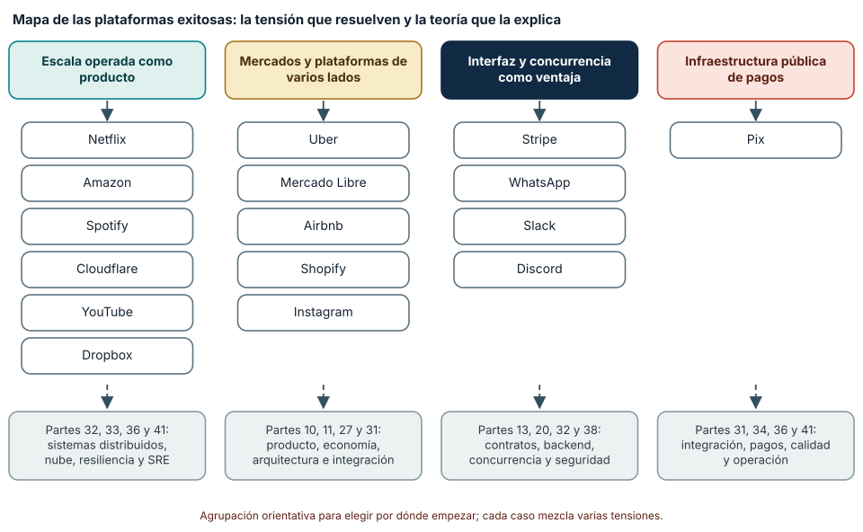

# Casos de estudio · Plataformas exitosas

[↑ Programa](../../README.md) · [Guía de casos](../GUIDE.md) · [Casos de fallo →](../fallo/README.md)

> Esta superficie no son clases ni roles: no cuenta en las 540 clases ni en las 45 partes. Es la realidad
> frente a la teoría del curso.

## Qué es

Esta página reúne ocho plataformas que lograron escala, ingresos o una posición difícil de disputar: Netflix, WhatsApp, Uber, Mercado Libre, Amazon, Spotify, Airbnb y Stripe. Cada una tiene su propio caso, escrito como un estudio completo: ficha histórica, problema, usuarios, funcionalidad de principio a fin, economía, arquitectura con esquemas, casos especiales, línea de tiempo y vínculo con las clases.

## Por qué se construyó

El curso enseña mecanismos (concurrencia, contratos, datos, despliegue, observabilidad) con ejemplos controlados. Un caso real muestra qué ocurre cuando esos mecanismos se combinan bajo presión de mercado, con equipos, dinero y plazos. Se construyó para contrastar la teoría con decisiones que alguien tomó, con sus costes, y para evitar dos errores opuestos: pensar que la teoría no sirve fuera del aula y creer que lo que funcionó en una empresa funcionará en cualquier otra.

## Cómo usar esta página pedagógicamente

1. Léelos **después** de las partes del curso que cada caso enlaza; sin esa base, el caso es una anécdota.
2. Antes de leer la sección de arquitectura, intenta dibujar tú el sistema con lo que ya sabes y compáralo.
3. Busca en cada caso la decisión que **no** harías en tu contexto y explica por qué no se transfiere.
4. Cierra con la sección «Qué no generalizar»: es la que separa aprender de imitar.

## Cómo se lee un caso

Todos los casos siguen el mismo esquema (definido en la [guía de casos](../GUIDE.md)) para poder
compararlos: ficha histórica, contexto y problema, mercado y usuarios, funcionalidad de principio a fin,
negocio y economía, arquitectura y esquemas, casos especiales, línea de tiempo, vínculo con el curso, qué no generalizar y fuentes públicas.
Las afirmaciones llevan fuente; lo inferido se marca como interpretación.

## Mapa visual

**Cómo leer el mapa.** Cada columna es una tensión de ingeniería; las cajas blancas son los casos que mejor
la ilustran y la caja gris inferior nombra las partes del curso con las herramientas para analizarla. La
agrupación es orientativa: sirve para elegir por dónde empezar, no para clasificar de forma excluyente.

## Índice de casos

- [Netflix](netflix.md) — **1997** · Reed Hastings y Marc Randolph. Del alquiler de DVD por correo a una plataforma de streaming que diseña su infraestructura para que cualquier pieza pueda fallar sin que el espectador lo note.
- [WhatsApp](whatsapp.md) — **2009** · Jan Koum y Brian Acton. Un servicio de mensajería que llegó a cientos de millones de usuarios con un equipo de ingeniería diminuto, apostando por la simplicidad y la concurrencia.
- [Uber](uber.md) — **2009** · Travis Kalanick y Garrett Camp. Un mercado de dos lados en tiempo real donde emparejar conductor y pasajero es un problema de ubicación, precio y confianza a la vez.
- [Mercado Libre](mercado-libre.md) — **1999** · Marcos Galperin. Un marketplace construido en América Latina que tuvo que resolver pagos, logística y confianza donde la infraestructura asumida en otros mercados no existía.
- [Amazon](amazon.md) — **1994** · Jeff Bezos. Una librería en línea cuyas capacidades internas, expuestas como servicios con contrato, acabaron convirtiéndose en el negocio de nube más grande del mundo.
- [Spotify](spotify.md) — **2006** · Daniel Ek y Martin Lorentzon. Un servicio de música por streaming cuya organización en equipos autónomos es tan conocida como su arquitectura, y no siempre se entiende bien.
- [Airbnb](airbnb.md) — **2008** · Brian Chesky, Joe Gebbia y Nathan Blecharczyk. Un mercado de alojamiento entre desconocidos donde la confianza, la búsqueda y la disponibilidad son tan técnicas como comerciales.
- [Stripe](stripe.md) — **2010** · Patrick y John Collison. Una empresa de pagos que convirtió una integración dolorosa en una API que se aprende en una tarde, con idempotencia y versionado como producto.

## Límites

Son estudios sobre fuentes públicas, no auditorías internas: lo que no es público se declara como desconocido y no se inventa. Un éxito comercial no demuestra que cada decisión técnica fuera correcta.

[↑ Programa](../../README.md) · [Guía de casos](../GUIDE.md) · [Casos de fallo →](../fallo/README.md)
