# Airbnb

[↑ Casos de éxito](README.md) · [← Spotify](spotify.md) · [Stripe →](stripe.md)

> **Qué es este caso.** Un análisis profesional de una empresa real que el programa usa para contrastar la teoría con la práctica. No es una clase ni un rol: es la realidad frente al curso. Se apoya solo en fuentes públicas citadas al final, consultadas el 16 de noviembre de 2026, y separa lo que está **documentado**, lo que es **inferido** y lo que **no se sabe**.

**Cómo leer este caso.**

- **Documentado**: lo dice una fuente citada, por ejemplo «Documentado (F3)». Si la fuente es secundaria, se declara.
- **Observable**: se comprueba usando el producto público, sin una cita específica en este caso.
- **Inferido**: conclusión del autor a partir de lo documentado; puede ser falsa.
- **Análisis propio**: razonamiento, cálculo o alternativa hipotética del autor; se rotula como tal y no es un hecho.
- **No se sabe**: dato que la empresa no ha publicado. No se rellena con suposiciones.

Las cifras de dinero están en dólares estadounidenses.

**Mapa de los niveles de arquitectura.** La sección de arquitectura va de lo general a lo particular, con una figura por nivel: contexto y capas de confianza; la migración de un monolito Rails a servicios con contratos (IDL); el cobro idempotente por dentro (fases, secuencia con reintento, réplicas, clasificación de errores, clave); la orquestación de pagos (grafo de pasos, datos inmutables, migración por fases); la búsqueda como sistema de aprendizaje (evolución, dos torres, resultados A/B); y la economía, la crisis y la historia. **No hay un diagrama interno completo y público de Airbnb**: lo que se sabe sale de blogs de ingeniería de 2017 a 2022 y de artículos de investigación de 2018 y 2020, y cada figura declara su alcance.

## Ficha histórica

| Dato | Valor | Estado de la evidencia |
| --- | --- | --- |
| Nombre | Airbnb, Inc. (nació como Airbed & Breakfast) | Documentado (F1) |
| Fundadores | Brian Chesky (director ejecutivo), Nathan Blecharczyk (director de estrategia) y Joe Gebbia | Documentado (F1) |
| Primeros huéspedes | octubre de 2007 (Chesky y Gebbia alojan a los primeros huéspedes) | Documentado (F1) |
| Lanzamiento | marzo de 2008, durante el festival SXSW, con solo dos reservas; en agosto de 2008, para la convención demócrata, llegó a 80 reservas | Documentado (F1) |
| Año de fundación de la sociedad | 2008 en San Francisco | Fuente secundaria (F10); la empresa data el origen del producto en 2007 y 2008 |
| Sede | San Francisco: en junio de 2013 abre su sede en 888 Brannan Street, a pocas manzanas de su primer anuncio | Documentado (F1) |
| Cambio de nombre | marzo de 2009: de Airbed & Breakfast a Airbnb, ampliando de habitaciones a apartamentos y casas enteras | Documentado (F1) |
| Hitos | 2008 plataforma de pagos propia; 2010 app e Instant Book; 2012 Garantía para anfitriones de 1 millón; 2016 Experiencias; 2020 salida a bolsa; 2021 AirCover para anfitriones; 2022 AirCover para huéspedes; 2025 Servicios | Documentado (F1) |
| Salida a bolsa | diciembre de 2020 | Documentado (F1) |
| Escala (mayo de 2026) | más de 9 millones de anuncios activos, más de 5,5 millones de anfitriones, más de 150.000 ciudades y pueblos, más de 220 países y regiones, más de 2.500 millones de llegadas acumuladas, más de 380.000 millones de dólares ganados por los anfitriones, más de 18.000 millones de dólares en impuestos recaudados y remitidos | Documentado (F1) |
| Resultados | cuarto trimestre de 2025: ingresos +12 %, valor bruto de reservas +16 %, noches y plazas reservadas +10 % | Documentado (F2) |
| Ingresos de 2025 | unos 12.200 millones de dólares; unos 8.200 empleados | Fuente secundaria (F10) |

## Contexto y problema

Según la historia de la empresa (F1), en octubre de 2007 Brian Chesky y Joe Gebbia alojaron a los primeros huéspedes de Airbed & Breakfast. De esa experiencia pequeña surge una pregunta de mercado, que formulamos como hipótesis del autor y no como cita: ¿hay una enorme capacidad ociosa de camas, habitaciones y casas, y viajeros que prefieren un alojamiento distinto al hotel? El obstáculo no era técnico sino de **confianza**: ¿por qué un desconocido dejaría entrar a otro en su casa, o pagaría por adelantado a alguien que no ha visto?

El caso es una lección de que el producto real de un mercado es la reducción de la incertidumbre entre las partes. Por eso aparecen pronto un sistema de pagos propio (agosto de 2008, F1), una garantía económica para anfitriones (2012, F1), reseñas con reglas diseñadas (F4) y, más tarde, una cobertura para huéspedes (AirCover, F6). Documentado (F1): el lanzamiento de 2008 recibió dos reservas y el sistema de pagos propio llegó meses después; la confianza se construyó en capas.

### Los números de un arranque lento

Documentado (F1): marzo de 2008, lanzamiento en el SXSW con dos reservas; agosto de 2008, con la convención demócrata, 80 reservas. El salto de 2 a 80 en cinco meses no es una curva de crecimiento sino un patrón: la demanda aparece donde hay un evento que agota los hoteles. Análisis propio: eso explica que el primer producto fuera una cama inflable (Airbed) en un evento, y que el segundo problema, el pago, se resolviera en el mismo mes, agosto de 2008: sin pago en plataforma, cada reserva dependía de un acuerdo de confianza entre desconocidos.

### La apuesta

Documentado (F7): el sistema de pagos y la confianza que da son, según el propio Airbnb, centrales para establecer la confianza entre anfitriones y huéspedes. Inferido: la apuesta de Airbnb fue **construir el mercado alrededor del pago y de la reseña, no del inventario**: la empresa no posee casas, posee la certeza de que el dinero y la reputación circulan bien. De ahí que su ingeniería más documentada sea la de pagos (idempotencia, orquestación, migración) y la de búsqueda (ordenar bien lo que no se posee).

## Mercado, usuarios y casos de uso

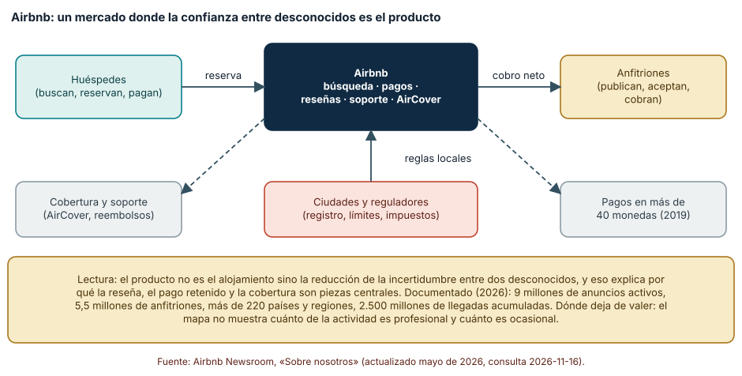

**Cómo leer la figura.** El centro oscuro es la plataforma; a la izquierda quien reserva y a la derecha quien ofrece; abajo, quien impone las reglas (ciudades y reguladores). Las flechas discontinuas son capas de protección que dan confianza. Mira primero lo que hace la plataforma: no presta el alojamiento, solo coordina, cobra y protege. **Dónde deja de valer.** No muestra cuánta actividad es profesional y cuánta ocasional, ni cómo difiere por ciudad; ese desglose no es público en los documentos consultados.

### Tipos de usuario y cómo cambia la experiencia

- **Huésped.** Observable: busca por destino y fechas, compara, reserva, paga y se comunica con el anfitrión. Documentado (F6): cada reserva de casa incluye AirCover para huéspedes: si hay un problema serio que el anfitrión no resuelve, Airbnb ayuda a reubicar o reembolsa total o parcialmente. Incentivo: precio y certeza; límite: AirCover no es un seguro y no cubre inconvenientes menores ni problemas de viaje ajenos al alojamiento.
- **Anfitrión ocasional.** Observable: publica un anuncio, define precio y reglas, acepta reservas y cobra. Documentado (F3): paga una comisión de servicio. Documentado (F1): en 2025 el anfitrión típico en Estados Unidos ganó unos 15.600 dólares. Incentivo: ingreso extra con baja dedicación; límite: reglas locales y su tiempo.
- **Anfitrión profesional o gestor.** Documentado (F3): la comisión única es obligatoria para la mayoría de anfitriones, incluidos los de alojamiento hotelero tradicional y los que usan software de gestión de propiedades. Incentivo: volumen y automatización; límite: la comisión se descuenta íntegra de su pago.
- **Anfitrión que gestiona con ayuda.** Documentado (F1): en octubre de 2024 Airbnb presentó la Red de Coanfitriones para encontrar a locales que gestionen el alojamiento.
- **Anfitrión de experiencias o servicios.** Documentado (F1, F2): Experiencias desde 2016 y de nuevo desde 2025 con Servicios; documentado (F2): casi la mitad de las reservas de experiencias en el cuarto trimestre de 2025 no estaba ligada a una reserva de alojamiento.
- **Ciudad o regulador.** Documentado (F1): en septiembre de 2020 Airbnb lanzó City Portal, una ventanilla para que los gobiernos locales entiendan y hagan cumplir el alquiler responsable. Incentivo: vivienda y orden; límite: sus normas y capacidad de control.
- **Persona desplazada o en crisis.** Documentado (F1): Airbnb.org, organización sin fines de lucro lanzada en diciembre de 2020, conecta a personas con alojamiento en crisis.
- **Equipos internos y de soporte.** No se sabe su estructura. Documentado (F2): el soporte con asistente de inteligencia artificial resuelve cerca de un tercio de las incidencias sin intervención de un agente en los mercados donde se desplegó.

### Casos de uso característicos

1. Reservar un apartamento para un viaje de cinco días.
2. Que un anfitrión ocasional alquile su casa cuando viaja.
3. Alojar a desplazados en una crisis: documentado (F1): Airbnb.org.
4. Reservar una experiencia local (F1: desde 2016) o un servicio (2025).
5. Reservar sin pagar nada por adelantado: documentado (F2): «Reserve Now, Pay Later», en pruebas en Estados Unidos y ampliada a más mercados.
6. Que una ciudad con restricciones consulte y haga cumplir sus normas con City Portal (F1).

### Qué trabajo contrata cada usuario

Análisis propio, con el enfoque de «trabajos por hacer» ([SE-122](../../classes/part-10-descubrimiento-y-estrategia-de-producto/se-122-usuarios-actores-trabajos-y-contextos/README.md)): el huésped contrata a Airbnb para **dormir en un sitio con la certeza de que, si algo sale mal, alguien responde**; el anfitrión, para **convertir capacidad ociosa en ingreso sin construir un negocio de hospedaje**; la ciudad, para **saber qué ocurre en su territorio**; el equipo de ingeniería, para **mover dinero sin errores**. Cada trabajo apunta a una decisión técnica: certeza, pagos y AirCover; capacidad ociosa, búsqueda y precio; conocimiento de la ciudad, City Portal; dinero sin errores, idempotencia e inmutabilidad.

## Funcionalidad de principio a fin

Cada tipo de usuario recorre su propio viaje. Lo que sigue es **observable** salvo cuando se cita una fuente.

### Instancia 1: el huésped, de la búsqueda a la reseña

1. **Primer contacto.** Observable: el viajero llega a un resultado de búsqueda por destino, fechas y huéspedes. Documentado (F8): la ordenación de resultados es «una de las mayores historias de éxito del aprendizaje automático en Airbnb»; los árboles de decisión con gradiente dieron mejoras iniciales que luego se estancaron y la empresa aplicó redes neuronales. Documentado (F12): las mejoras posteriores se centraron en arquitectura, sesgo de posición y arranque en frío.
2. **Registro.** Observable: se crea una cuenta con datos personales y verificación. No se sabe cómo se calcula internamente el riesgo de cada cuenta.
3. **Uso central: reservar.** Observable: el huésped elige un anuncio y reserva con aceptación inmediata o con aprobación del anfitrión. Documentado (F1): la función Instant Book existe desde 2010. Documentado (F2): en el cuarto trimestre de 2025 se probó reservar sin pagar nada por adelantado (Reserve Now, Pay Later) y se anunciaron cancelaciones más flexibles.
4. **Pago.** Documentado (F1): la plataforma de pagos propia existe desde agosto de 2008 y en 2019 procesó alrededor de 70.000 millones de dólares en transacciones de huéspedes y anfitriones en más de 40 monedas. Documentado (F5, F7): el cobro usa una clave de idempotencia y una orquestación de pasos reintentables; se explica en la sección de arquitectura.
5. **Estancia.** Observable: comunicación por mensajes y, si hay un problema, ayuda de soporte con AirCover (F6). Documentado (F6): hay que documentar el problema, avisar al anfitrión en las 72 horas siguientes a descubrirlo y contactar a Airbnb si no se resuelve; hay una línea de seguridad 24 horas.
6. **Reseñas.** Documentado (F4): al hacer el check-out, huésped y anfitrión reciben una invitación para reseñarse y tienen 14 días; las reseñas se publican cuando ambos las envían o al vencer el plazo, lo que ocurra primero.

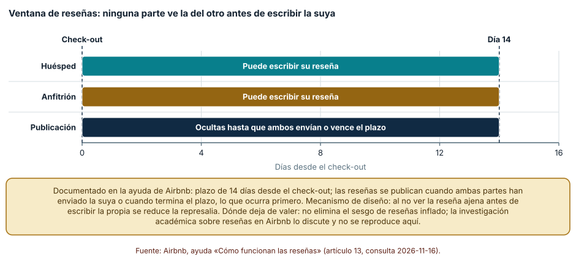

**Cómo leer la figura.** Cada carril es un actor y el tiempo corre de izquierda a derecha desde el check-out. Los dos carriles superiores muestran que ambos pueden escribir durante toda la ventana; el inferior muestra que nada se publica mientras falte una de las dos reseñas y no haya vencido el plazo. **Dónde deja de valer.** Documenta el mecanismo de publicación, no el sesgo de las reseñas, que la investigación académica discute y que no se reproduce aquí.

Documentado (F4) además: la valoración de un anuncio es el promedio de las valoraciones globales y aparece junto al título cuando el anuncio tiene al menos tres reseñas; las notas de subcategoría y los comentarios privados solo los ven el anfitrión y Airbnb; una reseña publicada permanece salvo que el autor pida retirarla en los 30 días siguientes o incumpla la política; si se cancela una reserva antes del día de llegada no hay reseña; Airbnb puede usar la información de las reseñas para ayudar a los anfitriones, identificar los alojamientos preferidos y afectar los resultados de búsqueda.

7. **Cobro del anfitrión.** Documentado (F3): la comisión del anfitrión se descuenta del total para calcular su pago. No se verificó el calendario exacto de la liberación del dinero; consúltese la ayuda vigente.
8. **Operación diaria.** Documentado (F1): lanzamientos semestrales de producto («Release») con docenas o cientos de mejoras; por ejemplo, el de invierno de 2021 trajo AirCover para anfitriones y un motor de traducción.

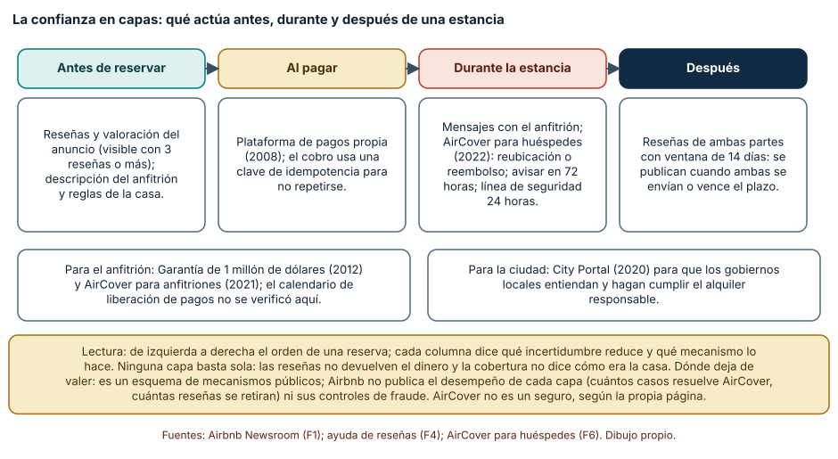

**Cómo leer la figura.** Cuatro columnas en el orden de una reserva; cada una nombra el mecanismo que actúa y qué incertidumbre reduce; abajo, lo que protege al anfitrión y a la ciudad. **Dónde deja de valer.** Es un esquema de mecanismos públicos; no mide cuánto funciona cada capa.

### Instancia 2: el anfitrión, del anuncio al pago

Observable: el anfitrión crea el anuncio, fija precio y reglas y recibe reservas. Documentado (F3): paga una comisión; para la mayoría de anfitriones de casas la estructura es una comisión única que ronda el 15,5 % (entre 14 % y 16 % en el resto, 16 % en Brasil y México). Documentado (F1): garantía para anfitriones de 1 millón de dólares desde 2012 y AirCover para anfitriones desde el lanzamiento de invierno de 2021. Caso límite: un huésped daña la casa; la cobertura de la garantía existe (F1), pero este caso no revisó sus condiciones. No se sabe cómo se resuelve cada disputa.

### Instancia 3: el gestor profesional, del software al volumen

Documentado (F3): los anfitriones que usan software de gestión de propiedades están obligados a la estructura de comisión única; es un caso en el que la política de precios depende del perfil del anfitrión. Inferido: el gestor profesional compara el costo de la comisión con su costo de distribuir en otros canales. No se sabe su proporción de la oferta (el desglose no es público, según la sección de mercado).

### Instancia 4: la ciudad y el regulador

Documentado (F1): City Portal desde septiembre de 2020 permite a los gobiernos locales entender y hacer cumplir el alquiler responsable; no se revisaron las normas concretas de cada ciudad. Documentado (F1): más de 18.000 millones de dólares en impuestos recaudados y remitidos en todo el mundo, lo que muestra que parte del cumplimiento fiscal pasa por la plataforma. Caso límite: una ciudad prohíbe el alquiler de corta duración sin licencia; no se sabe cómo la plataforma lo verifica.

### Instancia 5: el equipo de ingeniería que migra los pagos

Documentado (F7): decidió rediseñar y no reemplazar uno a uno; dividió en cuatro fases (precios, pagos a anfitriones, reservas, migración de datos) y mantuvo dos sistemas durante casi todo el proceso. Documentado (F5): construyó una biblioteca de idempotencia. Caso límite: una función nueva exige cambios en ambos sistemas, lo que duplica el trabajo (F7).

### Instancia 6: el equipo de búsqueda que mejora el orden

Documentado (F8, F12): itera con experimentos A/B; las mejoras publicadas son de décimas de punto porcentual en reservas; algunos experimentos empeoran las reservas y se publican. Caso límite: un anuncio nuevo sin reseñas ni reservas (arranque en frío).

## Negocio y economía

### Modelo

Documentado (F3): Airbnb cobra una comisión de servicio al confirmarse una reserva. Hay dos estructuras: comisión dividida (la paga en parte el huésped y en parte el anfitrión) y comisión única; con la comisión única todo el cobro se descuenta al anfitrión (la mayoría paga el 15,5 %, el resto suele pagar entre 14 y 16 %). Airbnb está migrando a todos los anfitriones de casas a la comisión única y no se puede volver atrás.

**Cómo leer la figura.** Cada barra es una reserva de 100 dólares de subtotal en un caso extremo de lo que publica Airbnb; los bloques apilados son lo que paga cada parte a Airbnb. Compara la altura total: Airbnb se queda entre 17 y 19,5 dólares por cada 100. **Dónde deja de valer.** Son los rangos de la ayuda (F3), no la media real. Excluye impuestos y tarifas del anfitrión, y el porcentaje varía por factores no detallados y por mercado (por ejemplo, el 4 % para anfitriones de Brasil y México); además la estructura dividida está siendo reemplazada.

Análisis propio con los rangos citados: en la estructura dividida, un huésped paga entre 14,1 % y 16,5 % del subtotal y el anfitrión el 3 % (4 % en Brasil y México), por lo que lo que retiene Airbnb va de 17,1 % a 19,5 % del subtotal (en la figura); en la estructura única, el anfitrión paga alrededor de 15,5 % de su subtotal y, inferido, el huésped no ve un cargo de servicio aparte. La comparación no es directa porque el huésped ve un precio total más alto en la dividida: la comisión única presenta un precio más sencillo al huésped y traslada al anfitrión el costo completo. Documentado (F2): el comunicado de Q4 2025 habla de «tarifas simplificadas» entre los factores de crecimiento, pero no publica el efecto de la estructura única.

### Métricas y fuentes de ingreso

Documentado (F3, F2): comisiones sobre reservas, medidas por el valor bruto de reservas (GBV) y por las noches y plazas reservadas.

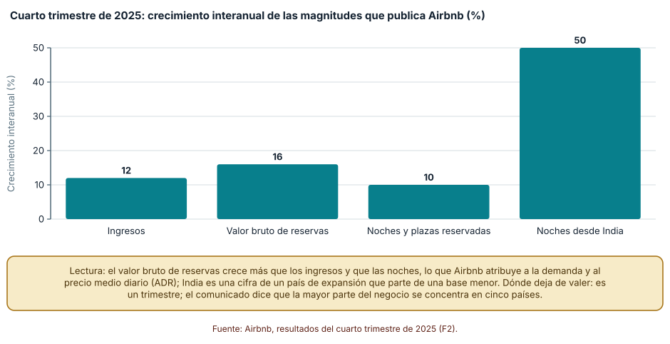

**Cómo leer la figura.** Cada barra es el crecimiento interanual de una magnitud en el cuarto trimestre de 2025. Mira que el valor bruto de reservas crece más que las noches. **Dónde deja de valer.** Es un trimestre; India parte de una base menor y es un país de expansión; el comunicado dice que la mayor parte del negocio está en cinco países.

Documentado (F2): GBV +16 %, ingresos +12 % (por encima del tope de la guía de la empresa), noches y plazas +10 %; la empresa atribuye el crecimiento a la demanda y al precio medio diario (ADR). Análisis propio: que el GBV crezca más que las noches indica que el precio medio diario sube; que los ingresos crezcan menos que el GBV es coherente con un cambio en la mezcla de estructuras de comisión, pero la fuente no lo dice y no se puede afirmar. Documentado (F2): el comunicado destaca flexibilidad de precio y cancelación (Reserve Now, Pay Later; cancelación gratis hasta 14 días antes con la nueva política Limited; 24 horas de gracia para reservas con más de una semana de antelación y estancias de menos de 28 días), y afirma que estos cambios redujeron los contactos con soporte y aumentaron las reservas.

### Costos, palancas y límites

Documentado (F1): el soporte 24 horas y los servicios que cubre la comisión (F3). No se sabe el desglose de costos de personal, marketing y tecnología con este nivel de detalle en las fuentes consultadas. Documentado (F2): palancas declaradas: mejorar el servicio, llevar Airbnb a más partes del mundo (los nuevos mercados crecen aproximadamente al doble que los núcleo en noches de origen), ampliar la oferta (experiencias, servicios, hoteles boutique en Nueva York, Los Ángeles, Madrid y San Francisco) e integrar inteligencia artificial (soporte y búsqueda).

### Efectos de red y por qué ganó este actor

Análisis propio (no documentado como causal): el mercado favoreció a Airbnb por cuatro mecanismos. Primero, **efecto de red entre las dos caras**: más anuncios atraen más huéspedes y más huéspedes atraen más anuncios; el tamaño de 9 millones de anuncios y 2.500 millones de llegadas (F1) sugiere una masa crítica difícil de replicar. Segundo, **reputación acumulada**: las reseñas son un activo que no se transfiere fácilmente a otra plataforma (F4). Tercero, **pagos y cobertura propios**, que reducen la fricción de confiar en un desconocido (F1, F6). Cuarto, **datos de búsqueda**: miles de millones de pares de entrenamiento (F8) mejoran el orden, lo que sube la conversión. Lo que no se sabe: la cuota de mercado por ciudad ni cuánto pesa cada mecanismo; tampoco hay datos de competidores en las fuentes de este caso.

### Competidores y sustitutos

Las fuentes de este caso no incluyen cifras de competidores. Documentado (F2): la propia empresa nombra un sustituto, el hotel, en su estrategia de asociarse con hoteles boutique en ciudades con oferta limitada. Análisis propio: la entrada a hoteles muestra que el sustituto principal ya no se trata solo como rival sino como complemento en ciudades con restricciones; el efecto económico no es público.

### La crisis de 2020 como prueba de resistencia

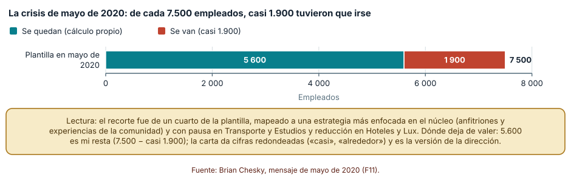

**Cómo leer la figura.** La barra es la plantilla de mayo de 2020; el tramo coral son quienes salen. Mira que es un cuarto del total. **Dónde deja de valer.** La cifra de 5.600 es mi resta; la carta usa cifras redondeadas y es la versión de la dirección.

Documentado (F11): en mayo de 2020 la dirección anunció la reducción de la plantilla: de 7.500 empleados, casi 1.900 (alrededor del 25 %) tuvieron que irse; la empresa preveía ingresos del año por debajo de la mitad de los de 2019, había levantado 2.000 millones de dólares y recortado costos «en casi todas las esquinas»; decidió, además, reducir inversión en actividades que no apoyaban directamente a la comunidad de anfitriones (pausó Transporte y Airbnb Studios y redujo Hoteles y Lux). Documentado (F11): la carta dice que no se sabe cuándo volverá el viaje ni cómo será. Análisis propio: una plataforma de dos caras puede perder casi toda la demanda de golpe y la respuesta fue enfocar el negocio; es una decisión de portafolio bajo incertidumbre ([SE-141](../../classes/part-11-economia-metricas-y-decisiones-de-producto/se-141-portafolio-opciones-y-secuenciacion-de-inversion/README.md), [SE-142](../../classes/part-11-economia-metricas-y-decisiones-de-producto/se-142-decisiones-reversibles-e-irreversibles/README.md)). El foco de 2020 no fue permanente: en el cuarto trimestre de 2025 la empresa pilota asociaciones con hoteles boutique (F2).

### Visión y misión

Documentado (F11): en su mensaje de mayo de 2020, Brian Chesky describe la misión de la empresa como centrada en la pertenencia («belonging») y en volver a lo esencial: personas corrientes que alojan en sus casas y ofrecen experiencias. Documentado (F1): la historia de la empresa pasa de colchones inflables para un evento (2008) a casas, experiencias y servicios (2025). Análisis propio: la pertenencia se usa como criterio para recortar y enfocar el negocio en 2020, no solo como lema; no se publica una declaración de misión y visión fechadas en las fuentes consultadas, por lo que no se reconstruye su evolución.

### Estructura, plantilla y presencia mundial

Documentado (F1): sede en San Francisco (888 Brannan Street desde junio de 2013); primera oficina internacional, en Alemania, en junio de 2011; operación en más de 220 países y regiones. Documentado (F11): 7.500 empleados en mayo de 2020, de los que casi 1.900 salen. Documentado (F10, secundaria): unos 8.200 empleados en 2025. Documentado (F7): ofertas de empleo de la época del blog sitúan la ingeniería de pagos en San Francisco y Seattle y el cumplimiento de pagos en Bangalore; es un indicio, no un organigrama. Documentado (F7): la organización de pagos, Alojamiento, Experiencia del huésped, Control de calidad y Finanzas trabajó junta en la migración de pagos. No se sabe: el organigrama de alto nivel, la plantilla por área y los años de apertura de oficinas.

## Arquitectura y esquemas

No hay un diagrama interno completo y público de Airbnb. Lo documentado se limita a: el paso de un monolito Rails a servicios con contratos IDL (2017), la biblioteca de idempotencia Orpheus (2019), la reconstrucción de la orquestación de pagos (2022) y la búsqueda con redes neuronales (2018 y 2020).

### Nivel 1: contexto

Ver la figura de contexto de la sección de mercado y la de capas de confianza de la funcionalidad. Evidencia: documentada (F1, F4, F6) para los mecanismos; no se sabe la arquitectura de identidad, antifraude ni mensajería.

### Nivel 2: contenedores y servicios

**Cómo leer la figura.** De izquierda a derecha: el monolito original, los servicios que lo sustituyen, y las dos áreas con documentación pública (búsqueda y pagos); debajo, cuatro rasgos documentados del subsistema de pagos. **Dónde deja de valer.** No es un mapa completo: no se sabe cuántos servicios hay hoy ni cómo se reparte la búsqueda por regiones; los blogs son de 2017 a 2022.

Documentado (F9): en diciembre de 2017 Airbnb describía que avanzaba a un ritmo acelerado hacia una arquitectura orientada a servicios desde un monolito Rails; los servicios se escribían sobre todo en Java con el marco Dropwizard, con una herramienta que generaba el esqueleto y puntos de acceso RESTful con JSON sobre HTTP. Documentado (F9): los problemas eran: sin interfaz ni esquema fuertemente tipados (el contrato se leía del código y hubo incidentes por cambios que rompían el contrato), sin RPC (había que escribir clientes en Ruby y Java a mano), y cargas JSON grandes e ineficientes, sobre todo en los percentiles 95 y 99.

**Cómo leer la figura.** A la izquierda, el archivo de interfaz; a la derecha, lo que se genera de él; debajo, el estado anterior y por qué no se cambió todo a Thrift o gRPC completos. **Dónde deja de valer.** Es la propuesta de 2017; no mide el ahorro ni cuántos servicios la usan.

Documentado (F9): tras sopesar opciones, se mantuvo Dropwizard, se añadió una IDL de Thrift, se cambió el transporte de JSON sobre HTTP a Thrift sobre HTTP y se construyeron herramientas que generan clientes RPC en distintos lenguajes; la razón explícita para no adoptar Thrift o gRPC completos fue evitar una reconstrucción mayor de la infraestructura y una disrupción de la productividad. El compilador se personalizó para generar el código del servidor y de los clientes con instrumentación estándar (métricas, contexto de solicitud, propagación de excepciones, TLS mutuo, alertas) y se añadieron tipos como Date y DateTime para que los desarrolladores no los disfrazaran como texto. Documentado (F9): antes de la IDL, el costo de crear servicios hacía que ingeniería y gestión evitaran la arquitectura orientada a servicios bajo presión de tiempo.

### Nivel 3: componentes de la operación crítica (el cobro)

Documentado (F5): el cobro es una llamada a una cadena de servicios; cada servicio cambia estado y puede tener efectos laterales, lo que equivale a una transacción distribuida compleja. Para mantener la integridad sin un protocolo como el de dos fases, el sistema usa tres técnicas de consistencia eventual (reparación en lectura, en escritura y asíncrona), y la solución de F5 es la reparación en escritura, que exige que los clientes sean más inteligentes pero les permite repetir la misma solicitud sin guardar estado.

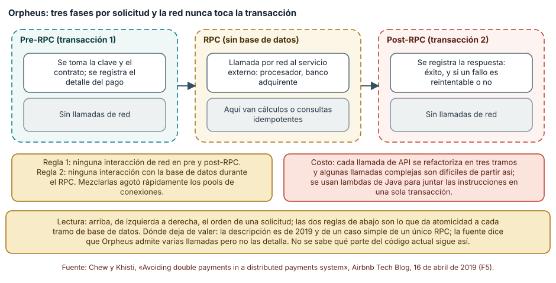

**Cómo leer la figura.** Tres grupos de izquierda a derecha: lo que ocurre antes, durante y después de la llamada externa; cada uno dice qué se puede y qué no se puede hacer en él. **Dónde deja de valer.** Es el caso simple de una sola llamada de red; la fuente dice que admite varias pero no las detalla.

Documentado (F5): la biblioteca Orpheus es una biblioteca de uso general, elegida frente a un servicio independiente por su baja latencia y porque un servicio de idempotencia sufriría los mismos problemas que debía resolver. Documentado (F5): los requisitos eran una solución genérica y configurable, sin comprometer la consistencia durante la iteración de productos, de latencia muy baja, que protegiera a los desarrolladores de producto de los detalles de consistencia, y sin sacrificar legibilidad, pruebas o depuración. Documentado (F5): casi toda solicitud estándar se puede dividir en pre-RPC (se registra el detalle del pago), RPC (la llamada por red al servicio externo, por ejemplo un procesador de pagos o un banco adquirente) y post-RPC (se registra la respuesta, su éxito y si el fallo es reintentable). Dos reglas: sin interacción de red en pre y post-RPC y sin interacción con la base de datos durante el RPC, porque mezclarlas produjo, según la fuente, agotamiento rápido del pool de conexiones y degradación del rendimiento. Cada una de las dos fases de base de datos se envuelve en una transacción única, y se usan lambdas de Java para combinar las instrucciones de la biblioteca y de la aplicación sin transacciones anidadas. El costo: el código se parte en tres tramos y algunas llamadas complejas son difíciles de partir así. Un servicio implementó una máquina de estados finitos con cada transición como paso idempotente.

### Nivel 4: flujo de secuencia del cobro con reintento

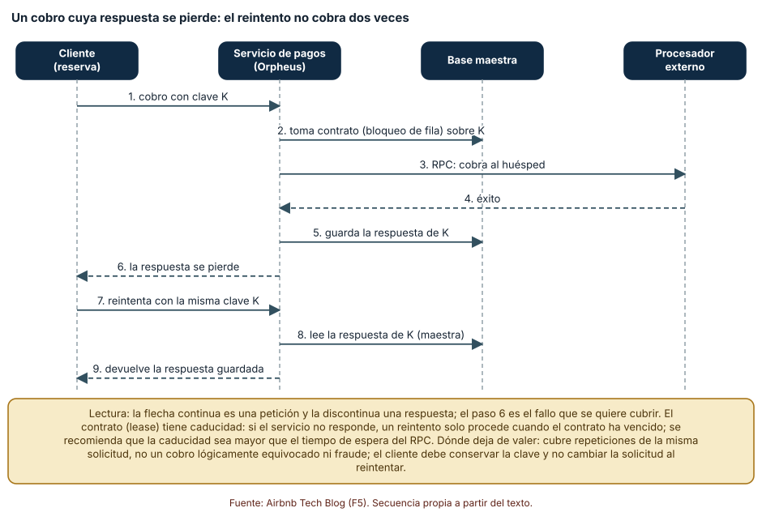

**Cómo leer la figura.** Cada columna es un actor; el tiempo avanza hacia abajo; las flechas continuas son peticiones y las discontinuas respuestas. Mira que el paso 6 es el fallo que se quiere cubrir y que el paso 8 lee de la base maestra. **Dónde deja de valer.** Cubre repeticiones de la misma solicitud, no cobros lógicamente equivocados ni fraude.

**Cómo leer la figura.** La fila superior es el camino normal; la inferior, lo que ocurre si la respuesta se pierde y el cliente reintenta con la misma clave. Fíjate en el recuadro gris: leer de una réplica puede fallar por el retraso de replicación. **Dónde deja de valer.** Cubre duplicados por reintentos o doble clic, no cobros lógicamente equivocados ni fraude.

Documentado (F5): la biblioteca guarda la información de idempotencia en tablas de una base maestra fragmentada, siempre leída y escrita de ahí para ser consistente; clasifica los errores como reintentables o no; y cada solicitud adquiere un contrato (lease) mediante un bloqueo de fila sobre la clave, con caducidad: si hay tiempo agotado en el servidor, el reintento procede solo cuando el contrato ha vencido; la regla práctica es que la caducidad sea mayor que el tiempo de espera del RPC; además hay una ventana máxima de reintentos como red de seguridad contra reintentos descontrolados. Se guardan las respuestas de los estados finales deterministas (éxito o error no reintentable) para devolver respuesta rápida en los reintentos; el costo es que la tabla crece con el rendimiento y hay que depurarla, sin eliminar respuestas demasiado pronto ni hacer cambios incompatibles en su estructura.

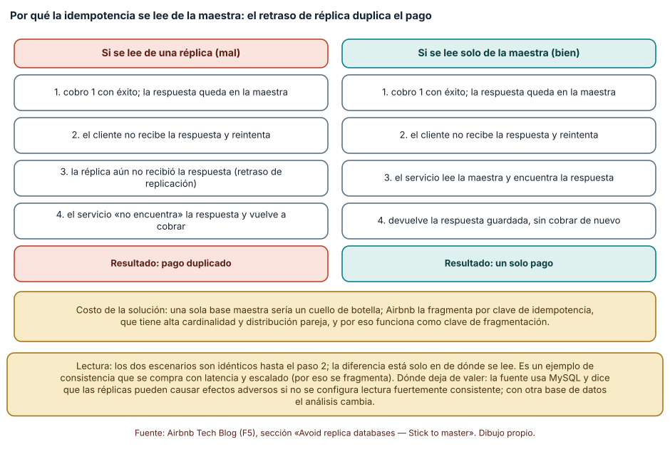

**Cómo leer la figura.** Dos columnas con los mismos pasos hasta el 2; la diferencia está en de dónde se lee. El último recuadro de cada una es el resultado. **Dónde deja de valer.** El análisis es sobre MySQL y réplicas con retraso; con lectura fuertemente consistente cambia.

Documentado (F5): la decisión fue leer y escribir esa información solo en la base maestra: con réplicas, un retraso de replicación de unos segundos puede hacer que el reintento no encuentre la respuesta y que el servicio vuelva a ejecutar el pago, lo que se vería como pago duplicado. Para escalar la maestra se fragmentó por clave de idempotencia, que tiene alta cardinalidad y distribución pareja. El trade-off que la fuente reconoce es entre consistencia y latencia.

**Cómo leer la figura.** Una decisión arriba con dos ramas; debajo de cada rama, el costo de equivocarse; la regla por defecto va en el recuadro inferior. **Dónde deja de valer.** Los casos ambiguos exigen criterio, y la fuente lo reconoce.

Documentado (F5): los errores de infraestructura o de red (estados 5xx) se consideran reintentables y los de validación (por ejemplo, reembolsar un reembolso, estados 4xx) no; se creó una clase de excepción genérica con valor por defecto «no reintentable». Equivocarse es caro: etiquetar como no reintentable un fallo transitorio deja la solicitud fallida de forma indefinida; etiquetar como reintentable algo que requiere intervención manual puede causar pagos duplicados. La carga de la solicitud no debe cambiar entre reintentos, o se rompe la definición de idempotencia.

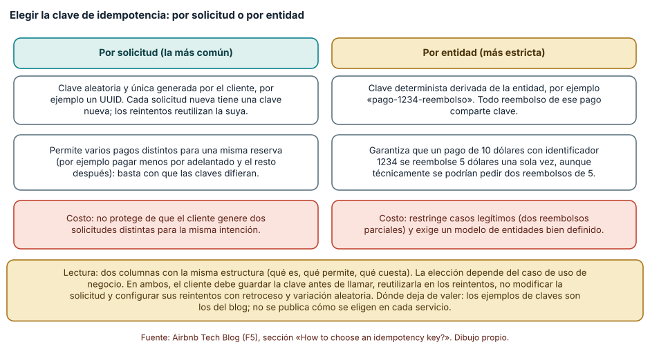

**Cómo leer la figura.** Dos columnas con la misma estructura: qué es la clave, qué permite y qué cuesta. **Dónde deja de valer.** Los ejemplos de clave son los del blog.

Documentado (F5): el cliente debe pasar una clave única por solicitud nueva y reutilizarla en los reintentos, guardar la clave en la base de datos antes de llamar, consumir la respuesta y desasignar la clave, no permitir mutación de la carga entre reintentos y configurar reintentos con retroceso exponencial y variación aleatoria para evitar el efecto de manada. La elección de clave puede ser por solicitud (aleatoria y única, el caso más común y simple) o por entidad (determinista, más estricta).

### Nivel 5: modelo y flujo de datos de la orquestación de pagos

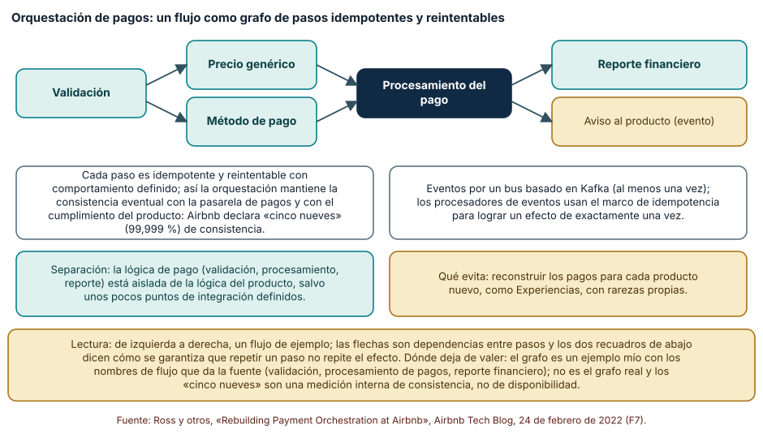

**Cómo leer la figura.** Un flujo de izquierda a derecha con dependencias entre pasos; los recuadros de abajo explican cómo se garantiza la repetición segura y por qué se separa la lógica de pago de la del producto. **Dónde deja de valer.** El grafo es un ejemplo mío; la fuente solo da nombres de flujos genéricos y no publica el grafo real.

Documentado (F7): el sistema de orquestación de pagos garantiza el movimiento de dinero entre anfitriones, huéspedes y Airbnb: cobrar el monto correcto en el momento correcto con el método elegido y pagar al anfitrión el monto correcto en el momento correcto. Por razones históricas, los datos de facturación, las API de pagos, la orquestación y la experiencia estaban muy acoplados al concepto de reserva de una estancia, de modo que una función de pagos tenía que reconstruirse para otros productos como Experiencias, con rarezas propias. La decisión fue rediseñar con tres ideas: orquestación idempotente, plataforma agnóstica al producto y datos inmutables. Cada flujo importante se divide en un grafo acíclico dirigido de pasos idempotentes y reintentables; el diseño condujo, según Airbnb, a cinco nueves (99,999 %) de consistencia en pagos. Para la comunicación asíncrona se usa un bus de mensajes basado en Kafka y los procesadores de eventos usan el marco de idempotencia para mejorar la garantía de «al menos una vez» a un efecto de «exactamente una vez». Herramientas de análisis de integridad transaccional dan una capa más de confianza al asegurar consistencia entre eventos y fuentes de datos transaccionales.

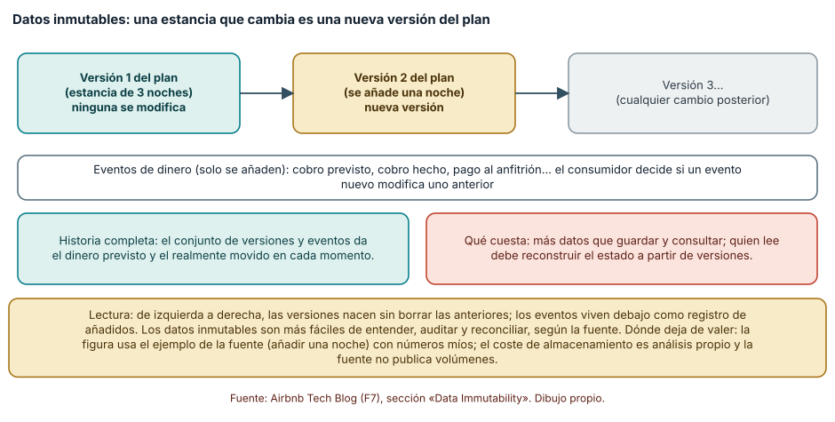

**Cómo leer la figura.** Las versiones del plan aparecen de izquierda a derecha, sin borrarse; los eventos viven debajo como registro de añadidos; los recuadros inferiores dicen qué da y qué cuesta. **Dónde deja de valer.** Es un ejemplo con números míos; no se publican volúmenes.

Documentado (F7): los datos inmutables son más fáciles de entender, auditar y reconciliar; para la orquestación esto se manifiesta en eventos persistentes (solo se añaden; el consumidor decide si un evento nuevo modifica uno anterior) y en versionado: cuando un producto cambia, por ejemplo añadiendo una noche a una estancia, la modificación del plan de orquestación se modela como una nueva versión en una secuencia de planes, y la información combinada de todas las versiones da la historia completa del movimiento de dinero previsto y real. Documentado (F7): el nuevo modelo de datos se basa en el concepto de factura («bill»), que no está atado a ningún producto.

### Nivel 6: despliegue y migración entre sistemas

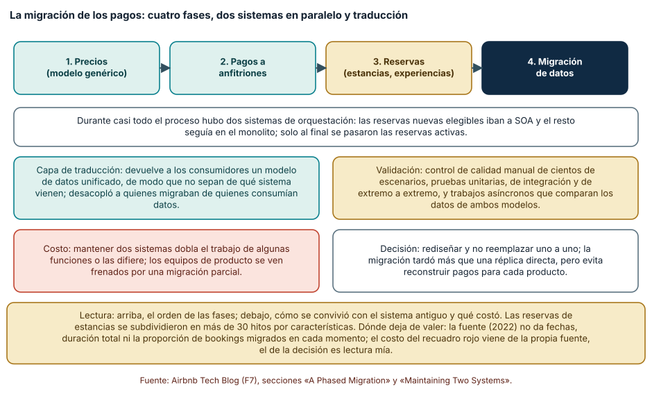

**Cómo leer la figura.** Arriba, las cuatro fases en orden; debajo, cómo se convivió con el sistema antiguo, cómo se validó y qué costó. **Dónde deja de valer.** La fuente no da fechas, duración total ni proporciones de bookings migrados en cada momento.

Documentado (F7): muchos equipos de Airbnb migraron en bloques pequeños con reemplazos equivalentes; el de pagos decidió rediseñar y por eso tardó más. Las fases fueron: Precios (de modelos por producto a un modelo genérico), Pagos a anfitriones y Reservas (rediseño de la orquestación del dinero) y Migración de datos (traslado de reservas existentes para retirar el sistema antiguo). Dentro de cada fase se dividió por función o producto: las reservas de estancias, por ejemplo, se subdividieron en más de 30 hitos según características de las reservas, lo que permitió probar a fondo cada uno y completar varios en paralelo. Documentado (F7): en general no se movieron reservas ni pagos históricos al inicio; las nuevas se enrutaron a la arquitectura nueva si eran elegibles y las demás siguieron en el sistema antiguo; solo al final se trasladaron las reservas activas; por eso hubo que mantener dos sistemas casi todo el proceso. Una capa de traducción devolvía a los consumidores un modelo unificado de datos sin que supieran de qué sistema venían; las funciones nuevas debían implementarse en uno o en ambos, a veces duplicando trabajo o difiriéndose. La validación incluyó un equipo de control de calidad con pruebas manuales de cientos de escenarios, pruebas unitarias, de integración y de extremo a extremo, y trabajos asíncronos de comparación entre el modelo nuevo y el antiguo.

### Nivel 7: resiliencia y degradación

Documentado (F5): el sistema está diseñado para que un fallo deje un estado recuperable: dos únicos resultados (éxito o fallo) con consistencia, transacciones atómicas por tramo y reintentos idempotentes. Documentado (F7): los pasos idempotentes y reintentables permiten la consistencia eventual con la pasarela de pagos; el análisis de integridad transaccional detecta incoherencias entre eventos y datos. Documentado (F2): para el soporte, la empresa usa un asistente de inteligencia artificial que resuelve cerca de un tercio de las incidencias; no se sabe cómo se degrada si el asistente falla. No se sabe: la resiliencia de la búsqueda, de los mensajes y de la disponibilidad por región.

### Nivel 8: seguridad, abuso y cumplimiento

Documentado (F1, F6): City Portal, impuestos recaudados y remitidos y una línea de seguridad 24 horas son mecanismos de cumplimiento y seguridad. Documentado (F5): las tablas de idempotencia protegen contra duplicados provocados por clics repetidos o reintentos agresivos; no protegen contra fraude. Documentado (F1): Project Lighthouse, junio de 2020, con Color of Change, contra la discriminación; no se sabe cómo se mide. No se sabe: el diseño antifraude, la verificación de identidad y la protección de datos personales en cada región.

### Nivel 9: observabilidad y operación

Documentado (F9): el compilador de la IDL genera instrumentación estándar (métricas, alertas) para cada servicio. Documentado (F5): las desviaciones de datos pueden costar horas de investigación y pagos incorrectos; por eso, además de la idempotencia, se usan tareas asíncronas (escaneos de tablas, funciones lambda, cron) como segunda línea de defensa y notificaciones del servidor al cliente para forzar consistencia. Documentado (F7): las herramientas de integridad transaccional y los trabajos de comparación miden la consistencia. No se sabe: cómo se organiza la guardia ni qué SLO tienen los servicios de pago.

### Nivel 10: la búsqueda como sistema de aprendizaje

**Cómo leer la figura.** Arriba, los pasos de 2018 de izquierda a derecha; debajo, una lección documentada, un fallo instructivo y tres mejoras posteriores con su resultado A/B. **Dónde deja de valer.** Los porcentajes son de experimentos concretos; no se transfieren.

Documentado (F8): la primera implementación fue una función de puntaje manual; reemplazarla por árboles de decisión con gradiente dio uno de los mayores saltos de reservas en la historia de Airbnb; las ganancias se saturaron con largas rachas de experimentos neutros; esto motivó probar redes neuronales. La primera arquitectura en producción fue una red simple de una capa oculta con 32 neuronas que resultó neutral frente a los árboles. Los avances vinieron de reformular: entrenar con pares (anuncio reservado frente a no reservado) ponderados por la diferencia de NDCG; luego, redes con salidas de árboles y de una máquina de factorización como entradas; y, finalmente, una red profunda que permitió retirar esa complejidad y que se entrenó con 1.700 millones de pares para cerrar la brecha entre entrenamiento y prueba. Documentado (F8): usar el identificador de cada anuncio como entrada sobreajustó porque cada anuncio tiene pocas reservas; un modelo que predecía reservas y vistas largas aumentó las vistas pero dejó las reservas neutras; y los autores insisten en normalizar las entradas y en distribuciones suaves para detectar errores.

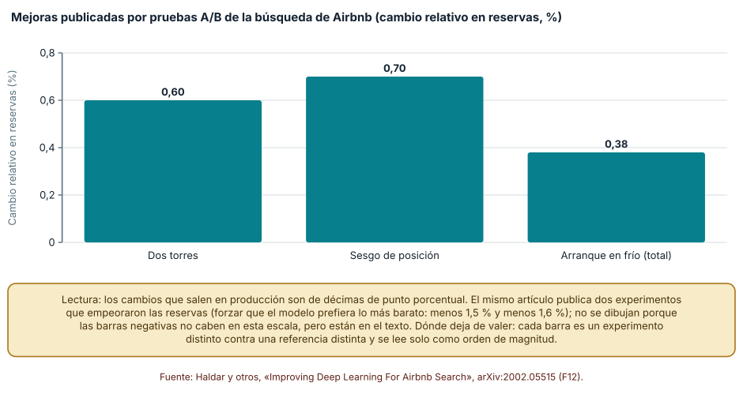

**Cómo leer la figura.** Cada barra es un experimento distinto, medido como cambio relativo en reservas; el eje parte de cero. **Dónde deja de valer.** Las barras no son comparables entre sí ni se suman; los experimentos que empeoraron las reservas se cuentan en el texto.

Documentado (F12): frente a la red totalmente conectada de dos capas, una arquitectura de dos torres dio +0,6 % de reservas; un modelo que forzaba preferir lo barato redujo el precio medio de resultados un 5,7 % pero bajó las reservas un 1,5 %, y otra variante bajó las reservas un 1,6 %; tratar el sesgo de posición con la posición como entrada regularizada (dropout de 0,15) dio +0,7 % en reservas y +1,8 % en ingresos; y para el arranque en frío, estimar los valores de las señales de un anuncio nuevo dio +14 % en reservas de anuncios nuevos y +14 % en su cuota de impresiones, con un aumento total de reservas de +0,38 %; un impulso simple dio +8,5 % de impresiones de primera página para los nuevos con reservas neutras.

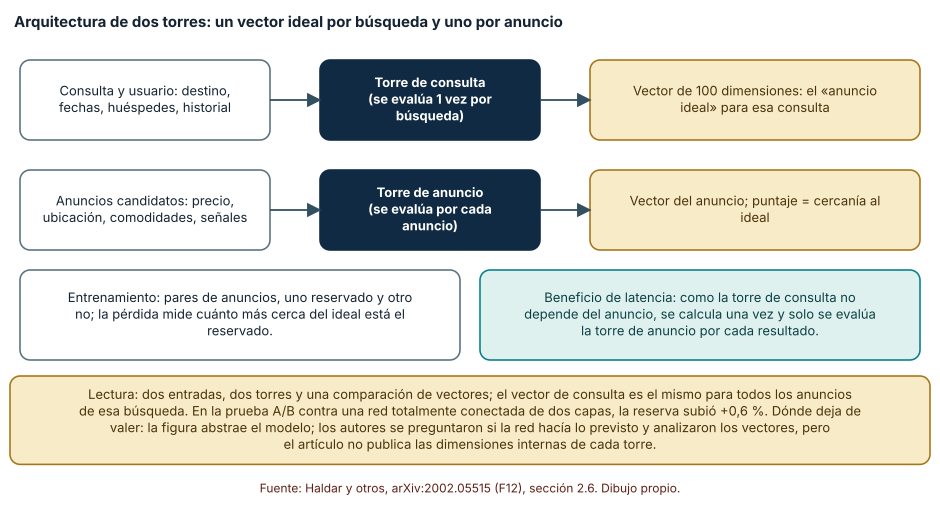

**Cómo leer la figura.** Dos entradas, dos torres y una comparación; la torre de consulta se calcula una vez. **Dónde deja de valer.** Abstrae el modelo; no publica dimensiones internas de cada torre.

Documentado (F12): una torre recibe la consulta y las características del usuario y genera un vector de 100 dimensiones que representa el anuncio ideal; la otra procesa las características de cada anuncio; la pérdida mide cuánto más cerca del ideal queda el anuncio reservado que el no reservado; y como la torre de consulta no depende del anuncio, se evalúa una vez por búsqueda, con ganancia de latencia. Se analizaron los vectores para ver si la red hacía lo previsto.

### Nivel 11: cómo evolucionó la arquitectura (antes y después)

**Cómo leer la figura.** Tres carriles: lo que da confianza y mueve el dinero, el producto y el estado de la empresa; las líneas verticales son hitos con fecha documentada (F1, F11). **Dónde deja de valer.** Las eras son síntesis del autor: varios productos conviven y el corte entre ellos es aproximado.

Antes y después, con lo documentado: antes de 2017, monolito Rails y servicios JSON sobre HTTP sin contrato fuertemente tipado (F9); después, IDL de Thrift con clientes y servidores generados. Antes de 2019, cada servicio de pagos resolvía la consistencia a su manera; después, Orpheus (F5). Antes de 2022, pagos acoplados a la reserva de una estancia; después, orquestación agnóstica al producto, con datos inmutables (F7). Antes, ordenación por puntaje manual; después, árboles y luego redes (F8, F12). No se sabe el estado actual de la arquitectura completa.

### Hardware utilizado

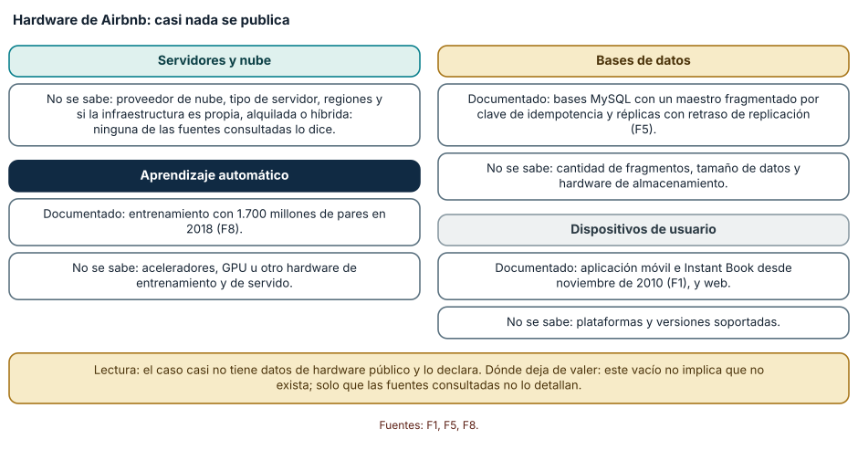

**Cómo leer la figura.** Cuatro recuadros; la mayoría declara que no hay dato público. **Dónde deja de valer.** La ausencia es de las fuentes consultadas, no necesariamente de la realidad.

Documentado (F5): las bases son MySQL, con un maestro fragmentado y réplicas con retraso de replicación. Documentado (F8): el modelo de búsqueda se entrenó con 1.700 millones de pares. Documentado (F1): la app móvil existe desde 2010. No se sabe: proveedor de nube, tipo de servidor, aceleradores, regiones y dispositivos de usuario soportados; las fuentes consultadas no lo detallan y este caso no lo supone.

### Software utilizado

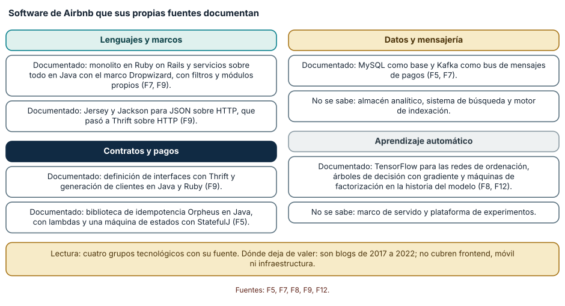

**Cómo leer la figura.** Cuatro grupos tecnológicos con su fuente. **Dónde deja de valer.** Blogs de 2017 a 2022.

Documentado (F9): servicios en Java con Dropwizard, Jersey y Jackson (JSON sobre HTTP) y filtros propios; interfaces en Thrift con clientes generados en Java y Ruby; transporte Thrift sobre HTTP. Documentado (F7): monolito Ruby on Rails en migración a servicios; bus de mensajes con Kafka. Documentado (F5): biblioteca Orpheus en Java con lambdas, MySQL y una máquina de estados con StatefulJ en un servicio. Documentado (F8, F12): TensorFlow, árboles de decisión con gradiente y máquinas de factorización en la historia del modelo de ordenación. No se sabe: sistema de búsqueda e indexación, almacén analítico, frontend y móvil.

### Características de la infraestructura

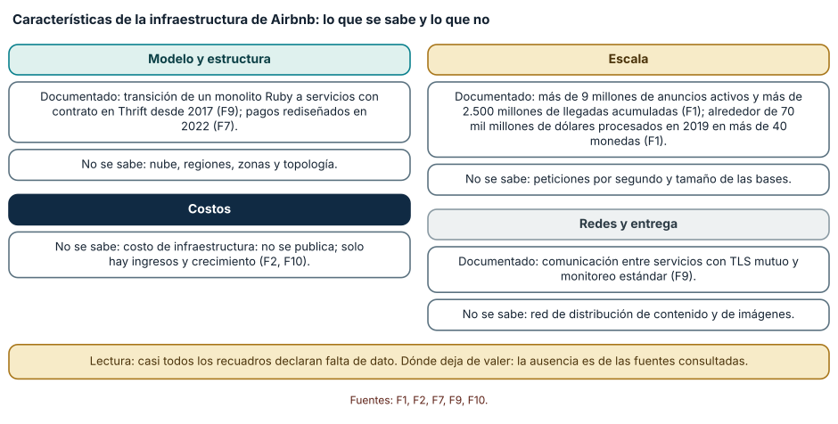

**Cómo leer la figura.** Modelo, escala, costos, redes; casi todo marcado como no publicado. **Dónde deja de valer.** La escala es de anuncios y pagos, no de peticiones.

Documentado (F9, F7): transición de un monolito Rails a servicios con contrato Thrift (2017) y orquestación de pagos rediseñada (2022), con dos sistemas en paralelo casi todo el proceso. Documentado (F1): más de 9 millones de anuncios activos, más de 2.500 millones de llegadas acumuladas y unos 70 mil millones de dólares procesados en 2019 en más de 40 monedas. Documentado (F9): TLS mutuo y monitoreo estándar entre servicios. No se sabe: nube, regiones, zonas, red de distribución de contenido y costo de infraestructura.

### Tolerancia a fallos: qué pasa si cae cada componente

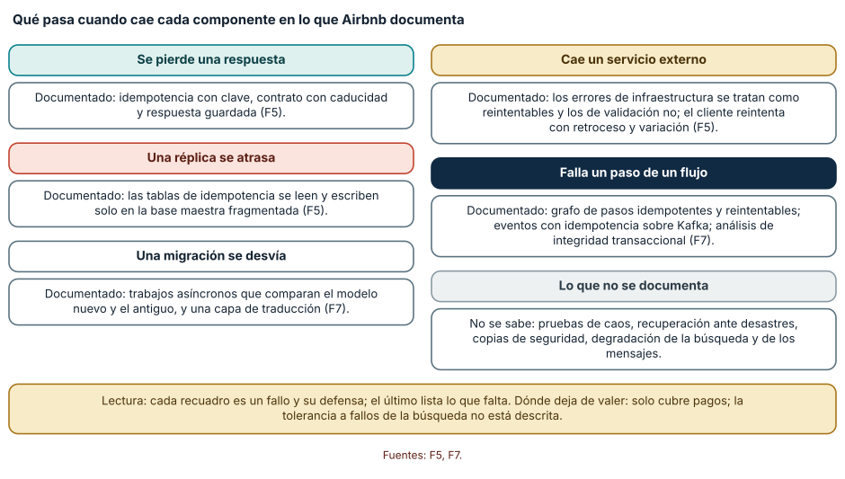

**Cómo leer la figura.** Cada recuadro es un fallo y su defensa; el último lista lo que falta. **Dónde deja de valer.** Solo cubre pagos.

Documentado (F5): tres técnicas de consistencia eventual (reparación en lectura, en escritura y asíncrona) con tareas de segunda línea de defensa (escaneos, lambdas, cron) y notificaciones; claves, contratos con caducidad, errores reintentables y no reintentables, y lectura solo de la base maestra. Documentado (F7): pasos idempotentes, eventos con idempotencia sobre Kafka, análisis de integridad transaccional, trabajos de comparación entre modelos y una capa de traducción durante la migración. Documentado (F2): el asistente de IA de soporte resuelve cerca de un tercio de las incidencias. No se sabe: pruebas de caos, recuperación ante desastres, copias de seguridad, degradación de la búsqueda y de los mensajes, y el comportamiento si cae el asistente.

### Alternativas descartadas y trade-offs (análisis propio)

Todo lo que sigue es análisis propio: qué habría ocurrido con otra decisión. No es historia.

| Decisión | Alternativa | Qué habría pasado (hipótesis) | Qué costó la elegida |
| --- | --- | --- | --- |
| Biblioteca de idempotencia (F5) | Servicio independiente de idempotencia | Reutilización central, pero más latencia y el mismo problema de consistencia en el propio servicio (F5) | Cada servicio importa la biblioteca y los clientes deben guardar claves y reintentar |
| Leer solo de la base maestra (F5) | Leer de réplicas o de caché | Más escala de lectura, pero riesgo de pagos duplicados con retraso de réplica (F5) | Cuello de botella, mitigado fragmentando por clave |
| IDL sobre el marco existente (F9) | Cambiar a gRPC o Thrift completos | Más funciones pero una reconstrucción mayor con disrupción de productividad (F9) | Una solución a medida y compatible, con carga de mantenimiento |
| Rediseñar los pagos (F7) | Reemplazo uno a uno del monolito | Migración más rápida pero arrastrando el acoplamiento a la reserva de estancias (F7) | Más tiempo y dos sistemas en paralelo casi todo el proceso |
| Migrar por fases con traducción (F7) | Corte único con migración de datos de golpe | Menos tiempo con dos sistemas, pero más riesgo de un incidente de dinero y una validación menos granular | Más complejidad temporal y trabajo duplicado |
| Redes neuronales con diseño iterativo (F8) | Seguir con árboles | Menos complejidad y menos riesgo, pero estancamiento tras la meseta (F8) | Sobreajuste con identificadores, ajustes de normalización y decisiones difíciles de interpretar |
| Comisión única (F3) | Comisión dividida | Más flexible, pero precio total más alto visible al huésped | Todo el costo recae en el anfitrión; la fuente no publica el efecto |
| Foco del negocio en 2020 (F11) | No recortar | Menos costo humano inmediato, pero un riesgo de caja con ingresos menores a la mitad (F11) | Un cuarto de la plantilla |

## Casos especiales y cómo se resuelven

| Situación | Qué se documenta | Qué enseña |
| --- | --- | --- |
| Reintento o doble clic en un pago | Clave de idempotencia, contrato con caducidad, solo base maestra (F5). | Un cobro debe poder repetirse sin repetirse. |
| Fallos entre servicios de pago | Reconciliación por tres vías (lectura, escritura y asíncrona) y eventos reintentables (F5, F7). | La consistencia eventual se diseña con reparación. |
| Reseñas con represalia | La reseña ajena no se ve antes de escribir la propia; ventana de 14 días (F4). | El orden de publicación cambia el comportamiento. |
| Huésped con un problema serio | AirCover: reubicación o reembolso (F6). | La confianza necesita una red de seguridad. |
| Una crisis de demanda | En mayo de 2020 Airbnb redujo cerca del 25 % de su plantilla (casi 1.900 de 7.500) porque el regreso de los viajes era incierto y habría cambiado (F11); en 2020 lanzó Experiencias en línea y un protocolo de limpieza (F1). | Una empresa de plataforma puede perder casi toda la demanda de golpe; hace falta decidir bajo incertidumbre. |
| Discriminación | Project Lighthouse, junio de 2020, con Color of Change (F1). No se sabe cómo se mide ni qué resultados dio en detalle. | Un mercado puede reproducir sesgos y necesita medirlos. |
| Regulación local | City Portal desde septiembre de 2020 (F1). Las normas concretas de cada ciudad no se revisaron aquí. | El cumplimiento es parte del producto. |
| Doble reserva del mismo calendario | No se sabe cómo se evita. Inferido: requiere una operación atómica sobre disponibilidad. | Contrastar con [SE-315](../../classes/part-26-datos-persistencia-y-recuperacion/se-315-transacciones-aislamiento-y-concurrencia/README.md) y [SE-338](../../classes/part-28-concurrencia-y-sistemas-distribuidos/se-338-memoria-compartida-locks-y-condiciones-de-carrera/README.md). |
| Fraude y abuso | No se sabe. Airbnb no publicó, en las fuentes consultadas, el diseño de sus controles. | Documentar también la ausencia de datos. |

Los siguientes casos especiales amplían la tabla con mecanismo, decisión y costo.

### Un anuncio nuevo sin historial (arranque en frío)

Mecanismo documentado (F12): estimar los valores de las señales de interacción (reservas, clics, reseñas) de un anuncio nuevo a partir de sus propiedades, en lugar de usar valores por defecto constantes; el estimador redujo el error de estimación un 42 % frente al valor por defecto y dio +14 % de reservas de anuncios nuevos. Decisión: replantear el problema como estimación y no como un balance entre explorar y explotar. Costo: más modelos que mantener; y en una versión anterior un impulso a los nuevos dio +8,5 % de impresiones de primera página con reservas neutras, es decir, sin ganancia neta.

### Sesgo de posición

Mecanismo documentado (F12): los modelos aprenden que los anuncios arriba se reservan más y refuerzan ese orden; se añadió la posición como entrada con dropout de 0,15 y se anuló al servir. Decisión: separar lo que es relevancia de lo que es posición. Resultado documentado: +0,7 % de reservas y +1,8 % de ingresos; la fuente explica el aumento de ingresos porque el sesgo había inflado la preferencia por precios bajos. Costo: más complejidad de entrenamiento.

### Consistencia entre servicios de pago

Mecanismo documentado (F5, F7): reparación en escritura, lectura y asíncrona; pasos idempotentes; eventos de Kafka con idempotencia; análisis de integridad transaccional. Decisión: priorizar consistencia sobre latencia en las tablas de idempotencia. Costo: base maestra, fragmentación y retención de respuestas.

### Sobrecarga y escala

Documentado (F5): la base maestra fragmentada por clave de idempotencia; el crecimiento de la tabla de respuestas con el rendimiento. Documentado (F8): la búsqueda opera sobre miles de anuncios por consulta y se entrena con miles de millones de pares. No se sabe: la capacidad en picos (por ejemplo, un evento deportivo) ni la topología.

### Cumplimiento regional

Documentado (F3): la comisión varía por país (4 % host en Brasil y México; IVA incluido en la comisión mostrada). Documentado (F1): impuestos recaudados y remitidos (más de 18.000 millones de dólares); City Portal. No se sabe: la lógica específica por jurisdicción.

### Offline y mensajes

No se sabe. Airbnb no publica el comportamiento sin conexión de sus apps ni cómo sincroniza mensajes.

### Costos

Documentado (F2): ingresos +12 %, GBV +16 %: la empresa vigila el valor por noche; no se publica el desglose del costo. Análisis propio: el soporte con IA que resuelve cerca de un tercio de las incidencias (F2) es una palanca de costo, pero la fuente solo habla de resolución y tiempo, no de dinero.

## Línea de tiempo

La figura está en la sección de arquitectura (nivel 11). En prosa, con sus fuentes:

- **Octubre de 2007.** Primeros huéspedes (F1).
- **Marzo de 2008.** Lanzamiento en el SXSW con dos reservas (F1).
- **Agosto de 2008.** Plataforma de pagos propia; 80 reservas durante la convención demócrata (F1).
- **Marzo de 2009.** Nombre actual y ampliación a casas y apartamentos (F1).
- **Noviembre de 2010.** App móvil e Instant Book (F1).
- **Mayo de 2012.** Garantía para anfitriones de 1 millón de dólares (F1).
- **Noviembre de 2016.** Experiencias (F1).
- **Diciembre de 2017.** Primera entrega de la serie sobre servicios con IDL (F9).
- **Octubre de 2018.** Artículo sobre aprendizaje profundo en la búsqueda (F8).
- **2019.** El sistema de pagos procesó cerca de 70.000 millones de dólares (F1); biblioteca de idempotencia, abril (F5).
- **Febrero de 2020.** Artículo sobre mejoras posteriores de la búsqueda (F12).
- **Mayo de 2020.** Reducción de plantilla de cerca del 25 % (F11).
- **Junio y septiembre de 2020.** Project Lighthouse; City Portal (F1).
- **Diciembre de 2020.** Cotización en bolsa; Airbnb.org (F1).
- **Noviembre de 2021 y mayo de 2022.** AirCover para anfitriones; AirCover para huéspedes y Categorías (F1).
- **Febrero de 2022.** Reconstrucción de la orquestación de pagos (F7).
- **2025.** Servicios y renovación de Experiencias; en el cuarto trimestre, GBV +16 % (F1, F2).

Giros y correcciones: Airbnb tardó casi cinco meses en pasar de 2 reservas a 80 (F1); decidió rediseñar los pagos en vez de replicarlos (F7), con la consecuencia de una migración larga; la búsqueda pasó por una meseta antes de las redes (F8); y en 2020 tuvo que reducir su plantilla y su alcance (F11) para luego, en 2025, probar de nuevo con hoteles pequeños (F2).

## Vínculo con el curso

| Concepto | Clases | Qué parte de la teoría ilustra el caso |
| --- | --- | --- |
| Idempotencia y reintentos | [SE-246](../../classes/part-20-backend-apis-y-procesamiento-asincrono/se-246-idempotencia-reintentos-y-deduplicacion/README.md), [SE-344](../../classes/part-28-concurrencia-y-sistemas-distribuidos/se-344-idempotencia-y-procesamiento-distribuido/README.md), [SE-378](../../classes/part-31-calidad-rendimiento-y-resiliencia/se-378-timeouts-retries-backoff-y-jitter/README.md) | Clave de idempotencia, contrato con caducidad y errores reintentables. |
| Semánticas de entrega | [SE-328](../../classes/part-27-integracion-eventos-y-mensajeria/se-328-entrega-orden-duplicacion-y-semanticas/README.md), [SE-329](../../classes/part-27-integracion-eventos-y-mensajeria/se-329-outbox-inbox-sagas-y-compensacion/README.md) | Convertir «al menos una vez» en efecto «exactamente una vez». |
| Réplicas, retraso y consistencia | [SE-319](../../classes/part-26-datos-persistencia-y-recuperacion/se-319-replicacion-particion-y-distribucion/README.md), [SE-320](../../classes/part-26-datos-persistencia-y-recuperacion/se-320-caches-y-consistencia-entre-capas/README.md), [SE-342](../../classes/part-28-concurrencia-y-sistemas-distribuidos/se-342-consistencia-disponibilidad-y-particiones/README.md) | Leer de la base maestra para evitar el retraso de replicación. |
| Transacciones e invariantes | [SE-315](../../classes/part-26-datos-persistencia-y-recuperacion/se-315-transacciones-aislamiento-y-concurrencia/README.md), [SE-316](../../classes/part-26-datos-persistencia-y-recuperacion/se-316-restricciones-invariantes-y-consistencia/README.md), [SE-282](../../classes/part-23-software-especializado-y-dominios/se-282-fintech-contabilidad-e-invariantes-monetarias/README.md) | Atomicidad de pagos y datos inmutables para reconciliar. |
| Concurrencia y condiciones de carrera | [SE-338](../../classes/part-28-concurrencia-y-sistemas-distribuidos/se-338-memoria-compartida-locks-y-condiciones-de-carrera/README.md) | Contrato con bloqueo de fila para que dos solicitudes idénticas simultáneas no compitan. |
| Del monolito a los servicios | [SE-303](../../classes/part-25-arquitectura-de-software-y-dominio/se-303-monolito-modular-monolith-y-servicios/README.md), [SE-532](../../classes/part-44-estilos-arquitectonicos/se-532-microservicios-y-sus-costes-reales/README.md), [SE-437](../../classes/part-36-mantenimiento-y-modernizacion-legacy/se-437-strangler-branch-by-abstraction-y-anticorruption/README.md), [SE-438](../../classes/part-36-mantenimiento-y-modernizacion-legacy/se-438-migraciones-de-runtime-lenguaje-y-framework/README.md), [SE-440](../../classes/part-36-mantenimiento-y-modernizacion-legacy/se-440-compatibilidad-coexistencia-y-doble-escritura/README.md) | Migración de Rails a servicios con contratos IDL y convivencia de dos sistemas. |
| Contratos y evolución de interfaces | [SE-163](../../classes/part-13-especificaciones-contratos-y-modelos/se-163-openapi-asyncapi-graphql-y-contratos-de-eventos/README.md), [SE-164](../../classes/part-13-especificaciones-contratos-y-modelos/se-164-compatibilidad-versionado-y-evolucion-de-contratos/README.md), [SE-244](../../classes/part-20-backend-apis-y-procesamiento-asincrono/se-244-validacion-errores-y-contratos-consistentes/README.md) | Interfaces definidas en Thrift; compatibilidad hacia atrás. |
| Migración de datos sin interrupción | [SE-439](../../classes/part-36-mantenimiento-y-modernizacion-legacy/se-439-migraciones-de-datos-sin-interrupcion/README.md) | Migración por fases de la orquestación de pagos (F7). |
| Aprendizaje automático como componente | [SE-279](../../classes/part-23-software-especializado-y-dominios/se-279-machine-learning-como-componente-de-producto/README.md) | Ordenación de búsqueda con redes neuronales (F8, F12). |
| Experimentos y métricas | [SE-138](../../classes/part-11-economia-metricas-y-decisiones-de-producto/se-138-experimentos-sesgos-y-causalidad-basica/README.md), [SE-139](../../classes/part-11-economia-metricas-y-decisiones-de-producto/se-139-north-star-guardrails-y-metricas-contrarias/README.md), [SE-143](../../classes/part-11-economia-metricas-y-decisiones-de-producto/se-143-taller-disenar-un-arbol-de-metricas/README.md) | Valor bruto de reservas, noches reservadas, ingresos y experimentos A/B de la búsqueda. |
| Modelos de negocio y costos | [SE-133](../../classes/part-11-economia-metricas-y-decisiones-de-producto/se-133-modelos-de-negocio-y-sostenibilidad/README.md), [SE-134](../../classes/part-11-economia-metricas-y-decisiones-de-producto/se-134-costos-de-construccion-operacion-y-oportunidad/README.md) | Comisión dividida frente a comisión única. |
| Usuarios, actores y propuesta de valor | [SE-121](../../classes/part-10-descubrimiento-y-estrategia-de-producto/se-121-problemas-sintomas-necesidades-y-oportunidades/README.md), [SE-122](../../classes/part-10-descubrimiento-y-estrategia-de-producto/se-122-usuarios-actores-trabajos-y-contextos/README.md), [SE-125](../../classes/part-10-descubrimiento-y-estrategia-de-producto/se-125-propuesta-de-valor-y-resultados-deseados/README.md), [SE-126](../../classes/part-10-descubrimiento-y-estrategia-de-producto/se-126-segmentacion-mercado-y-alternativas-existentes/README.md) | Huésped, anfitrión, regulador. |
| Ética del producto | [SE-129](../../classes/part-10-descubrimiento-y-estrategia-de-producto/se-129-etica-del-descubrimiento-y-proteccion-de-participantes/README.md), [SE-391](../../classes/part-32-seguridad-privacidad-y-cumplimiento/se-391-privacidad-por-diseno-y-minimizacion/README.md), [SE-394](../../classes/part-32-seguridad-privacidad-y-cumplimiento/se-394-cumplimiento-evidencia-y-limites-legales/README.md) | Discriminación, privacidad y cumplimiento local. |
| Accesibilidad e internacionalización | [SE-173](../../classes/part-14-experiencia-accesibilidad-e-internacionalizacion/se-173-accesibilidad-perceptible-operable-y-comprensible/README.md), [SE-177](../../classes/part-14-experiencia-accesibilidad-e-internacionalizacion/se-177-internacionalizacion-localizacion-y-formatos-culturales/README.md) | Traducción y 40 monedas. |
| Riesgo y decisiones bajo incertidumbre | [SE-450](../../classes/part-37-gestion-liderazgo-y-practica-profesional/se-450-gestion-de-riesgos-y-decisiones-ejecutivas/README.md), [SE-142](../../classes/part-11-economia-metricas-y-decisiones-de-producto/se-142-decisiones-reversibles-e-irreversibles/README.md), [SE-141](../../classes/part-11-economia-metricas-y-decisiones-de-producto/se-141-portafolio-opciones-y-secuenciacion-de-inversion/README.md) | La crisis de 2020 y un negocio «más enfocado». |
| Requisitos regulatorios | [SE-152](../../classes/part-12-ingenieria-de-requisitos/se-152-requisitos-regulatorios-de-datos-y-seguridad/README.md) | City Portal y reglas locales. |
| Observabilidad y mensajería | [SE-334](../../classes/part-27-integracion-eventos-y-mensajeria/se-334-observabilidad-y-seguridad-de-integraciones/README.md), [SE-421](../../classes/part-35-observabilidad-sre-e-incidentes/se-421-senales-eventos-y-observabilidad-util/README.md) | Instrumentación estándar de servicios y análisis de integridad transaccional. |
| Trade-offs y decisiones | [SE-309](../../classes/part-25-arquitectura-de-software-y-dominio/se-309-trade-offs-adr-y-evaluacion-de-alternativas/README.md), [SE-208](../../classes/part-17-documentacion-y-conocimiento-tecnico/se-208-adrs-rfcs-y-registro-de-decisiones/README.md) | La tabla de alternativas es un ADR en potencia. |

### Preguntas de discusión

1. Orpheus separa las llamadas de red de las transacciones de base de datos. ¿Qué otras operaciones de tu sistema mezclan red y base de datos en la misma transacción? ¿Qué fallo concreto produce esa mezcla?
2. Leer la idempotencia solo de la base maestra cuesta escala. ¿Cuándo aceptarías una réplica? ¿Qué garantías necesitarías de la base de datos?
3. Una clasificación errónea de un error puede dejar un pago fallido para siempre o duplicarlo. ¿Qué mecanismo añadirías para detectar clasificaciones erróneas en producción?
4. Airbnb tardó más porque rediseñó los pagos en vez de replicar el monolito. ¿Qué condiciones del negocio justifican esa decisión y cuáles no?
5. La comisión única simplifica el precio al huésped pero carga al anfitrión. ¿Qué datos necesitarías para saber si fue buena decisión y cuáles no son públicos?
6. En la búsqueda, dos ideas razonables empeoraron las reservas. ¿Cómo decide un equipo cuántos experimentos fallidos tolera antes de cambiar de enfoque?

### Mini-ejercicios de análisis

1. **Clasificar errores.** Lista diez errores de un servicio de pagos de tu elección y clasifícalos como reintentables o no reintentables con una justificación; identifica dos ambiguos.
2. **Replica lag.** Con un retraso de réplica de 2 segundos y un cliente que reintenta a los 500 ms, dibuja la línea de tiempo y calcula cuántos duplicados habría si 1 de cada 1.000 respuestas se pierde, con 10 millones de cobros al día.
3. **Contrato con caducidad.** Define el tiempo de espera del RPC y la caducidad del contrato para un procesador con p99 de 800 ms; justifica la regla «caducidad mayor que el tiempo de espera».
4. **Migración por fases.** Para un monolito tuyo, define tres fases y diez hitos con criterio de entrada y salida; indica qué capa de traducción necesitarías.
5. **Comisión.** Con un subtotal de 100 dólares, compara lo que retiene la plataforma en la estructura dividida (14,1 % a 16,5 % más 3 %) y en la única (15,5 %); explica qué dato no sabes para decidir.
6. **Experimento de búsqueda.** Diseña una prueba A/B para el arranque en frío de un producto tuyo: hipótesis, métrica de éxito, métrica de guardia y qué resultado te haría abandonar.

## Qué no generalizar

**Qué aprender.**

1. **En un mercado, la confianza es una función del producto.** Pagos, garantía, reseñas y cobertura nacen para reducir la incertidumbre (F1, F4, F6).
2. **Diseña el dinero como un sistema que se puede repetir.** Idempotencia, pasos reintentables y datos inmutables (F5, F7).
3. **No acoples el modelo de pagos al producto.** El rediseño de 2022 separa pagos de «reserva» para soportar otros productos (F7).
4. **Migra por fases y con coexistencia.** F7 describe una migración por fases manteniendo dos sistemas.
5. **Decide con evidencia bajo shock.** Una caída de demanda obligó a una reorganización dolorosa (F11).
6. **Un contrato explícito entre servicios reduce incidentes.** La IDL nace de incidentes por cambios que rompían contratos (F9).
7. **Publica también lo que no funcionó.** F8 y F12 cuentan modelos que empeoraron las reservas.

**Qué NO generalizar.**

- **El éxito del mercado no prueba que cada decisión técnica fuera correcta.** Muchas pudieron ser accidentales; los blogs cuentan una versión ordenada.
- **El número de «cinco nueves» es una medición interna de la empresa** y define consistencia de un conjunto de pagos, no disponibilidad del sitio (F7).
- **Las cifras de escala son autodeclaradas** y se actualizan (F1: «actualizado en mayo de 2026»).
- **La comisión depende del país y del tipo de anfitrión** y cambia; no sirve como regla del sector.
- **El mercado tiene externalidades.** Las ciudades regulan porque el alquiler de corta duración afecta vivienda y vecindarios; este caso no mide ese impacto y no debe usarse para negarlo ni para afirmarlo.
- **Sesgo de supervivencia.** Se documentan los casos que salieron bien.
- **Los porcentajes de las pruebas A/B no se transfieren.** Son de Airbnb contra su propio modelo (F12).
- **Una base maestra fragmentada con idempotencia no es la única solución.** Funciona con MySQL y sus garantías; con otros motores cambian las opciones (F5).
- **La biblioteca de 2019 y la orquestación de 2022 no describen necesariamente el sistema de hoy.**

## Fuentes públicas verificadas

Todas consultadas el 2026-11-16 con `curl` salvo lo indicado. «Secundaria» significa que no es una fuente primaria de la empresa.

- **F1.** Airbnb Newsroom, «About Us» y «The Airbnb Story» (datos rápidos actualizados en mayo de 2026): [https://news.airbnb.com/about-us/](https://news.airbnb.com/about-us/)
- **F2.** Airbnb, «Airbnb Q4 2025 financial results»: [https://news.airbnb.com/airbnb-q4-2025-financial-results](https://news.airbnb.com/airbnb-q4-2025-financial-results). Se usa para el crecimiento del cuarto trimestre, las políticas de flexibilidad, las palancas y el asistente de inteligencia artificial.
- **F3.** Airbnb, ayuda «Airbnb service fees»: [https://www.airbnb.com/help/article/1857](https://www.airbnb.com/help/article/1857)
- **F4.** Airbnb, ayuda «Leaving a review for a home or a guest»: [https://www.airbnb.com/help/article/13](https://www.airbnb.com/help/article/13)
- **F5.** Jon Chew y Ninad Khisti, «Avoiding double payments in a distributed payments system», Airbnb Tech Blog, 16 de abril de 2019: [https://medium.com/airbnb-engineering/avoiding-double-payments-in-a-distributed-payments-system-2981f6b070bb](https://medium.com/airbnb-engineering/avoiding-double-payments-in-a-distributed-payments-system-2981f6b070bb)
- **F6.** Airbnb, ayuda «AirCover for guests»: [https://www.airbnb.com/aircover](https://www.airbnb.com/aircover)
- **F7.** Bryon Ross y otros, «Rebuilding Payment Orchestration at Airbnb», Airbnb Tech Blog, 24 de febrero de 2022: [https://medium.com/airbnb-engineering/rebuilding-payment-orchestration-at-airbnb-341d194a781b](https://medium.com/airbnb-engineering/rebuilding-payment-orchestration-at-airbnb-341d194a781b)
- **F8.** Malay Haldar y otros, «Applying Deep Learning To Airbnb Search», arXiv:1810.09591 (octubre de 2018): [https://arxiv.org/abs/1810.09591](https://arxiv.org/abs/1810.09591)
- **F9.** Liang Guo, Frank Lin y Junjie Guan, «Building Services at Airbnb, Part 1», Airbnb Tech Blog, 12 de diciembre de 2017: [https://medium.com/airbnb-engineering/building-services-at-airbnb-part-1-c4c1d8fa811b](https://medium.com/airbnb-engineering/building-services-at-airbnb-part-1-c4c1d8fa811b)
- **F10.** (Secundaria) Wikipedia, «Airbnb», edición consultada el 2026-11-16: [https://en.wikipedia.org/wiki/Airbnb](https://en.wikipedia.org/wiki/Airbnb). Se usa para el año de fundación de la sociedad, los ingresos y los empleados de 2025.
- **F11.** Brian Chesky, «A Message from Co-Founder and CEO Brian Chesky» (mayo de 2020): [https://news.airbnb.com/a-message-from-co-founder-and-ceo-brian-chesky](https://news.airbnb.com/a-message-from-co-founder-and-ceo-brian-chesky)
- **F12.** Malay Haldar y otros, «Improving Deep Learning For Airbnb Search», arXiv:2002.05515 (febrero de 2020): [https://arxiv.org/abs/2002.05515](https://arxiv.org/abs/2002.05515). Se usa para dos torres, sesgo de posición, arranque en frío y los resultados de pruebas A/B.

**Qué no cubren estas fuentes.** No documentan la arquitectura actual completa, el calendario de pagos al anfitrión, los controles de fraude, el efecto del alquiler de corta duración sobre la vivienda ni las normas locales concretas; tampoco a competidores ni cuota de mercado. Esos puntos quedan como «no se sabe» o no verificados. La documentación de la salida a bolsa (formulario S-1) no pudo leerse porque el servidor de la SEC bloqueó al cliente automatizado.

---

[↑ Casos de éxito](README.md) · [← Spotify](spotify.md) · [Stripe →](stripe.md)
