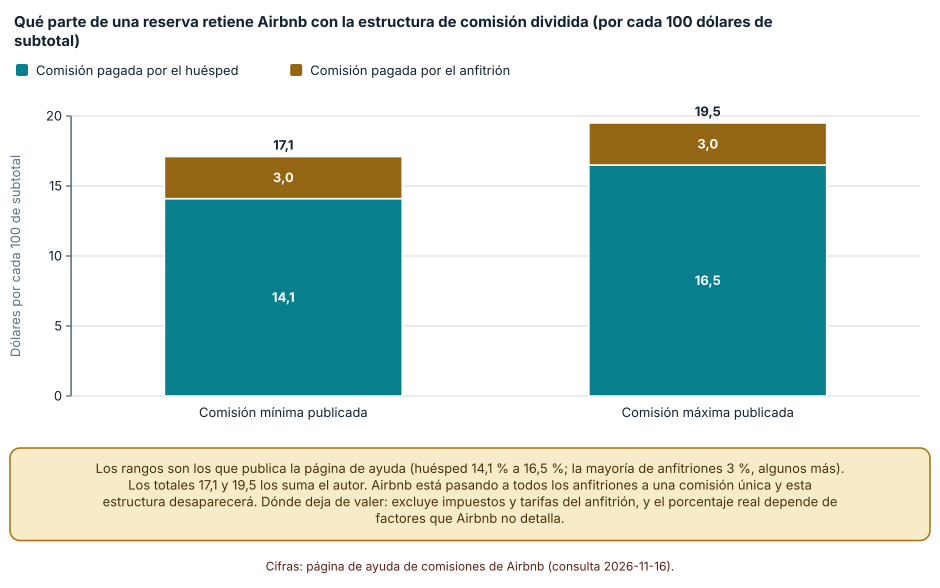
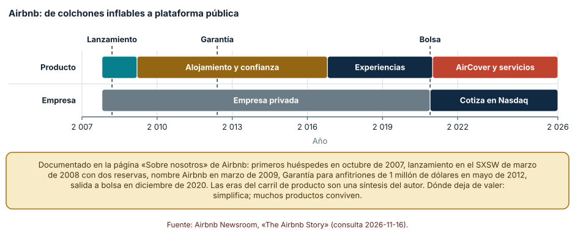

# Airbnb

[↑ Casos de éxito](README.md) · [← Spotify](spotify.md) · [Stripe →](stripe.md)

> **Qué es este caso.** Un análisis profesional de una empresa real que el programa usa para contrastar la teoría con la práctica. No es una clase ni un rol: es la realidad frente al curso. Se apoya solo en fuentes públicas citadas al final, consultadas el 16 de noviembre de 2026, y separa lo que está **documentado**, lo que es **inferido** y lo que **no se sabe**.

**Cómo leer este caso.**

- **Documentado**: lo dice una fuente citada, por ejemplo «Documentado (F3)». Si la fuente es secundaria, se declara.
- **Observable**: se comprueba usando el producto público, sin una cita específica en este caso.
- **Inferido**: conclusión del autor a partir de lo documentado; puede ser falsa.
- **No se sabe**: dato que la empresa no ha publicado. No se rellena con suposiciones.

Las cifras de dinero están en dólares estadounidenses.

## Ficha histórica

| Dato | Valor | Estado de la evidencia |
| --- | --- | --- |
| Nombre | Airbnb, Inc. (nació como Airbed & Breakfast) | Documentado (F1) |
| Fundadores | Brian Chesky (director ejecutivo), Nathan Blecharczyk (director de estrategia) y Joe Gebbia | Documentado (F1) |
| Primeros huéspedes | octubre de 2007 (Chesky y Gebbia alojan a los primeros huéspedes) | Documentado (F1) |
| Lanzamiento | marzo de 2008, durante el festival SXSW, con solo dos reservas; en agosto de 2008, para la convención demócrata, llegó a 80 reservas | Documentado (F1) |
| Año de fundación de la sociedad | 2008 en San Francisco | Fuente secundaria (F10); la empresa data el origen del producto en 2007 y 2008 |
| Sede | San Francisco: en junio de 2013 abre su sede en 888 Brannan Street, a pocas manzanas de su primer anuncio | Documentado (F1) |
| Cambio de nombre | marzo de 2009: de Airbed & Breakfast a Airbnb, ampliando de habitaciones a apartamentos y casas enteras | Documentado (F1) |
| Hitos | 2008 plataforma de pagos propia; 2010 app e Instant Book; 2012 Garantía para anfitriones de 1 millón; 2016 Experiencias; 2020 salida a bolsa; 2021 AirCover; 2025 Servicios | Documentado (F1) |
| Salida a bolsa | diciembre de 2020 | Documentado (F1) |
| Escala (mayo de 2026) | más de 9 millones de anuncios activos, más de 5,5 millones de anfitriones, más de 150.000 ciudades y pueblos, más de 220 países y regiones, más de 2.500 millones de llegadas acumuladas, más de 380.000 millones de dólares ganados por los anfitriones | Documentado (F1) |
| Resultados | cuarto trimestre de 2025: ingresos +12 %, valor bruto de reservas +16 %, noches y plazas reservadas +10 % | Documentado (F2) |
| Ingresos de 2025 | unos 12.200 millones de dólares; unos 8.200 empleados | Fuente secundaria (F10) |

## Contexto y problema

Según la historia de la empresa (F1), en octubre de 2007 Brian Chesky y Joe Gebbia alojaron a los primeros huéspedes de Airbed & Breakfast. De esa experiencia pequeña surge una pregunta de mercado, que formulamos como hipótesis del autor y no como cita: ¿hay una enorme capacidad ociosa de camas, habitaciones y casas, y viajeros que prefieren un alojamiento distinto al hotel? El obstáculo no era técnico sino de **confianza**: ¿por qué un desconocido dejaría entrar a otro en su casa, o pagaría por adelantado a alguien que no ha visto?

El caso es una lección de que el producto real de un mercado es la reducción de la incertidumbre entre las partes. Por eso aparecen pronto un sistema de pagos propio (agosto de 2008, F1), una garantía económica para anfitriones (2012, F1), reseñas con reglas diseñadas (F4) y, más tarde, una cobertura para huéspedes (AirCover, F6). Documentado (F1): el lanzamiento de 2008 recibió dos reservas y el sistema de pagos propio llegó meses después; la confianza se construyó en capas.

## Mercado, usuarios y casos de uso

**Cómo leer la figura.** El centro oscuro es la plataforma; a la izquierda quien reserva y a la derecha quien ofrece; abajo, quien impone las reglas (ciudades y reguladores). Las flechas discontinuas son capas de protección que dan confianza. Mira primero lo que hace la plataforma: no presta el alojamiento, solo coordina, cobra y protege. **Dónde deja de valer.** No muestra cuánta actividad es profesional y cuánta ocasional, ni cómo difiere por ciudad; ese desglose no es público en los documentos consultados.

### Tipos de usuario y cómo cambia la experiencia

- **Huésped.** Observable: busca por destino y fechas, compara, reserva, paga y se comunica con el anfitrión. Documentado (F6): cada reserva de casa incluye AirCover para huéspedes: si hay un problema serio que el anfitrión no resuelve, Airbnb ayuda a reubicar o reembolsa total o parcialmente.
- **Anfitrión.** Observable: publica un anuncio, define precio y reglas, acepta reservas y cobra. Documentado (F3): paga una comisión de servicio. Documentado (F1): en 2025 el anfitrión típico en Estados Unidos ganó unos 15.600 dólares.
- **Anfitrión que gestiona con ayuda.** Documentado (F1): en octubre de 2024 Airbnb presentó la Red de Coanfitriones para encontrar a locales que gestionen el alojamiento.
- **Administradores y reguladores.** Documentado (F1): en septiembre de 2020 Airbnb lanzó City Portal, una ventanilla para que los gobiernos locales entiendan y hagan cumplir el alquiler responsable.
- **Equipos internos y de soporte.** No se sabe su estructura.

### Casos de uso característicos

1. Reservar un apartamento para un viaje de cinco días.
2. Que un anfitrión ocasional alquile su casa cuando viaja.
3. Alojar a desplazados en una crisis: documentado (F1): Airbnb.org, organización sin fines de lucro lanzada en diciembre de 2020, conecta a personas con alojamiento en situaciones de crisis.
4. Reservar una experiencia local (F1: desde 2016) o un servicio (2025).

## Funcionalidad de principio a fin

1. **Primer contacto.** Observable: el viajero llega a un resultado de búsqueda por destino, fechas y huéspedes. Documentado (arXiv:1810.09591, F8): la ordenación de resultados es «una de las mayores historias de éxito del aprendizaje automático en Airbnb»; los árboles de decisión con gradiente dieron mejoras iniciales que luego se estancaron y la empresa aplicó redes neuronales.
2. **Registro.** Observable: se crea una cuenta con datos personales y verificación. No se sabe cómo se calcula internamente el riesgo de cada cuenta.
3. **Uso central: reservar.** Observable: el huésped elige un anuncio y reserva con aceptación inmediata o con aprobación del anfitrión. Documentado (F1): la función Instant Book existe desde 2010.
4. **Pago.** Documentado (F1): la plataforma de pagos propia existe desde agosto de 2008 y en 2019 procesó alrededor de 70.000 millones de dólares en transacciones de huéspedes y anfitriones en más de 40 monedas. Documentado (F5, F7): el cobro usa una clave de idempotencia y una orquestación de pasos reintentables; se explica en la sección 6.
5. **Estancia.** Observable: comunicación por mensajes y, si hay un problema, ayuda de soporte con AirCover (F6).
6. **Reseñas.** Documentado (F4): al hacer el check-out, huésped y anfitrión reciben una invitación para reseñarse y tienen 14 días; las reseñas se publican cuando ambos las envían o al vencer el plazo, lo que ocurra primero.

**Cómo leer la figura.** Cada carril es un actor y el tiempo corre de izquierda a derecha desde el check-out. Los dos carriles superiores muestran que ambos pueden escribir durante toda la ventana; el inferior muestra que nada se publica mientras falte una de las dos reseñas y no haya vencido el plazo. **Dónde deja de valer.** Documenta el mecanismo de publicación, no el sesgo de las reseñas, que la investigación académica discute y que no se reproduce aquí.

7. **Cobro del anfitrión.** Documentado (F3): la comisión del anfitrión se descuenta del total para calcular su pago. No se verificó el calendario exacto de la liberación del dinero; consúltese la ayuda vigente.
8. **Operación diaria.** Documentado (F1): lanzamientos semestrales de producto («Release») con docenas o cientos de mejoras; por ejemplo, el de invierno de 2021 trajo AirCover para anfitriones y un motor de traducción.

## Negocio y economía

**Modelo.** Documentado (F3): Airbnb cobra una comisión de servicio al confirmarse una reserva. Hay dos estructuras: comisión dividida (la paga en parte el huésped y en parte el anfitrión) y comisión única; Con la comisión única todo el cobro se descuenta al anfitrión (la mayoría paga el 15,5 %, el resto suele pagar entre 14 y 16 %). Airbnb está migrando a todos los anfitriones de casas a la comisión única y no se puede volver atrás.

**Cómo leer la figura.** Cada barra es una reserva de 100 dólares de subtotal en un caso extremo de lo que publica Airbnb; los bloques apilados son lo que paga cada parte a Airbnb. Compara la altura total: Airbnb se queda entre 17 y 19,5 dólares por cada 100. **Dónde deja de valer.** Son los rangos de la ayuda (F3), no la media real. Excluye impuestos y tarifas del anfitrión, y el porcentaje varía por factores no detallados y por mercado (por ejemplo, el 4 % para anfitriones de Brasil y México); además la estructura dividida está siendo reemplazada.

**Fuentes de ingreso.** Documentado (F3, F2): comisiones sobre reservas, medidas por el valor bruto de reservas (GBV) y por las noches y plazas reservadas; ingresos en el cuarto trimestre de 2025 con +12 % y GBV con +16 %. Inferido: Experiencias y Servicios (F1) amplían la oferta sobre la misma plataforma de comisión.

**Costos relevantes.** Documentado (F1): el soporte 24 horas y los servicios que cubre la comisión (F3). No se sabe el desglose de costos de personal, marketing y tecnología con este nivel de detalle en las fuentes consultadas.

**Ventajas.** Inferido: efecto de red (más anuncios atraen más huéspedes y viceversa), reseñas acumuladas y marca. Documentado (F1): más de 5,5 millones de anfitriones y 9 millones de anuncios.

## Arquitectura y esquemas

### Componentes documentados

**Cómo leer la figura.** De izquierda a derecha: el monolito original, los servicios que lo sustituyen, y las dos áreas con documentación pública (búsqueda y pagos); debajo, cuatro rasgos documentados del subsistema de pagos. **Dónde deja de valer.** No es un mapa completo: no se sabe cuántos servicios hay hoy ni cómo se reparte la búsqueda por regiones; los blogs son de 2017 a 2022.

Documentado (F9): en diciembre de 2017 Airbnb describía que avanzaba hacia una arquitectura orientada a servicios desde un monolito Rails, con una definición de interfaces (IDL) basada en Thrift para reducir las horas de ingeniería por servicio. Documentado (F7): en 2022 la orquestación de pagos se rediseñó porque los datos de facturación, las API de pago y la experiencia estaban muy acoplados al concepto de reserva de una estancia, lo que dificultaba otros productos; el nuevo sistema es independiente del producto, divide cada flujo en un grafo acíclico dirigido de pasos idempotentes y reintentables, y mantiene datos inmutables (eventos y versiones) para auditar y reconciliar. Documentado (F7): esto llevó a «cinco nueves» (99,999 %) de consistencia en pagos, según Airbnb.

### Flujo de la operación crítica: cobrar una reserva una sola vez

**Cómo leer la figura.** La fila superior es el camino normal; la inferior, lo que ocurre si la respuesta se pierde y el cliente reintenta con la misma clave. Fíjate en el recuadro gris: leer de una réplica puede fallar por el retraso de replicación. **Dónde deja de valer.** Cubre duplicados por reintentos o doble clic, no cobros lógicamente equivocados ni fraude.

Documentado (F5): la biblioteca de idempotencia Orpheus recibe una clave por solicitud; guarda la información en tablas de una base maestra fragmentada, siempre leída y escrita de ahí para ser consistente; combina transacciones de base de datos con funciones lambda de Java para que sean atómicas; clasifica los errores como reintentables o no; hace que cada llamada adquiera un contrato de uso con caducidad para que dos solicitudes idénticas simultáneas no generen condiciones de carrera; y evita las réplicas porque el retraso de replicación puede producir pagos duplicados (el blog muestra el caso). Documentado (F7): el sistema asíncrono usa un bus de mensajes basado en Kafka, y los procesadores de eventos usan el marco de idempotencia para convertir la garantía de «al menos una vez» de Kafka en «exactamente una vez» de efecto.

### Datos y escala

Documentado (F1): 9 millones de anuncios, 5,5 millones de anfitriones y más de 2.500 millones de llegadas acumuladas; pagos en más de 40 monedas (2019). Documentado (F8): la búsqueda aplica aprendizaje profundo a un problema de ordenación. No se sabe el volumen de consultas por segundo, la topología de datos ni el tamaño de las bases.

## Casos especiales y cómo se resuelven

| Situación | Qué se documenta | Qué enseña |
| --- | --- | --- |
| Reintento o doble clic en un pago | Clave de idempotencia, contrato con caducidad, solo base maestra (F5). | Un cobro debe poder repetirse sin repetirse. |
| Fallos entre servicios de pago | Reconciliación por tres vías (lectura, escritura y asíncrona) y eventos reintentables (F5, F7). | La consistencia eventual se diseña con reparación. |
| Reseñas con represalia | La reseña ajena no se ve antes de escribir la propia; ventana de 14 días (F4). | El orden de publicación cambia el comportamiento. |
| Huésped con un problema serio | AirCover: reubicación o reembolso (F6). | La confianza necesita una red de seguridad. |
| Una crisis de demanda | En mayo de 2020 Airbnb redujo cerca del 25 % de su plantilla (casi 1.900 de 7.500) porque el regreso de los viajes era incierto y habría cambiado (F11); en 2020 lanzó Experiencias en línea y un protocolo de limpieza (F1). | Una empresa de plataforma puede perder casi toda la demanda de golpe; hace falta decidir bajo incertidumbre. |
| Discriminación | Project Lighthouse, junio de 2020, con Color of Change (F1). No se sabe cómo se mide ni qué resultados dio en detalle. | Un mercado puede reproducir sesgos y necesita medirlos. |
| Regulación local | City Portal desde septiembre de 2020 (F1). Las normas concretas de cada ciudad no se revisaron aquí. | El cumplimiento es parte del producto. |
| Doble reserva del mismo calendario | No se sabe cómo se evita. Inferido: requiere una operación atómica sobre disponibilidad. | Contrastar con [SE-315](../../classes/part-26-datos-persistencia-y-recuperacion/se-315-transacciones-aislamiento-y-concurrencia/README.md) y [SE-338](../../classes/part-28-concurrencia-y-sistemas-distribuidos/se-338-memoria-compartida-locks-y-condiciones-de-carrera/README.md). |
| Fraude y abuso | No se sabe. Airbnb no publicó, en las fuentes consultadas, el diseño de sus controles. | Documentar también la ausencia de datos. |

## Línea de tiempo

**Cómo leer la figura.** Dos carriles: la oferta de producto y el estado de la empresa. Las líneas verticales son hitos con fecha documentada (F1). **Dónde deja de valer.** Las eras de producto son síntesis del autor: varios productos conviven y el corte entre ellos es aproximado.

- **Octubre de 2007.** Primeros huéspedes (F1).
- **Marzo de 2008.** Lanzamiento en el SXSW con dos reservas (F1).
- **Agosto de 2008.** Plataforma de pagos propia; 80 reservas durante la convención demócrata (F1).
- **Marzo de 2009.** Nombre actual y ampliación a casas y apartamentos (F1).
- **Noviembre de 2010.** App móvil e Instant Book (F1).
- **Mayo de 2012.** Garantía para anfitriones de 1 millón de dólares (F1).
- **2017.** Migración a servicios (F9).
- **2019.** El sistema de pagos procesó cerca de 70.000 millones de dólares (F1); biblioteca de idempotencia (F5).
- **Mayo de 2020.** Reducción de plantilla de cerca del 25 % (F11).
- **Diciembre de 2020.** Cotización en bolsa (F1).
- **2021 a 2025.** AirCover, Categorías, Experiencias y Servicios (F1).

## Vínculo con el curso

| Concepto | Clases | Qué parte de la teoría ilustra el caso |
| --- | --- | --- |
| Idempotencia y reintentos | [SE-246](../../classes/part-20-backend-apis-y-procesamiento-asincrono/se-246-idempotencia-reintentos-y-deduplicacion/README.md), [SE-344](../../classes/part-28-concurrencia-y-sistemas-distribuidos/se-344-idempotencia-y-procesamiento-distribuido/README.md), [SE-378](../../classes/part-31-calidad-rendimiento-y-resiliencia/se-378-timeouts-retries-backoff-y-jitter/README.md) | Clave de idempotencia, contrato con caducidad y errores reintentables. |
| Semánticas de entrega | [SE-328](../../classes/part-27-integracion-eventos-y-mensajeria/se-328-entrega-orden-duplicacion-y-semanticas/README.md), [SE-329](../../classes/part-27-integracion-eventos-y-mensajeria/se-329-outbox-inbox-sagas-y-compensacion/README.md) | Convertir «al menos una vez» en efecto «exactamente una vez». |
| Réplicas, retraso y consistencia | [SE-319](../../classes/part-26-datos-persistencia-y-recuperacion/se-319-replicacion-particion-y-distribucion/README.md), [SE-320](../../classes/part-26-datos-persistencia-y-recuperacion/se-320-caches-y-consistencia-entre-capas/README.md), [SE-342](../../classes/part-28-concurrencia-y-sistemas-distribuidos/se-342-consistencia-disponibilidad-y-particiones/README.md) | Leer de la base maestra para evitar el retraso de replicación. |
| Transacciones e invariantes | [SE-315](../../classes/part-26-datos-persistencia-y-recuperacion/se-315-transacciones-aislamiento-y-concurrencia/README.md), [SE-316](../../classes/part-26-datos-persistencia-y-recuperacion/se-316-restricciones-invariantes-y-consistencia/README.md), [SE-282](../../classes/part-23-software-especializado-y-dominios/se-282-fintech-contabilidad-e-invariantes-monetarias/README.md) | Atomicidad de pagos y datos inmutables para reconciliar. |
| Del monolito a los servicios | [SE-303](../../classes/part-25-arquitectura-de-software-y-dominio/se-303-monolito-modular-monolith-y-servicios/README.md), [SE-532](../../classes/part-44-estilos-arquitectonicos/se-532-microservicios-y-sus-costes-reales/README.md), [SE-437](../../classes/part-36-mantenimiento-y-modernizacion-legacy/se-437-strangler-branch-by-abstraction-y-anticorruption/README.md), [SE-438](../../classes/part-36-mantenimiento-y-modernizacion-legacy/se-438-migraciones-de-runtime-lenguaje-y-framework/README.md), [SE-440](../../classes/part-36-mantenimiento-y-modernizacion-legacy/se-440-compatibilidad-coexistencia-y-doble-escritura/README.md) | Migración de Rails a servicios con contratos IDL. |
| Contratos y evolución de interfaces | [SE-163](../../classes/part-13-especificaciones-contratos-y-modelos/se-163-openapi-asyncapi-graphql-y-contratos-de-eventos/README.md), [SE-164](../../classes/part-13-especificaciones-contratos-y-modelos/se-164-compatibilidad-versionado-y-evolucion-de-contratos/README.md), [SE-244](../../classes/part-20-backend-apis-y-procesamiento-asincrono/se-244-validacion-errores-y-contratos-consistentes/README.md) | Interfaces definidas en Thrift. |
| Migración de datos sin interrupción | [SE-439](../../classes/part-36-mantenimiento-y-modernizacion-legacy/se-439-migraciones-de-datos-sin-interrupcion/README.md) | Migración por fases de la orquestación de pagos (F7). |
| Aprendizaje automático como componente | [SE-279](../../classes/part-23-software-especializado-y-dominios/se-279-machine-learning-como-componente-de-producto/README.md) | Ordenación de búsqueda con redes neuronales (F8). |
| Experimentos y métricas | [SE-138](../../classes/part-11-economia-metricas-y-decisiones-de-producto/se-138-experimentos-sesgos-y-causalidad-basica/README.md), [SE-139](../../classes/part-11-economia-metricas-y-decisiones-de-producto/se-139-north-star-guardrails-y-metricas-contrarias/README.md), [SE-143](../../classes/part-11-economia-metricas-y-decisiones-de-producto/se-143-taller-disenar-un-arbol-de-metricas/README.md) | Valor bruto de reservas, noches reservadas, ingresos. |
| Modelos de negocio y costos | [SE-133](../../classes/part-11-economia-metricas-y-decisiones-de-producto/se-133-modelos-de-negocio-y-sostenibilidad/README.md), [SE-134](../../classes/part-11-economia-metricas-y-decisiones-de-producto/se-134-costos-de-construccion-operacion-y-oportunidad/README.md) | Comisión dividida frente a comisión única. |
| Usuarios, actores y propuesta de valor | [SE-121](../../classes/part-10-descubrimiento-y-estrategia-de-producto/se-121-problemas-sintomas-necesidades-y-oportunidades/README.md), [SE-122](../../classes/part-10-descubrimiento-y-estrategia-de-producto/se-122-usuarios-actores-trabajos-y-contextos/README.md), [SE-125](../../classes/part-10-descubrimiento-y-estrategia-de-producto/se-125-propuesta-de-valor-y-resultados-deseados/README.md) | Huésped, anfitrión, regulador. |
| Ética del producto | [SE-129](../../classes/part-10-descubrimiento-y-estrategia-de-producto/se-129-etica-del-descubrimiento-y-proteccion-de-participantes/README.md), [SE-391](../../classes/part-32-seguridad-privacidad-y-cumplimiento/se-391-privacidad-por-diseno-y-minimizacion/README.md), [SE-394](../../classes/part-32-seguridad-privacidad-y-cumplimiento/se-394-cumplimiento-evidencia-y-limites-legales/README.md) | Discriminación, privacidad y cumplimiento local. |
| Accesibilidad e internacionalización | [SE-173](../../classes/part-14-experiencia-accesibilidad-e-internacionalizacion/se-173-accesibilidad-perceptible-operable-y-comprensible/README.md), [SE-177](../../classes/part-14-experiencia-accesibilidad-e-internacionalizacion/se-177-internacionalizacion-localizacion-y-formatos-culturales/README.md) | Traducción y 40 monedas. |
| Riesgo y decisiones bajo incertidumbre | [SE-450](../../classes/part-37-gestion-liderazgo-y-practica-profesional/se-450-gestion-de-riesgos-y-decisiones-ejecutivas/README.md), [SE-142](../../classes/part-11-economia-metricas-y-decisiones-de-producto/se-142-decisiones-reversibles-e-irreversibles/README.md), [SE-141](../../classes/part-11-economia-metricas-y-decisiones-de-producto/se-141-portafolio-opciones-y-secuenciacion-de-inversion/README.md) | La crisis de 2020 y un negocio «más enfocado». |
| Requisitos regulatorios | [SE-152](../../classes/part-12-ingenieria-de-requisitos/se-152-requisitos-regulatorios-de-datos-y-seguridad/README.md) | City Portal y reglas locales. |

## Qué no generalizar

**Qué aprender.**

1. **En un mercado, la confianza es una función del producto.** Pagos, garantía, reseñas y cobertura nacen para reducir la incertidumbre (F1, F4, F6).
2. **Diseña el dinero como un sistema que se puede repetir.** Idempotencia, pasos reintentables y datos inmutables (F5, F7).
3. **No acoples el modelo de pagos al producto.** El rediseño de 2022 separa pagos de «reserva» para soportar otros productos (F7).
4. **Migra por fases y con coexistencia.** F7 describe una migración por fases manteniendo dos sistemas.
5. **Decide con evidencia bajo shock.** Una caída de demanda obligó a una reorganización dolorosa (F11).

**Qué NO generalizar.**

- **El éxito del mercado no prueba que cada decisión técnica fuera correcta.** Muchas pudieron ser accidentales; los blogs cuentan una versión ordenada.
- **El número de «cinco nueves» es una medición interna de la empresa** y define consistencia de un conjunto de pagos, no disponibilidad del sitio (F7).
- **Las cifras de escala son autodeclaradas** y se actualizan (F1: «actualizado en mayo de 2026»).
- **La comisión depende del país y del tipo de anfitrión** y cambia; no sirve como regla del sector.
- **El mercado tiene externalidades.** Las ciudades regulan porque el alquiler de corta duración afecta vivienda y vecindarios; este caso no mide ese impacto y no debe usarse para negarlo ni para afirmarlo.
- **Sesgo de supervivencia.** Se documentan los casos que salieron bien.

## Fuentes públicas verificadas

Todas consultadas el 2026-11-16 con `curl` salvo lo indicado. «Secundaria» significa que no es una fuente primaria de la empresa.

- **F1.** Airbnb Newsroom, «About Us» y «The Airbnb Story» (datos rápidos actualizados en mayo de 2026): [https://news.airbnb.com/about-us/](https://news.airbnb.com/about-us/)
- **F2.** Airbnb, «Airbnb Q4 2025 financial results»: [https://news.airbnb.com/airbnb-q4-2025-financial-results](https://news.airbnb.com/airbnb-q4-2025-financial-results)
- **F3.** Airbnb, ayuda «Airbnb service fees»: [https://www.airbnb.com/help/article/1857](https://www.airbnb.com/help/article/1857)
- **F4.** Airbnb, ayuda «Leaving a review for a home or a guest»: [https://www.airbnb.com/help/article/13](https://www.airbnb.com/help/article/13)
- **F5.** Jon Chew y Ninad Khisti, «Avoiding double payments in a distributed payments system», Airbnb Tech Blog, 16 de abril de 2019: [https://medium.com/airbnb-engineering/avoiding-double-payments-in-a-distributed-payments-system-2981f6b070bb](https://medium.com/airbnb-engineering/avoiding-double-payments-in-a-distributed-payments-system-2981f6b070bb)
- **F6.** Airbnb, ayuda «AirCover for guests»: [https://www.airbnb.com/aircover](https://www.airbnb.com/aircover)
- **F7.** Bryon Ross y otros, «Rebuilding Payment Orchestration at Airbnb», Airbnb Tech Blog, 24 de febrero de 2022: [https://medium.com/airbnb-engineering/rebuilding-payment-orchestration-at-airbnb-341d194a781b](https://medium.com/airbnb-engineering/rebuilding-payment-orchestration-at-airbnb-341d194a781b)
- **F8.** Malay Haldar y otros, «Applying Deep Learning To Airbnb Search», arXiv:1810.09591: [https://arxiv.org/abs/1810.09591](https://arxiv.org/abs/1810.09591)
- **F9.** Liang Guo, Frank Lin y Junjie Guan, «Building Services at Airbnb, Part 1», Airbnb Tech Blog, 12 de diciembre de 2017: [https://medium.com/airbnb-engineering/building-services-at-airbnb-part-1-c4c1d8fa811b](https://medium.com/airbnb-engineering/building-services-at-airbnb-part-1-c4c1d8fa811b)
- **F10.** (Secundaria) Wikipedia, «Airbnb», edición consultada el 2026-11-16: [https://en.wikipedia.org/wiki/Airbnb](https://en.wikipedia.org/wiki/Airbnb). Se usa para el año de fundación de la sociedad, los ingresos y los empleados de 2025.
- **F11.** Brian Chesky, «A Message from Co-Founder and CEO Brian Chesky» (mayo de 2020): [https://news.airbnb.com/a-message-from-co-founder-and-ceo-brian-chesky](https://news.airbnb.com/a-message-from-co-founder-and-ceo-brian-chesky)

**Qué no cubren estas fuentes.** No documentan la arquitectura actual completa, el calendario de pagos al anfitrión, los controles de fraude, el efecto del alquiler de corta duración sobre la vivienda ni las normas locales concretas; esos puntos quedan como «no se sabe» o no verificados. La documentación de la salida a bolsa (formulario S-1) no pudo leerse porque el servidor de la SEC bloqueó al cliente automatizado.

---

[↑ Casos de éxito](README.md) · [← Spotify](spotify.md) · [Stripe →](stripe.md)
