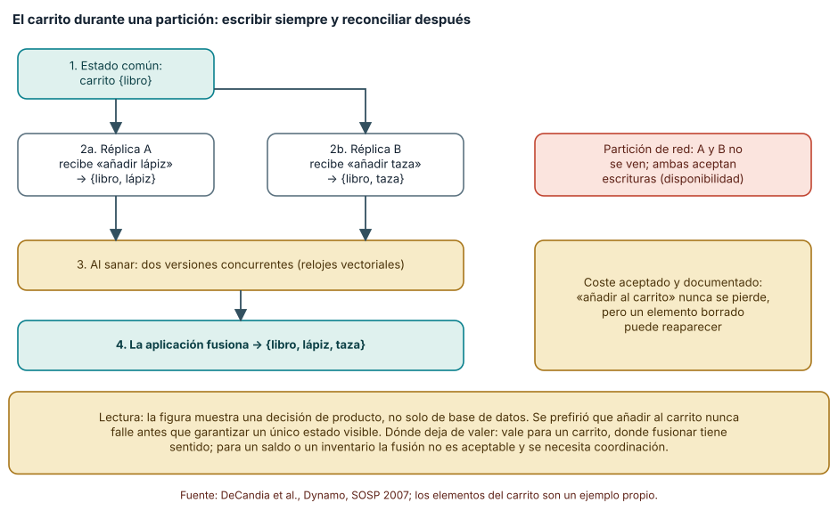
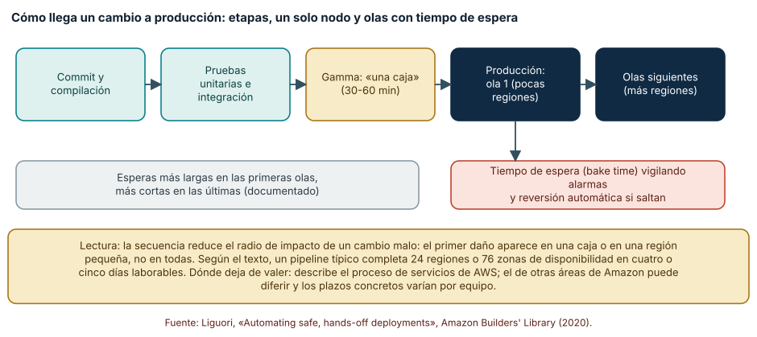
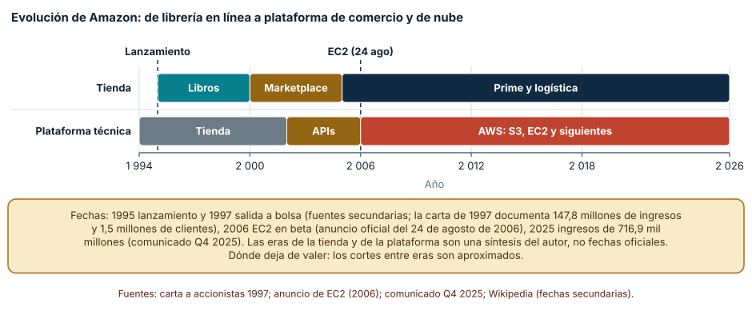

# Amazon

[↑ Casos de éxito](README.md) · [← Mercado Libre](mercado-libre.md) · [Spotify →](spotify.md)

> **Qué es este caso.** Un análisis profesional de una empresa real que el programa usa para contrastar la teoría con la práctica. No es una clase ni un rol: es la realidad frente al curso. Se apoya solo en fuentes públicas citadas al final, consultadas el 16 de noviembre de 2026, y separa lo que está **documentado**, lo que es **inferido** y lo que **no se sabe**.

**Cómo leer este caso.**

Cada afirmación lleva una etiqueta implícita en su redacción:

- **Documentado**: lo dice una fuente citada (por ejemplo, «Documentado (F1)»). Si la fuente es secundaria, se declara.
- **Observable**: se puede comprobar usando el producto público, sin una cita específica en este caso.
- **Inferido**: conclusión del autor a partir de lo documentado; puede ser falsa.
- **No se sabe**: dato que la empresa no ha publicado. No se rellena con suposiciones.

Las cifras de dinero están en dólares estadounidenses salvo que se diga otra cosa. Los «mil millones» son 10^9.

## Ficha histórica

| Dato | Valor | Estado de la evidencia |
| --- | --- | --- |
| Nombre | Amazon.com, Inc. | Documentado (F4) |
| Fundador | Jeff Bezos (Jeffrey Preston Bezos) | Documentado (fuente secundaria, F12) |
| Año de fundación | 1994, en Bellevue (Washington) | Fuente secundaria (F12) |
| Lanzamiento de la tienda | julio de 1995 | Fuente secundaria (F12) |
| Salida a bolsa | mayo de 1997 | Fuente secundaria (F12); la carta de 1997 (F3) corresponde a su primer año como empresa cotizada |
| Sede | Seattle (Washington) | Documentado: los comunicados de resultados se emiten desde Seattle (F4) |
| Primer hito de escala | 1997: más de 1,5 millones de clientes y 147,8 millones de ingresos (838 % de crecimiento) | Documentado (F3) |
| AWS | Servicios web para desarrolladores desde 2002; EC2 en beta el 24 de agosto de 2006 | 2002: fuente secundaria (F12); EC2: documentado (F5) |
| Ingresos 2025 | 716,9 mil millones (2024: 638,0) | Documentado (F4) |
| Resultado operativo 2025 | 80,0 mil millones (2024: 68,6) | Documentado (F4) |
| Utilidad neta 2025 | 77,7 mil millones (2024: 59,2) | Documentado (F4) |
| Empleados | más de 1,5 millones | Fuente secundaria (F12); el número exacto varía por fecha |
| Estado actual | Empresa cotizada (Nasdaq: AMZN); segmentos América del Norte, Internacional y AWS | Documentado (F4) |

Dos aclaraciones de método. Primero, la fundación en 1994 y el lanzamiento de 1995 vienen de una fuente secundaria: el cliente automatizado de este trabajo fue bloqueado por el servidor de la SEC y no se pudo leer el informe anual 10-K de la propia empresa, que es la fuente primaria de esas fechas. Segundo, «lanzamiento» significa aquí la apertura de la tienda al público, no la constitución legal de la sociedad.

## Contexto y problema

A mediados de los años noventa el comercio en línea era una promesa sin práctica. Un comprador que quería un libro dependía de una librería física con un inventario limitado a su estantería; Internet permitía, en principio, ofrecer un catálogo mucho mayor. El problema que Amazon atacó fue doble: **hacer posible comprar a distancia con confianza** (pagar con tarjeta a una empresa desconocida, esperar el envío) y **construir la logística** capaz de cumplir la promesa.

La carta a los accionistas de 1997 (F3) deja ver la postura con la que Amazon abordó el problema, y es lectura obligada porque fija el criterio de decisión que explica casi todo lo posterior. Documentado (F3): el primer año completo como empresa cotizada cerró con más de 1,5 millones de clientes servidos y 147,8 millones de dólares de ingresos, con un crecimiento del 838 %; y la carta dice textualmente que «este es el Día 1» de Internet y de Amazon. Documentado (F3): la dirección se comprometía a enfocarse «implacablemente» en el cliente, a invertir pensando en liderazgo de mercado a largo plazo antes que en rentabilidad inmediata y a medir de forma analítica la eficacia de cada programa para abandonar los que no rindan.

Este contexto importa para el curso porque muestra que muchas decisiones técnicas de Amazon (servicios pequeños, contratos de latencia, nube) responden a una decisión de negocio previa: sostener un crecimiento rápido sin que el sistema ni la organización se paralicen.

## Mercado, usuarios y casos de uso

Amazon es una empresa con varios mercados superpuestos. La figura siguiente muestra los actores y qué intercambian.

**Cómo leer la figura.** El rectángulo oscuro es la tienda de Amazon; las flechas continuas son intercambios del comercio (pedidos y pagos, catálogo y stock, órdenes de envío) y la flecha discontinua marca el intercambio distinto: infraestructura ofrecida como servicio. Mira primero qué actores aparecen fuera de la tienda: sin vendedores externos ni logística no hay oferta que comprar. **Dónde deja de valer.** No muestra el reparto de costos compartidos entre tienda y nube, que Amazon no publica; tampoco cubre las líneas de negocio menores (publicidad, dispositivos, suscripciones).

### Tipos de usuario y cómo cambia la experiencia

- **Comprador.** Observable: busca un producto, compara precio, valoraciones y plazo de entrega, compra y sigue el envío. La experiencia cambia mucho entre un comprador ocasional y un miembro Prime, que busca un plazo de entrega corto y beneficios añadidos; Prime es un programa de suscripción (año de inicio por fuente secundaria, F12).
- **Vendedor externo.** Documentado de forma general (F12): una parte significativa de las ventas procede de terceros que usan la plataforma como escaparate. Observable: el vendedor gestiona catálogo, precios, inventario y envíos o delega el envío a la logística de Amazon. La experiencia es la de un panel de gestión, no la de la tienda.
- **Desarrollador o empresa cliente de AWS.** Documentado (F5): el 24 de agosto de 2006 Amazon anunció EC2, un servicio web de capacidad de cómputo redimensionable, «diseñado para facilitar la computación a escala web a los desarrolladores». Este usuario ve consolas, APIs y facturas por uso, no la tienda.
- **Administradores y operadores internos.** No se sabe cómo son sus herramientas; lo único documentado (F9) es que los equipos despliegan mediante pipelines automatizados con alarmas y reversión.

### Casos de uso característicos

1. Comprar un libro o un producto de consumo y recibirlo en unos días (tienda).
2. Hacer una compra en una fecha de pico, como el Prime Day, con millones de personas a la vez (F10).
3. Que una empresa alquile servidores durante horas para un proyecto y los devuelva (AWS).
4. Que un vendedor pequeño llegue a clientes de otros países sin montar su logística.

## Funcionalidad de principio a fin

Describimos la experiencia de un comprador instancia por instancia. Lo que sigue es **observable** salvo cuando se cita una fuente.

1. **Primer contacto.** El usuario llega por búsqueda, anuncio o recomendación a la página de un producto. Esa página es el caso que Amazon describe en F1: una petición de página al motor de renderizado se resuelve consultando **más de 150 servicios** (precio, inventario, reseñas, recomendaciones). Documentado (F1).
2. **Registro y cuenta.** Para pagar se necesita una cuenta con dirección y método de pago. Observable: el registro es breve y se puede completar durante la compra. No se sabe cómo se almacenan internamente los datos de pago.
3. **Uso central: carrito y compra.** El usuario añade artículos al carrito. Documentado (F1, F2): el carrito es el ejemplo canónico de una operación que debe estar **siempre disponible para escritura**: «añadir al carrito» no puede fallar, aun si hay una partición de red; las versiones divergentes se fusionan después y el coste aceptado es que un elemento borrado puede reaparecer.
4. **Pago.** El usuario confirma la compra y se cobra el método elegido. Documentado de forma general: operaciones con efecto económico no son seguras de reintentar salvo que sean idempotentes; la Biblioteca de Constructores lo dice explícitamente y cita un parámetro de idempotencia en la API `RunInstances` de EC2 (F6). Inferido: el flujo de pago de la tienda sigue la misma disciplina; no hay documento público que lo describa.
5. **Cumplimiento y entrega.** Observable: el pedido pasa a un almacén o a un vendedor, se prepara, se envía y se actualiza el estado. No se sabe el diseño interno de la logística.
6. **Soporte y devoluciones.** Observable: el usuario abre una incidencia o una devolución desde su cuenta. No se sabe cuánto es automatizado.
7. **Operación diaria.** Documentado (F9): los cambios llegan a producción por pipelines automáticos que despliegan varias veces al día sin que nadie observe cada despliegue; la vigilancia la hacen alarmas y reversiones automáticas.

## Negocio y economía

**Modelo.** Documentado (F4): Amazon reporta tres segmentos: América del Norte, Internacional y AWS. En 2025 las ventas fueron 426,3, 161,9 y 128,7 mil millones respectivamente.

**Cómo leer la figura.** Cada segmento tiene dos barras: la azul verdosa es lo que vende y la roja lo que deja como resultado operativo. Compara la longitud de las dos dentro de cada segmento: en la tienda de América del Norte la roja es una fracción pequeña de la verde, mientras que en AWS la roja es más de un tercio de la verde. La conclusión que sostiene: la tienda aporta el volumen y la nube aporta la mayor parte del resultado. **Dónde deja de valer.** Es un solo año; los segmentos reparten costos compartidos con criterios que Amazon no detalla, de modo que el margen de cada uno es una lectura contable, no un precio de coste. No dice nada sobre el flujo de caja ni sobre inversión de capital.

**Fuentes de ingreso.** Documentado (F4): ventas de producto y de servicios en las tres divisiones. Fuente secundaria (F12): una proporción importante de las ventas procede de vendedores externos (la cifra citada allí es de 2008). No se sabe hoy el desglose público entre tienda propia, comisión de vendedores, publicidad y suscripciones dentro del segmento de América del Norte con el nivel de detalle que pide este caso.

**Costos relevantes.** Inferido: la logística, el cómputo y la inversión en capacidad dominan el gasto. No se sabe el desglose exacto.

**Ventajas.** Inferido, con apoyo documental: el apalancamiento entre tienda y nube (la misma infraestructura sirve a ambas, F1, F5) y una cultura de decidir a largo plazo (F3). Documentado (F4): en 2025 el resultado operativo creció a 80,0 mil millones y el flujo de caja operativo de los últimos doce meses a 139,5 mil millones.

## Arquitectura y esquemas

Todo lo que sigue es lo que Amazon ha publicado; no existe un diagrama interno público completo y no se debe inventar uno.

### Componentes: la página como abanico de servicios

**Cómo leer la figura.** De izquierda a derecha, una petición entra al motor de renderizado; hacia abajo, el abanico de servicios; en el recuadro de abajo, Dynamo almacena el estado del carrito. El recuadro discontinuo marca lo que no se sabe. Mira primero la cifra «más de 150 servicios» y el contrato de 300 ms al 99,9 % de las peticiones con 500 por segundo: el contrato está en la **cola** de la distribución, no en la media. **Dónde deja de valer.** El artículo es de 2007 (F1); no sirve para contar los servicios actuales ni para suponer que la composición no ha cambiado.

Documentado (F1): el artículo presenta Dynamo como almacén clave-valor de alta disponibilidad, que se usaba para carritos, gestión de sesiones y listas de más vendidos, entre otros servicios. Documentado (F1): el servicio de carrito sirvió «decenas de millones de peticiones» que dieron lugar a más de 3 millones de pagos finalizados en un solo día, y el servicio de sesiones manejó cientos de miles de sesiones activas simultáneas. Documentado (F1): en dos años de uso, las aplicaciones recibieron respuestas exitosas (sin tiempo agotado) para el 99,9995 % de las peticiones y no hubo pérdida de datos.

### Flujo de la operación crítica: añadir al carrito durante una partición

**Cómo leer la figura.** Sigue los cuatro pasos numerados. En el paso 2 las dos réplicas divergen porque no se ven; en el paso 3 el sistema detecta que las versiones son concurrentes (los relojes vectoriales lo permiten); en el paso 4 la aplicación, no la base de datos, decide fusionar. El recuadro de la derecha recoge el coste que el artículo reconoce. **Dónde deja de valer.** Los elementos del carrito son un ejemplo propio. La fusión es válida para un carrito, no para un saldo ni un inventario; en esos casos la coordinación es necesaria. Documentado (F1): Dynamo permite configurar tres parámetros (N, R, W) para ajustar la consistencia y la disponibilidad por servicio.

### Datos y escala

Documentado (F1): el artículo describe particionado por hash consistente, replicación en N nodos, quórums sueltos con traspaso de pistas y relojes vectoriales. Documentado (F2): Werner Vogels, entonces CTO de Amazon, explicó el mismo compromiso con los modelos de consistencia (consistencia eventual, lectura de las propias escrituras, de sesión, monótona) y recalcó que quien diseña el servicio debe saber qué modelo necesita. Documentado (F10): para el Prime Day de 2022, DynamoDB sostuvo un pico de 105,2 millones de peticiones por segundo con latencias de un solo dígito en milisegundos; SQS procesó 70,5 millones de mensajes por segundo; SES alcanzó 33.000 correos por segundo en pico; y el parque de EBS gestionó 11,4 billones de peticiones al día (10^12 el billón). Esas cifras describen servicios de AWS que alimentan a la tienda, no el rendimiento total de la tienda.

### Cómo llega un cambio a producción

**Cómo leer la figura.** Las cajas de arriba son etapas del pipeline; la de gamma despliega a la unidad más pequeña (una máquina o contenedor) durante 30 minutos a una hora; luego las olas de producción agrupan regiones en tamaños crecientes y cada una espera (bake time) mientras vigila alarmas. Mira que las esperas son más largas al principio, donde el riesgo es mayor. **Dónde deja de valer.** Documentado (F9) para servicios de AWS con 24 regiones y 76 zonas de disponibilidad en el momento del artículo (2020); los plazos son por defecto y varían por equipo.

## Casos especiales y cómo se resuelven

| Situación | Qué se documenta | Qué enseña |
| --- | --- | --- |
| Pico de tráfico | Prime Day: la huella de servidores creció solo un 7 % frente al Cyber Monday anterior, por mayor eficiencia (F10). | Un pico se absorbe con capacidad elástica y eficiencia, no solo con más máquinas. |
| Fallo parcial de una dependencia | Estabilidad estática: el sistema sigue funcionando con lo que ya tenía aunque la dependencia falle; EC2 separa plano de control y plano de datos (F7). | Los fallos del plano de control no deben detener el trabajo que el plano de datos ya hace. |
| Reintentos en cascada | Los reintentos son «egoístas»; se usa retroceso exponencial con tope, jitter y un cubo de fichas local; los interruptores de circuito añaden comportamiento modal difícil de probar (F6). | Reintentar sin freno convierte un fallo pequeño en uno grande. |
| Vecino ruidoso o ataque | Shuffle sharding: asignar a cada cliente una combinación casi única de recursos para que un abuso no afecte a todos (F8). | Reducir el radio de impacto es un diseño, no una reacción. |
| Consistencia | Carrito siempre escribible; la fusión puede resucitar elementos (F1). | La consistencia es una decisión de producto con coste visible. |
| Cambio defectuoso | Despliegue por olas, tiempo de espera y reversión (F9). | La velocidad de entrega y la seguridad se negocian con diseño del pipeline. |
| Cumplimiento y offline | No se sabe: Amazon no publica cómo gestiona el cumplimiento normativo de la tienda en cada país ni el comportamiento sin conexión de sus apps. | Aquí la ausencia de datos es parte del caso. |

## Línea de tiempo

**Cómo leer la figura.** Dos carriles paralelos: arriba lo que el cliente ve, abajo la plataforma que lo sostiene. Las líneas verticales son hitos con fecha; los bloques son eras aproximadas. Observa que la etapa «APIs» antecede al lanzamiento de EC2: la nube nació de ofrecer lo que la tienda ya usaba. **Dónde deja de valer.** Los cortes entre eras son síntesis del autor, no fechas oficiales.

En prosa, con sus fuentes:

- **1994–1995.** Fundación y apertura de la tienda en línea de libros (F12, fuente secundaria).
- **1997.** Primera carta a los accionistas: «Día 1», 1,5 millones de clientes, 147,8 millones de ingresos (F3).
- **2000–2005.** Aparición del marketplace de terceros y de Prime (F12, fuente secundaria; las fechas exactas no se verificaron con fuente primaria).
- **2002–2006.** Servicios web para desarrolladores y el anuncio de EC2 en beta el 24 de agosto de 2006 (F12, F5).
- **2007–2009.** Los artículos de Dynamo y de consistencia eventual explican públicamente el modelo de disponibilidad y los compromisos (F1, F2).
- **2019–2020.** La Biblioteca de Constructores publica prácticas sobre aislamiento de carga, estabilidad estática y despliegues seguros (F7, F8, F9).
- **2025.** 716,9 mil millones de ingresos y 128,7 de AWS (F4).

## Vínculo con el curso

El caso ilustra las siguientes clases. La columna derecha dice qué parte de la teoría se ve en el caso.

| Concepto | Clases | Qué parte de la teoría ilustra el caso |
| --- | --- | --- |
| Consistencia, disponibilidad y particiones | [SE-342](../../classes/part-28-concurrencia-y-sistemas-distribuidos/se-342-consistencia-disponibilidad-y-particiones/README.md), [SE-340](../../classes/part-28-concurrencia-y-sistemas-distribuidos/se-340-tiempo-relojes-y-orden-parcial/README.md), [SE-341](../../classes/part-28-concurrencia-y-sistemas-distribuidos/se-341-fallos-parciales-y-modelos-de-red/README.md) | El carrito de Dynamo es el ejemplo clásico de elegir disponibilidad y reconciliar después; los relojes vectoriales son orden parcial. |
| Replicación, particionado y balanceo | [SE-319](../../classes/part-26-datos-persistencia-y-recuperacion/se-319-replicacion-particion-y-distribucion/README.md), [SE-345](../../classes/part-28-concurrencia-y-sistemas-distribuidos/se-345-replicacion-sharding-y-balanceo/README.md) | Hash consistente, N réplicas y quórums sueltos de Dynamo. |
| Idempotencia y reintentos | [SE-246](../../classes/part-20-backend-apis-y-procesamiento-asincrono/se-246-idempotencia-reintentos-y-deduplicacion/README.md), [SE-344](../../classes/part-28-concurrencia-y-sistemas-distribuidos/se-344-idempotencia-y-procesamiento-distribuido/README.md), [SE-378](../../classes/part-31-calidad-rendimiento-y-resiliencia/se-378-timeouts-retries-backoff-y-jitter/README.md), [SE-524](../../classes/part-43-patrones-de-diseno-empresariales-y-de-resiliencia/se-524-resiliencia-timeout-retry-con-jitter-y-circuit-breaker/README.md) | La Biblioteca insiste en que lo que tiene efectos se reintenta solo si es idempotente, con retroceso y jitter. |
| Fallos parciales, disyuntores y mamparos | [SE-379](../../classes/part-31-calidad-rendimiento-y-resiliencia/se-379-circuit-breakers-bulkheads-y-degradacion/README.md), [SE-525](../../classes/part-43-patrones-de-diseno-empresariales-y-de-resiliencia/se-525-resiliencia-bulkhead-sidecar-ambassador-y-degradacion/README.md), [SE-341](../../classes/part-28-concurrencia-y-sistemas-distribuidos/se-341-fallos-parciales-y-modelos-de-red/README.md) | Crítica documentada a los interruptores de circuito y alternativa del cubo de fichas. |
| Radio de impacto y celdas | [SE-536](../../classes/part-44-estilos-arquitectonicos/se-536-arquitectura-celular-y-radio-de-impacto/README.md), [SE-534](../../classes/part-44-estilos-arquitectonicos/se-534-multi-tenancy-y-aislamiento/README.md) | Shuffle sharding y las zonas de disponibilidad como unidades de aislamiento. |
| Disponibilidad y recuperación | [SE-380](../../classes/part-31-calidad-rendimiento-y-resiliencia/se-380-disponibilidad-durabilidad-y-recuperacion/README.md), [SE-430](../../classes/part-35-observabilidad-sre-e-incidentes/se-430-continuidad-disaster-recovery-y-ejercicios/README.md) | Estabilidad estática: seguir con lo que ya se sabe cuando la dependencia cae. |
| Latencia, colas y capacidad | [SE-376](../../classes/part-31-calidad-rendimiento-y-resiliencia/se-376-latencia-throughput-saturacion-y-capacidad/README.md), [SE-375](../../classes/part-31-calidad-rendimiento-y-resiliencia/se-375-carga-estres-picos-y-endurance/README.md), [SE-356](../../classes/part-29-cloud-plataforma-e-infraestructura/se-356-escalado-capacidad-y-costos/README.md) | Contratos en el percentil 99,9 y picos de Prime Day. |
| SLI y SLO | [SE-425](../../classes/part-35-observabilidad-sre-e-incidentes/se-425-sli-slo-sla-y-presupuestos-de-error/README.md) | Un contrato de latencia en la cola es un SLO. |
| Despliegue progresivo y reversión | [SE-413](../../classes/part-34-ci-cd-iac-y-platform-engineering/se-413-entrega-y-despliegue-continuos/README.md), [SE-404](../../classes/part-33-build-release-y-cadena-de-suministro/se-404-canary-blue-green-y-rollback/README.md), [SE-403](../../classes/part-33-build-release-y-cadena-de-suministro/se-403-feature-flags-y-entrega-progresiva/README.md) | Una caja, olas, tiempo de espera y reversión automática. |
| Arquitectura de servicios y equipos | [SE-303](../../classes/part-25-arquitectura-de-software-y-dominio/se-303-monolito-modular-monolith-y-servicios/README.md), [SE-532](../../classes/part-44-estilos-arquitectonicos/se-532-microservicios-y-sus-costes-reales/README.md), [SE-310](../../classes/part-25-arquitectura-de-software-y-dominio/se-310-arquitectura-socio-tecnica-y-limites-de-equipo/README.md), [SE-446](../../classes/part-37-gestion-liderazgo-y-practica-profesional/se-446-diseno-de-equipos-y-ownership/README.md) | Servicios con dueños claros (inferido); ver las advertencias de la sección 10. |
| Nube y servicios gestionados | [SE-349](../../classes/part-29-cloud-plataforma-e-infraestructura/se-349-iaas-paas-saas-y-responsabilidad-compartida/README.md), [SE-352](../../classes/part-29-cloud-plataforma-e-infraestructura/se-352-serverless-y-ejecucion-gestionada/README.md) | Origen de EC2 como infraestructura convertida en producto. |
| Modelos de negocio y costos | [SE-133](../../classes/part-11-economia-metricas-y-decisiones-de-producto/se-133-modelos-de-negocio-y-sostenibilidad/README.md), [SE-134](../../classes/part-11-economia-metricas-y-decisiones-de-producto/se-134-costos-de-construccion-operacion-y-oportunidad/README.md), [SE-140](../../classes/part-11-economia-metricas-y-decisiones-de-producto/se-140-finops-de-producto-y-costo-por-resultado/README.md), [SE-453](../../classes/part-37-gestion-liderazgo-y-practica-profesional/se-453-economia-del-software-y-costo-total/README.md) | Tres segmentos con márgenes muy distintos y decisiones a largo plazo. |
| Propuesta de valor desde el cliente | [SE-125](../../classes/part-10-descubrimiento-y-estrategia-de-producto/se-125-propuesta-de-valor-y-resultados-deseados/README.md), [SE-122](../../classes/part-10-descubrimiento-y-estrategia-de-producto/se-122-usuarios-actores-trabajos-y-contextos/README.md) | «Working Backwards» parte del cliente (F11). |

## Qué no generalizar

**Qué aprender.**

1. **Decide con el cliente y el largo plazo como criterio.** La carta de 1997 formula ese criterio con claridad (F3). Para ti, la lección técnica es que una restricción de negocio explícita guía decisiones de arquitectura.
2. **Pon el contrato en la cola de la latencia.** Una página que depende de decenas de servicios no cumple con un promedio (F1).
3. **Convierte el fallo parcial en parte del diseño.** Estabilidad estática, shuffle sharding y despliegues por olas son tres respuestas al mismo problema: acotar el radio de impacto.
4. **Reintenta con disciplina.** Retroceso, jitter, límite local e idempotencia van juntos (F6).
5. **Una buena infraestructura interna puede ser un producto.** EC2 nació de capacidades que la tienda necesitaba (F5, F12).

**Qué NO generalizar.**

- **No copies la arquitectura de servicios de Amazon sin su organización.** Documentado (F9): los despliegues pasan por pipelines muy automatizados; inferido: eso exige equipos con dueños claros de cada servicio. Un equipo de diez personas con un monolito no obtiene los mismos beneficios de 150 servicios.
- **No copies la consistencia del carrito.** El mismo mecanismo en un saldo bancario produciría errores graves.
- **No tomes los números de Prime Day como referencia de tu escala.** Son de un conjunto de servicios de AWS con millones de clientes.
- **No concluyas que «Amazon hace X» si solo lo publica AWS.** Muchos de los textos citados describen servicios de AWS, no la tienda.
- **Sesgo de supervivencia.** Las prácticas publicadas son las que Amazon decide mostrar; los experimentos fallidos no aparecen.
- **Los datos más antiguos pueden estar desactualizados.** El artículo de Dynamo es de 2007 y describe un sistema interno anterior; no debe confundirse con el servicio DynamoDB de AWS, que es otro producto.

## Fuentes públicas verificadas

Todas consultadas el 2026-11-16 con `curl` o verificadas por DOI en Crossref. «Secundaria» significa que no es una fuente primaria de la empresa.

- **F1.** DeCandia, Hastorun, Jampani, Kakulapati, Lakshman, Pilchin, Sivasubramanian, Vosshall y Vogels, «Dynamo: Amazon's Highly Available Key-value Store», SOSP 2007. DOI 10.1145/1294261.1294281. PDF: [https://www.allthingsdistributed.com/files/amazon-dynamo-sosp2007.pdf](https://www.allthingsdistributed.com/files/amazon-dynamo-sosp2007.pdf)
- **F2.** Werner Vogels, «Eventually Consistent», Communications of the ACM, enero de 2009. DOI 10.1145/1435417.1435432. Versión del autor (23 de diciembre de 2008): [https://www.allthingsdistributed.com/2008/12/eventually_consistent.html](https://www.allthingsdistributed.com/2008/12/eventually_consistent.html)
- **F3.** Jeff Bezos, carta a los accionistas de 1997: [https://s2.q4cdn.com/299287126/files/doc_financials/annual/Shareholderletter97.pdf](https://s2.q4cdn.com/299287126/files/doc_financials/annual/Shareholderletter97.pdf)
- **F4.** Amazon, «Amazon.com Announces Fourth Quarter Results» (resultados del cuarto trimestre y del año 2025): [https://ir.aboutamazon.com/news-release/news-release-details/2026/Amazon-com-Announces-Fourth-Quarter-Results/](https://ir.aboutamazon.com/news-release/news-release-details/2026/Amazon-com-Announces-Fourth-Quarter-Results/)
- **F5.** AWS, «Announcing Amazon Elastic Compute Cloud (Amazon EC2) - beta», 24 de agosto de 2006: [https://aws.amazon.com/about-aws/whats-new/2006/08/24/announcing-amazon-elastic-compute-cloud-amazon-ec2---beta/](https://aws.amazon.com/about-aws/whats-new/2006/08/24/announcing-amazon-elastic-compute-cloud-amazon-ec2---beta/)
- **F6.** Amazon Builders' Library, «Timeouts, retries, and backoff with jitter»: [https://aws.amazon.com/builders-library/timeouts-retries-and-backoff-with-jitter/](https://aws.amazon.com/builders-library/timeouts-retries-and-backoff-with-jitter/)
- **F7.** Amazon Builders' Library, «Static stability using Availability Zones»: [https://aws.amazon.com/builders-library/static-stability-using-availability-zones/](https://aws.amazon.com/builders-library/static-stability-using-availability-zones/)
- **F8.** Amazon Builders' Library, «Workload isolation using shuffle-sharding» (5 de diciembre de 2019): [https://aws.amazon.com/builders-library/workload-isolation-using-shuffle-sharding/](https://aws.amazon.com/builders-library/workload-isolation-using-shuffle-sharding/)
- **F9.** Clare Liguori, «Automating safe, hands-off deployments», Amazon Builders' Library (18 de junio de 2020): [https://aws.amazon.com/builders-library/automating-safe-hands-off-deployments/](https://aws.amazon.com/builders-library/automating-safe-hands-off-deployments/)
- **F10.** Jeff Barr, «Amazon Prime Day 2022 – AWS for the Win!», AWS News Blog (25 de julio de 2022): [https://aws.amazon.com/blogs/aws/amazon-prime-day-2022-aws-for-the-win/](https://aws.amazon.com/blogs/aws/amazon-prime-day-2022-aws-for-the-win/)
- **F11.** Amazon, «An insider look at Amazon's culture and processes» (extracto de *Working Backwards*, de Colin Bryar y Bill Carr): [https://www.aboutamazon.com/news/workplace/an-insider-look-at-amazons-culture-and-processes](https://www.aboutamazon.com/news/workplace/an-insider-look-at-amazons-culture-and-processes)
- **F12.** (Secundaria) Wikipedia, «Amazon (company)», texto de la edición consultada el 2026-11-16: [https://en.wikipedia.org/wiki/Amazon_(company)](https://en.wikipedia.org/wiki/Amazon_(company)). Se usa solo para fechas de fundación, lanzamiento, salida a bolsa y AWS 2002, y se declara en cada caso.

**Qué no cubren estas fuentes.** No documentan la arquitectura actual de la tienda, el diseño de la logística, el desglose de ingresos de América del Norte ni el costo interno de la nube; esos puntos quedan como «no se sabe».

---

[↑ Casos de éxito](README.md) · [← Mercado Libre](mercado-libre.md) · [Spotify →](spotify.md)
