# Amazon

[↑ Casos de éxito](README.md) · [← Mercado Libre](mercado-libre.md) · [Spotify →](spotify.md)

> **Qué es este caso.** Un análisis profesional de una empresa real que el programa usa para contrastar la teoría con la práctica. No es una clase ni un rol: es la realidad frente al curso. Se apoya solo en fuentes públicas citadas al final, consultadas el 16 de noviembre de 2026, y separa lo que está **documentado**, lo que es **inferido** y lo que **no se sabe**.

**Cómo leer este caso.**

Cada afirmación lleva una etiqueta implícita en su redacción:

- **Documentado**: lo dice una fuente citada (por ejemplo, «Documentado (F1)»). Si la fuente es secundaria, se declara.
- **Observable**: se puede comprobar usando el producto público, sin una cita específica en este caso.
- **Inferido**: conclusión del autor a partir de lo documentado; puede ser falsa.
- **Análisis propio**: razonamiento o cálculo del autor sobre alternativas o números; se rotula como tal y no es un hecho.
- **No se sabe**: dato que la empresa no ha publicado. No se rellena con suposiciones.

Las cifras de dinero están en dólares estadounidenses salvo que se diga otra cosa. Los «mil millones» son 10^9 y el «billón» es 10^12.

**Mapa de los niveles de arquitectura.** La sección de arquitectura recorre el caso a varias distancias, cada una con su figura: contexto del ecosistema, la página como abanico de servicios, el almacén Dynamo por dentro (anillo, secuencia, versiones, datos de producción, evolución del particionado), la resiliencia (reintentos, estabilidad estática, shuffle sharding), la entrega de cambios (olas y cajas), la economía y la historia. Un hecho público de 2007 sobre un almacén no describe la tienda de hoy: cada figura declara su alcance.

## Ficha histórica

| Dato | Valor | Estado de la evidencia |
| --- | --- | --- |
| Nombre | Amazon.com, Inc. | Documentado (F4) |
| Fundador | Jeff Bezos (Jeffrey Preston Bezos) | Documentado (fuente secundaria, F12) |
| Año de fundación | 1994, en Bellevue (Washington) | Fuente secundaria (F12) |
| Lanzamiento de la tienda | julio de 1995 | Fuente secundaria (F12) |
| Salida a bolsa | mayo de 1997 | Documentado: la carta de 1997 (F3) menciona la oferta pública inicial de mayo de 1997 |
| Sede | Seattle (Washington) | Documentado: los comunicados de resultados se emiten desde Seattle (F4) |
| Primer hito de escala | 1997: más de 1,5 millones de clientes y 147,8 millones de ingresos (838 % de crecimiento) | Documentado (F3) |
| Inventario de 1997 | más de 200 000 títulos al cierre de 1997 | Documentado (F3) |
| AWS | Servicios web para desarrolladores desde 2002; S3 anunciado el 14 de marzo de 2006; EC2 en beta el 24 de agosto de 2006 | 2002: fuente secundaria (F12); S3: documentado (F14); EC2: documentado (F5) |
| Ingresos 2025 | 716,9 mil millones (2024: 638,0) | Documentado (F4) |
| Resultado operativo 2025 | 80,0 mil millones (2024: 68,6) | Documentado (F4) |
| Utilidad neta 2025 | 77,7 mil millones (2024: 59,2) | Documentado (F4) |
| Flujo de caja operativo 2025 | 139,5 mil millones (2024: 115,9) | Documentado (F4) |
| Inversión de capital 2025 | compras de propiedad y equipo por 131,8 mil millones brutos (2024: 83,0) | Documentado (F4) |
| Empleados | más de 1,5 millones (a fin de 2025, tiempo completo y parcial, sin contratistas) | Documentado (F4) |
| Estado actual | Empresa cotizada (Nasdaq: AMZN); segmentos América del Norte, Internacional y AWS | Documentado (F4) |

Dos aclaraciones de método. Primero, la fundación en 1994 y el lanzamiento de 1995 vienen de una fuente secundaria: el cliente automatizado de este trabajo fue bloqueado por el servidor de la SEC y no se pudo leer el informe anual 10-K de la propia empresa, que es la fuente primaria de esas fechas. Segundo, «lanzamiento» significa aquí la apertura de la tienda al público, no la constitución legal de la sociedad.

## Contexto y problema

A mediados de los años noventa el comercio en línea era una promesa sin práctica. Un comprador que quería un libro dependía de una librería física con un inventario limitado a su estantería; Internet permitía, en principio, ofrecer un catálogo mucho mayor. El problema que Amazon atacó fue doble: **hacer posible comprar a distancia con confianza** (pagar con tarjeta a una empresa desconocida, esperar el envío) y **construir la logística** capaz de cumplir la promesa.

### Lo que dice la carta de 1997

La carta a los accionistas de 1997 (F3) deja ver la postura con la que Amazon abordó el problema, y es lectura obligada porque fija el criterio de decisión que explica casi todo lo posterior. Documentado (F3): el primer año completo como empresa cotizada cerró con más de 1,5 millones de clientes servidos y 147,8 millones de dólares de ingresos, con un crecimiento del 838 %; y la carta dice textualmente que «este es el Día 1» de Internet y de Amazon. Documentado (F3): la dirección se comprometía a enfocarse «implacablemente» en el cliente, a invertir pensando en liderazgo de mercado a largo plazo antes que en rentabilidad inmediata y a medir de forma analítica la eficacia de cada programa para abandonar los que no rindan.

La carta añade dos ideas que importan para un ingeniero. Documentado (F3): ante la disyuntiva entre la apariencia contable y el valor presente de los flujos de caja futuros, la dirección declara que elegirá los flujos de caja. Documentado (F3): la dirección declara medir su liderazgo con el crecimiento de clientes y de ingresos, con cuánto repiten compra los clientes y con la fuerza de la marca, y dice que, en esa etapa, prioriza el crecimiento porque cree que la escala es condición para un modelo económico poderoso. Documentado (F3): al mismo tiempo declara que mantendrá una cultura de costos ajustados, «particularmente en un negocio con pérdidas netas».

### La apuesta, en tres frases

Inferido, con apoyo en la carta (F3) y en el artículo de Dynamo (F1): la apuesta de Amazon fue una combinación de tres decisiones de negocio que condicionaron la ingeniería. Primera, **selección y disponibilidad como ventaja**: la carta compara el catálogo en línea con una tienda física que «ocuparía seis campos de fútbol» y habla de más de 200 000 títulos en inventario al cierre de 1997. Segunda, **crecimiento antes que beneficio**, lo que exige una plataforma que escale sin reescribirse cada año. Tercera, **la disponibilidad como argumento comercial**: el artículo de Dynamo abre diciendo que incluso la menor interrupción tiene consecuencias financieras y afecta la confianza del cliente (F1). Esas tres decisiones explican por qué la historia técnica que sigue trata sobre latencia en la cola, fallo parcial y despliegues seguros, y no sobre algoritmos de recomendación.

Este contexto importa para el curso porque muestra que muchas decisiones técnicas de Amazon (servicios pequeños, contratos de latencia, nube) responden a una decisión de negocio previa: sostener un crecimiento rápido sin que el sistema ni la organización se paralicen.

## Mercado, usuarios y casos de uso

Amazon es una empresa con varios mercados superpuestos. La figura siguiente muestra los actores y qué intercambian.

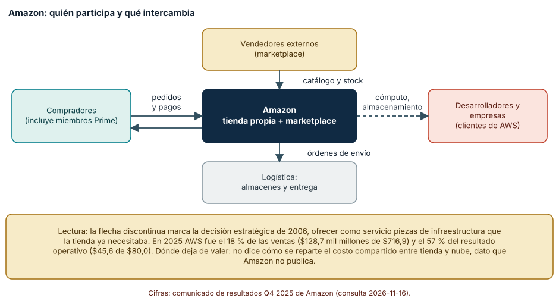

**Cómo leer la figura.** El rectángulo oscuro es la tienda de Amazon; las flechas continuas son intercambios del comercio (pedidos y pagos, catálogo y stock, órdenes de envío) y la flecha discontinua marca el intercambio distinto: infraestructura ofrecida como servicio. Mira primero qué actores aparecen fuera de la tienda: sin vendedores externos ni logística no hay oferta que comprar. **Dónde deja de valer.** No muestra el reparto de costos compartidos entre tienda y nube, que Amazon no publica; tampoco cubre las líneas de negocio menores (dispositivos, salud, satélites).

### Un mercado de varios lados

Análisis propio, con base en los segmentos que publica Amazon (F4): el sistema conecta al menos cuatro grupos con incentivos distintos. Los **compradores** quieren precio, selección y plazo. Los **vendedores externos** quieren tráfico, logística y reglas estables. Los **anunciantes** (vendedores, proveedores, editoriales) quieren aparecer ante un comprador que ya tiene intención de compra. Los **clientes de AWS** quieren capacidad de cómputo y almacenamiento sin comprar servidores. Documentado (F4): Amazon reporta ingresos por servicios de vendedores externos, publicidad, suscripciones y AWS como líneas separadas, lo que confirma que son negocios distintos con clientes distintos.

### Tipos de usuario y cómo cambia la experiencia

- **Comprador ocasional.** Observable: busca un producto, compara precio, valoraciones y plazo de entrega, compra y sigue el envío. Su incentivo es el precio y la certeza del plazo; su límite es la desconfianza ante una empresa que no conoce.
- **Miembro Prime.** Observable: busca un plazo de entrega corto y beneficios añadidos; Prime es un programa de suscripción (año de inicio por fuente secundaria, F12). Documentado (F4): los ingresos por suscripciones fueron de 13,1 mil millones solo en el cuarto trimestre de 2025, con 14 % de crecimiento interanual. Inferido: la suscripción cambia el incentivo del cliente, porque el costo marginal de cada envío le resulta cero y compra con más frecuencia.
- **Vendedor externo.** Documentado de forma general (F12): una parte significativa de las ventas procede de terceros que usan la plataforma como escaparate. Documentado (F4): en el cuarto trimestre de 2025, las unidades vendidas por terceros fueron el 61 % de las unidades pagadas. Observable: el vendedor gestiona catálogo, precios, inventario y envíos o delega el envío a la logística de Amazon. La experiencia es la de un panel de gestión, no la de la tienda.
- **Anunciante.** Documentado (F4): Amazon vende publicidad a vendedores, proveedores, editoriales y autores mediante anuncios patrocinados, de display y de video; en el cuarto trimestre de 2025 la línea ingresó 21,3 mil millones y creció 23 %. No se sabe cuántos anunciantes hay ni cómo se asigna la subasta.
- **Desarrollador o empresa cliente de AWS.** Documentado (F5): el 24 de agosto de 2006 Amazon anunció EC2, un servicio web de capacidad de cómputo redimensionable, «diseñado para facilitar la computación a escala web a los desarrolladores». Documentado (F14): el 14 de marzo de 2006 había anunciado S3, almacenamiento «para Internet» con la misma infraestructura que Amazon usa para sus propios sitios. Este usuario ve consolas, APIs y facturas por uso, no la tienda.
- **Ingeniero de un equipo de servicio (usuario interno).** Documentado (F9): sube su cambio a la rama principal y una tubería lo lleva a producción sin que nadie lo vigile; la última revisión humana es la revisión de código. Su incentivo es entregar rápido sin ser el responsable de un incidente; su límite son las alarmas y las reversiones automáticas.
- **Operador de guardia.** Documentado (F9): recibe una página cuando salta la alarma grave del servicio, a menudo con la reversión ya en curso. No se sabe cómo son sus herramientas internas.

### Casos de uso característicos

1. Comprar un libro o un producto de consumo y recibirlo en unos días (tienda).
2. Hacer una compra en una fecha de pico, como el Prime Day, con millones de personas a la vez (F10).
3. Que una empresa alquile servidores durante horas para un proyecto y los devuelva (AWS).
4. Que un vendedor pequeño llegue a clientes de otros países sin montar su logística.
5. Que un equipo de ingeniería despliegue varias veces al día sin vigilar cada despliegue (F9).
6. Que un servicio interno guarde el estado del carrito sin perderlo, aunque se caiga un centro de datos (F1).

### Qué trabajo contrata cada usuario

Análisis propio, aplicando el enfoque de «trabajos por hacer» del curso ([SE-122](../../classes/part-10-descubrimiento-y-estrategia-de-producto/se-122-usuarios-actores-trabajos-y-contextos/README.md)): el comprador contrata a Amazon para **reducir el riesgo de comprar a distancia** (certeza de plazo y devolución); el vendedor, para **convertir inventario en ventas sin construir su propia infraestructura de venta**; el cliente de AWS, para **convertir capital fijo en costo variable**; el ingeniero interno, para **llegar a producción sin ser un cuello de botella**. Cada trabajo explica una decisión técnica distinta: el plazo explica la logística, la ausencia de infraestructura propia explica la API, la conversión de capital en costo variable explica la facturación por uso y la entrega rápida explica las tuberías.

## Funcionalidad de principio a fin

Describimos la experiencia de cada tipo de usuario, de la primera interacción al caso límite. Lo que sigue es **observable** salvo cuando se cita una fuente; lo que se infiere se rotula así.

### Instancia 1: el comprador, desde la búsqueda hasta la devolución

1. **Primer contacto.** El usuario llega por búsqueda, anuncio o recomendación a la página de un producto. Esa página es el caso que Amazon describe en F1: una petición de página al motor de renderizado se resuelve consultando **más de 150 servicios** (precio, inventario, reseñas, recomendaciones). Documentado (F1). Caso límite: si uno de esos servicios es lento, la página lo muestra incompleto o lo omite; no se sabe qué elementos son opcionales.
2. **Registro y cuenta.** Para pagar se necesita una cuenta con dirección y método de pago. Observable: el registro es breve y se puede completar durante la compra. No se sabe cómo se almacenan internamente los datos de pago.
3. **Uso central: carrito.** El usuario añade artículos al carrito. Documentado (F1): el carrito es el ejemplo canónico de una operación que debe estar **siempre disponible para escritura**: «añadir al carrito» no puede fallar, aun si hay una partición de red; las versiones divergentes se fusionan después y el coste aceptado es que un elemento borrado puede reaparecer. Caso límite: el usuario abre el carrito desde dos dispositivos con la conexión cortada; las dos escrituras se conservan y se unen.
4. **Pago.** El usuario confirma la compra y se cobra el método elegido. Documentado de forma general: operaciones con efecto económico no son seguras de reintentar salvo que sean idempotentes; la Biblioteca de Constructores lo dice explícitamente y cita un parámetro de idempotencia en la API `RunInstances` de EC2 (F6). Inferido: el flujo de pago de la tienda sigue la misma disciplina; no hay documento público que lo describa. Caso límite: el usuario pulsa dos veces; la disciplina de idempotencia existe precisamente para que no se cobre dos veces.
5. **Cumplimiento y entrega.** Observable: el pedido pasa a un almacén o a un vendedor, se prepara, se envía y se actualiza el estado. No se sabe el diseño interno de la logística. Documentado (F4): en 2025 los gastos de logística y cumplimiento sumaron 109,1 mil millones, el 15,2 % de las ventas.
6. **Soporte y devoluciones.** Observable: el usuario abre una incidencia o una devolución desde su cuenta. No se sabe cuánto es automatizado.
7. **Operación diaria.** Documentado (F9): los cambios llegan a producción por tuberías automáticas que despliegan varias veces al día sin que nadie observe cada despliegue; la vigilancia la hacen alarmas y reversiones automáticas.

### Instancia 2: el vendedor externo, del alta al pago

Observable salvo lo citado. El vendedor se registra, sube catálogo y precios, elige si envía él o delega en la logística de Amazon, y recibe pedidos y liquidaciones. Documentado (F4): Amazon cobra comisiones y tarifas de logística y otros servicios a los vendedores; esa línea de «servicios a vendedores externos» fue de 172,2 mil millones en 2025 (suma de los cuatro trimestres). Documentado (F4): los vendedores externos fueron el 61 % de las unidades pagadas en el cuarto trimestre de 2025. Casos límite que se deducen de la teoría y no de una fuente: una ficha de producto con precio erróneo en un pico de ventas, un inventario que el vendedor agota mientras el comprador tiene el artículo en el carrito, una disputa por la devolución. No se sabe cómo Amazon resuelve internamente cada uno; lo que sí se puede decir es que un inventario compartido exige coordinación, no fusión (ver «Qué no generalizar»).

### Instancia 3: el desarrollador de AWS, de la cuenta a la factura

Documentado (F5, F14): el desarrollador crea una cuenta, llama a una API web para pedir capacidad (EC2) o guardar objetos (S3) y paga por uso; los anuncios de 2006 prometen justamente eso. Observable hoy: consola, APIs, regiones y facturas. Documentado (F7): EC2 se divide en un plano de control (hacer cambios: lanzar, parar, modificar) y un plano de datos (las instancias que ya corren); el patrón recomendado a los clientes es no depender del plano de control durante un fallo. Caso límite: una zona de disponibilidad falla; si el cliente tenía capacidad preasignada en otras zonas, su servicio sigue; si necesitaba lanzar instancias nuevas, depende del plano de control justo cuando está bajo estrés.

### Instancia 4: el ingeniero interno, de la idea a producción

Documentado (F11): la idea nace como un comunicado de prensa de menos de una página y un FAQ de hasta cinco, que se lee en silencio en una reunión y se revisa varias veces con la dirección. Documentado (F9): el cambio se escribe, se revisa por un compañero (obligatorio y único paso manual), se compila sin red, pasa pruebas unitarias, de integración y de «una caja» en gamma, y avanza por olas de producción con alarmas y reversión. Documentado (F13): hace años, el promedio desde la confirmación hasta producción era de 16 días, casi todos de espera. Caso límite: la tubería se bloquea por una prueba fallida; no afecta a otras tuberías del mismo servicio (infraestructura, configuración, parches) porque cada una es independiente (F9).

### Instancia 5: el operador de guardia, de la alarma a la reversión

Documentado (F9): cada microservicio tiene en cada región una alarma grave que se activa por tasas de fallo, latencia o utilización; la misma alarma avisa al operador y revierte automáticamente un despliegue en curso, y los equipos agregan las alarmas de todos sus servicios en una alarma que revierte todos los despliegues en esa región. Caso límite: un cambio en un servicio degrada a su vecino; por eso la alarma agregada cubre a todos. No se sabe cómo se organiza el escalamiento humano.

## Negocio y economía

### Modelo y segmentos

Documentado (F4): Amazon reporta tres segmentos: América del Norte, Internacional y AWS. En 2025 las ventas fueron 426,3, 161,9 y 128,7 mil millones respectivamente.

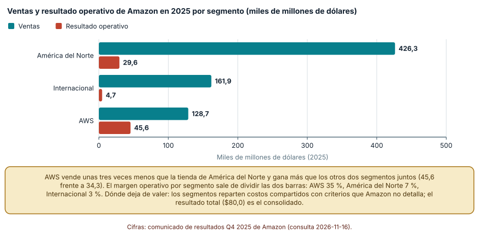

**Cómo leer la figura.** Cada segmento tiene dos barras: la azul verdosa es lo que vende y la roja lo que deja como resultado operativo. Compara la longitud de las dos dentro de cada segmento: en la tienda de América del Norte la roja es una fracción pequeña de la verde, mientras que en AWS la roja es más de un tercio de la verde. La conclusión que sostiene: la tienda aporta el volumen y la nube aporta la mayor parte del resultado. **Dónde deja de valer.** Es un solo año; los segmentos reparten costos compartidos con criterios que Amazon no detalla, de modo que el margen de cada uno es una lectura contable, no un precio de coste. No dice nada sobre el flujo de caja ni sobre inversión de capital.

Análisis propio con las cifras citadas: el margen operativo de 2025 es de 6,9 % en América del Norte (29,6 de 426,3), 2,9 % en Internacional (4,7 de 161,9) y 35,4 % en AWS (45,6 de 128,7). AWS pesa el 18 % de las ventas y el 57 % del resultado operativo. Documentado (F4): en el cuarto trimestre de 2025 AWS creció 24 %, la tasa más rápida de los últimos 13 trimestres según el propio comunicado.

### De dónde vienen los ingresos

Documentado (F4): el comunicado desglosa las ventas en siete líneas. Sumando sus cuatro trimestres de 2025 se obtiene la figura siguiente.

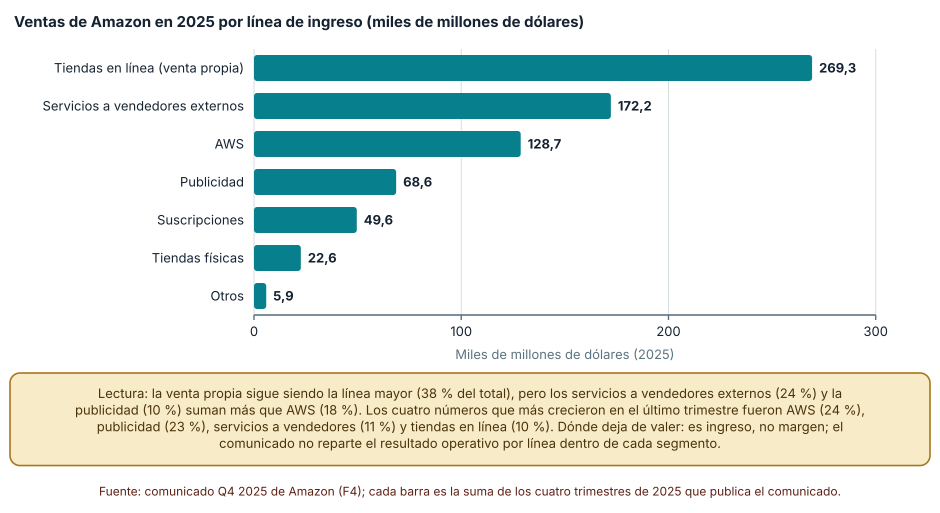

**Cómo leer la figura.** Cada barra es una línea de ingreso de 2025; la longitud muestra su tamaño relativo. Mira primero que la venta propia es la mayor, y luego que la suma de servicios a vendedores y publicidad (240,8) supera a la venta propia en tiendas físicas y en línea. **Dónde deja de valer.** Mide ingreso, no ganancia: un dólar de publicidad y un dólar de venta propia no tienen el mismo margen, y el comunicado no lo publica por línea.

Hechos y lectura. Documentado (F4): la línea de «servicios a vendedores externos» incluye comisiones, tarifas de cumplimiento y envío, y otros servicios a vendedores; la de publicidad incluye anuncios patrocinados, display y video; la de suscripciones incluye Prime y los servicios de video, audio, libros y música no AWS. Inferido: la publicidad y los servicios a vendedores son ingresos que se apoyan en el tráfico que la venta propia ya genera, así que su costo marginal probablemente sea menor que el de vender un producto, pero el comunicado no lo demuestra.

### Estructura de costos

**Cómo leer la figura.** Cada barra es el 100 % de las ventas del año, dividido en cinco partes. Mira primero el tamaño del segmento coral (costo de ventas, casi la mitad) y luego compara el segmento oscuro (tecnología e infraestructura) entre 2024 y 2025: crece más que cualquier otro. **Dónde deja de valer.** Son rubros contables consolidados; no se pueden asignar a la tienda o a AWS, y «tecnología e infraestructura» mezcla cómputo para los clientes de AWS, cómputo propio y desarrollo.

Documentado (F4) en 2025: costo de ventas 356,4 mil millones, logística y cumplimiento 109,1, tecnología e infraestructura 108,5, marketing 47,1, administración 11,2 y otros 4,6; el total de gastos operativos fue 636,9 y el resultado operativo 80,0. Análisis propio: la tecnología e infraestructura pasó de 13,9 % a 15,1 % de las ventas en un año; el crecimiento de ese rubro es el reflejo contable de construir capacidad para AWS y para la inteligencia artificial.

### Inversión, caja y apalancamiento

Documentado (F4): el flujo de caja operativo de 2025 fue de 139,5 mil millones y las compras de propiedad y equipo, netas de ventas e incentivos, de 128,3 mil millones en los últimos doce meses; el flujo de caja libre fue de 11,2 mil millones (2024: 38,2). El comunicado atribuye el aumento de la inversión principalmente a inteligencia artificial y anuncia unos 200 mil millones de inversión de capital para 2026. Análisis propio: la estrategia de 1997, elegir los flujos de caja futuros sobre la apariencia contable (F3), sigue visible casi treinta años después: el resultado operativo sube mientras el flujo de caja libre baja porque se invierte más. Es una apuesta, y puede resultar equivocada; no hay una cifra pública que demuestre su retorno todavía.

### Unit economics: lo que se puede y no se puede decir

Documentado (F4): en el cuarto trimestre de 2025 los envíos mundiales costaron 31,5 mil millones y las unidades pagadas crecieron 12 % interanual. Análisis propio: dividir esos 31,5 mil millones entre las unidades no es posible porque el comunicado publica el crecimiento de unidades pero no su cantidad. Por eso este caso no calcula un «costo por pedido» ni el valor por cliente de vida (LTV): serían cifras inventadas. Lo que sí se puede hacer es seguir la lógica de la carta de 1997 (F3), que mide el éxito con el crecimiento de clientes e ingresos y la tasa de repetición, y comprobar que el comunicado de 2025 sigue publicando crecimiento de unidades pagadas, proporción de vendedores externos y crecimiento de cada línea.

### Efectos de red y por qué ganó este actor

Análisis propio (con apoyo en F3, F4 y F14, no una afirmación documentada de causalidad): el mercado favoreció a Amazon por tres mecanismos que se refuerzan. Primero, un **efecto de red entre compradores y vendedores**: más compradores atraen más vendedores y más selección, lo que atrae más compradores; la carta de 1997 ya apuesta por «selección» y «escala» (F3) y hoy los vendedores externos son el 61 % de las unidades (F4). Segundo, un **apalancamiento de infraestructura**: la tienda y la nube usan una base común (F1, F14), de modo que la capacidad para la tienda se amortiza ofreciéndola. Tercero, una **economía de escala logística**: 109 mil millones de logística (F4) solo se recuperan con volumen. Qué no se sabe: Amazon no publica cuota de mercado por país ni compara con competidores, así que no se puede decir en qué medida estos mecanismos pesan más que, por ejemplo, la inversión en marca o la tolerancia de los inversores a las pérdidas iniciales (esto último sí está declarado en F3).

### Competidores

Documentado (F3): la carta de 1997 habla de «entrada competitiva agresiva» sin nombrar competidores. Los comunicados recientes (F4) no comparan con rivales. Este caso no incluye una tabla de competidores porque las fuentes citadas no la contienen; hacerlo exigiría fuentes adicionales por mercado y por año.

### Visión y misión

Documentado (F15): en su página institucional Amazon dice que su misión es hacer más fácil y mejor la vida de sus clientes mediante la invención constante en su nombre, y que ofrece selección, valor y comodidad en compras, nube, entretenimiento, dispositivos, publicidad, salud y servicios de IA (consulta del 16 de noviembre de 2026). Documentado (F16): los principios de liderazgo resumen una ambición triple, ser la empresa más centrada en el cliente, el mejor empleador y el lugar de trabajo más seguro de la Tierra; el primer principio es la obsesión por el cliente. Documentado (F3): en 1997 la carta a los accionistas ya hablaba de enfoque implacable en el cliente y de liderazgo de mercado a largo plazo. Análisis propio: la misión ha cambiado de alcance (de libros a «todo») pero no de criterio; lo que se amplía es la lista de servicios, no el método de decidir desde el cliente. No se sabe cómo ha evolucionado el texto oficial entre 1997 y hoy más allá de lo que muestran las cartas.

### Estructura, plantilla y presencia mundial

Documentado (F4): sede en Seattle; plantilla de más de 1,5 millones de personas, de tiempo completo y parcial, sin contratistas, al cierre de 2025. Documentado (F4): tres segmentos de reporte (América del Norte, Internacional y AWS). Documentado (F15): la página institucional habla de una red de operaciones mundial. No se sabe: el organigrama de alto nivel más allá del equipo directivo, la plantilla por segmento o por área (ingeniería, logística, AWS), la lista de oficinas y centros de ingeniería por país con su año de apertura. Documentado (F13): los equipos de software son pequeños y de un solo hilo («single-threaded»), dueños de su producto y de sus defectos; no hay cifras de cuántos equipos hay.

### Esquema del negocio

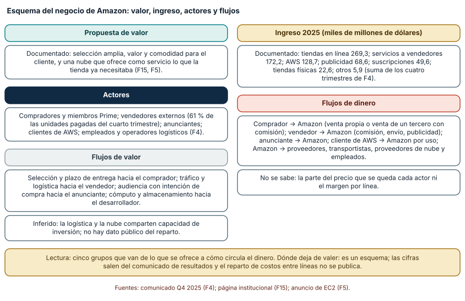

**Cómo leer la figura.** Cinco grupos de arriba abajo: qué se ofrece, cuánto ingresa por línea, quién participa y cómo circulan el dinero y el valor. **Dónde deja de valer.** Es un esquema con cifras del comunicado de resultados; no publica el margen por línea ni el reparto del precio entre actores.

Documentado (F4): la empresa vende producto propio y servicios, y cobra por tres vías a quien vende en su plataforma (comisiones, cumplimiento y envío, y publicidad) además de las suscripciones y de AWS. El valor y el dinero circulan en sentidos opuestos: el comprador entrega dinero y recibe selección y plazo; el vendedor entrega comisión y recibe tráfico y logística; el anunciante entrega dinero y recibe audiencia; el cliente de AWS entrega dinero por uso y recibe capacidad. No se sabe: cuánto del precio de un artículo vendido por un tercero se queda Amazon (el comunicado agrega «comisiones y tarifas de cumplimiento y envío» en una sola línea).

### Costos operativos y estructura de capital

Documentado (F4): en 2025 el costo de ventas fue de 356,4 mil millones de dólares (49,7 % de las ventas), logística y cumplimiento de 109,1 (15,2 %), tecnología e infraestructura de 108,5 (15,1 %), marketing de 47,1 (6,6 %), administración de 11,2 (1,6 %) y otros gastos de 4,6; el resultado operativo fue de 80,0 mil millones (11,2 %), frente a 68,6 (10,8 %) en 2024; el desglose se dibujó en la figura de la estructura de costos. Documentado (F4): los gastos de envío mundiales del cuarto trimestre fueron de 31,5 mil millones, y las unidades pagadas crecieron 12 %. Documentado (F4): amortización de 65,8 mil millones y compras de propiedad y equipo de 131,8 mil millones brutos en 2025. No se sabe: el costo de infraestructura de AWS por separado, el costo del soporte al cliente, los costos de pago a procesadores y el gasto de marketing por línea; el comunicado no los desglosa por segmento.

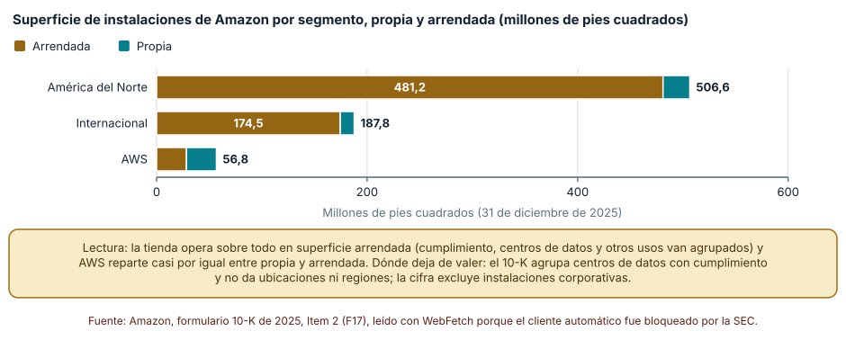

**Cómo leer la figura.** Cada barra es un segmento; el tramo dorado es superficie arrendada y el azul verdoso, propia. Mira que AWS es el único con más propia que arrendada. **Dónde deja de valer.** Agrupa centros de datos con cumplimiento y otros usos; no hay ubicaciones ni regiones.

Documentado (F17): a fines de 2025 la superficie de instalaciones era de 741,5 millones de pies cuadrados arrendados y 78,1 millones propios; la de oficinas, de 40,2 millones en América del Norte y 28,3 en el resto; 623 tiendas físicas. Inferido: la infraestructura no es «solo propia»; incluye una parte importante de arrendamientos, incluso en el segmento AWS (28,4 millones arrendados frente a 28,5 propios).

### Competidores nombrados en documentos oficiales

Documentado (F17): el 10-K de 2025 no nombra competidores concretos; describe categorías: minoristas físicos, de comercio electrónico y omnicanal, proveedores de nube y servicios de TI, y empresas de dispositivos electrónicos, publicidad, comestibles y salud, y dice que el mercado es muy competitivo y cambia con rapidez. No se sabe: cuota de mercado por país o segmento con fuente y año; las fuentes de este caso no la contienen y este caso no la inventa.

### Plantilla, sede y oficinas (actualización con el 10-K)

Documentado (F17): 1.576.000 empleados de tiempo completo y parcial al 31 de diciembre de 2025, sin contar contratistas ni personal temporal; sede en 410 Terry Avenue North, Seattle, con oficinas propias y arrendadas en la región de Puget Sound y en Arlington (Virginia). No se sabe: oficinas y centros de ingeniería por país con su año de apertura.

## Arquitectura y esquemas

Todo lo que sigue es lo que Amazon ha publicado; no existe un diagrama interno público completo y no se debe inventar uno. Cada nivel de zoom lleva su figura y su etiqueta de evidencia.

### Nivel 1: contexto (quién se conecta con quién)

Ya visto en la figura de contexto. Resumen de evidencia: documentado (F4) que existen tres segmentos; documentado (F1) que la plataforma de tienda es una arquitectura orientada a servicios con «cientos de servicios» y decenas de miles de servidores en muchos centros de datos (en 2007); no se sabe el número actual.

### Nivel 2: contenedores y servicios (la página como abanico)

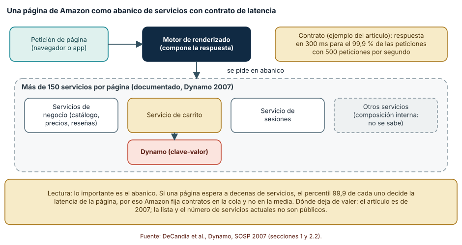

**Cómo leer la figura.** De izquierda a derecha, una petición entra al motor de renderizado; hacia abajo, el abanico de servicios; en el recuadro de abajo, Dynamo almacena el estado del carrito. El recuadro discontinuo marca lo que no se sabe. Mira primero la cifra «más de 150 servicios» y el contrato de 300 ms al 99,9 % de las peticiones con 500 por segundo: el contrato está en la **cola** de la distribución, no en la media. **Dónde deja de valer.** El artículo es de 2007 (F1); no sirve para contar los servicios actuales ni para suponer que la composición no ha cambiado.

Documentado (F1): una petición a una de las páginas de comercio electrónico requiere que el motor de renderizado envíe peticiones a más de 150 servicios; esos servicios tienen a su vez dependencias, de modo que el grafo de llamadas tiene varios niveles. Documentado (F1): cada servicio tiene sus propios almacenes, accesibles solo dentro de sus límites, y los servicios agregadores suelen ser sin estado, aunque con mucha caché. Documentado (F1): cada cliente y servicio pactan un acuerdo de nivel de servicio, un contrato formalmente negociado con el ritmo de peticiones esperado y la latencia esperada en esas condiciones; el ejemplo es 300 ms para el 99,9 % de las peticiones con 500 por segundo de carga máxima. Documentado (F1): se expresan en el percentil 99,9 y no en la media o la mediana porque, por ejemplo, los clientes con historial largo requieren más procesamiento personalizado y quedan en la cola; un contrato en la media los dejaría fuera.

Análisis propio: con N servicios en abanico y un contrato de percentil 99,9 en cada uno, la probabilidad de que una página los cumpla todos es 0,999^N; para N=150 es de 0,86, es decir, aproximadamente 14 de cada 100 páginas verían al menos un servicio fuera de contrato si los fallos fueran independientes. Es el motivo por el que el artículo habla de percentiles altos: la media no protege la página. Es un cálculo ilustrativo con una hipótesis (independencia) que no es un hecho publicado.

### Nivel 3: componentes de la operación crítica (Dynamo)

El carrito se apoya en Dynamo. Documentado (F1): Dynamo es un almacén clave-valor para objetos de menos de 1 MB, sin esquema relacional, sin operaciones que abarquen varios elementos, sin garantías de aislamiento y con actualizaciones de una sola clave; está pensado para servicios que aceptan consistencia más débil a cambio de alta disponibilidad. Documentado (F1): cada servicio que lo usa ejecuta sus propias instancias. Documentado (F1): se supone un entorno no hostil y no hay requisitos de seguridad como autenticación o autorización, porque solo lo usan servicios internos de Amazon.

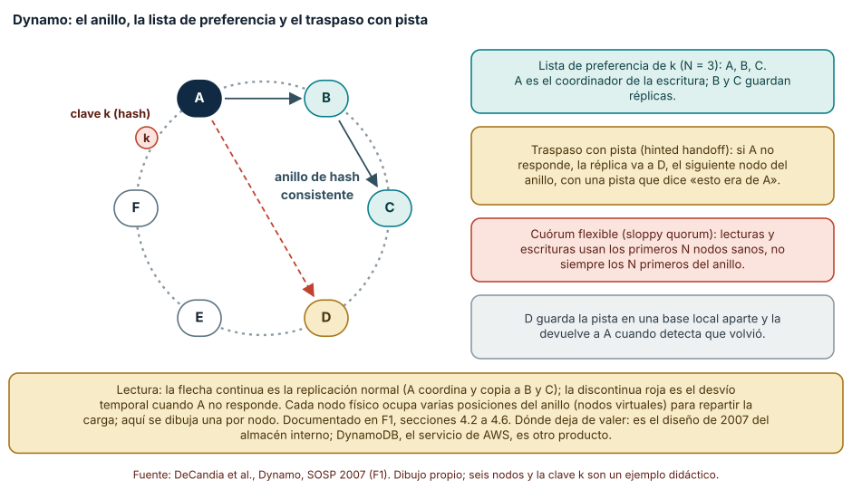

**Cómo leer la figura.** El círculo es el espacio de hash, que se recorre en el sentido de las agujas del reloj; cada letra es un nodo; la bolita k es la clave que se escribe. El primer nodo que se encuentra a la derecha de k (A) la coordina y la replica en los siguientes (B y C). La flecha discontinua roja es el desvío temporal a D. Mira primero la lista de preferencia: las réplicas son los vecinos en el anillo. **Dónde deja de valer.** Es un dibujo didáctico de seis nodos; en producción cada nodo físico ocupa muchas posiciones del anillo (nodos virtuales), y el artículo describe el diseño de 2007 del almacén interno, no el servicio DynamoDB de AWS.

Documentado (F1): el particionado usa hash consistente: la salida de la función de hash se trata como un anillo y cada nodo recibe uno o varios puntos (tokens). Cada clave se asigna al primer nodo con posición mayor que la suya al recorrer el anillo. La ventaja es que la entrada o salida de un nodo solo afecta a sus vecinos. Documentado (F1): para repartir mejor la carga, cada nodo físico se asigna a varios puntos del anillo, los «nodos virtuales», y el número de nodos virtuales puede ajustarse a la capacidad de cada máquina. Documentado (F1): el coordinador de una clave la replica en los N-1 nodos siguientes y la lista de nodos responsables se llama lista de preferencia; contiene más de N nodos para tolerar fallos y se construye saltando posiciones para que sean nodos físicos distintos.

### Nivel 4: flujo de secuencia de dos operaciones clave

**Cómo leer la figura.** Cada columna es un actor y el tiempo avanza hacia abajo; las flechas continuas son peticiones y las discontinuas respuestas; los recuadros dorados son pasos internos. Mira primero que la escritura responde en el paso 6 sin esperar a la réplica C, y que la lectura devuelve en el paso 11 todas las versiones concurrentes. **Dónde deja de valer.** Es la configuración común (3,2,2) documentada; otros servicios usan otras, y con partición el solapamiento entre lectura y escritura no está garantizado.

Documentado (F1): el cliente envía put con la clave, el contexto y el valor; el coordinador genera el reloj vectorial de la nueva versión, la escribe localmente y la envía a los N nodos más altos y alcanzables de la lista de preferencia; si al menos W-1 responden, la escritura se considera exitosa. En la lectura, el coordinador pide todas las versiones a los N nodos y espera R respuestas; si recoge versiones sin relación causal, devuelve todas, con el contexto, para que la aplicación las reconcilie y escriba la versión fusionada. Documentado (F1): la configuración común es (3,2,2); N determina la durabilidad (un valor típico es 3), y W y R influyen en disponibilidad, durabilidad y consistencia. Documentado (F1): bajar W a 1 impide que se rechace una escritura mientras haya un solo nodo vivo, a costa de un riesgo de inconsistencia y de una ventana de vulnerabilidad de durabilidad; subir W reduce esa ventana pero rechaza más escrituras.

Documentado (F1): la «lectura reparadora» (read repair): tras responder, el coordinador espera un pequeño tiempo las respuestas restantes y, si alguna réplica devolvió una versión antigua, la actualiza con la última. Documentado (F1): el tercer mecanismo de sincronización son los árboles de Merkle, árboles de hash en los que cada rama puede compararse sin leer todos los datos; cada nodo mantiene un árbol por rango de claves y dos nodos intercambian raíces para detectar rápidamente qué claves difieren.

**Cómo leer la figura.** Sigue los cuatro pasos numerados. En el paso 2 las dos réplicas divergen porque no se ven; en el paso 3 el sistema detecta que las versiones son concurrentes (los relojes vectoriales lo permiten); en el paso 4 la aplicación, no la base de datos, decide fusionar. El recuadro de la derecha recoge el coste que el artículo reconoce. **Dónde deja de valer.** Los elementos del carrito son un ejemplo propio. La fusión es válida para un carrito, no para un saldo ni un inventario; en esos casos la coordinación es necesaria. Documentado (F1): Dynamo permite configurar tres parámetros (N, R, W) para ajustar la consistencia y la disponibilidad por servicio.

Documentado (F1): el artículo explica por qué el carrito merece este tratamiento: la operación «añadir al carrito» no puede olvidarse ni rechazarse; si el estado más reciente no está disponible y el usuario hace un cambio sobre una versión antigua, ese cambio debe conservarse y fusionarse después. Tanto «añadir» como «borrar» del carrito se traducen en operaciones put. Por eso el servicio de carrito aplica una fusión de negocio, y el modo de resolución «gana la última escritura» queda para otros servicios como el de sesiones.

### Nivel 5: modelo de datos y flujo de datos

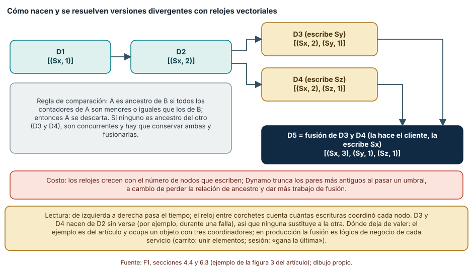

**Cómo leer la figura.** Cada recuadro es una versión del mismo objeto con su reloj vectorial entre corchetes; las flechas indican «descendiente de». Mira que D3 y D4 no tienen flecha entre sí: ninguna es antecesora de la otra, por eso son concurrentes y hay que fusionarlas. El recuadro inferior recuerda el costo. **Dónde deja de valer.** Es el ejemplo del artículo, con tres nodos; el mecanismo funciona con más nodos, pero el reloj crece.

Documentado (F1): Dynamo trata cada modificación como una versión nueva e inmutable del objeto. Normalmente la nueva versión sustituye a la anterior y el sistema lo detecta por sintaxis; si hay fallos y actualizaciones concurrentes, aparecen ramas que el sistema no puede reconciliar y entrega todas a la aplicación. El reloj vectorial es una lista de pares (nodo, contador); un reloj es ancestro de otro si todos sus contadores son menores o iguales; si no, son concurrentes. Documentado (F1): para que el reloj no crezca sin límite, se trunca el par más antiguo cuando se llega a un umbral; el artículo reconoce que esto puede volver ineficiente la reconciliación, aunque dice que no lo observó en producción.

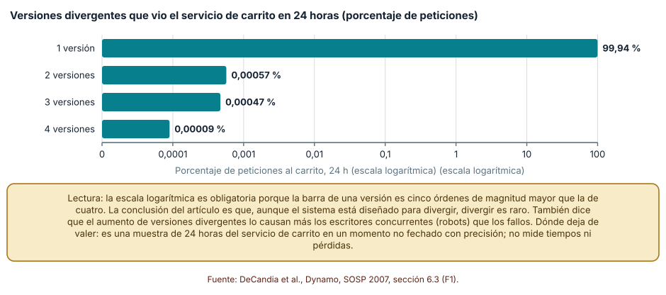

**Cómo leer la figura.** Cada barra es el porcentaje de peticiones al carrito que vieron ese número de versiones en 24 horas; el eje es logarítmico porque la primera barra es cinco órdenes de magnitud mayor que la última. **Dónde deja de valer.** Es una muestra de 24 horas de 2006-2007 del servicio de carrito; no es una medida de fallos ni de pérdida de datos.

Documentado (F1, sección 6.3): en 24 horas el 99,94 % de las peticiones vio una versión, el 0,00057 % dos, el 0,00047 % tres y el 0,00009 % cuatro. El artículo concluye que las divergencias son raras y que su aumento se debe más a escritores concurrentes, casi siempre robots, que a fallos; no da más detalle «por la naturaleza sensible de la historia». Esto muestra una lección de datos: el mecanismo que parece complejo se activa casi nunca, pero cuando se necesita, evita perder una compra.

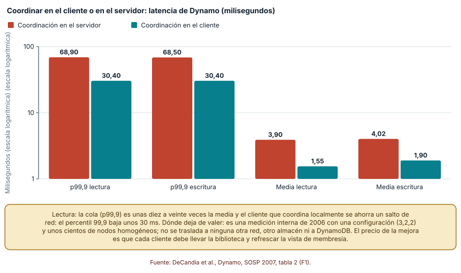

**Cómo leer la figura.** Dos series (servidor y cliente) para cuatro mediciones; la escala es logarítmica porque las medias y los percentiles difieren en más de un orden de magnitud. Mira primero que en el percentil 99,9 el cliente gana unos 30 ms. **Dónde deja de valer.** Es una medición de 2006 en una configuración (3,2,2) y unos cientos de nodos homogéneos.

Documentado (F1, tabla 2): con coordinación en el servidor, la latencia en el percentil 99,9 fue de 68,9 ms para lectura y 68,5 ms para escritura, y la media de 3,9 y 4,02 ms; con coordinación en el cliente, 30,4 ms en ambos percentiles y 1,55 y 1,9 ms de media. Documentado (F1): además de la latencia, la coordinación en el cliente evita el balanceador de carga para repartir peticiones, a cambio de que el cliente lleve una biblioteca y refresque periódicamente la vista de la membresía. Documentado (F1, sección 6.1): el perfil de un mes mostró un patrón diurno y un percentil 99,9 de alrededor de 200 ms, un orden de magnitud sobre la media; un búfer de escritura en memoria, incluso de mil objetos, redujo el percentil 99,9 por un factor de cinco en el pico, a cambio de riesgo de perder escrituras si cae el servidor, mitigado haciendo que una de las N réplicas haga una escritura duradera.

**Cómo leer la figura.** Tres columnas, de la estrategia inicial a la adoptada; arriba, la definición; abajo, lo que se aprendió. Mira el contraste entre los problemas de la izquierda y los beneficios de la derecha. **Dónde deja de valer.** Es el relato de una corrección de diseño dentro de un almacén en un sistema de 30 nodos de ejemplo; no cuenta cómo se organiza hoy ningún sistema de Amazon.

Documentado (F1, sección 6.2): la estrategia inicial asignaba T tokens aleatorios por nodo y partía el espacio por valor de token; al unirse un nodo había que escanear discos de otros nodos con la prioridad más baja para no afectar a los clientes, y en temporada alta el arranque llegó a tardar casi un día; además, el cambio de rangos obligaba a recalcular árboles de Merkle y dificultaba archivar. La estrategia adoptada divide el espacio en Q particiones iguales y reparte Q/S tokens por nodo: mejoró el reparto de carga y redujo en tres órdenes de magnitud el tamaño de los metadatos que los nodos se cuentan por gossip; cada partición vive en un archivo propio y se mueve como unidad. Documentado (F1): una estrategia intermedia sirvió de paso durante la migración y fue la de peor eficiencia (carga media entre carga del nodo más cargado).

Documentado (F1, sección 6.5): los procesos de fondo (sincronización de réplicas, traspasos de pistas, cambios de miembros) causaron contención de recursos al principio; se añadió un control de admisión que reserva franjas de tiempo y las ajusta según la latencia observada de las operaciones de primer plano, por ejemplo comparando el percentil 99 de lecturas de la última ventana de 60 segundos con un umbral de 50 ms.

Documentado (F1): el almacenamiento local es intercambiable: BDB Transactional Data Store, BDB Java Edition, MySQL o un búfer en memoria con respaldo persistente; la mayoría de las instancias de producción usaba BDB, y MySQL se reserva para objetos de mayor tamaño. La membresía se propaga por un protocolo de rumor (gossip) y la detección de fallos es local: un nodo A considera caído a B si B no responde, y reintenta periódicamente.

Documentado (F1, sección 6.6): tras dos años de uso, las aplicaciones recibieron respuestas exitosas (sin tiempo agotado) para el 99,9995 % de las peticiones y no hubo pérdida de datos. Es una cifra de 2007; no es el SLA del servicio actual.

### Nivel 6: despliegue y regiones

**Cómo leer la figura.** Las cajas de arriba son etapas del pipeline; la de gamma despliega a la unidad más pequeña (una máquina o contenedor) durante 30 minutos a una hora; luego las olas de producción agrupan regiones en tamaños crecientes y cada una espera (bake time) mientras vigila alarmas. Mira que las esperas son más largas al principio, donde el riesgo es mayor. **Dónde deja de valer.** Documentado (F9) para servicios de AWS con 24 regiones y 76 zonas de disponibilidad en el momento del artículo (2020); los plazos son por defecto y varían por equipo.

Documentado (F9): el objetivo número uno de los despliegues en producción es evitar el impacto simultáneo en varias regiones y en varias zonas de disponibilidad de una misma región. Desplegar una región o zona a la vez sería lo más seguro pero tardaría semanas, así que se agrupa en olas de tamaño creciente: la primera ola va a una región con pocas peticiones, de zona en zona; la segunda, a una región con muchas peticiones, donde es probable que los clientes ejerciten todos los caminos del código nuevo; luego, ejemplo del artículo, tres regiones, hasta doce y el resto. Documentado (F9): cada etapa tiene un tiempo de espera durante el cual la tubería sigue vigilando la alarma agregada para detectar daños lentos.

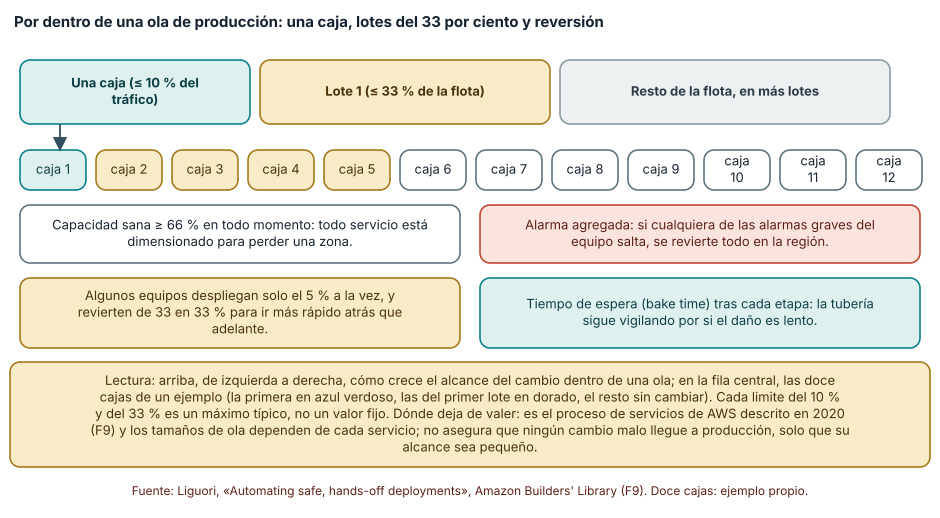

**Cómo leer la figura.** Arriba, las tres fases de una ola y, en la fila central, doce cajas de ejemplo con el estado de cada una; abajo, las reglas de capacidad, alarma y espera. **Dónde deja de valer.** Los máximos del 10 % y del 33 % son típicos; algunos equipos usan 5 % y revierten de 33 en 33 %. Son procesos de servicios de AWS en 2020.

Documentado (F9): cada ola empieza con una etapa de «una caja» (una máquina virtual, un contenedor o un pequeño porcentaje de invocaciones de una función) que típicamente atiende como máximo el diez por ciento de las peticiones; si hay daño, se revierte y no se promueve. Después, la mayoría de los equipos usa despliegues continuos por lotes: como máximo el 33 % de las cajas de la región se reemplazan a la vez, de modo que al menos el 66 % de la capacidad queda sana, algo seguro porque todos los servicios se dimensionan para perder una zona. Documentado (F9): la regla de revisión es que todos los cambios deben pasar por revisión de código de un miembro del equipo, y la tubería bloquea los commits sin revisar; un servicio típico tiene varias tuberías (código, infraestructura, parches de sistema operativo, configuración y banderas, herramientas), y los cambios de configuración tienen la misma seguridad que los de código.

**Cómo leer la figura.** La primera barra es el promedio antes de automatizar, partido en tres tramos; la segunda es el resultado del equipo piloto, calculado a partir de la reducción del 90 %. **Dónde deja de valer.** Documentado el 16 y la descomposición (F13); el 1,6 es una conversión mía, no una medición; es una medición antigua y de una muestra interna.

Documentado (F13): Amazon midió cuánto tardaban sus equipos en llevar una idea a producción y halló un promedio de 16 días desde el check-in hasta producción: día y medio de escribir código, menos de una hora de compilar y desplegar, y casi 14 días de esperas entre pasos (que alguien iniciase una compilación, un despliegue o las pruebas). Documentado (F13): construyeron una herramienta de tuberías que automatizó el tramo entre su sistema de compilación (Brazil) y su sistema de despliegue (Apollo); un equipo piloto logró una reducción del 90 % del tiempo total. Documentado (F13): al principio cada aplicación solo podía modelar un proceso de liberación, lo que forzó consistencia; y se midió que algunas organizaciones automatizaban sin pruebas, lo que llevó a insistir en la propiedad del equipo sobre el producto y sus defectos.

### Nivel 7: resiliencia y degradación

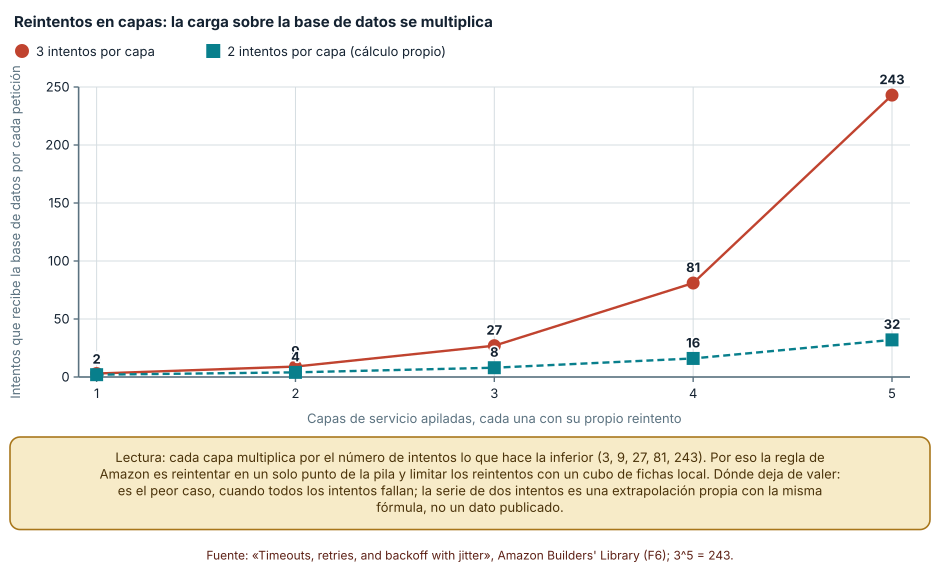

**Cómo leer la figura.** El eje horizontal cuenta capas de servicio apiladas, el vertical los intentos que recibe la base de datos por cada petición; la línea coral es el ejemplo de la fuente y la línea azul verdosa es una extrapolación propia. Mira el salto a 243 en la quinta capa. **Dónde deja de valer.** Es el peor caso (todos los intentos fallan) y la serie de dos intentos es mi cálculo, no un dato publicado.

Documentado (F6): los reintentos son «egoístas»: el cliente gasta más tiempo del servidor para aumentar su propia probabilidad de éxito; si el fallo es por sobrecarga, los reintentos aumentan la carga y pueden retrasar la recuperación. Documentado (F6): la solución preferida es el retroceso (backoff), normalmente exponencial con tope; pero entonces todos los clientes reintentan al ritmo del tope, de ahí que se añada jitter (variación aleatoria) y se limite el número de reintentos. Documentado (F6): si cada capa de una pila de cinco reintenta tres veces, la base de datos recibe 243 veces la carga; la práctica recomendada es reintentar en un solo punto de la pila. Documentado (F6): los interruptores de circuito introducen comportamiento modal difícil de probar; Amazon prefiere limitar localmente los reintentos con un cubo de fichas, comportamiento que el SDK de AWS incorporó en 2016. Documentado (F6): las operaciones con efectos no son seguras de reintentar salvo que sean idempotentes; EC2 `RunInstances` ofrece un token para ello.

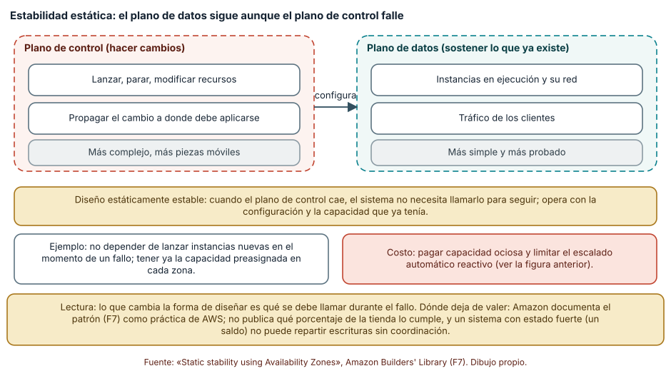

**Cómo leer la figura.** A la izquierda, el plano de control (hacer cambios); a la derecha, el plano de datos (sostener lo que ya corre); la flecha indica que el primero configura al segundo; abajo, la idea y su costo. **Dónde deja de valer.** Es un patrón documentado de AWS; no se sabe en qué medida la tienda lo cumple y no sirve para estado fuerte.

Documentado (F7): EC2 tiene un plano de control (agregar, borrar, modificar recursos y propagar esos cambios) y un plano de datos (lo que mantiene los recursos funcionando); los planos de datos suelen ser más sencillos y confiables. Un sistema estáticamente estable sigue funcionando cuando una dependencia falla, sin necesitar cambios durante el fallo. Documentado (F7): ejemplo concreto: con tres zonas de disponibilidad, se sobreaprovisiona un 50 %, de modo que cada zona opera como máximo al 66 % de lo probado, y si una zona entera se degrada, las demás absorben la carga.

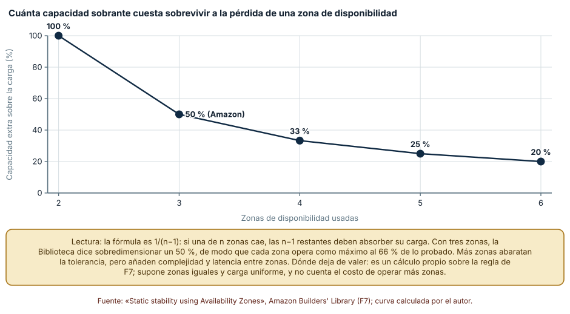

**Cómo leer la figura.** El eje horizontal es el número de zonas y el vertical la capacidad extra necesaria; la curva baja porque cada zona adicional absorbe una parte menor de la carga perdida. Mira el punto de 3 zonas, que es el que la fuente documenta. **Dónde deja de valer.** Es un cálculo propio, 1/(n−1), que supone zonas iguales y carga uniforme y no cuenta el costo de operar más zonas.

**Cómo leer la figura.** Cada cliente se conecta con dos trabajadores distintos; los trabajadores en rojo son los que agota la petición dañina; las flechas discontinuas son las del cliente dañino. Mira que Beta comparte el trabajador 2 con Alfa pero conserva el 5. **Dónde deja de valer.** Es un modelo didáctico; el artículo habla de cuántas combinaciones hay, pero no publica una tabla de asignación real ni cuántos clientes de qué servicio comparten.

Documentado (F8): con ocho trabajadores y un reparto simple, un cliente con una petición dañina puede degradar a todos; con shuffle sharding, que asigna a cada cliente una combinación de trabajadores, hay 28 combinaciones de dos entre ocho y el impacto se limita a quienes comparten la combinación. Documentado (F8): se inventó para Route 53 con el objetivo de ofrecer un servicio de DNS con 100 % de disponibilidad con pocos recursos, y se ha usado repetidamente.

### Nivel 8: seguridad, abuso y cumplimiento

Documentado (F1): Dynamo asume un entorno no hostil y no incluye autenticación ni autorización porque lo usan solo servicios internos; la defensa está en el perímetro y en el aislamiento entre servicios, no en el almacén. Documentado (F1, sección 6.3): una de las causas de divergencia de versiones era la actividad de robots, y el artículo no cuenta más «por la naturaleza sensible de la historia»; es un caso de abuso reconocido y sin detalle público. Documentado (F8): shuffle sharding es explícitamente una defensa contra vecinos ruidosos y contra clientes con comportamiento dañino. No se sabe: cómo la tienda protege pagos y datos personales, cómo cumple la normativa de cada país, cómo detecta el fraude. Estas ausencias son parte del caso: una empresa puede publicar mucho de su ingeniería de disponibilidad y casi nada de su control de fraude.

### Nivel 9: observabilidad y operación

Documentado (F9): cada microservicio tiene una alarma grave por región (tasa de fallos, latencia en p50, p90 y p99, CPU, memoria, disco, errores en logs, comprobaciones de salud); una alarma agregada reúne las de todos los servicios del equipo y las de las pruebas «canario» continuas; si salta, se revierten todos los despliegues en curso en esa región. Documentado (F9): la etapa de una caja también se revierte por métricas propias de esa caja. Documentado (F9): la revisión de código comprueba que el cambio esté instrumentado y pueda revertirse; los equipos usan listas de verificación que preguntan si el cambio está cubierto por el monitoreo y si puede desplegarse sin disparar alarmas. No se sabe: cómo se agregan y almacenan las métricas, qué política de retención tienen ni cómo se gestionan los incidentes más allá del aviso.

### Nivel 10: cómo evolucionó la arquitectura (antes y después)

**Cómo leer la figura.** Tres carriles paralelos: arriba lo que el cliente ve, en medio la plataforma, abajo la práctica de ingeniería. Las líneas verticales son hitos con fecha; los bloques son eras aproximadas. **Dónde deja de valer.** Los cortes entre eras son síntesis mía, no fechas oficiales; no implica causalidad entre carriles.

Antes y después, con lo documentado: antes de las tuberías, 16 días desde el check-in a producción y despliegues a mano (F13); después, despliegues varias veces al día sin vigilancia humana (F9). Antes de Dynamo, el estado se guardaba en bases relacionales que, según el artículo, requerían hardware caro y personal especializado y escalaban mal (F1); después, almacenes clave-valor con consistencia ajustable para los servicios que lo admiten. Antes de AWS, la infraestructura era interna; después, S3 en marzo de 2006 y EC2 en agosto de 2006 (F14, F5). Lo que no se sabe: la arquitectura de la tienda en 1995-2003, la transición de una aplicación monolítica a servicios y el diseño actual de pagos o logística.

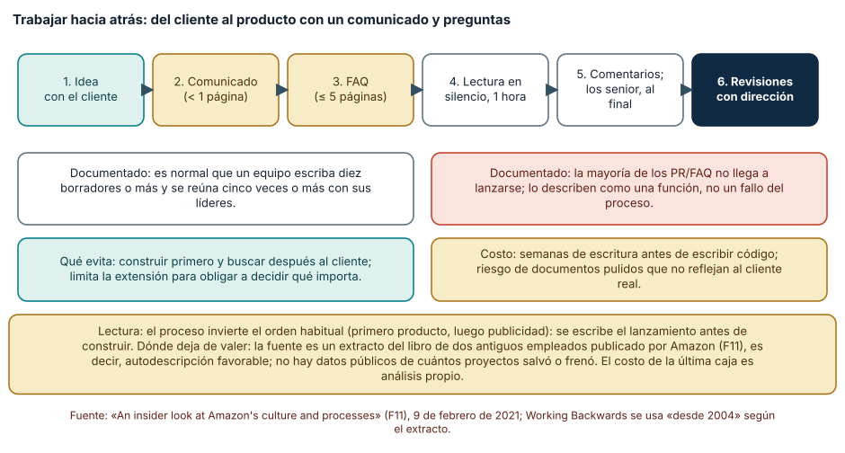

**Cómo leer la figura.** Seis pasos en orden: del cliente a la revisión con la dirección; abajo, dos datos documentados y dos recuadros de análisis propio sobre qué evita y qué cuesta. **Dónde deja de valer.** La fuente es un extracto autopublicado por Amazon; no mide cuántos proyectos salvó el proceso.

Documentado (F11): desde 2004 la mayoría de los productos importantes de Amazon se crearon con ese proceso; el comunicado es de menos de una página y el FAQ de cinco o menos; es normal escribir diez borradores o más y reunirse cinco veces o más con los líderes; la mayoría de los documentos nunca llega a ser producto, y los autores lo consideran una característica, no un defecto.

### Hardware utilizado

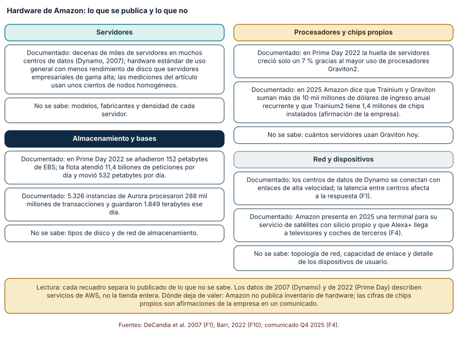

**Cómo leer la figura.** Cuatro grupos (servidores, chips, almacenamiento y red/dispositivos); cada ítem empieza con «Documentado» o «No se sabe». **Dónde deja de valer.** Describe servicios de AWS en 2007, 2022 y 2025, no el inventario de la tienda; no hay modelos, fabricantes ni densidad.

Documentado (F1): el artículo de Dynamo dice que el sistema corre sobre hardware estándar de uso general, con menos capacidad de disco que servidores empresariales de gama alta, de modo que el rendimiento de cada lectura o escritura queda limitado por la réplica más lenta; las mediciones se hicieron con unos cientos de nodos de hardware homogéneo repartidos en varios centros de datos conectados por enlaces de alta velocidad, cuya latencia influye en el tiempo de respuesta. Documentado (F10): en Prime Day de 2022 el uso de procesadores Graviton2 explicó que la huella equivalente de servidores solo creciera un 7 % frente al Cyber Monday anterior, y que se añadieran 152 petabytes de EBS. Documentado (F4): Amazon afirma que Trainium y Graviton suman más de 10 mil millones de dólares de ingreso anual recurrente y que Trainium2 tiene 1,4 millones de chips instalados; es una afirmación de la empresa. No se sabe: los modelos de servidor, la red interna y los dispositivos de borde de la tienda.

### Software utilizado

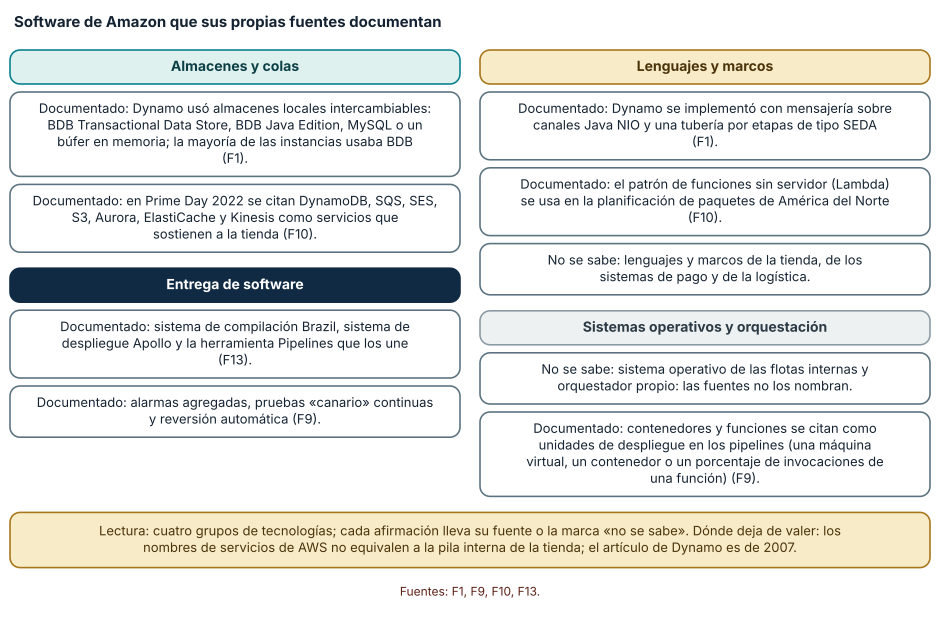

**Cómo leer la figura.** Cuatro grupos: almacenes y colas, lenguajes y marcos, entrega de software, y sistemas operativos y orquestación. **Dónde deja de valer.** Los servicios de AWS no equivalen a la pila interna de la tienda; el artículo de Dynamo es de 2007.

Documentado (F1): Dynamo usa una arquitectura de mensajería por etapas y canales Java NIO, almacenamiento local con BDB (la mayoría), BDB Java Edition, MySQL o un búfer en memoria, y una biblioteca de cliente opcional que coordina las peticiones. Documentado (F10): los servicios citados como base de Prime Day 2022 incluyen DynamoDB (con latencia de un solo dígito en milisegundos), SQS, SES, S3, Kinesis, ElastiCache, Lambda y Aurora. Documentado (F13): Brazil compila, Apollo despliega y Pipelines automatiza el tramo entre ambos. No se sabe: el sistema operativo, el orquestador y los marcos de la tienda.

### Características de la infraestructura

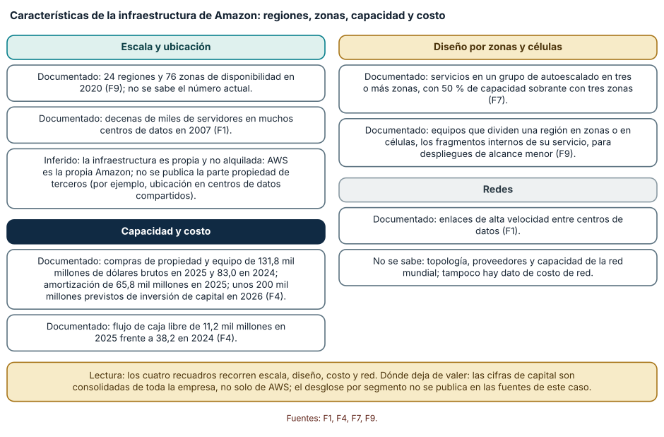

**Cómo leer la figura.** Escala y ubicación, diseño por zonas y células, capacidad y costo, y redes. **Dónde deja de valer.** Las cifras de capital son de toda la empresa.

Documentado (F9): 24 regiones y 76 zonas de disponibilidad cuando se escribió el artículo (2020); algunos equipos dividen aún más una región en zonas o en células. Documentado (F7): los servicios corren en tres o más zonas con sobreaprovisionamiento. Documentado (F4): compras de propiedad y equipo por 131,8 mil millones de dólares brutos en 2025 (83,0 en 2024), amortización de 65,8 mil millones y unos 200 mil millones de inversión de capital previstos en 2026. Inferido: la infraestructura es esencialmente propia, porque AWS es parte de Amazon; no hay un desglose público de qué es propio y qué es alquilado.

### Tolerancia a fallos: qué pasa si cae cada componente

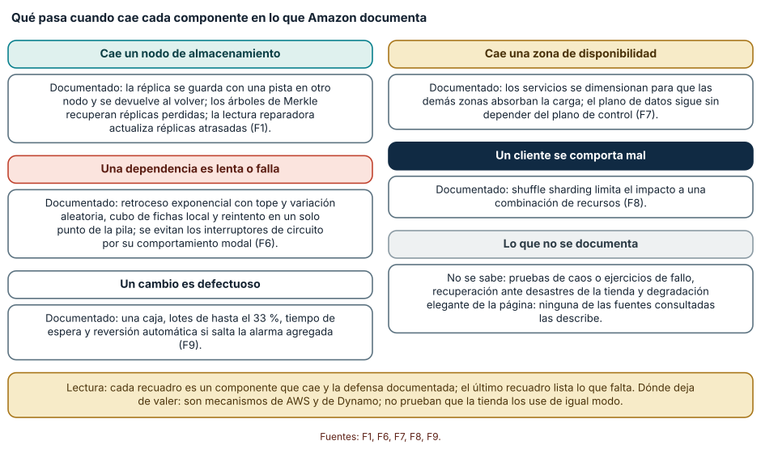

**Cómo leer la figura.** Cada recuadro es un componente que cae y su defensa documentada; el último lista lo que no se documenta. **Dónde deja de valer.** Son mecanismos de AWS y de Dynamo.

Los mecanismos ya descritos en los niveles anteriores se resumen así. Nodo de almacenamiento: traspaso con pista, árboles de Merkle y lectura reparadora (F1). Zona: capacidad sobrante y estabilidad estática (F7). Dependencia lenta: retroceso, variación aleatoria, cubo de fichas y reintento en un solo punto (F6). Cliente ruidoso: shuffle sharding (F8). Cambio defectuoso: una caja, olas, tiempo de espera y reversión (F9). Documentado (F1): control de admisión para que las tareas de fondo no degraden las de primer plano, y escrituras duraderas en una réplica cuando se usa un búfer en memoria. No se sabe: pruebas de caos o ejercicios de fallo, recuperación ante desastres de la tienda y degradación elegante de la página; ninguna fuente consultada las describe, y este caso no las supone.

### Alternativas descartadas y trade-offs (análisis propio)

Lo que sigue es análisis propio: no es historia, sino qué habría pasado con otra arquitectura. Está pensado para discutirse, no para citarse.

| Decisión de Amazon | Alternativa | Qué habría pasado (hipótesis) | Qué costó la elegida |
| --- | --- | --- | --- |
| Carrito siempre escribible, con fusión | Carrito fuertemente consistente (rechazar escrituras sin cuórum) | Durante una partición, usuarios verían errores al añadir; el artículo declara que rechazar actualizaciones era mala experiencia (F1) | Elementos borrados que reaparecen; lógica de fusión en la aplicación |
| Contratos en el percentil 99,9 | Contratos en la media | Una página con 150 servicios habría tenido una cola larga imprevisible y los clientes con historiales largos habrían sufrido más (F1) | Más sobredimensionamiento y trabajo de ingeniería en la cola |
| Una base de datos por servicio y almacén clave-valor para el estado simple | Una base de datos relacional compartida | Joins y transacciones multiclave, pero acoplamiento entre equipos y escalado vertical; el artículo dice que las réplicas relacionales de entonces elegían consistencia sobre disponibilidad (F1) | Sin transacciones entre claves, sin consultas ad hoc |
| Coordinación en el cliente | Coordinación solo en el servidor | Menos código en el cliente, pero 30 ms más en el percentil 99,9 (F1) | Bibliotecas en cada cliente y vista de membresía que refrescar |
| Despliegue en olas con reversión | Despliegue global inmediato | Más rápido para llegar a todos, pero un cambio malo afectaría a todas las regiones a la vez (F9) | Días en llegar a todas las regiones y mucha infraestructura de alarmas |
| Reintento en un solo punto y cubo de fichas | Reintento en cada capa y disyuntores | Carga multiplicada por 243 con cinco capas; los disyuntores añaden modos difíciles de probar (F6) | Cada capa debe decidir cuándo rendirse |

## Casos especiales y cómo se resuelven

| Situación | Qué se documenta | Qué enseña |
| --- | --- | --- |
| Pico de tráfico | Prime Day: la huella de servidores creció solo un 7 % frente al Cyber Monday anterior, por mayor eficiencia (F10). | Un pico se absorbe con capacidad elástica y eficiencia, no solo con más máquinas. |
| Fallo parcial de una dependencia | Estabilidad estática: el sistema sigue funcionando con lo que ya tenía aunque la dependencia falle; EC2 separa plano de control y plano de datos (F7). | Los fallos del plano de control no deben detener el trabajo que el plano de datos ya hace. |
| Reintentos en cascada | Los reintentos son «egoístas»; se usa retroceso exponencial con tope, jitter y un cubo de fichas local; los interruptores de circuito añaden comportamiento modal difícil de probar (F6). | Reintentar sin freno convierte un fallo pequeño en uno grande. |
| Vecino ruidoso o ataque | Shuffle sharding: asignar a cada cliente una combinación casi única de recursos para que un abuso no afecte a todos (F8). | Reducir el radio de impacto es un diseño, no una reacción. |
| Consistencia | Carrito siempre escribible; la fusión puede resucitar elementos (F1). | La consistencia es una decisión de producto con coste visible. |
| Cambio defectuoso | Despliegue por olas, tiempo de espera y reversión (F9). | La velocidad de entrega y la seguridad se negocian con diseño del pipeline. |
| Cumplimiento y offline | No se sabe: Amazon no publica cómo gestiona el cumplimiento normativo de la tienda en cada país ni el comportamiento sin conexión de sus apps. | Aquí la ausencia de datos es parte del caso. |

Los siguientes casos especiales amplían la tabla con su mecanismo y su costo.

### Pico en una partición del almacén

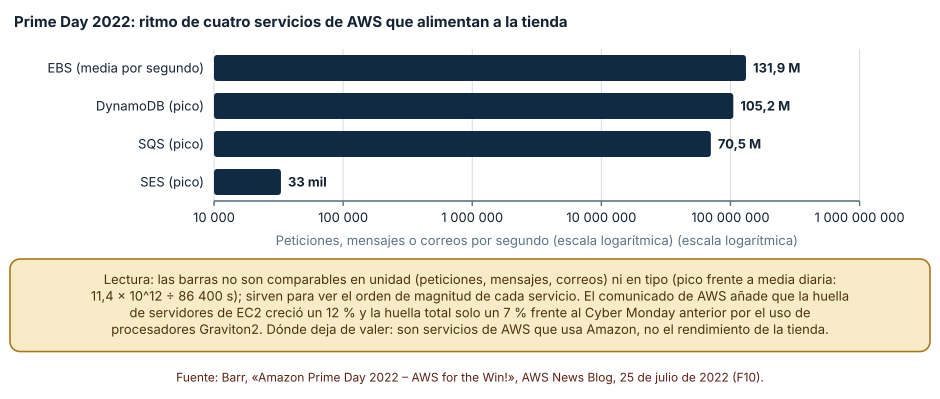

**Cómo leer la figura.** Cada barra es un servicio de AWS; la escala logarítmica muestra el orden de magnitud. Las unidades (peticiones, mensajes, correos) y los tipos de cifra (pico o media diaria) no son homogéneos. **Dónde deja de valer.** Es AWS en 2022, no toda la tienda, y no permite comparar rendimiento entre servicios.

Documentado (F10): para Prime Day de 2022 DynamoDB sostuvo un pico de 105,2 millones de peticiones por segundo con latencias de un solo dígito en milisegundos; SQS procesó 70,5 millones de mensajes por segundo; SES alcanzó 33 000 correos por segundo en pico; y el parque de EBS gestionó 11,4 billones de peticiones al día (más de 130 millones por segundo en promedio, cálculo propio). Documentado (F10): la huella de EC2 creció un 12 % y la huella total solo un 7 % frente al Cyber Monday de 2021 por el mayor uso de procesadores Graviton2. Documentado (F10): en Norteamérica, los sistemas de planificación de paquetes hicieron 60 millones de invocaciones de funciones Lambda, procesaron 17 terabytes de datos comprimidos en S3, guardaron 64 millones de elementos y atendieron 200 millones de eventos. Mecanismo: elasticidad y eficiencia, no solo más máquinas. Trade-off: preparar el pico tiene un costo de capacidad que se paga todo el año si no es elástica. Qué no se sabe: cuántas peticiones por segundo atiende la tienda ni cuántos pedidos se hicieron.

### Una zona de disponibilidad falla

Mecanismo documentado (F7, F9): los servicios se dimensionan para perder una zona; los despliegues avanzan zona por zona; el plano de datos no depende del de control. Trade-off: sobreaprovisionar un 50 % con tres zonas. Análisis propio: si el servicio usara solo dos zonas, la regla exigiría 100 % de sobrecapacidad; si usara cuatro, 33 %; por eso las plataformas con muchas zonas hacen más barata la tolerancia, aunque aumentan la complejidad.

### Un servicio recibe más carga de la prevista

Mecanismo documentado (F1): las SLA incluyen el ritmo de peticiones esperado: la latencia se garantiza hasta cierta carga; más allá, el contrato no vale. Mecanismo documentado (F6): los clientes limitan sus reintentos con un cubo de fichas. Mecanismo documentado (F8): shuffle sharding aísla al cliente que sobrepasa su parte. Trade-off: las tres medidas protegen al conjunto a costa del cliente que se excede, que verá errores antes.

### Escritores concurrentes y robots

Documentado (F1): el aumento de versiones divergentes lo causan más los escritores concurrentes, casi siempre robots, que los fallos. Mecanismo: la reconciliación en la aplicación absorbe el caso; la fusión del carrito es unir elementos. Trade-off: cada versión extra consume lecturas y lógica de negocio; el artículo prefiere minimizarlas. Qué no se sabe: cómo se detectan y bloquean esos robots.

### Un nodo se cae o se añade

Mecanismos documentados (F1): traspaso con pista si el nodo cae temporalmente; árboles de Merkle para recuperar réplicas perdidas permanentemente; gossip para difundir cambios de membresía; control de admisión para que la recuperación no degrade el primer plano. Trade-off: el traspaso con pista funciona mejor cuando la rotación de miembros es baja; con mucha, la pista puede perderse antes de devolverse y entonces hay que sincronizar con Merkle.

### Despliegue con defecto

Mecanismo documentado (F9): una caja, lotes pequeños, alarmas, tiempo de espera y reversión automática; la revisión de código y la lista de comprobaciones. Trade-off: el cambio tarda días en llegar a todas las regiones, y no hay garantía de que un defecto lento aparezca durante el tiempo de espera. Análisis propio: un defecto que solo se manifiesta con una combinación rara de carga y datos podría escapar de la caja y de la ola; por eso la reversión automática importa más que la prevención perfecta.

### Un servicio con efectos (cobro, creación de recursos) se reintenta

Mecanismo documentado (F6): idempotencia con token; `RunInstances` es el ejemplo público. Inferido: los cobros usan una disciplina equivalente. Trade-off: guardar tokens y respuestas durante un tiempo cuesta almacenamiento y define una ventana de deduplicación; no se sabe su duración.

### Cumplimiento regional y desconexión

No se sabe. Amazon no publica cómo adapta la tienda a la normativa de cada país (impuestos, protección de datos, consumo) ni cómo se comportan sus aplicaciones sin conexión. Es un hueco de este caso y se declara como tal.

## Línea de tiempo

La figura de línea de tiempo está en la sección de arquitectura (nivel 10). En prosa, con sus fuentes y separando hechos de interpretación:

- **1994–1995.** Fundación y apertura de la tienda en línea de libros (F12, fuente secundaria).
- **1997.** Primera carta a los accionistas: «Día 1», 1,5 millones de clientes, 147,8 millones de ingresos, más de 200 000 títulos, salida a bolsa en mayo (F3).
- **2000–2005.** Aparición del marketplace de terceros y de Prime (F12, fuente secundaria; las fechas exactas no se verificaron con fuente primaria).
- **2002–2006.** Servicios web para desarrolladores (F12); S3 el 14 de marzo de 2006 (F14) y EC2 en beta el 24 de agosto de 2006 (F5).
- **2004.** Según el extracto de Bryar y Carr (F11), a partir de este año la mayoría de los productos importantes se crean con Working Backwards.
- **2007–2009.** Los artículos de Dynamo y de consistencia eventual explican públicamente el modelo de disponibilidad y los compromisos (F1, F2).
- **2016.** El SDK de AWS incorpora el cubo de fichas para limitar reintentos (F6).
- **2019–2020.** La Biblioteca de Constructores publica prácticas sobre aislamiento de carga, estabilidad estática y despliegues seguros (F7, F8, F9). F8 es del 5 de diciembre de 2019 y F9 del 18 de junio de 2020.
- **2022.** Prime Day de 2022 y las cifras de DynamoDB, SQS, SES y EBS (F10).
- **2025.** 716,9 mil millones de ingresos, 128,7 de AWS, 80,0 de resultado operativo; la empresa anuncia unos 200 mil millones de inversión de capital para 2026 (F4).

Giros y correcciones, con prudencia: el artículo de Dynamo documenta una corrección técnica concreta (el cambio de estrategia de particionado, F1); el artículo de tuberías documenta una corrección organizativa (se detectó que medir la automatización sin medir las pruebas llevaba a automatizar sin probar, F13). No hay en las fuentes de este caso un relato de errores comerciales de la tienda; no se inventa.

## Vínculo con el curso

El caso ilustra las siguientes clases. La columna derecha dice qué parte de la teoría se ve en el caso.

| Concepto | Clases | Qué parte de la teoría ilustra el caso |
| --- | --- | --- |
| Consistencia, disponibilidad y particiones | [SE-390](../../classes/part-32-concurrencia-y-sistemas-distribuidos/se-390-consistencia-disponibilidad-y-particiones/README.md), [SE-388](../../classes/part-32-concurrencia-y-sistemas-distribuidos/se-388-tiempo-relojes-y-orden-parcial/README.md), [SE-389](../../classes/part-32-concurrencia-y-sistemas-distribuidos/se-389-fallos-parciales-y-modelos-de-red/README.md) | El carrito de Dynamo es el ejemplo clásico de elegir disponibilidad y reconciliar después; los relojes vectoriales son orden parcial; la figura del carrito en partición lo muestra. |
| Replicación, particionado y balanceo | [SE-355](../../classes/part-29-datos-persistencia-y-recuperacion/se-355-replicacion-particion-y-distribucion/README.md), [SE-393](../../classes/part-32-concurrencia-y-sistemas-distribuidos/se-393-replicacion-sharding-y-balanceo/README.md) | Hash consistente, N réplicas, quórums sueltos, traspaso con pista y la evolución de la estrategia 1 a la 3. |
| Modelos de datos: clave-valor | [SE-350](../../classes/part-29-datos-persistencia-y-recuperacion/se-350-relacional-documental-clave-valor-grafos-y-series/README.md), [SE-352](../../classes/part-29-datos-persistencia-y-recuperacion/se-352-restricciones-invariantes-y-consistencia/README.md), [SE-351](../../classes/part-29-datos-persistencia-y-recuperacion/se-351-transacciones-aislamiento-y-concurrencia/README.md) | Dynamo renuncia a esquema relacional, transacciones multiclave y aislamiento; las invariantes pasan a la aplicación. |
| Consenso y coordinación | [SE-391](../../classes/part-32-concurrencia-y-sistemas-distribuidos/se-391-consenso-eleccion-y-coordinacion/README.md) | Contraste: Dynamo evita el consenso y acepta versiones concurrentes; donde se necesita acuerdo, hay que coordinar. |
| Idempotencia y reintentos | [SE-246](../../classes/part-20-backend-apis-y-procesamiento-asincrono/se-246-idempotencia-reintentos-y-deduplicacion/README.md), [SE-392](../../classes/part-32-concurrencia-y-sistemas-distribuidos/se-392-idempotencia-y-procesamiento-distribuido/README.md), [SE-438](../../classes/part-36-calidad-rendimiento-y-resiliencia/se-438-timeouts-retries-backoff-y-jitter/README.md), [SE-320](../../classes/part-26-patrones-de-diseno-empresariales-y-de-resiliencia/se-320-resiliencia-timeout-retry-con-jitter-y-circuit-breaker/README.md) | La Biblioteca insiste en que lo que tiene efectos se reintenta solo si es idempotente, con retroceso y jitter; la figura de 243 veces lo cuantifica. |
| Fallos parciales, disyuntores y mamparos | [SE-439](../../classes/part-36-calidad-rendimiento-y-resiliencia/se-439-circuit-breakers-bulkheads-y-degradacion/README.md), [SE-321](../../classes/part-26-patrones-de-diseno-empresariales-y-de-resiliencia/se-321-resiliencia-bulkhead-sidecar-ambassador-y-degradacion/README.md), [SE-389](../../classes/part-32-concurrencia-y-sistemas-distribuidos/se-389-fallos-parciales-y-modelos-de-red/README.md) | Crítica documentada a los interruptores de circuito y alternativa del cubo de fichas. |
| Radio de impacto y celdas | [SE-344](../../classes/part-28-estilos-arquitectonicos/se-344-arquitectura-celular-y-radio-de-impacto/README.md), [SE-342](../../classes/part-28-estilos-arquitectonicos/se-342-multi-tenancy-y-aislamiento/README.md) | Shuffle sharding y las zonas de disponibilidad como unidades de aislamiento; las celdas dentro de una región. |
| Disponibilidad y recuperación | [SE-440](../../classes/part-36-calidad-rendimiento-y-resiliencia/se-440-disponibilidad-durabilidad-y-recuperacion/README.md), [SE-502](../../classes/part-41-observabilidad-sre-e-incidentes/se-502-continuidad-disaster-recovery-y-ejercicios/README.md) | Estabilidad estática: seguir con lo que ya se sabe cuando la dependencia cae. |
| Latencia, colas y capacidad | [SE-436](../../classes/part-36-calidad-rendimiento-y-resiliencia/se-436-latencia-throughput-saturacion-y-capacidad/README.md), [SE-435](../../classes/part-36-calidad-rendimiento-y-resiliencia/se-435-carga-estres-picos-y-endurance/README.md), [SE-404](../../classes/part-33-cloud-plataforma-e-infraestructura/se-404-escalado-capacidad-y-costos/README.md) | Contratos en el percentil 99,9 y picos de Prime Day; 0,999^150 y el sobredimensionamiento por zonas. |
| SLI y SLO | [SE-497](../../classes/part-41-observabilidad-sre-e-incidentes/se-497-sli-slo-sla-y-presupuestos-de-error/README.md) | Un contrato de latencia en la cola es un SLO. |
| Observabilidad y alertas | [SE-493](../../classes/part-41-observabilidad-sre-e-incidentes/se-493-senales-eventos-y-observabilidad-util/README.md), [SE-498](../../classes/part-41-observabilidad-sre-e-incidentes/se-498-alertas-accionables-y-fatiga/README.md), [SE-495](../../classes/part-41-observabilidad-sre-e-incidentes/se-495-metricas-dimensiones-y-cardinalidad/README.md) | La alarma agregada que revierte despliegues es una alerta accionable ligada a una acción automática. |
| Despliegue progresivo y reversión | [SE-485](../../classes/part-40-ci-cd-iac-y-platform-engineering/se-485-entrega-y-despliegue-continuos/README.md), [SE-476](../../classes/part-39-build-release-y-cadena-de-suministro/se-476-canary-blue-green-y-rollback/README.md), [SE-475](../../classes/part-39-build-release-y-cadena-de-suministro/se-475-feature-flags-y-entrega-progresiva/README.md), [SE-492](../../classes/part-40-ci-cd-iac-y-platform-engineering/se-492-proyecto-camino-a-produccion-con-rollback/README.md) | Una caja, olas, tiempo de espera y reversión automática. |
| Tuberías y flujo | [SE-481](../../classes/part-40-ci-cd-iac-y-platform-engineering/se-481-integracion-continua-y-feedback-temprano/README.md), [SE-184](../../classes/part-15-procesos-planificacion-y-estimacion/se-184-lean-teoria-de-colas-y-limites-de-trabajo/README.md), [SE-490](../../classes/part-40-ci-cd-iac-y-platform-engineering/se-490-metricas-dora-y-mejora-sin-gaming/README.md) | 16 días con casi 14 de espera es una cola; las tuberías atacan el tiempo en cola, no el de trabajo. |
| Arquitectura de servicios y equipos | [SE-327](../../classes/part-27-arquitectura-de-software-y-dominio/se-327-monolito-modular-monolith-y-servicios/README.md), [SE-340](../../classes/part-28-estilos-arquitectonicos/se-340-microservicios-y-sus-costes-reales/README.md), [SE-334](../../classes/part-27-arquitectura-de-software-y-dominio/se-334-arquitectura-socio-tecnica-y-limites-de-equipo/README.md), [SE-530](../../classes/part-44-gestion-liderazgo-y-practica-profesional/se-530-diseno-de-equipos-y-ownership/README.md) | Servicios con dueños claros (inferido); ver las advertencias de la sección 10. |
| Trade-offs y decisiones | [SE-333](../../classes/part-27-arquitectura-de-software-y-dominio/se-333-trade-offs-adr-y-evaluacion-de-alternativas/README.md), [SE-208](../../classes/part-17-documentacion-y-conocimiento-tecnico/se-208-adrs-rfcs-y-registro-de-decisiones/README.md), [SE-142](../../classes/part-11-economia-metricas-y-decisiones-de-producto/se-142-decisiones-reversibles-e-irreversibles/README.md) | Cada decisión de la tabla de alternativas es un ADR en potencia; la reversibilidad explica por qué los despliegues se hacen reversibles. |
| Nube y servicios gestionados | [SE-397](../../classes/part-33-cloud-plataforma-e-infraestructura/se-397-iaas-paas-saas-y-responsabilidad-compartida/README.md), [SE-400](../../classes/part-33-cloud-plataforma-e-infraestructura/se-400-serverless-y-ejecucion-gestionada/README.md), [SE-401](../../classes/part-33-cloud-plataforma-e-infraestructura/se-401-redes-identidad-y-secretos-en-cloud/README.md) | Origen de EC2 y S3 como infraestructura convertida en producto; planos de control y de datos. |
| Seguridad y abuso | [SE-457](../../classes/part-38-seguridad-privacidad-y-cumplimiento/se-457-principios-de-seguridad-y-modelos-de-amenaza/README.md), [SE-464](../../classes/part-38-seguridad-privacidad-y-cumplimiento/se-464-secure-sdlc-abuso-y-pruebas-negativas/README.md), [SE-459](../../classes/part-38-seguridad-privacidad-y-cumplimiento/se-459-autorizacion-recursos-y-minimo-privilegio/README.md) | El almacén asume entorno no hostil; el abuso se contiene con aislamiento (shuffle sharding). |
| Modelos de negocio y costos | [SE-133](../../classes/part-11-economia-metricas-y-decisiones-de-producto/se-133-modelos-de-negocio-y-sostenibilidad/README.md), [SE-134](../../classes/part-11-economia-metricas-y-decisiones-de-producto/se-134-costos-de-construccion-operacion-y-oportunidad/README.md), [SE-140](../../classes/part-11-economia-metricas-y-decisiones-de-producto/se-140-finops-de-producto-y-costo-por-resultado/README.md), [SE-537](../../classes/part-44-gestion-liderazgo-y-practica-profesional/se-537-economia-del-software-y-costo-total/README.md) | Tres segmentos con márgenes muy distintos y decisiones a largo plazo. |
| Propuesta de valor desde el cliente | [SE-125](../../classes/part-10-descubrimiento-y-estrategia-de-producto/se-125-propuesta-de-valor-y-resultados-deseados/README.md), [SE-122](../../classes/part-10-descubrimiento-y-estrategia-de-producto/se-122-usuarios-actores-trabajos-y-contextos/README.md), [SE-127](../../classes/part-10-descubrimiento-y-estrategia-de-producto/se-127-prototipos-experimentos-y-reduccion-de-incertidumbre/README.md) | «Working Backwards» parte del cliente (F11); el PR/FAQ es un prototipo de papel. |
| Métricas y guardrails | [SE-135](../../classes/part-11-economia-metricas-y-decisiones-de-producto/se-135-resultados-outputs-actividad-y-vanity-metrics/README.md), [SE-139](../../classes/part-11-economia-metricas-y-decisiones-de-producto/se-139-north-star-guardrails-y-metricas-contrarias/README.md) | La carta de 1997 elige métricas de liderazgo (clientes, repetición) y rechaza la apariencia contable; la entrega mide plazo y pruebas. |

### Preguntas de discusión

1. El carrito prefiere disponibilidad y acepta elementos que reaparecen. ¿Qué otros elementos de una tienda en línea no pueden permitirse esa decisión? Para cada uno, ¿qué mecanismo de coordinación usarías y qué costo de latencia tendría?
2. Un contrato de 300 ms al percentil 99,9 con 150 servicios en abanico implica 0,86 de probabilidad de cumplir todos si son independientes. ¿Qué hipótesis hace falsa esa cuenta en un sistema real (pista: dependencias compartidas) y qué haría el diseñador para que la página no dependa de los 150?
3. Amazon prefiere reintentar en un solo punto de la pila. ¿Qué pasa si ese punto es el cliente móvil? ¿Y si es el servicio más cercano a la base de datos? Compara con el reparto de responsabilidad que propone el curso.
4. La estrategia de particionado inicial «ataba» dos decisiones. Encuentra en un sistema que conozcas dos decisiones atadas que deberían ser independientes y explica qué costo pagas hoy.
5. La carta de 1997 dice que se elegirán los flujos de caja sobre la apariencia contable. ¿Qué métrica de tu producto sería equivalente a «apariencia contable» y cuál a «flujo de caja futuro»?
6. El proceso PR/FAQ rechaza la mayoría de las ideas. ¿Cómo mediría un equipo si el proceso rechaza demasiadas ideas buenas? ¿Qué dato necesitaría que la fuente no publica?

### Mini-ejercicios de análisis

1. **Cuenta de percentiles.** Para un sistema tuyo con un abanico de N servicios y un SLO de 99,9 % por servicio, calcula 0,999^N para N=10, 50 y 150. Dibuja la curva. ¿Para qué N el 95 % de las páginas cumple todo? Resultado esperado: un número entero y la hipótesis de independencia declarada.
2. **Mapa de cuórum.** Elige un dato de tu sistema (por ejemplo, el carrito o el saldo de puntos). Decide N, R y W y justifica con la regla R + W > N. Indica qué lecturas pueden ser obsoletas y qué operación de negocio lo tolera.
3. **Capacidad por zonas.** Con la fórmula 1/(n−1), calcula cuánta capacidad extra necesitas para 2, 3 y 4 zonas y cuánto costaría si tu servicio cuesta lo mismo por zona. ¿Cuántas zonas elegirías? Justifica con costos y complejidad, no solo con números.
4. **Amplificación de reintentos.** Dibuja la pila de llamadas de una operación de tu sistema y cuenta cuántos intentos recibe el nivel más bajo si todas las capas reintentan dos veces. Propón un solo punto de reintento y calcula el cambio.
5. **Tubería con alarma.** Diseña la alarma agregada de un servicio de tres componentes: lista las alarmas individuales, la regla de agregación y la acción automática. Declara qué fallo lento no detectaría en tu tiempo de espera.
6. **PR/FAQ breve.** Escribe un comunicado de menos de una página para una función de tu producto y cinco preguntas difíciles. Pide a alguien que lo lea en silencio y apunte dónde no entendió.

## Qué no generalizar

**Qué aprender.**

1. **Decide con el cliente y el largo plazo como criterio.** La carta de 1997 formula ese criterio con claridad (F3). Para ti, la lección técnica es que una restricción de negocio explícita guía decisiones de arquitectura.
2. **Pon el contrato en la cola de la latencia.** Una página que depende de decenas de servicios no cumple con un promedio (F1).
3. **Convierte el fallo parcial en parte del diseño.** Estabilidad estática, shuffle sharding y despliegues por olas son tres respuestas al mismo problema: acotar el radio de impacto.
4. **Reintenta con disciplina.** Retroceso, jitter, límite local e idempotencia van juntos (F6).
5. **Una buena infraestructura interna puede ser un producto.** EC2 y S3 nacieron de capacidades que la tienda necesitaba (F5, F14, F12).
6. **Mide el tiempo en cola, no solo el de trabajo.** Los 16 días eran casi todos espera (F13).
7. **Escribe primero lo que el cliente vería.** Es la idea del comunicado antes del producto (F11); aunque sea autodescrita, es una técnica transferible a cualquier equipo.

**Qué NO generalizar.**

- **No copies la arquitectura de servicios de Amazon sin su organización.** Documentado (F9): los despliegues pasan por pipelines muy automatizados; inferido: eso exige equipos con dueños claros de cada servicio. Un equipo de diez personas con un monolito no obtiene los mismos beneficios de 150 servicios.
- **No copies la consistencia del carrito.** El mismo mecanismo en un saldo bancario produciría errores graves.
- **No tomes los números de Prime Day como referencia de tu escala.** Son de un conjunto de servicios de AWS con millones de clientes.
- **No concluyas que «Amazon hace X» si solo lo publica AWS.** Muchos de los textos citados describen servicios de AWS, no la tienda.
- **Sesgo de supervivencia.** Las prácticas publicadas son las que Amazon decide mostrar; los experimentos fallidos no aparecen.
- **Los datos más antiguos pueden estar desactualizados.** El artículo de Dynamo es de 2007 y describe un sistema interno anterior; no debe confundirse con el servicio DynamoDB de AWS, que es otro producto.
- **No supongas que el entorno no hostil de Dynamo es válido para tu sistema.** Dynamo omitió autenticación y autorización porque era interno (F1); un servicio expuesto a Internet no puede.
- **No generalices los márgenes.** AWS gana un 35 % operativo con la inversión de capital que sostiene; un negocio de infraestructura pequeño no tiene ese colchón ni la misma intensidad de capital (F4).
- **No atribuyas causalidad al orden temporal.** Que Working Backwards, Dynamo y EC2 convivan en 2004-2007 no prueba que una cosa causó otra.

## Fuentes públicas verificadas

Todas consultadas el 2026-11-16 con `curl` o verificadas por DOI en Crossref. «Secundaria» significa que no es una fuente primaria de la empresa.

- **F1.** DeCandia, Hastorun, Jampani, Kakulapati, Lakshman, Pilchin, Sivasubramanian, Vosshall y Vogels, «Dynamo: Amazon's Highly Available Key-value Store», SOSP 2007. DOI 10.1145/1294261.1294281. PDF: [https://www.allthingsdistributed.com/files/amazon-dynamo-sosp2007.pdf](https://www.allthingsdistributed.com/files/amazon-dynamo-sosp2007.pdf). Se usa para el contexto de servicios, las SLA, el anillo, la lista de preferencia, el cuórum, los relojes vectoriales, las cifras de producción (secciones 6.1 a 6.6) y las limitaciones.
- **F2.** Werner Vogels, «Eventually Consistent», Communications of the ACM, enero de 2009. DOI 10.1145/1435417.1435432. Versión del autor (23 de diciembre de 2008): [https://www.allthingsdistributed.com/2008/12/eventually_consistent.html](https://www.allthingsdistributed.com/2008/12/eventually_consistent.html)
- **F3.** Jeff Bezos, carta a los accionistas de 1997: [https://s2.q4cdn.com/299287126/files/doc_financials/annual/Shareholderletter97.pdf](https://s2.q4cdn.com/299287126/files/doc_financials/annual/Shareholderletter97.pdf). Se usa para clientes, ingresos, inventario, salida a bolsa y criterios de decisión.
- **F4.** Amazon, «Amazon.com Announces Fourth Quarter Results» (resultados del cuarto trimestre y del año 2025): [https://ir.aboutamazon.com/news-release/news-release-details/2026/Amazon-com-Announces-Fourth-Quarter-Results/](https://ir.aboutamazon.com/news-release/news-release-details/2026/Amazon-com-Announces-Fourth-Quarter-Results/). Se usa para segmentos, líneas de ingreso, estructura de costos, flujo de caja y capital; las líneas anuales son la suma de los cuatro trimestres que publica.
- **F5.** AWS, «Announcing Amazon Elastic Compute Cloud (Amazon EC2) - beta», 24 de agosto de 2006: [https://aws.amazon.com/about-aws/whats-new/2006/08/24/announcing-amazon-elastic-compute-cloud-amazon-ec2---beta/](https://aws.amazon.com/about-aws/whats-new/2006/08/24/announcing-amazon-elastic-compute-cloud-amazon-ec2---beta/)
- **F6.** Amazon Builders' Library, «Timeouts, retries, and backoff with jitter»: [https://aws.amazon.com/builders-library/timeouts-retries-and-backoff-with-jitter/](https://aws.amazon.com/builders-library/timeouts-retries-and-backoff-with-jitter/). Se usa para el reintento selfish, el 243x, el cubo de fichas y la idempotencia.
- **F7.** Amazon Builders' Library, «Static stability using Availability Zones»: [https://aws.amazon.com/builders-library/static-stability-using-availability-zones/](https://aws.amazon.com/builders-library/static-stability-using-availability-zones/). Se usa para planos de control y de datos y el sobreaprovisionamiento del 50 % con tres zonas.
- **F8.** Amazon Builders' Library, «Workload isolation using shuffle-sharding» (5 de diciembre de 2019): [https://aws.amazon.com/builders-library/workload-isolation-using-shuffle-sharding/](https://aws.amazon.com/builders-library/workload-isolation-using-shuffle-sharding/). Se usa para las 28 combinaciones y el origen en Route 53.
- **F9.** Clare Liguori, «Automating safe, hands-off deployments», Amazon Builders' Library (18 de junio de 2020): [https://aws.amazon.com/builders-library/automating-safe-hands-off-deployments/](https://aws.amazon.com/builders-library/automating-safe-hands-off-deployments/). Se usa para el pipeline, una caja, olas, tiempo de espera, alarmas y reversión.
- **F10.** Jeff Barr, «Amazon Prime Day 2022 – AWS for the Win!», AWS News Blog (25 de julio de 2022): [https://aws.amazon.com/blogs/aws/amazon-prime-day-2022-aws-for-the-win/](https://aws.amazon.com/blogs/aws/amazon-prime-day-2022-aws-for-the-win/)
- **F11.** Amazon, «An insider look at Amazon's culture and processes» (extracto de *Working Backwards*, de Colin Bryar y Bill Carr; 9 de febrero de 2021): [https://www.aboutamazon.com/news/workplace/an-insider-look-at-amazons-culture-and-processes](https://www.aboutamazon.com/news/workplace/an-insider-look-at-amazons-culture-and-processes)
- **F12.** (Secundaria) Wikipedia, «Amazon (company)», texto de la edición consultada el 2026-11-16: [https://en.wikipedia.org/wiki/Amazon_(company)](https://en.wikipedia.org/wiki/Amazon_(company)). Se usa solo para fechas de fundación, lanzamiento y AWS 2002, y se declara en cada caso.
- **F13.** Amazon Builders' Library, «Going faster with continuous delivery»: [https://aws.amazon.com/builders-library/going-faster-with-continuous-delivery/](https://aws.amazon.com/builders-library/going-faster-with-continuous-delivery/). Se usa para el promedio de 16 días y el piloto de tuberías.
- **F14.** AWS, «Announcing Amazon S3 - Simple Storage Service», 14 de marzo de 2006: [https://aws.amazon.com/about-aws/whats-new/2006/03/14/announcing-amazon-s3---simple-storage-service/](https://aws.amazon.com/about-aws/whats-new/2006/03/14/announcing-amazon-s3---simple-storage-service/)

- **F15.** Amazon, «About Amazon: Mission, businesses, and innovation»: [https://www.aboutamazon.com/about-us](https://www.aboutamazon.com/about-us). Se usa para la misión y la plantilla.
- **F16.** Amazon, «Leadership Principles»: [https://www.aboutamazon.com/about-us/leadership-principles](https://www.aboutamazon.com/about-us/leadership-principles). Se usa para la ambición triple y la lista de principios.

- **F17.** Amazon, formulario 10-K del ejercicio 2025 (presentado en febrero de 2026), accesible en el índice de EDGAR: [https://www.sec.gov/Archives/edgar/data/1018724/000101872426000004/amzn-20251231.htm](https://www.sec.gov/Archives/edgar/data/1018724/000101872426000004/amzn-20251231.htm). El cliente automático de curl fue bloqueado por la SEC, de modo que se leyó con la herramienta WebFetch (resumen del contenido); se usa para empleados, competencia y superficies. Las cifras de costos vienen del comunicado F4.

**Qué no cubren estas fuentes.** No documentan la arquitectura actual de la tienda, el diseño de la logística, el desglose de ingresos de América del Norte por línea con margen, el costo interno de la nube, el flujo de pago, el control de fraude ni el cumplimiento normativo por país; esos puntos quedan como «no se sabe». Tampoco documentan competidores ni cuota de mercado.

---

[↑ Casos de éxito](README.md) · [← Mercado Libre](mercado-libre.md) · [Spotify →](spotify.md)
