# Cloudflare

[↑ Casos de éxito](README.md) · [← Discord](discord.md)

> **Caso de éxito.** Cloudflare se constituyó en julio de 2009, salió a bolsa en septiembre de 2019 y en 2025 facturó 2 167,9 millones de dólares con una red de más de 330 ciudades en más de 125 países. Es también una de las empresas que más detalladamente publica sus propias caídas. Este caso explica qué se sabe, con fuentes, de cómo lo logró, qué se infiere y qué no se sabe, y lo contrasta con las clases del curso. Es una superficie aparte de las clases.

**Cómo leer las etiquetas de este caso.** Cada afirmación técnica o de negocio lleva una de tres marcas cuando importa la diferencia: **[Documentado]** (lo dice una fuente pública citada al final), **[Inferido]** (lo deduce el curso a partir de lo documentado; puede ser falso) y **[No se sabe]** (no hay fuente pública). Las cifras llevan año y fuente. Ninguna arquitectura interna confidencial se reconstruye aquí. Los esquemas usan trazo continuo para lo documentado y trazo punteado para lo inferido. Los apartados rotulados «análisis propio» son razonamiento del curso, no hechos.

**Cómo usar el caso.** Léalo después de las clases enlazadas en «Vínculo con el curso». La sección de arquitectura se recorre como un mapa con zoom creciente: contexto, capas, petición, proxy, configuración, cómputo, ataques y tres caídas con sus análisis. Al final hay preguntas y ejercicios.

**Alcance y límites del caso.** Las cifras de negocio salen del 10-K de 2025 y del prospecto de la oferta pública de 2019, ambos de la SEC. La ingeniería sale de siete posts del blog de Cloudflare. Hay una advertencia importante: varios posts son de la propia empresa y describen sus productos o sus errores desde su punto de vista. Donde un post compara con un producto de un competidor, se marca como afirmación de Cloudflare. No hay cifras públicas de gasto en infraestructura ni del número de servidores.

## Ficha histórica

| Dato | Valor | Fuente |
| --- | --- | --- |
| Nombre | Cloudflare, Inc. | [C1] |
| Fundadores | Matthew Prince y Michelle Zatlyn (cofundadores en el 10-K) y Lee Holloway, tercer cofundador que según la carta de la oferta pública diseñó la plataforma y dirigió el primer equipo técnico, y que dejó la empresa en 2016 | [C1], [C2] |
| Constitución | En Delaware, en julio de 2009 | [C2] |
| Oferta pública | Septiembre de 2019, en la Bolsa de Nueva York con el símbolo NET; precio de 15 dólares por acción | [C2] |
| Sede | San Francisco, California: unos 112 000 pies cuadrados arrendados | [C1] |
| Centros de colocación principales | Zona de Portland (Oregón) y Ámsterdam | [C1] |
| Escala (2025) | 332 466 clientes de pago; ingresos de 2 167,9 millones de USD; red en más de 330 ciudades de más de 125 países, interconectada con más de 13 000 redes; 5 156 empleados a tiempo completo | [C1] |
| Escala (2019) | Red de 194 ciudades en más de 90 países, interconectada con más de 8 000 redes | [C2] |
| Estado actual | Sociedad cotizada con una pérdida contable y flujo de caja libre positivo | [C1] |

**Nota sobre los fundadores.** El 10-K de 2025 nombra a Prince (consejero delegado) y Zatlyn (presidenta) como cofundadores de los que depende [C1]. La carta de los fundadores del prospecto de 2019 dice que «tres personas empezaron Cloudflare» y nombra a Holloway como tercer cofundador [C2]. El año de lanzamiento comercial del servicio **no figura** en las fuentes consultadas y este caso no lo afirma.

**Qué mide cada cifra de escala.** «Clientes de pago» es una métrica de Cloudflare que se calcula cada trimestre; las cifras que se citan son las del cuarto trimestre [C1]. «Ciudades» son localizaciones donde la red tiene presencia; no son centros de datos del mismo tamaño ni con el mismo equipo. El ingreso es contable y de un único segmento.

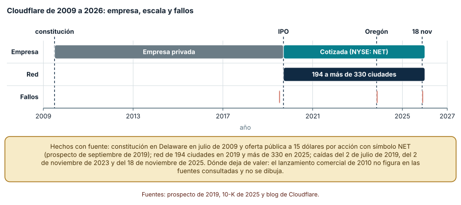

**Cómo leer la figura.** Cada carril es una dimensión del caso y la escala es el año. Mire cómo las tres caídas ocurren con la empresa ya cotizada y con una red cada vez mayor. **Dónde deja de valer.** Los marcadores de fallos son puntuales; el post de cada uno describe horas y no años.

### Oficinas, plantilla y estructura

**Oficinas (documentado).** La sede está en San Francisco, con unos 112 000 pies cuadrados arrendados, de los cuales unos 67 000 en dos edificios de Townsend Street con contratos hasta octubre de 2027 y unos 45 000 en Second Street hasta diciembre de 2027 [C1]. El 10-K reconoce que su sede está en la zona de la bahía de San Francisco y que uno de sus centros de datos principales está en el área de Portland, Oregón, y otro en Ámsterdam, regiones expuestas a riesgos sísmicos y volcánicos [C1]. **[No se sabe]** la lista de oficinas por país en las fuentes consultadas.

**Plantilla (documentado).** A 31 de diciembre de 2025 tenía 5 156 empleados a tiempo completo, de los cuales 2 452 fuera de Estados Unidos (48 %); además usa contratistas y consultores [C1]. El ingreso por empleado es de unos 420 000 USD (cálculo propio, orden de magnitud).

**Estructura.** **[No se sabe]** el organigrama de ingeniería y el número de ingenieros; el 10-K da el gasto de investigación y desarrollo: 512,5 millones de USD en 2025, 23,6 % del ingreso [C1].

## Contexto y problema

**Documentado.** El 10-K de 2025 describe lo que ofrece como una red global programable: la red «abarca más de 330 ciudades en más de 125 países» e interconecta con más de 13 000 redes, entre ellas proveedores de acceso, nubes y empresas; y explica que, a medida que crece, las dinámicas de coste de ancho de banda y de ubicación se vuelven más poderosas, y que cada vez más clientes usan la red para construir sus propias aplicaciones, lo que abre un mercado de almacenamiento y cómputo [C1].

**El problema de fondo.** Operar un sitio con visitantes en todo el mundo exige tres cosas que antes se compraban por separado: **rendimiento** (acercar el contenido al visitante), **seguridad** (resistir ataques de saturación y explotación de vulnerabilidades) y **fiabilidad** (que el sitio funcione aunque falle una pieza). Cloudflare propone una sola capa de red entre los visitantes y los servidores de origen que hace las tres. Esa capa es un punto crítico: si falla, fallan los sitios que protege. Por eso este caso dedica tanto espacio a sus tres caídas publicadas.

**Inferido.** La apuesta de producto parece haber sido que un volumen enorme y mezclado de tráfico es un activo: cada cliente nuevo da más visibilidad de ataques y más razones para que las redes se interconecten, lo que baja el coste y mejora el servicio. El 10-K lo respalda indirectamente al hablar de las dinámicas de coste que se refuerzan al crecer la red [C1].

### La apuesta, enunciada como hipótesis

El curso propone leer la apuesta de Cloudflare como tres hipótesis comprobables ([SE-124](../../classes/part-10-descubrimiento-y-estrategia-de-producto/se-124-hipotesis-supuestos-y-preguntas-criticas/README.md)): (1) los sitios pagarán por una capa de red que los acelera y los protege sin que operen hardware; (2) una red con presencia en cientos de ciudades logra costes por unidad de tráfico que un competidor pequeño no iguala; (3) un software de red propio, hecho para esa escala, supera a las soluciones generales. La tercera está documentada de forma directa: Cloudflare sustituyó NGINX por un proxy propio, Kyoto Tycoon por un almacén propio y consideró que los contenedores no servían para su cómputo [C6], [C7], [C8]. Las otras dos son lectura del curso.

## Mercado, usuarios y casos de uso

Cloudflare tiene varios públicos. La tabla resume quién es cada uno; lo que la fuente no confirma se marca.

| Rol | Qué hace y qué gana | Qué cambia en su experiencia | Respaldo |
| --- | --- | --- | --- |
| Sitio o aplicación pequeña | Pone su dominio detrás de la red, con planes gratuitos o baratos | Velocidad y protección sin operar nada | [C1] |
| Gran empresa | Contratos de gran tamaño con seguridad, rendimiento y desarrollo | 4 298 clientes superan 100 000 USD anuales al cierre de 2025 | [C1] |
| Desarrollador | Ejecuta código y guarda datos en la red | Un mercado nuevo de almacenamiento y cómputo | [C1], [C8] |
| Usuario final | Visita sitios que usan la red | Páginas más rápidas y con menos ataques | [C1] |
| Proveedor de acceso y nubes | Se interconecta con la red | Más de 13 000 redes interconectadas | [C1] |
| Atacante | Satura o explota los sitios protegidos | Botnets de millones de equipos | [C9] |
| Equipos de seguridad de Cloudflare | Analizan amenazas y publican informes | **[No se sabe]** tamaño y herramientas | [C9] |

**Uso central.** Poner un sitio detrás de la red para que cargue más rápido y resista ataques. **Mercado.** 332 466 clientes de pago a finales de 2025, 40 % más que un año antes; el 49 % del ingreso se factura a clientes de Estados Unidos, 28 % a Europa, Oriente Medio y África y 15 % a Asia Pacífico [C1].

### Quién da qué a quién

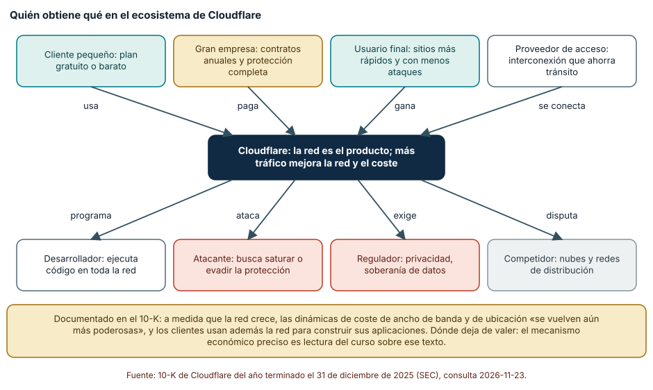

**Cómo leer la figura.** Cloudflare está en el centro porque conecta a todos; las etiquetas dicen qué aporta o qué busca cada actor. Mire primero que el atacante también es un actor del sistema: define el diseño. **Dónde deja de valer.** No hay cifras por actor.

### Incentivos por tipo de usuario (análisis propio sobre hechos documentados)

- **Sitio pequeño.** Quiere velocidad y protección sin equipo de operaciones; el plan gratuito o barato lo atrae y el 10-K reconoce que convertir clientes gratuitos en de pago es una de sus metas [C1].
- **Gran empresa.** Quiere contratos con garantías y funciones de seguridad; el número de clientes de más de 100 000 USD pasó de 2 756 a 4 298 en dos años (56 %) [C1].
- **Desarrollador.** Quiere un lugar donde ejecutar código cerca del usuario sin gestionar servidores; los aislados de V8 son la oferta [C8].
- **Proveedor de acceso.** Quiere reducir el coste de tráfico de tránsito; interconectarse con la red de Cloudflare es una forma de lograrlo (inferido a partir del texto del 10-K sobre interconexión).
- **Atacante.** Quiere saturar o evadir; la botnet Aisuru, con entre uno y cuatro millones de equipos, genera ataques por encima de 1 Tbps de forma rutinaria [C9].
- **Cloudflare.** Su incentivo es que la red crezca: el coste unitario baja y la retención sube. Su retención neta de dólares fue de 120 % en el cuarto trimestre de 2025 [C1].

### Competencia y por qué el mercado favoreció a Cloudflare (análisis propio)

El 10-K reconoce una competencia intensa y creciente y que las grandes nubes y los proveedores de seguridad pueden ofrecer productos similares [C1]. La razón por la que Cloudflare llegó a esta escala no está declarada. El análisis propio plantea cuatro factores, ninguno suficiente por sí solo: (1) una oferta gratuita que capta sitios pequeños y genera visibilidad de tráfico; (2) una red de presencia amplia interconectada con miles de redes [C1]; (3) la decisión de escribir software propio para el proxy, la configuración y el cómputo [C6]–[C8]; (4) la comunicación abierta de sus caídas, que crea confianza técnica. **[No se sabe]** cuánto pesa cada uno ni la cuota de mercado frente a cada competidor.

## Funcionalidad de principio a fin

Se recorre el servicio primero con un sitio pequeño y luego con otros tipos de usuario, hasta su caso límite.

### Recorrido de un sitio pequeño

1. **Primer contacto.** El propietario crea una cuenta y añade su dominio. **[No se sabe]** el flujo interno de alta.
2. **Cambio de nombres.** Apunta su dominio a los servidores de nombres de Cloudflare; desde entonces el tráfico pasa por la red.
3. **Una petición.** Un visitante llega por anycast a la ciudad más cercana; un proxy aplica caché y reglas y, si falta, pide el contenido al origen [C6].
4. **Seguridad.** El cortafuegos de aplicaciones y la gestión de bots se aplican en el camino [C3], [C5].
5. **Configuración.** Los cambios que el cliente hace en el panel se distribuyen a toda la red en segundos con Quicksilver [C7].
6. **Operación diaria.** Para el sitio, que funcione; detrás, una red de más de 330 ciudades.

### Recorridos por tipo de usuario

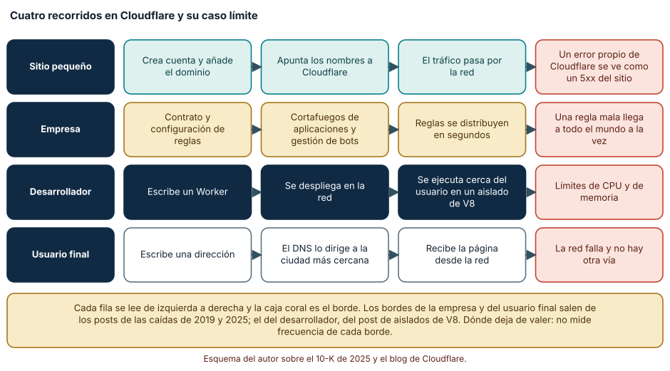

**Cómo leer la figura.** Cada fila es un usuario distinto; las cajas se leen de izquierda a derecha y la última, en coral, es el caso límite. **Dónde deja de valer.** Es un recorrido visible al usuario, no un diagrama de estados.

**Empresa.** **[Documentado]** que las reglas del cortafuegos se pueden desplegar rápido y de forma global, y que esa velocidad fue lo que permitió proteger frente a una vulnerabilidad de SharePoint en mayo de 2019 y lo que causó la caída de julio [C3]. El caso límite es una regla defectuosa que llega a todo el mundo a la vez.

**Desarrollador.** **[Documentado]** que Workers ejecuta código en aislados de V8, con arranques unas cien veces más rápidos que un proceso de Node según el autor del post [C8]. El caso límite son los límites de CPU y memoria de cada aislado. **[No se sabe]** los límites actuales.

**Usuario final.** **[Documentado]** que en noviembre de 2025 la red dejó de enrutar la mayor parte del tráfico principal durante unas tres horas y que el usuario vio una página de error de Cloudflare [C5]. El caso límite es la ausencia de una vía alternativa para los sitios detrás de la red.

## Negocio y economía

**Modelo (documentado).** Cloudflare genera ingresos principalmente de suscripciones de acceso a su red y a sus productos, junto con servicios de soporte; los clientes no tienen derecho a poseer el software de la red, sino acceso continuo durante el contrato [C1]. Hay planes gratuitos y de pago.

### La escala de los ingresos a lo largo del tiempo

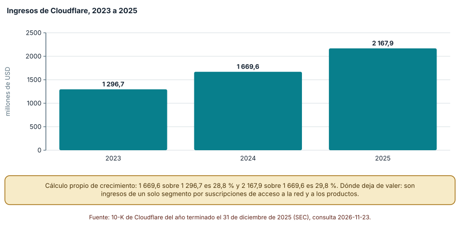

**Cómo leer la figura.** Cada barra es un año. Mire que el crecimiento se mantiene cerca de 30 % cada año. **Dónde deja de valer.** Es un solo segmento operativo y no hay desglose por producto.

### Unit economics con cifras citadas

| Magnitud | 2023 | 2024 | 2025 | Fuente |
| --- | ---: | ---: | ---: | --- |
| Ingresos (millones de USD) | 1 296,7 | 1 669,6 | 2 167,9 | [C1] |
| Coste de ingresos | 307,0 | 378,7 | 552,5 | [C1] |
| Beneficio bruto | 989,7 | 1 290,9 | 1 615,4 | [C1] |
| Margen bruto | 76 % | 77 % | 75 % | [C1] |
| Ventas y marketing | 599,1 | 745,8 | 920,8 | [C1] |
| Investigación y desarrollo | 358,1 | 421,4 | 512,5 | [C1] |
| Administración general | 218,0 | 278,5 | 389,3 | [C1] |
| Pérdida operativa | 185,5 | 154,8 | 207,2 | [C1] |
| Pérdida neta | 183,9 | 78,8 | 102,3 | [C1] |
| Flujo de caja libre | 119,5 | 166,9 | 260,6 | [C1] |
| Clientes de pago | 189 791 | 237 714 | 332 466 | [C1] |
| Clientes de más de 100 000 USD | 2 756 | 3 497 | 4 298 | [C1] |
| Retención neta de dólares | 115 % | 111 % | 120 % | [C1] |

La retención neta de dólares compara el ingreso anualizado de los clientes de pago de hace cuatro trimestres con el de esos mismos clientes en el último trimestre; incluye expansión y descuenta contracción y bajas, y excluye a los clientes nuevos y a los gratuitos que pasan a pago [C1].

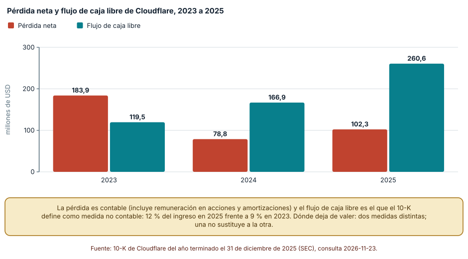

**Cómo leer la figura.** Dos barras por año: pérdida contable y caja libre. Mire que a pesar de la pérdida la caja es positiva y crece. **Dónde deja de valer.** Son medidas distintas.

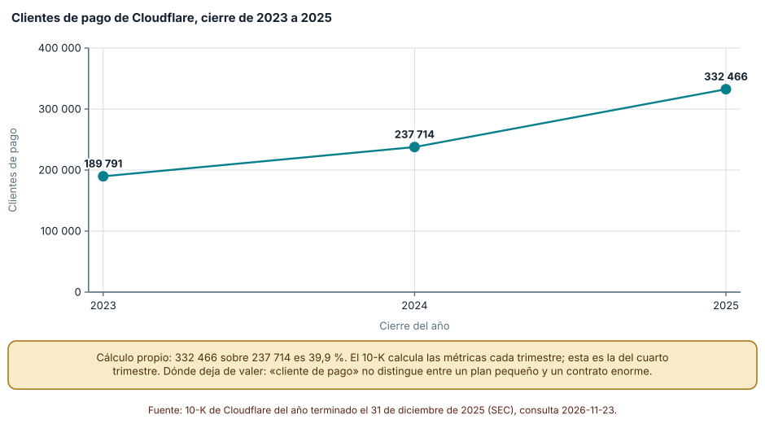

**Cómo leer la figura.** Cada punto es el cierre de un año. **Dónde deja de valer.** No distingue planes pequeños de contratos grandes.

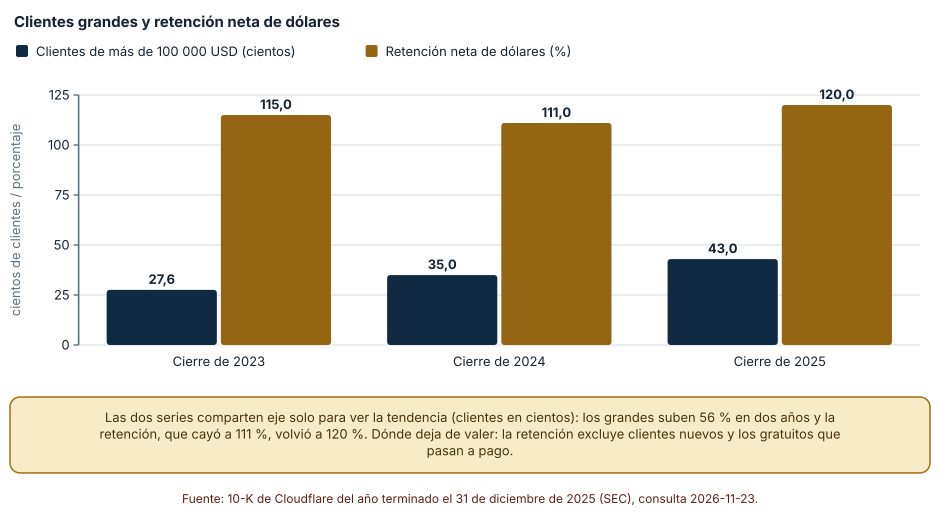

**Cómo leer la figura.** Las barras azules son clientes grandes en cientos y las doradas el porcentaje de retención. **Dónde deja de valer.** Dos magnitudes comparten eje solo para la tendencia.

### Dónde crece el negocio

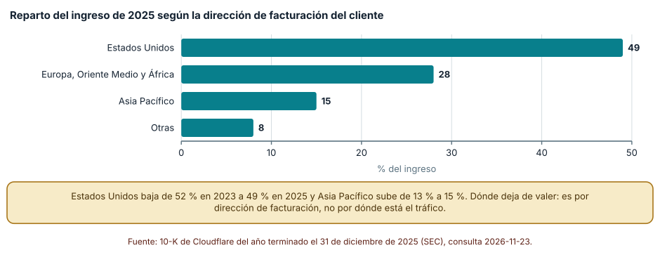

**Cómo leer la figura.** Cada barra es una región por dirección de facturación. **Dónde deja de valer.** No es dónde está el tráfico.

El ingreso de Estados Unidos creció de 678,2 millones en 2023 a 1 073,0 millones en 2025 (58 %); el de Asia Pacífico de 168,8 a 329,8 millones (95 %) [C1]. Cálculo propio: Asia Pacífico crece más rápido pero pesa solo 15 %.

### Eficiencia de la organización

Con 5 156 empleados, el gasto de ventas y marketing de 920,8 millones es de unos 179 000 USD por empleado (cálculo propio, orden de magnitud). Ventas y marketing es 42,5 % del ingreso: casi el doble que investigación y desarrollo.

### Esquema del negocio: flujos de dinero y de valor

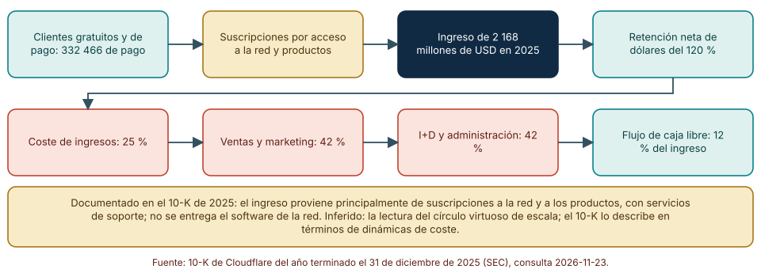

**Cómo leer la figura.** La fila superior es el embudo de ingresos y la inferior el destino del gasto. **Dónde deja de valer.** Es un esquema de flujo, no un modelo financiero.

### Visión, misión y estrategia

El 10-K presenta una estrategia de plataforma: ampliar la red, vender más productos a los clientes existentes y conquistar clientes grandes y desarrolladores [C1]. La carta de 2019 dice que quieren «construir un negocio enorme, lentamente y de forma consistente» y que su sesgo es hacia el desarrollo interno integrado en su plataforma [C2]. **[Inferido]** que las decisiones de escribir Pingora y Quicksilver responden a esa preferencia.

### Costos operativos

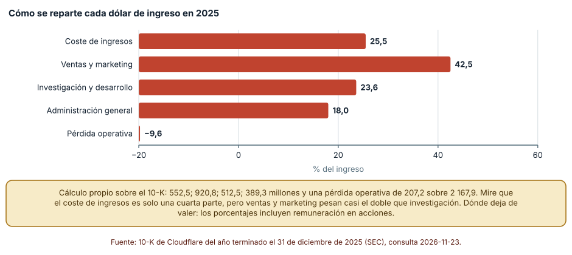

**Cómo leer la figura.** Cada barra es una partida como porcentaje de los 2 167,9 millones. **Dónde deja de valer.** Incluyen remuneración en acciones.

**Alojamiento y red.** **[No se sabe]** el gasto de red y el de centros de datos por separado. El 10-K lo describe cualitativamente: las dinámicas de coste de ancho de banda y de ubicación mejoran con la escala [C1].

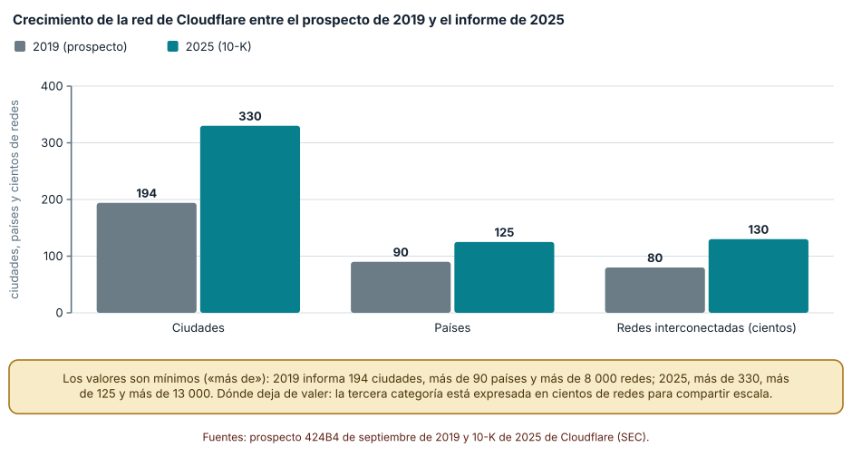

**Cómo leer la figura.** Cada grupo compara el prospecto de 2019 con el 10-K de 2025. **Dónde deja de valer.** Los valores son mínimos («más de») y la tercera categoría está en cientos de redes.

### Competidores

El 10-K reconoce competidores en seguridad, rendimiento, nube y desarrollo, y lo califica de intenso y creciente [C1]. **[No se sabe]** cuota de mercado por competidor.

## Arquitectura y esquemas

Se recorre como un mapa con zoom creciente. Lo que sigue sale de siete posts del blog de Cloudflare y del 10-K; lo que no está allí se marca. Tres de los posts son análisis posteriores a caídas (2019, 2023 y 2025), que cuentan sus propios errores con cronología.

### 6.1 Contexto del sistema

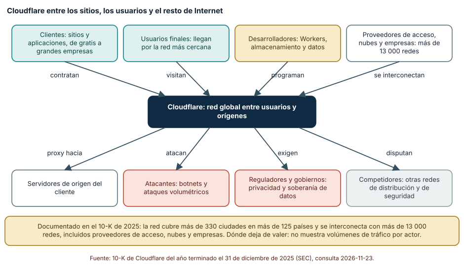

**Cómo leer la figura.** El cuadro central es la red y los satélites son quienes la usan o la presionan. Mire primero que los orígenes quedan detrás: ya no hablan directamente con el usuario. **Dónde deja de valer.** No hay volúmenes.

### 6.2 Capas

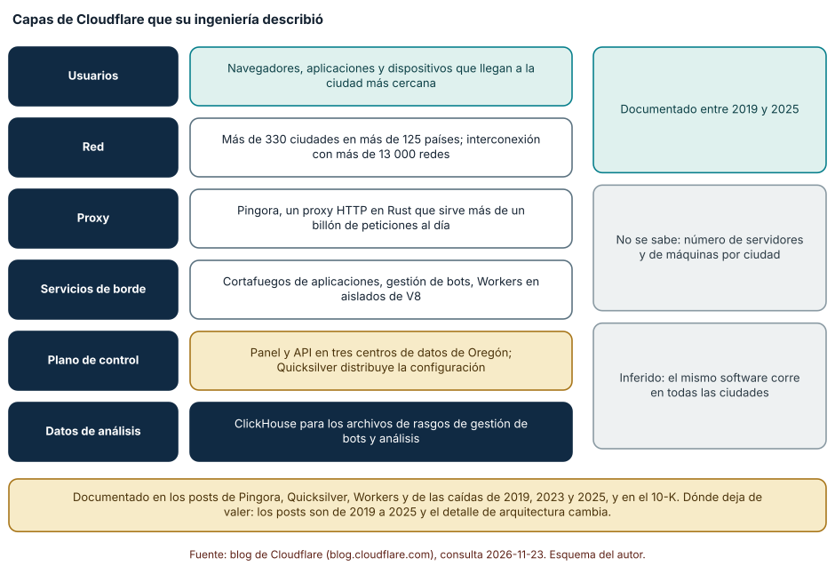

**Cómo leer la figura.** De arriba abajo, cada capa descansa en la siguiente; a la derecha, qué es documentado y qué no. **Dónde deja de valer.** Los posts son de 2019 a 2025.

**Documentado.** La red tiene presencia en más de 330 ciudades [C1]. El proxy HTTP que sirve la mayor parte del tráfico es Pingora, escrito en Rust, que sirve más de un billón de peticiones al día [C6]. Las funciones de seguridad (cortafuegos de aplicaciones, gestión de bots) se aplican en ese camino [C3], [C5]. El plano de control (panel y API) y los análisis corren en tres centros de datos de la zona de Hillsboro, Oregón [C4]. La configuración se distribuye con Quicksilver [C7]. El código de los clientes se ejecuta en aislados de V8 [C8].

### 6.3 Una petición

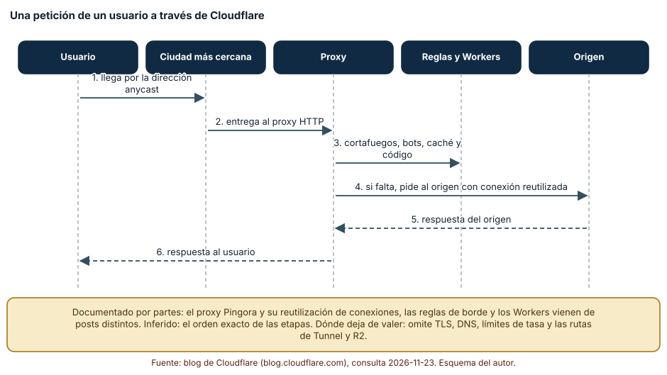

**Cómo leer la figura.** Las flechas son llamadas en orden; las punteadas son respuestas. Mire el paso del origen: es el único que sale de la red. **Dónde deja de valer.** Omite TLS, DNS y límites de tasa; es una síntesis de posts distintos.

**Documentado.** Pingora «sirve el tráfico entre la red y los servidores de Internet» y alimenta la distribución de contenido, la función fetch de Workers, Tunnel, Stream y R2, entre otros [C6]. **Inferido.** El orden exacto de las etapas dentro de una ciudad. **Mecanismo.** Es la combinación de DNS, direccionamiento anycast, proxy y caché que tratan las clases de redes ([SE-041](../../classes/part-03-redes-internet-y-protocolos/se-041-dns-nombres-resolucion-y-fallos/README.md), [SE-044](../../classes/part-03-redes-internet-y-protocolos/se-044-proxies-balanceadores-gateways-y-cdn/README.md)), de HTTP y caché ([SE-042](../../classes/part-03-redes-internet-y-protocolos/se-042-http-semantica-cache-y-negociacion/README.md)) y de caché y limitación de tasa ([SE-249](../../classes/part-20-backend-apis-y-procesamiento-asincrono/se-249-caching-rate-limiting-y-proteccion/README.md)).

### 6.4 Pingora: sustituir un proxy al llegar a su límite

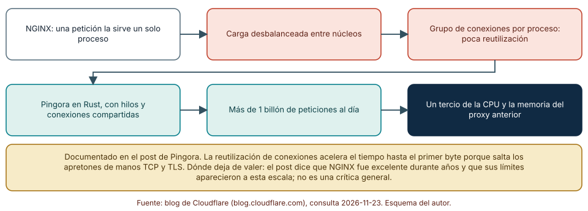

**Cómo leer la figura.** La fila superior es el diseño anterior y la inferior el nuevo. **Dónde deja de valer.** Es una comparación del propio Cloudflare con su uso de NGINX.

**Documentado [C6].** Cloudflare anunció Pingora, un proxy HTTP propio en Rust que sirve más de un billón de peticiones al día y usa un tercio de la CPU y la memoria de la infraestructura de proxy anterior. Explica que NGINX fue excelente durante años pero sus límites aparecieron a su escala: en NGINX cada petición la atiende un solo proceso («trabajador»), lo que desbalancea la carga entre núcleos y hace que una petición que consume CPU o bloquea por entrada y salida frene a las demás; y, lo más crítico, el grupo de conexiones al origen es por trabajador, de modo que al añadir trabajadores la reutilización de conexiones empeora porque las conexiones se dispersan en más grupos aislados. La reutilización acelera el tiempo hasta el primer byte porque se evitan los apretones de manos de TCP y TLS. Para Pingora eligieron Rust, multihilo en lugar de multiproceso para compartir recursos y especialmente los grupos de conexiones, y robo de trabajo para repartir la carga. El ahorro viene de poder compartir conexiones entre todos los hilos: en conjunto, Pingora hace un tercio de las conexiones nuevas.

**Qué enseña.** Una pieza estándar (un proxy general) puede ser la elección correcta durante años y dejar de serlo a una escala concreta; el criterio de cambio fue una limitación de arquitectura medida, no una moda. La clase de proxies y balanceadores ([SE-044](../../classes/part-03-redes-internet-y-protocolos/se-044-proxies-balanceadores-gateways-y-cdn/README.md)) y la de concurrencia ([SE-385](../../classes/part-32-concurrencia-y-sistemas-distribuidos/se-385-concurrencia-paralelismo-y-asincronia/README.md)) lo desarrollan.

### 6.5 Quicksilver: distribuir configuración en segundos

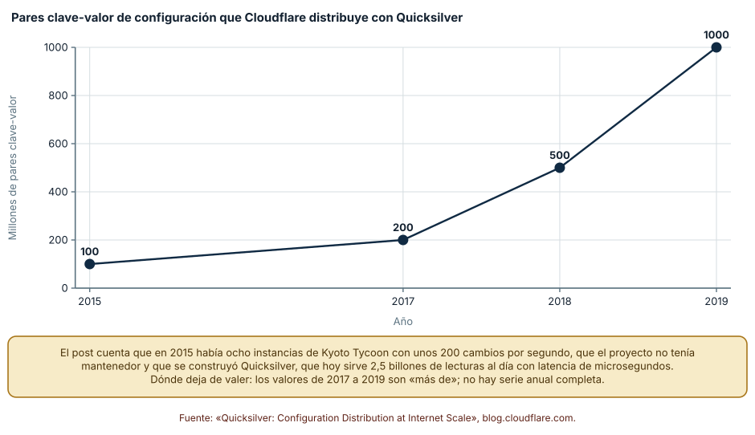

**Cómo leer la figura.** Cada punto es un año con su volumen de pares. Mire la aceleración de 2017 a 2019. **Dónde deja de valer.** Los valores de 2017 a 2019 son mínimos.

**Documentado [C7].** Cuando un cliente cambia su configuración entre cientos de cambios, Cloudflare la distribuye a las ciudades donde tiene hardware en segundos; el sistema tiene que ser rápido y fiable, porque de él dependían más de 26 millones de propiedades de Internet cuando se escribió el post. En 2015 usaban ocho instancias de Kyoto Tycoon (un almacén clave-valor) con unos 100 millones de pares y unos 200 cambios por segundo, con decenas de miles de procesos en la infraestructura; el número de claves pasó de 100 millones en 2015 a más de 1 000 millones en 2019. El problema: la escritura a disco, la falta de conmutación automática sin tiempo de inactividad del nodo raíz y un proyecto sin mantenedor. Por eso construyeron Quicksilver, que hoy sirve en promedio 2,5 billones de lecturas al día con latencia de microsegundos.

**Qué enseña.** La distribución de configuración es una función de la plataforma que debe tratarse como un sistema crítico: es el mecanismo por el que un cambio local llega a todas las ciudades, y por lo mismo por el que una regla mala llega a todas ([SE-475](../../classes/part-39-build-release-y-cadena-de-suministro/se-475-feature-flags-y-entrega-progresiva/README.md); [SE-476](../../classes/part-39-build-release-y-cadena-de-suministro/se-476-canary-blue-green-y-rollback/README.md)).

### 6.6 Workers: aislados de V8

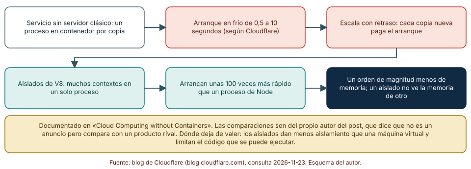

**Cómo leer la figura.** La fila superior es el diseño clásico y la inferior el de Workers. **Dónde deja de valer.** La comparación es del autor del post, que compara con un producto rival.

**Documentado [C8].** Workers se apoya en V8, el motor de JavaScript de Chrome: los aislados (isolates) son contextos ligeros que agrupan variables con el código que puede mutarlas, y un solo proceso puede ejecutar cientos o miles de ellos y cambiar entre ellos, con lo que se ejecuta código de clientes distintos dentro de un único proceso del sistema operativo sin que un aislado acceda a la memoria de otro. Se paga una vez el coste del motor de JavaScript. El autor afirma que un aislado arranca unas cien veces más rápido que un proceso de Node y consume un orden de magnitud menos memoria, que no usa máquina virtual ni contenedor y que en servicios sin servidor tradicionales un arranque en frío tarda entre 500 milisegundos y 10 segundos. **Interpretación.** Menos aislamiento que una máquina virtual es el precio del arranque rápido; la clase de contenedores, microVM y sandboxes ([SE-282](../../classes/part-23-runtimes-y-plataformas-modernas/se-282-contenedores-microvm-y-sandboxes/README.md)) y la de WebAssembly y runtimes ([SE-277](../../classes/part-23-runtimes-y-plataformas-modernas/se-277-webassembly-y-wasi/README.md)) tratan ese eje.

### 6.7 Ataques volumétricos

**Cómo leer la figura.** El centro es el informe y cada nodo, una cifra. **Dónde deja de valer.** Son mediciones de Cloudflare sobre su propio tráfico.

**Documentado [C9].** El informe del tercer trimestre de 2025 describe la botnet Aisuru, con entre uno y cuatro millones de equipos infectados, que lanzó ataques hipervolumétricos que superaban de forma rutinaria 1 terabit por segundo y 1 000 millones de paquetes por segundo; el número de esos ataques subió 54 % respecto del trimestre anterior, con unos 14 diarios, y el máximo fue de 29,7 terabits por segundo y 14,1 miles de millones de paquetes por segundo. **Mecanismo.** Soportar un ataque de esa magnitud exige capacidad distribuida; la tesis del 10-K es que una red amplia y muy interconectada la ofrece de forma natural [C1]. La clase de seguridad de redes y de amenazas ([SE-457](../../classes/part-38-seguridad-privacidad-y-cumplimiento/se-457-principios-de-seguridad-y-modelos-de-amenaza/README.md)) da el marco.

### 6.8 Caída del 2 de julio de 2019

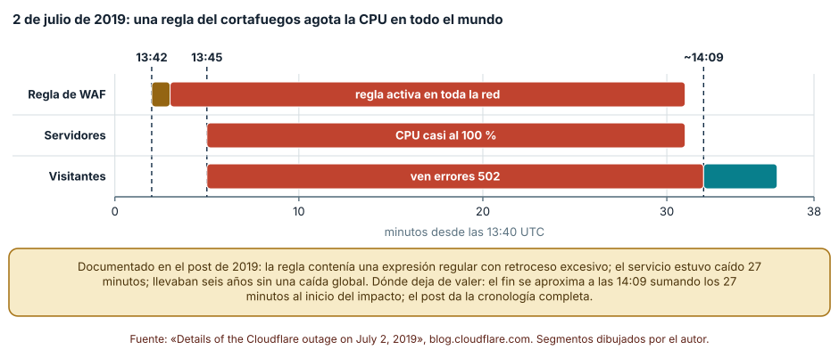

**Cómo leer la figura.** Los carriles son la regla, los servidores y los visitantes. **Dónde deja de valer.** Los segmentos se dibujan a partir de las horas citadas.

**Documentado [C3].** Ese día se desplegó una regla nueva en las reglas gestionadas del cortafuegos de aplicaciones que agotó la CPU de todos los núcleos que atienden tráfico HTTP y HTTPS en toda la red. Contenía una expresión regular con retroceso enorme. Los visitantes vieron una página de error 502. A las 13:42 un ingeniero del equipo de cortafuegos desplegó mediante un proceso automático un cambio menor en las reglas de detección de XSS; tres minutos después llegó la primera alerta, de una prueba sintética externa; después, alertas de pruebas de extremo a extremo, una caída global de tráfico, errores 502 y CPU agotada en ciudades de todo el mundo. El servicio estuvo caído 27 minutos. La empresa dice que llevaban seis años sin una caída global. El post añade que la historia real «es mucho más compleja que una regular expression mala» y dedica un apéndice al retroceso de expresiones regulares.

**Qué enseña.** Es el caso de manual de una entrada que se evalúa con un motor de coste no acotado y de un despliegue global inmediato: el mismo mecanismo que permite proteger rápido permite fallar rápido ([SE-460](../../classes/part-38-seguridad-privacidad-y-cumplimiento/se-460-validacion-codificacion-y-clases-de-inyeccion/README.md) para validación y entrada; [SE-476](../../classes/part-39-build-release-y-cadena-de-suministro/se-476-canary-blue-green-y-rollback/README.md) para despliegues progresivos; [SE-501](../../classes/part-41-observabilidad-sre-e-incidentes/se-501-postmortems-sin-culpa-y-aprendizaje/README.md) para postmortems sin culpa).

### 6.9 Caída de la capa de control del 2 al 4 de noviembre de 2023

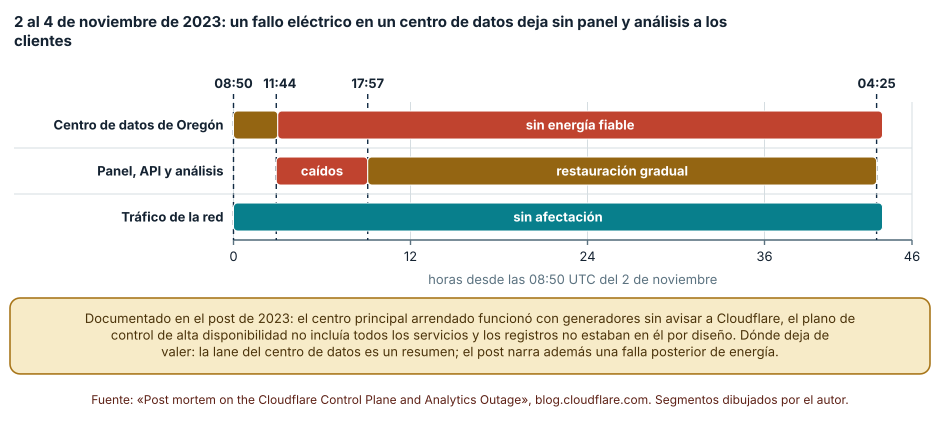

**Cómo leer la figura.** Mire el último carril: el tráfico no se vio afectado; lo que cayó fue el panel, la API y los análisis. **Dónde deja de valer.** Resume un post largo.

**Documentado [C4].** El plano de control (la interfaz para clientes, el sitio web y las API) y los servicios de análisis corren principalmente en tres centros de datos de la zona de Hillsboro, Oregón, independientes entre sí, con varias acometidas y varias conexiones de red, a una distancia pensada para que un desastre natural no los afectara a todos, y funcionando en activo-activo con sincronización continua. El diseño llevaba cuatro años implantándose; muchos servicios críticos estaban ya en el clúster de alta disponibilidad, pero algunos, sobre todo de productos nuevos, no, y los registros se dejaron fuera a propósito porque en el borde se encolan hasta que el núcleo vuelve. El mayor de los tres centros lo opera Flexential (Cloudflare usa alrededor de 10 % de su capacidad). El 2 de noviembre a las 08:50 UTC la compañía eléctrica tuvo un mantenimiento no planificado que cortó una de las acometidas; el centro pasó a generadores y, contra las buenas prácticas, no avisó a Cloudflare. El incidente duró del 2 de noviembre a las 11:44 UTC al 4 de noviembre a las 04:25 UTC; la mayor parte del plano de control se restauró en el centro de recuperación a las 17:57 del 2 de noviembre; los registros brutos no estuvieron disponibles para la mayoría de clientes durante todo el incidente. Durante él, los servicios de red y de seguridad siguieron funcionando; hubo periodos en que los clientes no pudieron cambiar su configuración, pero el tráfico no se vio afectado. Cloudflare dice que «esto nunca debió ocurrir»: creían tener alta disponibilidad, pero algunos sistemas críticos tenían dependencias no obvias.

**Qué enseña.** Separa dos planos: el **plano de datos** (el tráfico) siguió sirviendo y el **plano de control** (cambiar la configuración) cayó; es el patrón que las clases de continuidad ([SE-502](../../classes/part-41-observabilidad-sre-e-incidentes/se-502-continuidad-disaster-recovery-y-ejercicios/README.md)) y de disponibilidad ([SE-440](../../classes/part-36-calidad-rendimiento-y-resiliencia/se-440-disponibilidad-durabilidad-y-recuperacion/README.md)) piden diseñar a propósito.

### 6.10 Caída del 18 de noviembre de 2025

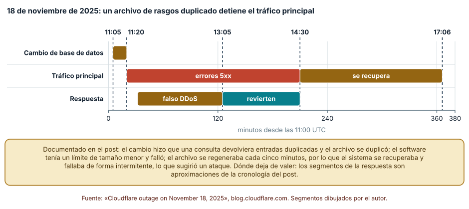

**Cómo leer la figura.** Mire cómo el periodo de investigación de un ataque inexistente ocupa más de la mitad del tiempo de caída. **Dónde deja de valer.** Los segmentos de respuesta son aproximaciones.

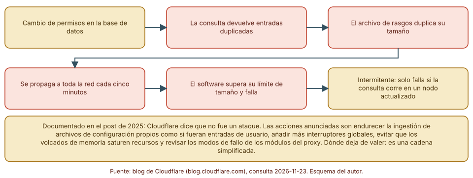

**Cómo leer la figura.** Cada caja es un eslabón; casi todos son coral. **Dónde deja de valer.** Es una simplificación del post.

**Documentado [C5].** El 18 de noviembre de 2025 a las 11:20 UTC la red empezó a fallar al entregar el tráfico principal. No fue por un ataque. Un cambio en los permisos de uno de sus sistemas de bases de datos hizo que la base devolviera varias entradas en un «archivo de rasgos» usado por el sistema de gestión de bots; el archivo duplicó su tamaño y se propagó a todas las máquinas de la red. El software que enruta el tráfico tenía un límite de tamaño menor que el archivo duplicado y falló. El archivo se generaba cada cinco minutos con una consulta en un clúster de ClickHouse que se estaba actualizando de forma gradual: solo se generaban datos malos cuando la consulta corría en una parte ya actualizada, de modo que cada cinco minutos había una posibilidad de archivo bueno o malo y el sistema se recuperaba y volvía a fallar, lo que hizo pensar al principio en un ataque de denegación a gran escala. Cronología: 11:05 despliegue del cambio de permisos; 11:28 el despliegue llega a los clientes; 11:31 la primera prueba automática detecta el problema y 11:32 empieza la investigación manual; hasta las 13:05 investigan un supuesto problema en Workers KV; 13:05 se desvían Workers KV y Access a una versión anterior del proxy, aunque el fallo estaba también en esa; se detiene la propagación del archivo y se restaura una versión anterior; el tráfico principal fluye casi con normalidad a las 14:30 y todo funciona a las 17:06. Acciones anunciadas: endurecer la ingestión de archivos de configuración propios como si fueran entradas de usuario, más interruptores globales de funciones, impedir que los volcados de memoria saturen recursos y revisar los modos de fallo de los módulos del proxy. La empresa lo describe como su peor caída desde 2019.

**Qué enseña.** Una vez más, el detonante fue un cambio de configuración propio que se propagó rápido a todo; y el análisis se desvió por un síntoma que parecía un ataque. Las clases de contratos de datos ([SE-366](../../classes/part-30-ingenieria-de-datos-y-plataformas-de-datos/se-366-contratos-de-datos-y-evolucion-de-esquemas/README.md)), de despliegue progresivo ([SE-476](../../classes/part-39-build-release-y-cadena-de-suministro/se-476-canary-blue-green-y-rollback/README.md)) y de respuesta a incidentes ([SE-500](../../classes/part-41-observabilidad-sre-e-incidentes/se-500-gestion-de-incidentes-y-comunicacion/README.md)) lo cubren.

### 6.11 Seguridad, abuso y cumplimiento

**Documentado.** El 10-K trata la seguridad, la privacidad y las leyes de datos como riesgos materiales y menciona que las actividades de clientes y el contenido de sus sitios pueden causar consecuencias políticas, comerciales y reputacionales [C1]. **[No se sabe]** el diseño interno de identidad, claves y cumplimiento más allá de lo anterior.

### 6.12 Observabilidad y operación

**Documentado.** En 2019 una prueba sintética externa fue la primera alerta [C3]; en 2025 la primera prueba automática detectó el problema a las 11:31 [C5]; cada incidente se cuenta en un análisis público con cronología [C3]–[C5]. **Mecanismo.** Ver el sistema desde fuera (pruebas sintéticas) es lo que da una primera señal; la clase de señales y observabilidad ([SE-493](../../classes/part-41-observabilidad-sre-e-incidentes/se-493-senales-eventos-y-observabilidad-util/README.md)) y la de postmortems ([SE-501](../../classes/part-41-observabilidad-sre-e-incidentes/se-501-postmortems-sin-culpa-y-aprendizaje/README.md)) lo desarrollan.

### 6.13 Evolución y alternativas descartadas (análisis propio)

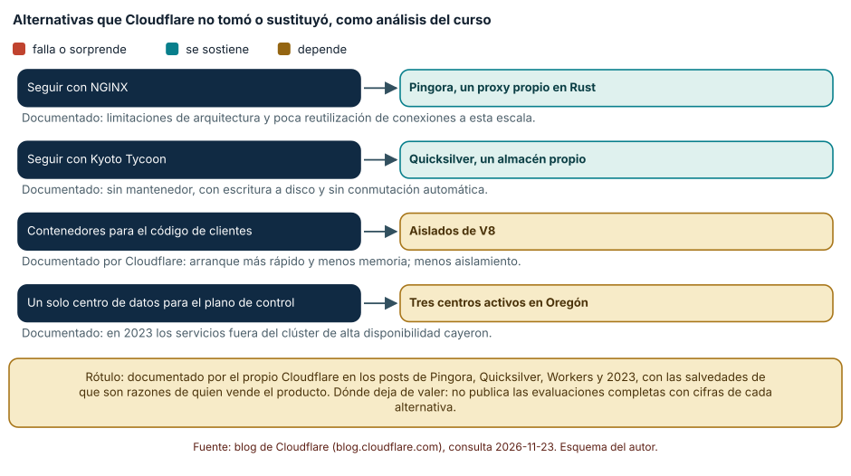

**Cómo leer la figura.** Cada tarjeta enfrenta una alternativa con lo que Cloudflare hizo. **Dónde deja de valer.** Son razones del propio proveedor.

**Rótulo: documentado por Cloudflare.** Sobre NGINX, Kyoto Tycoon y los contenedores hay razones escritas por el equipo [C6]–[C8]; sobre el plano de control, la decisión de pasar a tres centros activos se describe como un diseño de cuatro años y su límite en 2023 [C4]. **[No se sabe]** si evaluó otras bases de datos o proxies de código abierto además de los nombrados.

### 6.14 Hardware, software, infraestructura y fallos

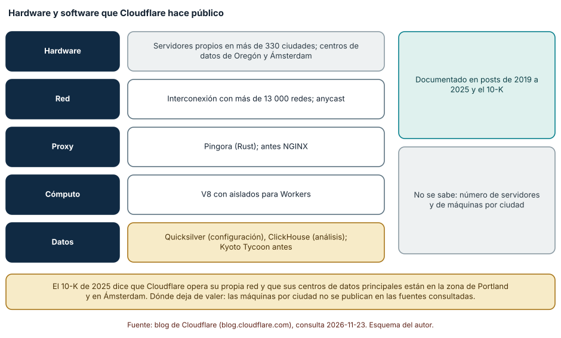

**Cómo leer la figura.** De arriba abajo, de lo físico a lo lógico. **Dónde deja de valer.** No hay números de servidores.

**Hardware utilizado.** **[No se sabe]** el modelo y el número de servidores por ciudad. Lo documentado: más de 330 ciudades; centros de colocación principales en la zona de Portland y Ámsterdam; tres centros de datos de control en Hillsboro, uno de ellos arrendado a Flexential [C1], [C4].

**Software utilizado (documentado).** Pingora (Rust), V8, Quicksilver, ClickHouse, Kyoto Tycoon (antes), NGINX (antes), Workers KV, Access, Tunnel, Stream y R2 [C3]–[C8].

**Características de la infraestructura.** Presencia en cientos de ciudades; interconexión con miles de redes; plano de datos distribuido y plano de control concentrado en pocos centros; configuración distribuida en segundos [C1], [C4], [C7].

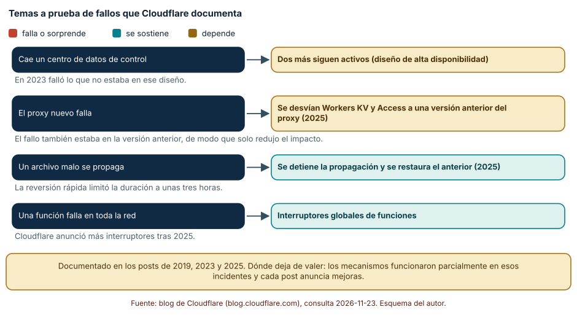

**Cómo leer la figura.** Cada tarjeta enlaza el fallo con el mecanismo que lo contiene. **Dónde deja de valer.** Funcionaron parcialmente en esos incidentes.

**Temas a prueba de fallos.** Plano de control activo-activo en tres centros, derivación de servicios a una versión anterior del proxy, reversión rápida de un archivo, interruptores globales, pruebas sintéticas externas [C3]–[C5].

## Casos especiales y cómo se resuelven

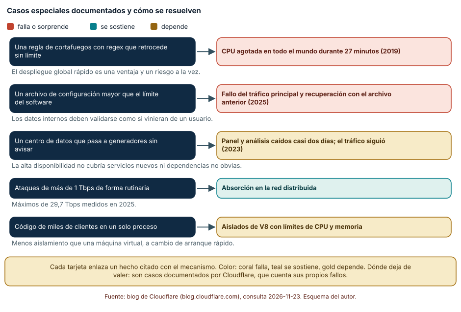

**Cómo leer la figura.** Cada tarjeta enfrenta una situación con lo que hizo el sistema; el color es el veredicto. **Dónde deja de valer.** Son casos documentados por Cloudflare.

1. **Regla de cortafuegos defectuosa.** Caída global de 27 minutos en 2019 [C3].
2. **Archivo de configuración mayor que el límite.** Tres horas de tráfico principal afectado en 2025 [C5].
3. **Centro de datos con generadores sin aviso.** Casi dos días sin panel ni análisis en 2023 [C4].
4. **Ataques de más de 1 Tbps.** Absorción en la red distribuida [C9].
5. **Código de clientes.** Aislados de V8 [C8].
6. **Reutilización de conexiones al origen.** Grupos compartidos entre hilos [C6].
7. **Crecimiento de la configuración.** Quicksilver sustituyó a Kyoto Tycoon [C7].

## Línea de tiempo

| Año o fecha | Hecho | Fuente |
| --- | --- | --- |
| Julio de 2009 | Se constituye Cloudflare en Delaware | [C2] |
| 2015 | 100 millones de pares clave-valor de configuración en Kyoto Tycoon | [C7] |
| 2 de julio de 2019 | Caída global de 27 minutos por una regla del cortafuegos | [C3] |
| Septiembre de 2019 | Oferta pública a 15 dólares con símbolo NET; red de 194 ciudades | [C2] |
| 2019 | Más de 1 000 millones de pares clave-valor; se escribe Quicksilver | [C7] |
| 2 al 4 de noviembre de 2023 | Caída del plano de control y de análisis por un fallo eléctrico | [C4] |
| 18 de noviembre de 2025 | Caída del tráfico principal por un archivo de rasgos duplicado | [C5] |
| Tercer trimestre de 2025 | Ataques de hasta 29,7 Tbps | [C9] |
| Cierre de 2025 | 332 466 clientes de pago; más de 330 ciudades; 2 167,9 millones de ingresos | [C1] |

### Decisiones clave, giros y correcciones

- **Software propio donde duele.** Pingora, Quicksilver y Workers sustituyen NGINX, Kyoto Tycoon y los contenedores [C6]–[C8].
- **Plano de control en alta disponibilidad (desde unos cuatro años antes de 2023).** Corrección parcial: no incluyó todo [C4].
- **Tras 2025: tratar la configuración propia como entrada no confiable e interruptores globales.** Corrección anunciada [C5].

## Vínculo con el curso

El caso muestra, en una plataforma real, mecanismos que el curso desarrolla con ejemplos controlados. Cada enlace dice qué ilustra el caso:

- [SE-044](../../classes/part-03-redes-internet-y-protocolos/se-044-proxies-balanceadores-gateways-y-cdn/README.md): proxies, balanceadores, gateways y CDN. Pingora y la reutilización de conexiones.
- [SE-041](../../classes/part-03-redes-internet-y-protocolos/se-041-dns-nombres-resolucion-y-fallos/README.md): DNS, nombres, resolución y fallos. El cambio de servidores de nombres y el enrutado por anycast.
- [SE-042](../../classes/part-03-redes-internet-y-protocolos/se-042-http-semantica-cache-y-negociacion/README.md): HTTP, semántica, caché y negociación. El caché de borde.
- [SE-249](../../classes/part-20-backend-apis-y-procesamiento-asincrono/se-249-caching-rate-limiting-y-proteccion/README.md): caching, rate limiting y protección. Reglas de protección en el borde.
- [SE-282](../../classes/part-23-runtimes-y-plataformas-modernas/se-282-contenedores-microvm-y-sandboxes/README.md): contenedores, microVM y sandboxes. Los aislados de V8 frente a los contenedores.
- [SE-277](../../classes/part-23-runtimes-y-plataformas-modernas/se-277-webassembly-y-wasi/README.md): WebAssembly y runtimes. Aislamiento ligero de código de terceros.
- [SE-475](../../classes/part-39-build-release-y-cadena-de-suministro/se-475-feature-flags-y-entrega-progresiva/README.md): feature flags y entrega progresiva. Interruptores globales y reglas que llegan a todo a la vez.
- [SE-476](../../classes/part-39-build-release-y-cadena-de-suministro/se-476-canary-blue-green-y-rollback/README.md): canary, blue-green y rollback. La reversión del archivo de 2025.
- [SE-440](../../classes/part-36-calidad-rendimiento-y-resiliencia/se-440-disponibilidad-durabilidad-y-recuperacion/README.md): disponibilidad, durabilidad y recuperación. Plano de datos frente a plano de control.
- [SE-502](../../classes/part-41-observabilidad-sre-e-incidentes/se-502-continuidad-disaster-recovery-y-ejercicios/README.md): continuidad y recuperación ante desastres. El centro de recuperación de 2023.
- [SE-501](../../classes/part-41-observabilidad-sre-e-incidentes/se-501-postmortems-sin-culpa-y-aprendizaje/README.md): postmortems sin culpa. Tres análisis públicos con cronología.
- [SE-500](../../classes/part-41-observabilidad-sre-e-incidentes/se-500-gestion-de-incidentes-y-comunicacion/README.md): gestión de incidentes. El falso ataque de 2025.
- [SE-460](../../classes/part-38-seguridad-privacidad-y-cumplimiento/se-460-validacion-codificacion-y-clases-de-inyeccion/README.md): validación y clases de inyección. La entrada que debe validarse, aunque sea propia.
- [SE-366](../../classes/part-30-ingenieria-de-datos-y-plataformas-de-datos/se-366-contratos-de-datos-y-evolucion-de-esquemas/README.md): contratos de datos. El archivo de rasgos y su límite de tamaño.
- [SE-133](../../classes/part-11-economia-metricas-y-decisiones-de-producto/se-133-modelos-de-negocio-y-sostenibilidad/README.md): modelos de negocio. Suscripción con plan gratuito y retención neta.

### Preguntas de discusión

1. ¿Qué diferencia hay entre un despliegue global inmediato de reglas de seguridad y un despliegue progresivo? ¿Qué se pierde y qué se gana en cada uno?
2. En 2025 los síntomas intermitentes llevaron a pensar en un ataque. ¿Qué señal habría separado antes un fallo interno de un ataque?
3. En 2023 el plano de datos siguió y el de control cayó. ¿Cómo decidiría qué servicios deben estar en el clúster de alta disponibilidad?
4. ¿Cuándo es mejor sustituir una pieza de código abierto madura por una propia? ¿Qué coste de mantenimiento se asume?
5. Cloudflare publica sus propias caídas. ¿Qué incentivos y riesgos tiene hacerlo?

### Mini-ejercicios de análisis

1. Calcule el crecimiento anual de ingresos y de clientes de pago de 2024 a 2025 y compárelo con la retención neta.
2. Dibuje la cadena de causas de la caída de 2025 y marque qué mejora anunciada corta cada eslabón.
3. Escriba una prueba que habría detectado un archivo de rasgos de más del límite antes de propagarlo.

## Qué no generalizar

- **Escribir software propio.** Cloudflare lo hace a una escala de más de un billón de peticiones al día; para la mayoría de equipos, un proxy o una base de código abierto es la elección razonable.
- **Los aislados de V8.** La comparación con los contenedores es del autor del post y compara con un producto rival; menos aislamiento es un riesgo en otros contextos.
- **El modelo gratuito más suscripción.** Depende de que el coste marginal de servir un sitio pequeño sea bajo gracias a una red ya construida.
- **La pérdida contable.** Cloudflare tiene pérdida neta y caja libre positiva; un negocio con esa forma depende de que los inversores acepten pérdidas contables.
- **La transparencia.** Que Cloudflare publique sus caídas no demuestra que sean más raras ni más leves que las de quien no las publica.
- **Las cifras de ataques.** Son las que Cloudflare mide en su red; no son una estadística global de Internet.

## Fuentes públicas verificadas

Todas las URL se consultaron el 23 de noviembre de 2026 y devolvieron contenido (HTTP 200). Las cifras de la SEC se leyeron con el acceso de datos públicos de la propia SEC.

- **[C1]** [Cloudflare, Form 10-K del año terminado el 31 de diciembre de 2025 (SEC)](https://www.sec.gov/Archives/edgar/data/1477333/000147733326000016/cloud-20251231.htm): ingresos, costes, clientes, retención, plantilla, sede, red y riesgos.
- **[C2]** [Cloudflare, prospecto 424B4 de la oferta pública de septiembre de 2019 (SEC)](https://www.sec.gov/Archives/edgar/data/1477333/000119312519244325/d735023d424b4.htm): constitución en 2009, oferta a 15 dólares, red de 194 ciudades y carta de los fundadores.
- **[C3]** [Details of the Cloudflare outage on July 2, 2019](https://blog.cloudflare.com/details-of-the-cloudflare-outage-on-july-2-2019/): regla del cortafuegos, retroceso de expresión regular y 27 minutos.
- **[C4]** [Post mortem on the Cloudflare Control Plane and Analytics Outage](https://blog.cloudflare.com/post-mortem-on-cloudflare-control-plane-and-analytics-outage/): fallo eléctrico del 2 al 4 de noviembre de 2023 y plano de control.
- **[C5]** [Cloudflare outage on November 18, 2025](https://blog.cloudflare.com/18-november-2025-outage/): archivo de rasgos duplicado, cronología y acciones.
- **[C6]** [How we built Pingora, the proxy that connects Cloudflare to the Internet](https://blog.cloudflare.com/how-we-built-pingora-the-proxy-that-connects-cloudflare-to-the-internet/): límites de NGINX y diseño de Pingora.
- **[C7]** [Quicksilver: Configuration Distribution at Internet Scale](https://blog.cloudflare.com/introducing-quicksilver-configuration-distribution-at-internet-scale/): distribución de configuración y crecimiento de claves.
- **[C8]** [Cloud Computing without Containers](https://blog.cloudflare.com/cloud-computing-without-containers/): aislados de V8 y arranques en frío.
- **[C9]** [DDoS threat report for the third quarter of 2025, including Aisuru](https://blog.cloudflare.com/ddos-threat-report-2025-q3/): botnet Aisuru y ataques de hasta 29,7 Tbps.

[↑ Casos de éxito](README.md) · [← Discord](discord.md)
