# Discord

[↑ Casos de éxito](README.md) · [← Instagram](instagram.md) · [Cloudflare →](cloudflare.md)

> **Caso de éxito.** Discord nació en mayo de 2015 como un chat para hablar mientras se juega y, según sus propios datos internos del cuarto trimestre de 2025, tiene más de 90 millones de usuarios activos diarios. Este caso explica qué se sabe, con fuentes, de cómo lo logró, qué se infiere y qué no se sabe, y lo contrasta con las clases del curso. Es una superficie aparte de las clases.

**Cómo leer las etiquetas de este caso.** Cada afirmación técnica o de negocio lleva una de tres marcas cuando importa la diferencia: **[Documentado]** (lo dice una fuente pública citada al final), **[Inferido]** (lo deduce el curso a partir de lo documentado; puede ser falso) y **[No se sabe]** (no hay fuente pública). Las cifras llevan año y fuente. Ninguna arquitectura interna confidencial se reconstruye aquí. Los esquemas usan trazo continuo para lo documentado y trazo punteado para lo inferido. Los apartados rotulados «análisis propio» son razonamiento del curso, no hechos.

**Cómo usar el caso.** Léalo después de las clases enlazadas en «Vínculo con el curso». La sección de arquitectura se recorre como un mapa con zoom creciente: contexto, capas, mensajes, reparto en tiempo real, servidores enormes, estructuras de datos, almacenamiento, migración y voz. Al final hay preguntas y ejercicios.

**Alcance y límites del caso: léalo antes de seguir.** Discord es una empresa privada. En las fuentes consultadas no hay estados financieros, número de empleados ni gasto de infraestructura; por eso la sección de economía es corta y lo declara. A cambio, su blog de ingeniería es muy detallado: ocho posts de 2017 a 2023 describen decisiones con cifras y con sus errores. El caso es, por tanto, más técnico que financiero, y las cifras técnicas son de la fecha de cada post: la pila actual puede diferir.

## Ficha histórica

| Dato | Valor | Fuente |
| --- | --- | --- |
| Nombre | Discord | [D1] |
| Fundadores | Jason Citron, fundador, y Stanislav Vishnevskiy, director de tecnología | [D1] |
| Antecedentes | Abril de 2012: Citron establece el estudio Phoenix Guild; abril de 2013: Vishnevskiy se une; verano de 2014: el estudio, ya llamado Hammer & Chisel, lanza el juego móvil Fates Forever | [D1] |
| Lanzamiento | Mayo de 2015: primera versión de Discord, un chat para jugadores en escritorio y móvil | [D1] |
| Hitos de producto | 2016: overlay en el juego y API oficial; 2017: Nitro y videollamadas; 2019: Go Live y Server Boosting; 2023: Activities, Soundboard y mensajes de voz; 2025: Social SDK, Orbs y prueba de comercio social | [D1] |
| Dirección | Abril de 2025: Citron pasa a consejero y asesor; Humam Sakhnini, procedente de Activision Blizzard, es el consejero delegado | [D1] |
| Escala | Más de 90 millones de usuarios activos diarios (datos internos, cuarto trimestre de 2025); más del 90 % juega videojuegos | [D1] |
| Ingeniería | Puestos de ingeniería en San Francisco o en remoto (EE. UU.) y un centro de ingeniería nuevo en Lisboa | [D9] |
| Estado actual | Empresa privada que sigue lanzando producto; no hay informe financiero público en las fuentes consultadas | [D1] |

**Nota sobre las fuentes de la historia.** La línea de tiempo con fechas sale de la propia página de empresa de Discord [D1], de modo que es una fuente primaria pero interesada: cuenta la historia que la empresa quiere contar. Los años coinciden con los de los posts técnicos (por ejemplo, los 40 millones de mensajes diarios de julio de 2016 [D2]).

**Qué mide cada cifra de escala.** «Usuarios activos diarios» son datos internos de Discord para el cuarto trimestre de 2025; la empresa no define la métrica en esa página ni la audita [D1]. Otras magnitudes de los posts miden cosas distintas: mensajes por día (2017), usuarios concurrentes (5 millones en 2017), usuarios concurrentes en un solo servidor (más de 1 millón en 2022) y usuarios concurrentes de voz (2,5 millones en 2018). No se pueden sumar ni compararlas sin cuidado.

**Cómo leer la figura.** Cada carril es una dimensión del caso y la escala horizontal es el año. Mire cómo el cambio de base de datos de 2022 ocurre cuando el producto ya llevaba siete años y varios hitos. **Dónde deja de valer.** Los marcadores de producto son lanzamientos, no periodos, y el paso de MongoDB a Cassandra se sitúa en 2015-2016 por los datos del post.

### Oficinas, plantilla y estructura

**Oficinas (documentado parcialmente).** La página de empleo ofrece puestos de ingeniería en San Francisco o en remoto dentro de Estados Unidos y anuncia que Lisboa es el centro de ingeniería más nuevo fuera de San Francisco [D9]. **[No se sabe]** la lista completa de oficinas y el número de personas en cada una.

**Plantilla.** **[No se sabe]** con las fuentes consultadas. Un dato cualitativo sí está documentado: el post de voz de 2018 dice que las decisiones de ingeniería y de producto permitieron escalar «con un equipo pequeño y recursos limitados» [D8].

**Estructura.** **[No se sabe]** el organigrama. Los posts muestran equipos de infraestructura de datos, de tiempo real y de voz, pero no su tamaño ni su relación.

## Contexto y problema

**Documentado.** La historia oficial cuenta que Discord se construyó para resolver un problema: cómo hablar con amigos mientras se juega juntos, sin un modo fiable de hacerlo en línea [D1]. El estudio fundador había lanzado en 2014 un juego móvil con voz, texto y foros incorporados, y esa experiencia sembró la idea [D1].

**El problema técnico de fondo.** Un chat para jugadores combina tres exigencias que se contradicen:

1. **Latencia muy baja** en voz y en texto, porque se usa mientras se juega.
2. **Comunidades de tamaños muy dispares**: desde un grupo de amigos de 25 personas hasta servidores que en 2017 llegaban a 30 000 conectados [D4] y en 2022 a más de un millón conectados a la vez [D7].
3. **Historial permanente**: Discord decidió pronto guardar todo el historial de chat «para siempre» para que los usuarios puedan volver en cualquier momento desde cualquier dispositivo [D2].

**Inferido.** La apuesta de producto parece haber sido que la comunicación de voz de baja fricción (entrar a un canal y hablar) es el hábito que ancla a una comunidad, y que el texto, los roles y las integraciones se construyen alrededor. El hecho de que la voz y el chat estuvieran desde el primer juego del estudio sugiere que era la hipótesis central, no un añadido.

### La apuesta, enunciada como hipótesis

El curso propone leer la apuesta de Discord como tres hipótesis comprobables ([SE-124](../../classes/part-10-descubrimiento-y-estrategia-de-producto/se-124-hipotesis-supuestos-y-preguntas-criticas/README.md)): (1) los jugadores adoptarán una herramienta de voz y texto si entrar a hablar cuesta un clic; (2) las comunidades que se forman alrededor de servidores sostienen la retención mejor que las cuentas individuales; (3) un equipo pequeño puede escalar el producto si construye rápido con una ruta clara a soluciones más robustas. La tercera la declara el propio Discord como parte de su cultura: «construir rápido para validar una función, pero siempre con un camino hacia una solución más robusta» [D2]. Las otras dos son lectura del curso.

## Mercado, usuarios y casos de uso

Discord se usa en comunidades con fines distintos. La tabla resume quién es cada uno; lo que la fuente no confirma se marca.

| Rol | Qué hace y qué gana | Qué cambia en su experiencia | Respaldo |
| --- | --- | --- | --- |
| Jugador | Habla por voz, texto y vídeo mientras juega | Comunicación sin salir del juego (overlay desde 2016) | [D1] |
| Administrador o moderador | Crea y modera un servidor con canales y roles | Control sobre una comunidad | [D4], [D7] |
| Comunidad grande | Servidores de decenas de miles a más de un millón de conectados | Los límites de escala se vuelven del producto | [D7] |
| Suscriptor de Nitro o de Boosts | Paga por mejoras de perfil, emojis y de servidor | Funciones extra | [D1] |
| Desarrollador de juegos | Integra la API, las Activities o el Social SDK | Chat y social sin construirlo | [D1] |
| Anunciante o editor | Usa Quests y comercio social | Acceso a jugadores | [D1] |
| Equipos de seguridad | Atienden denuncias y protección de menores | **[No se sabe]** tamaño y herramientas | [D1] |

**Uso central.** Hablar con otros jugadores. **Mercado.** Más de 90 millones de usuarios diarios, de los que más del 90 % juega videojuegos y cerca del 40 % empieza una partida en menos de una hora (PC, promedio de 2025, encuesta propia de Discord) [D1].

### Quién da qué a quién

**Cómo leer la figura.** Discord está en el centro porque conecta a todos; las etiquetas dicen qué aporta cada actor. Mire primero que lo básico es gratis y que pagan quienes quieren más o quienes buscan audiencia. **Dónde deja de valer.** No hay cifras por actor.

### Incentivos por tipo de usuario (análisis propio sobre hechos documentados)

- **Jugador.** Quiere hablar sin fricción; la voz gratuita baja a cero el coste. Su incentivo para quedarse es que su grupo ya está allí.
- **Administrador.** Quiere una comunidad estable; las herramientas de roles y permisos le dan control. En los posts de ingeniería los permisos son parte del coste de repartir cada mensaje: algunos eventos van a todos y otros requieren comprobar roles y canales [D7].
- **Suscriptor.** Quiere personalización. Nitro llegó a comienzos de 2017 con emojis personalizados en cualquier servidor y avatares animados [D1].
- **Desarrollador de juegos.** Quiere funciones sociales sin construirlas: el Social SDK de 2025 permite enlazar cuentas y usar funciones de Discord dentro de los juegos [D1].
- **Anunciante.** Quiere atención. Los Quests y las Orbs de 2025 son su vía; **[No se sabe]** la cuantía.

### Competencia y por qué el mercado favoreció a Discord (análisis propio)

Las fuentes consultadas no describen competidores ni cuotas. El análisis propio del curso plantea cuatro factores combinados, ninguno suficiente por sí solo: (1) una comunicación de voz y texto con muy poca fricción de entrada; (2) un modelo de comunidades persistentes (servidores) en lugar de contactos individuales; (3) una ejecución técnica que escaló de decenas a millones de concurrentes sin rediseñarlo todo (cada paso con un post que lo explica); (4) la posibilidad de integrarse con los juegos y las consolas, como el acuerdo de cuentas con PlayStation de 2021 [D1]. **[No se sabe]** cuánto pesa cada factor ni cuál es la cuota frente a otras aplicaciones.

## Funcionalidad de principio a fin

Se recorre el servicio primero con un jugador que se une a un servidor y luego con otros tipos de usuario, hasta su caso límite.

### Recorrido de un jugador

1. **Primer contacto.** Recibe una invitación a un servidor y descarga la aplicación o abre la web. **[No se sabe]** el flujo de registro y verificación.
2. **Conexión.** El cliente abre un WebSocket y se crea un proceso de sesión (un GenServer de Elixir) que comunica con los procesos de los servidores a los que pertenece [D4].
3. **Texto.** Escribe y lee en canales; cada mensaje se guarda y se reparte a quienes están conectados [D2], [D4].
4. **Voz.** Entra a un canal de voz: el cliente inicia la comunicación con un servidor de medios y envía una señal mínima de unos 1 000 bytes [D8].
5. **Presencia y estado.** El servicio de «Read States» recuerda qué canales y mensajes ha leído, y se consulta en cada conexión, mensaje enviado y mensaje leído [D6].
6. **Operación diaria.** Para el jugador, que simplemente funcione; detrás, los mecanismos de las secciones siguientes.

### Recorridos por tipo de usuario

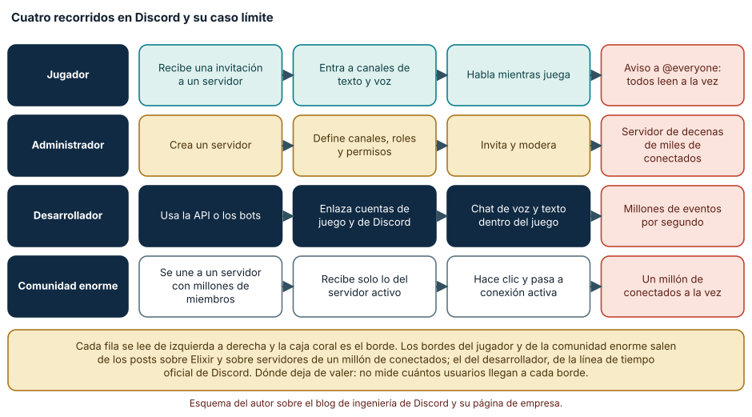

**Cómo leer la figura.** Cada fila es un usuario distinto; las cajas se leen de izquierda a derecha y la última, en coral, es el caso límite. **Dónde deja de valer.** Es un recorrido visible al usuario, no un diagrama de estados.

**Administrador.** **[Documentado]** que el servidor tiene canales, roles y permisos, y que cada evento debe comprobarlos: algunos mensajes van a todos y otros solo a quien puede verlos [D7]. El caso límite es el servidor que crece: el trabajo de repartir mensajes crece de forma cuadrática con las personas conectadas.

**Desarrollador.** **[Documentado]** que la API oficial se lanzó en 2016 y que la línea de tiempo la presenta como base de cientos de miles de aplicaciones [D1]. El caso límite es el volumen de eventos por segundo: en 2017 había «millones de eventos por segundo» fluyendo por el sistema [D4].

**Comunidad enorme.** **[Documentado]** que en 2022 Discord daba servicio a un servidor con más de 10 millones de miembros, de los cuales más de un millón estaban conectados a la vez [D7]. El caso límite es el aviso a todos o la apertura de un canal que provoca miles de lecturas iguales.

**Usuario de un juego integrado.** **[Documentado]** que desde finales de 2024 Discord alimenta el chat de texto y voz dentro de algunos juegos [D1]. **[No se sabe]** el diseño técnico de esa integración.

## Negocio y economía

**Modelo (documentado parcialmente).** Discord es gratuito para hablar y obtiene ingresos de varias vías que su línea de tiempo menciona: la suscripción Nitro (2017), Server Boosting (2019), Quests y Orbs (2025), y una prueba de comercio social con un juego (invierno de 2025) en la que los desarrolladores venden objetos dentro de sus servidores oficiales [D1]. **[No se sabe]** la cuantía de ingresos, la proporción de cada vía, el margen y la rentabilidad: Discord es privado y las fuentes consultadas no publican esas cifras. Este caso no recurre a estimaciones de prensa porque no hay una fuente primaria verificable.

### Esquema del negocio: flujos de dinero y de valor

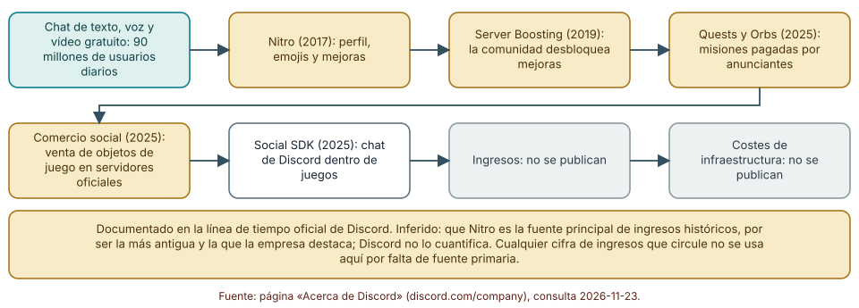

**Cómo leer la figura.** La fila superior sigue el valor desde el uso gratuito hasta las vías de pago; las cajas grises de la inferior son lo que no se publica. **Dónde deja de valer.** Es un esquema cualitativo de lo que la empresa dice; no es un modelo financiero.

### Visión, misión y estrategia

La historia de Discord dice que se construyó «para resolver un problema: cómo hablar con amigos mientras se juega juntos» y que la compañía sigue buscando ser «el mejor lugar para pasar el rato antes, durante y después de jugar» [D1]. Hay una estrategia visible en la línea de tiempo: de herramienta de comunicación (2015) a plataforma para desarrolladores (API en 2016, Rich Presence en 2017, Activities en 2023, Social SDK en 2025) y a un canal de comercio y de publicidad (Quests, Orbs y comercio social en 2025) [D1]. **[Inferido]** que la llegada de un consejero delegado con experiencia en la industria del juego en abril de 2025 refuerza ese giro; Discord no declara esa relación.

### Costos operativos

**[No se sabe]** el gasto de infraestructura, de personal y de moderación. Lo documentado es de ingeniería y puede leerse como indicio de eficiencia: la migración de la base de mensajes pasó de 177 nodos a 72 y de 4 TB a 9 TB de disco por nodo [D3]. Cálculo propio: la capacidad total de disco pasó de unos 708 TB (177 × 4) a unos 648 TB (72 × 9), es decir, casi lo mismo con 59 % menos de nodos. Es un dato de infraestructura, no de coste, porque el precio por nodo no se publica.

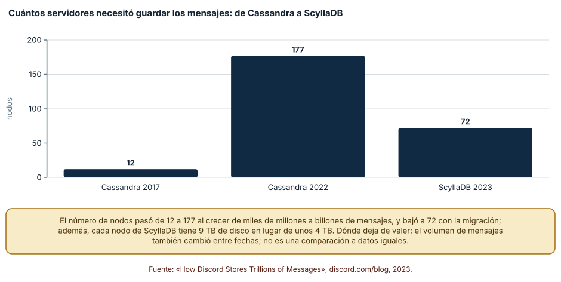

**Cómo leer la figura.** Cada barra es un clúster en una fecha. Mire el salto de 12 a 177 y la bajada a 72. **Dónde deja de valer.** El volumen de mensajes cambió entre fechas.

### Competidores

Las fuentes consultadas no enumeran competidores. **[No se sabe]** cuota de mercado por competidor; este caso no la inventa.

## Arquitectura y esquemas

Se recorre como un mapa con zoom creciente. Todo lo que sigue sale de ocho posts del blog de ingeniería de Discord (2017 a 2023) y de su página de empresa; lo que no está allí se marca. Es una de las fuentes más ricas del conjunto de casos porque los posts cuentan decisiones, errores y mediciones.

### 6.1 Contexto del sistema

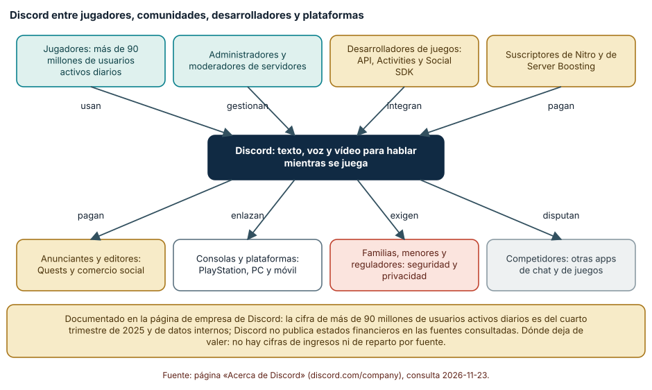

**Cómo leer la figura.** El cuadro central es Discord y los satélites son quienes lo usan, lo financian o lo limitan. Mire primero a los desarrolladores de juegos: son el canal de crecimiento de 2025. **Dónde deja de valer.** No hay volúmenes de dinero ni de usuarios por actor.

### 6.2 Capas

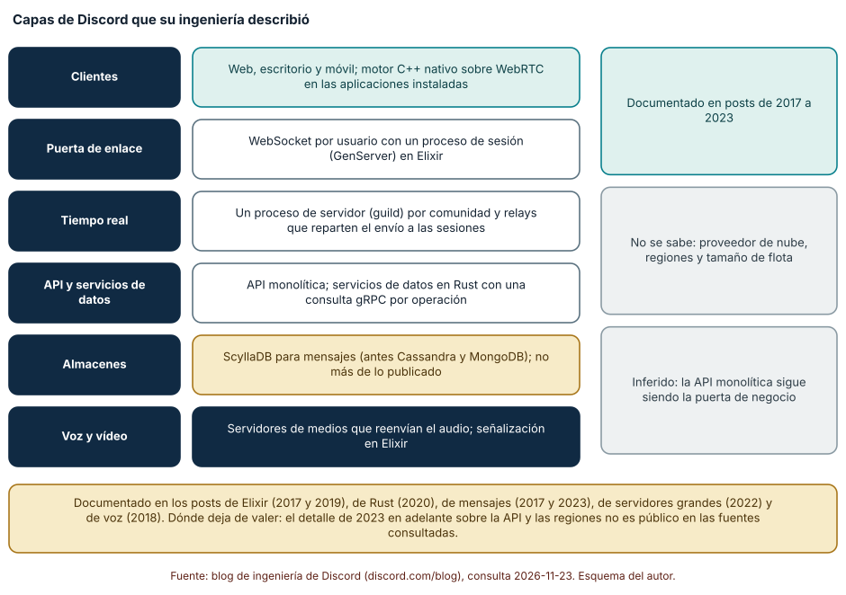

**Cómo leer la figura.** De arriba abajo, cada capa descansa en la siguiente; a la derecha, qué es documentado y qué no. **Dónde deja de valer.** Los posts son de 2017 a 2023.

**Documentado.** Elixir (sobre la máquina virtual de Erlang) es la base del tiempo real: el prototipo original de Discord se desarrolló en Elixir y se convirtió en la base de su infraestructura [D4]. La señalización de voz también está en Elixir [D8]. Los servicios de datos que protegen la base de mensajes están en Rust [D3]. Los clientes instalados usan un motor C++ propio sobre WebRTC, y el navegador usa el WebRTC del navegador [D8]. Los mensajes se guardan en ScyllaDB desde 2022 [D3]. Hay una «API monolítica» entre los clientes y los servicios de datos [D3].

### 6.3 Un mensaje, de punta a punta

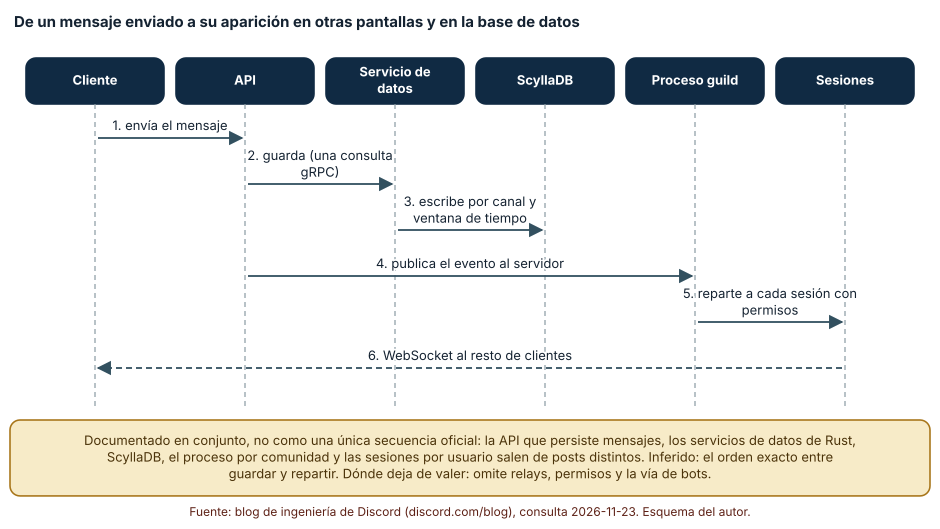

**Cómo leer la figura.** Las flechas son llamadas en orden de arriba abajo; las punteadas, respuestas. Mire que guardar y repartir son caminos separados. **Dónde deja de valer.** Es una síntesis de varios posts, no una secuencia oficial.

**Documentado [D4].** La mayor parte de las funciones de Discord se reduce a publicación y suscripción: el usuario abre un WebSocket y se crea un proceso de sesión (un GenServer) que se comunica con nodos de Erlang remotos donde viven los procesos del servidor (el «guild»); cuando algo se publica en un servidor, se reparte a todas las sesiones conectadas a él. Al conectarse, el usuario se une al guild, que publica su presencia al resto. **Inferido.** El orden exacto entre persistir y repartir; el post de 2017 dice que cada mensaje se guarda para siempre [D2] pero no detalla la secuencia. **Mecanismo.** Es el modelo de actores y de canales concurrentes de las clases de programación concurrente ([SE-081](../../classes/part-06-paradigmas-de-programacion/se-081-programacion-concurrente-y-actores/README.md)) y de actores y canales ([SE-387](../../classes/part-32-concurrencia-y-sistemas-distribuidos/se-387-actores-canales-y-structured-concurrency/README.md)).

### 6.4 Repartir mensajes: el cuello de botella del proceso

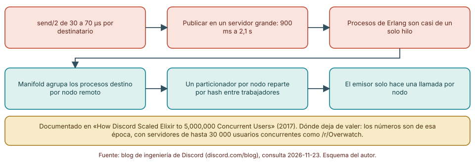

**Cómo leer la figura.** La fila superior es el problema y la inferior la solución. **Dónde deja de valer.** Son cifras de 2017 con servidores de hasta 30 000 conectados.

**Documentado [D4].** Para 2017 había nuevos servidores muy grandes, como /r/Overwatch con hasta 30 000 usuarios concurrentes. En horas punta, los procesos de guild no daban abasto con sus colas de mensajes y hubo que apagar a mano funciones que generaban mensajes. Midieron: una llamada send/2 entre procesos de Erlang tardaba entre 30 y 70 microsegundos por el desplanificado del proceso, de modo que publicar un evento en un servidor grande podía tardar de 900 milisegundos a 2,1 segundos. Los procesos de Erlang son casi de un solo hilo y la única forma de paralelizar es repartir (shard); lanzar un proceso por publicación rompía la linealidad de eventos que los clientes necesitan. La solución fue una biblioteca propia, **Manifold**: agrupa los destinatarios por nodo remoto, envía a un particionador en cada nodo, que reparte por hash entre trabajadores por núcleo, de modo que el proceso emisor solo llama a send/2 una vez por nodo implicado. A fecha del post, Discord tenía casi cinco millones de usuarios concurrentes y millones de eventos por segundo.

### 6.5 Servidores de más de un millón de conectados

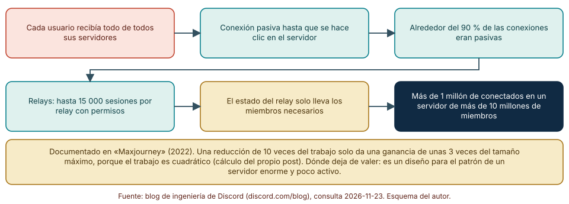

**Cómo leer la figura.** Cada caja es un paso; los relays son la parte que permite pasar de cientos de miles a más de un millón. **Dónde deja de valer.** Es un diseño para servidores enormes y poco activos.

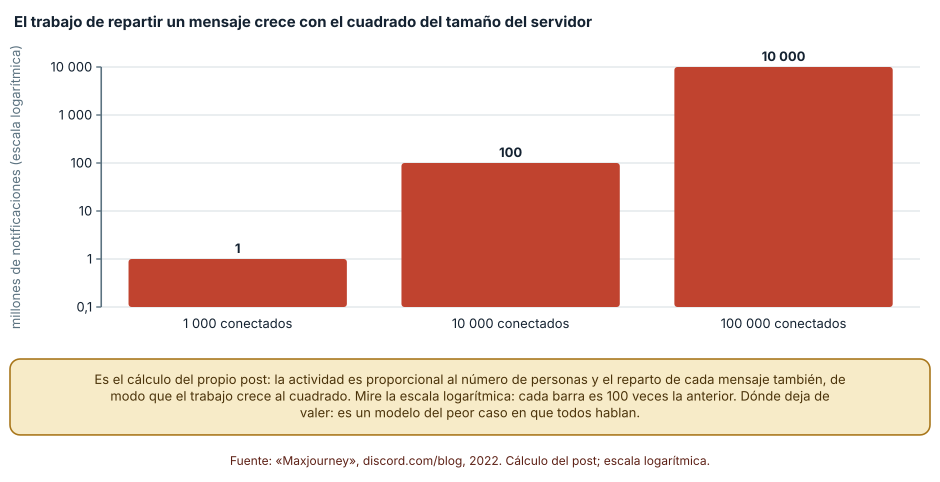

**Cómo leer la figura.** Cada barra es un tamaño de servidor y su altura el número de notificaciones si todos escriben una vez; la escala es logarítmica. **Dónde deja de valer.** Es un modelo del peor caso.

**Documentado [D7].** En 2022 Discord daba servicio a un servidor con más de 10 millones de miembros y más de un millón conectados a la vez, y había escalado servidores de decenas de miles a casi dos millones de concurrentes. El diseño: un proceso Elixir por guild como punto central de enrutado y otro proceso (sesión) por cliente conectado. El trabajo crece de forma cuadrática: la actividad es proporcional al número de personas y el trabajo de repartir cada mensaje también; con 1 000 personas conectadas que dicen algo una vez son un millón de notificaciones, con 10 000 son cien millones y con 100 000 son diez mil millones. Primero midieron: análisis de tiempo de pared con trazas de pila de procesos de Elixir (mil trazas con 100 milisegundos entre cada una). Luego, tres mejoras: (1) **conexiones pasivas**: no enviar todo a un usuario que está en muchos servidores hasta que haga clic en uno; cerca del 90 % de las conexiones usuario-servidor en servidores grandes eran pasivas, con lo que el reparto costaba 90 % menos (una reducción de 10 veces da solo unas 3 veces más tamaño máximo); (2) **relays**: procesos entre el guild y las sesiones que reparten con comprobación de permisos, con hasta 15 000 sesiones cada uno, lo que permitió cientos de miles de miembros; el primer diseño guardaba la lista completa de miembros en cada relay, lo que a escala de decenas de millones multiplicaba la memoria y bloqueaba al guild decenas de segundos al crear un relay, de modo que se limitó el estado a los miembros necesarios; (3) **procesos trabajadores y ETS** para operaciones largas que iteran todos los miembros, como un aviso a todos.

**Qué enseña.** Cuando el trabajo crece al cuadrado, una mejora de un orden de magnitud compra solo una fracción del tamaño: hay que cambiar la topología ([SE-344](../../classes/part-28-estilos-arquitectonicos/se-344-arquitectura-celular-y-radio-de-impacto/README.md) trata el radio de impacto; [SE-045](../../classes/part-03-redes-internet-y-protocolos/se-045-sockets-conexiones-persistentes-y-tiempo-real/README.md) trata las conexiones persistentes) y medir antes de optimizar ([SE-094](../../classes/part-07-estructuras-de-datos-y-algoritmos/se-094-complejidad-empirica-benchmarks-y-perfiles/README.md)).

### 6.6 La lista de miembros: estructuras de datos y Rust

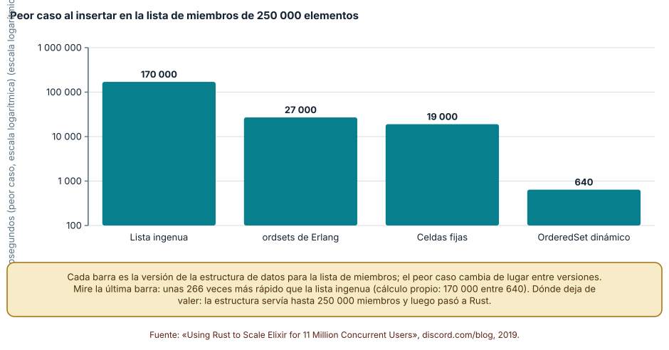

**Cómo leer la figura.** Cada barra es una versión de la estructura; la altura es el peor caso en microsegundos con escala logarítmica. **Dónde deja de valer.** El peor caso cambia de lugar entre versiones.

**Documentado [D5].** Para enviar solo las actualizaciones de la parte visible de la lista de miembros hacía falta una estructura ordenada con cientos de miles de entradas que aceptara muchas mutaciones y devolviera los índices de lo añadido y quitado. En Elixir las estructuras son inmutables: añadir un miembro a un servidor de 100 000 construye una lista nueva de 100 001. Dos ingenieros probaron: una lista con orden (insertar al final de 250 000 elementos tardó unos 170 000 microsegundos), `ordsets` de Erlang (27 000 en el peor caso), celdas de tamaño fijo (5 000 al final pero 19 000 al principio) y celdas que crecen y se dividen: 4 microsegundos al principio y 640 al final con 250 000 elementos. Eso servía hasta 250 000 miembros y era el límite, así que probaron Rust para ir más rápido [D5]. **Mecanismo.** Es el ejemplo de elegir la estructura por el patrón de acceso ([SE-088](../../classes/part-07-estructuras-de-datos-y-algoritmos/se-088-arboles-tries-y-estructuras-jerarquicas/README.md); los benchmarks empíricos de [SE-094](../../classes/part-07-estructuras-de-datos-y-algoritmos/se-094-complejidad-empirica-benchmarks-y-perfiles/README.md)).

### 6.7 De Go a Rust en un servicio

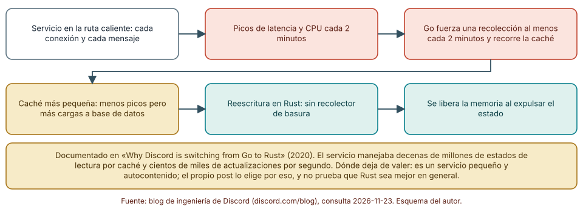

**Cómo leer la figura.** La fila superior es el problema y la inferior las soluciones intentadas. **Dónde deja de valer.** Es un servicio pequeño y autocontenido.

**Documentado [D6].** «Read States» guarda qué canales y mensajes ha leído cada usuario: hay miles de millones, uno por usuario y canal, con contadores que se actualizan de forma atómica, como el número de menciones. Cada servidor tiene una caché LRU con decenas de millones de estados y cientos de miles de actualizaciones por segundo; la persistencia está en Cassandra, con decenas de miles de escrituras por segundo. En Go había picos de latencia y de CPU cada dos minutos: Go fuerza una recolección de basura al menos cada dos minutos y, para saber qué es basura, tenía que recorrer toda la caché. Cambiar el porcentaje de recolección no ayudó; reducir la caché bajó los picos pero subió la latencia del percentil 99 porque había más cargas a base de datos. Tras ver éxito de Rust en otros servicios, lo reescribieron en Rust, donde la memoria se libera al expulsar el estado de la caché; para ello usaron Rust nocturno hasta que lo asíncrono fue estable. Con pocas optimizaciones superó la versión de Go muy afinada.

**Qué enseña.** Un recolector de basura convierte el tamaño de la caché en latencia ([SE-021](../../classes/part-01-computadores-y-representacion-de-informacion/se-021-runtimes-maquinas-virtuales-y-recoleccion-de-basura/README.md)), y la reescritura se justificó por un servicio pequeño y en la ruta caliente. **No generalice:** el propio post lo eligió por ser pequeño y autocontenido.

### 6.8 Mensajes: de MongoDB a Cassandra y de Cassandra a ScyllaDB

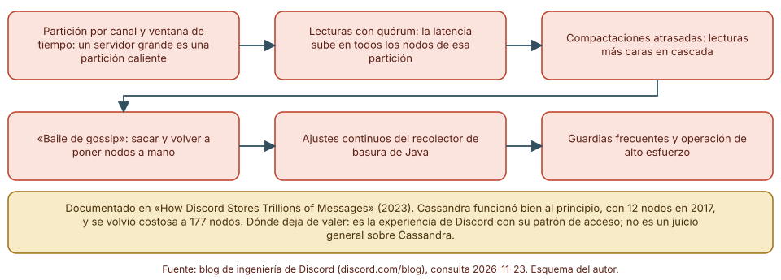

**Cómo leer la figura.** Cada caja es un eslabón de una cadena; la mayoría son costes de operar. **Dónde deja de valer.** Es la experiencia de Discord con su patrón de acceso.

**Documentado [D2].** La primera versión de Discord se construyó en menos de dos meses a comienzos de 2015 con todo en un solo conjunto de réplicas de MongoDB; fue intencional y planificaron una migración fácil, sin usar el fragmentado de MongoDB por complejidad e inestabilidad. Los mensajes estaban en una colección con un índice compuesto por canal y fecha. Hacia noviembre de 2015, con 100 millones de mensajes, los datos y el índice ya no cabían en RAM y las latencias se volvieron impredecibles. Analizaron el patrón de lectura: lecturas muy aleatorias y una proporción de lectura y escritura cercana a 50 y 50. Distinguieron tres tipos de servidores: de voz (casi sin mensajes), de texto privado (100 000 a un millón de mensajes al año, datos recientes y poco leídos) y públicos grandes (millones al año, casi siempre se lee lo reciente y se queda en caché de disco). Fijaron requisitos: escalabilidad lineal, conmutación automática, poco mantenimiento, tecnología probada, latencia predecible (una alerta si el percentil 95 de la API supera 80 ms), no ser un almacén de blobs y código abierto. Solo Cassandra los cumplía. Los volúmenes: 40 millones de mensajes al día en julio de 2016, 100 millones en diciembre y más de 120 millones a comienzos de 2017.

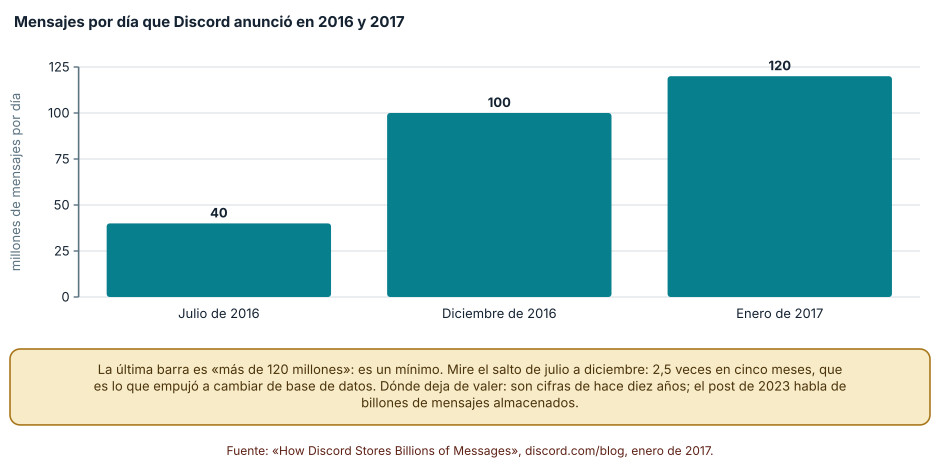

**Cómo leer la figura.** Cada barra es el volumen diario anunciado en un momento. **Dónde deja de valer.** La última es un mínimo.

**Documentado [D3].** En 2017 Discord ejecutaba 12 nodos de Cassandra con miles de millones de mensajes; a comienzos de 2022 había 177 nodos con billones. Se volvió un sistema de alto esfuerzo: guardias frecuentes, latencia impredecible y mantenimientos que había que recortar. Los mensajes se particionan por canal y por una ventana de tiempo (cubo) y se replican en tres nodos; un servidor pequeño envía órdenes de magnitud menos mensajes que uno de cientos de miles de personas. En Cassandra las lecturas cuestan más que las escrituras; muchas lecturas concurrentes crean una **partición caliente** y, como se lee con quórum, todas las consultas a los nodos de esa partición sufren. Las compactaciones atrasadas encarecían las lecturas; el «baile de gossip» (sacar un nodo de rotación para que compacte, devolverlo para recoger sus pistas y repetir) consumía tiempo; y las pausas del recolector de Java exigían ajustes constantes.

### 6.9 Servicios de datos en Rust

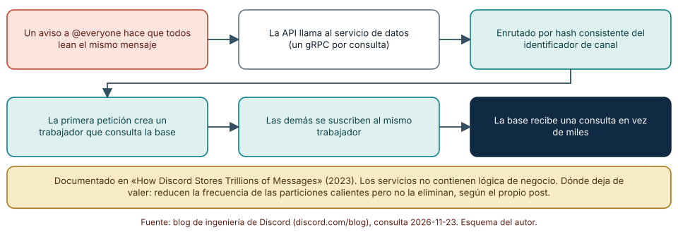

**Cómo leer la figura.** La fila superior es el origen del problema y la inferior la solución. **Dónde deja de valer.** Reduce la frecuencia de las particiones calientes, no las elimina.

**Documentado [D3].** Antes de cambiar la base, Discord escribió servicios intermedios entre la API monolítica y la base, en Rust con el ecosistema Tokio, con aproximadamente un punto final gRPC por consulta y sin lógica de negocio. Su función principal es **fusionar peticiones**: si varios usuarios piden la misma fila a la vez, se consulta una vez: la primera petición lanza una tarea trabajadora y las siguientes se suscriben a ella. Delante hay un enrutado por hash consistente con una clave (para mensajes, el identificador del canal) para que todas las peticiones de un canal vayan a la misma instancia. Ante un aviso a @everyone, esto evita que la base reciba miles de lecturas idénticas. **Mecanismo.** Es una caché de peticiones en vuelo con control de concurrencia, un patrón de [SE-356](../../classes/part-29-datos-persistencia-y-recuperacion/se-356-caches-y-consistencia-entre-capas/README.md) y de [SE-393](../../classes/part-32-concurrencia-y-sistemas-distribuidos/se-393-replicacion-sharding-y-balanceo/README.md).

### 6.10 La migración de trillones de mensajes

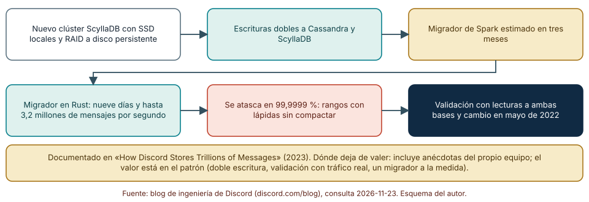

**Cómo leer la figura.** Las cajas siguen el orden temporal de la migración. **Dónde deja de valer.** Incluye anécdotas del equipo; el patrón es lo transferible.

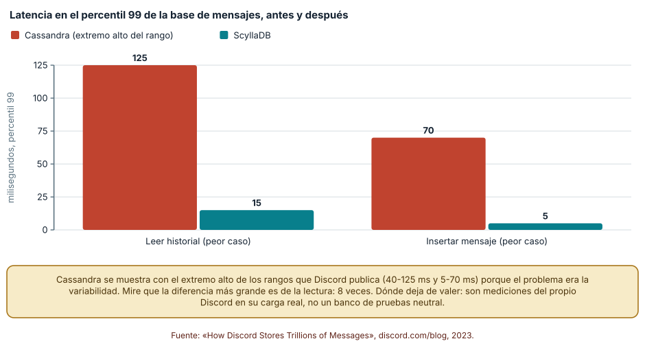

**Cómo leer la figura.** Cada grupo de barras es una operación; la coral es el extremo alto de Cassandra y la teal, ScyllaDB. **Dónde deja de valer.** Son mediciones del propio Discord.

**Documentado [D3].** Discord migró todas sus bases a ScyllaDB (una base compatible con Cassandra, en C++ y sin recolector de basura) salvo la de mensajes, que dejó para el final por su tamaño: casi 200 nodos y billones de mensajes. Pidió mejoras de lecturas inversas al equipo de ScyllaDB, que las implementó. El clúster nuevo usa discos SSD locales con RAID espejado a un disco persistente. Plan inicial: escribir en ambas bases desde un instante y migrar el histórico con el migrador de Spark de ScyllaDB (estimado en tres meses); lo reescribieron en Rust en una tarde sobre su biblioteca de servicios de datos: lee rangos de tokens, los marca con puntos de control en SQLite y los vuelca en ScyllaDB, con nueve días de estimación y hasta 3,2 millones de mensajes por segundo. Se atascó en 99,9999 % por rangos con lápidas (tombstones) no compactados en Cassandra; al compactar ese rango, terminó. Validaron enviando un pequeño porcentaje de lecturas a ambas bases y cambiaron la base primaria en mayo de 2022. Resultado: de 177 nodos de Cassandra a 72 de ScyllaDB con 9 TB cada uno (antes unos 4 TB), el percentil 99 de lectura de historial pasó de 40-125 ms a 15 ms y el de inserción de 5-70 ms a unos 5 ms; durante la final del Mundial de 2022 los goles se vieron como picos en las gráficas de mensajes. Las clases de migraciones de datos sin interrupción ([SE-523](../../classes/part-43-mantenimiento-y-modernizacion-legacy/se-523-migraciones-de-datos-sin-interrupcion/README.md)) y de doble escritura ([SE-524](../../classes/part-43-mantenimiento-y-modernizacion-legacy/se-524-compatibilidad-coexistencia-y-doble-escritura/README.md)) desarrollan el patrón.

### 6.11 Voz y vídeo

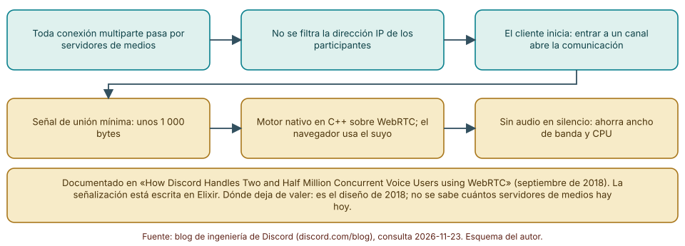

**Cómo leer la figura.** Las cajas agrupan decisiones de diseño. **Dónde deja de valer.** Es el diseño de 2018.

**Documentado [D8].** Toda comunicación es multiparte; para grupos grandes (se han visto 1 000 personas turnándose) el peer-to-peer es demasiado caro, así que todo pasa por servidores, lo que además oculta la dirección IP (protegiendo de ataques de denegación) y permite moderar. Los clientes instalados usan un motor C++ sobre WebRTC, lo que permite evitar el volumen automático de Windows, controlar el volumen, usar voz por actividad y atajos del sistema. La comunicación la inicia siempre el cliente al entrar a un canal, lo que simplifica el servidor y da resiliencia: ante un fallo de infraestructura, el participante se reconecta a otro servidor. En lugar del protocolo SDP (cerca de diez kilobytes de ida y vuelta) intercambian unos 1 000 bytes; no usan ICE porque cada cliente se conecta a un servidor de medios; en lugar de DTLS y SRTP usan cifrado Salsa20; y no envían audio en los silencios, con ahorro de ancho de banda y CPU. El título del post cita 2,5 millones de usuarios de voz concurrentes (septiembre de 2018).

### 6.12 Seguridad, abuso y cumplimiento

**Documentado.** El diseño de la voz oculta las direcciones IP de los participantes y permite que los administradores desactiven el audio y el vídeo de quien incumple [D8]. **[No se sabe]** el diseño interno de identidad, moderación a escala, cifrado de mensajes y protección de menores en las fuentes consultadas; la página de empresa enlaza a centros de seguridad y de familias sin detallar su arquitectura [D1]. La clase de privacidad y retención ([SE-358](../../classes/part-29-datos-persistencia-y-recuperacion/se-358-privacidad-retencion-y-ciclo-de-vida-del-dato/README.md)) da el marco para analizarlo.

### 6.13 Observabilidad y operación

**Documentado.** Discord alerta cuando el percentil 95 de la respuesta de la API supera 80 ms [D2]; analiza el rendimiento de procesos de Elixir con trazas de pila y perfiles [D7]; y vio los goles del Mundial de 2022 como picos en sus gráficas de mensajes enviados [D3]. **[No se sabe]** el diseño de guardias y de gestión de incidentes más allá de que Cassandra generaba guardias frecuentes.

### 6.14 Evolución y alternativas descartadas (análisis propio)

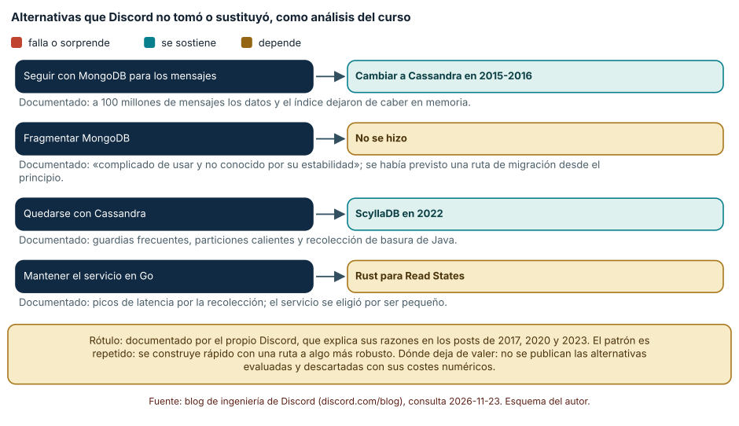

**Cómo leer la figura.** Cada tarjeta enfrenta una alternativa con lo que Discord hizo. **Dónde deja de valer.** Discord no publica las alternativas evaluadas con costes numéricos.

**Rótulo: documentado.** El propio Discord explica sus razones en cuatro momentos: no fragmentar MongoDB, cambiar a Cassandra cuando el índice dejó de caber en RAM, cambiar de Cassandra a ScyllaDB por el esfuerzo de operación y no seguir con Go en un servicio de ruta caliente. **Patrón.** Construir rápido con una ruta clara a algo más robusto [D2]: cada cambio se hizo cuando una medición lo justificó. **[No se sabe]** si evaluaron otras bases en 2015 o en 2022 además de las nombradas.

### 6.15 Hardware, software, infraestructura y fallos

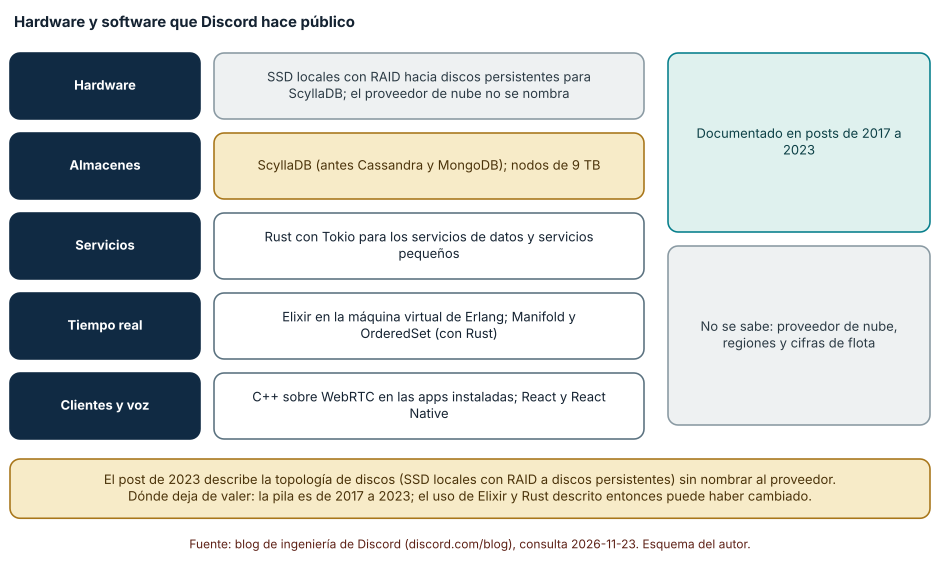

**Cómo leer la figura.** De arriba abajo, de lo físico a lo lógico. **Dónde deja de valer.** El proveedor de nube no se nombra en las fuentes.

**Hardware utilizado.** **[No se sabe]** el proveedor de nube y el número de servidores. Lo documentado: nodos de ScyllaDB de 9 TB con SSD locales y RAID espejado a discos persistentes [D3].

**Software utilizado (documentado).** Elixir y la máquina virtual de Erlang, Rust con Tokio, ScyllaDB (antes Cassandra y MongoDB), una API monolítica (su lenguaje no se detalla en las fuentes), C++ y WebRTC en los clientes de escritorio y móvil, y React y React Native en la interfaz [D3]–[D8].

**Características de la infraestructura.** Procesos ligeros por sesión y por servidor; reparto del envío entre nodos; servicios de datos con fusión de peticiones; almacén de mensajes particionado por canal y ventana de tiempo con réplicas; voz mediante servidores de medios [D3], [D4], [D8].

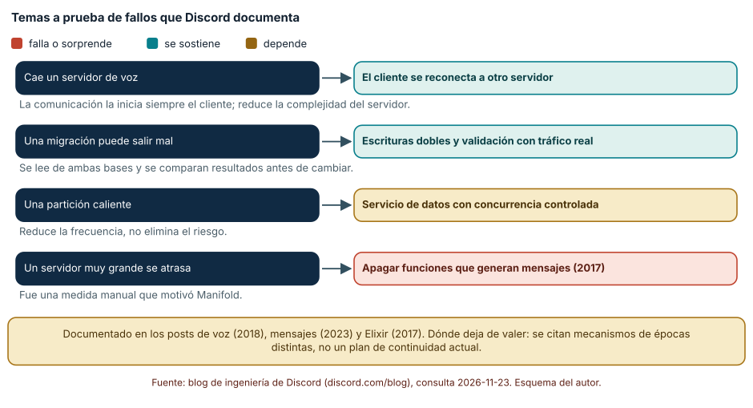

**Cómo leer la figura.** Cada tarjeta enlaza el fallo con el mecanismo que lo contiene. **Dónde deja de valer.** Son mecanismos de épocas distintas.

**Temas a prueba de fallos.** Comunicación iniciada por el cliente para reconectar a otro servidor de voz, escrituras dobles y validación de migraciones, servicios de datos con fusión de peticiones y apagar funciones en servidores grandes como medida manual en 2017 [D3], [D4], [D8].

## Casos especiales y cómo se resuelven

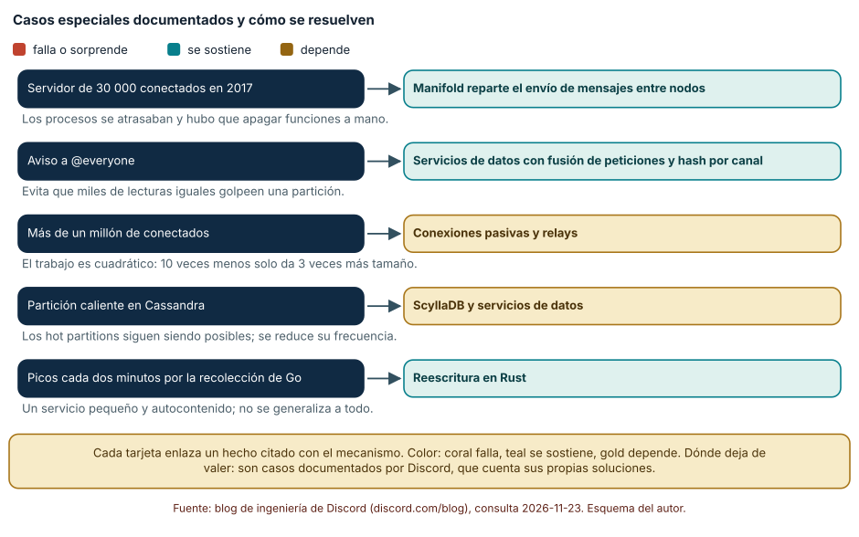

**Cómo leer la figura.** Cada tarjeta enfrenta una situación con lo que hizo el sistema; el color es el veredicto. **Dónde deja de valer.** Son casos documentados por la propia empresa.

1. **Servidor de decenas de miles.** Manifold [D4].
2. **Aviso a todos.** Fusión de peticiones y hash por canal [D3]; procesos trabajadores para recorrer miembros [D7].
3. **Servidor de más de un millón conectados.** Conexiones pasivas y relays [D7].
4. **Partición caliente.** ScyllaDB más servicios de datos [D3].
5. **Servicio con latencia por recolección.** Rust [D6].
6. **Voz de miles de personas.** Cliente-servidor con silencio sin audio [D8].
7. **Migrar billones de mensajes.** Escrituras dobles, migrador a medida, validación con lecturas a ambas bases [D3].
8. **Un evento mundial.** Los goles del Mundial de 2022 aparecieron como picos en las gráficas de mensajes [D3].

## Línea de tiempo

| Año o fecha | Hecho | Fuente |
| --- | --- | --- |
| Abril de 2012 | Citron establece el estudio Phoenix Guild | [D1] |
| Abril de 2013 | Vishnevskiy se une | [D1] |
| Verano de 2014 | Se lanza Fates Forever | [D1] |
| Mayo de 2015 | Primera versión de Discord | [D1] |
| Noviembre de 2015 | 100 millones de mensajes en MongoDB; empieza la migración | [D2] |
| 2016 | Overlay, API oficial; 40 millones de mensajes al día en julio y 100 millones en diciembre | [D1], [D2] |
| Enero de 2017 | Más de 120 millones de mensajes al día; Nitro | [D1], [D2] |
| 2017 | Casi 5 millones de usuarios concurrentes | [D4] |
| Septiembre de 2018 | 2,5 millones de usuarios de voz concurrentes | [D8] |
| 2019 | Go Live y Server Boosting; 11 millones de concurrentes con Rust | [D1], [D5] |
| 2020 | Go a Rust en Read States | [D6] |
| 2022 | Un servidor con más de 1 millón de conectados; mensajes pasan a ScyllaDB en mayo | [D3], [D7] |
| 2023 | Activities, Soundboard y mensajes de voz | [D1] |
| Abril de 2025 | Nuevo consejero delegado | [D1] |
| Cuarto trimestre de 2025 | Más de 90 millones de usuarios activos diarios | [D1] |

### Decisiones clave, giros y correcciones

- **MongoDB primero con una ruta de salida (2015).** Decisión de velocidad con plan de migración; el índice dejó de caber en RAM a 100 millones de mensajes [D2].
- **Cassandra (2016) y su abandono (2022).** Giro de una base elegida por requisitos a otra elegida por esfuerzo de operación [D2], [D3].
- **Elixir y su límite.** Una decisión de plataforma que exigió construir bibliotecas (Manifold y otras) [D4].
- **Rust donde duele.** Primero en un servicio de la ruta caliente (2020), luego en servicios de datos y en el migrador [D3], [D6].

## Vínculo con el curso

El caso muestra, en una plataforma real, mecanismos que el curso desarrolla con ejemplos controlados. Cada enlace dice qué ilustra el caso:

- [SE-081](../../classes/part-06-paradigmas-de-programacion/se-081-programacion-concurrente-y-actores/README.md): programación concurrente y actores. Procesos de sesión y de servidor en Elixir.
- [SE-387](../../classes/part-32-concurrencia-y-sistemas-distribuidos/se-387-actores-canales-y-structured-concurrency/README.md): actores, canales y concurrencia estructurada. El reparto de mensajes a sesiones.
- [SE-045](../../classes/part-03-redes-internet-y-protocolos/se-045-sockets-conexiones-persistentes-y-tiempo-real/README.md): sockets, conexiones persistentes y tiempo real. WebSockets y conexiones pasivas.
- [SE-344](../../classes/part-28-estilos-arquitectonicos/se-344-arquitectura-celular-y-radio-de-impacto/README.md): arquitectura celular y radio de impacto. Relays que reparten el trabajo de un servidor enorme.
- [SE-355](../../classes/part-29-datos-persistencia-y-recuperacion/se-355-replicacion-particion-y-distribucion/README.md): réplica, partición y distribución. Partición por canal y ventana de tiempo.
- [SE-356](../../classes/part-29-datos-persistencia-y-recuperacion/se-356-caches-y-consistencia-entre-capas/README.md): cachés y consistencia entre capas. Fusión de peticiones en servicios de datos.
- [SE-393](../../classes/part-32-concurrencia-y-sistemas-distribuidos/se-393-replicacion-sharding-y-balanceo/README.md): replicación, sharding y balanceo. Hash consistente por canal.
- [SE-021](../../classes/part-01-computadores-y-representacion-de-informacion/se-021-runtimes-maquinas-virtuales-y-recoleccion-de-basura/README.md): runtimes y recolección de basura. Los picos de Go y de Java.
- [SE-088](../../classes/part-07-estructuras-de-datos-y-algoritmos/se-088-arboles-tries-y-estructuras-jerarquicas/README.md): árboles, tries y estructuras jerárquicas. La estructura de la lista de miembros.
- [SE-094](../../classes/part-07-estructuras-de-datos-y-algoritmos/se-094-complejidad-empirica-benchmarks-y-perfiles/README.md): complejidad empírica y benchmarks. Medir antes de optimizar.
- [SE-523](../../classes/part-43-mantenimiento-y-modernizacion-legacy/se-523-migraciones-de-datos-sin-interrupcion/README.md): migraciones de datos sin interrupción. De Cassandra a ScyllaDB.
- [SE-524](../../classes/part-43-mantenimiento-y-modernizacion-legacy/se-524-compatibilidad-coexistencia-y-doble-escritura/README.md): compatibilidad, coexistencia y doble escritura. Escrituras dobles y validación.
- [SE-436](../../classes/part-36-calidad-rendimiento-y-resiliencia/se-436-latencia-throughput-saturacion-y-capacidad/README.md): latencia, throughput, saturación y capacidad. El percentil 99 como objetivo.
- [SE-133](../../classes/part-11-economia-metricas-y-decisiones-de-producto/se-133-modelos-de-negocio-y-sostenibilidad/README.md): modelos de negocio. Gratuito más suscripción, Boosts y Quests.
- [SE-142](../../classes/part-11-economia-metricas-y-decisiones-de-producto/se-142-decisiones-reversibles-e-irreversibles/README.md): decisiones reversibles e irreversibles. Construir rápido con una ruta a algo más robusto.

### Preguntas de discusión

1. Si el trabajo de repartir mensajes crece al cuadrado, ¿qué límites de producto (no solo de ingeniería) pondría a un servidor?
2. Discord eligió Cassandra por sus requisitos y la abandonó por el esfuerzo de operarla. ¿Qué requisito faltó en 2016 y cómo se habría detectado?
3. ¿En qué condiciones reescribir un servicio en otro lenguaje se justifica y cuáles son los costes ocultos?
4. La voz va siempre por servidores. ¿Qué se gana y qué se pierde frente a peer-to-peer?
5. Discord es privado y no publica ingresos. ¿Qué decisiones de producto serían difíciles de evaluar sin cifras y cómo se estimaría su impacto?

### Mini-ejercicios de análisis

1. Calcule cuántas notificaciones genera un servidor de 250 000 conectados bajo el modelo cuadrático y compare con la capacidad de un relay de 15 000 sesiones.
2. Dibuje la cadena de causas de una partición caliente y marque qué eslabón corta cada mejora (servicio de datos, ScyllaDB).
3. Diseñe una validación de migración con lecturas a dos bases: qué porcentaje de tráfico enviaría y qué diferencias toleraría.

## Qué no generalizar

- **Elixir y Rust.** Son decisiones de un equipo con experiencia y con problemas muy específicos de tiempo real y alta concurrencia; no son una recomendación de lenguajes.
- **Reescribir en Rust.** El propio post elige un servicio pequeño y autocontenido; reescribir un sistema grande es otro problema.
- **ScyllaDB frente a Cassandra.** Son mediciones del propio Discord con su patrón de acceso; no son una comparación neutral.
- **La falta de cifras de negocio.** Discord no publica ingresos ni rentabilidad: no se puede decir que el modelo sea rentable ni que Nitro sea su principal ingreso.
- **El crecimiento.** Pasar de decenas de miles de concurrentes a millones tuvo mucha ingeniería detrás; no es un resultado automático de elegir esas tecnologías.
- **Los datos de 2025.** Los 90 millones de usuarios diarios son datos internos sin definición pública.

## Fuentes públicas verificadas

Todas las URL se consultaron el 23 de noviembre de 2026 y devolvieron contenido (HTTP 200).

- **[D1]** [About Discord: our mission and story (discord.com/company)](https://discord.com/company): historia con fechas, fundadores, hitos de producto, cambio de consejero delegado y más de 90 millones de usuarios diarios.
- **[D2]** [How Discord Stores Billions of Messages](https://discord.com/blog/how-discord-stores-billions-of-messages): MongoDB, 100 millones de mensajes, requisitos y elección de Cassandra (2017).
- **[D3]** [How Discord Stores Trillions of Messages](https://discord.com/blog/how-discord-stores-trillions-of-messages): 177 nodos de Cassandra, servicios de datos en Rust, migración a ScyllaDB y resultados (2023).
- **[D4]** [How Discord Scaled Elixir to 5,000,000 Concurrent Users](https://discord.com/blog/how-discord-scaled-elixir-to-5-000-000-concurrent-users): sesiones, guilds y Manifold (2017).
- **[D5]** [Using Rust to Scale Elixir for 11 Million Concurrent Users](https://discord.com/blog/using-rust-to-scale-elixir-for-11-million-concurrent-users): lista de miembros y estructuras de datos (2019).
- **[D6]** [Why Discord is switching from Go to Rust](https://discord.com/blog/why-discord-is-switching-from-go-to-rust): Read States, recolección de basura y caché LRU (2020).
- **[D7]** [Maxjourney: Pushing Discord's Limits with a Million+ Online Users in a Single Server](https://discord.com/blog/maxjourney-pushing-discords-limits-with-a-million-plus-online-users-in-a-single-server): conexiones pasivas, relays y trabajo cuadrático (2022).
- **[D8]** [How Discord Handles Two and Half Million Concurrent Voice Users using WebRTC](https://discord.com/blog/how-discord-handles-two-and-half-million-concurrent-voice-users-using-webrtc): voz cliente-servidor, WebRTC nativo y señalización en Elixir (2018).
- **[D9]** [Work at Discord (discord.com/careers)](https://discord.com/careers): puestos en San Francisco o en remoto y centro de ingeniería en Lisboa.

[↑ Casos de éxito](README.md) · [← Instagram](instagram.md) · [Cloudflare →](cloudflare.md)
