# Dropbox

[↑ Casos de éxito](README.md) · [← Cloudflare](cloudflare.md)

> **Caso de éxito.** Dropbox se constituyó en mayo de 2007, tenía más de 500 millones de usuarios registrados cuando salió a bolsa en marzo de 2018 y en 2025 ingresó 2 521 millones de dólares con 18,08 millones de usuarios de pago. Entre 2015 y 2016 migró la mayor parte del contenido de sus usuarios a infraestructura propia, un caso poco habitual de empresa de software que trae de vuelta su almacenamiento. Este caso explica qué se sabe, con fuentes, de cómo lo logró, qué se infiere y qué no se sabe, y lo contrasta con las clases del curso. Es una superficie aparte de las clases.

**Cómo leer las etiquetas de este caso.** Cada afirmación técnica o de negocio lleva una de tres marcas cuando importa la diferencia: **[Documentado]** (lo dice una fuente pública citada al final), **[Inferido]** (lo deduce el curso a partir de lo documentado; puede ser falso) y **[No se sabe]** (no hay fuente pública). Las cifras llevan año y fuente. Ninguna arquitectura interna confidencial se reconstruye aquí. Los esquemas usan trazo continuo para lo documentado y trazo punteado para lo inferido. Los apartados rotulados «análisis propio» son razonamiento del curso, no hechos.

**Cómo usar el caso.** Léalo después de las clases enlazadas en «Vínculo con el curso». La sección de arquitectura se recorre como un mapa con zoom creciente: contexto, capas, sincronización, almacenamiento en bloques, migración, discos, red de borde, motor de sincronización y operación. Al final hay preguntas y ejercicios.

**Alcance y límites del caso.** Las cifras de negocio salen del prospecto de la oferta pública de 2018 y del 10-K de 2025, ambos de la SEC. **No se consultaron** los informes de 2018 a 2024 (salvo la comparación de 2024 en el 10-K de 2025), por lo que hay un salto de seis años en las series. La ingeniería sale de cuatro posts del blog técnico de Dropbox (2016 a 2020). Los posts son de la propia empresa y describen sus decisiones desde su punto de vista. No hay cifras públicas del tamaño de la flota ni del coste por terabyte.

## Ficha histórica

| Dato | Valor | Fuente |
| --- | --- | --- |
| Nombre | Dropbox, Inc. (hasta octubre de 2009, Evenflow, Inc.) | [B2] |
| Fundadores | Drew Houston (Andrew W. Houston), cofundador y consejero delegado, y Arash Ferdowsi, cofundador y consejero | [B1], [B2] |
| Constitución | Mayo de 2007 en Delaware como Evenflow, Inc.; renombrada Dropbox en octubre de 2009 | [B2] |
| Sincronización | En beta desde 2008 | [B4] |
| Oferta pública | Marzo de 2018, en Nasdaq con el símbolo DBX; precio de 21 dólares por acción | [B2] |
| Sede | 1800 Owens Street, San Francisco (en 2018 estaba en 333 Brannan Street) | [B1], [B2] |
| Escala (2017) | Más de 500 millones de usuarios registrados en 180 países; 11 millones de usuarios de pago; más de 400 000 millones de piezas de contenido, más de un exabyte | [B2] |
| Escala (2025) | 18,08 millones de usuarios de pago; ingresos de 2 521,0 millones de USD; ARR total de 2 526 millones; 2 113 empleados a tiempo completo | [B1] |
| Estado actual | Sociedad cotizada con beneficio neto de 508,4 millones de USD en 2025 | [B1] |

**Nota sobre los fundadores.** El 10-K de 2025 llama a Houston «uno de nuestros cofundadores» y es crítico para la visión y la estrategia [B1]. El prospecto de 2018 nombra a Ferdowsi como cofundador y consejero [B2]. El año de lanzamiento público del producto no figura de forma explícita en las fuentes consultadas; la sincronización entró en beta en 2008 [B4].

**Qué mide cada cifra de escala.** Los «usuarios registrados» son cuentas creadas, no personas únicas: el prospecto advierte de que una persona puede registrarse más de una vez [B2]. Los «usuarios de pago» son los que tienen licencias de pago activas al cierre del periodo [B1]. El «ARR total» es el ingreso recurrente anual que Dropbox espera que se repita, su indicador principal de trayectoria [B1].

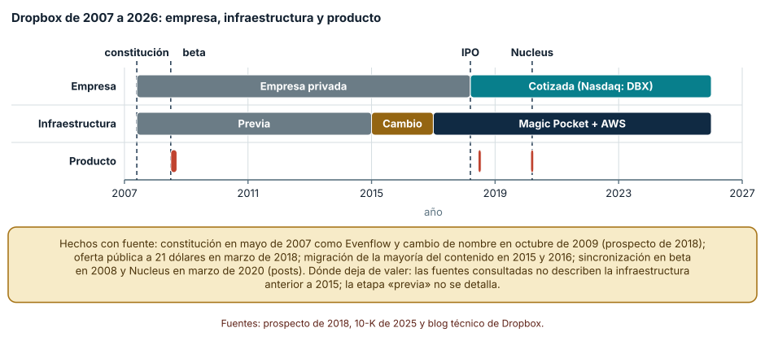

**Cómo leer la figura.** Cada carril es una dimensión del caso y la escala horizontal es el año. Mire cómo la migración de infraestructura ocurre justo antes de la salida a bolsa. **Dónde deja de valer.** Las fuentes consultadas no describen la infraestructura anterior a 2015; la etapa previa no se detalla.

### Oficinas, plantilla y estructura

**Oficinas (documentado).** La sede está en 1800 Owens Street, San Francisco [B1]; en 2018 el prospecto daba otra dirección en la misma ciudad [B2]. **[No se sabe]** la lista de oficinas y su distribución.

**Plantilla (documentado).** A 31 de diciembre de 2025 había 2 113 empleados a tiempo completo: 1 612 en Estados Unidos y 501 fuera [B1]. A fines de 2015 eran 1 446 y a fines de 2017 1 858 [B2]. Con 2 521 millones de ingresos, el ingreso por empleado es de unos 1,2 millones de USD (cálculo propio, orden de magnitud).

**Estructura.** **[No se sabe]** el organigrama. El 10-K da el gasto de investigación y desarrollo: 732,0 millones en 2025 y 914,9 en 2024 [B1].

## Contexto y problema

**Documentado.** El prospecto resume la idea fundacional: «La vida sería mucho mejor si todos pudieran acceder a su información más importante en cualquier momento desde cualquier dispositivo» [B2]. En 2008 la sincronización ya funcionaba como hoy a primera vista: el usuario instala la aplicación, se crea una «carpeta mágica» y lo que se pone en ella se sincroniza con los servidores de Dropbox y con sus otros dispositivos [B4].

**El problema de fondo.** La sincronización parece sencilla y es difícil a escala por tres razones que el propio post de 2020 enumera: (1) los usuarios confían en Dropbox con su contenido más valioso, por lo que la durabilidad es innegociable; (2) la sincronización bidireccional tiene muchos casos límite y las particiones de red son una condición normal, no excepcional; (3) probar un motor de sincronización es muy difícil porque el número de combinaciones de estados de archivos y acciones de usuario es astronómico [B4]. Y hay un problema económico: guardar el contenido de cientos de millones de usuarios es el mayor coste del negocio.

**Inferido.** La apuesta de producto fue que la sincronización invisible y fiable, sin que el usuario piense en ella, es el hábito que se convierte en suscripción. El prospecto lo respalda con el dato de que el crecimiento viene de un efecto viral: «la popularidad de nuestra plataforma impulsa un crecimiento viral que nos ha permitido escalar con rapidez y eficiencia» [B2].

### La apuesta, enunciada como hipótesis

El curso propone leer la apuesta de Dropbox como tres hipótesis comprobables ([SE-124](../../classes/part-10-descubrimiento-y-estrategia-de-producto/se-124-hipotesis-supuestos-y-preguntas-criticas/README.md)): (1) una carpeta que se sincroniza sola es un hábito que convierte a una fracción de usuarios gratuitos en suscriptores; (2) a gran escala, operar el almacenamiento propio cuesta mucho menos que alquilarlo; (3) un motor de sincronización fiable es una ventaja difícil de copiar. Cada una tiene un criterio de fracaso: que la conversión sea baja, que el ahorro no compense el coste de ingeniería o que los competidores igualen la fiabilidad. La segunda está respaldada por el prospecto, que atribuye parte de la caída del coste de ingresos de 2017 a la optimización de infraestructura [B2]. Esta formulación es del curso; Dropbox no publica sus hipótesis internas.

## Mercado, usuarios y casos de uso

Dropbox sirve a públicos distintos. La tabla resume quién es cada uno; lo que la fuente no confirma se marca.

| Rol | Qué hace y qué gana | Qué cambia en su experiencia | Respaldo |
| --- | --- | --- | --- |
| Persona usuaria | Sincroniza archivos entre sus dispositivos y los comparte | Acceso a su información desde cualquier dispositivo | [B2] |
| Equipo y organización | Colabora sobre documentos y usa productos como Sign, DocSend, Replay o Dash | Colaboración, firma y gestión de documentos | [B1] |
| Usuario gratuito | Prueba el servicio con limitaciones | Puede convertirse en usuario de pago | [B2] |
| Socio de integración | Integra su producto con Microsoft, Zoom, Atlassian, Slack, BetterCloud o Google | Funciones conjuntas | [B1] |
| Proveedor de infraestructura | Centros de colocación y AWS | **[No se sabe]** los términos | [B1] |
| Equipos de seguridad y cumplimiento | Protegen los datos y responden a requerimientos | **[No se sabe]** tamaño y herramientas | [B1] |

**Uso central.** Tener los archivos disponibles y compartibles en cualquier dispositivo. **Mercado.** Más de 500 millones de registrados en 180 países a fines de 2017 y solo 11 millones de pago [B2]; a fines de 2025, 18,08 millones de pago, 0,8 % menos que un año antes (18,22 millones) [B1].

### Quién da qué a quién

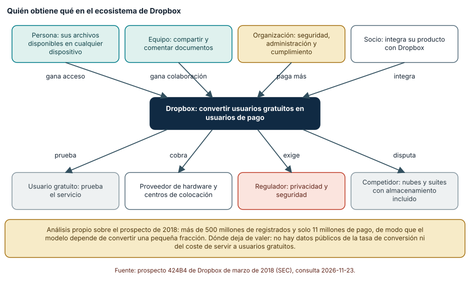

**Cómo leer la figura.** Dropbox está en el centro porque convierte a usuarios gratuitos en de pago; las etiquetas dicen qué recibe o aporta cada actor. Mire primero la proporción de pago: 11 de 500 millones en 2017. **Dónde deja de valer.** No hay cifras por actor.

### Incentivos por tipo de usuario (análisis propio sobre hechos documentados)

- **Persona.** Quiere sus archivos en cualquier lugar; el plan gratuito baja a cero el coste de probar. Su incentivo para pagar es el espacio y las funciones.
- **Equipo u organización.** Quiere colaborar con control y seguridad; su incentivo para pagar más es la administración. El 10-K lista una cartera ampliada: Backup, Sign, DocSend, Dash, Replay, Transfer y Reclaim [B1].
- **Socio.** Quiere que su producto funcione dentro del flujo de trabajo del cliente; el 10-K cita integraciones profundas con Microsoft, Zoom, Atlassian, Slack, BetterCloud y Google [B1].
- **Dropbox.** Su incentivo es convertir usuarios y bajar el coste de almacenar: el prospecto de 2018 identifica la optimización de infraestructura como causa del descenso del coste de ingresos en 2017 [B2].

### Competencia y por qué el mercado favoreció a Dropbox (análisis propio)

Las fuentes consultadas describen una competencia de grandes proveedores de nube y de suites de ofimática, sin cifras comparables. La razón por la que Dropbox llegó a la escala de 2017 no está declarada de forma completa. El análisis propio del curso plantea cuatro factores combinados, ninguno suficiente por sí solo: (1) un producto de utilidad evidente con muy poca fricción de entrada; (2) un crecimiento viral que redujo el coste de captar usuarios [B2]; (3) una ejecución técnica que mantuvo la sincronización fiable mientras crecía [B4]; (4) una decisión de infraestructura que dio ventaja de costes [B2]. **[No se sabe]** cuánto pesa cada uno ni la cuota de mercado frente a cada competidor.

## Funcionalidad de principio a fin

Se recorre el servicio primero con una persona que sincroniza una carpeta y luego con otros tipos de usuario, hasta su caso límite.

### Recorrido de una persona usuaria

1. **Primer contacto.** Instala la aplicación; se crea la carpeta. **[No se sabe]** el flujo actual de alta.
2. **Archivos.** Pone archivos en la carpeta; el motor de sincronización los detecta y los sube [B4].
3. **Almacenamiento.** El contenido se divide en bloques que se cifran y se guardan en Magic Pocket; los cambios se registran en FileJournal [B3].
4. **Otros dispositivos.** Reciben el aviso y descargan los bloques que faltan [B4].
5. **Smart Sync.** Si el contenido supera el disco local, la función descarga los archivos solo cuando se necesitan [B4].
6. **Operación diaria.** Para la persona, que la carpeta esté al día; detrás, un sistema que guarda exabytes con una durabilidad de más de 99,999999999 % [B1].

### Recorridos por tipo de usuario

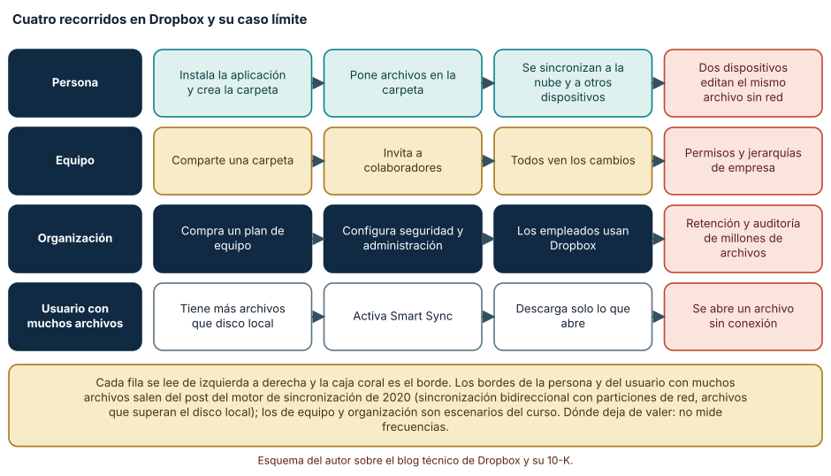

**Cómo leer la figura.** Cada fila es un usuario distinto; las cajas se leen de izquierda a derecha y la última, en coral, es el caso límite. **Dónde deja de valer.** Es un recorrido visible al usuario, no un diagrama de estados.

**Equipo.** **[Documentado]** que los usuarios llevan Dropbox al trabajo, con acceso a millones de archivos organizados en jerarquías de compartición de empresa [B4]. El caso límite son los permisos y la jerarquía: un cambio en una carpeta compartida afecta a muchos.

**Organización.** **[Documentado]** que el 10-K destaca la seguridad y los controles de privacidad como riesgos materiales [B1]. **[No se sabe]** el diseño de administración, retención y auditoría.

**Usuario con muchos archivos.** **[Documentado]** que Smart Sync permite descargar archivos solo cuando se necesitan porque el contenido de empresa suele exceder el disco local [B4]. El caso límite es abrir un archivo sin conexión: la promesa «sincronizado» cambia de significado. Las clases de offline-first ([SE-260](../../classes/part-21-software-movil-escritorio-y-multiplataforma/se-260-offline-first-y-resolucion-de-conflictos/README.md)) y de almacenamiento local y sincronización ([SE-256](../../classes/part-21-software-movil-escritorio-y-multiplataforma/se-256-almacenamiento-local-y-sincronizacion/README.md)) tratan ese eje.

**Dos dispositivos que editan a la vez.** **[Documentado]** que la sincronización bidireccional «tiene muchos casos límite» y que las particiones de red son operación normal [B4]. **[No se sabe]** la política exacta de resolución de conflictos.

## Negocio y economía

**Modelo (documentado).** Dropbox genera ingresos de la venta de suscripciones a su plataforma; el ingreso se reconoce de forma lineal durante el plazo del contrato, normalmente desde que la plataforma está disponible [B1]. Sus indicadores principales son el ARR total, los usuarios de pago, el ingreso medio por usuario de pago (ARPU) y el flujo de caja libre [B1].

### La escala de los ingresos a lo largo del tiempo

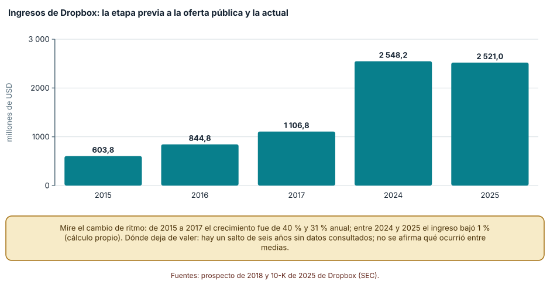

**Cómo leer la figura.** Cada barra es un año con datos; entre 2017 y 2024 hay un salto sin datos consultados. Mire el último tramo: el ingreso baja de 2024 a 2025. **Dónde deja de valer.** No se afirma qué ocurrió en 2018 a 2023.

### Unit economics con cifras citadas

| Magnitud | 2015 | 2016 | 2017 | 2024 | 2025 | Fuente |
| --- | ---: | ---: | ---: | ---: | ---: | --- |
| Ingresos (millones de USD) | 603,8 | 844,8 | 1 106,8 | 2 548,2 | 2 521,0 | [B1], [B2] |
| Margen bruto | 54 % | 67 % | 76 % | 82,5 % | 80,1 % | [B1], [B2] |
| Coste de ingresos (millones) | — | — | — | 445,1 | 500,8 | [B1] |
| Investigación y desarrollo | — | — | — | 914,9 | 732,0 | [B1] |
| Ventas y marketing | — | — | — | 460,7 | 369,9 | [B1] |
| Resultado operativo | — | — | — | 486,2 | 689,1 | [B1] |
| Resultado neto | -325,9 | -210,2 | -111,7 | 452,3 | 508,4 | [B1], [B2] |
| Flujo de caja libre | — | — | — | 871,6 | 930,8 | [B1] |
| Usuarios de pago (millones) | — | — | 11 | 18,22 | 18,08 | [B1], [B2] |
| ARPU (USD) | — | — | — | 140,23 | 138,91 | [B1] |

El margen bruto de 2024 y 2025 es cálculo propio (beneficio bruto sobre ingresos). Las celdas con «—» son valores que este caso no encontró en las fuentes consultadas y no inventa.

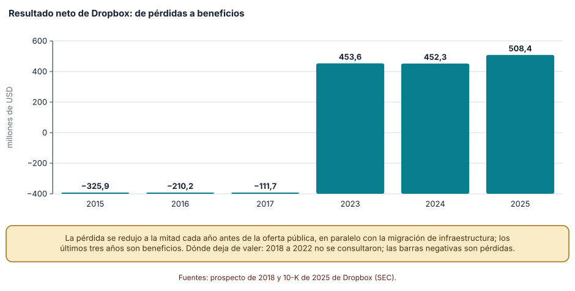

**Cómo leer la figura.** Cada barra es un año; las negativas son pérdidas. Mire que la pérdida se redujo cada año antes de la oferta pública. **Dónde deja de valer.** 2018 a 2022 no se consultaron.

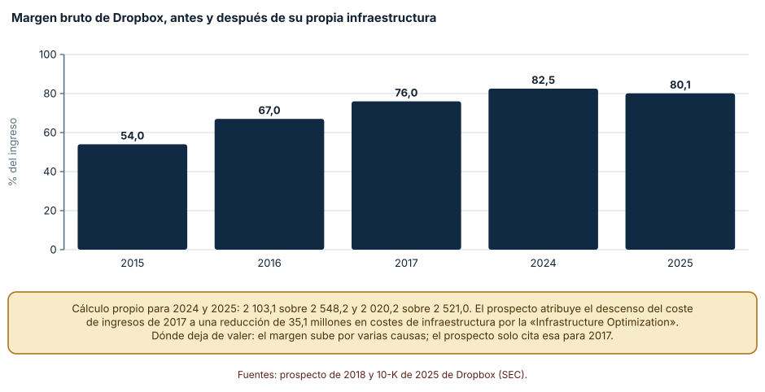

**Cómo leer la figura.** Cada barra es el porcentaje del ingreso que queda tras el coste de ingresos. Mire la subida de 2015 a 2017. **Dónde deja de valer.** El prospecto solo atribuye una parte de esa mejora a la infraestructura.

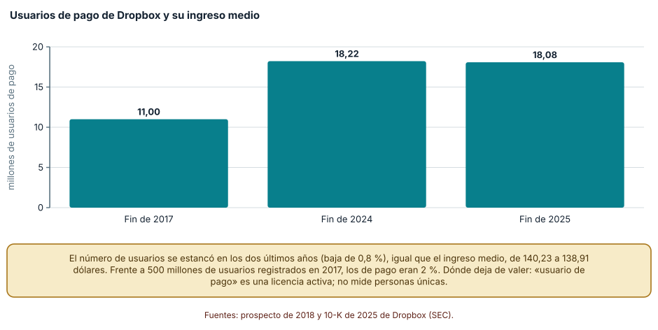

**Cómo leer la figura.** Cada barra es un cierre de año. **Dónde deja de valer.** Es una licencia activa, no una persona única.

### Dónde crece el negocio

**[Documentado]** que el ARR total fue de 2 526 millones al cierre de 2025 frente a 2 574 millones al de 2024: ligeramente menor; a tipos de cambio constantes, 2 562 millones con las divisas de comienzos de 2026 [B1]. El 10-K reconoce que los usuarios de pago pueden seguir disminuyendo en algunos periodos [B1]. El crecimiento actual no está en más usuarios sino en el valor por usuario y en nuevos productos como Dash; **[No se sabe]** cuánto aportan.

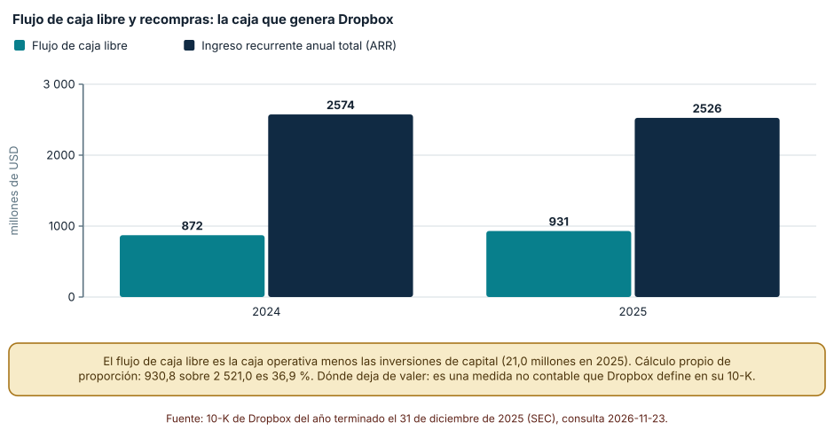

**Cómo leer la figura.** Cada grupo compara el flujo de caja libre con el ARR de un cierre. **Dónde deja de valer.** Son medidas distintas; el flujo de caja libre es no contable.

### Eficiencia de la organización

Con 2 113 empleados, el flujo de caja libre es de unos 440 000 USD por empleado (cálculo propio, orden de magnitud). Entre 2017 y 2025 la plantilla subió 14 % (de 1 858 a 2 113) mientras el ingreso creció 128 % (de 1 106,8 a 2 521,0 millones), cálculo propio.

### Esquema del negocio: flujos de dinero y de valor

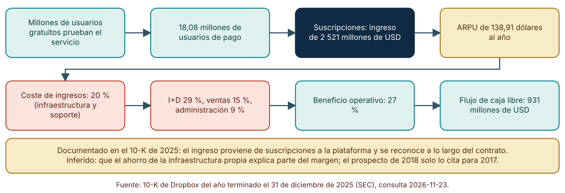

**Cómo leer la figura.** La fila superior es el embudo y la inferior el destino de cada dólar. **Dónde deja de valer.** Es un esquema de flujo, no un modelo financiero.

### Visión, misión y estrategia

El prospecto dice que quieren evolucionar de «guardar archivos» a una plataforma de colaboración donde el contenido se crea, se accede y se comparte [B2]. El 10-K de 2025 describe una oferta con Dash (búsqueda y organización con inteligencia artificial), Sign, DocSend, Backup y Replay [B1]. **[Inferido]** que la estrategia busca aumentar el valor por usuario más que el número de usuarios, dado el estancamiento de los usuarios de pago.

### Costos operativos

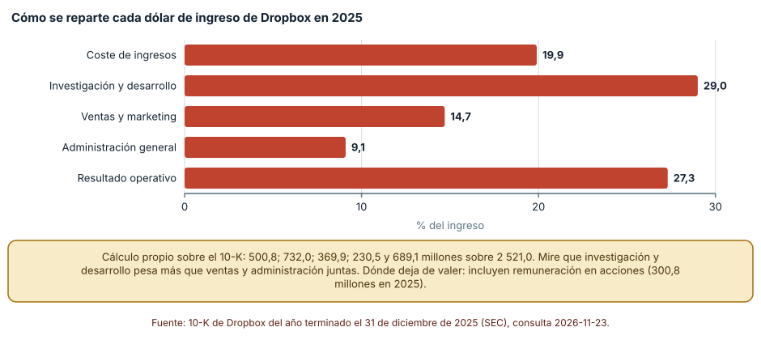

**Cómo leer la figura.** Cada barra es una partida como porcentaje de los 2 521 millones. Mire el peso de I+D: casi tres de cada diez dólares. **Dónde deja de valer.** Incluyen remuneración en acciones.

**Infraestructura.** El 10-K dice que los costes de arrendar y mantener la infraestructura propia en centros de colocación y de centros de datos de terceros ya son una parte significativa del gasto de capital y operativo, y reconoce el riesgo de sobreestimar o subestimar la capacidad [B1], [B2]. En 2017 el coste de ingresos bajó 21,7 millones (6 %) por una reducción de 35,1 millones en costes de infraestructura gracias a la «Infrastructure Optimization», más 5,9 millones menos de amortización, parcialmente compensados por 11,0 millones más de personal [B2].

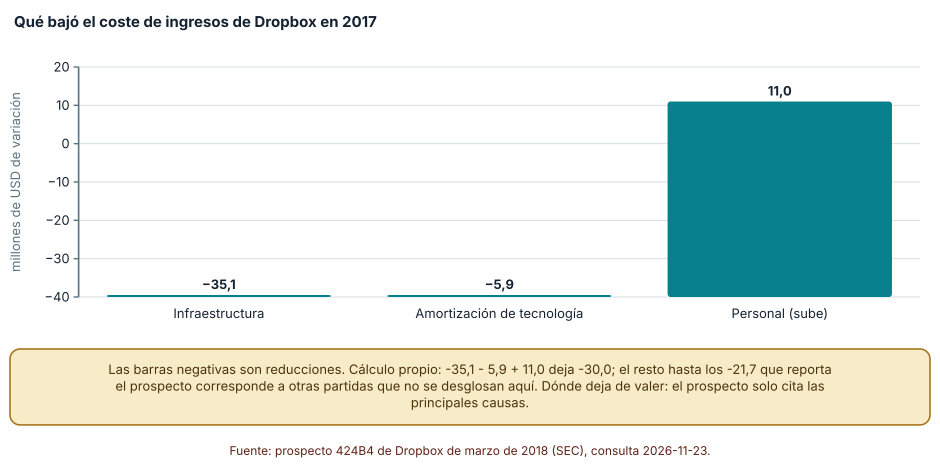

**Cómo leer la figura.** Las barras negativas son reducciones del coste. **Dónde deja de valer.** El prospecto solo desglosa las causas principales.

### Competidores

El 10-K reconoce competencia de grandes proveedores de nube y de suites, sin cuotas comparables [B1]. **[No se sabe]** la cuota de mercado por competidor.

## Arquitectura y esquemas

Se recorre como un mapa con zoom creciente. Lo que sigue sale de cuatro posts del blog técnico de Dropbox (2016 a 2020), del prospecto de 2018 y del 10-K de 2025; lo que no está allí se marca. Hay una limitación: el blog técnico cuenta muy bien el almacenamiento y el motor de sincronización, pero poco de la capa de metadatos y de la operación diaria.

### 6.1 Contexto del sistema

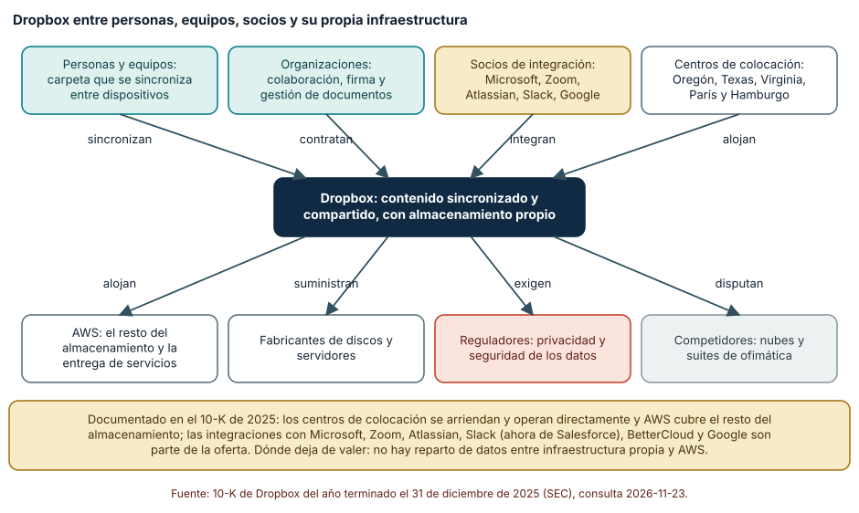

**Cómo leer la figura.** El cuadro central es Dropbox y los satélites son quienes lo usan, lo alojan o lo presionan. Mire primero los dos tipos de alojamiento: propio y de terceros. **Dónde deja de valer.** No hay volúmenes ni reparto.

### 6.2 Capas

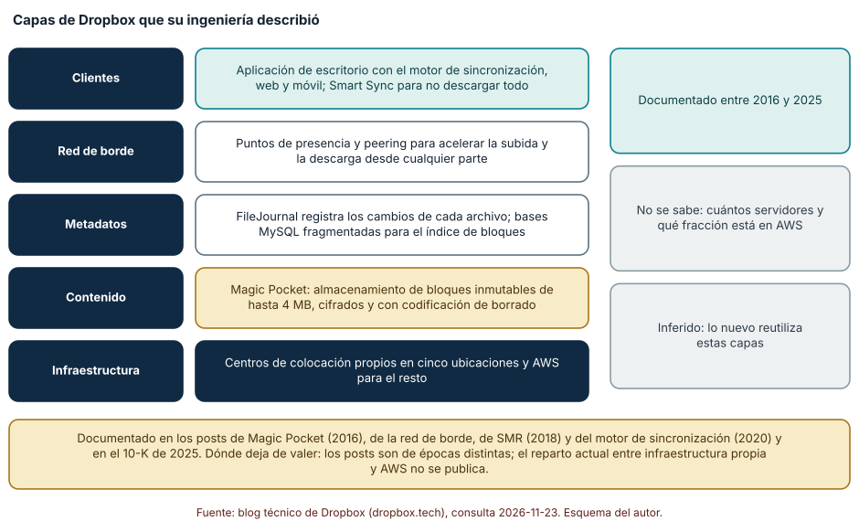

**Cómo leer la figura.** De arriba abajo, cada capa descansa en la siguiente; a la derecha, qué es documentado y qué no. **Dónde deja de valer.** Los posts son de 2016 a 2020.

**Documentado [B3].** Dropbox guarda dos tipos de datos: el contenido de los archivos y los metadatos de archivos y usuarios. **Magic Pocket** es el sistema que guarda el contenido: los archivos se dividen en bloques, se replican para durabilidad y se reparten por la infraestructura en varias regiones geográficas. Los cambios de un archivo se registran en un sistema aparte, FileJournal, de modo que la mutabilidad vive arriba y el almacenamiento es inmutable.

### 6.3 Sincronizar un archivo

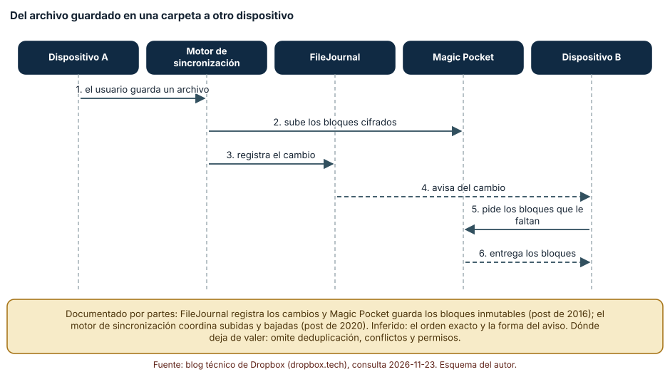

**Cómo leer la figura.** Las flechas son llamadas en orden; las punteadas son respuestas o avisos. Mire que el contenido y el registro del cambio son caminos distintos. **Dónde deja de valer.** Omite deduplicación, conflictos y permisos; es una síntesis de dos posts.

**Documentado [B4].** El motor de sincronización vive en el ordenador del usuario y coordina la subida y la descarga de archivos contra un sistema de archivos remoto. En 2020 Dropbox tenía cientos de miles de millones de archivos, billones de revisiones de archivos y exabytes de datos de clientes, y los usuarios accedían desde cientos de millones de dispositivos conectados en un enorme sistema distribuido. **Inferido.** El orden exacto entre subir bloques y registrar el cambio. **Mecanismo.** Es el patrón de separar el contenido (inmutable, direccionable por contenido) del registro (que cambia) que tratan las clases de almacenamiento y consistencia ([SE-352](../../classes/part-29-datos-persistencia-y-recuperacion/se-352-restricciones-invariantes-y-consistencia/README.md); [SE-356](../../classes/part-29-datos-persistencia-y-recuperacion/se-356-caches-y-consistencia-entre-capas/README.md)).

### 6.4 Magic Pocket: almacenamiento de bloques inmutables

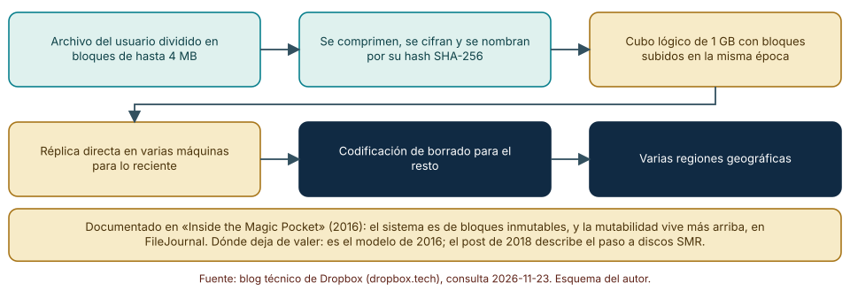

**Cómo leer la figura.** La fila superior es cómo se forma un bloque y un cubo y la inferior, cómo se protege. **Dónde deja de valer.** Es el modelo de 2016.

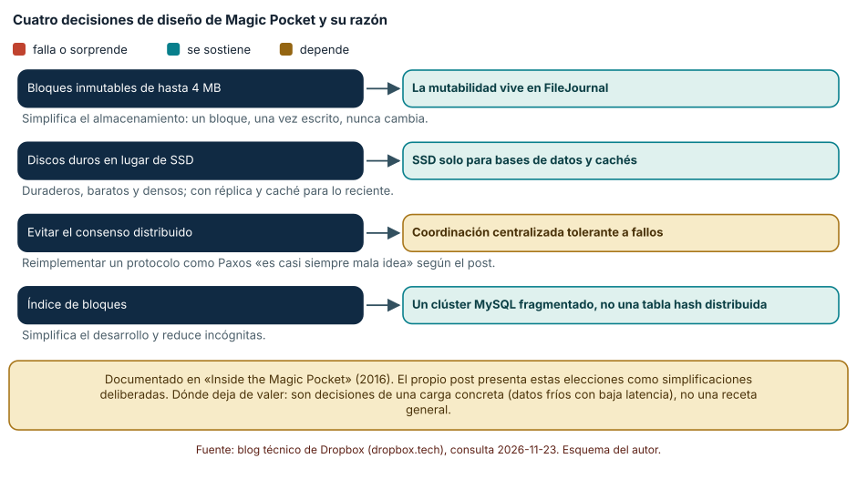

**Cómo leer la figura.** Cada tarjeta es una decisión y su razón. **Dónde deja de valer.** Son decisiones de una carga concreta.

**Documentado [B3].** Magic Pocket es un sistema de almacenamiento de bloques inmutables: guarda fragmentos cifrados de archivos de hasta 4 megabytes; una vez escrito, un bloque no cambia. La carga tiene mucha localidad temporal: gran parte de los datos se accede con frecuencia en la hora posterior a la subida y mucho menos después; es un sistema «frío» pero con lectura de baja latencia para todos los bloques. Construyeron sobre discos duros (duraderos, baratos, densos y de latencia razonable) y reservan los discos de estado sólido para bases de datos y cachés; usan mucha réplica inicial y caché para lo reciente y una codificación más eficiente para el resto. La durabilidad teórica debía ser «efectivamente infinita»; los datos llevan codificación de borrado y se guardan entre varias regiones. Sobre la simplicidad: el sistema evita el consenso de tipo quórum y la coordinación distribuida en la medida de lo posible y usa puntos de coordinación centralizados cuando son tolerantes a fallos y escalables; para el índice de bloques eligieron un gigantesco clúster MySQL fragmentado en lugar de una tabla hash distribuida, lo que simplificó el desarrollo y redujo incógnitas. Los bloques se nombran por el hash SHA-256 de su contenido; se agrupan en cubos lógicos de 1 gigabyte con bloques que simplemente se subieron en la misma época; los cubos se replican en varias máquinas físicas.

**Qué enseña.** Cuando la carga es de escritura única y lectura de baja latencia, el almacenamiento inmutable más un registro de cambios arriba simplifica la durabilidad; y evitar el consenso propio es una decisión de ingeniería, no una carencia ([SE-391](../../classes/part-32-concurrencia-y-sistemas-distribuidos/se-391-consenso-eleccion-y-coordinacion/README.md) trata el consenso; [SE-357](../../classes/part-29-datos-persistencia-y-recuperacion/se-357-backups-restauracion-y-pruebas-de-recuperacion/README.md) los respaldos y su restauración).

### 6.5 De cero a varios exabytes y la migración de 2015-2016

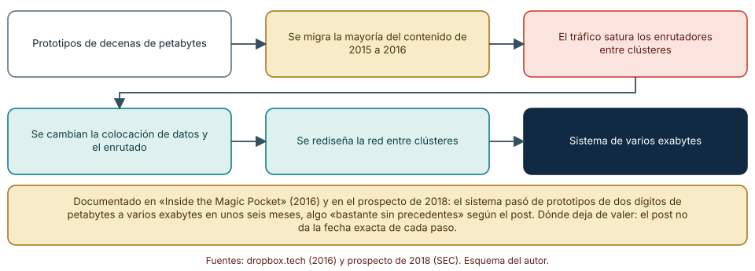

**Cómo leer la figura.** Cada caja es un paso; la coral es el problema inesperado. **Dónde deja de valer.** El post no da la fecha de cada paso.

**Documentado [B2], [B3].** El prospecto dice que durante 2015 y 2016 migraron la gran mayoría del contenido de los usuarios a su propia infraestructura a medida en centros de colocación que arriendan y operan directamente [B2]. El post de Magic Pocket cuenta que el sistema creció desde prototipos de decenas de petabytes a varios exabytes en unos seis meses, «una transición bastante sin precedentes»; en un caso el tráfico creció de golpe y empezaron a saturar los enrutadores entre clústeres de red, lo que obligó a cambiar los algoritmos de colocación de datos y el enrutado de peticiones para reflejar la afinidad por clúster, la capacidad de almacenamiento disponible y los calendarios de crecimiento, y por último la arquitectura de red entre clústeres [B3]. El 10-K de 2025 confirma que la mayor parte del contenido sigue en infraestructura propia y que AWS cubre el resto del almacenamiento y ayuda a entregar los servicios, en centros de datos de Estados Unidos, Australia, Europa y Japón que permiten localizar dónde se guarda el contenido [B1].

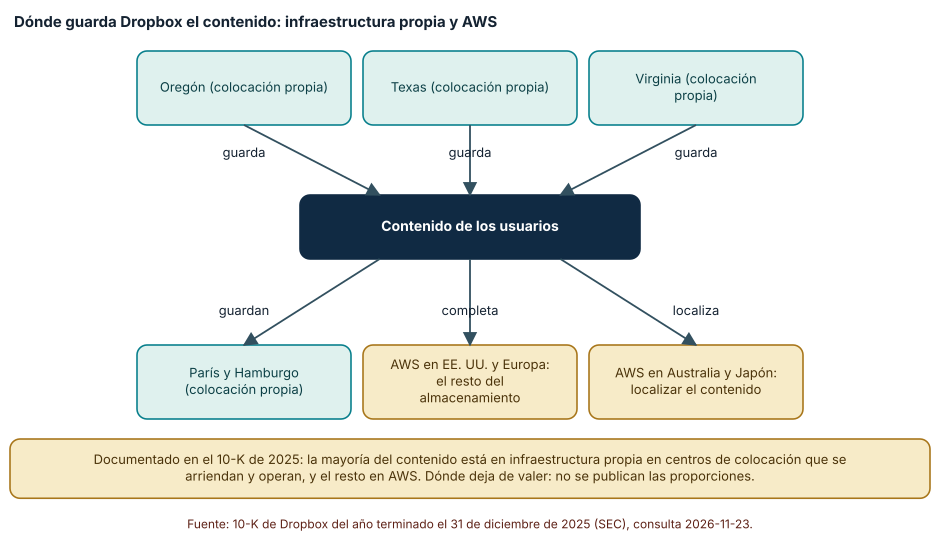

**Cómo leer la figura.** El centro es el contenido de los usuarios y los satélites son dónde se guarda. **Dónde deja de valer.** No se publican las proporciones.

**Qué enseña (análisis propio).** La migración no fue un abandono de la nube: Dropbox sigue usándola para el resto y para localizar contenido. Fue una decisión económica para la parte del negocio donde el almacenamiento es el producto y el coste dominante. El prospecto muestra la consecuencia contable: el margen bruto pasó de 54 % a 67 % y a 76 % entre 2015 y 2017, y el coste de infraestructura bajó 35,1 millones en 2017 [B2]. La clase de economía de la nube ([SE-404](../../classes/part-33-cloud-plataforma-e-infraestructura/se-404-escalado-capacidad-y-costos/README.md)) y la de multi-nube y portabilidad ([SE-405](../../classes/part-33-cloud-plataforma-e-infraestructura/se-405-multi-cloud-hibrido-y-portabilidad-real/README.md)) discuten cuándo tiene sentido.

### 6.6 Discos SMR: más densidad a cambio de software

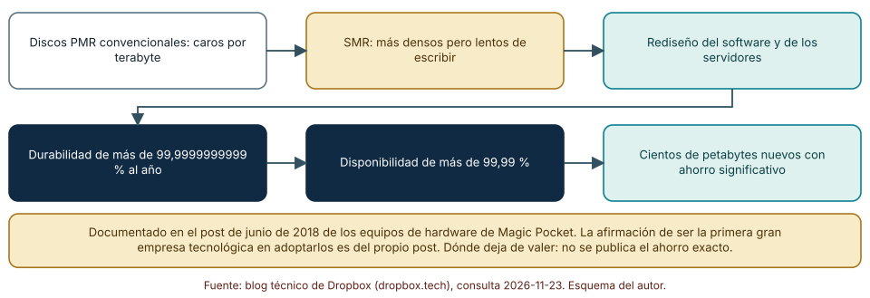

**Cómo leer la figura.** La fila superior es el problema de hardware y la inferior las metas y el resultado. **Dónde deja de valer.** El ahorro exacto no se publica.

**Documentado [B6].** En junio de 2018 los equipos de hardware de Magic Pocket anunciaron el despliegue de servidores llenos de discos SMR (grabación magnética en tejas) de alta densidad, con cientos de petabytes de capacidad nueva con un ahorro significativo frente a los discos convencionales PMR. Los discos SMR tienen fama de ser más lentos de escribir; el reto fue aprovechar el ahorro sin perder rendimiento, mediante software y arquitectura de servidor, con objetivos de durabilidad anual de más de 99,9999999999 % y de disponibilidad de más de 99,99 %. Dropbox afirma ser la primera gran empresa tecnológica en adoptarlos. **Mecanismo.** Una unidad de almacenamiento inmutable y con escritura secuencial es la que mejor casa con un disco que escribe por tejas ([SE-018](../../classes/part-01-computadores-y-representacion-de-informacion/se-018-memoria-caches-almacenamiento-y-jerarquias/README.md) trata la jerarquía de almacenamiento).

### 6.7 La red de borde

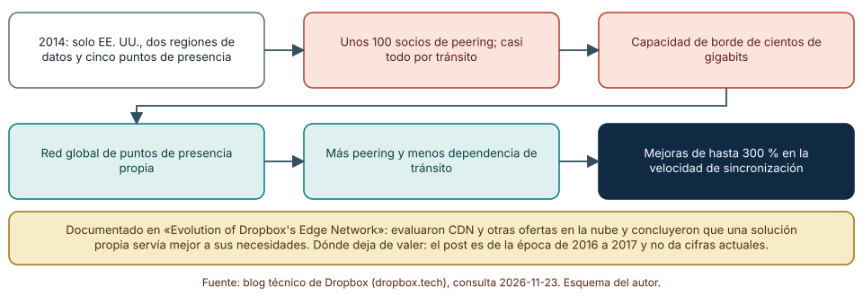

**Cómo leer la figura.** La fila superior es la red de 2014 y la inferior, la evolución. **Dónde deja de valer.** El post no da cifras actuales.

**Documentado [B5].** En 2014 la presencia de red estaba solo en Estados Unidos: dos regiones de centros de datos (una en cada costa) con todos los datos de usuarios y cinco puntos de presencia en las ciudades de más tráfico, de modo que los usuarios de otras regiones solo podían ser atendidos desde EE. UU., con dependencia del tránsito y rutas de mayor latencia. Se interconectaba con unos cien socios de peering y la capacidad de borde era de cientos de gigabits, casi toda con proveedores de tránsito. Usaban BGP en el borde y en la red troncal y OSPF como protocolo subyacente. Evaluaron CDN y otras ofertas en la nube y concluyeron que, para sus necesidades, la solución propia servía mejor, con mejoras de velocidad de sincronización de hasta 300 % en algunos usuarios. **Mecanismo.** Tener presencia cerca del usuario reduce latencia y dependencia de terceros; es el tema de las clases de rutas y de proxies y CDN ([SE-039](../../classes/part-03-redes-internet-y-protocolos/se-039-ipv4-ipv6-subredes-rutas-y-nat/README.md); [SE-044](../../classes/part-03-redes-internet-y-protocolos/se-044-proxies-balanceadores-gateways-y-cdn/README.md)).

### 6.8 El motor de sincronización: la reescritura

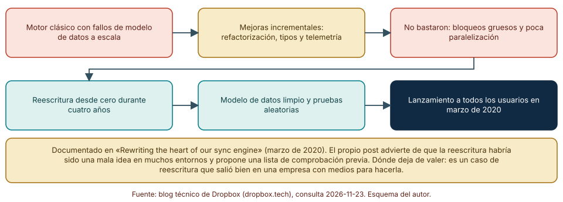

**Cómo leer la figura.** La fila superior es el diagnóstico y la inferior, la reescritura. **Dónde deja de valer.** Es un caso que salió bien; el post advierte de que en muchos entornos habría sido una mala idea.

**Documentado [B4].** En marzo de 2020 Dropbox anunció que había enviado a todos los usuarios su nuevo motor de sincronización, llamado Nucleus, tras reconstruir durante cuatro años desde cero el motor del cliente de escritorio, una de las piezas de código más antiguas e importantes de la empresa. El motor original («Sync Engine Classic») tenía problemas fundamentales de modelo de datos que solo aparecían a escala. Antes de reescribir habían hecho mejoras incrementales al construir Smart Sync: limpiar código feo, refactorizar interfaces, añadir anotaciones de tipos de Python, telemetría copiosa y procesos de mantenimiento seguros, pero no bastaron; la arquitectura usaba bloqueos gruesos mantenidos mucho tiempo, sacrificando el paralelismo para que el sistema fuera más fácil de razonar. El post destila una «lista de comprobación» para decidir una reescritura que empieza por: ¿se agotaron las mejoras incrementales? ¿se probó refactorizar en módulos mejores? Y subraya que probar un motor de sincronización es difícil porque el número de combinaciones de estados de archivos y de acciones de usuario es astronómico.

**Qué enseña.** Es el contraargumento a «nunca reescribas» con condiciones explícitas: modelo de datos defectuoso, mejoras incrementales agotadas y capacidad de probar. Las clases de economía de reescribir frente a evolucionar ([SE-526](../../classes/part-43-mantenimiento-y-modernizacion-legacy/se-526-economia-de-reescribir-frente-a-evolucionar/README.md)) y de migración incremental ([SE-521](../../classes/part-43-mantenimiento-y-modernizacion-legacy/se-521-strangler-branch-by-abstraction-y-anticorruption/README.md)) desarrollan el criterio. **No generalice:** el propio post dice que en muchos entornos habría sido una mala idea.

### 6.9 Seguridad, abuso y cumplimiento

**Documentado.** El 10-K trata la seguridad de los datos y la prevención de brechas como riesgos materiales y menciona que el servicio podría interrumpirse o perder contenido [B1]; el prospecto describe múltiples capas de redundancia contra la pérdida de datos [B2]. **[No se sabe]** el diseño interno de cifrado, claves, identidad y auditoría más allá de que los bloques se cifran antes de guardarse [B3].

### 6.10 Observabilidad y operación

**No documentado en las fuentes consultadas.** Ninguno de los cuatro posts describe la observabilidad, las guardias o la gestión de incidentes. Lo único documentado es la dificultad de probar el motor de sincronización y la necesidad de detectar regresiones antes de producción [B4]. **[No se sabe]** el resto.

### 6.11 Evolución y alternativas descartadas (análisis propio)

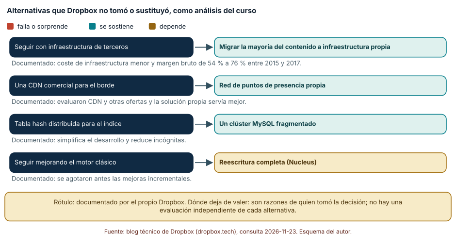

**Cómo leer la figura.** Cada tarjeta enfrenta una alternativa con lo que Dropbox hizo. **Dónde deja de valer.** Son razones de quien tomó la decisión.

**Rótulo: documentado por Dropbox.** Sobre la CDN, el índice de bloques y la reescritura hay razones escritas por el equipo [B3]–[B5]; sobre la migración a infraestructura propia, la razón económica la sustenta el prospecto de 2018 [B2]. **[No se sabe]** si evaluó otros diseños de almacenamiento además de los nombrados.

### 6.12 Hardware, software, infraestructura y fallos

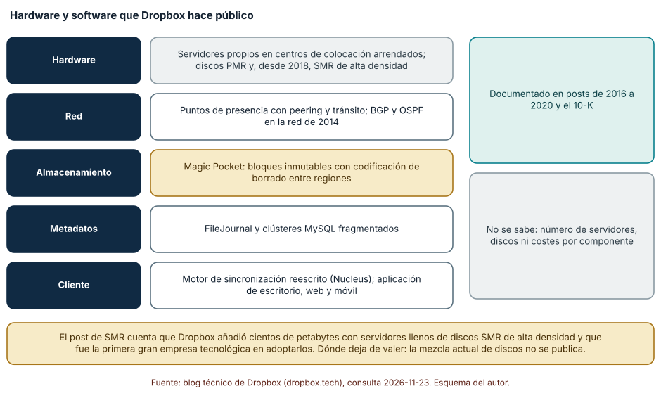

**Cómo leer la figura.** De arriba abajo, de lo físico a lo lógico. **Dónde deja de valer.** No hay datos de número de servidores ni de costes.

**Hardware utilizado.** Servidores propios en centros de colocación (Oregón, Texas, Virginia, París y Hamburgo), discos PMR y SMR, y AWS para el resto [B1], [B6]. **[No se sabe]** el número de servidores y de discos.

**Software utilizado (documentado).** Magic Pocket (almacenamiento de bloques), FileJournal, MySQL fragmentado, el motor de sincronización (con Python en la versión clásica), BGP y OSPF en la red [B3]–[B5].

**Características de la infraestructura.** Bloques inmutables con codificación de borrado entre regiones; réplica y caché para lo reciente; redundancia por capas; durabilidad de al menos 99,999999999 % [B1], [B3].

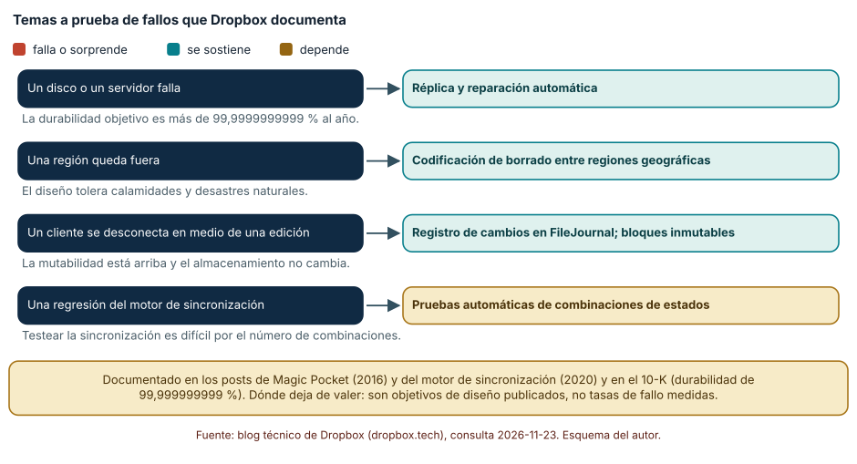

**Cómo leer la figura.** Cada tarjeta enlaza el fallo con el mecanismo que lo contiene. **Dónde deja de valer.** Son objetivos de diseño publicados, no tasas medidas.

**Temas a prueba de fallos.** Réplica inicial alta y reparación; codificación de borrado entre regiones; mutabilidad separada del almacenamiento; pruebas del motor de sincronización [B3], [B4].

## Casos especiales y cómo se resuelven

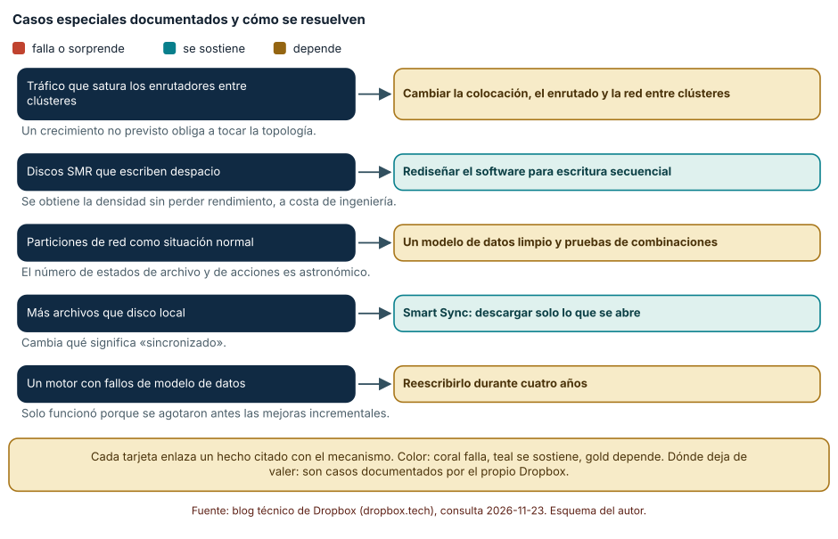

**Cómo leer la figura.** Cada tarjeta enfrenta una situación con lo que hizo el sistema; el color es el veredicto. **Dónde deja de valer.** Son casos documentados por Dropbox.

1. **Tráfico que satura los enrutadores.** Cambio de colocación, enrutado y red entre clústeres [B3].
2. **Escritura lenta en SMR.** Rediseño del software y de los servidores [B6].
3. **Particiones de red.** Operación normal del motor de sincronización [B4].
4. **Usuario con más archivos que disco.** Smart Sync [B4].
5. **Datos recientes de alta demanda.** Réplica inicial alta y caché frente a codificación de borrado para lo antiguo [B3].
6. **Usuarios fuera de Estados Unidos.** Puntos de presencia propios y peering [B5].
7. **Un motor con fallos de modelo.** Reescritura tras agotar las mejoras incrementales [B4].

## Línea de tiempo

| Año o fecha | Hecho | Fuente |
| --- | --- | --- |
| Mayo de 2007 | Se constituye Evenflow, Inc. | [B2] |
| 2008 | La sincronización entra en beta | [B4] |
| Octubre de 2009 | La empresa pasa a llamarse Dropbox | [B2] |
| 2014 | Red de borde solo en EE. UU.: cinco puntos de presencia | [B5] |
| 2015 y 2016 | Migración de la mayoría del contenido a infraestructura propia | [B2] |
| Mayo de 2016 | Se publica la arquitectura de Magic Pocket | [B3] |
| 2017 | Más de 500 millones de registrados y 11 millones de pago; margen bruto de 76 % | [B2] |
| Marzo de 2018 | Oferta pública a 21 dólares en Nasdaq (DBX) | [B2] |
| Junio de 2018 | Despliegue de discos SMR a escala de petabytes | [B6] |
| Marzo de 2020 | Nucleus, el nuevo motor de sincronización, llega a todos los usuarios | [B4] |
| 2025 | 18,08 millones de usuarios de pago; 2 521 millones de ingresos; 508,4 millones de beneficio neto | [B1] |

### Decisiones clave, giros y correcciones

- **Migrar el contenido a infraestructura propia (2015-2016).** Decisión económica con efecto visible en el margen [B2].
- **Inmutabilidad y simplicidad en Magic Pocket.** Decisión de diseño que evita consenso propio [B3].
- **Adoptar SMR (2018).** Decisión de hardware que exige software nuevo [B6].
- **Reescribir el motor de sincronización (2016-2020).** Un giro tras agotar las mejoras incrementales [B4].

## Vínculo con el curso

El caso muestra, en una plataforma real, mecanismos que el curso desarrolla con ejemplos controlados. Cada enlace dice qué ilustra el caso:

- [SE-357](../../classes/part-29-datos-persistencia-y-recuperacion/se-357-backups-restauracion-y-pruebas-de-recuperacion/README.md): backups, restauración y pruebas de recuperación. Durabilidad y reparación de bloques.
- [SE-440](../../classes/part-36-calidad-rendimiento-y-resiliencia/se-440-disponibilidad-durabilidad-y-recuperacion/README.md): disponibilidad, durabilidad y recuperación. Objetivos de 99,999999999 % y 99,99 %.
- [SE-355](../../classes/part-29-datos-persistencia-y-recuperacion/se-355-replicacion-particion-y-distribucion/README.md): réplica, partición y distribución. Cubos replicados y codificación de borrado entre regiones.
- [SE-393](../../classes/part-32-concurrencia-y-sistemas-distribuidos/se-393-replicacion-sharding-y-balanceo/README.md): replicación, sharding y balanceo. El índice de bloques en MySQL fragmentado.
- [SE-391](../../classes/part-32-concurrencia-y-sistemas-distribuidos/se-391-consenso-eleccion-y-coordinacion/README.md): consenso, elección y coordinación. Evitar el consenso propio.
- [SE-352](../../classes/part-29-datos-persistencia-y-recuperacion/se-352-restricciones-invariantes-y-consistencia/README.md): restricciones, invariantes y consistencia. Bloques inmutables y registro de cambios.
- [SE-260](../../classes/part-21-software-movil-escritorio-y-multiplataforma/se-260-offline-first-y-resolucion-de-conflictos/README.md): offline-first y resolución de conflictos. Sincronización bidireccional.
- [SE-256](../../classes/part-21-software-movil-escritorio-y-multiplataforma/se-256-almacenamiento-local-y-sincronizacion/README.md): almacenamiento local y sincronización. Smart Sync y el disco local.
- [SE-526](../../classes/part-43-mantenimiento-y-modernizacion-legacy/se-526-economia-de-reescribir-frente-a-evolucionar/README.md): economía de reescribir frente a evolucionar. La reescritura de Nucleus.
- [SE-521](../../classes/part-43-mantenimiento-y-modernizacion-legacy/se-521-strangler-branch-by-abstraction-y-anticorruption/README.md): strangler y migración incremental. Mejoras incrementales agotadas antes de reescribir.
- [SE-404](../../classes/part-33-cloud-plataforma-e-infraestructura/se-404-escalado-capacidad-y-costos/README.md): escalado, capacidad y costos. El coste de infraestructura propia.
- [SE-405](../../classes/part-33-cloud-plataforma-e-infraestructura/se-405-multi-cloud-hibrido-y-portabilidad-real/README.md): multi-cloud, híbrido y portabilidad real. Infraestructura propia más AWS.
- [SE-044](../../classes/part-03-redes-internet-y-protocolos/se-044-proxies-balanceadores-gateways-y-cdn/README.md): proxies, balanceadores, gateways y CDN. La red de borde propia.
- [SE-018](../../classes/part-01-computadores-y-representacion-de-informacion/se-018-memoria-caches-almacenamiento-y-jerarquias/README.md): memoria, cachés, almacenamiento y jerarquías. Discos duros, SSD y SMR.
- [SE-133](../../classes/part-11-economia-metricas-y-decisiones-de-producto/se-133-modelos-de-negocio-y-sostenibilidad/README.md): modelos de negocio y sostenibilidad. Suscripción con una fracción de usuarios de pago.

### Preguntas de discusión

1. ¿Qué condiciones hacen que traer el almacenamiento a infraestructura propia convenga a Dropbox y no a una empresa cuyo producto no es el almacenamiento?
2. Magic Pocket evita el consenso distribuido. ¿Qué riesgos acepta a cambio y cómo se limitan?
3. Aplique la lista de comprobación de reescritura a un sistema que conozca. ¿Qué respondería a «¿se agotaron las mejoras incrementales?»?
4. Con 11 de 500 millones de usuarios de pago en 2017, ¿qué métricas usaría para saber si el modelo gratuito es sostenible?
5. Los usuarios de pago bajaron 0,8 % en 2025 mientras la caja libre subió. ¿Qué riesgos tiene ese patrón?

### Mini-ejercicios de análisis

1. Calcule la caída del coste de ingresos de 2017 que explican la infraestructura, la amortización y el personal, y diga cuánto queda sin explicar.
2. Dibuje el camino de un archivo desde la carpeta hasta tres réplicas y marque dónde interviene la codificación de borrado.
3. Redacte tres pruebas del motor de sincronización para particiones de red y diga qué estados combinaría.

## Qué no generalizar

- **Migrar a infraestructura propia.** Dropbox tiene exabytes de datos y una carga muy regular de bloques inmutables; para la mayoría de empresas la nube pública es la opción razonable.
- **Reescribir el motor.** El propio post advierte de que en muchos entornos habría sido una mala idea.
- **Evitar el consenso.** Funciona porque el almacenamiento es inmutable y el índice está en una base fragmentada; no se transfiere a sistemas con escrituras concurrentes sobre los mismos datos.
- **La rentabilidad.** El margen y la caja de Dropbox vienen de un negocio maduro con usuarios de pago estancados; no prueban que el modelo gratuito más suscripción sea una receta de crecimiento.
- **Las series.** Faltan 2018 a 2023; no se debe extrapolar entre 2017 y 2024.
- **Las comparaciones del post de SMR.** Son afirmaciones del propio Dropbox sobre su caso.

## Fuentes públicas verificadas

Todas las URL se consultaron el 23 de noviembre de 2026 y devolvieron contenido (HTTP 200). Las cifras de la SEC se leyeron con el acceso de datos públicos de la propia SEC.

- **[B1]** [Dropbox, Form 10-K del año terminado el 31 de diciembre de 2025 (SEC)](https://www.sec.gov/Archives/edgar/data/1467623/000146762326000008/dbx-20251231.htm): ingresos, costes, usuarios de pago, ARR, plantilla, sede, centros de colocación y AWS.
- **[B2]** [Dropbox, prospecto 424B4 de la oferta pública de marzo de 2018 (SEC)](https://www.sec.gov/Archives/edgar/data/1467623/000119312518092764/d553522d424b4.htm): constitución, oferta a 21 dólares, ingresos 2015 a 2017, margen bruto, migración de 2015 y 2016 y optimización de infraestructura.
- **[B3]** [Inside the Magic Pocket (Dropbox.Tech, mayo de 2016)](https://dropbox.tech/infrastructure/inside-the-magic-pocket): bloques inmutables, cubos, durabilidad, simplicidad y salto de escala.
- **[B4]** [Rewriting the heart of our sync engine (Dropbox.Tech, marzo de 2020)](https://dropbox.tech/infrastructure/rewriting-the-heart-of-our-sync-engine): motor de sincronización, Nucleus y lista de comprobación de reescritura.
- **[B5]** [Evolution of Dropbox's Edge Network (Dropbox.Tech)](https://dropbox.tech/infrastructure/evolution-of-dropboxs-edge-network): red de 2014, peering y solución propia frente a CDN.
- **[B6]** [Extending Magic Pocket innovation with the first petabyte scale SMR drive deployment (Dropbox.Tech, junio de 2018)](https://dropbox.tech/infrastructure/extending-magic-pocket-innovation-with-the-first-petabyte-scale-smr-drive-deployment): discos SMR y objetivos de durabilidad y disponibilidad.

[↑ Casos de éxito](README.md) · [← Cloudflare](cloudflare.md)
