# Instagram

[↑ Casos de éxito](README.md) · [← Shopify](shopify.md)

> **Caso de éxito.** Instagram se lanzó el 6 de octubre de 2010 con una aplicación de fotos que nació de otra idea, tuvo más de cien millones de usuarios registrados cuando Facebook completó su compra en agosto de 2012 y hoy forma parte de una familia de aplicaciones que alcanza 3 580 millones de personas al día. Este caso explica qué se sabe, con fuentes, de cómo lo logró, qué se infiere y qué no se sabe, y lo contrasta con las clases del curso. Es una superficie aparte de las clases.

**Cómo leer las etiquetas de este caso.** Cada afirmación técnica o de negocio lleva una de tres marcas cuando importa la diferencia: **[Documentado]** (lo dice una fuente pública citada al final), **[Inferido]** (lo deduce el curso a partir de lo documentado; puede ser falso) y **[No se sabe]** (no hay fuente pública). Las cifras llevan año y fuente. Ninguna arquitectura interna confidencial se reconstruye aquí. Los esquemas usan trazo continuo para lo documentado y trazo punteado para lo inferido. Los apartados rotulados «análisis propio» son razonamiento del curso, no hechos.

**Cómo usar el caso.** Léalo después de las clases enlazadas en «Vínculo con el curso». La sección de arquitectura se recorre como un mapa con zoom creciente: contexto, capas, identificadores y fragmentación, reparto entre continentes, runtime de Python, capacidad, y reutilización en Threads. Al final hay preguntas y ejercicios.

**Alcance y límites del caso: léalo antes de seguir.** Este es el caso más corto de la serie por razones concretas de fuentes. (1) Meta no publica ingresos, usuarios ni empleados de Instagram por separado: sus informes agrupan todo en la «familia de aplicaciones». (2) El blog técnico original de Instagram (`instagram-engineering.com`) no respondió a las consultas de verificación de este caso; solo se pudo leer una copia archivada de un post de fragmentación. Los posts de 2013 a 2017 sobre Postgres, Cassandra, el recolector de basura de Python y los centros de datos se conocen por citas y resúmenes, y aquí no se citan como fuente primaria. (3) Las fuentes posteriores a 2018 son posts de Engineering at Meta. Por eso el caso cubre bien la economía de la compra, el diseño de identificadores y fragmentación, el reparto entre continentes y el trabajo sobre el runtime de Python, y declara lo que no puede cubrir.

## Ficha histórica

| Dato | Valor | Fuente |
| --- | --- | --- |
| Nombre | Instagram (hoy, un producto de Meta Platforms) | [I2] |
| Fundadores | Kevin Systrom y Mike Krieger | [I3] |
| Origen | Burbn, una aplicación de check-ins, de la que Systrom y Krieger conservaron la función de fotos; probada durante meses antes del lanzamiento | [I3] |
| Lanzamiento | 6 de octubre de 2010; unos 25 000 usuarios el primer día | [I3] |
| Android | Más de 1 millón de usuarios en 24 horas en el lanzamiento de la versión para Android (abril de 2012) | [I3] |
| Compra | Anunciada en abril de 2012; completada en agosto de 2012 por Facebook | [I1] |
| Precio contable | 521 millones de USD (300 millones en efectivo y unos 12 millones de acciones de clase B) más unos 11 millones de acciones sujetas a permanencia de empleados valoradas en 194 millones | [I1] |
| Usuarios al comprarla | Más de 100 millones de usuarios registrados (a diciembre de 2012) | [I1] |
| Escala (febrero de 2013) | 100 millones de usuarios mensuales, 28 meses después del lanzamiento | [I4] |
| Escala del grupo (diciembre de 2025) | 3 580 millones de personas activas diarias en la familia de aplicaciones | [I2] |
| Estado actual | Producto de Meta Platforms; su ingeniería comparte infraestructura y herramientas con la matriz | [I2], [I8] |

**Nota sobre fechas y cifras discrepantes.** La prensa de 2012 habla de un valor de mil millones de dólares para la compra (el valor anunciado en abril), la de 2013 de 715 millones al cierre, y el 10-K de Facebook de 2012 da un precio de compra de 521 millones, más 194 millones por las acciones de los empleados que se reconocen como gasto con el tiempo [I1], [I4]. Las tres cifras no se contradicen: miden cosas distintas (valor anunciado, valor al cierre con la cotización de entonces, precio contable de la combinación). Cálculo propio: 521 + 194 = 715. Respecto de la fecha de cierre, el 10-K dice agosto de 2012 [I1]; otras fuentes secundarias dicen septiembre; este caso usa la del informe auditado.

**Qué mide cada cifra de escala.** Los «usuarios registrados» (más de cien millones en diciembre de 2012) son cuentas creadas, no personas activas [I1]. Los «100 millones de usuarios mensuales» de febrero de 2013 son personas que usaron la aplicación en un mes, según el anuncio de la empresa citado por la prensa [I4]. Las «personas activas diarias» de la familia de aplicaciones de Meta son un estimado de personas únicas que visitaron al menos una de las aplicaciones (Facebook, Instagram, Messenger o WhatsApp) en el periodo, y Meta advierte que no cuenta cuentas, sino personas, con técnicas de atribución entre cuentas [I2]. Por eso **no** se puede deducir cuántas personas usan Instagram a partir de esa cifra.

**Cómo leer la figura.** Cada carril es una dimensión del caso y la escala horizontal es el año. Mire la compra de 2012: separa un producto independiente de uno que comparte infraestructura. **Dónde deja de valer.** Las etapas de infraestructura son aproximadas; no hay fecha publicada para cada migración.

### Oficinas, plantilla y estructura

**Oficinas (no documentado para Instagram).** El 10-K de 2012 sitúa la sede de Facebook en Menlo Park (California) [I1]. **[No se sabe]** dónde trabajan hoy los equipos de Instagram ni cuántas personas son: Meta informa que tenía 78 865 empleados a 31 de diciembre de 2025, 6 % más que un año antes, sin desglose por producto [I2].

**Plantilla de Instagram.** **[No se sabe]** con las fuentes consultadas. Una estimación del número de ingenieros en el momento de la compra circula en la prensa, pero este caso no la usa porque no hay una fuente primaria que la sostenga. Lo único documentado es cualitativo: el equipo de 2011-2012 escalaba el servicio «con muy pocos ingenieros» gracias a elegir soluciones simples y comprensibles, según el propio equipo [I5].

**Estructura.** **[No se sabe]** el organigrama de Instagram dentro de Meta. El 10-K de 2025 describe a Meta con dos segmentos, Family of Apps y Reality Labs, e Instagram dentro del primero [I2].

## Contexto y problema

**Documentado.** El origen del producto es un giro. En 2010 Kevin Systrom probó una aplicación de check-ins llamada Burbn, con unas cuatro secciones: marcar el lugar, publicar planes y compartir fotos. Los usuarios no hacían check-ins con frecuencia; lo que compartían eran fotos, muchas de ellas mundanas. Systrom y Krieger quitaron casi todo salvo las fotos, añadieron filtros, etiquetas de personas o lugares, una publicación en tres toques y un perfil público por defecto, y lanzaron la aplicación el 6 de octubre de 2010 [I3].

**El problema de fondo.** En 2010 compartir una foto desde el móvil exigía varios pasos y producía imágenes poco atractivas. El producto resolvió dos fricciones a la vez: **hacer rápida la publicación** (pocos toques) y **hacer atractiva la foto** (filtros). Técnicamente eso significa que cada foto se sube, se almacena, se reparte a los seguidores y se muestra en un orden, en un servicio que debía crecer muy rápido con muy poco personal. En el post de 2012 el equipo escribe que a esa fecha almacenaban más de 25 fotos y 90 «me gusta» por segundo y que querían que los datos importantes cupieran en memoria [I5].

**Inferido.** La apuesta de producto fue que la cámara del móvil, y no la red social, era el motor del uso: el producto empezó siendo una herramienta (hacer fotos bonitas) y se volvió red social después. La prensa de 2012 recoge la anécdota del CEO que dice que lo ve como una red social más que como una aplicación de fotos [I3]. Esta lectura es interpretación del curso.

### La apuesta, enunciada como hipótesis

El curso propone leer la apuesta de Instagram como tres hipótesis comprobables ([SE-124](../../classes/part-10-descubrimiento-y-estrategia-de-producto/se-124-hipotesis-supuestos-y-preguntas-criticas/README.md)): (1) la gente compartirá fotos con filtros desde el móvil si publicar cuesta pocos toques; (2) el perfil público por defecto crea una red de seguidores que sostiene el crecimiento sin publicidad; (3) un equipo muy pequeño puede operar un servicio de rápido crecimiento si elige piezas simples. Cada una tiene un criterio de fracaso: que el uso se estanque tras la novedad, que los seguidores no generen retención, o que la operación se desborde. Esta formulación es del curso; Instagram no publica sus hipótesis internas.

## Mercado, usuarios y casos de uso

Instagram sirve a varios públicos. La tabla resume quién es cada uno; lo que la fuente no confirma se marca.

| Rol | Qué hace y qué gana | Qué cambia en su experiencia | Respaldo |
| --- | --- | --- | --- |
| Persona usuaria | Comparte y mira fotos, vídeo y mensajes en Feed, Stories, Reels, Live y mensajería | Descubrimiento entre personas y contenido de intereses | [I2] |
| Creador | Publica contenido para una audiencia | Alcance a cambio de tiempo y esfuerzo | [I2] |
| Negocio | Muestra productos y los vende desde la aplicación | Descubrimiento y compras dentro de la aplicación | [I2] |
| Anunciante | Compra publicidad a través de la plataforma de Meta | Segmentación y medición comunes | [I2] |
| Meta (matriz) | Aporta infraestructura, personas y sistema de anuncios | Instagram deja de operar solo | [I1], [I6] |
| Menores y familias, reguladores | Exigen protecciones y competencia | **[No se sabe]** el detalle de las medidas de Instagram | [I2] |

**Uso central.** Compartir y descubrir contenido visual y mensajes. **Mercado.** Más de 100 millones de registrados en diciembre de 2012 [I1]; 100 millones mensuales en febrero de 2013 [I4]; en 2025, la familia de aplicaciones de Meta llega a 3 580 millones de personas al día [I2]. **[No se sabe]** el número de usuarios de Instagram hoy en las fuentes consultadas.

### Quién da qué a quién

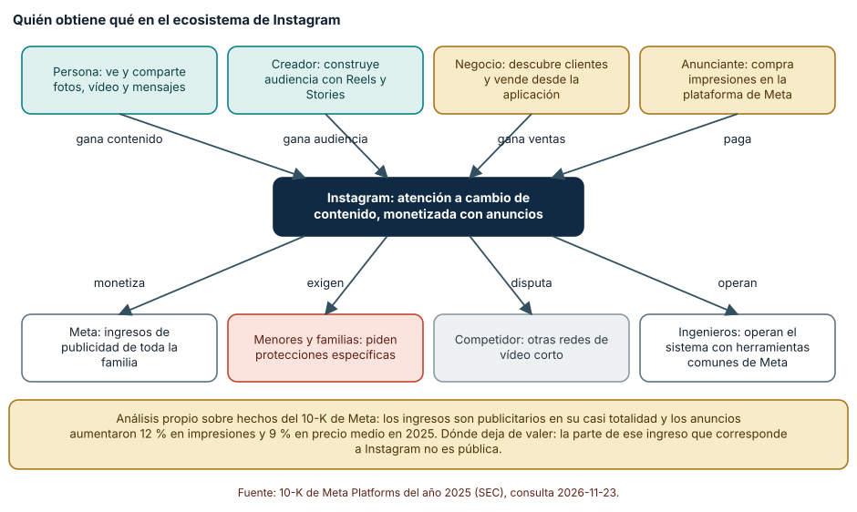

**Cómo leer la figura.** Instagram está en el centro porque junta atención y la entrega a quien paga; las etiquetas dicen qué aporta cada actor. Mire primero que las personas no pagan. **Dónde deja de valer.** No hay cifras de reparto del ingreso por actor.

### Incentivos por tipo de usuario (análisis propio sobre hechos documentados)

- **Persona.** Quiere ver lo que le interesa y compartir sin esfuerzo; el producto es gratis, así que su «pago» es atención. El 10-K de Meta dice que sustancialmente todos los ingresos vienen de la publicidad [I2].
- **Creador.** Quiere audiencia; su incentivo es que el sistema de recomendación lo muestre. **[No se sabe]** cómo se reparte el alcance ni cómo se remunera.
- **Negocio.** Quiere clientes; el 10-K menciona descubrir y comprar «de sus negocios favoritos» dentro de la aplicación [I2].
- **Anunciante.** Quiere alcance medible; las impresiones de anuncios en la familia aumentaron 12 % en 2025 y el precio medio por anuncio 9 % [I2].
- **Meta.** Su incentivo es sumar atención a la familia de aplicaciones; en 2012 reconoció que no obtenía ingresos directos de Instagram y que su prioridad era el crecimiento de usuarios y la experiencia [I1].

### Competencia y por qué el mercado favoreció a Instagram (análisis propio)

El 10-K de Facebook de 2012 reconoce que algunos usuarios habían reducido su uso de Facebook en favor de productos como Instagram, un ejemplo de competencia que la empresa resolvió comprando [I1]. La razón por la que Instagram llegó a la escala que alcanzó no está declarada. El análisis propio del curso plantea cuatro factores combinados, ninguno suficiente por sí solo: (1) una experiencia mínima y rápida de publicar, por la que el equipo tuvo que decir «no» a funciones nuevas (la prensa lo describe así [I3]); (2) un momento de mercado, con más iPhones y cámaras móviles; (3) una red de seguidores pública por defecto; (4) una ingeniería deliberadamente simple que permitió crecer con poco personal [I5]. **[No se sabe]** cuánto pesa cada uno.

## Funcionalidad de principio a fin

Se recorre el servicio primero con una persona que publica una foto y luego con otros tipos de usuario, hasta su caso límite. Los detalles de implementación están en la sección de arquitectura.

### Recorrido de una persona usuaria

1. **Primer contacto.** Descarga la aplicación y crea una cuenta. **[No se sabe]** el flujo actual de alta.
2. **Feed.** Ve fotos y vídeos de las cuentas que sigue y de recomendaciones. **[No se sabe]** el algoritmo de ordenación.
3. **Crear.** Hace una foto o vídeo, aplica filtros y publica en pocos toques [I3].
4. **Almacenar y repartir.** El servidor asigna un identificador único de 64 bits que lleva dentro la hora y el fragmento, guarda la foto y la reparte a los seguidores [I5].
5. **Interactuar.** «Me gusta», comentarios y mensajes privados; en 2011 eran unos 90 «me gusta» por segundo [I5].
6. **Operación diaria.** Para la persona, que simplemente funcione; detrás, un nivel web sin estado y almacenes partidos por proximidad [I6].

### Recorridos por tipo de usuario

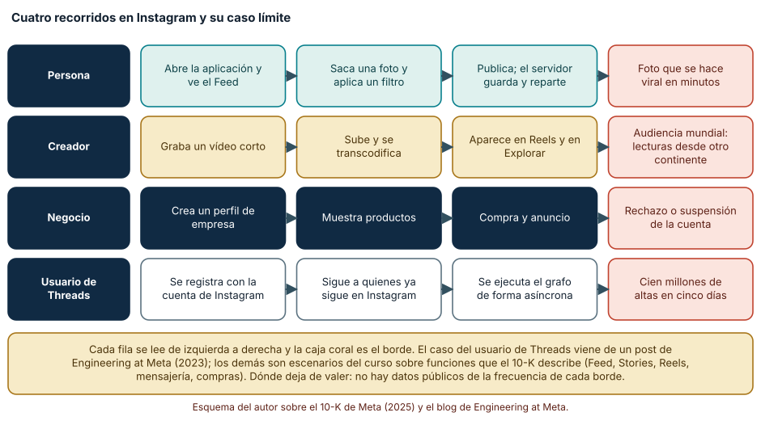

**Cómo leer la figura.** Cada fila es un usuario distinto; las cajas se leen de izquierda a derecha y la última, en coral, es el caso límite. **Dónde deja de valer.** Es un recorrido visible al usuario, no un diagrama de estados.

**Creador de vídeo corto.** **[Documentado]** que Reels forma parte de la oferta actual [I2]. El caso límite es el contenido que se vuelve visible en otros continentes: los datos de un usuario se almacenan cerca de él (Akkio), pero la audiencia puede estar en otro lugar. La charla de 2018 distingue por eso los datos de usuario (Cassandra, con Akkio) de los objetos multimedia accesibles desde todo el mundo (TAO) [I6].

**Negocio.** **[Documentado]** que se pueden descubrir y comprar productos de negocios dentro de la aplicación [I2]. **[No se sabe]** el diseño de pagos y de moderación de cuentas comerciales.

**Usuario que llega desde Instagram a Threads.** **[Documentado]** que al unirse a Threads se puede seguir a las mismas personas que se siguen en Instagram, que esa operación costosa se ejecuta de forma asíncrona y que Threads alcanzó más de 100 millones de altas en cinco días tras su lanzamiento el 5 de julio de 2023 [I10]. El caso límite es el volumen de altas simultáneas; la respuesta fue desacoplar el trabajo costoso del alta.

## Negocio y economía

**Modelo (documentado).** Instagram no tiene un estado de resultados público propio. El 10-K de Meta dice que sustancialmente todos sus ingresos provienen de la publicidad, y reparte el ingreso en Family of Apps (donde está Instagram) y Reality Labs [I2]. En 2012, al comprarla, Facebook reconoció que no obtenía ingresos directos de Instagram y que estaba centrado en el crecimiento de usuarios y su experiencia [I1].

### El precio de la compra

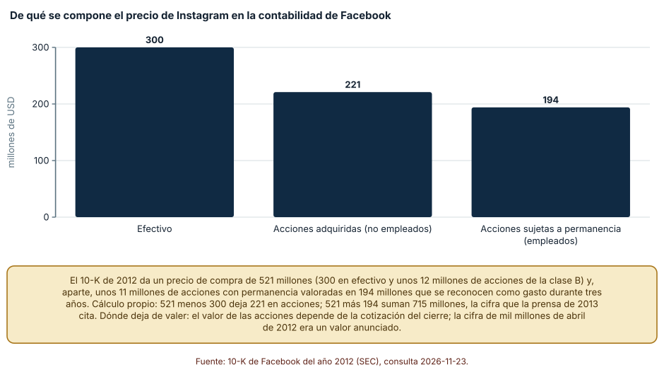

**Cómo leer la figura.** Cada barra es un componente del precio. Mire la tercera: es una compensación a los empleados que se paga con el tiempo, no con la compra. **Dónde deja de valer.** El valor de las acciones depende de la cotización de entonces y los 221 millones salen de restar el efectivo del precio de 521.

**Cómo se contó.** El 10-K de 2012 clasifica la compra como adquisición de negocio con un precio de 521 millones, del que 433 millones se asignan a fondo de comercio, 74 a tecnología adquirida (con vida útil de 5 años) y 64 a nombre comercial y otros [I1]. La tecnología adquirida valía menos de una sexta parte del precio: el grueso del precio es el valor de la audiencia y del equipo, no del código.

### La economía del grupo al que pertenece

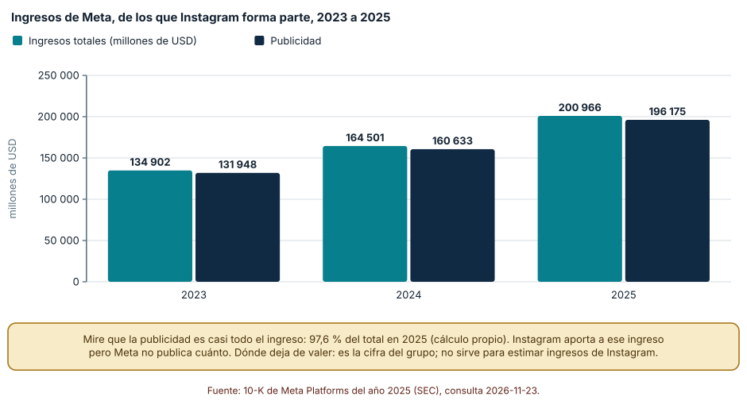

**Cómo leer la figura.** Cada grupo de barras es un año: el ingreso total y la publicidad. Mire la diferencia entre las dos barras de cada año: es muy pequeña. **Dónde deja de valer.** Son cifras del grupo; no se pueden dividir por aplicación.

| Magnitud (Meta) | 2023 | 2024 | 2025 | Fuente |
| --- | ---: | ---: | ---: | --- |
| Ingresos totales (millones de USD) | 134 902 | 164 501 | 200 966 | [I2] |
| Publicidad | 131 948 | 160 633 | 196 175 | [I2] |
| Family of Apps | 133 006 | 162 355 | 198 759 | [I2] |
| Reality Labs | 1 896 | 2 146 | 2 207 | [I2] |
| Coste de ingresos | 25 959 | 30 161 | 36 175 | [I2] |
| Investigación y desarrollo | 38 483 | 43 873 | 57 372 | [I2] |
| Resultado operativo | 46 751 | 69 380 | 83 276 | [I2] |
| Utilidad neta | 39 098 | 62 360 | 60 458 | [I2] |

La publicidad fue 97,6 % del ingreso total en 2025 (196 175 sobre 200 966, cálculo propio). El ingreso de Family of Apps creció 22 % en 2025 gracias casi en su totalidad a la publicidad; las impresiones de anuncios subieron 12 % y el precio medio por anuncio 9 % [I2].

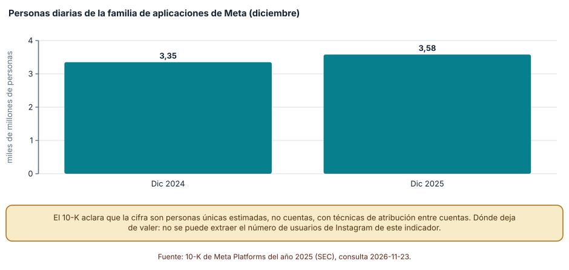

**Cómo leer la figura.** Cada barra es el promedio de diciembre. **Dónde deja de valer.** Son personas únicas de las cuatro aplicaciones: no sirve para estimar los usuarios de Instagram.

### Dónde crece el negocio

El 10-K no desglosa el crecimiento por aplicación. El ingreso medio por persona (ARPP) de la familia fue de 16,56 USD en el último trimestre de la serie del 10-K, frente a 12,33 USD en el primero [I2]. **[No se sabe]** cuánto de ese crecimiento es de Instagram.

### Eficiencia de la organización

Con 78 865 empleados y 200 966 millones de ingresos, el ingreso por empleado de Meta es de unos 2,5 millones de USD (cálculo propio, orden de magnitud). No es una cifra de Instagram.

### Esquema del negocio: flujos de dinero y de valor

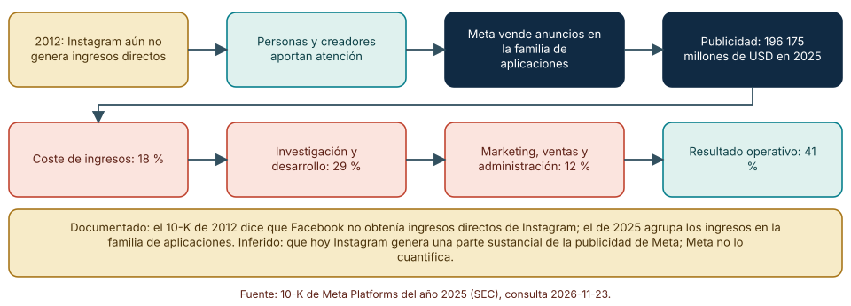

**Cómo leer la figura.** La fila superior sigue el dinero desde la atención hasta la publicidad y la inferior, su destino. **Dónde deja de valer.** Es un esquema de flujo del grupo, no un estado de resultados de Instagram.

### Visión, misión y estrategia

El 10-K de 2025 describe a Instagram con la frase «brings people closer to the people and things they love» y como lugar para conectar y expresarse mediante fotos, vídeo y mensajería privada, y para descubrir y comprar de negocios [I2]. En 2012, la misión de Facebook era «hacer el mundo más abierto y conectado» [I1]. **[Inferido]** que la compra respondió a la lógica de sumar una aplicación móvil de fotos «para aumentar los niveles de participación móvil y de compartir fotos», como dice el propio 10-K de 2012 [I1].

### Costos operativos

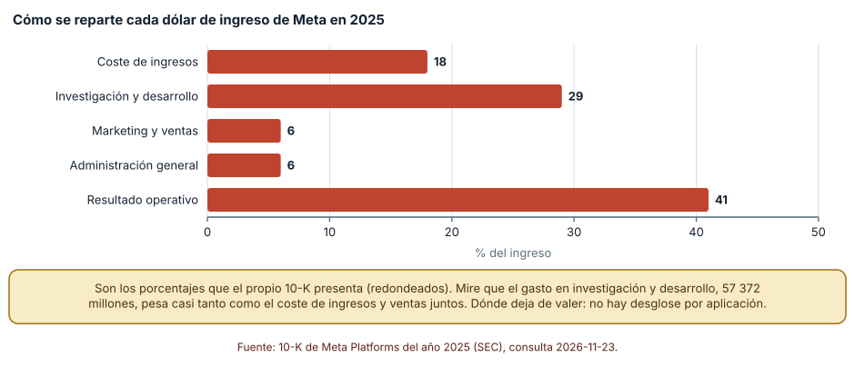

**Cómo leer la figura.** Cada barra es una partida como porcentaje de los 200 966 millones. **Dónde deja de valer.** Son porcentajes redondeados del grupo.

**Alojamiento.** **[No se sabe]** el gasto de infraestructura de Instagram. Lo documentado es cualitativo: hasta la compra operaba en AWS y después migró a los centros de datos de Facebook [I6].

### Competidores

El 10-K de 2025 reconoce competencia en la captación de tiempo y atención de las personas y de gasto publicitario [I2]. **[No se sabe]** cuota de mercado por competidor en las fuentes consultadas.

## Arquitectura y esquemas

Se recorre como un mapa con zoom creciente. Lo documentado sale de un post de 2012 (copia archivada), la charla de LISA 2018 resumida por InfoQ y posts de Engineering at Meta de 2020 a 2023. Hay un hueco largo entre 2013 y 2017 que este caso **no** rellena con memoria: lo que no tiene fuente verificada se marca como no sabido.

### 6.1 Contexto del sistema

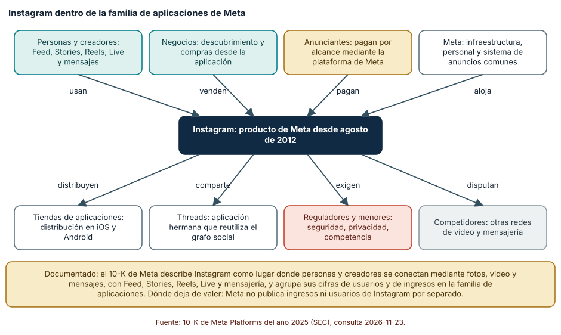

**Cómo leer la figura.** El cuadro central es Instagram y los satélites son quienes lo usan, lo financian o lo limitan. Mire primero a Meta: tras 2012 es la matriz y el proveedor de infraestructura. **Dónde deja de valer.** No hay volúmenes; Meta no publica cifras de Instagram por separado.

### 6.2 Capas

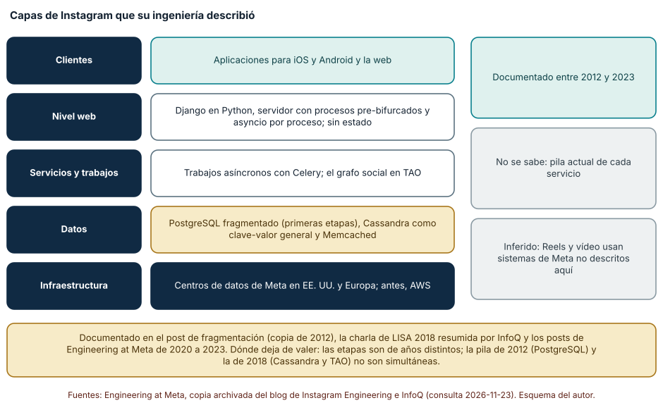

**Cómo leer la figura.** De arriba abajo, cada capa descansa en la siguiente; a la derecha, qué es documentado y qué no. **Dónde deja de valer.** Las capas de datos son de épocas distintas: PostgreSQL es de 2011-2012 y Cassandra y TAO de 2018.

**Documentado.** La pila de 2018 consiste principalmente en Django, Cassandra, el almacén distribuido TAO, Memcached y trabajos asíncronos con Celery [I6]. El nivel web en 2023 sigue siendo Django en Python, con un servidor pre-bifurcado de varios procesos y asyncio dentro de cada proceso [I8]. En 2022 Meta dice que Instagram opera uno de los mayores despliegues del mundo de Django [I7]. En 2011-2012 el almacén era PostgreSQL con Django [I5].

### 6.3 Identificadores y fragmentación (2011-2012)

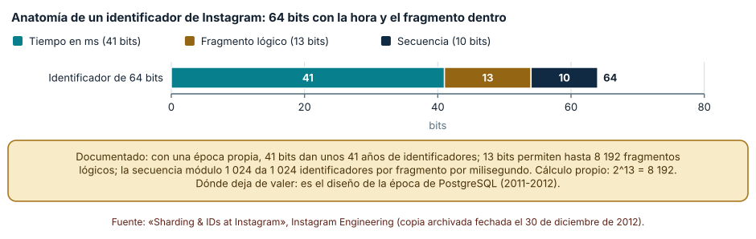

**Cómo leer la figura.** La barra es el identificador completo y cada tramo, un campo. Mire que la hora va a la izquierda: ordenar por identificador es ordenar por tiempo. **Dónde deja de valer.** Es el diseño de la etapa PostgreSQL.

**Documentado [I5].** Con más de 25 fotos y 90 «me gusta» por segundo, el equipo decidió fragmentar los datos para que los importantes cupieran en memoria. La primera pregunta fue si PostgreSQL debía seguir siendo el almacén: evaluaron varias soluciones NoSQL y concluyeron que lo mejor era fragmentar PostgreSQL en un conjunto de servidores. Antes de escribir tenían que resolver cómo asignar identificadores únicos, porque el autoincremento de una sola base ya no sirve cuando varias bases insertan a la vez. Fijaron tres requisitos: identificadores ordenables por tiempo, de 64 bits (índices más pequeños y mejor almacenamiento en sistemas como Redis) y «el menor número posible de piezas móviles», porque parte de cómo escalaban con muy pocos ingenieros era elegir soluciones simples y fiables. El sistema tiene varios miles de fragmentos **lógicos** (esquemas de PostgreSQL) asignados en código a muchos menos servidores **físicos**; para crecer, se mueven conjuntos de fragmentos lógicos a más servidores sin reubicar datos. Cada tabla genera sus identificadores con una función de PL/pgSQL: 41 bits de tiempo en milisegundos desde una época propia (unos 41 años), 13 bits del fragmento lógico y 10 bits de una secuencia que da 1 024 identificadores por fragmento y milisegundo.

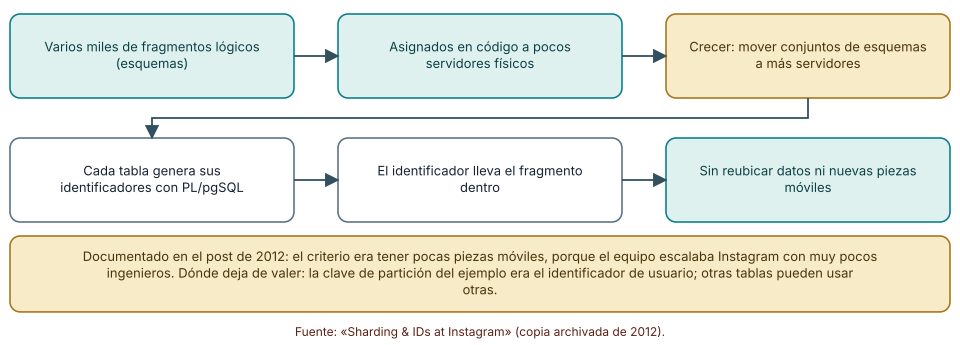

**Cómo leer la figura.** La fila superior es la asignación de fragmentos a servidores y la inferior, cómo nace un identificador. **Dónde deja de valer.** El ejemplo usa el identificador de usuario como clave; otras tablas pueden usar otra.

**Mecanismo.** Separar fragmentos lógicos de físicos es el truco que permite crecer sin reubicar datos: el número de fragmentos lógicos se fija al principio con holgura (hasta 8 192 con 13 bits, cálculo propio) y el cambio de capacidad es mover esquemas enteros. La clase de réplica, partición y distribución ([SE-355](../../classes/part-29-datos-persistencia-y-recuperacion/se-355-replicacion-particion-y-distribucion/README.md)) y la de replicación, sharding y balanceo ([SE-393](../../classes/part-32-concurrencia-y-sistemas-distribuidos/se-393-replicacion-sharding-y-balanceo/README.md)) tratan este patrón; el coste es que la clave elegida condiciona qué consultas son baratas.

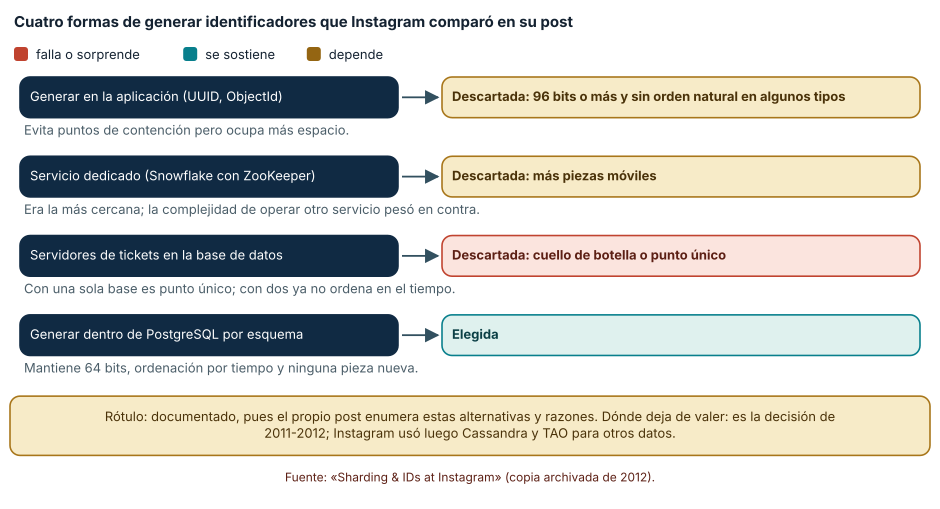

**Cómo leer la figura.** Cada tarjeta es una alternativa que el equipo comparó y su veredicto. **Dónde deja de valer.** Es una decisión de 2011-2012.

**Alternativas que el equipo consideró (documentado) [I5].** Generar identificadores en la aplicación (UUID u ObjectId de MongoDB): evita puntos de contención, pero requiere 96 bits o más y algunos tipos no tienen orden. Un servicio dedicado como Snowflake de Twitter (64 bits, ordenable, con ZooKeeper): era el más cercano, pero añadía piezas móviles. Servidores de tickets como el de Flickr (dos bases, una con pares y otra con impares): predecibles, pero pueden ser un cuello de botella o un punto único de fallo y con varias bases pierden el orden temporal. La solución elegida llevó una idea parecida a Snowflake dentro de PostgreSQL.

### 6.4 De AWS a los centros de datos de Facebook, y a dos continentes

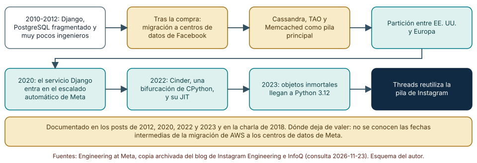

**Cómo leer la figura.** Cada caja es una etapa; las teal son mejoras posteriores a la compra. **Dónde deja de valer.** Las fechas intermedias no son públicas.

**Documentado [I6].** Tras la compra, Instagram migró a la infraestructura de Facebook: la de Instagram estaba solo en Estados Unidos y la de Facebook también en Europa. Cassandra, que Instagram usaba como almacén clave-valor general, se movió de AWS a centros de datos propios de Facebook junto con el resto de componentes. En 2018, en la conferencia LISA, una ingeniera de producción de Instagram explicó cómo repartieron los servicios entre Estados Unidos y Europa por limitaciones de espacio de almacenamiento. Los desafíos fueron la alta latencia de las llamadas de quórum de Cassandra, la partición para tener los datos cerca, la conmutación por error dentro de la región europea y la sincronización maestro-réplica de TAO.

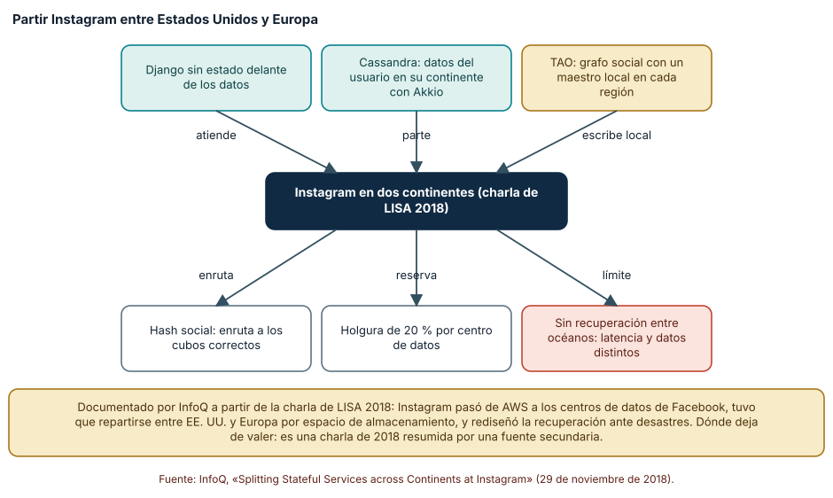

**Cómo leer la figura.** El centro es el diseño por continentes y los satélites son sus piezas. **Dónde deja de valer.** Es una charla de 2018 resumida por una fuente secundaria.

**Mecanismo.** Cassandra usa un quórum de réplicas entre centros de datos para consistencia en lecturas y escrituras. Copiar todos los datos en Europa habría desperdiciado almacenamiento y las peticiones de quórum habrían cruzado el océano, con latencia inaceptable. En su lugar partieron los datos para que los usuarios de Estados Unidos tuvieran los suyos en los centros de datos de allí y los de Europa en tres europeos, con Akkio, una herramienta de colocación de datos de Facebook que agrupa datos en conjuntos lógicos guardados cerca de quienes los acceden más; Akkio «rastrea los patrones de acceso de los usuarios y dispara la migración de datos». Para enrutar usaron el partidor hash social, sobre todo para cuentas con muchos seguidores. TAO, el almacén del grafo social, tiene un maestro por fragmento al que se dirigen las escrituras; lo modificaron para escribir en un maestro local en Europa. No usaron Akkio en TAO porque su modelo de datos es distinto: los objetos multimedia pueden leerse desde todo el mundo y la colocación por cercanía no es óptima. El resultado fue un nivel Django sin estado delante de Cassandra partida y TAO con maestros locales. La recuperación ante desastres cambió: no era posible entre océanos por latencia y porque los datos eran distintos, de modo que cada región mantiene 20 % de holgura para absorber la carga de un centro de datos caído.

**Qué enseña.** Es un buen ejemplo de que la partición geográfica es un problema de modelo de datos: lo que pertenece a un usuario se parte por proximidad y lo que todos leen no. Las clases de replicación y consistencia ([SE-355](../../classes/part-29-datos-persistencia-y-recuperacion/se-355-replicacion-particion-y-distribucion/README.md), [SE-390](../../classes/part-32-concurrencia-y-sistemas-distribuidos/se-390-consistencia-disponibilidad-y-particiones/README.md)) y de continuidad y recuperación ante desastres ([SE-502](../../classes/part-41-observabilidad-sre-e-incidentes/se-502-continuidad-disaster-recovery-y-ejercicios/README.md)) lo desarrollan.

### 6.5 Capacidad: el servicio Django en un grupo elástico

**Documentado [I9].** En 2020 Meta explicó su escalado automático por rendimiento: tras probarlo un año en el nivel web de Facebook, lo aplicó a otros servicios grandes, entre ellos el servicio web Django de Instagram y los de multifeed, y planeaba extenderlo a más servicios de Facebook e Instagram con un patrón de demanda diurno, para que los servidores liberados vayan a un grupo elástico y el hardware se use con más eficiencia. **Mecanismo.** La demanda de Instagram sube y baja a lo largo del día; con capacidad fija se paga lo mismo en la madrugada que en el pico. La clase de escalado, capacidad y costes ([SE-404](../../classes/part-33-cloud-plataforma-e-infraestructura/se-404-escalado-capacidad-y-costos/README.md)) lo trata. **[No se sabe]** cuántos servidores usa Instagram ni qué fracción se libera.

### 6.6 El runtime de Python: optimizar en lugar de reescribir

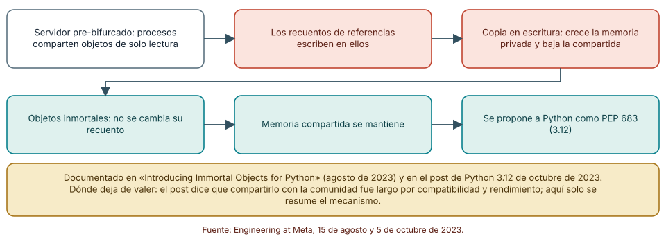

**Cómo leer la figura.** La fila superior es el problema y la inferior la solución. **Dónde deja de valer.** Resume dos posts y omite compatibilidad con otras plataformas.

**Documentado [I7], [I8].** Como Instagram opera uno de los mayores despliegues de Django, Meta decidió optimizar Python y publicó como código abierto Cinder, su runtime, una bifurcación de CPython, con optimizaciones como objetos inmortales, shadowcode (su término para caché en línea y quickening) y Static Python, además de un compilador JIT cuyo inlining de funciones describe el post de 2022. El nivel web de Instagram usa un servidor pre-bifurcado: procesos hijos que comparten como memoria de solo lectura los objetos que el padre cachea. Meta observó que la memoria privada de cada proceso crecía mientras la compartida disminuía, porque el recuento de referencias y el recolector de basura escriben en objetos que en la práctica son inmutables, y cada escritura obliga a copiar la página de memoria. La solución fueron los **objetos inmortales** (PEP 683): objetos que saltan las comprobaciones de recuento de referencias y viven toda la ejecución. Implementarlo dentro de Instagram fue sencillo por su entorno aislado; llevarlo a la comunidad fue largo por compatibilidad hacia atrás, de plataforma y de rendimiento, y la función se incorporó a Python 3.12 [I8].

**Qué enseña.** Una organización con una base de código enorme y muy específica puede preferir cambiar el runtime a reescribir el servicio: el coste de reescribir es mayor que el de mantener un fork o un parche, siempre que se pueda llevar lo útil a la comunidad. Es una lección sobre recolección de basura y memoria ([SE-021](../../classes/part-01-computadores-y-representacion-de-informacion/se-021-runtimes-maquinas-virtuales-y-recoleccion-de-basura/README.md)), compilación y JIT ([SE-020](../../classes/part-01-computadores-y-representacion-de-informacion/se-020-compilacion-interpretacion-bytecode-y-jit/README.md)) y medición de rendimiento ([SE-094](../../classes/part-07-estructuras-de-datos-y-algoritmos/se-094-complejidad-empirica-benchmarks-y-perfiles/README.md)).

### 6.7 Reutilización: Threads sobre la base de Instagram

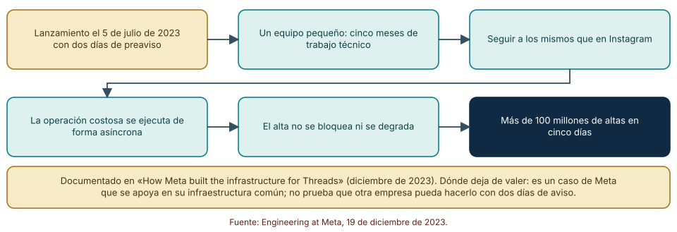

**Cómo leer la figura.** Cada caja es un hecho del lanzamiento. **Dónde deja de valer.** Es el post de una empresa que celebra su resultado; no reproduce los números internos de capacidad.

**Documentado [I10].** El 5 de julio de 2023 Meta lanzó Threads, que superó 100 millones de altas en sus cinco primeros días. Un equipo pequeño la construyó en cinco meses de trabajo técnico y las áreas de infraestructura recibieron solo dos días de aviso antes del lanzamiento. Para dejar que quien se une siga a las mismas personas que sigue en Instagram, la operación costosa de replicar ese grafo se ejecuta de forma asíncrona, lo que evita bloquear o degradar el alta. **Mecanismo.** Es un uso del procesamiento diferido ([SE-247](../../classes/part-20-backend-apis-y-procesamiento-asincrono/se-247-jobs-colas-y-procesamiento-diferido/README.md)): lo que no necesita responder ya se saca de la ruta crítica. **[No se sabe]** cuánto código de Instagram reutiliza Threads fuera de lo descrito en el post.

### 6.8 Seguridad, abuso y cumplimiento

**Documentado.** El 10-K de Meta trata la privacidad, la seguridad de los menores y la competencia como riesgos materiales para el negocio [I2]. **[No se sabe]** el diseño interno de identidad, moderación, cifrado y auditoría de Instagram: ningún documento consultado lo describe. La clase de privacidad por diseño ([SE-463](../../classes/part-38-seguridad-privacidad-y-cumplimiento/se-463-privacidad-por-diseno-y-minimizacion/README.md)) da el marco para analizarlo.

### 6.9 Observabilidad y operación

**No documentado.** Ninguna de las fuentes consultadas describe la observabilidad, las guardias o la gestión de incidentes específicas de Instagram; el caso lo declara en lugar de generalizar desde los posts de Slack o de Shopify. Lo documentado es indirecto: Instagram comparte con Meta la herramienta de escalado automático y la capacidad elástica [I9].

### 6.10 Evolución por etapas

**Etapas documentadas.** (1) Django y PostgreSQL fragmentado con identificadores propios (2011-2012). (2) Compra por Facebook y migración a sus centros de datos. (3) Cassandra, TAO y Memcached como pila principal y partición entre continentes (2018). (4) Escalado automático del nivel Django (2020). (5) Optimización del runtime con Cinder (2022) y objetos inmortales (2023). **Inferido.** Cada etapa responde a un límite de la anterior; no es un plan de arquitectura publicado.

### 6.11 Alternativas descartadas y trade-offs (análisis propio)

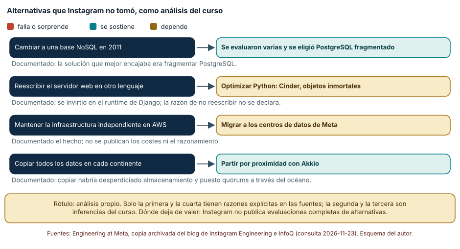

**Cómo leer la figura.** Cada tarjeta enfrenta una alternativa con lo que Instagram hizo y marca cuándo la razón es documentada. **Dónde deja de valer.** Solo la primera y la cuarta tienen razones explícitas.

**Rótulo: análisis propio.** Sobre PostgreSQL frente a NoSQL y sobre copiar o partir datos hay razones escritas por el equipo [I5], [I6]. Sobre reescribir Python o mantenerse en AWS hay hechos (se optimizó el runtime; se migró) pero no las razones; cualquier explicación es del curso. **[No se sabe]** si se consideró un lenguaje distinto de Python para el nivel web.

### 6.12 Hardware, software, infraestructura y fallos

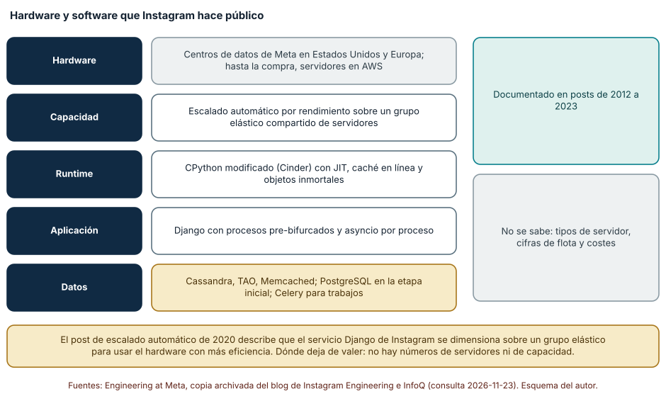

**Cómo leer la figura.** De arriba abajo, de lo lógico a lo físico. **Dónde deja de valer.** No hay datos de tipos de servidor ni de flota.

**Hardware utilizado.** **[No se sabe]** los modelos y cantidades de servidores. Lo documentado: centros de datos de Facebook en Estados Unidos y Europa después de la compra y AWS antes [I6].

**Software utilizado (documentado).** Django y Python (con el runtime Cinder), PostgreSQL en la etapa inicial, Cassandra, TAO, Memcached, Celery, el partidor hash social y Akkio [I5], [I6], [I7].

**Características de la infraestructura.** Nivel web sin estado; almacenes partidos por proximidad; maestros locales en TAO; 20 % de holgura por región; capacidad elástica con escalado automático [I6], [I9].

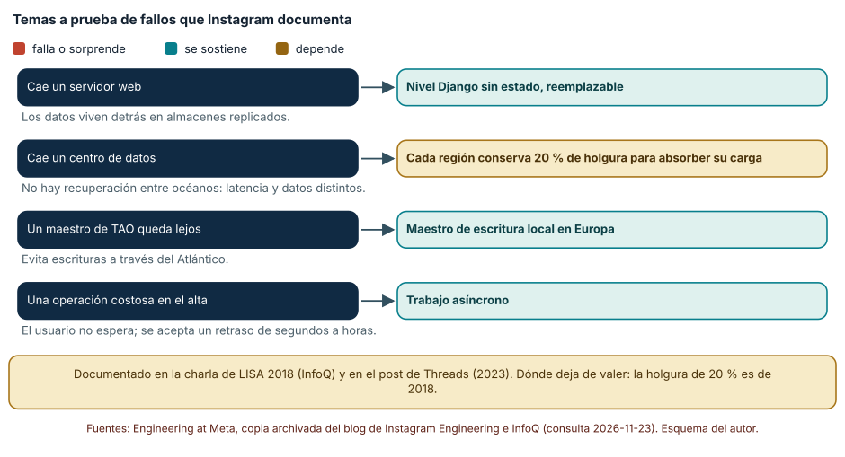

**Cómo leer la figura.** Cada tarjeta enlaza el fallo con el mecanismo que lo contiene. **Dónde deja de valer.** Son mecanismos descritos en 2018 y 2023.

**Temas a prueba de fallos.** Nivel web sin estado y reemplazable, holgura de 20 % por región, escrituras locales en TAO, trabajos asíncronos para operaciones costosas [I6], [I10].

## Casos especiales y cómo se resuelven

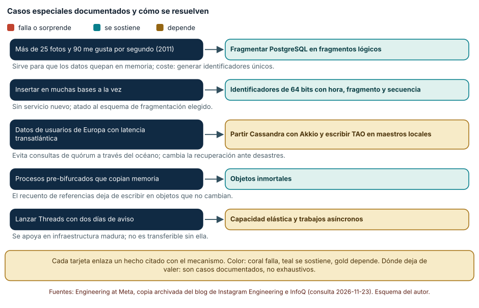

**Cómo leer la figura.** Cada tarjeta enfrenta una situación con lo que hizo el sistema; el color es el veredicto. **Dónde deja de valer.** Son casos documentados, no un catálogo.

1. **Crecimiento explosivo con pocos ingenieros.** Soluciones simples y pocas piezas móviles [I5].
2. **Identificadores en muchas bases.** Hora, fragmento y secuencia en 64 bits [I5].
3. **Latencia transatlántica.** Partir datos por proximidad con Akkio y escribir en maestros locales [I6].
4. **Memoria que crece en procesos hijos.** Objetos inmortales [I8].
5. **Alta masiva en Threads.** Trabajo asíncrono [I10].
6. **Cuentas con muchos seguidores.** Enrutado con hash social [I6]. **[No se sabe]** el detalle del reparto de contenido de cuentas muy populares.
7. **Pérdida de un centro de datos.** Holgura de 20 % por región [I6].

## Línea de tiempo

| Año o fecha | Hecho | Fuente |
| --- | --- | --- |
| 2010 | Se prueba Burbn; el 6 de octubre se lanza Instagram con unos 25 000 usuarios el primer día | [I3] |
| 2011-2012 | Fragmentación de PostgreSQL y diseño de identificadores de 64 bits | [I5] |
| Abril de 2012 | Versión para Android: más de 1 millón de usuarios en 24 horas; anuncio de la compra | [I3] |
| Agosto de 2012 | Facebook completa la compra de Instagram | [I1] |
| Diciembre de 2012 | Más de 100 millones de usuarios registrados | [I1] |
| Febrero de 2013 | 100 millones de usuarios mensuales | [I4] |
| 2018 | Charla de LISA: reparto entre Estados Unidos y Europa con Cassandra y TAO | [I6] |
| 2020 | El servicio Django entra en el escalado automático de Meta | [I9] |
| Mayo de 2022 | Meta describe el JIT de Cinder y el inlining de funciones | [I7] |
| Julio de 2023 | Lanzamiento de Threads | [I10] |
| Agosto de 2023 | Se publican los objetos inmortales | [I8] |
| Diciembre de 2025 | 3 580 millones de personas activas diarias en la familia de Meta | [I2] |

### Decisiones clave, giros y correcciones

- **Del check-in a las fotos (2010).** Un giro de producto: se conservó lo que los usuarios usaban de verdad [I3].
- **Fragmentar PostgreSQL en vez de pasar a NoSQL (2011).** Decisión de simplicidad documentada [I5].
- **Vender (2012).** Decisión estratégica de los fundadores; sus razones internas **no se saben**.
- **Migrar de AWS a la infraestructura de Facebook.** Decisión posterior a la compra; **[No se sabe]** su calendario ni su coste.
- **Optimizar el runtime en lugar de reescribir (2022-2023).** Corrección de rumbo hacia mejorar lo existente [I7], [I8].

## Vínculo con el curso

El caso muestra, en una plataforma real, mecanismos que el curso desarrolla con ejemplos controlados. Cada enlace dice qué ilustra el caso:

- [SE-355](../../classes/part-29-datos-persistencia-y-recuperacion/se-355-replicacion-particion-y-distribucion/README.md): réplica, partición y distribución. Fragmentos lógicos sobre servidores físicos.
- [SE-393](../../classes/part-32-concurrencia-y-sistemas-distribuidos/se-393-replicacion-sharding-y-balanceo/README.md): replicación, sharding y balanceo. Mover esquemas enteros a más servidores.
- [SE-390](../../classes/part-32-concurrencia-y-sistemas-distribuidos/se-390-consistencia-disponibilidad-y-particiones/README.md): consistencia, disponibilidad y particiones. El quórum de Cassandra frente a la latencia transatlántica.
- [SE-502](../../classes/part-41-observabilidad-sre-e-incidentes/se-502-continuidad-disaster-recovery-y-ejercicios/README.md): continuidad, recuperación ante desastres y ejercicios. La holgura de 20 % por región.
- [SE-404](../../classes/part-33-cloud-plataforma-e-infraestructura/se-404-escalado-capacidad-y-costos/README.md): escalado, capacidad y costos. El escalado automático del servicio Django.
- [SE-021](../../classes/part-01-computadores-y-representacion-de-informacion/se-021-runtimes-maquinas-virtuales-y-recoleccion-de-basura/README.md): runtimes y recolección de basura. Recuento de referencias y copia en escritura.
- [SE-020](../../classes/part-01-computadores-y-representacion-de-informacion/se-020-compilacion-interpretacion-bytecode-y-jit/README.md): compilación, interpretación y JIT. Cinder y su compilador JIT.
- [SE-094](../../classes/part-07-estructuras-de-datos-y-algoritmos/se-094-complejidad-empirica-benchmarks-y-perfiles/README.md): complejidad empírica y benchmarks. Medir antes de optimizar el runtime.
- [SE-247](../../classes/part-20-backend-apis-y-procesamiento-asincrono/se-247-jobs-colas-y-procesamiento-diferido/README.md): jobs, colas y procesamiento diferido. El alta asíncrona de Threads.
- [SE-346](../../classes/part-28-estilos-arquitectonicos/se-346-evolucion-y-migracion-entre-estilos/README.md): evolución y migración entre estilos. De AWS a la infraestructura de Meta.
- [SE-133](../../classes/part-11-economia-metricas-y-decisiones-de-producto/se-133-modelos-de-negocio-y-sostenibilidad/README.md): modelos de negocio. Una compra sin ingresos directos.
- [SE-134](../../classes/part-11-economia-metricas-y-decisiones-de-producto/se-134-costos-de-construccion-operacion-y-oportunidad/README.md): costos de construcción, operación y oportunidad. El precio de la compra y el coste de operar.
- [SE-463](../../classes/part-38-seguridad-privacidad-y-cumplimiento/se-463-privacidad-por-diseno-y-minimizacion/README.md): privacidad por diseño. El tratamiento de menores y datos como riesgo declarado.

### Preguntas de discusión

1. ¿Qué habría pasado con 13 bits de fragmento si la empresa hubiera necesitado más de 8 192 fragmentos lógicos? ¿Cómo se cambia un identificador ya desplegado?
2. Akkio parte datos de usuario por proximidad y TAO no. ¿Qué propiedad del modelo de datos decide cuál sirve?
3. ¿En qué condiciones optimizar el runtime de un lenguaje es mejor que reescribir en otro?
4. Meta no publica ingresos por aplicación. ¿Qué decisiones de producto serían difíciles de tomar sin esa cifra y cómo se estimaría?
5. ¿Qué riesgos tiene reutilizar el grafo social de una aplicación para lanzar otra?

### Mini-ejercicios de análisis

1. Calcule cuántos identificadores por segundo puede generar un fragmento lógico según el diseño de 41-13-10 bits.
2. Dibuje el camino de una petición de un usuario europeo hacia Django, Cassandra y TAO, y marque cuáles llamadas cruzan el océano.
3. Redacte tres hipótesis falsables sobre el valor de comprar una aplicación sin ingresos y cómo se comprobarían en 12 meses.

## Qué no generalizar

- **Que la simplicidad escala.** Funcionó con una aplicación de fotos en 2011-2012 y un equipo muy pequeño; no garantiza que otro producto con más tipos de datos escale igual.
- **Los identificadores de 64 bits.** Son una solución a un conjunto de requisitos concreto (ordenar por tiempo, caber en 64 bits, no añadir servicios) y ataron la fragmentación a una clave elegida en 2011.
- **La compra.** El éxito de la compra no se puede medir con las fuentes: Meta no publica los ingresos de Instagram. Que valga más de lo pagado es una inferencia, no un dato.
- **Que Django aguanta cualquier escala.** Instagram necesitó un runtime modificado (Cinder) y parches aceptados en Python para que funcionara con su nivel de tráfico.
- **La reutilización en Threads.** Se apoyó en una infraestructura de miles de ingenieros; una empresa pequeña no puede lanzar un producto en dos días de aviso.
- **Las fuentes.** Este caso depende de un post archivado, una charla resumida y posts corporativos; no sustituye al material original que no pudo verificarse.

## Fuentes públicas verificadas

Todas las URL siguientes se consultaron el 23 de noviembre de 2026 y devolvieron contenido (HTTP 200); la copia archivada del post de fragmentación se leyó a través de web.archive.org porque el dominio original no respondió.

- **[I1]** [Facebook, Form 10-K del año terminado el 31 de diciembre de 2012 (SEC)](https://www.sec.gov/Archives/edgar/data/1326801/000132680113000003/fb-12312012x10k.htm): compra de Instagram en agosto de 2012, precio contable, más de 100 millones de registrados, sin ingresos directos.
- **[I2]** [Meta Platforms, Form 10-K del año terminado el 31 de diciembre de 2025 (SEC)](https://www.sec.gov/Archives/edgar/data/1326801/000162828026003942/meta-20251231.htm): ingresos, publicidad, personas activas diarias, plantilla y descripción de Instagram.
- **[I3]** [From 0 To $1 Billion In Two Years: Instagram's Rose-Tinted Ride To Glory (TechCrunch, 9 de abril de 2012)](https://techcrunch.com/2012/04/09/instagram-story-facebook-acquisition/): Burbn, lanzamiento el 6 de octubre de 2010, 25 000 usuarios el primer día, Android.
- **[I4]** [Instagram Hits 100 Million Monthly Users 28 Months After Launch (TechCrunch, 26 de febrero de 2013)](https://techcrunch.com/?p=766134): 100 millones de usuarios mensuales y venta de 715 millones.
- **[I5]** [Sharding & IDs at Instagram (copia archivada del blog de Instagram Engineering)](https://web.archive.org/web/2023/https://instagram-engineering.com/sharding-ids-at-instagram-1cf5a71e5a5c): fragmentación de PostgreSQL e identificadores de 64 bits.
- **[I6]** [Splitting Stateful Services across Continents at Instagram (InfoQ, 29 de noviembre de 2018)](https://www.infoq.com/news/2018/11/instagram-across-continents/): pila, migración desde AWS, Akkio, TAO y holgura del 20 %.
- **[I7]** [How the Cinder JIT's function inliner helps us optimize Instagram (Engineering at Meta, mayo de 2022)](https://engineering.fb.com/2022/05/02/open-source/cinder-jits-instagram/): Cinder y uno de los mayores despliegues de Django.
- **[I8]** [Introducing Immortal Objects for Python (Engineering at Meta, agosto de 2023)](https://engineering.fb.com/2023/08/15/developer-tools/immortal-objects-for-python-instagram-meta/): servidor pre-bifurcado, copia en escritura y objetos inmortales.
- **[I9]** [Throughput autoscaling: Dynamic sizing for Facebook.com (Engineering at Meta, septiembre de 2020)](https://engineering.fb.com/2020/09/14/networking-traffic/throughput-autoscaling/): escalado automático del servicio Django de Instagram.
- **[I10]** [How Meta built the infrastructure for Threads (Engineering at Meta, diciembre de 2023)](https://engineering.fb.com/2023/12/19/core-infra/how-meta-built-the-infrastructure-for-threads/): lanzamiento, trabajo asíncrono y grafo de seguidores de Instagram.

[↑ Casos de éxito](README.md) · [← Shopify](shopify.md)
