# Mercado Libre

[↑ Casos de éxito](README.md) · [← Uber](uber.md) · [Amazon →](amazon.md)

> **Caso de éxito.** Mercado Libre nació en 1999 como un mercado en línea para Latinoamérica y hoy combina marketplace, pagos, logística, publicidad y crédito. En 2025 tuvo 121 millones de compradores únicos activos, 78 millones de usuarios mensuales de servicios financieros y ingresos de 28 893 millones de USD. Este caso explica qué se sabe, con fuentes, de su historia, negocio y tecnología, qué se infiere y qué no se sabe.

**Etiquetas.** **[Documentado]** = lo dice una fuente citada al final; **[Inferido]** = deducción del curso, puede ser falsa; **[No se sabe]** = no hay fuente pública consultada. Las cifras llevan año y fuente. No se reconstruye arquitectura confidencial. En los esquemas, trazo continuo es lo documentado y trazo punteado lo inferido; los apartados rotulados «análisis propio» son razonamiento del curso, no hechos.

**Cómo usar el caso.** Léalo después de las clases enlazadas en «Vínculo con el curso». La sección de arquitectura se recorre con zoom creciente: contexto, contenedores, componentes, secuencias, datos, despliegue, resiliencia, seguridad y cumplimiento, operación, evolución y alternativas. Al final hay preguntas y ejercicios para aplicar el método a un caso propio.

## Ficha histórica

| Dato | Valor | Fuente |
| --- | --- | --- |
| Nombre | MercadoLibre, Inc. (Mercado Libre) | [M1], [M2] |
| Fundación | En marzo de 1999 Marcos Galperín, cofundador y director ejecutivo, escribió el plan de negocio mientras cursaba un MBA en Stanford; la empresa se constituyó en Delaware en octubre de 1999 | [M1] |
| Otros cofundadores | **[No se sabe]** con las fuentes consultadas: el informe nombra a Galperín como cofundador y no lista a los demás | [M1] |
| Primer lanzamiento | Argentina, agosto de 1999; Brasil, octubre; México, noviembre; Uruguay, diciembre | [M1] |
| Financiación temprana | Ronda de 7,6 millones de USD en noviembre de 1999 y de 46,7 millones en mayo de 2000 | [M1] |
| Alianza con eBay | Septiembre de 2001: eBay pasó a ser accionista y Mercado Libre adquirió su filial brasileña iBazar | [M1] |
| Mercado Pago | Lanzado como producto de custodia (escrow) en Argentina en noviembre de 2003 | [M1] |
| Salida a bolsa | Agosto de 2007, Nasdaq; las acciones comenzaron a cotizar el 10 de agosto | [M1] |
| Sede | Montevideo, Uruguay (oficinas ejecutivas); el caso de Go la sitúa en Argentina, lo que refleja el origen | [M2], [M3] |
| Escala (2024) | Más de 100 millones de compradores únicos al año; ingresos netos del cuarto trimestre de 6 100 millones de USD; 61 millones de usuarios mensuales en fintech | [M4] |
| Escala (2025) | 121 millones de compradores únicos activos; 78 millones de usuarios mensuales de fintech; GMV de 65 037 millones de USD; volumen total de pagos de 277 823 millones; ingresos netos y financieros de 28 893 millones (+39 %); resultado operativo de 3 201 millones; 20 347 empleados de tecnología y desarrollo de producto | [M6] |
| Presencia | Marketplace en 18 países y Mercado Pago en 8; Brasil, Argentina y México suman 95,6 % de los ingresos de 2025 | [M6] |
| Estado actual | Sociedad cotizada con seis servicios integrados; en junio de 2025 presentó una solicitud de licencia bancaria en Argentina, en revisión a la fecha del 10-K | [M2], [M6] |

**Qué mide cada cifra.** «Compradores únicos activos» y «usuarios mensuales de fintech» son indicadores propios desde 2024: reemplazaron a «usuarios únicos activos» como indicadores de las líneas de comercio y de fintech, y el volumen de pagos (TPV) incluye cobros fuera del marketplace ([M6]). No son comparables con métricas de otras empresas sin revisar su definición.

### Oficinas, plantilla y estructura

**Oficinas (documentado).** La dirección de las oficinas ejecutivas del 10-K de 2025 es la Zona Franca WTC, Torre II, en Montevideo, Uruguay ([M6]). El mismo documento dice que arrienda instalaciones en distintos países de Latinoamérica para fines administrativos, de marketing, desarrollo de producto y envíos, y que todas las oficinas son arrendadas salvo una oficina argentina y las de Venezuela, que son propias ([M6]). **[No se sabe]** la lista de oficinas por ciudad, los centros de ingeniería con su año de apertura y la superficie total.

**Plantilla (documentado).** El 10-K de 2025 informa 20 347 empleados de tecnología y desarrollo de producto al 31 de diciembre de 2025, 11 % más que los 18 282 de 2024 ([M6]); el de 2022, 13 856 frente a 9 471 en 2021 ([M2]). **[No se sabe]** la plantilla total, por país y por función en las fuentes consultadas.

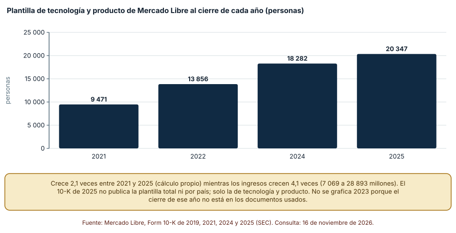

**Cómo leer la figura.** Cada barra es un cierre de año; la altura es el número de personas de tecnología y producto. Mire el ritmo: en 2021-2022 sumó unas 4 400 personas y en 2024-2025 unas 2 100. **Dónde deja de valer.** Falta 2023 y no incluye al resto de la plantilla; no es un organigrama.

**Estructura (documentado).** Seis servicios integrados (marketplace, pagos, envíos, publicidad, crédito y la plataforma) y un equipo dividido en «celdas» autónomas con su hardware, datos y código ([M2], [M6]). El 10-K lo describe como una sola sociedad con segmentos geográficos de informe (Brasil, México, Argentina y otros países) ([M6]). **[No se sabe]** el organigrama de alto nivel y cuántas celdas hay.

## Contexto y problema

**Documentado.** El informe anual de 2022 describe una región con más de 650 millones de personas y uno de los crecimientos de internet y comercio electrónico más rápidos, con «desafíos culturales y geográficos» propios para operar una plataforma de comercio ([M2]). El de 2007 resume lo que se hizo al principio: una misma plataforma tecnológica en todos los países y un marketplace separado por país, sin interacción entre ellos ([M1]).

El problema de fondo era de confianza y de infraestructura: comprador y vendedor no se conocen, pagar a un desconocido es arriesgado y entregar un paquete en la región es difícil. Mercado Pago nació para dar confianza en el pago (el informe dice que «llevó confianza a la relación comerciante-consumidor» ([M2])) y Mercado Envíos para controlar la experiencia completa ([M2]). **[Inferido]** que cada servicio se creó para quitar la fricción que frenaba al anterior; el informe lo sugiere pero no lo formula así.

Cuando Mercado Pago empezó, el informe de 2007 lo describe como un producto de custodia; el de 2022, como un ecosistema financiero completo, incluidos terminales de cobro, QR, billetera, tarjetas, crédito, seguros y ahorro ([M1], [M2]). También observaron que muchas transacciones físicas seguían liquidándose en efectivo y que individuos y pymes estaban desatendidos por proveedores tradicionales ([M2]).

### Cómo era el comercio antes (análisis propio sobre hechos documentados)

El 10-K de 2025 describe una competencia con operadores de marketplace, empresas que venden directo al consumidor, comercios físicos con oferta en línea y, en fintech, proveedores de pagos y bancos digitales; la competencia crece con jugadores locales y con entrantes internacionales, sobre todo en Brasil y México ([M6]). **Inferido:** en 1999 la ineficiencia a resolver era doble. Primero, de descubrimiento: un comprador no podía encontrar a un vendedor fuera de su barrio. Segundo, de confianza: sin tarjetas extendidas ni logística fiable, cada transacción entre desconocidos era un riesgo. El marketplace atacó el primero; Mercado Pago y Mercado Envíos, el segundo.

### La apuesta, formulada como hipótesis

El curso propone leer la apuesta como tres hipótesis comprobables ([SE-124](../../classes/part-10-descubrimiento-y-estrategia-de-producto/se-124-hipotesis-supuestos-y-preguntas-criticas/README.md)): (1) un marketplace local replicado por país, con una plataforma común, crecerá más rápido que uno regional centralizado; (2) pago y envío integrados vuelven el marketplace más confiable y más difícil de copiar; (3) los datos de pago permiten ofrecer crédito con riesgo controlable. Los criterios de fracaso: si el marketplace por país no alcanza masa crítica, si el coste de logística supera lo que el comprador paga, o si las pérdidas por crédito superan su ingreso. Es una formulación del curso; la empresa no publica sus hipótesis internas.

## Mercado, usuarios y casos de uso

| Rol | Qué hace y qué gana | Qué cambia en su experiencia | Respaldo |
| --- | --- | --- | --- |
| Comprador | Compra en el marketplace, paga con Mercado Pago, recibe por Mercado Envíos | Programa de Protección al Comprador; puntos y niveles de lealtad; cuotas | [M2], [M6] |
| Vendedor | Publica, cobra y envía; paga comisiones por transacción | Puede usar cumplimiento y almacenamiento de Mercado Libre; crea una tienda en Mercado Shops sin coste | [M2] |
| Anunciante | Promociona productos con Mercado Ads | Anuncios en búsquedas, banners y productos sugeridos | [M2] |
| Usuario de servicios financieros | Billetera, tarjetas, crédito, inversión | Ahorro con retiro rápido; crédito dentro y fuera del marketplace | [M2], [M6] |
| Desarrollador externo | Integra el marketplace y Mercado Pago por API | Documentación pública: OAuth, notificaciones (webhooks e IPN), cuentas y tarjetas de prueba | [M2], [M5] |
| Transportista y tienda aliada | Presta transporte o recibe y entrega paquetes (MELI Places) | Red de miles de tiendas y transporte de terceros | [M6] |
| Equipos internos | Construyen servicios sobre una plataforma común | Celdas autónomas y plataforma interna | [M2], [M3] |
| Autoridades financieras y de competencia | Regulan pagos, lavado de activos, secreto bancario y competencia | Una autoridad de México revisó el funcionamiento de algoritmos de la «caja de compra» y la integración logística, sin imponer medidas | [M2], [M6] |

**Alcance geográfico.** El informe de 2022 lista el marketplace en varios países, con Mercado Pago, Mercado Envíos y Mercado Crédito en distintas combinaciones según el país ([M2]). Brasil, Argentina y México concentraron el 95,2 % de los ingresos netos de 2022 ([M2]) y el 95,6 % en 2025 ([M6]).

### Quién da qué a quién

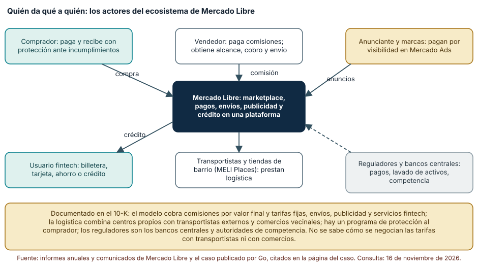

**Cómo leer la figura.** Mercado Libre está en el centro porque integra todos los flujos. Mire que el comprador y el vendedor pagan cosas distintas (la compra y la comisión) a la misma plataforma, y que el crédito vuelve al usuario como un producto financiero. **Dónde deja de valer.** No muestra magnitudes ni contratos con transportistas o comercios; la flecha punteada a reguladores solo indica que existen obligaciones.

### Incentivos por tipo de usuario (análisis propio sobre hechos documentados)

- **Comprador.** Busca precio y certeza de entrega; el programa de protección le reduce el riesgo de comprar a un desconocido, y las cuotas le permiten pagar a plazo: en 2025 las cuotas fueron 19,0 % del volumen de pagos de Mercado Pago ([M6]).
- **Vendedor.** Busca alcance y logística sin montarla; el cumplimiento propio resuelve el almacenamiento y el despacho, y por eso más de la mitad de los envíos salen de centros de cumplimiento ([M6]).
- **Usuario fintech.** Busca una cuenta, un medio de pago y crédito; el incentivo de la empresa es que el uso de pagos alimente el crédito ([M6]).
- **Anunciante.** Quiere visibilidad ante un comprador con intención; Mercado Ads vende esa posición ([M2]).
- **Transportista.** Obtiene volumen; la mayoría de los vehículos de última milla pertenecen a terceros ([M6]).
- **Regulador.** Busca estabilidad financiera y competencia: un banco central supervisa a Mercado Pago, y la autoridad de competencia mexicana revisó el marketplace ([M6]).

### Competencia y por qué el mercado favoreció a Mercado Libre (análisis propio)

El 10-K afirma que su plataforma de comercio es líder de la región por valor vendido y que su plataforma fintech es líder en usuarios mensuales entre las empresas fintech de Argentina, Chile y México y la segunda de Brasil ([M6]). La razón no está declarada. El análisis propio del curso plantea cuatro factores combinados: (1) llegada temprana, con 1999 como año de fundación y varios años de ventaja local; (2) una estrategia de marketplace por país con plataforma tecnológica común, que adapta cada mercado y reutiliza el sistema; (3) la integración de pagos y logística, que reduce la fricción de confianza y de entrega; (4) la alianza con eBay en 2001, que dio capital y presencia en Brasil ([M1]). **[No se sabe]** cuánto pesa cada uno ni si habría ocurrido lo mismo con otra secuencia.

## Funcionalidad de principio a fin

### Recorrido del comprador

1. **Primer contacto.** El comprador llega por búsqueda, anuncio o campañas de fechas comerciales como Hot Sale, Cyber Monday y Black Friday ([M2]).
2. **Registro.** **[Documentado]** que cualquier usuario registrado puede enviar y recibir pagos digitales y pagar compras en el marketplace ([M2]). **[No se sabe]** el proceso de verificación.
3. **Publicar (vendedor).** Lista mercadería; el marketplace está «totalmente automatizado» y organizado por temas ([M2]).
4. **Comprar y pagar.** Mercado Pago procesa y liquida todas las transacciones del marketplace en Argentina, Brasil, México, Chile, Colombia, Uruguay y Perú ([M2]). Admite cuotas, financiadas directamente o vendidas como activos ([M2]).
5. **Enviar.** Mercado Envíos permite usar transportistas externos y servicios propios de cumplimiento y almacenamiento; en 2020 se lanzó Meli Air con aviones dedicados y existe una red de comercios vecinales («Meli Places») para dejar y recoger paquetes ([M2]). Más del 95 % de los envíos del cuarto trimestre de 2024 se completó dentro de la red gestionada y el 49 % llegó el mismo día o al siguiente ([M4]).
6. **Soporte y reclamos.** El Programa de Protección al Comprador cubre casos de no recibir o recibir mal lo comprado, con reembolsos que pueden crecer al ampliarse la cobertura ([M2]).
7. **Operación diaria.** Para el vendedor, el panel de ventas, publicidad y envíos; detrás, las celdas y la plataforma de la sección de arquitectura.

### Recorridos por tipo de usuario

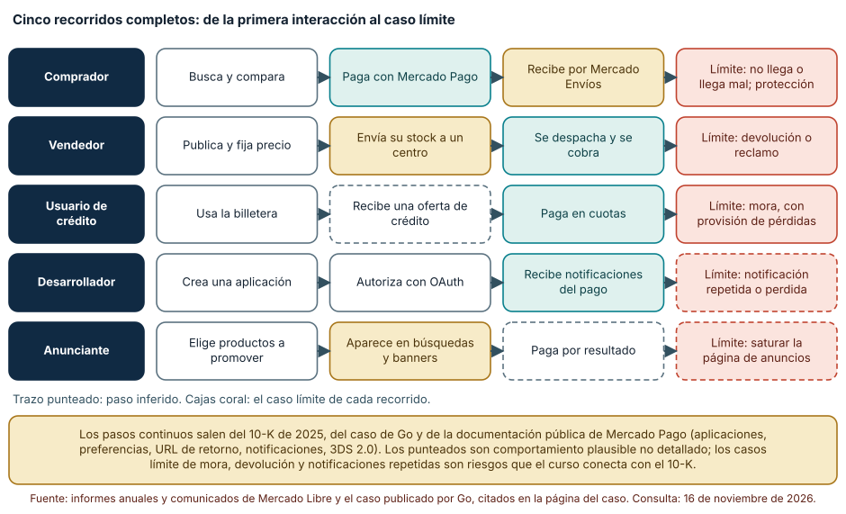

**Cómo leer la figura.** Cada fila es un usuario distinto; las cajas se leen de izquierda a derecha y la coral final es el caso límite. Los trazos punteados son pasos inferidos. Mire qué filas tienen pasos punteados: crédito y anunciante, los dos recorridos donde la empresa publica menos mecanismo. **Dónde deja de valer.** Es un recorrido visible, no un diagrama de estados; no mide cuántos usuarios llegan a cada caso límite.

**Vendedor que usa el cumplimiento.** **[Documentado]** que el vendedor deja su inventario en bodegas de la empresa o entrega cada artículo vendido en una tienda aliada, y que los centros de cumplimiento atienden más de la mitad de los envíos ([M6]). El caso límite es la devolución: las tiendas aliadas también sirven para recogerla y procesarla ([M6]), pero el coste del flujo inverso no se publica.

**Usuario de crédito.** **[Documentado]** que el crédito es una línea de ingreso grande (5 858 millones en 2025) y que el 10-K atribuye el aumento de la provisión para cuentas dudosas a la expansión de la cartera de tarjetas de crédito ([M6]). El caso límite es la mora: la provisión de 2025 fue de 3 091 millones, 53 % de los ingresos de crédito (cálculo propio). **[No se sabe]** cómo se decide la oferta a cada persona.

**Desarrollador externo.** **[Documentado]** que la guía pública cubre crear una aplicación, una preferencia de pago, URL de retorno, notificaciones y una compra de prueba, con 3DS 2.0, prevención de fraude y alineación con OWASP y PCI DSS ([M5]). El caso límite, inferido, es la notificación repetida o perdida: quien integra debe tolerar duplicados y consultar el estado antes de actuar, porque una notificación asíncrona no garantiza una sola entrega ([SE-246](../../classes/part-20-backend-apis-y-procesamiento-asincrono/se-246-idempotencia-reintentos-y-deduplicacion/README.md), [SE-379](../../classes/part-31-integracion-eventos-y-mensajeria/se-379-webhooks-polling-y-suscripciones/README.md)).

**Anunciante.** **[Documentado]** que Mercado Ads ofrece anuncios en búsquedas, banners y productos sugeridos ([M2]). **[No se sabe]** cómo se asignan ni cómo se mide cada anuncio.

## Negocio y economía

**Modelo (documentado).** Dos grandes fuentes: comercio, con servicios (comisiones por valor final y tarifas fijas, envíos netos de costos de transportistas, clasificados, publicidad) y venta de producto propio; y fintech, con comisiones fuera de la plataforma, cuotas, tarjetas, seguros, intereses de crédito y venta de terminales ([M2]). Antes de 2019 la empresa informaba por «mercado mejorado» y «no mercado»: en 2019, 1 199 y 1 097 millones de USD ([M7]).

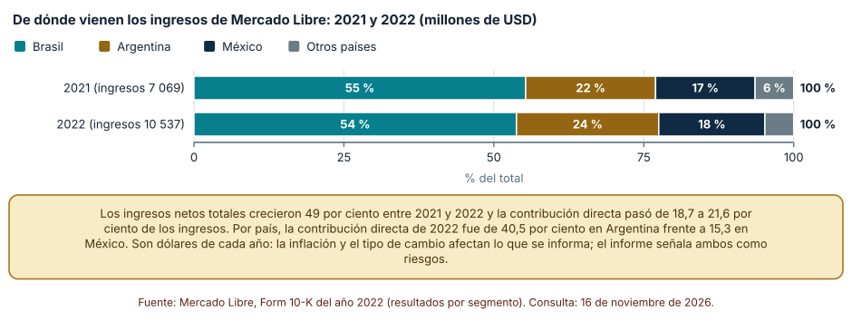

**Cómo leer la figura.** Cada barra es un año reducido a 100 %; los segmentos son países. Mire primero el tamaño de Brasil y luego cuánto crecen Argentina y México. **Dónde deja de valer.** Son dólares de cada año: inflación y tipo de cambio mueven la composición, y el informe los cita como riesgos. No muestra la rentabilidad por país (la nota da la contribución directa, 40,5 % en Argentina y 15,3 % en México en 2022).

**Cifras.** En 2022 los ingresos netos fueron de 10 537 millones de USD (7 069 en 2021, +49 %), con una contribución directa de 21,6 % ([M2]). En el cuarto trimestre de 2024: ingresos netos de 6 100 millones (+37 %), valor vendido (GMV) de 14 500 millones, volumen de pagos (TPV) de 59 000 millones, activos bajo gestión de 10 600 millones y cartera de crédito de 6 600 millones ([M4]). El TPV incluye cobros fuera del marketplace, por eso supera al GMV. En el año 2025, el 10-K da 28 893 millones de ingresos netos y financieros (+39,1 %), 20 777 en 2024 y 15 107 en 2023 recompuestos por un cambio de presentación ([M6]).

### Escala en el tiempo

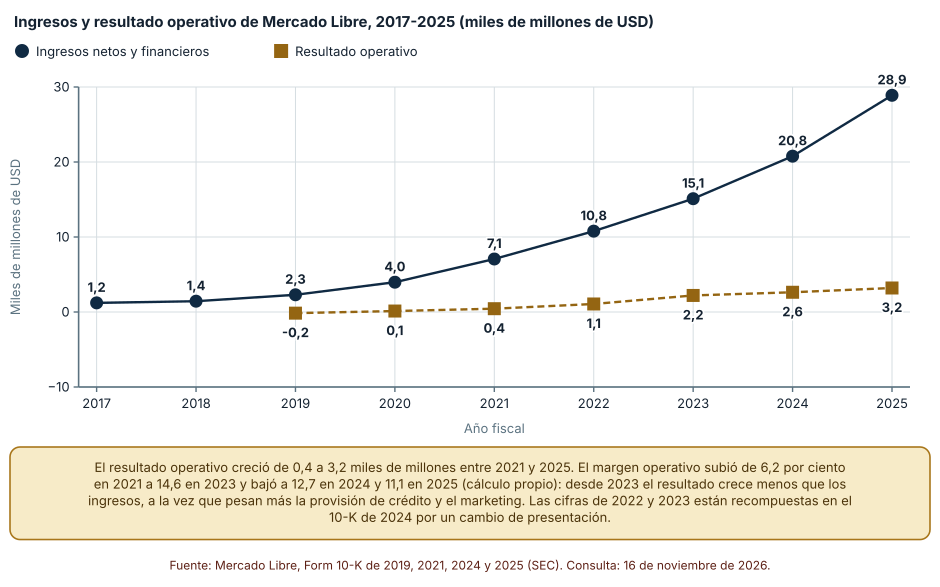

**Cómo leer la figura.** El eje horizontal es el año fiscal y el vertical los miles de millones de USD; la línea azul son ingresos y la dorada resultado operativo. Mire cómo la línea dorada nace de un valor negativo en 2019 y cómo la distancia entre ambas crece. **Dónde deja de valer.** Las cifras de 2022 y 2023 están recompuestas por un cambio de presentación; antes de 2019 el informe usaba otra estructura; y el resultado operativo no incluye el efecto de cambio de moneda, que en 2025 costó 337 millones ([M6]).

**Margen operativo (cálculo propio con los 10-K).** 6,2 % en 2021 (440,7 sobre 7 069,4, [M8]), 9,9 % en 2022 (1 069 sobre 10 780 recompuestos, [M10]), 14,6 % en 2023, 12,7 % en 2024 y 11,1 % en 2025 ([M6]). El 10-K de 2025 explica la baja de 2025 por la reducción del umbral de envío gratis en Brasil, el aumento de la provisión de cuentas dudosas por la expansión de las tarjetas de crédito y el coste de ingresos, con efectos parcialmente compensados por menos gasto relativo de desarrollo y administración ([M6]); y el margen bruto bajó de 46,1 % en 2024 a 44,5 % en 2025 ([M6]).

### Qué pasa en los cuatro grandes bloques de ingresos

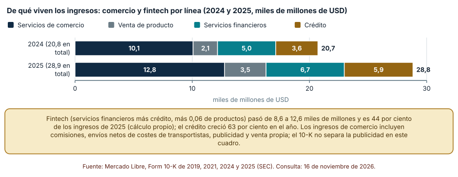

**Cómo leer la figura.** Cada barra es un año; los segmentos son líneas de ingresos. Compare el segmento dorado (crédito): crece más rápido que los demás. **Dónde deja de valer.** Mide ingresos, no márgenes: el crédito tiene un coste de provisión alto, y la venta de producto un margen bajo. Tampoco separa la publicidad.

En 2025 el comercio aportó 16 294 millones (12 750 en servicios y 3 544 en venta de producto) y fintech 12 599 millones (6 678 en servicios financieros, 5 858 en crédito y 63 en productos) ([M6]). Fintech es el 44 % de los ingresos (cálculo propio). El propio 10-K advierte que la venta de bienes tiene un margen puro más bajo y que, si sigue creciendo, el margen bruto puede seguir cayendo ([M6]).

### Unit economics con cifras citadas

**Pagos que crecen más que las ventas.** El volumen total de pagos pasó de 5 184 millones de USD en 2015 a 28 390 en 2019 y a 277 823 en 2025, mientras el valor vendido pasó de 7 151 a 13 997 y a 65 037 ([M7], [M6]).

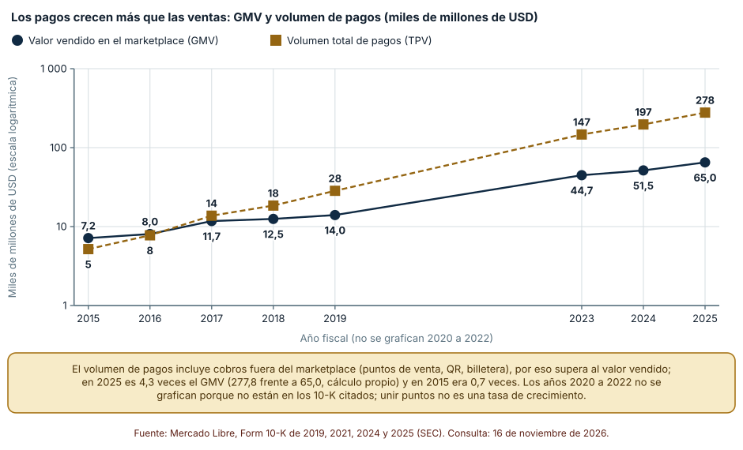

**Cómo leer la figura.** Cada línea es una magnitud en miles de millones de USD en escala logarítmica; la dorada son los pagos y la azul las ventas. Mire el momento en que se cruzan, 2017, y cómo después se separan. **Dónde deja de valer.** No se grafican 2020 a 2022, y el volumen de pagos incluye cobros fuera del marketplace (el volumen de adquirencia fue 188 105 millones en 2025, [M6]); no es una medida de comisiones ni de ingresos.

**El crédito: crecer y reservar.** Los ingresos por crédito pasaron de 2 546 millones en 2023 a 3 600 en 2024 y 5 858 en 2025; la provisión para cuentas dudosas, de 1 050 a 1 858 y 3 091 ([M6]).

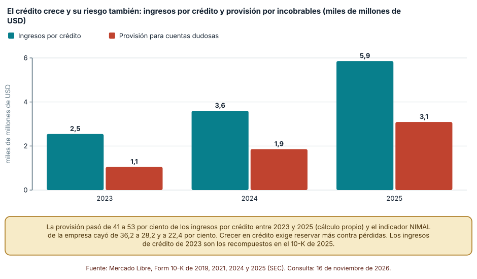

**Cómo leer la figura.** Cada grupo es un año; la barra teal son los ingresos por crédito y la coral lo que se reserva contra pérdidas. Compare la altura relativa de la coral: sube de 41 % a 53 % de la teal. **Dónde deja de valer.** La provisión es una estimación contable de pérdidas esperadas y no la pérdida realizada; la cifra de 2023 es la recompuesta en el 10-K de 2025; y el indicador de la empresa, el margen de interés neto tras pérdidas (NIMAL), bajó de 36,2 % a 28,2 % y a 22,4 % entre 2023 y 2025 ([M6]).

**Costos y costes de logística.** El 10-K define el coste de ingresos como principalmente envíos y bodegas, transportistas, coste de bienes vendidos, comisiones de cobro, impuestos de ventas, costes de fondeo del negocio fintech, prevención de fraude y alojamiento ([M6]). **[No se sabe]** el coste por envío. **[Documentado]** que el gasto en marketing de 2025 fue de 3 219 millones (2 191 en 2024) y el de desarrollo de producto y tecnología de 2 269 (1 934) ([M6]); la plantilla de tecnología y producto fue de 20 347 personas, 11 % más que a fines de 2024 ([M6]) y 13 856 a fines de 2022 ([M2]).

**Efectos de red y escala (análisis propio).** El marketplace tiene efectos de red clásicos entre compradores y vendedores: más vendedores atraen compradores y viceversa. Lo que añade el ecosistema es un efecto entre servicios: el pago reduce la fricción del marketplace, el envío mejora la entrega, los datos de pago alimentan el crédito, y el crédito sostiene el consumo. La consecuencia es que un competidor debe replicar varias piezas a la vez; el coste es que la empresa debe financiar y operar todas ellas, incluida una logística de capital intensivo.

**Moneda e inflación.** Brasil, Argentina y México dan 95,6 % de los ingresos de 2025; 52,6 % se denominan en reales, 22,4 % en pesos mexicanos y 20,6 % en pesos argentinos ([M6]). La inflación de 2025 fue 4,3 % en Brasil, 3,7 % en México y 31,5 % en Argentina, y la argentina fue 117,8 % en 2024 y 211,4 % en 2023; Argentina es economía altamente inflacionaria desde el 1 de julio de 2018 y su subsidiaria reporta en dólares ([M6]).

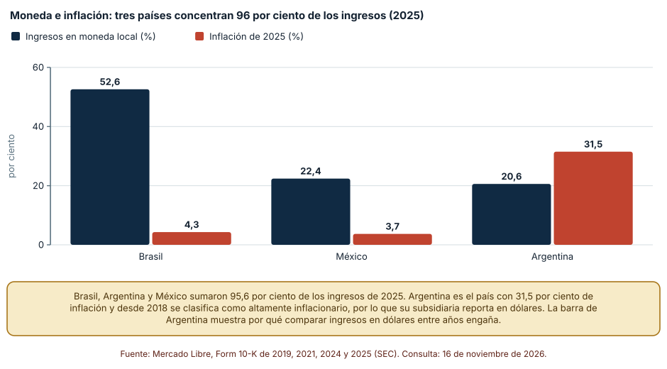

**Cómo leer la figura.** Cada grupo es un país; la barra azul es la parte de los ingresos denominada en su moneda y la coral la inflación del año. Mire a Argentina: casi tanta inflación como ingresos locales. **Dónde deja de valer.** Dos magnitudes distintas en la misma escala porcentual; no dicen nada del efecto en los resultados, que el 10-K cuantifica aparte con sensibilidades de cambio.

**Ventajas (documentado por la empresa).** Un ecosistema donde cada componente refuerza a los demás ([M4]) y una logística propia que controla la experiencia. **[Inferido]** que la combinación de comercio, pago y envío dificulta que un competidor replique solo una pieza.

### Esquema del negocio: flujos de dinero y de valor

**Cómo leer la figura.** A la izquierda, las cuatro corrientes que aportan ingresos; en el centro, la empresa; a la derecha, cómo se reparten los 28 893 millones de 2025. Mire la caja coral: una de cada diez unidades de ingreso se reserva contra pérdidas de crédito. **Dónde deja de valer.** Las corrientes no están cuantificadas por separado en esta figura (ver la de ingresos por línea) y el costo de ingresos mezcla logística, bienes vendidos y fondeo.

**Flujo de valor.** El comprador obtiene confianza y entrega; el vendedor, alcance, cobro y envío; el usuario financiero, una cuenta y crédito; la empresa, comisiones, intereses y publicidad ([M2], [M6]). El valor viaja entre servicios: el pago reduce la fricción del marketplace y alimenta el crédito. **[No se sabe]** las comisiones por categoría y país.

### Visión, misión y estrategia

**Documentado.** El 10-K de 2025 se presenta como el ecosistema líder de comercio en línea y fintech de Latinoamérica: la plataforma de comercio es líder de la región por valor vendido y la fintech, líder en usuarios mensuales entre las empresas fintech de Argentina, Chile y México y segunda en Brasil ([M6]). Las estrategias que enumera incluyen aumentar la monetización de las transacciones de la plataforma (estructura de comisiones, publicidad, servicios adicionales y venta cruzada de servicios financieros) y aprovechar las sinergias naturales entre servicios para crear un ecosistema integrado ([M6]); el informe de 2022 había descrito el uso de pagos para llevar confianza a la relación entre comerciante y consumidor ([M2]). **[No se sabe]** un texto de misión formal con fecha de adopción en las fuentes consultadas; por eso se cita la estrategia declarada.

**Evolución.** De un marketplace por país con plataforma común (2007) ([M1]) a un ecosistema con pagos, envíos, publicidad y crédito (2022) ([M2]) y a un ecosistema que solicita una licencia bancaria en Argentina (2025) ([M6]).

### Costos operativos

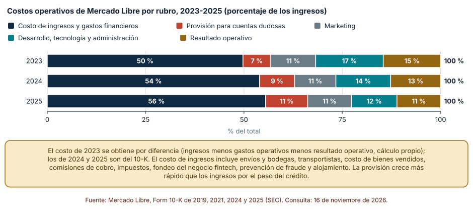

**Cómo leer la figura.** Cada barra es un año de ingresos reducido a 100 %. Mire los dos segmentos que suben (costo de ingresos, azul, y provisión, coral) y el dorado que baja (resultado). **Dónde deja de valer.** Son rubros contables: el costo de 2023 está calculado por diferencia, y los ingresos de 2023 son los recompuestos por un cambio de presentación.

**Cifras de 2025 ([M6]).** Costo de ingresos y gastos financieros de 16 035 millones (55,5 %); provisión para cuentas dudosas de 3 091 (10,7 %); marketing de 3 219; desarrollo de producto y tecnología de 2 269; administración de 1 078; resultado operativo de 3 201 (11,1 %), con un efecto de cambio de moneda de menos 337 millones en otros resultados. **Margen bruto:** 44,5 % en 2025 y 46,1 % en 2024 ([M6]). **Por qué baja el margen (documentado):** la reducción del umbral de envío gratis en Brasil, el aumento de la provisión por la expansión de las tarjetas de crédito y el crecimiento de la venta de bienes, de menor margen ([M6]). **[No se sabe]** el costo de infraestructura por separado, el de soporte y el de pagos.

### Competidores

**Documentado.** El 10-K de 2025 dice que Mercado Libre es hoy líder en varios de los mercados donde opera y que compite actual o potencialmente con operadores de marketplace, empresas que venden directo al consumidor, enfocadas en categorías verticales y comercios físicos con oferta en línea; que la competencia se ha intensificado con el crecimiento de actores locales y la expansión de internacionales, sobre todo en Brasil y México; y que en fintech crecen varias empresas establecidas en Latinoamérica ([M6]). En México, una autoridad analizó posibles preocupaciones sobre los algoritmos de la caja de compra y la integración logística de Amazon México y Mercado Libre, sin imponer medidas ([M6]).

**[No se sabe]** con fuente primaria la cuota de mercado por competidor y país en estos documentos. **Análisis propio** de por qué el mercado favoreció a Mercado Libre: llegada temprana, integración de pagos y logística, y marketplace por país con plataforma común (ver «Competencia»); es hipótesis.

## Arquitectura y esquemas

La arquitectura se recorre con zoom creciente. La regla de fondo: lo que Mercado Libre publica describe un momento (2007, 2019, 2022, 2025) y casi nunca el diseño interno concreto.

### 6.1 Contexto

**Cómo leer la figura.** A la izquierda están las personas; el recuadro grande es el ecosistema. Las flechas muestran el uso principal. **Dónde deja de valer.** No muestra el reparto de tráfico entre servicios, ni países, ni sistemas internos.

### 6.2 Contenedores

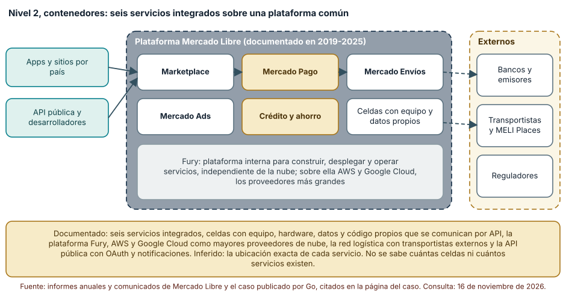

**Cómo leer la figura.** Cada caja es una pieza. Las aplicaciones y la API entran al ecosistema; los seis servicios se apoyan en las celdas y estas en Fury, que corre sobre las nubes; a la derecha, los externos con los que se integra. **Dónde deja de valer.** Es el nivel de contenedores del modelo C4 con fuentes públicas: no hay nombres de servicios concretos ni número de celdas, y las flechas a externos son indicaciones.

### 6.3 Componentes

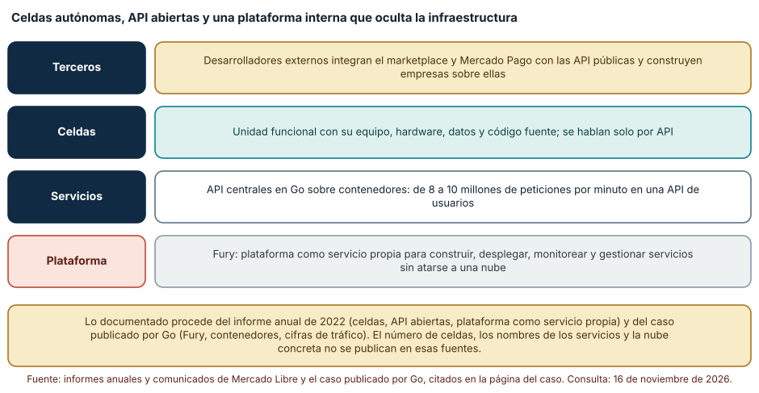

**Cómo leer la figura.** Cada fila es una capa, de la más externa (terceros) a la más interna (plataforma). **Dónde deja de valer.** Es la foto de 2019 (caso de Go) y 2022 (informe), no un inventario actual.

**Documentado.** El informe de 2022 dice que pasaron de un sistema cerrado y monolítico a uno abierto y desacoplado: dividieron los equipos en «celdas», cada una con su equipo, hardware, datos y código fuente, que interactúan por API; abrieron la plataforma a terceros y construyeron una plataforma como servicio propia que reduce la carga cognitiva de gestionar infraestructura y red ([M2]). El caso publicado por Go cuenta que en 2015 la pila de Groovy y Grails llegaba a su límite, con pruebas, compilaciones y despliegues lentos, y que se pasó a Go: un servicio grande redujo sus servidores de 32 a 4 (88 %) y los núcleos por servidor de 4 a 2, y sirve 70 000 peticiones por máquina con 20 MB de memoria; las compilaciones son tres veces más rápidas y la suite de pruebas pasó de 90 a 3 segundos; las aplicaciones en Go atienden aproximadamente la mitad del tráfico ([M3]). Fury, la plataforma como servicio, permite construir, desplegar, monitorear y gestionar servicios de forma independiente de la nube, con plantillas de servicios en Go, repositorios iniciales, imágenes de Docker y canalizaciones de despliegue ([M3]).

**Cómo leer la figura.** El punto vacío es antes y el lleno después; cuanto más largo el segmento, mayor la reducción. Fíjese en que el eje es logarítmico. **Dónde deja de valer.** Es un único servicio elegido por un caso publicado por el proyecto Go; los núcleos totales son un producto de dos cifras, no una medida, y no incluyen el coste de reescribir.

**Escala del tráfico.** Una API de usuarios recibe entre 8 y 10 millones de peticiones por minuto con respuestas de menos de 10 ms, y las mayores superan 20 millones por minuto ([M3]). Centros de datos: el 10-K de 2025 dice que depende de sus proveedores de nube, los mayores AWS y Google Cloud ([M6]); **[No se sabe]** el reparto exacto.

**Qué documenta cada servicio.**

- **Marketplace.** Totalmente automatizado y organizado por temas ([M2]).
- **Mercado Pago.** Procesa y liquida las transacciones del marketplace y también cobros fuera de él; en Brasil participa en Pix y en arreglos de tarjetas y forma parte de Open Finance desde 2021 ([M6]).
- **Mercado Envíos.** Ver 6.5.
- **Mercado Ads.** Anuncios dentro del marketplace ([M2]).
- **Crédito.** Un producto financiero propio con fondeo mixto, que puede venderse como activos o financiarse con deuda ([M6]).
- **Plataforma.** Celdas y Fury ([M2], [M3]).

### 6.4 Secuencias de las operaciones críticas

**Operación 1: una compra.**

**Cómo leer la figura.** De izquierda a derecha. Las cajas azules son el pago, las doradas la logística; las punteadas son inferidas. **Dónde deja de valer.** No describe cuándo se libera el dinero al vendedor ni las reglas de reclamos: no están en las fuentes consultadas.

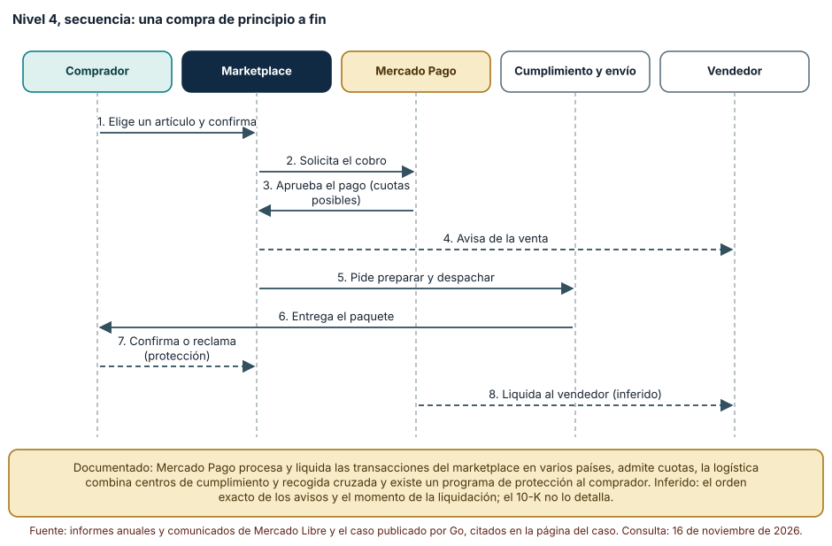

**Cómo leer la figura.** Cada columna es un participante; el tiempo baja. Las flechas punteadas son inferidas. Mire que el pago se aprueba antes de preparar el envío, por el diseño de cobro previo. **Dónde deja de valer.** Un diagrama de secuencia sugiere un único orden; la realidad incluye pagos en varias cuotas, reintentos, cancelaciones y devoluciones.

**Operación 2: un cobro con Checkout Pro.**

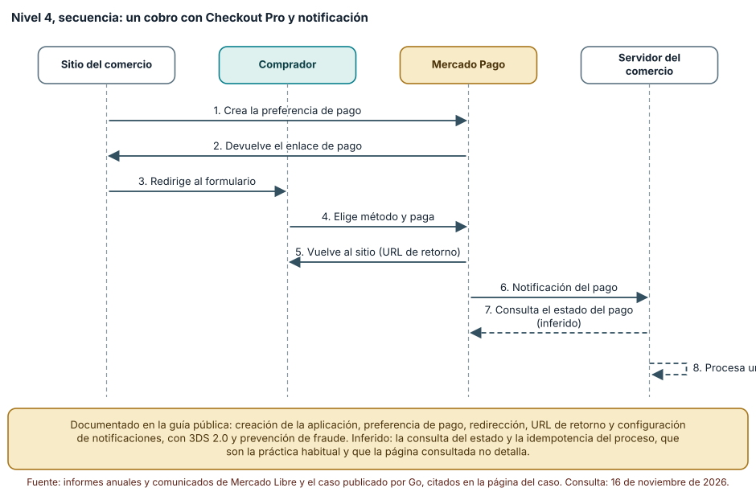

**Cómo leer la figura.** Cuatro participantes: el sitio del comercio, el comprador, Mercado Pago y el servidor del comercio. Las dos últimas flechas, punteadas, son prácticas inferidas. Mire que el regreso del comprador y la notificación son dos caminos distintos. **Dónde deja de valer.** La guía consultada solo detalla las etapas de integración (preferencia, URL de retorno, notificaciones) y no la forma de verificar el estado; la verificación y la idempotencia son prácticas recomendadas por el curso ([SE-246](../../classes/part-20-backend-apis-y-procesamiento-asincrono/se-246-idempotencia-reintentos-y-deduplicacion/README.md), [SE-379](../../classes/part-31-integracion-eventos-y-mensajeria/se-379-webhooks-polling-y-suscripciones/README.md)).

**Qué decisión de diseño resuelve esto.** La redirección a un formulario alojado reduce el alcance de seguridad del comercio (menos datos de tarjeta en su sitio), y la notificación asíncrona desacopla la confirmación del pago de la navegación del comprador. El coste es que el comercio debe tolerar notificaciones repetidas o tardías.

### 6.5 Red logística

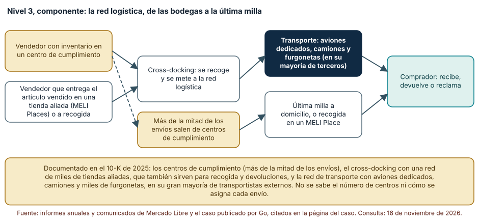

**Cómo leer la figura.** De izquierda a derecha: orígenes del paquete, red de transporte y destino. Mire las dos entradas: inventario en bodega (más de la mitad de los envíos) y artículo recogido o entregado en una tienda aliada. **Dónde deja de valer.** No muestra el número de centros ni la asignación de cada envío; la entrada punteada es el flujo de inventario a centros.

**Documentado.** La red se construye con centros de cumplimiento (más de la mitad de los envíos), cross-docking con miles de tiendas aliadas que también sirven para recogida y devoluciones, y una red de transporte con aviones dedicados, camiones y miles de furgonetas, en su gran mayoría de transportistas externos ([M6]). Meli Air se lanzó en 2020 ([M2]). En el cuarto trimestre de 2024, más del 95 % de los envíos se completó dentro de la red gestionada y el 49 % llegó el mismo día o al siguiente ([M4]). El umbral de envío gratis en Brasil se redujo y el 10-K lo cita como causa de menor margen en 2025 ([M6]), lo que muestra que la logística es una palanca de producto y de coste a la vez.

### 6.6 Datos y escala

Mercado Pago, mercado y envíos comparten plataforma tecnológica pero cada país opera un marketplace separado ([M1]). La documentación pública para desarrolladores ofrece Checkout Pro, Checkout API, notificaciones por webhook e IPN, cuentas y tarjetas de prueba, OAuth y guías de seguridad (PCI DSS y OWASP) ([M5]).

| Magnitud | 2023 | 2024 | 2025 | Fuente |
| --- | --- | --- | --- | --- |
| Compradores únicos activos (millones) | 85 | 100 | 121 | [M6] |
| Usuarios mensuales de fintech (millones) | 46 | 61 | 78 | [M6] |
| Valor vendido, GMV (millones de USD) | 44 749 | 51 467 | 65 037 | [M6] |
| Artículos vendidos (millones) | 1 404 | 1 787 | 2 429 | [M6] |
| Volumen total de pagos (millones de USD) | 146 738 | 196 660 | 277 823 | [M6] |
| Transacciones de pago (millones) | 7 595 | 11 355 | 15 470 | [M6] |

**[No se sabe]** los motores de bases de datos, el número de servicios y de celdas. Desde el cierre de 2024 la empresa dejó de informar el número de artículos enviados porque ya no aporta información útil, según el 10-K de 2025 ([M6]); es un ejemplo de cómo cambia lo que una empresa publica.

### 6.7 Despliegue

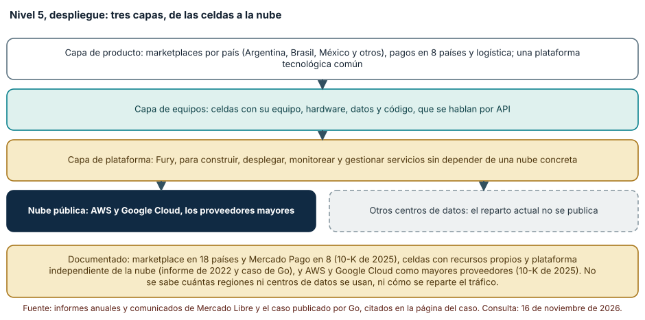

**Cómo leer la figura.** Las filas son capas de abajo hacia arriba: la nube soporta Fury, Fury soporta celdas y las celdas soportan los productos por país. La caja punteada gris es lo que no se publica. **Dónde deja de valer.** No es un diagrama de regiones: las fuentes no dicen cuántas regiones o centros de datos hay, ni cómo se asigna el tráfico entre países.

**Documentado.** Marketplace en 18 países y Mercado Pago en 8; plataforma independiente de la nube; AWS y Google Cloud como los proveedores mayores, de los que depende el funcionamiento diario ([M6], [M3]). El informe de 2022 menciona sedes de datos en Virginia (EE. UU.) ([M2]).

### 6.8 Resiliencia y degradación

| Nivel | Qué falla | Respuesta documentada o inferida | Coste |
| --- | --- | --- | --- |
| 1 | Una API lenta | **[Inferido]** tiempos límite y reintentos con idempotencia; el 10-K no detalla | Complejidad de clientes |
| 2 | Un servicio de una celda | La celda es autónoma con su equipo, datos y código ([M2]) | Duplicación entre celdas |
| 3 | Un pico estacional | Campañas de fechas comerciales y «dobles fechas» para suavizar la temporada baja ([M6]) | Capacidad que sobra fuera de temporada |
| 4 | Una nube | La plataforma es independiente de la nube ([M3]); los 10-K reconocen la dependencia de AWS y Google Cloud ([M6]) | Dependencia declarada |
| 5 | Una moneda | Ingresos en varias monedas; Argentina en dólares ([M6]) | Volatilidad de resultados |

### 6.9 Seguridad, abuso y cumplimiento

- **Documentado: fraude y vendedores.** El 10-K reconoce que usuarios no reciben producto o dinero, que la empresa puede suspender cuentas pero no obligar a cumplir, que existe el Programa de Protección al Comprador y que hay bienes prohibidos (alcohol, armas, medicamentos, especies protegidas) que los usuarios llegan a ofrecer eludiendo los controles, con multas en algunos casos ([M6]).
- **Documentado: regulación financiera.** Mercado Pago está sujeto a leyes de pagos, lavado de activos y protección de datos; en Brasil participa en Pix y en Open Finance y está sujeto a reglas de capital del banco central; en Argentina solicitó en junio de 2025 una licencia bancaria ([M6]).
- **Documentado: competencia.** Una autoridad de México identificó posibles preocupaciones sobre los algoritmos de la «caja de compra» y la integración de logística de Amazon México y Mercado Libre, sin imponer medidas, y cerró el procedimiento ([M6]).
- **Documentado: seguridad de la plataforma.** El 10-K reconoce susceptibilidad a ataques y a errores de migración o de los proveedores de nube, y depende de cifrado para transmitir información confidencial ([M6]); la guía de pagos referencia 3DS 2.0, prevención de fraude y verificación de identidad del comprador ([M5]).
- **No se sabe.** El modelo de amenazas, el diseño de detección de fraude, la gestión de claves y los incidentes concretos.

**Cómo lo razonaría el curso.** Un marketplace con pagos y crédito tiene activos sensibles (identidad, medios de pago, datos de crédito) y abusos propios (vendedores incumplidos, bienes prohibidos, fraude con tarjetas, lavado de activos). El método del curso ([SE-457](../../classes/part-38-seguridad-privacidad-y-cumplimiento/se-457-principios-de-seguridad-y-modelos-de-amenaza/README.md), [SE-463](../../classes/part-38-seguridad-privacidad-y-cumplimiento/se-463-privacidad-por-diseno-y-minimizacion/README.md), [SE-466](../../classes/part-38-seguridad-privacidad-y-cumplimiento/se-466-cumplimiento-evidencia-y-limites-legales/README.md)) pide enumerar activos, atacantes y controles; las respuestas concretas de la empresa no son públicas.

### 6.10 Observabilidad y operación

**Documentado.** Las compilaciones tres veces más rápidas y la suite de pruebas de 90 a 3 segundos son datos de operación de ingeniería ([M3]); Fury ofrece construir, desplegar, monitorear y gestionar servicios ([M3]). **No se sabe.** Los objetivos de nivel de servicio, la gestión de incidentes y la telemetría de producto. La disciplina de [SE-493](../../classes/part-41-observabilidad-sre-e-incidentes/se-493-senales-eventos-y-observabilidad-util/README.md) y [SE-497](../../classes/part-41-observabilidad-sre-e-incidentes/se-497-sli-slo-sla-y-presupuestos-de-error/README.md) se aplica aquí como pregunta, no como hecho.

### 6.11 Evolución de la arquitectura por etapas

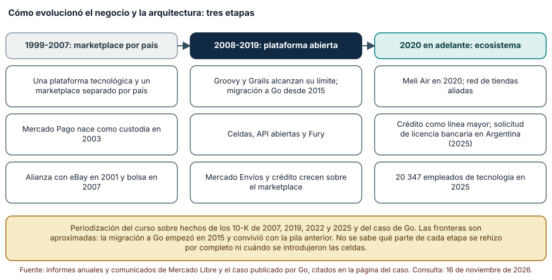

**Cómo leer la figura.** Cada columna es una etapa; las cajas son rasgos documentados; las flechas, la secuencia. Mire cómo cada etapa agrega una capa: país, plataforma, ecosistema. **Dónde deja de valer.** La periodización es del curso; las fronteras son aproximadas y no se sabe cuándo se introdujeron las celdas.

**Del monolito a las celdas.** El informe de 2022 describe el paso de un sistema cerrado y monolítico a uno abierto y desacoplado y el caso de Go da el ejemplo de un servicio ([M2], [M3]). Es la evolución típica de una organización que crece por equipos y países ([SE-334](../../classes/part-27-arquitectura-de-software-y-dominio/se-334-arquitectura-socio-tecnica-y-limites-de-equipo/README.md), [SE-344](../../classes/part-28-estilos-arquitectonicos/se-344-arquitectura-celular-y-radio-de-impacto/README.md)). **La plantilla como indicador.** 13 856 empleados de tecnología en 2022 y 20 347 en 2025 ([M2], [M6]): el crecimiento del equipo es parte de la arquitectura porque las celdas se justifican por ese tamaño.

### 6.12 Alternativas descartadas y trade-offs (análisis propio)

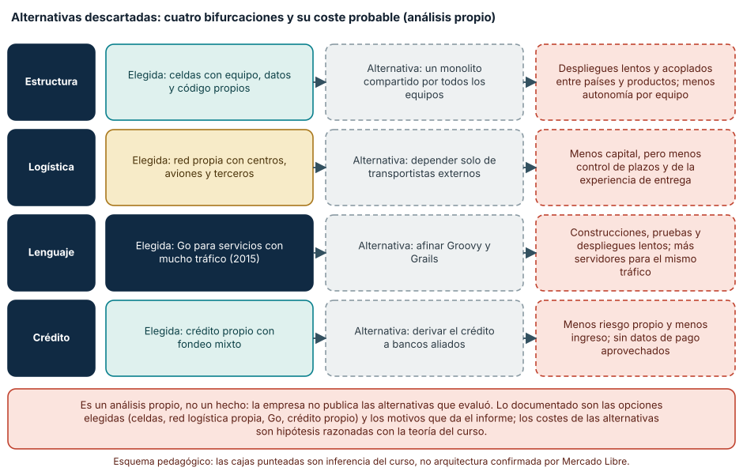

**Cómo leer la figura.** Cada fila es una bifurcación: lo elegido, la alternativa y el coste probable de ésta. Los trazos punteados son hipótesis. **Dónde deja de valer.** Son hipótesis del curso: la empresa no publica las alternativas que evaluó, aunque sí motiva Go (límites de Groovy y Grails) y las celdas (el desacople).

**Logística propia frente a terceros.** La red propia da control de la experiencia, pero exige capital: el 10-K muestra la tensión cuando una decisión de producto (el umbral de envío gratis) mueve el margen de la empresa ([M6]). Un modelo solo de transportistas externos habría reducido el capital y el control. **Crédito propio frente a derivado.** El crédito propio aporta ingresos (5 858 millones en 2025), pero también provisiones (3 091) y la necesidad de fondeo ([M6]); derivarlo habría trasladado el riesgo y el ingreso a un tercero.

### 6.13 Hardware utilizado

**Documentado.** Las fuentes consultadas no describen los servidores ni la red de Mercado Libre. Lo que sí consta es hardware del negocio: una red de transporte con aviones dedicados (Meli Air desde 2020), camiones y miles de furgonetas de última milla, la mayoría de terceros ([M2], [M6]); centros de cumplimiento y miles de tiendas aliadas ([M6]); y terminales de cobro que Mercado Pago vende, dentro de los ingresos fintech ([M2]). **[No se sabe]** el tipo de servidores, aceleradores o redes propias y el número de centros de datos propios; el informe de 2022 menciona sedes de datos en Virginia (EE. UU.) ([M2]). No se rellena la laguna con datos no verificados.

### 6.14 Software utilizado

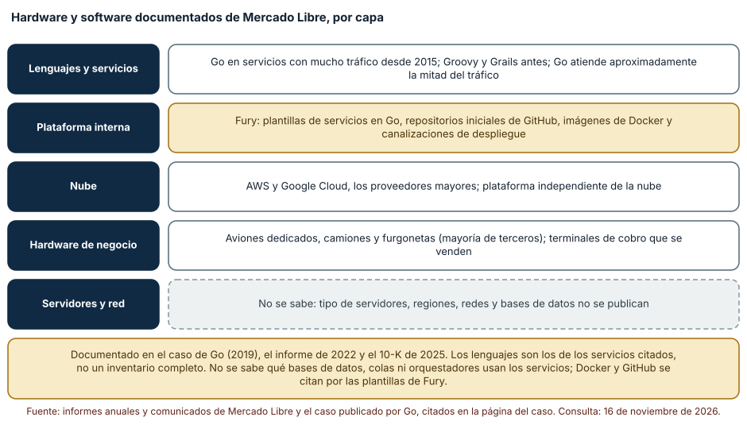

**Cómo leer la figura.** Cada fila es una capa; la última, gris punteada, es lo que no se sabe. Mire cómo la capa de plataforma (Fury) separa los servicios de la nube. **Dónde deja de valer.** Es una síntesis de 2019 a 2025 con pocas fuentes: no es un inventario y no dice qué lenguajes dominan hoy.

**Documentado.** Go en servicios de alto tráfico desde 2015, tras alcanzar Groovy y Grails su límite; aproximadamente la mitad del tráfico se atiende hoy con aplicaciones en Go; plantillas de servicios en Go, repositorios iniciales en GitHub, imágenes de Docker y canalizaciones de despliegue en Fury ([M3]); API pública con OAuth, notificaciones por webhook e IPN y cuentas de prueba ([M5]); 3DS 2.0 y alineación con OWASP y PCI DSS en pagos ([M5]); participación en Pix y en Open Finance en Brasil ([M6]). **[No se sabe]** las bases de datos, colas, orquestadores y herramientas internas de código abierto.

### 6.15 Características de la infraestructura

**Modelo.** Una plataforma independiente de la nube ([M3]) que depende de proveedores de nube, los mayores AWS y Google Cloud ([M6]). **[No se sabe]** qué parte corre en centros de datos propios. **Regiones.** Marketplace en 18 países y Mercado Pago en 8 ([M6]); la plataforma técnica es común y cada país opera su marketplace ([M1]). **Capacidad y escala.** Una API de usuarios con 8 a 10 millones de peticiones por minuto y más de 20 millones en las mayores ([M3]); 15 470 millones de transacciones de pago y 2 429 millones de artículos vendidos en 2025 ([M6]). **Costos.** No se separan; el costo de ingresos total fue de 16 035 millones en 2025 e incluye alojamiento y operación del sitio ([M6]).

### 6.16 Temas a prueba de fallos

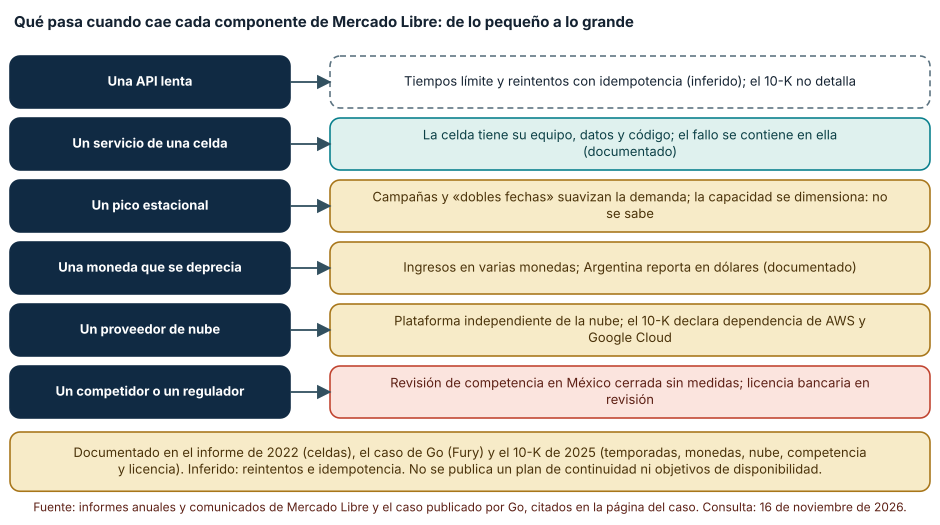

**Cómo leer la figura.** Cada fila es una perturbación mayor que la anterior; a la derecha, el efecto y la respuesta. Mire que las últimas filas son de negocio y no técnicas: monedas y regulación son parte de la resiliencia. **Dónde deja de valer.** Combina arquitectura y riesgo de negocio; no es un plan de continuidad.

**Documentado.** El diseño en celdas contiene fallos y cambios en el equipo propietario ([M2]); las campañas y «dobles fechas» suavizan la estacionalidad ([M6]); la plataforma es independiente de la nube ([M3]); hay un programa de protección al comprador ante vendedores que incumplen ([M6]); ingresos en varias monedas y Argentina reportada en dólares ([M6]). **Inferido:** reintentos con idempotencia y tiempos límite en APIs y pagos. **[No se sabe]** las pruebas de caos, la recuperación ante desastres, los límites de velocidad por cliente y la degradación elegante.

**Qué pasa cuando cae cada componente.** (1) Una API: **[Inferido]** tiempos límite y reintentos. (2) Una celda: se contiene en esa celda ([M2]). (3) Un pico: demanda suavizada con campañas ([M6]). (4) Una nube: dependencia declarada ([M6]). (5) Un pago duplicado o tardío: el comercio debe consultar el estado y procesar una sola vez (**[Inferido]**, [SE-246](../../classes/part-20-backend-apis-y-procesamiento-asincrono/se-246-idempotencia-reintentos-y-deduplicacion/README.md)). (6) Una autoridad: revisión o licencia, con riesgo regulatorio declarado ([M6]).

## Casos especiales y cómo se resuelven

Cada caso se expone como: situación, mecanismo, decisión, trade-off, y qué se sabe.

- **Picos estacionales.** El cuarto trimestre es el más fuerte en todos los países y el primero el más lento; las campañas Hot Sale, Black Friday y Cyber Monday elevan las transacciones; operar en ambos hemisferios mitiga parte de la estacionalidad y se promueven «dobles fechas» en temporada baja ([M2], [M6]). **[No se sabe]** cómo se dimensiona la capacidad. *Trade-off:* capacidad que sobra fuera de temporada.
- **Fraude y vendedores incumplidos.** El informe reconoce quejas de usuarios que no reciben producto o dinero; puede suspender cuentas pero no obligar a cumplir, y mantiene el Programa de Protección al Comprador ([M2], [M6]). *Trade-off:* a mayor cobertura, más reembolsos.
- **Cumplimiento regulatorio.** Mercado Pago está sujeto a leyes de pagos, lavado de activos, secreto bancario y protección de datos (en Brasil, Argentina, México y otros); el informe cita las leyes y los bancos centrales como reguladores ([M2]); una solicitud de licencia bancaria en Argentina está en revisión ([M6]).
- **Inflación y divisas.** Argentina tuvo inflación de 211,4 % en 2023, 117,8 % en 2024 y 31,5 % en 2025 y el tipo de cambio oficial frente al dólar subió 356,3 %, 27,7 % y 41,0 %; la subsidiaria reporta en dólares ([M6]). *Trade-off:* comparar años en dólares engaña.
- **Riesgo de crédito.** La provisión para cuentas dudosas fue de 3 091 millones en 2025, impulsada por la cartera de tarjetas ([M6]); el indicador NIMAL bajó a 22,4 % ([M6]).
- **Decisiones de producto con efecto en margen.** La reducción del umbral de envío gratis en Brasil bajó el margen operativo de 12,7 % a 11,1 % junto con otros factores ([M6]).
- **Reintentos y duplicados en pagos.** **[Inferido]** que, como en cualquier API de pagos con notificaciones asíncronas, se necesitan claves de idempotencia; la documentación consultada no lo confirmó, así que no se afirma ([SE-246](../../classes/part-20-backend-apis-y-procesamiento-asincrono/se-246-idempotencia-reintentos-y-deduplicacion/README.md)).
- **Competencia y plataforma.** La revisión mexicana sobre la «caja de compra» y la integración logística se cerró sin medidas ([M6]); el riesgo regulatorio sigue declarado ([M6]).
- **Fallos parciales.** **[No se sabe]** los mecanismos de resiliencia internos.
- **Sin conexión.** **[No se sabe]**.

## Línea de tiempo

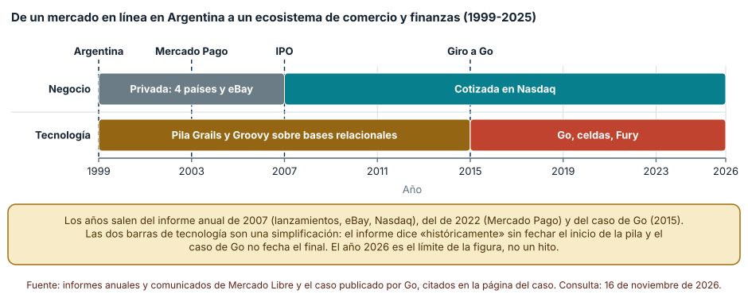

**Cómo leer la figura.** El eje es el año. Cada carril es una historia y las líneas verticales son hitos. **Dónde deja de valer.** Las barras de tecnología son aproximadas: el informe dice «históricamente» sin fechar el inicio de la pila.

- **Marzo de 1999.** Galperín escribe el plan de negocio ([M1]).
- **Agosto a diciembre de 1999.** Lanzamientos en Argentina, Brasil, México y Uruguay ([M1]).
- **Octubre de 1999.** Constitución en Delaware ([M1]).
- **Noviembre de 1999 y mayo de 2000.** Dos rondas de financiación ([M1]).
- **Septiembre de 2001.** Alianza con eBay ([M1]).
- **Noviembre de 2003.** Mercado Pago en Argentina ([M1]).
- **Agosto de 2007.** Oferta pública en Nasdaq ([M1]).
- **2015.** El equipo de API empieza a migrar de Groovy y Grails a Go ([M3]); 7 151 millones de GMV y 23,6 millones de compradores únicos ([M7]).
- **2019.** Ingresos de 2 296 millones y pérdida operativa de 153 millones ([M8], [M9]).
- **2020.** Lanzamiento de Meli Air ([M2]); ingresos de 3 974 millones y resultado operativo de 128 millones ([M8]).
- **2021.** Ingresos de 7 069 millones y resultado operativo de 441 millones ([M8]); Mercado Pago entra en Open Finance de Brasil ([M6]).
- **2022.** 13 856 empleados de tecnología ([M2]).
- **20 de febrero de 2025.** Resultados de 2024: más de 100 millones de compradores únicos ([M4]).
- **Junio de 2025.** Solicitud de licencia bancaria en Argentina ([M6]).
- **Febrero de 2026.** 10-K de 2025: ingresos de 28 893 millones, 121 millones de compradores únicos activos y 78 millones de usuarios mensuales de fintech ([M6]).

### Decisiones clave, giros y correcciones

- **1999: un marketplace por país.** Una apuesta de adaptación local con plataforma común ([M1]).
- **2001: alianza con eBay.** Capital y una filial brasileña en un momento de escasez de financiación ([M1]).
- **2003: Mercado Pago como custodia.** Una pieza de confianza que luego se convirtió en negocio ([M1], [M2]).
- **2015: migrar a Go.** Una corrección de rendimiento y de ritmo de desarrollo ([M3]).
- **Celdas y plataforma abierta.** Una corrección de acoplamiento organizacional ([M2]).
- **2019-2021: de pérdida a utilidad operativa.** 2019 cerró con pérdida operativa de 153 millones y 2020 con utilidad de 128 millones ([M8]).
- **2025: más crédito, más provisión, menos margen.** El crecimiento del crédito presionó el resultado ([M6]).

## Vínculo con el curso

| Concepto | Clases | Qué ilustra el caso |
| --- | --- | --- |
| Modelos de negocio y métricas | [SE-133](../../classes/part-11-economia-metricas-y-decisiones-de-producto/se-133-modelos-de-negocio-y-sostenibilidad/README.md), [SE-136](../../classes/part-11-economia-metricas-y-decisiones-de-producto/se-136-metricas-de-adopcion-retencion-y-tarea-util/README.md), [SE-141](../../classes/part-11-economia-metricas-y-decisiones-de-producto/se-141-portafolio-opciones-y-secuenciacion-de-inversion/README.md) | Ecosistema con varias líneas de ingreso; GMV, TPV y compradores como métricas |
| Hipótesis y criterios de abandono | [SE-124](../../classes/part-10-descubrimiento-y-estrategia-de-producto/se-124-hipotesis-supuestos-y-preguntas-criticas/README.md), [SE-130](../../classes/part-10-descubrimiento-y-estrategia-de-producto/se-130-criterios-de-no-exito-y-decisiones-de-abandono/README.md) | Las apuestas del marketplace por país, de pago más envío y de crédito |
| Costos y economía del software | [SE-134](../../classes/part-11-economia-metricas-y-decisiones-de-producto/se-134-costos-de-construccion-operacion-y-oportunidad/README.md), [SE-537](../../classes/part-44-gestion-liderazgo-y-practica-profesional/se-537-economia-del-software-y-costo-total/README.md) | Dónde se concentra el coste de una plataforma con logística propia |
| FinOps y costo por resultado | [SE-140](../../classes/part-11-economia-metricas-y-decisiones-de-producto/se-140-finops-de-producto-y-costo-por-resultado/README.md) | Costes de logística, provisión y fondeo frente a ingresos |
| Microservicios y su coste | [SE-340](../../classes/part-28-estilos-arquitectonicos/se-340-microservicios-y-sus-costes-reales/README.md), [SE-327](../../classes/part-27-arquitectura-de-software-y-dominio/se-327-monolito-modular-monolith-y-servicios/README.md) | De un sistema monolítico a servicios independientes |
| Arquitectura celular y radio de impacto | [SE-344](../../classes/part-28-estilos-arquitectonicos/se-344-arquitectura-celular-y-radio-de-impacto/README.md) | Las «celdas» de equipo, código y datos propios |
| Arquitectura socio-técnica | [SE-334](../../classes/part-27-arquitectura-de-software-y-dominio/se-334-arquitectura-socio-tecnica-y-limites-de-equipo/README.md), [SE-530](../../classes/part-44-gestion-liderazgo-y-practica-profesional/se-530-diseno-de-equipos-y-ownership/README.md) | Equipos autónomos alineados con la arquitectura |
| Vistas de arquitectura | [SE-326](../../classes/part-27-arquitectura-de-software-y-dominio/se-326-vistas-logica-runtime-datos-y-despliegue/README.md) | Los niveles de la sección de arquitectura |
| Plataformas internas | [SE-406](../../classes/part-33-cloud-plataforma-e-infraestructura/se-406-plataformas-internas-y-golden-paths/README.md), [SE-489](../../classes/part-40-ci-cd-iac-y-platform-engineering/se-489-developer-portals-y-capacidades-de-plataforma/README.md) | Fury como camino pavimentado para crear servicios |
| Cloud, portabilidad y multi-nube | [SE-397](../../classes/part-33-cloud-plataforma-e-infraestructura/se-397-iaas-paas-saas-y-responsabilidad-compartida/README.md), [SE-405](../../classes/part-33-cloud-plataforma-e-infraestructura/se-405-multi-cloud-hibrido-y-portabilidad-real/README.md) | Plataforma independiente de la nube y dependencia de dos proveedores |
| Concurrencia y latencia | [SE-385](../../classes/part-32-concurrencia-y-sistemas-distribuidos/se-385-concurrencia-paralelismo-y-asincronia/README.md), [SE-436](../../classes/part-36-calidad-rendimiento-y-resiliencia/se-436-latencia-throughput-saturacion-y-capacidad/README.md) | Go: miles de peticiones por máquina con poca memoria |
| Migración y reescritura | [SE-522](../../classes/part-43-mantenimiento-y-modernizacion-legacy/se-522-migraciones-de-runtime-lenguaje-y-framework/README.md), [SE-526](../../classes/part-43-mantenimiento-y-modernizacion-legacy/se-526-economia-de-reescribir-frente-a-evolucionar/README.md), [SE-521](../../classes/part-43-mantenimiento-y-modernizacion-legacy/se-521-strangler-branch-by-abstraction-y-anticorruption/README.md) | De Groovy y Grails a Go servicio por servicio |
| APIs, autenticación y webhooks | [SE-242](../../classes/part-20-backend-apis-y-procesamiento-asincrono/se-242-rest-y-semantica-de-recursos/README.md), [SE-245](../../classes/part-20-backend-apis-y-procesamiento-asincrono/se-245-autenticacion-autorizacion-y-contexto/README.md), [SE-379](../../classes/part-31-integracion-eventos-y-mensajeria/se-379-webhooks-polling-y-suscripciones/README.md) | OAuth, notificaciones y APIs públicas |
| Dominio fintech e invariantes monetarias | [SE-294](../../classes/part-24-software-especializado-y-dominios/se-294-fintech-contabilidad-e-invariantes-monetarias/README.md), [SE-246](../../classes/part-20-backend-apis-y-procesamiento-asincrono/se-246-idempotencia-reintentos-y-deduplicacion/README.md) | Pagos, custodia y consistencia contable |
| Sagas y compensación | [SE-377](../../classes/part-31-integracion-eventos-y-mensajeria/se-377-outbox-inbox-sagas-y-compensacion/README.md) | Compra, pago y envío como proceso con reversión |
| Picos y capacidad | [SE-435](../../classes/part-36-calidad-rendimiento-y-resiliencia/se-435-carga-estres-picos-y-endurance/README.md), [SE-404](../../classes/part-33-cloud-plataforma-e-infraestructura/se-404-escalado-capacidad-y-costos/README.md) | Hot Sale, Black Friday y estacionalidad |
| Cumplimiento, privacidad y límites legales | [SE-466](../../classes/part-38-seguridad-privacidad-y-cumplimiento/se-466-cumplimiento-evidencia-y-limites-legales/README.md), [SE-358](../../classes/part-29-datos-persistencia-y-recuperacion/se-358-privacidad-retencion-y-ciclo-de-vida-del-dato/README.md), [SE-152](../../classes/part-12-ingenieria-de-requisitos/se-152-requisitos-regulatorios-de-datos-y-seguridad/README.md) | Leyes de pagos y de protección de datos por país |
| Seguridad y modelo de amenazas | [SE-457](../../classes/part-38-seguridad-privacidad-y-cumplimiento/se-457-principios-de-seguridad-y-modelos-de-amenaza/README.md), [SE-463](../../classes/part-38-seguridad-privacidad-y-cumplimiento/se-463-privacidad-por-diseno-y-minimizacion/README.md) | Fraude, bienes prohibidos y datos de pago |
| Observabilidad y SLO | [SE-493](../../classes/part-41-observabilidad-sre-e-incidentes/se-493-senales-eventos-y-observabilidad-util/README.md), [SE-497](../../classes/part-41-observabilidad-sre-e-incidentes/se-497-sli-slo-sla-y-presupuestos-de-error/README.md) | Preguntas de operación que las fuentes no responden |
| Internacionalización | [SE-177](../../classes/part-14-experiencia-accesibilidad-e-internacionalizacion/se-177-internacionalizacion-localizacion-y-formatos-culturales/README.md) | Marketplace separado por país con plataforma común |

### Preguntas de discusión

1. Mercado Libre eligió un marketplace por país con plataforma común. ¿Qué costes de coordinación aparecen en ese diseño y cómo los reduciría un modelo de celdas?
2. La provisión para cuentas dudosas pasó de 41 % a 53 % de los ingresos por crédito en dos años. ¿Qué señales le permitirían saber si el crecimiento del crédito es sano?
3. El umbral de envío gratis en Brasil movió el margen. ¿Qué otras decisiones de producto, aparentemente comerciales, tienen un efecto directo en la arquitectura o en los costes de operación?
4. Una plataforma independiente de la nube convive con una dependencia declarada de AWS y Google Cloud. ¿Qué significa «independiente» en la práctica y qué parte de la dependencia sigue existiendo?
5. Argentina tuvo una inflación de 211 % en 2023. ¿Cómo diseñaría las métricas y los informes de producto para que esa realidad no distorsione las decisiones?
6. Una autoridad de competencia revisó los algoritmos de la caja de compra y la integración de logística. ¿Qué decisiones de diseño de un marketplace pueden volverse materia regulatoria?

### Mini-ejercicios de análisis

1. **Descomponga un ecosistema.** Para un producto con más de un servicio, dibuje los tres niveles de zoom (contexto, contenedores, secuencia de la operación clave) y marque cada flecha como documentada, inferida o desconocida.
2. **Calcule su proporción de pagos.** Con el volumen de pagos y el valor vendido de una plataforma, calcule la razón entre ambos como en la figura de pagos frente a ventas e interprete qué mide cada magnitud.
3. **Mida riesgo de crédito.** Con ingresos por crédito y provisión de tres años, calcule el porcentaje de provisión sobre ingresos y diga qué decisión de negocio tomaría con una tendencia como la de este caso.
4. **Diseñe un webhook seguro.** Escriba cómo procesaría una notificación de pago repetida, tardía o fuera de orden y qué consultaría antes de actuar.
5. **Compare moneda e ingresos.** Para un producto con ingresos en tres monedas, diseñe un informe que separe el efecto de la inflación o del tipo de cambio del crecimiento real.

## Qué no generalizar

**Qué aprender.**

- Una plataforma de comercio, pagos, logística y crédito integra capacidades que se refuerzan entre sí, pero cada una trae su propio riesgo y capital ([M4], [M6]).
- Reescribir un servicio en otro lenguaje puede reducir servidores y mejorar tiempos de compilación, pero es un caso de un servicio y no una regla ([M3]).
- El crecimiento del crédito exige reservar más contra pérdidas: el margen de interés neto tras pérdidas cayó ([M6]).
- Las decisiones de producto, como un umbral de envío gratis, tienen efecto en el margen de toda la empresa ([M6]).
- Las métricas cambian: el número de artículos enviados dejó de publicarse y los usuarios únicos se sustituyeron por compradores y usuarios fintech ([M6]).

**Qué no generalizar.**

- **No** hace falta una plataforma propia (Fury) ni celdas para un equipo pequeño: se justifican con miles de ingenieros (13 856 en tecnología en 2022; 20 347 en 2025) ([M2], [M6]).
- **No** se debe extrapolar el ahorro de Go (88 % menos de servidores) a otros sistemas: es un servicio, contado por el proyecto Go ([M3]).
- Los ingresos por país dependen de monedas inflacionarias; la comparación entre años en dólares engaña.
- Integrar pagos, logística y crédito exige licencias y capital que una empresa de software normal no tiene.
- Las fuentes no cubren seguridad, incidentes ni disputas con vendedores en detalle: el caso no dice que esos asuntos estén resueltos.
- El volumen de pagos (TPV) no es ingreso: incluye cobros fuera del marketplace y no se puede multiplicar por una comisión.

## Fuentes públicas verificadas

Fecha de consulta: 16 de noviembre de 2026. Los documentos de la SEC se descargaron con `curl` enviando un agente de usuario identificado; las páginas de documentación y del proyecto Go se leyeron con la herramienta de lectura web.

- **[M1]** Mercado Libre, Form 10-K de 2007 (PDF del sitio de relación con inversionistas): [informe 2007](https://api.mziq.com/mzfilemanager/v2/d/098a2d95-0ea8-4ed5-a340-d9ef6a2b0053/74b698d2-8f42-9e1f-5390-4d63a1e13e1c?origin=1). Respalda fundación, lanzamientos, rondas, eBay, Mercado Pago 2003 y la oferta de 2007.
- **[M2]** Mercado Libre, Form 10-K de 2022: [informe 2022](https://api.mziq.com/mzfilemanager/v2/d/098a2d95-0ea8-4ed5-a340-d9ef6a2b0053/6131d439-c7c4-4b69-aae2-cc6c869e438f?origin=1). Respalda servicios, modelo de ingresos, celdas, estacionalidad, regulación, riesgos y resultados por país.
- **[M3]** The Go Programming Language, «MercadoLibre Grows with Go», 10 de noviembre de 2019: [caso de Go](https://go.dev/solutions/mercadolibre). Respalda la migración de 2015, las cifras de servidores y tráfico, las compilaciones y pruebas, Fury y el alcance de Go.
- **[M4]** Mercado Libre, «Financial results fourth quarter 2024», 20 de febrero de 2025: [comunicado](https://news.mercadolibre.com/en/financial-results-fourth-quarter-2024). Respalda GMV, TPV, compradores, envíos y usuarios fintech.
- **[M5]** Mercado Pago Developers, documentación de Checkout Pro: [documentación](https://www.mercadopago.com.ar/developers/en/docs/checkout-pro/landing). Respalda webhooks, IPN, OAuth, cuentas y tarjetas de prueba, y las etapas de integración y los controles de seguridad.
- **[M6]** MercadoLibre, Inc., Form 10-K del año fiscal 2025 (SEC, presentado el 25 de febrero de 2026): [https://www.sec.gov/Archives/edgar/data/1099590/000109959026000006/meli-20251231.htm](https://www.sec.gov/Archives/edgar/data/1099590/000109959026000006/meli-20251231.htm). Respalda las cifras de 2023 a 2025, ingresos por línea y país, provisión, NIMAL, logística, empleados, inflación y monedas, nube, regulación y licencia bancaria.
- **[M7]** MercadoLibre, Inc., Form 10-K del año fiscal 2019 (SEC, presentado el 14 de febrero de 2020): [https://www.sec.gov/Archives/edgar/data/1099590/000156276220000055/meli-20191231x10k.htm](https://www.sec.gov/Archives/edgar/data/1099590/000156276220000055/meli-20191231x10k.htm). Respalda la estructura de ingresos de 2017 a 2019 y los datos de valor vendido, pagos, compradores y envíos de 2015 a 2019.
- **[M8]** MercadoLibre, Inc., Form 10-K del año fiscal 2021 (SEC, presentado el 23 de febrero de 2022): [https://www.sec.gov/Archives/edgar/data/1099590/000156276222000049/meli-20211231x10k.htm](https://www.sec.gov/Archives/edgar/data/1099590/000156276222000049/meli-20211231x10k.htm). Respalda ingresos y resultado operativo de 2019 a 2021.
- **[M10]** MercadoLibre, Inc., Form 10-K del año fiscal 2024 (SEC, presentado el 21 de febrero de 2025): [https://www.sec.gov/Archives/edgar/data/1099590/000109959025000007/meli-20241231.htm](https://www.sec.gov/Archives/edgar/data/1099590/000109959025000007/meli-20241231.htm). Respalda el resultado operativo de 2022 y las cifras recompuestas de 2022 y 2023.

**Límites.** Nadie ejecutó ni midió Mercado Libre aquí. El 10-K de 2022 fue leído como PDF descargado con `curl`; la dirección de la sede se tomó de él. Los informes 2007 y 2022 son anteriores al 2024 de las cifras recientes. Las cifras de 2022 y 2023 se comparan en la versión recompuesta de los 10-K posteriores y difieren de las originales. Los apartados rotulados «análisis propio» no son hechos de la empresa.

---

[↑ Casos de éxito](README.md) · [← Uber](uber.md) · [Amazon →](amazon.md)
