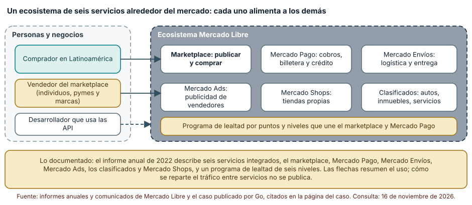
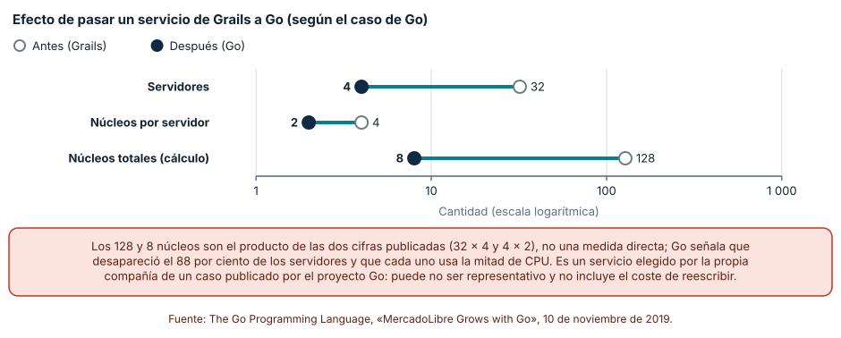
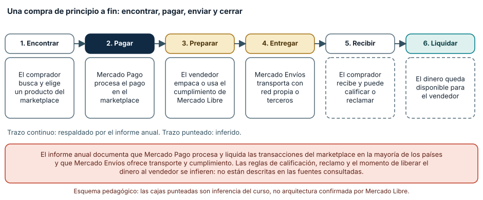

# Mercado Libre

[↑ Casos de éxito](README.md) · [← Uber](uber.md) · [Amazon →](amazon.md)

> **Caso de éxito.** Mercado Libre nació en 1999 como un mercado en línea para Latinoamérica y hoy combina marketplace, pagos, logística, publicidad y crédito. En el cuarto trimestre de 2024 superó los 100 millones de compradores únicos anuales y 61 millones de usuarios mensuales de servicios financieros. Este caso explica qué se sabe, con fuentes, de su historia, negocio y tecnología, qué se infiere y qué no se sabe.

**Etiquetas.** **[Documentado]** = lo dice una fuente citada al final; **[Inferido]** = deducción del curso, puede ser falsa; **[No se sabe]** = no hay fuente pública consultada. Las cifras llevan año y fuente. No se reconstruye arquitectura confidencial.

## Ficha histórica

| Dato | Valor | Fuente |
| --- | --- | --- |
| Nombre | MercadoLibre, Inc. (Mercado Libre) | [M1], [M2] |
| Fundación | En marzo de 1999 Marcos Galperín, cofundador y director ejecutivo, escribió el plan de negocio mientras cursaba un MBA en Stanford; la empresa se constituyó en Delaware en octubre de 1999 | [M1] |
| Otros cofundadores | **[No se sabe]** con las fuentes consultadas: el informe nombra a Galperín como cofundador y no lista a los demás | [M1] |
| Primer lanzamiento | Argentina, agosto de 1999; Brasil, octubre; México, noviembre; Uruguay, diciembre | [M1] |
| Financiación temprana | Ronda de 7,6 millones de USD en noviembre de 1999 y de 46,7 millones en mayo de 2000 | [M1] |
| Alianza con eBay | Septiembre de 2001: eBay pasó a ser accionista y Mercado Libre adquirió su filial brasileña iBazar | [M1] |
| Mercado Pago | Lanzado como producto de custodia (escrow) en Argentina en noviembre de 2003 | [M1] |
| Salida a bolsa | Agosto de 2007, Nasdaq; las acciones comenzaron a cotizar el 10 de agosto | [M1] |
| Sede | Montevideo, Uruguay (oficinas ejecutivas); el caso de Go la sitúa en Argentina, lo que refleja el origen | [M2], [M3] |
| Escala (2024) | Más de 100 millones de compradores únicos al año; ingresos netos del cuarto trimestre de 6 100 millones de USD; 61 millones de usuarios mensuales en fintech | [M4] |
| Estado actual | Sociedad cotizada con seis servicios integrados | [M2] |

## Contexto y problema

**Documentado.** El informe anual de 2022 describe una región con más de 650 millones de personas y uno de los crecimientos de internet y comercio electrónico más rápidos, con «desafíos culturales y geográficos» propios para operar una plataforma de comercio ([M2]). El de 2007 resume lo que se hizo al principio: una misma plataforma tecnológica en todos los países y un marketplace separado por país, sin interacción entre ellos ([M1]).

El problema de fondo era de confianza y de infraestructura: comprador y vendedor no se conocen, pagar a un desconocido es arriesgado y entregar un paquete en la región es difícil. Mercado Pago nació para dar confianza en el pago (el informe dice que «llevó confianza a la relación comerciante-consumidor» ([M2])) y Mercado Envíos para controlar la experiencia completa ([M2]). **[Inferido]** que cada servicio se creó para quitar la fricción que frenaba al anterior; el informe lo sugiere pero no lo formula así.

Cuando Mercado Pago empezó, el informe de 2007 lo describe como un producto de custodia; el de 2022, como un ecosistema financiero completo, incluidos terminales de cobro, QR, billetera, tarjetas, crédito, seguros y ahorro ([M1], [M2]). También observaron que muchas transacciones físicas seguían liquidándose en efectivo y que individuos y pymes estaban desatendidos por proveedores tradicionales ([M2]).

## Mercado, usuarios y casos de uso

| Rol | Qué hace y qué gana | Qué cambia en su experiencia | Respaldo |
| --- | --- | --- | --- |
| Comprador | Compra en el marketplace, paga con Mercado Pago, recibe por Mercado Envíos | Programa de Protección al Comprador; puntos y niveles de lealtad | [M2] |
| Vendedor | Publica, cobra y envía; paga comisiones por transacción | Puede usar cumplimiento y almacenamiento de Mercado Libre; crea una tienda en Mercado Shops sin coste | [M2] |
| Anunciante | Promociona productos con Mercado Ads | Anuncios en búsquedas, banners y productos sugeridos | [M2] |
| Usuario de servicios financieros | Billetera, tarjetas, crédito, inversión | Ahorro con retiro rápido; crédito dentro y fuera del marketplace | [M2] |
| Desarrollador externo | Integra el marketplace y Mercado Pago por API | Documentación pública: OAuth, notificaciones (webhooks e IPN), cuentas y tarjetas de prueba | [M2], [M5] |
| Equipos internos | Construyen servicios sobre una plataforma común | Celdas autónomas y plataforma interna | [M2], [M3] |
| Autoridades financieras | Regulan pagos, lavado de activos y secreto bancario | **[No se sabe]** el detalle operativo | [M2] |

**Alcance geográfico.** El informe de 2022 lista el marketplace en varios países, con Mercado Pago, Mercado Envíos y Mercado Crédito en distintas combinaciones según el país ([M2]). Brasil, Argentina y México concentraron el 95,2 % de los ingresos netos de 2022 ([M2]).

## Funcionalidad de principio a fin

1. **Primer contacto.** El comprador llega por búsqueda, anuncio o campañas de fechas comerciales como Hot Sale, Cyber Monday y Black Friday ([M2]).
2. **Registro.** **[Documentado]** que cualquier usuario registrado puede enviar y recibir pagos digitales y pagar compras en el marketplace ([M2]). **[No se sabe]** el proceso de verificación.
3. **Publicar (vendedor).** Lista mercadería; el marketplace está «totalmente automatizado» y organizado por temas ([M2]).
4. **Comprar y pagar.** Mercado Pago procesa y liquida todas las transacciones del marketplace en Argentina, Brasil, México, Chile, Colombia, Uruguay y Perú ([M2]). Admite cuotas, financiadas directamente o vendidas como activos ([M2]).
5. **Enviar.** Mercado Envíos permite usar transportistas externos y servicios propios de cumplimiento y almacenamiento; en 2020 se lanzó Meli Air con aviones dedicados y existe una red de comercios vecinales («Meli Places») para dejar y recoger paquetes ([M2]). Más del 95 % de los envíos del cuarto trimestre de 2024 se completó dentro de la red gestionada y el 49 % llegó el mismo día o al siguiente ([M4]).
6. **Soporte y reclamos.** El Programa de Protección al Comprador cubre casos de no recibir o recibir mal lo comprado, con reembolsos que pueden crecer al ampliarse la cobertura ([M2]).
7. **Operación diaria.** Para el vendedor, el panel de ventas, publicidad y envíos; detrás, las celdas y la plataforma de la sección de arquitectura.

## Negocio y economía

**Modelo (documentado).** Dos grandes fuentes: comercio, con servicios (comisiones por valor final y tarifas fijas, envíos netos de costos de transportistas, clasificados, publicidad) y venta de producto propio; y fintech, con comisiones fuera de la plataforma, cuotas, tarjetas, seguros, intereses de crédito y venta de terminales ([M2]).

**Cómo leer la figura.** Cada barra es un año reducido a 100 %; los segmentos son países. Mire primero el tamaño de Brasil y luego cuánto crecen Argentina y México. **Dónde deja de valer.** Son dólares de cada año: inflación y tipo de cambio mueven la composición, y el informe los cita como riesgos. No muestra la rentabilidad por país (la nota da la contribución directa, 40,5 % en Argentina y 15,3 % en México en 2022).

**Cifras.** En 2022 los ingresos netos fueron de 10 537 millones de USD (7 069 en 2021, +49 %), con una contribución directa de 21,6 % ([M2]). En el cuarto trimestre de 2024: ingresos netos de 6 100 millones (+37 %), valor vendido (GMV) de 14 500 millones, volumen de pagos (TPV) de 59 000 millones, activos bajo gestión de 10 600 millones y cartera de crédito de 6 600 millones ([M4]). El TPV incluye cobros fuera del marketplace, por eso supera al GMV.

**Costos.** **[Documentado]** que en 2022 tenían 13 856 empleados de tecnología y producto, frente a 9 471 en 2021 ([M2]). **[No se sabe]** el coste de logística, de crédito incobrable o de nube por separado en estas fuentes.

**Ventajas (documentado por la empresa).** Un ecosistema donde cada componente refuerza a los demás ([M4]) y una logística propia que controla la experiencia. **[Inferido]** que la combinación de comercio, pago y envío dificulta que un competidor replique solo una pieza.

## Arquitectura y esquemas

### Contexto

**Cómo leer la figura.** A la izquierda están las personas; el recuadro grande es el ecosistema. Las flechas muestran el uso principal. **Dónde deja de valer.** No muestra el reparto de tráfico entre servicios, ni países, ni sistemas internos.

### Componentes

**Cómo leer la figura.** Cada fila es una capa, de la más externa (terceros) a la más interna (plataforma). **Dónde deja de valer.** Es la foto de 2019 (caso de Go) y 2022 (informe), no un inventario actual.

**Documentado.** El informe de 2022 dice que pasaron de un sistema cerrado y monolítico a uno abierto y desacoplado: dividieron los equipos en «celdas», cada una con su equipo, hardware, datos y código fuente, que interactúan por API; abrieron la plataforma a terceros y construyeron una plataforma como servicio propia que reduce la carga cognitiva de gestionar infraestructura y red ([M2]). El caso publicado por Go cuenta que en 2015 la pila de Groovy y Grails llegaba a su límite, con pruebas, compilaciones y despliegues lentos, y que se pasó a Go: un servicio grande redujo sus servidores de 32 a 4 y los núcleos por servidor de 4 a 2, y sirve 70 000 peticiones por máquina con 20 MB de memoria ([M3]). Fury, la plataforma como servicio, permite construir, desplegar, monitorear y gestionar servicios de forma independiente de la nube ([M3]).

**Cómo leer la figura.** El punto vacío es antes y el lleno después; cuanto más largo el segmento, mayor la reducción. Fíjese en que el eje es logarítmico. **Dónde deja de valer.** Es un único servicio elegido por un caso publicado por el proyecto Go; los núcleos totales son un producto de dos cifras, no una medida, y no incluyen el coste de reescribir.

**Escala del tráfico.** Una API de usuarios recibe entre 8 y 10 millones de peticiones por minuto con respuestas de menos de 10 ms, y las mayores superan 20 millones por minuto ([M3]). Centros de datos: **[No se sabe]** el reparto actual entre nube y propios; el informe de 2022 menciona sedes de datos en Virginia (EE. UU.) ([M2]).

### Flujo de la operación crítica: una compra

**Cómo leer la figura.** De izquierda a derecha. Las cajas azules son el pago, las doradas la logística; las punteadas son inferidas. **Dónde deja de valer.** No describe cuándo se libera el dinero al vendedor ni las reglas de reclamos: no están en las fuentes consultadas.

### Datos y escala

Mercado Pago, mercado y envíos comparten plataforma tecnológica pero cada país opera un marketplace separado ([M1]). La documentación pública para desarrolladores ofrece Checkout Pro, Checkout API, notificaciones por webhook e IPN, cuentas y tarjetas de prueba, OAuth y guías de seguridad (PCI DSS y OWASP) ([M5]). **[No se sabe]** los motores de bases de datos, el número de servicios y de celdas.

## Casos especiales y cómo se resuelven

- **Picos estacionales.** El cuarto trimestre es el más fuerte en todos los países y el primero el más lento; las campañas Hot Sale, Black Friday y Cyber Monday elevan las transacciones; operar en ambos hemisferios mitiga parte de la estacionalidad ([M2]). **[No se sabe]** cómo se dimensiona la capacidad.
- **Fraude y vendedores incumplidos.** El informe reconoce quejas de usuarios que no reciben producto o dinero; puede suspender cuentas pero no obligar a cumplir, y mantiene el Programa de Protección al Comprador ([M2]).
- **Cumplimiento regulatorio.** Mercado Pago está sujeto a leyes de pagos, lavado de activos, secreto bancario y protección de datos (en Brasil, Argentina, México y otros); el informe cita las leyes y los bancos centrales como reguladores ([M2]).
- **Inflación y divisas.** Cita inflación, devaluaciones y controles cambiarios como riesgos que afectan lo que se informa ([M2]).
- **Reintentos y duplicados en pagos.** **[Inferido]** que, como en cualquier API de pagos con notificaciones asíncronas, se necesitan claves de idempotencia; la documentación consultada no lo confirmó, así que no se afirma.
- **Fallos parciales.** **[No se sabe]** los mecanismos de resiliencia internos.
- **Sin conexión.** **[No se sabe]**.

## Línea de tiempo

**Cómo leer la figura.** El eje es el año. Cada carril es una historia y las líneas verticales son hitos. **Dónde deja de valer.** Las barras de tecnología son aproximadas: el informe dice «históricamente» sin fechar el inicio de la pila.

- **Marzo de 1999.** Galperín escribe el plan de negocio ([M1]).
- **Agosto a diciembre de 1999.** Lanzamientos en Argentina, Brasil, México y Uruguay ([M1]).
- **Octubre de 1999.** Constitución en Delaware ([M1]).
- **Noviembre de 1999 y mayo de 2000.** Dos rondas de financiación ([M1]).
- **Septiembre de 2001.** Alianza con eBay ([M1]).
- **Noviembre de 2003.** Mercado Pago en Argentina ([M1]).
- **Agosto de 2007.** Oferta pública en Nasdaq ([M1]).
- **2015.** El equipo de API empieza a migrar de Groovy y Grails a Go ([M3]).
- **2020.** Lanzamiento de Meli Air ([M2]).
- **20 de febrero de 2025.** Resultados de 2024: más de 100 millones de compradores únicos ([M4]).

## Vínculo con el curso

| Concepto | Clases | Qué ilustra el caso |
| --- | --- | --- |
| Modelos de negocio y métricas | [SE-133](../../classes/part-11-economia-metricas-y-decisiones-de-producto/se-133-modelos-de-negocio-y-sostenibilidad/README.md), [SE-136](../../classes/part-11-economia-metricas-y-decisiones-de-producto/se-136-metricas-de-adopcion-retencion-y-tarea-util/README.md), [SE-141](../../classes/part-11-economia-metricas-y-decisiones-de-producto/se-141-portafolio-opciones-y-secuenciacion-de-inversion/README.md) | Ecosistema con varias líneas de ingreso; GMV, TPV y compradores como métricas |
| Costos y economía del software | [SE-134](../../classes/part-11-economia-metricas-y-decisiones-de-producto/se-134-costos-de-construccion-operacion-y-oportunidad/README.md), [SE-453](../../classes/part-37-gestion-liderazgo-y-practica-profesional/se-453-economia-del-software-y-costo-total/README.md) | Dónde se concentra el coste de una plataforma con logística propia |
| Microservicios y su coste | [SE-532](../../classes/part-44-estilos-arquitectonicos/se-532-microservicios-y-sus-costes-reales/README.md), [SE-303](../../classes/part-25-arquitectura-de-software-y-dominio/se-303-monolito-modular-monolith-y-servicios/README.md) | De un sistema monolítico a servicios independientes |
| Arquitectura celular y radio de impacto | [SE-536](../../classes/part-44-estilos-arquitectonicos/se-536-arquitectura-celular-y-radio-de-impacto/README.md) | Las «celdas» de equipo, código y datos propios |
| Arquitectura socio-técnica | [SE-310](../../classes/part-25-arquitectura-de-software-y-dominio/se-310-arquitectura-socio-tecnica-y-limites-de-equipo/README.md), [SE-446](../../classes/part-37-gestion-liderazgo-y-practica-profesional/se-446-diseno-de-equipos-y-ownership/README.md) | Equipos autónomos alineados con la arquitectura |
| Plataformas internas | [SE-358](../../classes/part-29-cloud-plataforma-e-infraestructura/se-358-plataformas-internas-y-golden-paths/README.md), [SE-417](../../classes/part-34-ci-cd-iac-y-platform-engineering/se-417-developer-portals-y-capacidades-de-plataforma/README.md) | Fury como camino pavimentado para crear servicios |
| Cloud, portabilidad y multi-nube | [SE-349](../../classes/part-29-cloud-plataforma-e-infraestructura/se-349-iaas-paas-saas-y-responsabilidad-compartida/README.md), [SE-357](../../classes/part-29-cloud-plataforma-e-infraestructura/se-357-multi-cloud-hibrido-y-portabilidad-real/README.md) | Plataforma independiente de la nube |
| Concurrencia y latencia | [SE-337](../../classes/part-28-concurrencia-y-sistemas-distribuidos/se-337-concurrencia-paralelismo-y-asincronia/README.md), [SE-376](../../classes/part-31-calidad-rendimiento-y-resiliencia/se-376-latencia-throughput-saturacion-y-capacidad/README.md) | Go: miles de peticiones por máquina con poca memoria |
| Migración y reescritura | [SE-438](../../classes/part-36-mantenimiento-y-modernizacion-legacy/se-438-migraciones-de-runtime-lenguaje-y-framework/README.md), [SE-442](../../classes/part-36-mantenimiento-y-modernizacion-legacy/se-442-economia-de-reescribir-frente-a-evolucionar/README.md), [SE-437](../../classes/part-36-mantenimiento-y-modernizacion-legacy/se-437-strangler-branch-by-abstraction-y-anticorruption/README.md) | De Groovy y Grails a Go servicio por servicio |
| APIs, autenticación y webhooks | [SE-242](../../classes/part-20-backend-apis-y-procesamiento-asincrono/se-242-rest-y-semantica-de-recursos/README.md), [SE-245](../../classes/part-20-backend-apis-y-procesamiento-asincrono/se-245-autenticacion-autorizacion-y-contexto/README.md), [SE-331](../../classes/part-27-integracion-eventos-y-mensajeria/se-331-webhooks-polling-y-suscripciones/README.md) | OAuth, notificaciones y APIs públicas |
| Dominio fintech e invariantes monetarias | [SE-282](../../classes/part-23-software-especializado-y-dominios/se-282-fintech-contabilidad-e-invariantes-monetarias/README.md), [SE-246](../../classes/part-20-backend-apis-y-procesamiento-asincrono/se-246-idempotencia-reintentos-y-deduplicacion/README.md) | Pagos, custodia y consistencia contable |
| Sagas y compensación | [SE-329](../../classes/part-27-integracion-eventos-y-mensajeria/se-329-outbox-inbox-sagas-y-compensacion/README.md) | Compra, pago y envío como proceso con reversión |
| Picos y capacidad | [SE-375](../../classes/part-31-calidad-rendimiento-y-resiliencia/se-375-carga-estres-picos-y-endurance/README.md), [SE-356](../../classes/part-29-cloud-plataforma-e-infraestructura/se-356-escalado-capacidad-y-costos/README.md) | Hot Sale, Black Friday y estacionalidad |
| Cumplimiento, privacidad y límites legales | [SE-394](../../classes/part-32-seguridad-privacidad-y-cumplimiento/se-394-cumplimiento-evidencia-y-limites-legales/README.md), [SE-322](../../classes/part-26-datos-persistencia-y-recuperacion/se-322-privacidad-retencion-y-ciclo-de-vida-del-dato/README.md) | Leyes de pagos y de protección de datos por país |
| Internacionalización | [SE-177](../../classes/part-14-experiencia-accesibilidad-e-internacionalizacion/se-177-internacionalizacion-localizacion-y-formatos-culturales/README.md) | Marketplace separado por país con plataforma común |

## Qué no generalizar

- **No** hace falta una plataforma propia (Fury) ni celdas para un equipo pequeño: se justifican con miles de ingenieros (13 856 en tecnología en 2022) ([M2]).
- **No** se debe extrapolar el ahorro de Go (88 % menos de servidores) a otros sistemas: es un servicio, contado por el proyecto Go ([M3]).
- Los ingresos por país dependen de monedas inflacionarias; la comparación entre años en dólares engaña.
- Integrar pagos, logística y crédito exige licencias y capital que una empresa de software normal no tiene.
- Las fuentes no cubren seguridad, incidentes ni disputas con vendedores: el caso no dice que esos asuntos estén resueltos.

## Fuentes públicas verificadas

Fecha de consulta: 16 de noviembre de 2026.

- **[M1]** Mercado Libre, Form 10-K de 2007 (PDF del sitio de relación con inversionistas): [informe 2007](https://api.mziq.com/mzfilemanager/v2/d/098a2d95-0ea8-4ed5-a340-d9ef6a2b0053/74b698d2-8f42-9e1f-5390-4d63a1e13e1c?origin=1). Respalda fundación, lanzamientos, rondas, eBay, Mercado Pago 2003 y la oferta de 2007.
- **[M2]** Mercado Libre, Form 10-K de 2022: [informe 2022](https://api.mziq.com/mzfilemanager/v2/d/098a2d95-0ea8-4ed5-a340-d9ef6a2b0053/6131d439-c7c4-4b69-aae2-cc6c869e438f?origin=1). Respalda servicios, modelo de ingresos, celdas, estacionalidad, regulación, riesgos y resultados por país.
- **[M3]** The Go Programming Language, «MercadoLibre Grows with Go», 10 de noviembre de 2019: [caso de Go](https://go.dev/solutions/mercadolibre).
- **[M4]** Mercado Libre, «Financial results fourth quarter 2024», 20 de febrero de 2025: [comunicado](https://news.mercadolibre.com/en/financial-results-fourth-quarter-2024). Respalda GMV, TPV, compradores, envíos y usuarios fintech.
- **[M5]** Mercado Pago Developers, documentación de Checkout Pro: [documentación](https://www.mercadopago.com.ar/developers/en/docs/checkout-pro/landing). Respalda webhooks, IPN, OAuth, cuentas y tarjetas de prueba.

**Límites.** Nadie ejecutó ni midió Mercado Libre aquí. El 10-K de 2022 fue leído como PDF descargado con `curl`; la dirección de la sede se tomó de él. Los informes 2007 y 2022 son anteriores al 2024 de las cifras recientes.

---

[↑ Casos de éxito](README.md) · [← Uber](uber.md) · [Amazon →](amazon.md)
