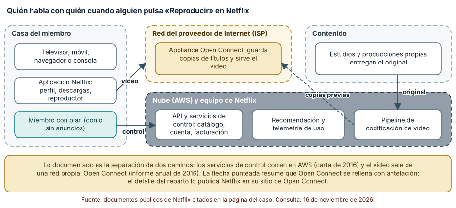
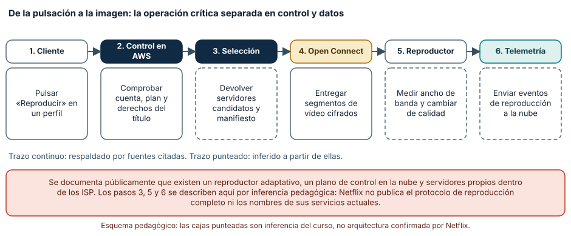
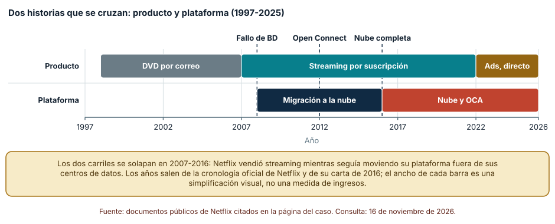
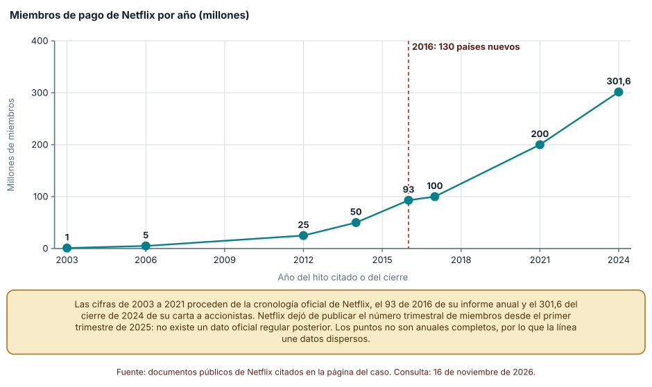

# Netflix

[↑ Casos de éxito](README.md) · [WhatsApp →](whatsapp.md)

> **Caso de éxito.** Netflix sobrevivió a dos cambios de modelo (alquiler por correo → streaming → productor de contenido) y a una migración completa de sus sistemas a la nube. Este caso explica qué se sabe, con fuentes, de cómo lo logró, qué se infiere y qué no se sabe. Es una superficie aparte de las clases: contrasta la teoría del curso con una realidad documentada.

**Cómo leer las etiquetas de este caso.** Cada afirmación técnica o de negocio lleva una de tres marcas cuando importa la diferencia: **[Documentado]** (lo dice una fuente pública citada al final), **[Inferido]** (lo deduce el curso a partir de lo documentado; puede ser falso) y **[No se sabe]** (no hay fuente pública). Las cifras llevan año y fuente. Ninguna arquitectura interna confidencial se reconstruye aquí.

## Ficha histórica

| Dato | Valor | Fuente |
| --- | --- | --- |
| Nombre | Netflix, Inc. | [N3] |
| Fundadores | Reed Hastings y Marc Randolph | [N2], [N8b] |
| Constitución | Delaware, agosto de 1997 | [N3], [N4] |
| Sitio web de alquiler de DVD | Abril de 1998 | [N4] |
| Suscripción con DVD ilimitados | 1999 | [N2] |
| Salida a bolsa | Mayo de 2002, NASDAQ, símbolo NFLX | [N2], [N3] |
| Lanzamiento del streaming | 2007; en enero de 2007 llegó la función de «ver al instante» en PC | [N2], [N4] |
| Sede | Los Gatos, California (según el informe anual de 2016) | [N3] |
| Escala (cierre de 2024) | 301,6 millones de miembros de pago; ingresos de 39 000 millones de USD en 2024; resultado operativo de más de 10 000 millones de USD | [N5] |
| Estado actual | Sociedad cotizada; desde el primer trimestre de 2025 ya no publica el número trimestral de miembros, solo hitos | [N5] |

**Nota sobre los fundadores.** Netflix lo dice en su propia cronología («Reed Hastings and Marc Randolph have an idea to rent DVDs by mail», 1997). Que Randolph fue cofundador y primer director ejecutivo lo afirma la editorial de su libro ([N8b]). El informe anual no nombra a los fundadores. Esta es la fuente más débil de la ficha y por eso se menciona dos veces.

## Contexto y problema

**Documentado.** En 1997 la idea fue alquilar DVD por correo; la propia empresa cuenta que probaron el concepto enviándose un DVD a sí mismos y que llegó intacto ([N2]). El sitio de alquiler y venta se lanzó en 1998 y en 1999 apareció la suscripción «sin fechas de devolución, sin recargos por demora y sin límites mensuales» ([N2]). En su informe de 2007 Netflix se describe aún como proveedor de acceso a «aproximadamente 90 000 títulos en DVD» para unos 7,5 millones de suscriptores ([N4]).

El problema de fondo fue siempre el mismo y cambió de forma tres veces:

1. **Frente a la tienda de alquiler:** quitar la fricción de ir a devolver el disco y eliminar la penalización por retraso (modelo de suscripción, 1999).
2. **Frente al disco físico:** quitar la espera del correo. La respuesta fue el streaming en 2007, con el requisito técnico de entregar vídeo en tiempo real a millones de personas con calidad variable de red.
3. **Frente a los dueños del contenido:** cuando los estudios endurecen licencias, depender de catálogo ajeno es un riesgo. La cronología oficial sitúa en 2013 la primera serie de originales ('House of Cards', 'Hemlock Grove', 'Arrested Development', 'Orange Is the New Black') ([N2]).

**Inferido.** El orden de las tres respuestas sugiere que Netflix fue reduciendo su dependencia de cada eslabón externo: el comercio minorista (tienda), el transporte (correo) y la licencia (estudio). No lo declara con esas palabras.

**Problema técnico que lo forzó a cambiar su plataforma.** En agosto de 2008 una corrupción de base de datos impidió enviar DVD durante tres días. Netflix lo cuenta como el punto de partida de su migración: entendieron que debían abandonar «puntos únicos de fallo con escalado vertical, como las bases de datos relacionales en nuestro centro de datos», y moverse hacia sistemas distribuidos y escalables horizontalmente en la nube ([N1]).

## Mercado, usuarios y casos de uso

Netflix es un servicio con varios públicos. La tabla resume quién es cada uno y qué obtiene; lo que la fuente no confirma se marca.

| Rol | Qué hace y qué gana | Qué cambia en su experiencia | Respaldo |
| --- | --- | --- | --- |
| Miembro (usuario final) | Reproduce series, películas, juegos, directos; crea perfiles; descarga para ver sin conexión | Plan con o sin anuncios; perfiles separados desde 2005; descargas desde 2016 | [N2] |
| Perfil infantil / supervisado | Entorno con controles parentales (introducidos en el streaming en 2011; PIN en 2018) | Contenido filtrado y acceso protegido | [N2] |
| Anunciante | Compra publicidad en el plan con anuncios (lanzado en 2022 en 12 países) | Segundo ingreso por usuario | [N2], [N5] |
| Estudio, productor, talento | Entrega contenido original o licenciado y cobra por él | **[No se sabe]** cómo se negocia ni los precios; Netflix no los publica | [N2] |
| Proveedor de acceso a internet (ISP) | Aloja servidores de Netflix dentro de su red para reducir tráfico de tránsito | Menos coste de ancho de banda para el ISP | [N6] |
| Personal de Netflix (producto, ingeniería, soporte) | Opera el servicio, atiende reclamos y decide catálogo | **[No se sabe]** los detalles internos de las herramientas | — |

**Uso central.** Ver un título en cualquier pantalla, en cualquier lugar, con calidad que se adapta a la conexión. **Mercado.** El informe anual de 2016 dice que Netflix tenía «más de 93 millones de miembros de streaming en más de 190 países» ([N3]); a fin de 2024 la carta a accionistas da 301,63 millones ([N5]). **Cambio de experiencia por segmento:** el plan con anuncios abarató la entrada y creó una segunda fuente de ingreso; el «paso de miembros extra» y el uso compartido de cuentas aparecen en la carta de 2024 como parte de la estrategia de crecimiento ([N5]).

## Funcionalidad de principio a fin

Se recorre el servicio desde el punto de vista de un miembro. Lo que sale de fuentes se marca; los pasos de implementación se tratan en la sección 6.

1. **Primer contacto.** El miembro descubre el servicio por la aplicación, un anuncio o un dispositivo con botón dedicado (el primer botón de Netflix en un control remoto es de 2011, según [N2]). **[Documentado]** que la empresa colabora con fabricantes de televisores y consolas desde 2008 para que el servicio esté instalado de origen ([N2]).
2. **Registro y plan.** Elige un plan y crea la cuenta. Los planes actuales incluyen un plan con anuncios ([N2], [N5]). **[No se sabe]** el flujo de verificación interno.
3. **Perfiles.** Crea perfiles para cada persona del hogar (función de 2005, [N2]); los recomendadores y el historial se asocian al perfil.
4. **Descubrimiento.** La recomendación personalizada existe desde 2000, cuando Netflix «introduce un sistema de recomendación basado en las calificaciones de los miembros» ([N2]). La empresa organizó el Netflix Prize, que se concedió en 2009: premio de 1 millón de USD tras casi tres años y 40 000 envíos, para mejorar la precisión un 10 % ([N2]).
5. **Reproducción.** Pulsa reproducir; la aplicación pide autorización a los servicios de control y descarga el vídeo desde un servidor cercano de la red Open Connect ([N3], [N6]). Ver sección 6 para el esquema.
6. **Pago.** La facturación fue de lo último que se migró a la nube; Netflix informa que su infraestructura de facturación y los datos de clientes y empleados tardaron más porque exigían un camino «seguro y duradero» ([N1]).
7. **Soporte.** **[No se sabe]** cómo se atienden los reclamos internamente. **[Documentado]** que la aplicación ofrece audiodescripción (2015) y controles de accesibilidad ([N2]).
8. **Operación diaria.** Para el miembro, que «simplemente funcione»; detrás, la resiliencia descrita en la sección 7.

## Negocio y economía

**Modelo (documentado).** Suscripción mensual por plan, más publicidad en el plan con anuncios desde 2022 ([N2], [N5]). La empresa dice que su meta es «sostener un crecimiento de ingresos saludable, expandir el margen operativo y aumentar el flujo de caja libre» ([N5]).

**Ingresos y márgenes.** En 2024 los ingresos fueron de 39 000 millones de USD (33 700 en 2023), +16 %. El resultado operativo superó 10 000 millones por primera vez; el margen pasó de cerca de 21 % a 27 % ([N5], cálculo propio sobre el estado de resultados). La figura siguiente muestra la composición.

**Cómo leer la figura.** Cada barra es un año completo de ingresos reducido a 100 %; los segmentos muestran cuánto de cada dólar se va a cada partida. Mire primero el segmento dorado (resultado operativo) y el azul oscuro (coste de los ingresos): uno sube seis puntos y el otro baja cuatro. **Dónde deja de valer.** Dos años no son una tendencia; «marketing + tecnología y desarrollo» agrupa dos líneas; y el estado de resultados no separa el coste de infraestructura del de contenido. No sirve para concluir cuánto cuesta la nube o el CDN.

**Costos relevantes.** **[Documentado]** que el coste de los ingresos fue de 21 000 millones de USD en 2024 ([N5]). **[No se sabe]** qué parte es contenido, qué parte infraestructura y qué parte es el CDN. **[Inferido]** que el contenido es la mayor parte, porque Netflix es productor y licenciatario de series y películas; el 8-K no lo desglosa.

**Ventajas competitivas que Netflix mismo declara.** Escala global (más de 190 países), una red propia de entrega (Open Connect), recomendación personalizada y contenido original ([N2], [N3]). Cuánto pesa cada una en el resultado **[No se sabe]**.

## Arquitectura y esquemas

### 6.1 Contexto del sistema

**Cómo leer la figura.** Hay tres espacios: la casa del miembro, la red del ISP y la nube de Netflix. Las flechas continuas son tráfico del uso normal; la punteada es el abastecimiento previo. Fíjese en que control y vídeo siguen caminos distintos. **Dónde deja de valer.** Es un esquema de contexto, no un plano de red: no muestra balanceadores, DNS, subredes ni cuántos servidores hay. El 10-K de 2016 dice que Netflix «construyó su propia red de entrega de contenido, Open Connect» ([N3]) y la carta de 2016 que todos los servicios de cara al cliente se migraron a AWS antes de 2015 ([N1]); el esquema no pretende reflejar cambios posteriores.

### 6.2 Componentes de resiliencia

**Cómo leer la figura.** Cada fila es una capa y su función; la columna izquierda dice qué es y la derecha qué hace según el blog técnico. Siga las flechas de arriba abajo: una petición baja desde la puerta de entrada hasta los datos, y la última fila no es una capa de datos sino una práctica que prueba a las otras. **Dónde deja de valer.** Es la foto de los artículos 2011-2016; no se sabe qué herramientas siguen en uso con esos nombres.

**Qué documenta cada pieza.**

- **Interruptor y respuesta alternativa (2011).** El blog de diciembre de 2011 explica que el equipo de la API reestructuró el sistema para que «mecanismos de respuesta alternativa» se activen cuando una dependencia falla: se envuelven las llamadas con código que registra el resultado, y cuando un servicio falla demasiado «dejamos de llamarlo y servimos respuestas alternativas» mientras se recupera ([N7]). El objetivo declarado era alta disponibilidad para un sistema que maneja «mil millones de peticiones al día».
- **Caché (2016).** EVCache es una caché en RAM basada en memcached, optimizada para la nube y pensada para contextos donde la consistencia fuerte no es un requisito; en el pico procesa más de 30 millones de peticiones por segundo sobre decenas de miles de instancias de memcached ([N10]).
- **Puerta de entrada.** Zuul 2 pasó de un modelo bloqueante (un hilo por conexión) a uno asíncrono y no bloqueante, donde una conexión cuesta un descriptor de archivo y no un hilo ([N9]).
- **Varias regiones (2013).** El artículo sobre «activo-activo» describe DNS (Denominator) y Zuul para dirigir tráfico, replicación de datos con Cassandra y EVCache, y herramientas de prueba (Chaos Gorilla, Chaos Kong, un «mono de cerebro dividido») ([N8]).
- **Chaos Monkey (2011).** Una herramienta que apaga instancias de producción al azar para comprobar que el servicio resiste esa falla común sin impacto para el cliente ([N11]). Una disciplina posterior, la ingeniería del caos, formaliza el método de experimentar sobre un sistema para ganar confianza en su resistencia ([N12]).

### 6.3 Flujo de la operación crítica: reproducir un título

**Cómo leer la figura.** Siga los pasos de izquierda a derecha. Las cajas azules oscuras son control en la nube, la dorada es la entrega por Open Connect y las punteadas están inferidas, no confirmadas. **Dónde deja de valer.** Netflix no publica el protocolo de reproducción actual ni el nombre de los servicios de cada paso; el esquema muestra la idea de separar control y datos, no el diseño real. La codificación por título, documentada desde 2015, adapta la receta de compresión a la complejidad de cada título («acción intensa necesita más bits que paisajes inmóviles o animación»), con el mismo o mejor resultado usando menos ancho de banda ([N13]).

### 6.4 Datos y escala

| Magnitud | Valor | Año | Fuente |
| --- | --- | --- | --- |
| Peticiones/s en EVCache en el pico | más de 30 millones | 2016 | [N10] |
| Instancias de memcached en EVCache | decenas de miles | 2016 | [N10] |
| Capacidad de un servidor Open Connect | de unos 60 TB y 80 Gbps (modelo para ISP pequeños) a hasta 120 TB y unos 200 Gbps según la ficha del modelo | consulta 2026 | [N6] |
| Países atendidos | más de 190 | 2016 | [N1], [N2] |

**[No se sabe]** el número actual de servidores, instancias, regiones o servicios. Cualquier cifra distinta de estas procede de conferencias y entrevistas que este caso no ha podido contrastar con curl.

## Casos especiales y cómo se resuelven

- **Picos de demanda.** **[Documentado]** que la carta de 2024 cita la pelea Paul-Tyson como el evento deportivo más transmitido de la historia y dos partidos de la NFL en Navidad como los más vistos ([N5]). **[Inferido]** que Open Connect, al almacenar el contenido cerca del usuario y rellenarse antes, desplaza el pico lejos de los enlaces de tránsito. **[No se sabe]** cómo se dimensionó o ensayó cada evento.
- **Fallo parcial de una dependencia.** Interruptor + respuesta alternativa: el servicio muestra una experiencia ligeramente degradada o menos personalizada antes que una pantalla de error ([N7]).
- **Fallo de una región.** Dirigir el tráfico a otra región; el artículo de 2013 describe un simulacro de interrupción real («Chaos Kong») hecho sin degradar la experiencia del usuario ([N8]).
- **Consistencia.** Las cachés EVCache asumen que no se exige consistencia fuerte ([N10]); el proveedor decide qué datos toleran verse algo viejos. **[No se sabe]** la política exacta por tipo de dato.
- **Abuso (cuentas compartidas).** La carta de 2024 menciona «paid sharing» (pago por compartir) como parte del crecimiento ([N5]); **[No se sabe]** el mecanismo de detección.
- **Cumplimiento y privacidad.** **[No se sabe]** el detalle; solo se documenta que la migración de datos de clientes y empleados exigió «un camino seguro y duradero» ([N1]).
- **Sin conexión.** La función de descarga llegó en 2016 ([N2]); **[No se sabe]** el diseño de licencias y caducidad.
- **Riesgo de la propia práctica de caos.** Una práctica tan agresiva como apagar instancias aleatorias en producción exige acotar el impacto; el artículo de 2011 lo plantea como parte de la cultura de construir servicios que tolerarán la falla ([N11]).

## Línea de tiempo

**Cómo leer la figura.** El eje es el año; cada barra es un periodo y las líneas verticales son tres hitos de plataforma. Mire dónde se solapan los carriles entre 2007 y 2016. **Dónde deja de valer.** Las barras fijan el inicio y el final de una etapa de forma simplificada; el DVD sigue siendo un producto en periodos posteriores a 2007 que esta figura no mide.

- **1997.** Idea del alquiler de DVD por correo; constitución en Delaware en agosto ([N2], [N3]).
- **1998.** Sitio web de alquiler y venta ([N2], [N4]).
- **1999.** Suscripción de alquiler ilimitado ([N2]).
- **2000.** Sistema de recomendación personalizado ([N2]).
- **2002.** Salida a bolsa ([N2], [N3]).
- **2007.** Streaming ([N2]); enero, función de ver al instante en PC ([N4]).
- **2008.** Corrupción de base de datos de tres días que impulsa la migración a la nube ([N1]).
- **2009.** Se concede el Netflix Prize ([N2]).
- **2011.** Llega a América Latina y el Caribe; se publican Chaos Monkey y la Simian Army ([N2], [N11]).
- **2012.** Lanza Open Connect y llega a 25 millones de miembros ([N2]).
- **2013.** Primeras series originales ([N2]); artículo sobre activo-activo ([N8]).
- **2015.** Codificación por título; primera película original ([N13], [N2]).
- **2016.** Expansión a 130 países nuevos (6 de enero) y fin de la migración a la nube en enero ([N1], [N2]).
- **2017.** 100 millones de miembros ([N2]).
- **2021.** Más de 200 millones y primeros juegos móviles ([N2]).
- **2022.** Plan con anuncios en 12 países ([N2]).
- **2023.** Primeros directos ([N2]).
- **2024.** 301,6 millones de miembros y récords de emisión en directo ([N5]).
- **2025.** Dejan de publicar el número trimestral de miembros ([N5]).

**Cómo leer la figura.** El eje horizontal es el año y el vertical los millones de miembros; los números rotulados son los datos citados. Observe la pendiente: tras la expansión de 2016 la línea sube más rápido. **Dónde deja de valer.** Une puntos dispersos (algunos son «supera N millones»), no una serie anual regular; después de 2024 no hay dato oficial equivalente.

## Vínculo con el curso

Cada fila indica dónde enseña el programa el concepto y qué parte de la teoría ilustra Netflix. Las clases están enlazadas.

| Concepto | Clases | Qué ilustra el caso |
| --- | --- | --- |
| Modelo de negocio y sostenibilidad | [SE-133](../../classes/part-11-economia-metricas-y-decisiones-de-producto/se-133-modelos-de-negocio-y-sostenibilidad/README.md), [SE-139](../../classes/part-11-economia-metricas-y-decisiones-de-producto/se-139-north-star-guardrails-y-metricas-contrarias/README.md) | De alquiler a suscripción, publicidad y contenido propio: un modelo cambia, la métrica guía (miembros, margen) también |
| Costo de construir y operar | [SE-134](../../classes/part-11-economia-metricas-y-decisiones-de-producto/se-134-costos-de-construccion-operacion-y-oportunidad/README.md), [SE-140](../../classes/part-11-economia-metricas-y-decisiones-de-producto/se-140-finops-de-producto-y-costo-por-resultado/README.md) | El coste de los ingresos domina el estado de resultados; qué parte es infraestructura no se publica |
| Decisiones reversibles e irreversibles | [SE-142](../../classes/part-11-economia-metricas-y-decisiones-de-producto/se-142-decisiones-reversibles-e-irreversibles/README.md), [SE-442](../../classes/part-36-mantenimiento-y-modernizacion-legacy/se-442-economia-de-reescribir-frente-a-evolucionar/README.md) | Reescribir frente a evolucionar: migrar a la nube durante siete años en vez de un corte único |
| Estilos arquitectónicos y microservicios | [SE-532](../../classes/part-44-estilos-arquitectonicos/se-532-microservicios-y-sus-costes-reales/README.md), [SE-533](../../classes/part-44-estilos-arquitectonicos/se-533-bff-api-gateway-y-service-mesh/README.md), [SE-303](../../classes/part-25-arquitectura-de-software-y-dominio/se-303-monolito-modular-monolith-y-servicios/README.md) | Servicios con puerta de entrada (Zuul) y los costes de operar muchos servicios |
| Arquitectura evolutiva | [SE-308](../../classes/part-25-arquitectura-de-software-y-dominio/se-308-fitness-functions-y-arquitectura-evolutiva/README.md), [SE-538](../../classes/part-44-estilos-arquitectonicos/se-538-evolucion-y-migracion-entre-estilos/README.md) | De una base relacional vertical a sistemas distribuidos tras el fallo de 2008 |
| Migración sin parar el servicio | [SE-437](../../classes/part-36-mantenimiento-y-modernizacion-legacy/se-437-strangler-branch-by-abstraction-y-anticorruption/README.md), [SE-439](../../classes/part-36-mantenimiento-y-modernizacion-legacy/se-439-migraciones-de-datos-sin-interrupcion/README.md), [SE-440](../../classes/part-36-mantenimiento-y-modernizacion-legacy/se-440-compatibilidad-coexistencia-y-doble-escritura/README.md) | Strangler, doble escritura y coexistencia durante el traslado a AWS |
| Latencia, saturación y capacidad | [SE-376](../../classes/part-31-calidad-rendimiento-y-resiliencia/se-376-latencia-throughput-saturacion-y-capacidad/README.md), [SE-375](../../classes/part-31-calidad-rendimiento-y-resiliencia/se-375-carga-estres-picos-y-endurance/README.md) | Picos de eventos en directo y por qué Netflix quiere el contenido cerca del usuario |
| Timeouts, interruptores y degradación | [SE-378](../../classes/part-31-calidad-rendimiento-y-resiliencia/se-378-timeouts-retries-backoff-y-jitter/README.md), [SE-379](../../classes/part-31-calidad-rendimiento-y-resiliencia/se-379-circuit-breakers-bulkheads-y-degradacion/README.md), [SE-524](../../classes/part-43-patrones-de-diseno-empresariales-y-de-resiliencia/se-524-resiliencia-timeout-retry-con-jitter-y-circuit-breaker/README.md), [SE-525](../../classes/part-43-patrones-de-diseno-empresariales-y-de-resiliencia/se-525-resiliencia-bulkhead-sidecar-ambassador-y-degradacion/README.md) | Hystrix: dejar de llamar a un servicio que falla y servir una alternativa |
| Caos controlado | [SE-346](../../classes/part-28-concurrencia-y-sistemas-distribuidos/se-346-caos-controlado-y-pruebas-de-distribucion/README.md) | Chaos Monkey y los principios del caos como pruebas con hipótesis |
| Disponibilidad y recuperación | [SE-380](../../classes/part-31-calidad-rendimiento-y-resiliencia/se-380-disponibilidad-durabilidad-y-recuperacion/README.md), [SE-430](../../classes/part-35-observabilidad-sre-e-incidentes/se-430-continuidad-disaster-recovery-y-ejercicios/README.md) | Active-active entre regiones y simulacros de pérdida de una región |
| Réplicas, particiones y consistencia | [SE-319](../../classes/part-26-datos-persistencia-y-recuperacion/se-319-replicacion-particion-y-distribucion/README.md), [SE-342](../../classes/part-28-concurrencia-y-sistemas-distribuidos/se-342-consistencia-disponibilidad-y-particiones/README.md), [SE-345](../../classes/part-28-concurrencia-y-sistemas-distribuidos/se-345-replicacion-sharding-y-balanceo/README.md) | Cassandra y EVCache replicadas: elegir disponibilidad sobre consistencia fuerte |
| Cachés y consistencia entre capas | [SE-320](../../classes/part-26-datos-persistencia-y-recuperacion/se-320-caches-y-consistencia-entre-capas/README.md) | EVCache como RAM de baja latencia que tolera datos algo viejos |
| CDN, proxies y balanceadores | [SE-044](../../classes/part-03-redes-internet-y-protocolos/se-044-proxies-balanceadores-gateways-y-cdn/README.md), [SE-042](../../classes/part-03-redes-internet-y-protocolos/se-042-http-semantica-cache-y-negociacion/README.md) | Open Connect es una CDN propia; el streaming adaptativo se apoya en HTTP |
| Cloud: IaaS y responsabilidad compartida | [SE-349](../../classes/part-29-cloud-plataforma-e-infraestructura/se-349-iaas-paas-saas-y-responsabilidad-compartida/README.md), [SE-356](../../classes/part-29-cloud-plataforma-e-infraestructura/se-356-escalado-capacidad-y-costos/README.md), [SE-357](../../classes/part-29-cloud-plataforma-e-infraestructura/se-357-multi-cloud-hibrido-y-portabilidad-real/README.md) | Elegir AWS; escalar y pagar capacidad sin comprarla |
| Observabilidad y SLO | [SE-421](../../classes/part-35-observabilidad-sre-e-incidentes/se-421-senales-eventos-y-observabilidad-util/README.md), [SE-425](../../classes/part-35-observabilidad-sre-e-incidentes/se-425-sli-slo-sla-y-presupuestos-de-error/README.md) | Medir cada llamada para decidir cuándo abrir un interruptor |
| Despliegue progresivo | [SE-403](../../classes/part-33-build-release-y-cadena-de-suministro/se-403-feature-flags-y-entrega-progresiva/README.md), [SE-404](../../classes/part-33-build-release-y-cadena-de-suministro/se-404-canary-blue-green-y-rollback/README.md) | Cambios por etapas y regiones; **[No se sabe]** el pipeline interno actual |
| Experiencia, accesibilidad e internacionalización | [SE-173](../../classes/part-14-experiencia-accesibilidad-e-internacionalizacion/se-173-accesibilidad-perceptible-operable-y-comprensible/README.md), [SE-177](../../classes/part-14-experiencia-accesibilidad-e-internacionalizacion/se-177-internacionalizacion-localizacion-y-formatos-culturales/README.md) | Audiodescripción, subtítulos y 21 idiomas |
| Offline | [SE-260](../../classes/part-21-software-movil-escritorio-y-multiplataforma/se-260-offline-first-y-resolucion-de-conflictos/README.md) | La descarga para ver sin conexión |

## Qué no generalizar

**Qué aprender.**

- Un incidente concreto (tres días sin enviar DVD) puede justificar una reorganización de siete años; la causa, no la moda, orientó la decisión ([N1]).
- Separar el plano de control del plano de datos (cómputo en la nube, vídeo en CDN propia) permite escalar cada uno con su propia lógica.
- La resiliencia se practica: apagar cosas a propósito es la forma de saber si las respuestas alternativas funcionan ([N11], [N12]).
- Una plataforma tolera la falla de una dependencia si se diseñó para degradar, no solo para funcionar.

**Qué no generalizar.**

- **No** hace falta una CDN propia ni Cassandra: Netflix pudo construirlas por escala y por tener un equipo para mantenerlas; casi nadie está en ese punto.
- **No** se debe copiar Chaos Monkey en un sistema sin observabilidad, sin respuestas alternativas y sin rollback.
- **No** se debe asumir que los artículos de 2011-2016 describen la arquitectura actual.
- Las cifras de miembros no son comparables entre empresas con definiciones distintas de «miembro» o «usuario activo».
- Un caso de éxito tiene sesgo de supervivencia: el blog muestra lo que funcionó y no las alternativas descartadas.

## Fuentes públicas verificadas

Fecha de consulta de todas: 16 de noviembre de 2026. Las URL se comprobaron con `curl` salvo donde se indica.

- **[N1]** Netflix, «Completing the Netflix Cloud Migration», febrero de 2016: [https://about.netflix.com/en/news/completing-the-netflix-cloud-migration](https://about.netflix.com/en/news/completing-the-netflix-cloud-migration). Respalda: agosto de 2008, corrupción de base de datos de tres días, enero de 2016 como fin de la migración, 130 países el 6 de enero de 2016, ocho veces más miembros que en 2008.
- **[N2]** Netflix, cronología oficial de la compañía (página de liderazgo): [https://about.netflix.com/en/leadership](https://about.netflix.com/en/leadership). Respalda los años de 1997 a 2025 de la sección 8.
- **[N3]** Netflix, Form 10-K del año fiscal 2016 (SEC; leído con la herramienta de lectura web porque `curl` recibe un 403 del sitio): [https://sec.gov/Archives/edgar/data/1065280/000162828017000496/nflx201610k.htm](https://sec.gov/Archives/edgar/data/1065280/000162828017000496/nflx201610k.htm). Respalda constitución, IPO, 93 millones de miembros, sede y Open Connect.
- **[N4]** Netflix, Form 10-K del año fiscal 2007 (SEC; misma limitación): [https://www.sec.gov/Archives/edgar/data/0001065280/000119312508040378/d10k.htm](https://www.sec.gov/Archives/edgar/data/0001065280/000119312508040378/d10k.htm). Respalda abril de 1998, enero de 2007 y 7,5 millones de suscriptores.
- **[N5]** Netflix, Q4'24 Earnings 8-K con la carta a accionistas: [https://s22.q4cdn.com/959853165/files/doc_downloads/2025/Q4-24-Earnings-8-K.pdf](https://s22.q4cdn.com/959853165/files/doc_downloads/2025/Q4-24-Earnings-8-K.pdf). Respalda 301,63 millones de miembros, ingresos de 39 001 millones, estado de resultados 2023-2024, fin de la publicación trimestral de miembros, anuncios y directos.
- **[N6]** Netflix Open Connect, «Appliances»: [https://openconnect.netflix.com/en/appliances/](https://openconnect.netflix.com/en/appliances/). Respalda las capacidades por modelo.
- **[N7]** Netflix Technology Blog, «Making the Netflix API More Resilient», 8 de diciembre de 2011: [https://netflixtechblog.com/making-the-netflix-api-more-resilient-a8ec62159c2d](https://netflixtechblog.com/making-the-netflix-api-more-resilient-a8ec62159c2d).
- **[N8]** Netflix Technology Blog, «Active-Active for Multi-Regional Resiliency», 12 de febrero de 2013: [https://netflixtechblog.com/active-active-for-multi-regional-resiliency-c47719f6685b](https://netflixtechblog.com/active-active-for-multi-regional-resiliency-c47719f6685b).
- **[N8b]** Hachette Book Group, ficha de *That Will Never Work* de Marc Randolph (ISBN 9780316530200): [https://www.hachettebookgroup.com/titles/marc-randolph/that-will-never-work/9780316530200/](https://www.hachettebookgroup.com/titles/marc-randolph/that-will-never-work/9780316530200/). Respalda que Randolph fue cofundador y primer director ejecutivo.
- **[N9]** Netflix Technology Blog, «Zuul 2: The Netflix Journey to Asynchronous, Non-Blocking Systems»: [https://netflixtechblog.com/zuul-2-the-netflix-journey-to-asynchronous-non-blocking-systems-45947377fb5c](https://netflixtechblog.com/zuul-2-the-netflix-journey-to-asynchronous-non-blocking-systems-45947377fb5c). Publicado el 21 de septiembre de 2016.
- **[N10]** Netflix Technology Blog, «Caching for a Global Netflix» (EVCache): [https://netflixtechblog.com/caching-for-a-global-netflix-7bcc457012f1](https://netflixtechblog.com/caching-for-a-global-netflix-7bcc457012f1). Publicado el 1 de marzo de 2016.
- **[N11]** Netflix Technology Blog, «The Netflix Simian Army», 19 de julio de 2011: [https://netflixtechblog.com/the-netflix-simian-army-16e57fbab116](https://netflixtechblog.com/the-netflix-simian-army-16e57fbab116).
- **[N12]** Principles of Chaos Engineering: [https://principlesofchaos.org/](https://principlesofchaos.org/).
- **[N13]** Netflix Technology Blog, «Per-Title Encode Optimization», 14 de diciembre de 2015: [https://netflixtechblog.com/per-title-encode-optimization-7e99442b62a2](https://netflixtechblog.com/per-title-encode-optimization-7e99442b62a2).

**Límites de este caso.** No se ejecutó ni se midió ningún sistema de Netflix; todo es lectura de fuentes públicas. Las cifras de EVCache y de Open Connect son de las fechas indicadas y pueden haber cambiado. Las clases enlazadas enseñan los conceptos con laboratorios propios; este caso no prueba que Netflix aplique cada uno tal como se enseña.

---

[↑ Casos de éxito](README.md) · [WhatsApp →](whatsapp.md)
