# Netflix

[↑ Casos de éxito](README.md) · [WhatsApp →](whatsapp.md)

> **Caso de éxito.** Netflix sobrevivió a dos cambios de modelo (alquiler por correo → streaming → productor de contenido) y a una migración completa de sus sistemas a la nube. Este caso explica qué se sabe, con fuentes, de cómo lo logró, qué se infiere y qué no se sabe. Es una superficie aparte de las clases: contrasta la teoría del curso con una realidad documentada.

**Cómo leer las etiquetas de este caso.** Cada afirmación técnica o de negocio lleva una de tres marcas cuando importa la diferencia: **[Documentado]** (lo dice una fuente pública citada al final), **[Inferido]** (lo deduce el curso a partir de lo documentado; puede ser falso) y **[No se sabe]** (no hay fuente pública). Las cifras llevan año y fuente. Ninguna arquitectura interna confidencial se reconstruye aquí. Los esquemas usan trazo continuo para lo documentado y trazo punteado para lo inferido. Los apartados rotulados «análisis propio» son razonamiento del curso, no hechos.

**Cómo usar el caso.** Léalo después de las clases enlazadas en «Vínculo con el curso». La sección de arquitectura se recorre como un mapa con zoom creciente: contexto, contenedores, componentes, secuencia, datos, despliegue, resiliencia, seguridad, operación y evolución. Al final hay preguntas y ejercicios para aplicar el método a un caso propio.

## Ficha histórica

| Dato | Valor | Fuente |
| --- | --- | --- |
| Nombre | Netflix, Inc. | [N3] |
| Fundadores | Reed Hastings y Marc Randolph | [N2], [N8b] |
| Constitución | Delaware, agosto de 1997 | [N3], [N4] |
| Sitio web de alquiler de DVD | Abril de 1998 | [N4] |
| Suscripción con DVD ilimitados | 1999 | [N2] |
| Salida a bolsa | Mayo de 2002, NASDAQ, símbolo NFLX | [N2], [N3] |
| Lanzamiento del streaming | 2007; en enero de 2007 llegó la función de «ver al instante» en PC | [N2], [N4] |
| Sede | Los Gatos, California (según el informe anual de 2016) | [N3] |
| Escala (cierre de 2024) | 301,6 millones de miembros de pago; ingresos de 39 000 millones de USD en 2024; resultado operativo de más de 10 000 millones de USD | [N5] |
| Escala (cierre de 2025) | Ingresos de 45 183 millones de USD y resultado operativo de 13 327 millones (margen de 29,5 %); unos 16 000 empleados a tiempo completo; un solo segmento operativo | [N14] |
| Estado actual | Sociedad cotizada; desde 2025 ya no publica el número de miembros, solo hitos. En diciembre de 2025 firmó un acuerdo para adquirir el negocio de streaming y estudios de Warner Bros. Discovery, enmendado en enero de 2026; el desenlace posterior a esa fecha no consta en las fuentes de este caso | [N5], [N14] |

**Nota sobre los fundadores.** Netflix lo dice en su propia cronología («Reed Hastings and Marc Randolph have an idea to rent DVDs by mail», 1997). Que Randolph fue cofundador y primer director ejecutivo lo afirma la editorial de su libro ([N8b]). El informe anual no nombra a los fundadores. Esta es la fuente más débil de la ficha y por eso se menciona dos veces.

**Qué mide cada cifra de escala.** «Miembro de pago» es, según el informe de 2016, el derecho a recibir el servicio tras registrarse y aportar un método de pago, e incluye a quien está en periodo de prueba mientras haya un medio de pago ([N3]). Los ingresos son contables y el resultado operativo es el de un único segmento: el 10-K de 2025 dice que opera como un solo segmento ([N14]), de modo que no hay desglose oficial de rentabilidad por región o por línea.

### Oficinas, plantilla y estructura

**Oficinas (documentado).** El 10-K de 2025 dice que Netflix arrienda sus propiedades principales en Los Gatos, California, sede corporativa, y en Los Ángeles, y que posee y arrienda oficinas y espacio de producción «en todo el mundo» ([N14]). **[No se sabe]** la lista pública de oficinas por país, las fechas de apertura y los centros de ingeniería fuera de California: el 10-K no los enumera y este caso no encontró una fuente primaria que lo haga.

**Plantilla (documentado).** A fines de 2025 Netflix tenía unos 16 000 empleados a tiempo completo: unos 10 900 (68 %) en Estados Unidos y Canadá, 2 500 (16 %) en Europa, Oriente Medio y África, 1 900 (12 %) en Asia-Pacífico y 700 (4 %) en Latinoamérica, además de personal de producción a tiempo parcial o temporal cuyo número varía ([N14]).

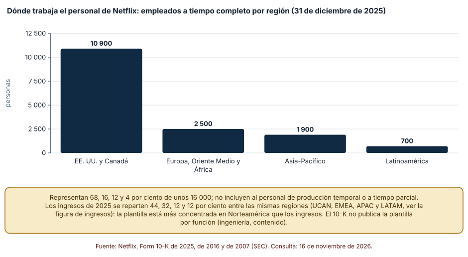

**Cómo leer la figura.** Cada barra es una región y su altura el número de empleados a tiempo completo; compare con los ingresos por región de la sección de economía. Mire la diferencia: la plantilla está más concentrada en Norteamérica (68 %) que los ingresos (44 %). **Dónde deja de valer.** Es un corte a una fecha, no incluye al personal temporal de producción y no distingue funciones; no es un mapa geográfico de oficinas.

**Estructura (documentado y no documentado).** El 10-K declara un solo segmento operativo ([N14]), lo que implica que no hay divisiones con resultados propios publicados. **[No se sabe]** el organigrama de alto nivel, el número de ingenieros, cómo se agrupan los equipos de plataforma y de producto, y cuántos trabajan en Open Connect. El 10-K de 2025 sí fija un orden de magnitud: 3 391 millones de USD de gasto en tecnología y desarrollo en 2025, 7,5 % de los ingresos ([N14]).

**Cálculo propio.** Con ingresos de 45 183 millones y unos 16 000 empleados a tiempo completo, el ingreso por empleado es de unos 2,8 millones de USD; es una cifra de orden de magnitud, no de productividad, porque gran parte del trabajo (producción, entrega, nube) se contrata fuera.

## Contexto y problema

**Documentado.** En 1997 la idea fue alquilar DVD por correo; la propia empresa cuenta que probaron el concepto enviándose un DVD a sí mismos y que llegó intacto ([N2]). El sitio de alquiler y venta se lanzó en 1998 y en 1999 apareció la suscripción «sin fechas de devolución, sin recargos por demora y sin límites mensuales» ([N2]). En su informe de 2007 Netflix se describe aún como proveedor de acceso a «aproximadamente 90 000 títulos en DVD» para unos 7,5 millones de suscriptores, con una biblioteca creciente de más de 6 000 títulos que se podían ver al instante en el PC y nueve planes desde 4,99 USD al mes ([N4]).

El problema de fondo fue siempre el mismo y cambió de forma tres veces:

1. **Frente a la tienda de alquiler:** quitar la fricción de ir a devolver el disco y eliminar la penalización por retraso (modelo de suscripción, 1999).
2. **Frente al disco físico:** quitar la espera del correo. La respuesta fue el streaming en 2007, con el requisito técnico de entregar vídeo en tiempo real a millones de personas con calidad variable de red.
3. **Frente a los dueños del contenido:** cuando los estudios endurecen licencias, depender de catálogo ajeno es un riesgo. La cronología oficial sitúa en 2013 la primera serie de originales ('House of Cards', 'Hemlock Grove', 'Arrested Development', 'Orange Is the New Black') ([N2]).

**Inferido.** El orden de las tres respuestas sugiere que Netflix fue reduciendo su dependencia de cada eslabón externo: el comercio minorista (tienda), el transporte (correo) y la licencia (estudio). No lo declara con esas palabras.

### El mundo anterior en cifras (2007)

El informe anual de 2007 permite fotografiar el negocio justo antes del streaming ([N4]). Tenía 7,479 millones de suscriptores a fin de año (6,316 en 2006 y 4,179 en 2005), ingresos de 1 205 millones de USD, un margen bruto de 34,8 % y un coste de adquisición de suscriptor de 40,88 USD. La compañía informaba además una rotación que el documento rotula «anualizada» (4,3 %). La figura muestra la trayectoria de suscriptores de esos años.

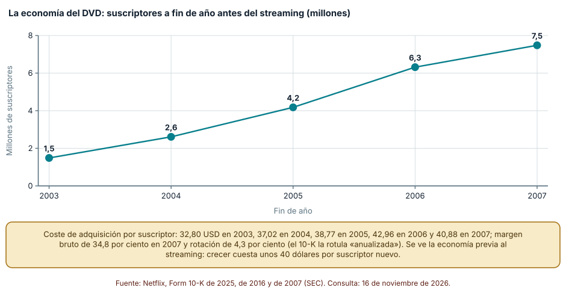

**Cómo leer la figura.** El eje horizontal es el año y el vertical los millones de suscriptores a fin de año; cada punto está rotulado. Mire la pendiente entre 2005 y 2006, la más fuerte, y luego la nota inferior, que da el coste de captar a cada uno. **Dónde deja de valer.** Son cinco puntos de un solo informe: no dice nada de la distribución por plan ni del coste de enviar cada disco, que el 10-K agrupa en costes de suscripción y de cumplimiento. La lectura de la rotación como mensual es una conjetura de este curso y no consta en la fuente.

### Qué había antes de Netflix y qué amenazaba al modelo

**Documentado.** El propio 10-K de 2007 señala que a fines de 2006 Blockbuster lanzó un programa integrado en tienda y en línea en el que sus suscriptores podían devolver los discos en el local ([N4]). Es la prueba de que el modelo de alquiler por correo no estaba protegido por nada más que la ejecución. Y el mismo informe declara que Netflix creía que el DVD, junto con sus sucesores de alta definición, seguiría siendo el medio principal de ver contenido en el hogar «en el futuro previsible» ([N4]), mientras anunciaba la función de ver al instante.

**Interpretación.** El pasaje es valioso porque muestra una empresa que cubre dos apuestas a la vez: confirma el producto vigente y lanza el que lo sustituirá. No es un error de previsión que haya que juzgar con la información posterior; es un ejemplo de la clase sobre decisiones reversibles: se invierte en la opción nueva sin abandonar la antigua hasta que los datos lo permiten ([SE-142](../../classes/part-11-economia-metricas-y-decisiones-de-producto/se-142-decisiones-reversibles-e-irreversibles/README.md)).

**Problema técnico que lo forzó a cambiar su plataforma.** En agosto de 2008 una corrupción de base de datos impidió enviar DVD durante tres días. Netflix lo cuenta como el punto de partida de su migración: entendieron que debían abandonar «puntos únicos de fallo con escalado vertical, como las bases de datos relacionales en nuestro centro de datos», y moverse hacia sistemas distribuidos y escalables horizontalmente en la nube ([N1]).

### La apuesta, enunciada como hipótesis

El curso propone leer la apuesta de Netflix como tres hipótesis comprobables ([SE-124](../../classes/part-10-descubrimiento-y-estrategia-de-producto/se-124-hipotesis-supuestos-y-preguntas-criticas/README.md)): (1) los clientes pagarán una cuota fija por un catálogo con el que se sientan sin límite; (2) el vídeo por internet será suficientemente bueno y barato antes de que los competidores cierren el hueco; (3) poseer parte del contenido y de la red de entrega vale más que alquilarlos. Cada una tenía un criterio de fracaso claro: si la rotación sube, si la calidad de vídeo sobre redes reales es insuficiente, o si el coste del contenido propio no se compensa con retención. Esta formulación es del curso; Netflix no publica sus hipótesis internas.

## Mercado, usuarios y casos de uso

Netflix es un servicio con varios públicos. La tabla resume quién es cada uno y qué obtiene; lo que la fuente no confirma se marca.

| Rol | Qué hace y qué gana | Qué cambia en su experiencia | Respaldo |
| --- | --- | --- | --- |
| Miembro (usuario final) | Reproduce series, películas, juegos, directos; crea perfiles; descarga para ver sin conexión | Plan con o sin anuncios; perfiles separados desde 2005; descargas desde 2016 | [N2] |
| Perfil infantil / supervisado | Entorno con controles parentales (introducidos en el streaming en 2011; PIN en 2018) | Contenido filtrado y acceso protegido | [N2] |
| Anunciante | Compra publicidad en el plan con anuncios (lanzado en 2022 en 12 países) | Segundo ingreso por usuario | [N2], [N5] |
| Estudio, productor, talento | Entrega contenido original o licenciado y cobra por él | **[No se sabe]** cómo se negocia ni los precios; Netflix no los publica | [N2] |
| Proveedor de acceso a internet (ISP) | Aloja servidores de Netflix dentro de su red para reducir tráfico de tránsito | Menos coste de ancho de banda para el ISP | [N6], [N20] |
| Fabricante de dispositivos | Preinstala la aplicación o incluye un botón en el mando | Más uso del dispositivo; Netflix colabora con fabricantes desde 2008 | [N2] |
| Personal de Netflix (producto, ingeniería, soporte) | Opera el servicio, atiende reclamos y decide catálogo | **[No se sabe]** los detalles internos de las herramientas | — |

**Uso central.** Ver un título en cualquier pantalla, en cualquier lugar, con calidad que se adapta a la conexión. **Mercado.** El informe anual de 2016 dice que Netflix tenía «más de 93 millones de miembros de streaming en más de 190 países» ([N3]); a fin de 2024 la carta a accionistas da 301,63 millones ([N5]). **Cambio de experiencia por segmento:** el plan con anuncios abarató la entrada y creó una segunda fuente de ingreso; el «paso de miembros extra» y el uso compartido de cuentas aparecen en la carta de 2024 como parte de la estrategia de crecimiento ([N5]).

### Quién da qué a quién

La tabla anterior enumera roles; la figura siguiente muestra el flujo de valor entre ellos, que es lo que explica por qué cada actor participa.

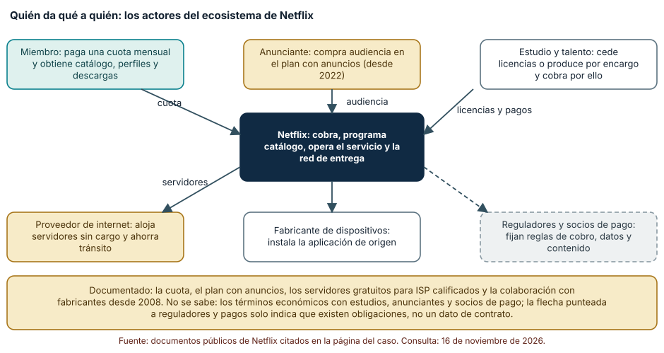

**Cómo leer la figura.** Netflix está en el centro porque es el único actor que habla con todos. Las flechas indican quién entrega valor a quién: cuota, audiencia, licencias, servidores. Mire primero a qué actor le conviene participar sin pagar: el proveedor de internet recibe servidores sin cargo si califica y ahorra tránsito ([N20]). **Dónde deja de valer.** No muestra magnitudes ni condiciones contractuales, que Netflix no publica; la flecha punteada a reguladores y socios de pago solo señala que existen obligaciones.

### Incentivos por tipo de usuario (análisis propio sobre hechos documentados)

- **Miembro de un hogar con hijos.** Valora el catálogo amplio, los perfiles y los controles parentales; su incentivo para quedarse es que cada integrante encuentre algo que ver sin gestionar nada. El sistema responde con perfiles separados (2005) y controles parentales con PIN (2018) ([N2]).
- **Miembro individual con presupuesto ajustado.** Su criterio dominante es el precio mensual; el plan con anuncios se creó en 2022 para captar a quien prefiere pagar menos y tolerar publicidad ([N2], [N5]).
- **Miembro que viaja o tiene mala conexión.** Valora las descargas (2016) y la adaptación de calidad ([N2], [N13]).
- **Hogar que comparte cuenta.** Su incentivo es dividir el coste; el incentivo de Netflix es convertir el uso compartido en ingresos, por lo que el 10-K de 2025 dice que ha aumentado la aplicación de sus términos sobre uso multihogar ([N14]).
- **Anunciante.** Quiere audiencia medible; el plan con anuncios convierte la cuota baja en un segundo ingreso por usuario ([N5]).
- **Estudio y talento.** Su incentivo es cobrar por la licencia o por la producción; la tensión es que cada título licenciado a Netflix compite con sus propios canales. **[No se sabe]** cómo se resuelve contractualmente.
- **ISP.** Quiere reducir el tráfico de tránsito que paga a terceros; Netflix le ofrece servidores sin cargo si califica, a cambio de espacio, energía y conectividad ([N20]).

### Competencia y por qué el mercado favoreció a Netflix (análisis propio)

El 10-K de 2025 describe una competencia amplia: modelos de suscripción, transaccionales, con publicidad y basados en piratería, y proveedores tradicionales (televisión abierta, por cable) y de internet ([N14]). La razón por la que el mercado favoreció a Netflix no está declarada. El análisis propio del curso plantea cuatro factores combinados, ninguno suficiente por sí solo: (1) llegar primero a la entrega por internet a escala, con años de ventaja en recomendación y en red de entrega; (2) un coste fijo de contenido repartido entre una base de miembros muy grande, de modo que cada título nuevo cuesta menos por miembro; (3) la integración de la red de entrega, que convierte un coste variable por gigabyte en un activo que se amortiza; (4) la presencia global desde 2016, que multiplica la base sobre la que se reparte el contenido. **[No se sabe]** cuánto pesa cada factor.

## Funcionalidad de principio a fin

Se recorre el servicio primero con el miembro estándar y luego con otros tipos de usuario, hasta su caso límite. Lo que sale de fuentes se marca; los pasos de implementación se tratan en la sección de arquitectura.

### Recorrido del miembro estándar

1. **Primer contacto.** El miembro descubre el servicio por la aplicación, un anuncio o un dispositivo con botón dedicado (el primer botón de Netflix en un control remoto es de 2011, según [N2]). **[Documentado]** que la empresa colabora con fabricantes de televisores y consolas desde 2008 para que el servicio esté instalado de origen ([N2]).
2. **Registro y plan.** Elige un plan y crea la cuenta. Los planes actuales incluyen un plan con anuncios ([N2], [N5]). **[No se sabe]** el flujo de verificación interno.
3. **Perfiles.** Crea perfiles para cada persona del hogar (función de 2005, [N2]); los recomendadores y el historial se asocian al perfil.
4. **Descubrimiento.** La recomendación personalizada existe desde 2000, cuando Netflix «introduce un sistema de recomendación basado en las calificaciones de los miembros» ([N2]). La empresa organizó el Netflix Prize, que se concedió en 2009: premio de 1 millón de USD tras casi tres años y 40 000 envíos, para mejorar la precisión un 10 % ([N2]).
5. **Reproducción.** Pulsa reproducir; la aplicación pide autorización a los servicios de control y descarga el vídeo desde un servidor cercano de la red Open Connect ([N3], [N6]). Ver sección de arquitectura para el esquema.
6. **Pago.** La facturación fue de lo último que se migró a la nube; Netflix informa que su infraestructura de facturación y los datos de clientes y empleados tardaron más porque exigían un camino «seguro y duradero» ([N1]).
7. **Soporte.** **[No se sabe]** cómo se atienden los reclamos internamente. **[Documentado]** que la aplicación ofrece audiodescripción (2015) y controles de accesibilidad ([N2]).
8. **Operación diaria.** Para el miembro, que «simplemente funcione»; detrás, la resiliencia descrita en la sección de arquitectura.

### Recorridos por tipo de usuario

La figura resume cuatro recorridos completos, cada uno con su caso límite. Después se explica cada uno con lo que se sabe y lo que no.

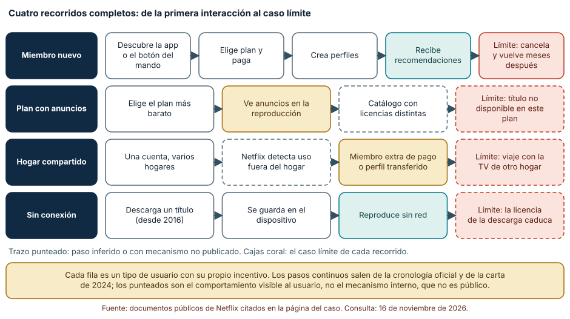

**Cómo leer la figura.** Cada fila es un usuario distinto; las cajas se leen de izquierda a derecha y la última, en coral, es el caso límite donde el diseño es más difícil. Mire qué recorridos tienen pasos punteados: son los que dependen de mecanismos no publicados. **Dónde deja de valer.** Es un recorrido visible al usuario, no un diagrama de estados del sistema; no dice cuántos usuarios pasan por cada fila ni con qué frecuencia llegan al caso límite.

**Miembro del plan con anuncios.** **[Documentado]** que el plan existe desde 2022 y que la publicidad es un segundo ingreso por usuario ([N2], [N5]). El recorrido añade al flujo estándar la inserción de anuncios en la reproducción. **[Inferido]** que el catálogo disponible puede diferir por licencias; el caso límite es un título que no está disponible en ese plan. **[No se sabe]** cómo se selecciona y mide cada anuncio.

**Hogar que comparte la cuenta.** **[Documentado]** que el 10-K de 2025 dice que Netflix aplica sus términos de uso para limitar el uso multihogar y que ajusta planes y precios, con la advertencia de que estas medidas pueden no ser bien recibidas por los consumidores ([N14]); la carta de 2024 menciona el pago por compartir como parte del crecimiento ([N5]). **[No se sabe]** el método de detección. El caso límite es el miembro que viaja y usa un televisor de otro hogar: cualquier regla de «mismo hogar» produce falsos positivos y obliga a diseñar una vía de verificación temporal. Cómo lo resuelve Netflix en detalle no es público.

**Miembro sin conexión.** **[Documentado]** que la descarga llegó en 2016 ([N2]). El recorrido: elegir un título descargable, guardarlo en el dispositivo y reproducirlo sin red. **[No se sabe]** el diseño de licencias y caducidad; el curso lo contrasta con el diseño offline-first de [SE-260](../../classes/part-21-software-movil-escritorio-y-multiplataforma/se-260-offline-first-y-resolucion-de-conflictos/README.md): el caso límite es la licencia de la descarga que caduca mientras el dispositivo sigue desconectado.

**Perfil infantil.** **[Documentado]** que los controles parentales existen en el streaming desde 2011 y que el PIN llegó en 2018 ([N2]). El caso límite es un adulto que reproduce desde un perfil infantil: el control protege el acceso, no la intención.

**Miembro en directo.** **[Documentado]** que los primeros directos son de 2023 y que la carta de 2024 cita récords de emisión ([N2], [N5]). Un evento en directo cambia la carga: todos los espectadores piden el mismo contenido a la vez, sin posibilidad de preparar copias con antelación para la parte en directo. **[No se sabe]** cómo se resuelve técnicamente.

## Negocio y economía

**Modelo (documentado).** Suscripción mensual por plan, más publicidad en el plan con anuncios desde 2022 ([N2], [N5]). La empresa dice que su meta es «sostener un crecimiento de ingresos saludable, expandir el margen operativo y aumentar el flujo de caja libre» ([N5]).

**Ingresos y márgenes.** En 2024 los ingresos fueron de 39 000 millones de USD (33 700 en 2023), +16 %. El resultado operativo superó 10 000 millones por primera vez; el margen pasó de cerca de 21 % a 27 % ([N5], cálculo propio sobre el estado de resultados). Con el 10-K de 2025, los ingresos fueron 45 183 millones, el resultado operativo 13 327 millones y el margen 29,5 % ([N14]). La figura siguiente muestra la composición de 2023 y 2024.

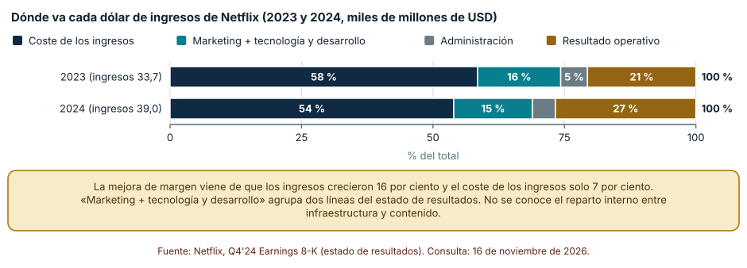

**Cómo leer la figura.** Cada barra es un año completo de ingresos reducido a 100 %; los segmentos muestran cuánto de cada dólar se va a cada partida. Mire primero el segmento dorado (resultado operativo) y el azul oscuro (coste de los ingresos): uno sube seis puntos y el otro baja cuatro. **Dónde deja de valer.** Dos años no son una tendencia; «marketing + tecnología y desarrollo» agrupa dos líneas; y el estado de resultados no separa el coste de infraestructura del de contenido. No sirve para concluir cuánto cuesta la nube o el CDN.

### La escala de los ingresos a lo largo del tiempo

Los 10-K citados permiten ver tres tramos: el de 2007, el de 2012 a 2016 y el de 2023 a 2025. Entre 2012 y 2016 los ingresos pasaron de 3 609 a 8 831 millones, mientras los miembros de streaming pasaron de 33,3 a 93,8 millones ([N3]); en 2025 son 45 183 millones ([N14]).

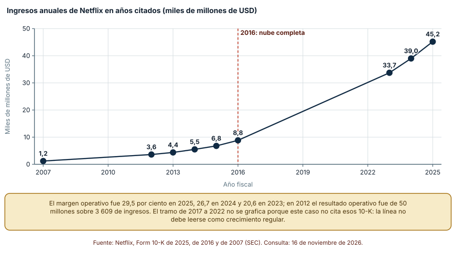

**Cómo leer la figura.** El eje horizontal es el año fiscal y el vertical los miles de millones de USD; los números rotulados son datos de los tres 10-K. La línea vertical marca el fin de la migración a la nube. **Dónde deja de valer.** Falta el tramo 2017-2022, que este caso no cita; unir los puntos sugiere una continuidad que no se ha verificado, así que sirve para el orden de magnitud y no para una tasa de crecimiento.

### Unit economics con cifras citadas

**Antes del streaming (2007).** Con los datos del 10-K de 2007 ([N4]), un cálculo propio da una idea de la economía por suscriptor: los ingresos de 1 205 millones entre un promedio de unos 6,9 millones de suscriptores (el promedio de 6,316 y 7,479) son unos 175 USD por suscriptor y año, unos 14,6 al mes. Con un margen bruto de 34,8 %, la contribución bruta anual rondaría 61 USD, de modo que el coste de adquisición de 40,88 USD se recuperaría en unos ocho meses si el suscriptor se quedara. La cifra es aproximada: omite la rotación, cuya definición exacta el documento no aclara, y no distingue planes.

**La escala del contenido (2025).** El 10-K de 2025 permite ver cuánto cuesta el contenido por unidad de ingreso. La amortización de contenido fue de 16 422 millones de USD en 2025, 15 302 en 2024 y 14 197 en 2023; como proporción de los ingresos, 36 %, 39 % y 42 % (cálculo propio). Dentro de esa amortización, el contenido producido por Netflix pesa un 47 % en 2025 (7 709 de 16 422) frente al 50 % en 2023 (7 052 de 14 197): el contenido licenciado creció 22 % en esos dos años y el producido 9 % (cálculo propio) ([N14]).

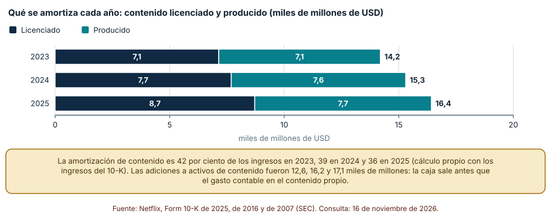

**Cómo leer la figura.** Cada barra es un año; el azul es contenido licenciado y el verde, producido. Mire que el total sube cada año y que el azul crece más rápido. **Dónde deja de valer.** La amortización es un gasto contable que sigue la curva de visionado estimada, no la caja del año: el mismo 10-K indica que las adiciones a activos de contenido fueron 12 555, 16 224 y 17 097 millones en 2023, 2024 y 2025 ([N14]), de modo que la caja que sale por el contenido producido llega antes que su amortización.

**Mecanismo de caja.** El 10-K explica que los pagos de contenido original, en especial el que produce y posee, exigen más caja por adelantado que la licencia, cuyo pago históricamente acompañó el periodo de amortización ([N14]). Es la razón por la que Netflix tuvo flujo de caja libre negativo durante años mientras crecía: el 10-K de 2016 da un flujo de caja libre de −58 millones en 2012, −16 en 2013, −127 en 2014, −921 en 2015 y −1 660 en 2016, con activos de contenido que pasaron de 2 934 a 11 001 millones ([N3]). Un resultado contable positivo con caja negativa es la firma de un modelo que financia contenido hoy para cobrar suscripciones durante años; es también la razón de que Netflix usara deuda (3 364 millones a largo plazo en 2016, [N3]).

**Efectos de red y escala (análisis propio).** Netflix no tiene un efecto de red directo fuerte entre miembros: una persona más no mejora el servicio para las demás. Lo que sí hay son economías de escala por tres vías. (1) El contenido es un coste fijo por título: con más miembros, el coste por miembro baja. (2) La red de entrega es un activo de capital: más tráfico por servidor amortiza mejor el equipo. (3) Los datos de uso alimentan la recomendación, aunque cuánto mejora eso la retención **[No se sabe]**. La consecuencia es que el modelo premia el tamaño y castiga al competidor que debe construir catálogo con menos base.

### Dónde crece el negocio: regiones

El 10-K de 2025 desglosa los ingresos por región ([N14]). Estados Unidos y Canadá aportan 19 957 millones (44 %), Europa, Oriente Medio y África 14 515 (32 %), Latinoamérica 5 358 (12 %) y Asia-Pacífico 5 354 (12 %). Asia-Pacífico creció 21 % en 2025, Europa, Oriente Medio y África 17 %, Estados Unidos y Canadá 15 % y Latinoamérica 11 %.

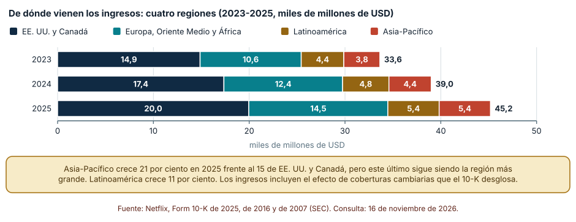

**Cómo leer la figura.** Cada barra es un año y cada segmento una región; la longitud total es el ingreso de streaming. Mire cómo crece cada segmento en el mismo orden de años. **Dónde deja de valer.** Mide ingresos, no miembros ni rentabilidad: el 10-K opera un solo segmento y no publica margen regional ([N14]); además los ingresos incluyen coberturas cambiarias (−91 millones en 2025 y +124 en 2024).

**Palancas de crecimiento (documentado).** Los 10-K y cartas citados enumeran: precios y planes, publicidad, aplicación del uso multihogar, contenido propio, juegos y directos, y expansión internacional ([N5], [N14]). **Límites (documentado).** El propio 10-K advierte que cambiar precios, planes o aplicación de las reglas puede no ser bien recibido y afectar la retención, y que predecir el efecto del plan con anuncios o de limitar el uso multihogar es difícil por falta de historial ([N14]).

### Eficiencia de la organización

El 10-K de 2025 informa unos 16 000 empleados a tiempo completo (10 900 en Estados Unidos y Canadá, 2 500 en Europa, Oriente Medio y África, 1 900 en Asia-Pacífico y 700 en Latinoamérica), sin contar al personal de producción temporal ([N14]). Con ingresos de 45 183 millones, equivale a unos 2,8 millones de USD de ingresos por empleado a tiempo completo (cálculo propio): es una cifra de orden de magnitud, no de productividad, porque la producción y la entrega se apoyan en terceros.

**Costos relevantes.** **[Documentado]** que el coste de los ingresos fue de 21 000 millones de USD en 2024 ([N5]) y que el 10-K define como principal componente la amortización de contenido; otros incluyen costes de entrega en streaming, que «principalmente» se relacionan con Open Connect, y costes operativos como atención al cliente y comisiones de pago ([N14]). **[No se sabe]** el desglose exacto de entrega frente a contenido. **[Inferido]** que el contenido es la mayor parte, porque la amortización de 15 302 millones de 2024 es más de 70 % del coste de los ingresos de 21 040 millones (cálculo propio).

**Ventajas competitivas que Netflix mismo declara.** Escala global (más de 190 países), una red propia de entrega (Open Connect), recomendación personalizada y contenido original ([N2], [N3]). Cuánto pesa cada una en el resultado **[No se sabe]**.

### Esquema del negocio: flujos de dinero y de valor

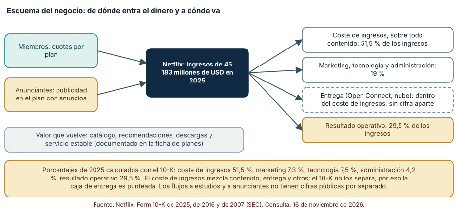

**Cómo leer la figura.** A la izquierda entra el dinero (cuotas y publicidad); en el centro está Netflix; a la derecha, a dónde va en 2025. Cada cifra es un porcentaje de los 45 183 millones de ingresos. Mire cuánto queda como resultado operativo (29,5 %). **Dónde deja de valer.** El coste de ingresos mezcla contenido, entrega y otros costes; la caja punteada indica que lo que se paga por entrega no se publica por separado. Los ingresos por publicidad no se separan en el 10-K citado.

**Flujo de valor.** El miembro recibe un catálogo, recomendaciones y un servicio que funcione en cualquier pantalla; los estudios y creadores reciben licencias o contratos; el proveedor de internet recibe tráfico más barato; Netflix retiene la diferencia. **Documentado:** la cuota por plan, el plan con anuncios desde 2022, la amortización de contenido de 16 422 millones en 2025 y la estructura de costes del estado de resultados ([N5], [N14]). **[No se sabe]** el reparto entre cuotas y publicidad, el precio de cada plan y las condiciones con estudios.

### Visión, misión y estrategia

**Documentado.** El 10-K de 2025 describe a Netflix como uno de los principales servicios de entretenimiento del mundo, con series, películas, juegos y programación en directo, donde los miembros pueden reproducir, pausar y reanudar cuanto quieran, en cualquier momento y lugar ([N14]). La estrategia central, dicha en el mismo documento, es crecer globalmente dentro de los parámetros de un objetivo de margen operativo, mejorando la experiencia del miembro con contenido que atrae nuevos miembros, con una gama de planes que incluye el plan con anuncios ([N14]). La carta a accionistas de 2024 declara como meta sostener un crecimiento de ingresos saludable, ampliar el margen operativo y aumentar el flujo de caja libre ([N5]).

**Evolución.** En 2007 el informe se describía como un servicio de suscripción de DVD con acceso al instante en PC ([N4]); en 2016, como una red global de streaming ([N3]); en 2025, como una oferta que añade juegos y directo ([N14]). **[No se sabe]** un texto formal de «misión» con fecha de adopción en las fuentes consultadas; por eso se cita la estrategia declarada y no una frase de misión.

### Costos operativos

**Cómo leer la figura.** Cada barra es un año reducido a 100 % de los ingresos; los segmentos son rubros del estado de resultados. Mire cómo el coste de ingresos cede siete puntos y el resultado operativo los gana. **Dónde deja de valer.** Son rubros contables: no separan la infraestructura del contenido y la amortización de contenido es un gasto, no la caja.

**Cifras de 2025 en dólares ([N14]).** Coste de ingresos de 23 275 millones, marketing de 3 301, tecnología y desarrollo de 3 391 y administración de 1 888. Dentro del coste de ingresos, la amortización de contenido fue de 16 422 millones (8 714 de licenciado y 7 709 de producido). El 10-K define el coste de ingresos como principalmente amortización de contenido, además de costes de adquisición y producción, entrega en streaming (sobre todo Open Connect: equipo, personal y costes de terceros como la nube) y costes operativos como atención al cliente y comisiones de pago ([N14]). **[No se sabe]** el desglose de la entrega, de la nube y del soporte.

**Cálculo propio.** Si toda la amortización de contenido es el 70,6 % del coste de ingresos de 2025 (16 422 / 23 275), el resto (6 853 millones, 15,2 % de los ingresos) cubre entrega, producción no amortizada, soporte, pagos y otros; ese remanente es la cota superior de todo el coste de infraestructura y entrega, y es pequeño frente al contenido.

**Márgenes.** Resultado operativo de 29,5 % en 2025, 26,7 % en 2024 y 20,6 % en 2023; resultado neto de 10 981 millones en 2025 ([N14]).

### Competidores

**Documentado.** El 10-K de 2025 describe un mercado de entretenimiento en vídeo intensamente competitivo y cambiante, en el que Netflix compite por el tiempo libre del consumidor con televisión lineal, proveedores de streaming (incluidos los que ofrecen contenido pirata), videojuegos, plataformas abiertas de contenido generado por usuarios y otras fuentes de entretenimiento, como las redes sociales; los modelos económicos incluyen suscripción, transaccional, con publicidad y basados en piratería; y algunos competidores tienen mayor historia, base de clientes, derechos exclusivos y recursos ([N14]).

**[No se sabe]** con fuente primaria la cuota de mercado por competidor: el 10-K no nombra competidores en el fragmento consultado ni da cuotas, y este caso no usa estimaciones de terceros sin verificar. **Análisis propio** de por qué el mercado favoreció a Netflix (ver «Competencia» en la sección de mercado): ventaja temprana en entrega por internet y recomendación, coste fijo de contenido repartido entre muchos miembros y una red de entrega propia. Es hipótesis, no un hecho declarado.

## Arquitectura y esquemas

La arquitectura se recorre en niveles de zoom: contexto (qué actores hay), contenedores (qué piezas grandes), componentes (qué hace una pieza crítica por dentro), secuencia (cómo se pasan los mensajes en la operación más importante), datos, despliegue, resiliencia, seguridad, operación y evolución. Cada nivel tiene su propia figura o su propio apartado. En todos se separa lo documentado de lo inferido y de lo que no se sabe. La regla de fondo es la del [N1]: lo que Netflix publicó describe un momento; no es un plano vigente.

### 6.1 Contexto del sistema

**Cómo leer la figura.** Hay tres espacios: la casa del miembro, la red del ISP y la nube de Netflix. Las flechas continuas son tráfico del uso normal; la punteada es el abastecimiento previo. Fíjese en que control y vídeo siguen caminos distintos. **Dónde deja de valer.** Es un esquema de contexto, no un plano de red: no muestra balanceadores, DNS, subredes ni cuántos servidores hay. El 10-K de 2016 dice que Netflix «construyó su propia red de entrega de contenido, Open Connect» ([N3]) y la carta de 2016 que todos los servicios de cara al cliente se migraron a AWS antes de 2015 ([N1]); el 10-K de 2025 confirma que ejecuta la mayor parte de su cómputo en AWS y que no puede cambiar fácilmente de proveedor ([N14]).

### 6.2 Contenedores: las piezas grandes

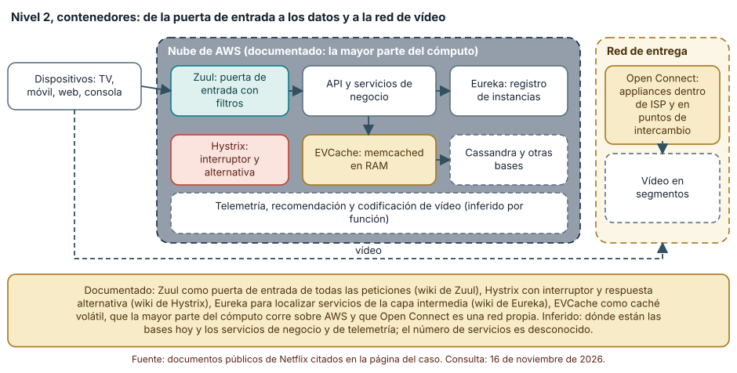

**Cómo leer la figura.** Cada caja es una pieza desplegable. La puerta de entrada recibe todas las peticiones; detrás, los servicios usan un registro (Eureka) para encontrarse, una biblioteca de tolerancia a fallos (Hystrix) y una caché en memoria (EVCache). La línea punteada inferior es el camino del vídeo, que no pasa por la nube de control. **Dónde deja de valer.** Es el nivel de contenedores del modelo C4 aplicado con fuentes públicas: no hay servicios de negocio con nombre, ni se sabe el reparto de bases de datos hoy.

**Qué documenta cada pieza.**

- **Puerta de entrada: Zuul.** La wiki oficial lo describe como la puerta de entrada de todas las peticiones de dispositivos y sitios web hacia el backend de la aplicación de streaming, construido para enrutamiento dinámico, monitorización, resiliencia y seguridad, con filtros que aplican autenticación y seguridad, medición en el borde y enrutamiento dinámico, entre otros, y la capacidad de enrutar a varios grupos de autoescalado ([N17]). La razón declarada es que el volumen y la diversidad del tráfico de la API generan incidentes rápidos y sin aviso, por lo que se necesita cambiar el comportamiento del borde rápidamente.
- **Registro de servicios: Eureka.** Es un servicio REST usado en AWS para localizar servicios con fines de balanceo y conmutación por error de los servidores de la capa intermedia; la wiki explica que en AWS los servidores aparecen y desaparecen, a diferencia de los balanceadores tradicionales con direcciones fijas, y que Eureka complementa al balanceador de borde de AWS en la capa intermedia ([N16]). En Netflix un balanceador más sofisticado envuelve a Eureka para ponderar según tráfico, uso de recursos y errores.
- **Tolerancia a fallos: Hystrix.** Se detalla en 6.3.
- **Caché: EVCache.** Una solución basada en memcached para infraestructura de AWS, cuyo nombre abrevia «efímero, volátil, caché»: los datos duran lo que dice su TTL y pueden desaparecer en cualquier momento ([N18]). El artículo de 2016 lo sitúa en 30 millones de peticiones por segundo en el pico sobre decenas de miles de instancias ([N10]).
- **Red de entrega: Open Connect.** Ver 6.6.
- **Bases de datos.** El artículo de 2013 cita Cassandra con replicación entre regiones ([N8]). **[No se sabe]** qué bases usan hoy los servicios, ni los volúmenes.
- **Telemetría, recomendación y codificación.** **[Documentado]** que la codificación por título adapta la receta de compresión a cada título ([N13]) y que la recomendación existe desde 2000 ([N2]). **[Inferido]** que ambas, junto con la telemetría de uso, se ejecutan en la nube y no en el camino de reproducción.

### 6.3 Componentes de la operación crítica: resiliencia por capas

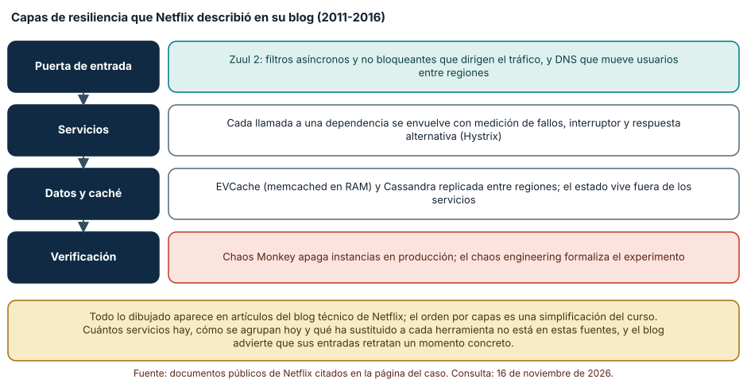

**Cómo leer la figura.** Cada fila es una capa y su función; la columna izquierda dice qué es y la derecha qué hace según el blog técnico. Siga las flechas de arriba abajo: una petición baja desde la puerta de entrada hasta los datos, y la última fila no es una capa de datos sino una práctica que prueba a las otras. **Dónde deja de valer.** Es la foto de los artículos 2011-2016; no se sabe qué herramientas siguen en uso con esos nombres.

**Qué documenta cada pieza.**

- **Interruptor y respuesta alternativa (2011).** El blog de diciembre de 2011 explica que el equipo de la API reestructuró el sistema para que «mecanismos de respuesta alternativa» se activen cuando una dependencia falla: se envuelven las llamadas con código que registra el resultado, y cuando un servicio falla demasiado «dejamos de llamarlo y servimos respuestas alternativas» mientras se recupera ([N7]). El objetivo declarado era alta disponibilidad para un sistema que maneja «mil millones de peticiones al día».
- **Caché (2016).** EVCache es una caché en RAM basada en memcached, optimizada para la nube y pensada para contextos donde la consistencia fuerte no es un requisito; en el pico procesa más de 30 millones de peticiones por segundo sobre decenas de miles de instancias de memcached ([N10]).
- **Puerta de entrada.** Zuul 2 pasó de un modelo bloqueante (un hilo por conexión) a uno asíncrono y no bloqueante, donde una conexión cuesta un descriptor de archivo y no un hilo ([N9]).
- **Varias regiones (2013).** El artículo sobre «activo-activo» describe DNS (Denominator) y Zuul para dirigir tráfico, replicación de datos con Cassandra y EVCache, y herramientas de prueba (Chaos Gorilla, Chaos Kong, un «mono de cerebro dividido») ([N8]).
- **Chaos Monkey (2011).** Una herramienta que apaga instancias de producción al azar para comprobar que el servicio resiste esa falla común sin impacto para el cliente ([N11]). El repositorio oficial la describe como una herramienta que termina al azar máquinas virtuales y contenedores en producción para incentivar que los ingenieros construyan servicios resilientes ([N19]). Una disciplina posterior, la ingeniería del caos, formaliza el método de experimentar sobre un sistema para ganar confianza en su resistencia ([N12]).

**Por dentro de Hystrix.** La wiki oficial describe qué hace la biblioteca con cada llamada a una dependencia ([N15]). El flujo comienza al construir un objeto de comando que representa la petición; se ejecuta de una de cuatro formas (síncrona, como futuro o como flujo reactivo); luego se consulta una caché de la petición, se comprueba si el circuito está abierto, se comprueba si la reserva de hilos, la cola o el semáforo asociados están llenos, se ejecuta la llamada con un tiempo límite y se calcula la salud del circuito. Si cualquiera de esos pasos falla (circuito abierto, reserva llena, excepción, tiempo agotado), Hystrix recurre a la respuesta alternativa que el programador definió.

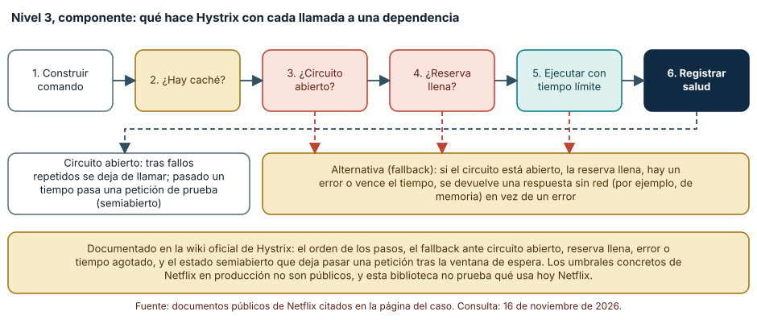

**Cómo leer la figura.** La fila superior es el camino feliz de una llamada, de izquierda a derecha; las flechas rojas punteadas son los atajos hacia la respuesta alternativa; el cuadro de la izquierda explica el circuito abierto. Mire que hay tres lugares distintos desde donde se llega al fallback. **Dónde deja de valer.** Describe la biblioteca tal como la documenta su wiki; no dice cómo la configura Netflix ni si sigue en uso con ese nombre. La propia wiki recomienda que la alternativa no dependa de la red y no pueda fallar: en el diseño es la parte más fácil de olvidar.

**Aislamiento: por qué los hilos.** La wiki distingue aislar con reservas de hilos (cada dependencia tiene su grupo, de modo que una dependencia lenta no consume los hilos de las demás) de hacerlo con semáforos, y explica que la alternativa siempre se ejecuta en el hilo que llama ([N15]). La consecuencia de diseño es que una dependencia lenta degrada una función y no a toda la aplicación, que es el mecanismo del patrón de mamparos que enseña la clase [SE-525](../../classes/part-43-patrones-de-diseno-empresariales-y-de-resiliencia/se-525-resiliencia-bulkhead-sidecar-ambassador-y-degradacion/README.md).

### 6.4 Secuencia: reproducir un título, paso a paso

**Cómo leer la figura.** Siga los pasos de izquierda a derecha. Las cajas azules oscuras son control en la nube, la dorada es la entrega por Open Connect y las punteadas están inferidas, no confirmadas. **Dónde deja de valer.** Netflix no publica el protocolo de reproducción actual ni el nombre de los servicios de cada paso; el esquema muestra la idea de separar control y datos, no el diseño real. La codificación por título, documentada desde 2015, adapta la receta de compresión a la complejidad de cada título («acción intensa necesita más bits que paisajes inmóviles o animación»), con el mismo o mejor resultado usando menos ancho de banda ([N13]).

El diagrama de secuencia siguiente añade el orden de los mensajes entre cinco participantes y distingue qué parte es documentada.

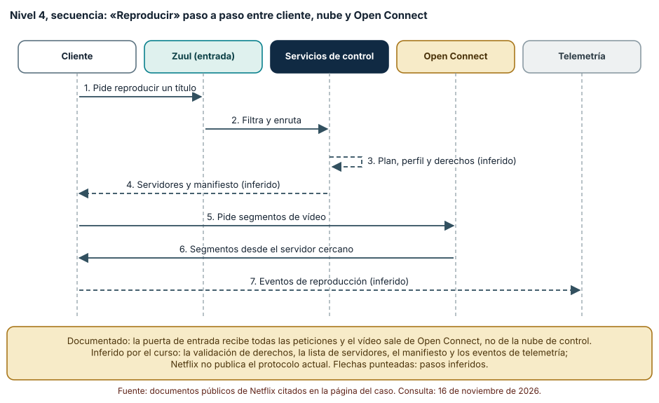

**Cómo leer la figura.** Cada columna es un participante y el tiempo avanza hacia abajo; una flecha es un mensaje y las punteadas están inferidas. Mire qué mensajes llegan a Open Connect: solo la petición de segmentos, nunca las decisiones de plan o de derechos. **Dónde deja de valer.** Un diagrama de secuencia sugiere un orden único; en la realidad hay peticiones paralelas, reintentos, caché y varias llamadas a servicios por pulsación que Netflix no publica.

**Qué falla en cada paso (análisis propio con la teoría del curso).**

- *Paso 1-2 (entrada).* Si la puerta de entrada se satura, ningún usuario puede iniciar. Por eso el borde es asíncrono y no bloqueante ([N9]) y es el lugar donde se aplican filtros de seguridad y límites ([SE-249](../../classes/part-20-backend-apis-y-procesamiento-asincrono/se-249-caching-rate-limiting-y-proteccion/README.md)).
- *Paso 3 (control).* Si el servicio de derechos falla, el cliente podría no poder reproducir. **[Inferido]** que una respuesta alternativa razonable es permitir lo ya autorizado recientemente, a costa de aceptar un dato algo viejo ([SE-320](../../classes/part-26-datos-persistencia-y-recuperacion/se-320-caches-y-consistencia-entre-capas/README.md)).
- *Paso 4-5 (entrega).* Si un servidor Open Connect no responde, el cliente debería pedir a otro de la lista. **[Inferido]** de que el control devuelve candidatos y no uno solo.
- *Paso 7 (telemetría).* No debe bloquear la reproducción: es el ejemplo clásico de una dependencia no crítica que debe fallar en silencio.

### 6.5 Datos y escala

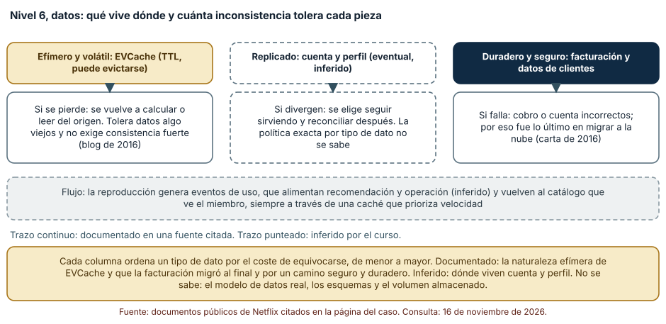

**Cómo leer la figura.** Tres columnas ordenan los datos por el coste de equivocarse: la caché volátil, el estado replicado y el dato duradero y seguro. Debajo de cada una, qué pasa si se pierde, diverge o falla. **Dónde deja de valer.** Es una taxonomía por criticidad, no un diagrama de esquema de bases de datos; la ubicación de cuenta y perfil es inferida.

| Magnitud | Valor | Año | Fuente |
| --- | --- | --- | --- |
| Peticiones/s en EVCache en el pico | más de 30 millones | 2016 | [N10] |
| Instancias de memcached en EVCache | decenas de miles | 2016 | [N10] |
| Capacidad de un servidor Open Connect | de unos 60 TB y 80 Gbps (modelo para ISP pequeños) a hasta 120 TB y unos 200 Gbps según la ficha del modelo | consulta 2026 | [N6] |
| ISP con appliances embebidos | más de mil | consulta 2026 | [N20] |
| Centros de datos de Netflix | más de 60 | consulta 2026 | [N20] |
| Países atendidos | más de 190 | 2016 | [N1], [N2] |

**[No se sabe]** el número actual de servidores, instancias, regiones o servicios. Cualquier cifra distinta de estas procede de conferencias y entrevistas que este caso no ha podido contrastar con curl.

**El dato duro: la facturación al final.** El orden de la migración es en sí mismo un dato de arquitectura: Netflix movió primero lo de cara al cliente y dejó para el final la facturación y los datos de clientes y empleados, que requerían un camino seguro y duradero ([N1]). El criterio fue la tolerancia al error: lo que puede mostrar un dato algo viejo se migra antes que lo que no puede equivocarse en un cobro. Es el mismo razonamiento de [SE-316](../../classes/part-26-datos-persistencia-y-recuperacion/se-316-restricciones-invariantes-y-consistencia/README.md) sobre invariantes y de [SE-439](../../classes/part-36-mantenimiento-y-modernizacion-legacy/se-439-migraciones-de-datos-sin-interrupcion/README.md) sobre migrar datos sin interrupción.

**Consistencia elegida.** EVCache se diseñó para contextos sin consistencia fuerte ([N10]) y la replicación entre regiones del artículo de 2013 es una opción de disponibilidad sobre consistencia inmediata ([N8]). En términos de [SE-342](../../classes/part-28-concurrencia-y-sistemas-distribuidos/se-342-consistencia-disponibilidad-y-particiones/README.md), ante una partición Netflix declara que prefiere seguir sirviendo. El coste es que un miembro puede ver un dato algo viejo durante un tiempo; el beneficio es que la mayoría de las pantallas siguen funcionando.

### 6.6 Despliegue y regiones

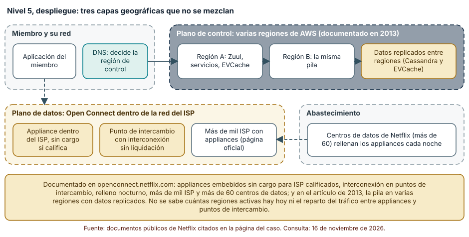

**Cómo leer la figura.** Hay dos planos que no se mezclan: arriba el de control, en varias regiones de nube con datos replicados; abajo el de datos, con servidores dentro de los ISP. A la derecha, el abastecimiento nocturno. Siga la flecha punteada desde el miembro hacia los appliances: es el vídeo, que no pasa por la nube de control. **Dónde deja de valer.** El número de regiones, su ubicación y el reparto del tráfico no son públicos; el esquema solo muestra que hay más de una y que las dos capas se escalan por separado.

**Open Connect según la fuente oficial.** Los ISP participan con appliances embebidos o con interconexión sin liquidación en puntos de intercambio; los appliances embebidos se entregan sin cargo a ISP calificados y el ISP aporta espacio, energía y conectividad; los rellenos y actualizaciones se hacen cada noche; Netflix colabora con más de mil ISP y tiene más de 60 centros de datos ([N20]). La ficha de modelos da capacidades de entre unos 60 TB y 80 Gbps y hasta 120 TB y unos 200 Gbps ([N6]).

**Por qué el diseño importa económicamente.** El 10-K clasifica los costes de entrega en streaming como principalmente los de Open Connect e incluye equipo, personal y costes de terceros como la nube ([N14]). Es decir, Netflix convierte un coste variable por gigabyte entregado en un coste de capital más personal. **[Inferido]** que esa conversión es rentable a su escala; **[No se sabe]** el punto de equilibrio.

**Activo-activo.** El artículo de 2013 presenta la arquitectura en varias regiones con DNS (Denominator) y Zuul para el tráfico, y datos replicados ([N8]). La consecuencia para el usuario es que una región puede dejar de recibir tráfico sin que el servicio caiga; la consecuencia para el equipo es que los datos replicados deben tolerar escrituras en más de un lugar, con el coste de reconciliar conflictos.

### 6.7 Resiliencia y degradación

La resiliencia se entiende como una escalera de respuestas, de la más barata a la más costosa. Cada peldaño responde a una falla más grande y tiene su propio coste.

| Nivel | Qué falla | Respuesta | Coste |
| --- | --- | --- | --- |
| 1 | Una dependencia tarda o responde con error | Tiempo límite y respuesta alternativa (Hystrix, [N7], [N15]) | Una pantalla algo menos personalizada |
| 2 | Una dependencia falla de forma sostenida | Circuito abierto: se deja de llamar y se sirve la alternativa durante la ventana de espera ([N15]) | Funcionalidad reducida mientras tanto |
| 3 | Una instancia desaparece | Autoescalado y registro de servicios (Eureka, [N16]) | Capacidad redundante pagada |
| 4 | Una región entera degrada | Dirigir el tráfico a otra región con datos replicados ([N8]) | Datos replicados y capacidad en otra región |
| 5 | Un proveedor completo falla | **[No se sabe]**: el 10-K dice que no se puede cambiar fácilmente de AWS ([N14]) | Dependencia declarada como riesgo |

La última fila es un dato sorprendente por su franqueza: el informe de 2025 reconoce que la mayor parte de la computación depende de un solo proveedor, que no puede moverse con facilidad y que cualquier interrupción afectaría el negocio ([N14]). La resiliencia de Netflix es entre regiones de un mismo proveedor, no entre proveedores; es la distinción de [SE-357](../../classes/part-29-cloud-plataforma-e-infraestructura/se-357-multi-cloud-hibrido-y-portabilidad-real/README.md) entre multirregión y multinube.

### 6.8 Seguridad, abuso y cumplimiento

Casi todo el detalle de seguridad es confidencial. Se puede separar lo que sí consta:

- **Documentado.** La puerta de entrada incluye filtros de autenticación y seguridad ([N17]). La migración de datos de clientes y empleados exigió un camino «seguro y duradero» ([N1]). El 10-K de 2025 dice que Netflix aplica sus términos para limitar el uso multihogar ([N14]) y que depende de socios de pago integrados, cuyas comisiones forman parte del coste de ingresos ([N14]).
- **Inferido.** Que el vídeo se entrega cifrado y con control de licencias por título; es la práctica general de la industria, pero Netflix no la detalla en las fuentes de este caso.
- **No se sabe.** El modelo de amenazas, la gestión de claves, la detección de uso compartido, la revisión de contenido, y el cumplimiento regional (por ejemplo, datos personales por país).

El curso enseña cómo se razonaría este apartado: modelo de amenazas ([SE-385](../../classes/part-32-seguridad-privacidad-y-cumplimiento/se-385-principios-de-seguridad-y-modelos-de-amenaza/README.md)), identidad y sesiones ([SE-386](../../classes/part-32-seguridad-privacidad-y-cumplimiento/se-386-identidad-autenticacion-y-sesiones/README.md)), privacidad por diseño ([SE-391](../../classes/part-32-seguridad-privacidad-y-cumplimiento/se-391-privacidad-por-diseno-y-minimizacion/README.md)) y cumplimiento ([SE-394](../../classes/part-32-seguridad-privacidad-y-cumplimiento/se-394-cumplimiento-evidencia-y-limites-legales/README.md)). Sirve como plantilla de preguntas al leer el caso: qué activos hay (cuenta, medio de pago, contenido licenciado), quién los ataca (copia ilegal de contenido, fraude de pago, toma de cuentas, uso compartido) y qué control corresponde. Las respuestas concretas de Netflix no son públicas.

### 6.9 Observabilidad y operación

**Documentado.** El interruptor necesita medir cada llamada para decidir cuándo abrirse: el artículo de 2011 explica que las llamadas se envuelven con código que registra el resultado ([N7]), y la wiki de Hystrix describe el cálculo de salud del circuito como un paso del flujo ([N15]). La ingeniería del caos pide definir un estado estable como una salida medible que indica comportamiento normal, formular la hipótesis de que continuará en un grupo de control y otro experimental, introducir variables reales como fallos de servidor y buscar diferencias ([N12]). Chaos Monkey es un caso de esa práctica ([N19]).

**Por qué la medición va primero.** Un experimento de caos sin una métrica de estado estable no es un experimento, es una avería provocada. El método exige tener observabilidad antes de romper cosas ([SE-421](../../classes/part-35-observabilidad-sre-e-incidentes/se-421-senales-eventos-y-observabilidad-util/README.md), [SE-425](../../classes/part-35-observabilidad-sre-e-incidentes/se-425-sli-slo-sla-y-presupuestos-de-error/README.md)).

**No se sabe.** Las herramientas actuales de métricas y alertas, la cultura de guardia, el proceso de posmortem y los objetivos de nivel de servicio. Netflix publicó en su blog varias herramientas pero no una descripción completa de su operación actual.

### 6.10 Evolución de la arquitectura por etapas

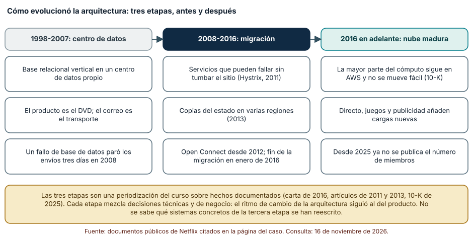

**Cómo leer la figura.** Las columnas son periodos y las cajas, rasgos de la arquitectura en cada uno; las flechas indican la secuencia. Mire cómo cada etapa responde a un problema de la anterior: la base vertical del centro de datos origina la migración; la migración origina la necesidad de tolerar fallos y de entregar vídeo en red propia. **Dónde deja de valer.** La periodización es del curso; las fechas de cada rasgo vienen de las fuentes, pero las etapas no tienen límites tajantes, y de la tercera etapa solo hay información de alto nivel.

**Por qué siete años.** La migración empezó con el fallo de 2008 y terminó en enero de 2016 ([N1]). La duración sugiere una elección deliberada: mover por partes, con la facturación al final, y mantener el servicio en marcha. Es el escenario de [SE-437](../../classes/part-36-mantenimiento-y-modernizacion-legacy/se-437-strangler-branch-by-abstraction-y-anticorruption/README.md) (el estrangulador) y [SE-440](../../classes/part-36-mantenimiento-y-modernizacion-legacy/se-440-compatibilidad-coexistencia-y-doble-escritura/README.md) (coexistencia y doble escritura) aplicado a una compañía entera. El carril de producto y el de plataforma se solapan de 2007 a 2016 en la línea de tiempo: Netflix vendió streaming mientras seguía moviendo su plataforma.

**Qué cambió con el tamaño.** Un artículo de 2016 del equipo cuenta que Zuul pasó de un modelo con un hilo por conexión a uno asíncrono ([N9]), cambio típico cuando el número de conexiones simultáneas crece lo bastante para que el coste de un hilo por conexión sea prohibitivo. Es un ejemplo de arquitectura que evoluciona con la escala, no de acierto inicial.

### 6.11 Alternativas descartadas y trade-offs (análisis propio)

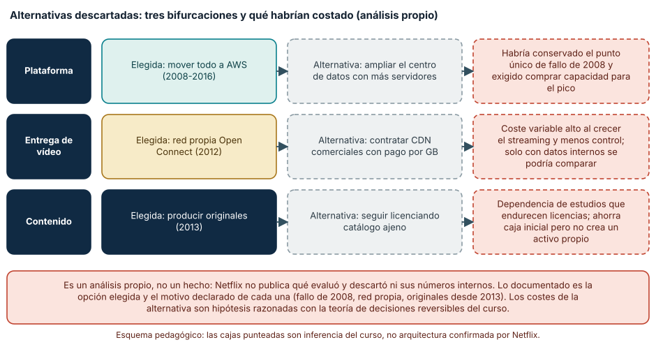

**Cómo leer la figura.** Cada fila es una bifurcación: la caja del medio es lo que se hizo y la siguiente, lo que se habría podido hacer; la de la derecha es el coste probable de esa alternativa. Los trazos punteados indican hipótesis. **Dónde deja de valer.** Son hipótesis del curso, no hechos: Netflix no publica las alternativas que evaluó ni sus números. Sirve para entrenar el razonamiento, no para afirmar qué habría pasado.

**Nube frente a ampliar el centro de datos.** La alternativa habría resuelto el problema de capacidad comprando más servidores, pero habría dejado la causa del fallo de 2008 (bases relacionales verticales, puntos únicos) sin tocar, salvo que se rediseñara a la vez. La ventaja de la nube fue pagar capacidad bajo demanda ([SE-356](../../classes/part-29-cloud-plataforma-e-infraestructura/se-356-escalado-capacidad-y-costos/README.md)) y obligar a diseñar para la falla; el coste fue una dependencia de un proveedor que el propio 10-K reconoce hoy ([N14]).

**Red propia frente a CDN comercial.** El coste de una CDN comercial es variable con el volumen; el de una red propia es de capital y de personal. Con una base pequeña la comercial gana; con una base enorme la propia puede ganar. Netflix lanzó Open Connect en 2012 ([N2]), con 25 millones de miembros; el 10-K de 2025 sigue contando el equipo de Open Connect entre sus costes de entrega ([N14]). **[No se sabe]** el punto de equilibrio. Lo que sí es verificable es la contrapartida operativa: Netflix tiene que mantener relaciones con más de mil ISP y centros de datos propios ([N20]).

**Originales frente a licencias.** Los originales exigen caja por adelantado y tienen riesgo de fallo por título; las licencias permiten pagar durante el periodo de amortización pero dejan a la empresa expuesta a lo que decidan los estudios ([N14], [N2]). El dato de 2025 muestra la mezcla resultante: casi mitad y mitad entre producido y licenciado en la amortización, con el licenciado creciendo más rápido que el producido en 2023-2025 ([N14]). La lección de [SE-142](../../classes/part-11-economia-metricas-y-decisiones-de-producto/se-142-decisiones-reversibles-e-irreversibles/README.md) es que la decisión no fue binaria sino una cartera.

### 6.12 Hardware utilizado

**Documentado (servidores de Open Connect).** La página oficial dice que los appliances se basan en componentes de PC comunes, ensamblados en cajas a medida por proveedores; se entregan sin cargo a ISP que cumplan requisitos básicos y no se venden a terceros; tienen discos del sistema, fuentes de alimentación y puertos de red redundantes; si un disco falla se desactiva automáticamente y el equipo sigue funcionando; no tienen piezas reparables por el usuario salvo fuentes y ópticas; y se monitorizan de forma continua desde un centro de operaciones de red ([N6]). Hay dos clases principales ([N6]):

- **Appliance de almacenamiento:** servidor 2U que aloja el catálogo en muchos puntos de intercambio y en los ISP más grandes; busca gran capacidad y suficiente memoria NAND de bajo coste para llegar a 10 GB/s de rendimiento; conexión de red de 6 enlaces de 10 Gbps agregados o hasta 2 de 100 Gbps; procesador único; potencia operativa pico de unos 400 W; rendimiento operativo de unos 200 Gbps; hasta 120 TB en bruto.
- **Appliance global:** servidor 2U de menor coste para ISP pequeños y mercados emergentes; hasta 60 TB en bruto, unos 80 Gbps y unos 250 W; solo ópticas reemplazables en campo y una fiabilidad de 4 a 6 años sin intervención.

Los componentes citados son placa Tyan, procesador AMD, memoria Micron, discos de estado sólido de Kioxia o Micron, controladores de red de Mellanox y Broadcom, y chasis de Ahead; los integradores de sistemas son Sanmina, MBX e Intequus ([N6]).

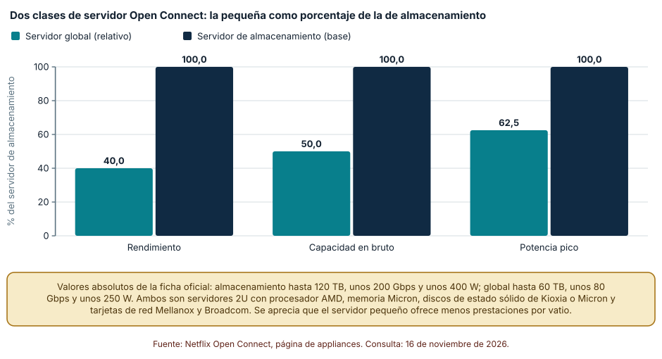

**Cómo leer la figura.** Cada grupo compara una magnitud: la barra azul es el servidor de almacenamiento (100 %) y la teal el global como porcentaje. Mire que la potencia baja menos que el rendimiento: el servidor pequeño es menos eficiente por vatio. **Dónde deja de valer.** Son valores nominales de la ficha oficial de la versión más reciente; no incluyen el coste de los equipos ni la cantidad desplegada, que no se publican.

**Cálculo propio de eficiencia.** Rendimiento por vatio: 0,5 Gbps/W en el de almacenamiento (200/400) y 0,32 en el global (80/250). Es una comparación de las cifras nominales de la ficha, no una medición.

**Documentado (otros dispositivos).** El 10-K cita equipo de Open Connect entre los costes de entrega ([N14]). Los dispositivos del usuario (televisores, móviles, consolas, navegadores) son diversos y Netflix colabora con fabricantes desde 2008 ([N2]). **[No se sabe]** los aceleradores (por ejemplo, para codificación de vídeo), los servidores de la nube (que son los de AWS) y la red de transporte entre centros de datos.

### 6.13 Software utilizado

**Documentado.** En los servidores de vídeo: FreeBSD como sistema operativo (la versión de desarrollo), elegido por equilibrio entre estabilidad y funciones, con mejoras contribuidas a la comunidad; NGINX como servidor web que entrega audio y vídeo por HTTP; y el demonio de encaminamiento BIRD, que recoge la topología de red de los ISP y la comparte con el sistema de control en AWS; con soporte de IPv4 e IPv6 ([N6]). El diseño busca software abierto, lectura eficiente de disco a conexión de red, entrega HTTP de alto rendimiento y obtención de rutas por BGP ([N6]).

**Documentado (código abierto de la plataforma).** Los repositorios oficiales de Netflix en GitHub muestran, con lenguaje y año de creación ([N21]): Hystrix (Java, 2012), Eureka (Java, 2012), Zuul (Java, 2013), EVCache (Java, 2013), Chaos Monkey (Go, 2016), Atlas (Scala, 2014), Genie (Java, 2013), Priam (Java, 2011), Falcor (JavaScript, 2015), VMAF (C, 2016) y Metaflow (Python, 2019). Conductor y Dispatch figuran como archivados. Las descripciones oficiales: Atlas es una base de datos de series temporales dimensionales en memoria; Genie, un servicio de orquestación de datos masivos; Priam, un coproceso para copia de seguridad y recuperación, gestión de tokens y configuración centralizada (de Cassandra); VMAF, una métrica perceptual de calidad de vídeo; Metaflow, una herramienta para construir y desplegar sistemas de IA y aprendizaje automático ([N21]).

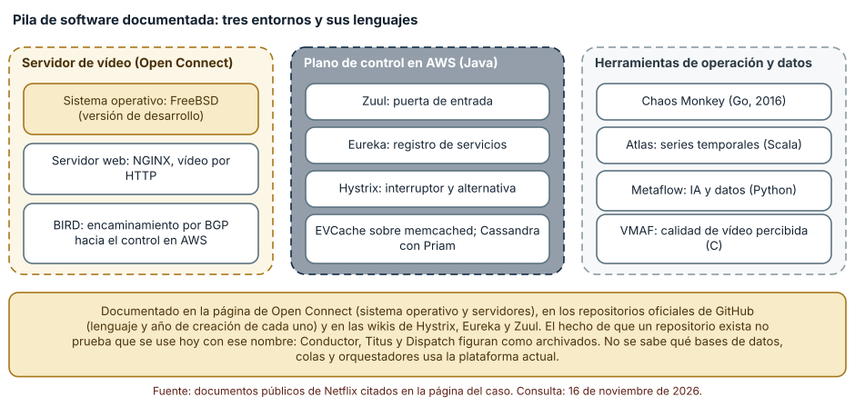

**Cómo leer la figura.** Tres bloques: el servidor de vídeo (dorado), el plano de control en AWS (azul) y las herramientas (gris). Cada caja es un componente con su función y, cuando figura, su lenguaje. **Dónde deja de valer.** Muestra componentes con repositorio o página oficial, no la pila de producción de hoy: un repositorio existente o archivado no prueba que se use. No se sabe qué colas, orquestadores o bases de datos operan hoy.

**[No se sabe]** los lenguajes de los servicios de negocio actuales, las colas y el sistema de streaming de datos, y el orquestador de contenedores en uso (Titus, una plataforma de contenedores, figura como archivada).

### 6.14 Características de la infraestructura

**Modelo híbrido (documentado).** El plano de control corre en la nube: Netflix declara que ejecuta la mayor parte de su cómputo en AWS y que no puede cambiar fácilmente de proveedor ([N14]); el plano de datos es una red propia de appliances dentro de los ISP y en puntos de intercambio, abastecida desde más de 60 centros de datos de Netflix, con más de mil ISP asociados ([N20]).

**Regiones y zonas.** Una arquitectura en varias regiones activas con datos replicados se documenta en 2013 ([N8]). **[No se sabe]** el número y ubicación de regiones y zonas hoy.

**Capacidad y escala.** Servidores de 60 a 120 TB y de 80 a unos 200 Gbps cada uno ([N6]); EVCache con más de 30 millones de peticiones por segundo en el pico de 2016 ([N10]); más de 300 millones de miembros a fines de 2024 ([N5]). **[No se sabe]** la capacidad total en terabits ni el número de servidores.

**Redes.** Peering sin liquidación (SFI) en puntos de intercambio y appliances embebidos con sesiones BGP con el ISP ([N20]); el ISP aporta espacio, energía y conectividad ([N20]). El relleno ocurre cada noche ([N20]).

**Costos.** El 10-K trata el equipo de Open Connect, el personal y la nube como costes de entrega dentro del coste de ingresos ([N14]); por el cálculo propio de la sección de costos, el coste total de entrega y otros ajenos al contenido está acotado por unos 6 900 millones de USD en 2025 (15,2 % de los ingresos). **[No se sabe]** la parte de nube frente a la de equipo propio.

### 6.15 Temas a prueba de fallos

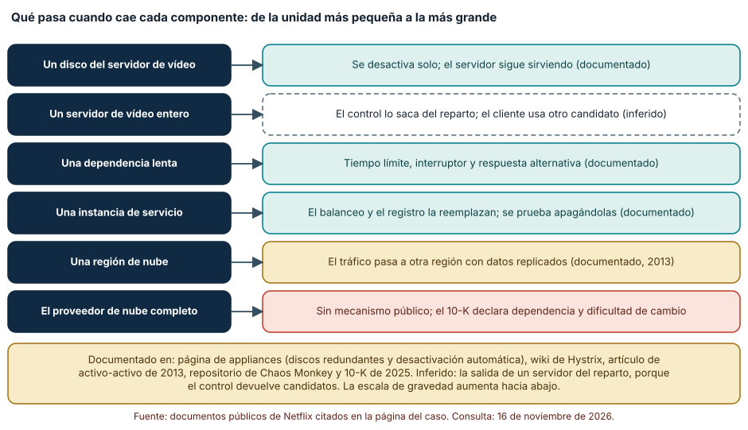

**Cómo leer la figura.** Cada fila es un componente cada vez mayor y a su derecha lo que ocurre y cómo se contiene. Los colores indican el tipo de respuesta; la caja coral inferior es la falla sin respuesta pública. **Dónde deja de valer.** Cada fila es una síntesis de documentos de años distintos; no es un plan de continuidad vigente ni un conjunto de objetivos de recuperación.

**Tolerancia a fallos y redundancia.** Hardware: discos, fuentes y puertos redundantes, con desactivación automática del disco averiado ([N6]). Software: interruptor y alternativa por dependencia ([N7], [N15]). **Replicación y failover.** Datos replicados entre regiones y tráfico dirigido a otra región ([N8]); EVCache replicada y tolerante a datos algo viejos ([N10]). **Degradación elegante.** La alternativa de Hystrix sirve una respuesta menos personalizada en vez de un error ([N7], [N15]). **Pruebas de caos.** Chaos Monkey termina instancias y contenedores al azar en producción; el método formal de caos define estado estable, hipótesis y variables reales ([N19], [N12]). **Recuperación ante desastres.** El ejercicio de pérdida de región de 2013 ([N8]); **[No se sabe]** el plan de recuperación actual ni los objetivos de tiempo y punto de recuperación.

**Límites de velocidad y aislamiento.** Zuul aplica filtros en el borde y la biblioteca Hystrix aísla cada dependencia con su propia reserva de hilos o semáforo ([N15], [N17]). **[No se sabe]** los límites de velocidad por cliente.

**Qué pasa cuando cae cada componente.** (1) Un disco: se desactiva y el servidor sigue ([N6]). (2) Un servidor: el control puede dirigir al cliente a otro; **[Inferido]**. (3) El control en una región: el tráfico pasa a otra región ([N8]). (4) Una dependencia: alternativa ([N15]). (5) Una caché: los datos se vuelven a leer del origen; EVCache admite pérdida de datos por diseño ([N18]). (6) AWS completo: sin mecanismo público ([N14]).

## Casos especiales y cómo se resuelven

Cada caso se expone como: situación, mecanismo que lo resuelve, decisión de diseño, trade-off, y qué se sabe.

- **Picos de demanda.** **[Documentado]** que la carta de 2024 cita la pelea Paul-Tyson como el evento deportivo más transmitido de la historia y dos partidos de la NFL en Navidad como los más vistos ([N5]). *Mecanismo:* **[Inferido]** que Open Connect, al almacenar el contenido cerca del usuario y rellenarse antes, desplaza el pico lejos de los enlaces de tránsito. *Decisión:* separar control y datos. *Trade-off:* hay que predecir qué se rellena y dónde; el directo es especialmente difícil porque el contenido no existe antes. **[No se sabe]** cómo se dimensionó o ensayó cada evento.
- **Fallo parcial de una dependencia.** Interruptor + respuesta alternativa: el servicio muestra una experiencia ligeramente degradada o menos personalizada antes que una pantalla de error ([N7], [N15]). *Trade-off:* se acepta un servicio peor en vez de ninguno, y hay que diseñar y mantener la alternativa para cada dependencia.
- **Fallo de una región.** Dirigir el tráfico a otra región; el artículo de 2013 describe un simulacro de interrupción real («Chaos Kong») hecho sin degradar la experiencia del usuario ([N8]). *Trade-off:* capacidad y datos duplicados en otra región, pagados incluso cuando no se usan.
- **Consistencia.** Las cachés EVCache asumen que no se exige consistencia fuerte ([N10]); el proveedor decide qué datos toleran verse algo viejos. **[No se sabe]** la política exacta por tipo de dato. *Trade-off:* velocidad y disponibilidad a cambio de leer datos algo desactualizados.
- **Abuso (cuentas compartidas).** La carta de 2024 menciona «paid sharing» (pago por compartir) como parte del crecimiento ([N5]) y el 10-K de 2025 dice que se aplican los términos de uso multihogar ([N14]); **[No se sabe]** el mecanismo de detección. *Trade-off documentado:* el propio 10-K advierte que estas medidas pueden no ser bien recibidas y afectar la retención ([N14]).
- **Fraude de pago.** **[Documentado]** que hay socios de pago integrados cuyos costes se cuentan como costes operativos ([N14]). **[No se sabe]** cómo se previene el fraude.
- **Cumplimiento y privacidad.** **[No se sabe]** el detalle; solo se documenta que la migración de datos de clientes y empleados exigió «un camino seguro y duradero» ([N1]).
- **Cumplimiento regional de contenido.** **[Documentado]** que Netflix opera en más de 190 países ([N3]) y que sus compromisos de contenido son obligaciones contractuales que figuran en sus informes ([N14]). **[Inferido]** que los derechos de cada título se otorgan por territorio y el servicio debe respetarlo. **[No se sabe]** cómo se implementa el bloqueo por territorio.
- **Sin conexión.** La función de descarga llegó en 2016 ([N2]); **[No se sabe]** el diseño de licencias y caducidad.
- **Costes del contenido.** Un título es un activo con una curva de uso estimada: el 10-K explica que la pauta de amortización de cada serie o película se estima con patrones históricos y previstos de visionado, y si el visionado real difiere se ajusta el ritmo ([N14]). *Trade-off:* un error de estimación se traduce en gasto en un periodo posterior.
- **Dependencia de un proveedor.** El 10-K reconoce que no puede cambiar fácilmente de AWS y que cualquier interrupción afectaría su negocio ([N14]). *Decisión:* aceptar el riesgo a cambio de capacidad elástica.
- **Riesgo de la propia práctica de caos.** Una práctica tan agresiva como apagar instancias aleatorias en producción exige acotar el impacto; el artículo de 2011 lo plantea como parte de la cultura de construir servicios que tolerarán la falla ([N11]).

## Línea de tiempo

**Cómo leer la figura.** El eje es el año; cada barra es un periodo y las líneas verticales son tres hitos de plataforma. Mire dónde se solapan los carriles entre 2007 y 2016. **Dónde deja de valer.** Las barras fijan el inicio y el final de una etapa de forma simplificada; el DVD sigue siendo un producto en periodos posteriores a 2007 que esta figura no mide.

- **1997.** Idea del alquiler de DVD por correo; constitución en Delaware en agosto ([N2], [N3]).
- **1998.** Sitio web de alquiler y venta ([N2], [N4]).
- **1999.** Suscripción de alquiler ilimitado ([N2]).
- **2000.** Sistema de recomendación personalizado ([N2]).
- **2002.** Salida a bolsa ([N2], [N3]).
- **2005.** Perfiles separados ([N2]).
- **2007.** Streaming ([N2]); enero, función de ver al instante en PC ([N4]); 7,5 millones de suscriptores ([N4]).
- **2008.** Corrupción de base de datos de tres días que impulsa la migración a la nube ([N1]); colaboración con fabricantes para instalar el servicio de origen ([N2]); anuncio de un acuerdo de desarrollo con LG para un dispositivo que lleve el servicio al televisor ([N4]).
- **2009.** Se concede el Netflix Prize ([N2]).
- **2011.** Llega a América Latina y el Caribe; se publican Chaos Monkey y la Simian Army ([N2], [N11]); mecanismos de respuesta alternativa en la API ([N7]).
- **2012.** Lanza Open Connect y llega a 25 millones de miembros ([N2]); 33,3 millones de membresías de streaming a fin de año y ingresos de 3 609 millones ([N3]).
- **2013.** Primeras series originales ([N2]); artículo sobre activo-activo ([N8]).
- **2015.** Codificación por título; primera película original ([N13], [N2]).
- **2016.** Expansión a 130 países nuevos (6 de enero) y fin de la migración a la nube en enero ([N1], [N2]); flujo de caja libre de −1 660 millones y descargas ([N3], [N2]).
- **2017.** 100 millones de miembros ([N2]).
- **2021.** Más de 200 millones y primeros juegos móviles ([N2]).
- **2022.** Plan con anuncios en 12 países ([N2]).
- **2023.** Primeros directos ([N2]); último año con ingresos de DVD en el 10-K de 2025, de 83 millones ([N14]).
- **2024.** 301,6 millones de miembros y récords de emisión en directo ([N5]).
- **2025.** Dejan de publicar el número de miembros ([N5], [N14]); ingresos de 45 183 millones ([N14]); en diciembre, acuerdo para adquirir el negocio de streaming y estudios de Warner Bros. Discovery ([N14]).

**Cómo leer la figura.** El eje horizontal es el año y el vertical los millones de miembros; los números rotulados son los datos citados. Observe la pendiente: tras la expansión de 2016 la línea sube más rápido. **Dónde deja de valer.** Une puntos dispersos (algunos son «supera N millones»), no una serie anual regular; después de 2024 no hay dato oficial equivalente.

### Decisiones clave, giros y correcciones

- **2007: dos apuestas a la vez.** El informe declara que cree en el DVD como medio principal «en el futuro previsible» y, a la vez, lanza el visionado al instante ([N4]). Es la lectura de una empresa que cubre ambas opciones.
- **2008: el fallo que reordena prioridades.** Tres días sin enviar DVD por una corrupción de la base de datos; la respuesta no fue arreglar esa base sino abandonar la clase de arquitectura que permite ese fallo ([N1]).
- **2011-2013: se acepta que todo falla.** Del interruptor (2011) a la práctica de apagar instancias (2011) y a simular la caída de una región (2013): la corrección de rumbo fue pasar de intentar evitar el fallo a diseñar para él ([N7], [N11], [N8]).
- **2012: la red propia.** Open Connect nace cuando el streaming ya es relevante y la factura de entrega, un coste que crece con el tráfico, puede dominar ([N2]). La decisión es de integración vertical.
- **2013: del licenciado al propio.** Los originales cambian el modelo de caja ([N2], [N14]).
- **2016: todo a la vez.** Fin de la migración, 130 países nuevos y flujo de caja libre de −1 660 millones en el mismo año ([N1], [N3]): la expansión internacional se financió con deuda y con contenido por adelantado.
- **2022-2025: del crecimiento al control del margen.** Plan con anuncios, aplicación del uso multihogar y dejar de publicar miembros ([N2], [N5], [N14]). El indicador que importa pasa de miembros a ingresos y margen.

## Vínculo con el curso

Cada fila indica dónde enseña el programa el concepto y qué parte de la teoría ilustra Netflix. Las clases están enlazadas.

| Concepto | Clases | Qué ilustra el caso |
| --- | --- | --- |
| Modelo de negocio y sostenibilidad | [SE-133](../../classes/part-11-economia-metricas-y-decisiones-de-producto/se-133-modelos-de-negocio-y-sostenibilidad/README.md), [SE-139](../../classes/part-11-economia-metricas-y-decisiones-de-producto/se-139-north-star-guardrails-y-metricas-contrarias/README.md) | De alquiler a suscripción, publicidad y contenido propio: un modelo cambia, la métrica guía (miembros, margen) también |
| Costo de construir y operar | [SE-134](../../classes/part-11-economia-metricas-y-decisiones-de-producto/se-134-costos-de-construccion-operacion-y-oportunidad/README.md), [SE-140](../../classes/part-11-economia-metricas-y-decisiones-de-producto/se-140-finops-de-producto-y-costo-por-resultado/README.md) | El coste de los ingresos domina el estado de resultados; qué parte es infraestructura no se publica |
| Economía del software y costo total | [SE-453](../../classes/part-37-gestion-liderazgo-y-practica-profesional/se-453-economia-del-software-y-costo-total/README.md) | Contenido, red propia y personal como costes que pesan más que el código |
| Decisiones reversibles e irreversibles | [SE-142](../../classes/part-11-economia-metricas-y-decisiones-de-producto/se-142-decisiones-reversibles-e-irreversibles/README.md), [SE-442](../../classes/part-36-mantenimiento-y-modernizacion-legacy/se-442-economia-de-reescribir-frente-a-evolucionar/README.md) | Reescribir frente a evolucionar: migrar a la nube durante siete años en vez de un corte único |
| Hipótesis y criterios de abandono | [SE-124](../../classes/part-10-descubrimiento-y-estrategia-de-producto/se-124-hipotesis-supuestos-y-preguntas-criticas/README.md), [SE-130](../../classes/part-10-descubrimiento-y-estrategia-de-producto/se-130-criterios-de-no-exito-y-decisiones-de-abandono/README.md) | Las apuestas del streaming y del contenido propio formuladas como hipótesis con criterio de fracaso |
| Segmentación y alternativas existentes | [SE-126](../../classes/part-10-descubrimiento-y-estrategia-de-producto/se-126-segmentacion-mercado-y-alternativas-existentes/README.md) | Plan con anuncios frente a plan sin anuncios; la competencia por modelos de ingreso |
| Estilos arquitectónicos y microservicios | [SE-532](../../classes/part-44-estilos-arquitectonicos/se-532-microservicios-y-sus-costes-reales/README.md), [SE-533](../../classes/part-44-estilos-arquitectonicos/se-533-bff-api-gateway-y-service-mesh/README.md), [SE-303](../../classes/part-25-arquitectura-de-software-y-dominio/se-303-monolito-modular-monolith-y-servicios/README.md) | Servicios con puerta de entrada (Zuul) y los costes de operar muchos servicios |
| Vistas de arquitectura | [SE-302](../../classes/part-25-arquitectura-de-software-y-dominio/se-302-vistas-logica-runtime-datos-y-despliegue/README.md) | Los niveles contexto, contenedores, componentes y despliegue de la sección de arquitectura |
| Arquitectura evolutiva | [SE-308](../../classes/part-25-arquitectura-de-software-y-dominio/se-308-fitness-functions-y-arquitectura-evolutiva/README.md), [SE-538](../../classes/part-44-estilos-arquitectonicos/se-538-evolucion-y-migracion-entre-estilos/README.md) | De una base relacional vertical a sistemas distribuidos tras el fallo de 2008 |
| Migración sin parar el servicio | [SE-437](../../classes/part-36-mantenimiento-y-modernizacion-legacy/se-437-strangler-branch-by-abstraction-y-anticorruption/README.md), [SE-439](../../classes/part-36-mantenimiento-y-modernizacion-legacy/se-439-migraciones-de-datos-sin-interrupcion/README.md), [SE-440](../../classes/part-36-mantenimiento-y-modernizacion-legacy/se-440-compatibilidad-coexistencia-y-doble-escritura/README.md) | Strangler, doble escritura y coexistencia durante el traslado a AWS |
| Latencia, saturación y capacidad | [SE-376](../../classes/part-31-calidad-rendimiento-y-resiliencia/se-376-latencia-throughput-saturacion-y-capacidad/README.md), [SE-375](../../classes/part-31-calidad-rendimiento-y-resiliencia/se-375-carga-estres-picos-y-endurance/README.md) | Picos de eventos en directo y por qué Netflix quiere el contenido cerca del usuario |
| Timeouts, interruptores y degradación | [SE-378](../../classes/part-31-calidad-rendimiento-y-resiliencia/se-378-timeouts-retries-backoff-y-jitter/README.md), [SE-379](../../classes/part-31-calidad-rendimiento-y-resiliencia/se-379-circuit-breakers-bulkheads-y-degradacion/README.md), [SE-524](../../classes/part-43-patrones-de-diseno-empresariales-y-de-resiliencia/se-524-resiliencia-timeout-retry-con-jitter-y-circuit-breaker/README.md), [SE-525](../../classes/part-43-patrones-de-diseno-empresariales-y-de-resiliencia/se-525-resiliencia-bulkhead-sidecar-ambassador-y-degradacion/README.md) | Hystrix: dejar de llamar a un servicio que falla y servir una alternativa |
| Caos controlado | [SE-346](../../classes/part-28-concurrencia-y-sistemas-distribuidos/se-346-caos-controlado-y-pruebas-de-distribucion/README.md) | Chaos Monkey y los principios del caos como pruebas con hipótesis |
| Disponibilidad y recuperación | [SE-380](../../classes/part-31-calidad-rendimiento-y-resiliencia/se-380-disponibilidad-durabilidad-y-recuperacion/README.md), [SE-430](../../classes/part-35-observabilidad-sre-e-incidentes/se-430-continuidad-disaster-recovery-y-ejercicios/README.md) | Active-active entre regiones y simulacros de pérdida de una región |
| Réplicas, particiones y consistencia | [SE-319](../../classes/part-26-datos-persistencia-y-recuperacion/se-319-replicacion-particion-y-distribucion/README.md), [SE-342](../../classes/part-28-concurrencia-y-sistemas-distribuidos/se-342-consistencia-disponibilidad-y-particiones/README.md), [SE-345](../../classes/part-28-concurrencia-y-sistemas-distribuidos/se-345-replicacion-sharding-y-balanceo/README.md) | Cassandra y EVCache replicadas: elegir disponibilidad sobre consistencia fuerte |
| Cachés y consistencia entre capas | [SE-320](../../classes/part-26-datos-persistencia-y-recuperacion/se-320-caches-y-consistencia-entre-capas/README.md) | EVCache como RAM de baja latencia que tolera datos algo viejos |
| Integridad e invariantes | [SE-316](../../classes/part-26-datos-persistencia-y-recuperacion/se-316-restricciones-invariantes-y-consistencia/README.md) | La facturación fue lo último en migrar: el dato que no puede equivocarse |
| CDN, proxies y balanceadores | [SE-044](../../classes/part-03-redes-internet-y-protocolos/se-044-proxies-balanceadores-gateways-y-cdn/README.md), [SE-042](../../classes/part-03-redes-internet-y-protocolos/se-042-http-semantica-cache-y-negociacion/README.md) | Open Connect es una CDN propia; el streaming adaptativo se apoya en HTTP |
| DNS y nombres | [SE-041](../../classes/part-03-redes-internet-y-protocolos/se-041-dns-nombres-resolucion-y-fallos/README.md) | El DNS decide la región de control; mover usuarios entre regiones depende de él |
| Cloud: IaaS y responsabilidad compartida | [SE-349](../../classes/part-29-cloud-plataforma-e-infraestructura/se-349-iaas-paas-saas-y-responsabilidad-compartida/README.md), [SE-356](../../classes/part-29-cloud-plataforma-e-infraestructura/se-356-escalado-capacidad-y-costos/README.md), [SE-357](../../classes/part-29-cloud-plataforma-e-infraestructura/se-357-multi-cloud-hibrido-y-portabilidad-real/README.md) | Elegir AWS; escalar y pagar capacidad sin comprarla; dependencia de un proveedor |
| Seguridad y privacidad | [SE-385](../../classes/part-32-seguridad-privacidad-y-cumplimiento/se-385-principios-de-seguridad-y-modelos-de-amenaza/README.md), [SE-386](../../classes/part-32-seguridad-privacidad-y-cumplimiento/se-386-identidad-autenticacion-y-sesiones/README.md), [SE-391](../../classes/part-32-seguridad-privacidad-y-cumplimiento/se-391-privacidad-por-diseno-y-minimizacion/README.md), [SE-394](../../classes/part-32-seguridad-privacidad-y-cumplimiento/se-394-cumplimiento-evidencia-y-limites-legales/README.md) | Preguntas de amenaza, identidad, privacidad y cumplimiento que Netflix no detalla en público |
| Rate limiting y protección del borde | [SE-249](../../classes/part-20-backend-apis-y-procesamiento-asincrono/se-249-caching-rate-limiting-y-proteccion/README.md) | Filtros en la puerta de entrada para proteger los servicios |
| Observabilidad y SLO | [SE-421](../../classes/part-35-observabilidad-sre-e-incidentes/se-421-senales-eventos-y-observabilidad-util/README.md), [SE-425](../../classes/part-35-observabilidad-sre-e-incidentes/se-425-sli-slo-sla-y-presupuestos-de-error/README.md) | Medir cada llamada para decidir cuándo abrir un interruptor |
| Despliegue progresivo | [SE-403](../../classes/part-33-build-release-y-cadena-de-suministro/se-403-feature-flags-y-entrega-progresiva/README.md), [SE-404](../../classes/part-33-build-release-y-cadena-de-suministro/se-404-canary-blue-green-y-rollback/README.md) | Cambios por etapas y regiones; **[No se sabe]** el pipeline interno actual |
| Experiencia, accesibilidad e internacionalización | [SE-173](../../classes/part-14-experiencia-accesibilidad-e-internacionalizacion/se-173-accesibilidad-perceptible-operable-y-comprensible/README.md), [SE-177](../../classes/part-14-experiencia-accesibilidad-e-internacionalizacion/se-177-internacionalizacion-localizacion-y-formatos-culturales/README.md) | Audiodescripción, subtítulos y 21 idiomas |
| Offline | [SE-260](../../classes/part-21-software-movil-escritorio-y-multiplataforma/se-260-offline-first-y-resolucion-de-conflictos/README.md) | La descarga para ver sin conexión |

### Preguntas de discusión

1. El 10-K de 2025 reconoce que no puede cambiar fácilmente de AWS. ¿Qué diseño de arquitectura reduciría esa dependencia y qué costaría? ¿Cuándo valdría la pena pagarlo?
2. Hystrix devuelve una respuesta alternativa cuando una dependencia falla. Nombre una función de un producto que usted conozca donde la alternativa sea aceptable y otra donde no lo sea. ¿Qué criterio las separa?
3. La facturación fue lo último en migrar. ¿Qué otros datos de un sistema suyo migraría al final y por qué?
4. Open Connect cambia un coste variable por uno de capital. ¿A partir de qué volumen cree que esa decisión es racional? ¿Qué datos necesitaría para calcularlo?
5. El flujo de caja libre fue negativo desde 2012 hasta 2016 con resultados operativos positivos. ¿Qué indicadores de salud usaría para distinguir una inversión sana de una deuda peligrosa?
6. Netflix dejó de publicar el número de miembros en 2025. ¿Qué métrica de producto sustituiría usted y qué incentivos cambia ese cambio de métrica?

### Mini-ejercicios de análisis

1. **Aplique los niveles de zoom a un producto propio.** Dibuje, para un sistema que conozca, los cinco niveles (contexto, contenedores, componentes de la operación más crítica, secuencia y despliegue). Para cada flecha escriba si es documentada, inferida o desconocida, y quién la documenta.
2. **Diseñe una escalera de resiliencia.** Para su sistema, complete una tabla con cinco niveles de falla (dependencia lenta, dependencia caída, instancia, región, proveedor) y, para cada uno, la respuesta, su coste y cómo lo probaría. Compare con la tabla de 6.7.
3. **Calcule una economía por usuario.** Con la forma del cálculo de 2007 (ingresos por suscriptor, margen bruto, coste de adquisición), estime la recuperación del coste de captación de un producto suyo. Indique qué dato falta y cómo lo obtendría.
4. **Clasifique datos por coste de equivocarse.** Tome diez tablas de un sistema y colóquelas en las tres columnas de la figura de datos. ¿Qué dato movería de columna y qué cambiaría en su arquitectura?
5. **Escriba tres hipótesis y su criterio de abandono** para una apuesta de producto, como en la sección de contexto, y diga qué métrica las comprobaría.

## Qué no generalizar

**Qué aprender.**

- Un incidente concreto (tres días sin enviar DVD) puede justificar una reorganización de siete años; la causa, no la moda, orientó la decisión ([N1]).
- Separar el plano de control del plano de datos (cómputo en la nube, vídeo en CDN propia) permite escalar cada uno con su propia lógica.
- La resiliencia se practica: apagar cosas a propósito es la forma de saber si las respuestas alternativas funcionan ([N11], [N12]).
- Una plataforma tolera la falla de una dependencia si se diseñó para degradar, no solo para funcionar.
- El orden de una migración es una decisión de riesgo: primero lo que tolera un dato algo viejo, al final el dinero ([N1]).

**Qué no generalizar.**

- **No** hace falta una CDN propia ni Cassandra: Netflix pudo construirlas por escala y por tener un equipo para mantenerlas; casi nadie está en ese punto.
- **No** se debe copiar Chaos Monkey en un sistema sin observabilidad, sin respuestas alternativas y sin rollback.
- **No** se debe asumir que los artículos de 2011-2016 describen la arquitectura actual; la propia biblioteca Hystrix es un ejemplo de herramienta de esa época cuyo estado actual no prueba qué usa hoy la empresa.
- Las cifras de miembros no son comparables entre empresas con definiciones distintas de «miembro» o «usuario activo».
- Un caso de éxito tiene sesgo de supervivencia: el blog muestra lo que funcionó y no las alternativas descartadas. Por eso la sección 6.11 está rotulada como análisis propio.
- La economía de Netflix (contenido como coste fijo repartido sobre cientos de millones de miembros) no se transfiere a un servicio con pocos miles de usuarios.
- Un flujo de caja libre negativo durante años fue viable porque había financiación y una trayectoria de crecimiento; no es una receta.

## Fuentes públicas verificadas

Fecha de consulta de todas: 16 de noviembre de 2026. Las URL se comprobaron con `curl` salvo donde se indica.

- **[N1]** Netflix, «Completing the Netflix Cloud Migration», febrero de 2016: [https://about.netflix.com/en/news/completing-the-netflix-cloud-migration](https://about.netflix.com/en/news/completing-the-netflix-cloud-migration). Respalda: agosto de 2008, corrupción de base de datos de tres días, enero de 2016 como fin de la migración, 130 países el 6 de enero de 2016, ocho veces más miembros que en 2008.
- **[N2]** Netflix, cronología oficial de la compañía (página de liderazgo): [https://about.netflix.com/en/leadership](https://about.netflix.com/en/leadership). Respalda los años de 1997 a 2025 de la sección 8.
- **[N3]** Netflix, Form 10-K del año fiscal 2016 (SEC; se descarga con `curl` enviando un agente de usuario identificado, porque el sitio rechaza el agente por defecto): [https://sec.gov/Archives/edgar/data/1065280/000162828017000496/nflx201610k.htm](https://sec.gov/Archives/edgar/data/1065280/000162828017000496/nflx201610k.htm). Respalda constitución, IPO, 93 millones de miembros, sede, Open Connect, datos financieros de 2012 a 2016 (ingresos, resultado operativo, flujo de caja libre, activos de contenido, deuda) y la definición de membresía.
- **[N4]** Netflix, Form 10-K del año fiscal 2007 (SEC; misma limitación): [https://www.sec.gov/Archives/edgar/data/0001065280/000119312508040378/d10k.htm](https://www.sec.gov/Archives/edgar/data/0001065280/000119312508040378/d10k.htm). Respalda abril de 1998, enero de 2007, 7,5 millones de suscriptores, ingresos de 1 205 millones, coste de adquisición de 40,88 USD, margen bruto de 34,8 %, 90 000 títulos en DVD, el acuerdo con LG y la creencia en el DVD.
- **[N5]** Netflix, Q4'24 Earnings 8-K con la carta a accionistas: [https://s22.q4cdn.com/959853165/files/doc_downloads/2025/Q4-24-Earnings-8-K.pdf](https://s22.q4cdn.com/959853165/files/doc_downloads/2025/Q4-24-Earnings-8-K.pdf). Respalda 301,63 millones de miembros, ingresos de 39 001 millones, estado de resultados 2023-2024, fin de la publicación trimestral de miembros, anuncios y directos.
- **[N6]** Netflix Open Connect, «Appliances»: [https://openconnect.netflix.com/en/appliances/](https://openconnect.netflix.com/en/appliances/). Respalda las capacidades por modelo.
- **[N7]** Netflix Technology Blog, «Making the Netflix API More Resilient», 8 de diciembre de 2011: [https://netflixtechblog.com/making-the-netflix-api-more-resilient-a8ec62159c2d](https://netflixtechblog.com/making-the-netflix-api-more-resilient-a8ec62159c2d).
- **[N8]** Netflix Technology Blog, «Active-Active for Multi-Regional Resiliency», 12 de febrero de 2013: [https://netflixtechblog.com/active-active-for-multi-regional-resiliency-c47719f6685b](https://netflixtechblog.com/active-active-for-multi-regional-resiliency-c47719f6685b).
- **[N8b]** Hachette Book Group, ficha de *That Will Never Work* de Marc Randolph (ISBN 9780316530200): [https://www.hachettebookgroup.com/titles/marc-randolph/that-will-never-work/9780316530200/](https://www.hachettebookgroup.com/titles/marc-randolph/that-will-never-work/9780316530200/). Respalda que Randolph fue cofundador y primer director ejecutivo.
- **[N9]** Netflix Technology Blog, «Zuul 2: The Netflix Journey to Asynchronous, Non-Blocking Systems»: [https://netflixtechblog.com/zuul-2-the-netflix-journey-to-asynchronous-non-blocking-systems-45947377fb5c](https://netflixtechblog.com/zuul-2-the-netflix-journey-to-asynchronous-non-blocking-systems-45947377fb5c). Publicado el 21 de septiembre de 2016.
- **[N10]** Netflix Technology Blog, «Caching for a Global Netflix» (EVCache): [https://netflixtechblog.com/caching-for-a-global-netflix-7bcc457012f1](https://netflixtechblog.com/caching-for-a-global-netflix-7bcc457012f1). Publicado el 1 de marzo de 2016.
- **[N11]** Netflix Technology Blog, «The Netflix Simian Army», 19 de julio de 2011: [https://netflixtechblog.com/the-netflix-simian-army-16e57fbab116](https://netflixtechblog.com/the-netflix-simian-army-16e57fbab116).
- **[N12]** Principles of Chaos Engineering (última actualización de marzo de 2019): [https://principlesofchaos.org/](https://principlesofchaos.org/). Respalda la definición, el estado estable, la hipótesis y la introducción de variables reales.
- **[N13]** Netflix Technology Blog, «Per-Title Encode Optimization», 14 de diciembre de 2015: [https://netflixtechblog.com/per-title-encode-optimization-7e99442b62a2](https://netflixtechblog.com/per-title-encode-optimization-7e99442b62a2).
- **[N14]** Netflix, Form 10-K del año fiscal 2025 (SEC, presentado el 23 de enero de 2026; descarga con agente de usuario identificado): [https://www.sec.gov/Archives/edgar/data/1065280/000106528026000034/nflx-20251231.htm](https://www.sec.gov/Archives/edgar/data/1065280/000106528026000034/nflx-20251231.htm). Respalda ingresos y resultado operativo de 2023 a 2025, ingresos por región, amortización y adiciones de contenido, unos 16 000 empleados, el cómputo sobre AWS y su dificultad de cambio, el uso multihogar, la competencia y el acuerdo con Warner Bros. Discovery.
- **[N15]** Netflix, Hystrix, wiki «How it Works» (GitHub): [https://github.com/Netflix/Hystrix/wiki/How-it-Works](https://github.com/Netflix/Hystrix/wiki/How-it-Works). Respalda el flujo de un comando, el circuito, el fallback y el estado semiabierto.
- **[N16]** Netflix, Eureka, wiki «Eureka at a glance» (GitHub): [https://github.com/Netflix/eureka/wiki/Eureka-at-a-glance](https://github.com/Netflix/eureka/wiki/Eureka-at-a-glance). Respalda el papel de Eureka en AWS y su diferencia con el balanceador de borde.
- **[N17]** Netflix, Zuul, wiki (GitHub): [https://github.com/Netflix/zuul/wiki](https://github.com/Netflix/zuul/wiki). Respalda que Zuul es la puerta de entrada y sus funciones.
- **[N18]** Netflix, EVCache (GitHub): [https://github.com/Netflix/EVCache](https://github.com/Netflix/EVCache). Respalda el significado de las siglas y su base en memcached.
- **[N19]** Netflix, Chaos Monkey (GitHub): [https://github.com/Netflix/chaosmonkey](https://github.com/Netflix/chaosmonkey). Respalda que termina instancias y contenedores al azar en producción.
- **[N20]** Netflix Open Connect, página principal: [https://openconnect.netflix.com/en/](https://openconnect.netflix.com/en/). Respalda la participación de ISP, el relleno nocturno, el coste para el ISP y las cifras de ISP y centros de datos.

- **[N21]** Netflix, repositorios oficiales en GitHub, consultados con la API pública (lenguaje, año de creación, descripción y estado): [Atlas](https://github.com/Netflix/atlas), [Metaflow](https://github.com/Netflix/metaflow), [Priam](https://github.com/Netflix/Priam), [Genie](https://github.com/Netflix/genie), [Conductor](https://github.com/Netflix/conductor), [VMAF](https://github.com/Netflix/vmaf) y [Falcor](https://github.com/Netflix/falcor).

**Límites de este caso.** No se ejecutó ni se midió ningún sistema de Netflix; todo es lectura de fuentes públicas. Las cifras de EVCache y de Open Connect son de las fechas indicadas y pueden haber cambiado. Los artículos de blog de [N7] a [N13] están protegidos frente a descargas automáticas y se citan por lo que ya recogía la versión anterior de este caso; el resto se verificó directamente. Las clases enlazadas enseñan los conceptos con laboratorios propios; este caso no prueba que Netflix aplique cada uno tal como se enseña. Los apartados rotulados «análisis propio» y las hipótesis del curso no son hechos de la empresa.

---

[↑ Casos de éxito](README.md) · [WhatsApp →](whatsapp.md)
