# Pix

[↑ Casos de éxito](README.md) · [← YouTube](youtube.md)

> **Caso de éxito.** El Pix es el sistema de pagos instantáneos del Banco Central do Brasil. Entró en operación plena el 16 de noviembre de 2020 y en 2025 procesó casi 80 000 millones de transacciones, con un récord de más de 313 millones en un solo día. Es un caso poco común: no es una empresa sino una infraestructura pública que un banco central diseñó, reguló y opera. Este caso explica qué se sabe, con fuentes, de cómo se construyó, qué se infiere y qué no se sabe, y lo contrasta con las clases del curso. Es una superficie aparte de las clases.

**Cómo leer las etiquetas de este caso.** Cada afirmación técnica o de negocio lleva una de tres marcas cuando importa la diferencia: **[Documentado]** (lo dice una fuente pública citada al final), **[Inferido]** (lo deduce el curso a partir de lo documentado; puede ser falso) y **[No se sabe]** (no hay fuente pública). Las cifras llevan año y fuente. Ninguna arquitectura interna confidencial se reconstruye aquí. Los esquemas usan trazo continuo para lo documentado y trazo punteado para lo inferido. Los apartados rotulados «análisis propio» son razonamiento del curso, no hechos.

**Cómo usar el caso.** Léalo después de las clases enlazadas en «Vínculo con el curso». La sección de arquitectura se recorre como un mapa con zoom creciente: contexto, capas, un pago, liquidación, liquidez, claves, plazos, seguridad y operación. Al final hay preguntas y ejercicios.

**Alcance y límites del caso: léalo antes de seguir.** Las fuentes son documentos públicos del propio Banco Central do Brasil: dos informes de gestión del Pix (2020-2022 y 2023-2025), dos informes anuales del Sistema de Pagamentos Instantâneos (SPI, de 2024 y 2025), el Manual de Tiempos del Pix (versión 7.0) y el Manual Operacional del DICT. Son fuentes oficiales pero interesadas: el Banco Central describe su propio sistema. Algunas particularidades de este caso frente a los de empresas: **no hay «fundadores»** (hay una institución y un grupo de trabajo), **no hay estados financieros** (el SPI recupera costes, no obtiene beneficio), **no hay hardware ni software interno publicados** (el Banco Central no describe los componentes internos del SPI ni del DICT) y **las secciones de oficinas, plantilla y competidores se adaptan** a lo que existe: participantes, gobernanza y medios de pago. El caso no inventa nada de lo que el Banco Central no publica. Los textos de las fuentes están en portugués; las traducciones y los cálculos son del curso.

## Ficha histórica

| Dato | Valor | Fuente |
| --- | --- | --- |
| Nombre | Pix (arreglo de pagos instantáneos brasileño) | [P2] |
| Organización | Banco Central do Brasil, que definió las reglas y además desarrolló, opera y gestiona la infraestructura (SPI y DICT) | [P2] |
| Antecedentes | Informe de vigilancia de 2013 (publicado en 2014) con la primera mención de «pagos de pequeño valor en tiempo real e ininterrumpidos»; en 2016, taller internacional sobre pagos instantáneos | [P2] |
| Grupo de trabajo | GT de Pagos Instantáneos, abierto a cualquier institución o persona interesada, con más de 130 participantes | [P2] |
| Requisitos fundamentales | Comunicado 32.927, de 21 de diciembre de 2018 | [P2] |
| Desarrollo | Octubre de 2019: comienza el desarrollo de la infraestructura | [P2] |
| Reglamento | 12 de agosto de 2020: Reglamento del Pix (Resolución BCB nº 1), tras consulta pública | [P2] |
| Registro de claves | 5 de octubre de 2020: más de 25 millones de registros en los primeros días | [P2] |
| Operación restringida | 3 de noviembre de 2020 | [P2] |
| Operación plena | 16 de noviembre de 2020 | [P1], [P2] |
| Escala (2025) | Casi 80 000 millones de transacciones (+25,7 %); más de 35 billones de reales (+33,8 %); 148 millones de personas físicas y 12 millones de empresas activas en diciembre; más de 920 millones de claves | [P1] |
| Estado actual | En evolución: Pix Automático y Pix por aproximación en 2025 | [P1] |

**Nota sobre «fundadores».** Un arreglo público no tiene fundadores: tiene una institución responsable (el Banco Central), un proceso de diseño abierto (un grupo de trabajo con más de 130 participantes) y una cadena de normas. En el Banco Central, el arreglo lo regula el Departamento de Competición y Estructura del Mercado Financiero; la gestión y operación del SPI son del Departamento de Operaciones Bancarias y de Sistema de Pagos; y la ejecución de sus servicios de tecnología, del Departamento de Tecnología de la Información [P3]. **[No se sabe]** quiénes fueron las personas que lideraron el proyecto: los informes consultados hablan de la institución.

**Qué mide cada cifra de escala.** Hay tres cifras que no se pueden mezclar. «Transacciones del Pix» son todos los Pix, incluidos los que ocurren dentro de una misma institución. «Pix interbancarios liquidados por el SPI» son solo los que cruzan instituciones y se liquidan en el Banco Central [P3]. «Usuarios» son personas o empresas que hicieron o recibieron al menos un Pix en un mes [P1]. Cuando una figura dice «liquidados por el SPI», habla del segundo conjunto.

**Cómo leer la figura.** La escala son los meses desde diciembre de 2018; las líneas verticales marcan los hitos. Mire cuánto del tiempo se fue en diseñar con el mercado (los primeros 20 meses) frente a las siete semanas entre el registro de claves y la operación plena. **Dónde deja de valer.** Las posiciones son aproximadas; los hitos de octubre y noviembre de 2020 están separados por días.

### Participantes, gobernanza y estructura

**Participantes (documentado).** A fines de 2025 había 214 participantes directos (23,6 %) y 693 indirectos (76,4 %) en el SPI [P3]. Un participante directo tiene una cuenta de liquidación en el Banco Central (Conta PI) y conexión directa; uno indirecto no tiene cuenta ni conexión directa y liquida a través de un participante directo [P3]. Los bancos comerciales, múltiples con cartera comercial, cajas económicas, prestadores de servicios de compensación y liquidación y el Tesoro participan solo de forma directa; las instituciones de pago sin autorización del Banco Central participan solo de forma indirecta; el resto elige [P3].

**Gobernanza (documentado).** La estructura de gobernanza del Pix incluye el Foro Pix, donde participan los agentes interesados en construir el ecosistema [P1]. El Banco Central lo describe como «una infraestructura pública digital esencial» que ejerce su competencia legal permanente de promover competencia, inclusión financiera y transparencia en los servicios de pago [P1].

**Plantilla.** **[No se sabe]** el número de personas del Banco Central que construyen y operan el Pix: los informes no lo dicen.

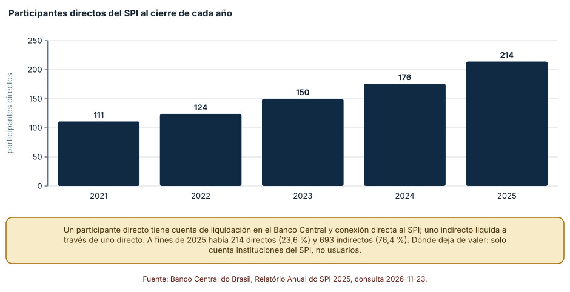

**Cómo leer la figura.** Cada barra es el cierre de un año. Mire que los directos casi se duplican en cuatro años. **Dónde deja de valer.** Cuenta instituciones, no usuarios; los indirectos (693 en 2025) quedan fuera.

## Contexto y problema

**Documentado.** El informe de gestión describe el mercado de pagos minoristas anterior al Pix. Los avances en pagos móviles por código QR habían adoptado un formato cerrado, en que pagador y receptor debían ser clientes de la misma institución [P2]. En 2018 la dificultad de coordinación y la falta de movilización del mercado dejaban claro que los agentes privados no podrían, por sí solos, implantar una solución abierta de pagos instantáneos [P2]. El Banco Central, como institución neutra y ante una industria compleja con muchos intereses, asumió el liderazgo [P2].

**El problema de fondo.** Los objetivos declarados del Pix son seis: disminuir el uso de efectivo y promover la digitalización; fomentar la competencia y la eficiencia; incentivar la innovación y habilitar nuevos modelos de negocio; democratizar el acceso a medios electrónicos y contribuir a la inclusión financiera; reducir el coste de las transacciones electrónicas; y ofrecer una experiencia simple, segura y sin fricciones [P2]. Técnicamente eso exige tres cosas que se contradicen: **velocidad** (segundos, a cualquier hora, todos los días), **interoperabilidad** (cualquier cliente de cualquier institución debe poder pagar a cualquier otro) y **seguridad** (los pagos son irrevocables y los estafadores existen).

**Estudio internacional.** El Banco Central estudió diez jurisdicciones (Australia, Singapur, Dinamarca, India, Reino Unido, Suecia, Unión Europea, Estados Unidos, Italia y México) y realizó visitas técnicas a seis (México, Estados Unidos, Australia, Dinamarca, Suecia y Reino Unido) [P2]. Su conclusión: no existe un modelo ideal; los modelos dependen de necesidades y aspectos culturales de cada jurisdicción, así que adaptó las características a la realidad brasileña [P2]. El primer sistema de pagos instantáneos del mundo es de 2001, en Corea del Sur, y una publicación de marzo de 2023 citada por el informe cuenta más de 60 jurisdicciones con servicios de pagos instantáneos [P2].

**Inferido.** La apuesta de diseño fue que una infraestructura pública con acceso abierto, en lugar de un arreglo cerrado de bancos, genera competencia y cobertura a la vez, porque cualquier institución autorizada puede ofrecer el servicio sobre la misma red. El informe de 2023 a 2025 lo dice para el Pix Automático: permite que cualquier participante aproveche toda la red de usuarios sin importar la institución del pagador, reduciendo el poder de mercado de instituciones grandes con mucha clientela [P1].

### La apuesta, enunciada como hipótesis

El curso propone leer la apuesta del Banco Central como tres hipótesis comprobables ([SE-124](../../classes/part-10-descubrimiento-y-estrategia-de-producto/se-124-hipotesis-supuestos-y-preguntas-criticas/README.md)): (1) un arreglo abierto y gratuito para las personas se adoptará más rápido que una alternativa cerrada de pago; (2) si el Banco Central opera la liquidación y el directorio de claves, las instituciones pequeñas competirán con las grandes; (3) un sistema de liquidación continuo puede alcanzar la disponibilidad que exige un medio de pago de uso diario. Cada una tiene un criterio de fracaso: baja adopción, concentración en pocas instituciones o caídas frecuentes del sistema. Esta formulación es del curso; el Banco Central no publica hipótesis internas.

## Mercado, usuarios y casos de uso

El Pix sirve a públicos distintos. La tabla resume quién es cada uno; lo que la fuente no confirma se marca.

| Rol | Qué hace y qué gana | Qué cambia en su experiencia | Respaldo |
| --- | --- | --- | --- |
| Persona física | Transfiere y paga con una clave o un código QR, a cualquier hora | Gratuito para las personas | [P2] |
| Empresa y comercio | Cobra con código QR, cobros con vencimiento y Pix Automático | Coste menor que otros medios | [P1], [P2] |
| Gobierno | Paga y cobra por el Pix | **[No se sabe]** el detalle de uso | [P2] |
| Institución participante | Ofrece Pix a sus clientes | Acceso común a toda la red | [P3] |
| Iniciador de pago | Inicia pagos en cuentas de otra institución (Open Finance) | Un servicio nuevo | [P2] |
| Banco Central | Regula, desarrolla, opera y gestiona SPI y DICT | Recupera costes del SPI | [P3] |

**Uso central.** Pagar y cobrar en segundos a cualquier hora. **Mercado.** En diciembre de 2025, 148 millones de personas físicas y 12 millones de empresas hicieron o recibieron un Pix; había más de 920 millones de claves registradas, 67 % más que en diciembre de 2022 [P1]. En 2020, año del lanzamiento, el medio se usaba sobre todo entre personas físicas (cerca del 85 % de las transacciones); con el tiempo creció el uso entre personas y empresas, y desde 2023 el valor entre empresas supera al valor entre personas físicas, con 47 % del total en 2025 [P1].

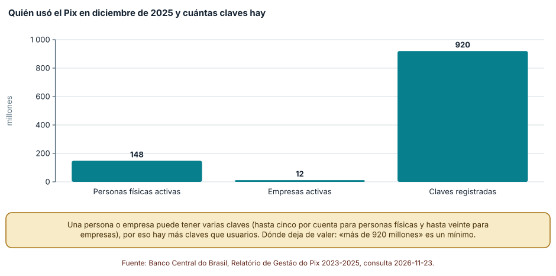

**Cómo leer la figura.** Cada barra es una población: usuarios activos en un mes y claves registradas. Mire que hay muchas más claves que usuarios. **Dónde deja de valer.** Una persona puede tener varias claves; «más de 920 millones» es un mínimo.

### Quién da qué a quién

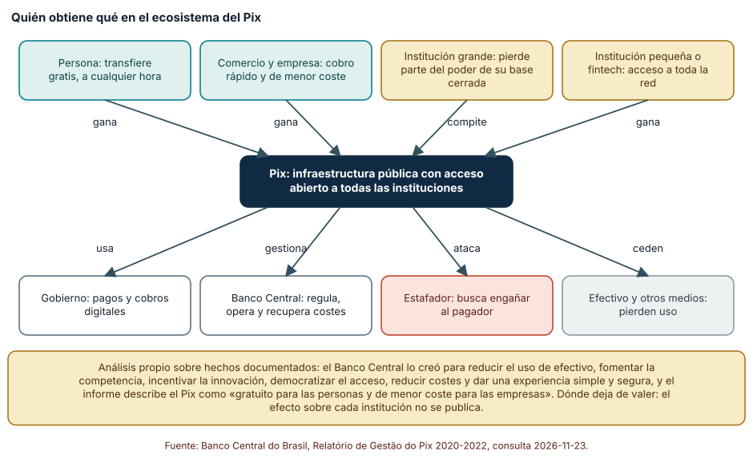

**Cómo leer la figura.** El Pix está en el centro porque es la infraestructura común; las etiquetas dicen qué gana o pierde cada actor. Mire primero el contraste entre instituciones grandes y pequeñas. **Dónde deja de valer.** No hay cifras por actor.

### Incentivos por tipo de usuario (análisis propio sobre hechos documentados)

- **Persona.** Quiere pagar sin coste y sin fricción; el informe describe el Pix como rápido, barato, integrado, versátil y fácil [P2].
- **Comercio.** Quiere cobrar barato y conciliar fácil: las informaciones de la transacción viajan junto con la orden de pago, lo que facilita la conciliación y la automatización [P2].
- **Institución grande.** Su clientela deja de ser una barrera: cualquier cliente puede pagar a cualquier otro. El informe lo plantea como menor poder de mercado de los incumbentes [P1].
- **Institución pequeña o fintech.** Gana acceso a toda la red como participante indirecto sin integrar sus sistemas con la RSFN [P3].
- **Banco Central.** Su incentivo es el cumplimiento de sus objetivos públicos; cobra solo para recuperar costes del SPI [P3].
- **Estafador.** Su incentivo crece con la irrevocabilidad y la velocidad: de ahí el MED y las reglas de seguridad [P1], [P2].

### Competencia y por qué el mercado favoreció al Pix (análisis propio)

Las fuentes consultadas comparan el Pix con otros medios de pago mediante estadísticas que el Banco Central publica en otro sitio, que no se consultaron aquí [P1]. **[No se sabe]** la cuota del Pix frente a efectivo, tarjetas, transferencias bancarias y boletos con una fuente comparable. El análisis propio plantea cuatro factores, ninguno suficiente por sí solo: (1) gratuidad para las personas [P2]; (2) acceso universal por clave o QR sin importar la institución; (3) un operador neutral y obligación de participar para las grandes instituciones; (4) un lanzamiento por etapas con registro previo de claves (25 millones en los primeros días), que aseguró masa crítica [P2]. **[No se sabe]** cuánto pesa cada uno.

## Funcionalidad de principio a fin

Se recorre el servicio primero con una persona que paga a otra y luego con otros tipos de usuario, hasta su caso límite.

### Recorrido de una persona que paga

1. **Alta y clave.** La persona registra una clave (celular, correo, CPF, CNPJ o clave aleatoria) en su institución; el DICT la vincula a su cuenta [P6].
2. **Iniciar el pago.** Abre la aplicación de su institución y escribe la clave del receptor o lee un código QR [P2].
3. **Resolución.** La institución del pagador consulta el DICT para obtener los datos de la cuenta del receptor [P6].
4. **Orden.** Envía la orden de pago al SPI [P3].
5. **Liquidación.** El SPI liquida de forma bruta y en tiempo real, con asientos en las cuentas PI de las instituciones; la operación liquidada es irrevocable [P3].
6. **Acreditación.** La institución del receptor acredita y los dos usuarios reciben la confirmación en segundos [P2]. **[No se sabe]** el detalle del mensaje de confirmación.

### Recorridos por tipo de usuario

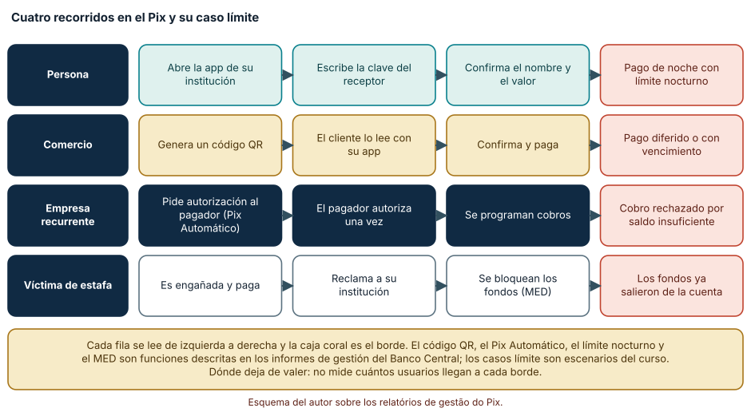

**Cómo leer la figura.** Cada fila es un usuario distinto; las cajas se leen de izquierda a derecha y la última, en coral, es el caso límite. **Dónde deja de valer.** Es un recorrido visible al usuario, no un diagrama de estados.

**Comercio.** **[Documentado]** que desde julio de 2021 se pueden generar cobros con vencimiento con cálculo automático de intereses, multas, descuentos y rebajas; el pago comienza leyendo un código QR o con «Pix Copia y Pega» [P1]. El caso límite es el pago de un cobro vencido con cálculo al día real de pago.

**Empresa con cobros recurrentes.** **[Documentado]** que el Pix Automático (2025) permite cobros recurrentes con autorización previa del pagador; a diciembre de 2025 había más de mil receptores ofreciéndolo, y el informe espera que crezca porque requiere desarrollo del lado del receptor [P1]. El caso límite es el cobro que falla por saldo insuficiente. **[No se sabe]** las tasas de fallo.

**Víctima de una estafa.** **[Documentado]** que, desde noviembre de 2021, el Mecanismo Especial de Devolución (MED) permite bloquear los fondos en la cuenta del estafador tras la queja de la víctima y devolverlos si la queja procede [P2]. El caso límite es que los fondos ya se hayan dispersado: el MED cubre las cuentas conectadas a la transacción original por una cadena continua de dispersión de recursos [P1].

**Pago en el extranjero.** **[Documentado]** que el Pix en sí permite solo transacciones domésticas; para turistas y brasileños en el exterior, una alianza con instituciones extranjeras genera el QR del Pix, el pago se hace en reales a una institución brasileña y la remesa al exterior va por la vía tradicional [P1].

## Negocio y economía

**Modelo (documentado).** El Pix no es un negocio: es una infraestructura pública. Sus rasgos económicos son: gratuito para las personas y de menor coste para las empresas [P2]; las tarifas del SPI se fijan solo para recuperar los costes de los sistemas y recursos de tecnología del Banco Central; y no hay tarifa para la institución del pagador ni para las operaciones que fallan antes de liquidarse [P3].

### La escala a lo largo del tiempo

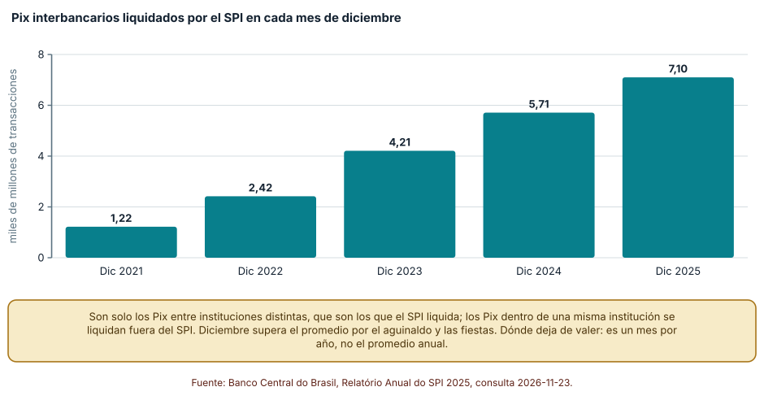

**Cómo leer la figura.** Cada barra es un mes de diciembre. Mire la regularidad: cada año se añade más de mil millones. **Dónde deja de valer.** Es un mes por año; diciembre es el pico por el aguinaldo y las fiestas.

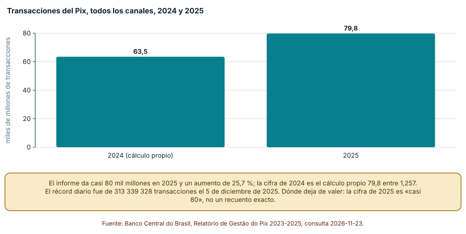

**Cómo leer la figura.** Cada barra es un año con todos los canales. **Dónde deja de valer.** La cifra de 2024 es un cálculo propio a partir del crecimiento de 25,7 %.

### Unit economics con cifras citadas

| Magnitud | Valor | Fuente |
| --- | ---: | --- |
| Transacciones del Pix en 2025 | casi 80 000 millones | [P1] |
| Crecimiento de transacciones 2025 | 25,7 % | [P1] |
| Valor del Pix en 2025 | más de 35 billones de reales | [P1] |
| Crecimiento del valor 2025 | 33,8 % | [P1] |
| Pix interbancarios liquidados por el SPI en diciembre de 2025 | 7 100 millones | [P3] |
| Valor liquidado por el SPI en 2025 | 29,61 billones de reales | [P3] |
| Valor liquidado por el SPI desde el lanzamiento | 80,33 billones de reales | [P3] |
| Valor medio por Pix en diciembre de 2025 | 443,29 reales | [P3] |
| Mediana del valor por Pix | menos de 36 reales | [P3] |
| Percentil 90 | menos de 400 reales | [P3] |
| Percentil 99 | menos de 3 900 reales | [P3] |
| Mayor Pix individual liquidado | 3 500 millones de reales | [P3] |

Cálculo propio: 29,61 billones sobre 22,12 billones de 2024 es un crecimiento de 33,9 % del valor liquidado por el SPI. Como el valor medio es 443 reales y la mediana menos de 36, la distribución es muy asimétrica: pocos pagos grandes y muchos pequeños. Eso es lo que hace al Pix un sistema de pagos minoristas [P3].

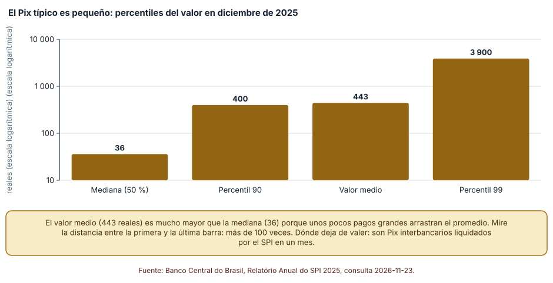

**Cómo leer la figura.** Cada barra es una medida de la distribución de valores; la escala es logarítmica. **Dónde deja de valer.** Es un mes de Pix interbancarios.

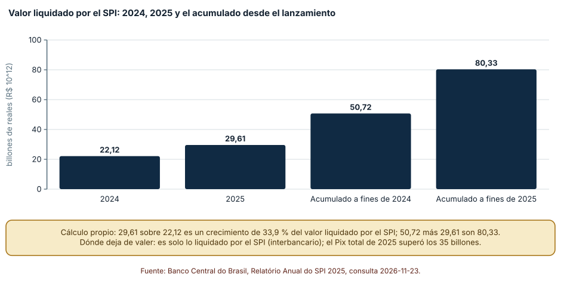

**Cómo leer la figura.** Las dos primeras barras son años y las dos últimas, acumulados. **Dónde deja de valer.** Es solo lo liquidado por el SPI.

### Dónde crece el negocio

**[Documentado]** que el uso se ha desplazado: de casi 85 % entre personas en 2020 a una mayor presencia de pagos a empresas; que el Pix Agendado creció 56 % en 2025 y llegó a algo más de un billón de reales, aunque aún es cerca del 0,3 % de las transacciones; y que el Pix Automático aún es incipiente [P1]. En valor, el B2B pasó a ser casi la mitad en 2025 [P1].

### Eficiencia de la organización

**[No se sabe]** el coste de personal. Lo documentado es una eficiencia de diseño: una infraestructura única de liquidación para 907 participantes [P3].

### Esquema del negocio: flujos de dinero y de valor

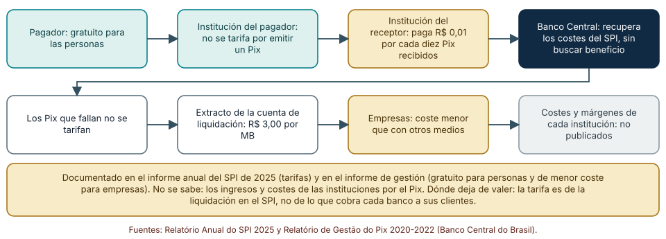

**Cómo leer la figura.** La fila superior sigue el dinero del SPI y la inferior sus excepciones. **Dónde deja de valer.** Es la tarifa de liquidación en el SPI, no lo que cobra cada institución a sus clientes.

### Visión, misión y estrategia

El Banco Central describe el Pix como «una infraestructura pública digital esencial para el buen funcionamiento de la economía» cuyo desarrollo es el ejercicio de su competencia para promover competencia, inclusión financiera y transparencia [P1]. Sus pilares de evolución son la eficiencia, la competencia, la inclusión y la seguridad [P1]. La agenda futura habla de nuevos productos, integración con otros servicios financieros y «inserción internacional» del Pix [P1].

### Costos operativos

**Documentado.** Las tarifas del SPI se fijan para reembolsar los costes de los sistemas y recursos de tecnología necesarios para operarlo; el Banco Central calcula ingresos y costes de forma continua y revisa las tarifas con el resultado y las proyecciones, en el marco del reembolso de costes del sistema de información del Banco Central [P3]. Se cobra a los participantes directos acreditados por los Pix: R$ 0,01 por cada diez Pix liquidados, y R$ 3,00 por megabyte de extracto de la cuenta PI [P3]. **[No se sabe]** el coste total del SPI ni su desglose.

### Competidores

**[No se sabe]** una comparación con otros medios de pago con fuente comparable en este caso. El Banco Central publica estadísticas de medios de pago en otra página que no se consultó [P1].

## Arquitectura y esquemas

Se recorre como un mapa con zoom creciente. Lo que sigue sale de los informes y manuales del Banco Central; lo que no está allí se marca. Una advertencia sobre el nivel de detalle: el Banco Central publica **qué hace** el SPI y el DICT, con reglas y plazos, y **no publica cómo están construidos por dentro**. Por eso esta sección describe contratos, reglas y números de operación, no software.

### 6.1 Contexto del sistema

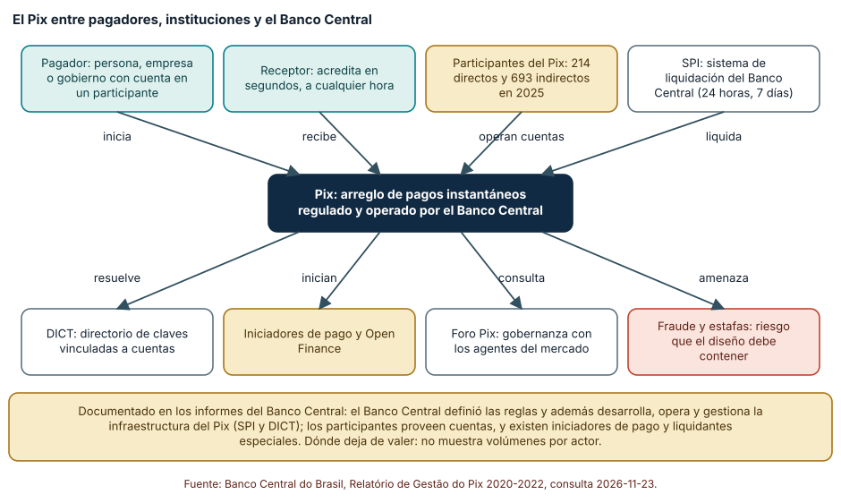

**Cómo leer la figura.** El cuadro central es el arreglo y los satélites son quienes lo usan, lo operan o lo amenazan. Mire primero el SPI y el DICT: son las dos piezas que opera el propio Banco Central. **Dónde deja de valer.** No hay volúmenes por actor.

### 6.2 Capas

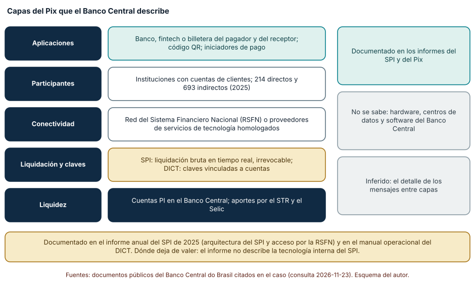

**Cómo leer la figura.** De arriba abajo, cada capa descansa en la siguiente; a la derecha, qué es documentado y qué no. **Dónde deja de valer.** El informe no describe los componentes internos.

**Documentado [P3].** El SPI es un sistema del mercado financiero operado por el Banco Central y, dentro del sistema de pagos brasileño, el sistema centralizado y único de liquidación de los Pix interbancarios, es decir, cuando el pagador y el receptor tienen cuenta en instituciones distintas. Los participantes acceden por una estructura única, la Red del Sistema Financiero Nacional (RSFN), con conexión directa o a través de un proveedor de servicios de tecnología de la información homologado. Para gestionar liquidez en su cuenta PI usan además el Sistema de Transferencia de Reservas (STR) y el Selic. El DICT es la base centralizada de datos vinculados a las claves [P2].

### 6.3 Un Pix, de punta a punta

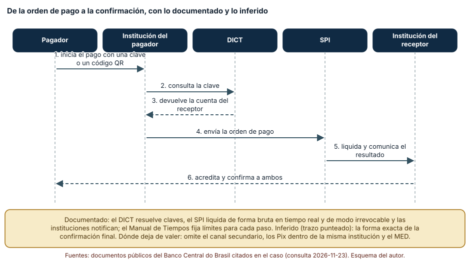

**Cómo leer la figura.** Las flechas son llamadas en orden; las punteadas son inferidas. Mire que el DICT se consulta antes de la liquidación y el SPI solo liquida. **Dónde deja de valer.** Omite el canal secundario, los Pix dentro de una misma institución y el MED.

**Documentado.** El ecosistema incluye al pagador, que accede a su cuenta en una institución participante; el liquidante especial, que presta solo servicio de liquidación a otros participantes sin acceder directamente al SPI; y el iniciador, que presta solo el servicio de iniciar la transacción en una cuenta de otra institución [P2]. Las instituciones proveedoras de cuenta pueden acceder al SPI y al DICT de forma directa o indirecta [P2]. **Inferido.** El orden exacto de los mensajes entre instituciones y el SPI: los documentos consultados fijan plazos para cada tramo, pero no los describen mensaje a mensaje.

### 6.4 Liquidación bruta en tiempo real

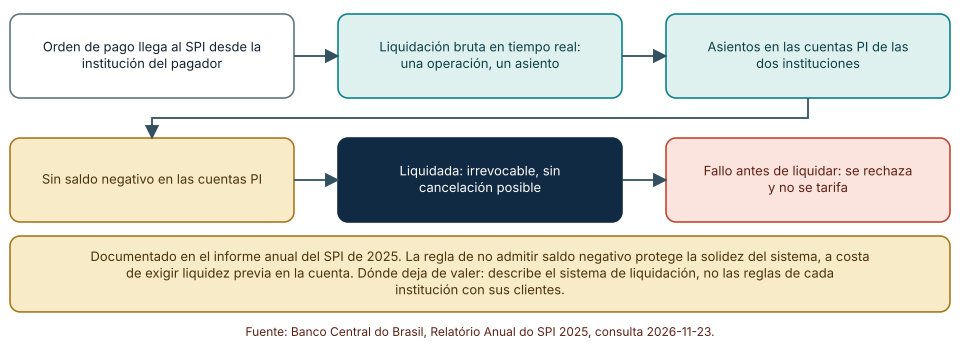

**Cómo leer la figura.** La fila superior es el camino feliz y la inferior, las reglas que lo protegen. **Dónde deja de valer.** Describe el SPI, no el trato de cada institución con sus clientes.

**Documentado [P3].** El SPI hace liquidación bruta en tiempo real: procesa y liquida cada transacción en cuanto la recibe, y una vez liquidada es irrevocable, sin posibilidad de cancelación. Los Pix se liquidan con asientos en cuentas de propósito específico que los participantes directos mantienen en el Banco Central, las cuentas de pago instantáneo (Conta PI), y para dar solidez al sistema no se admite saldo negativo (descubierto) en ellas. El SPI debe funcionar las 24 horas, todos los días del año, también en fines de semana y feriados.

**Qué enseña (análisis propio).** Es la elección de diseño más importante del Pix: liquidar cada pago de forma bruta y final, con liquidez pre-posicionada, en lugar de acumular y compensar en lotes. Evita el riesgo de crédito entre instituciones y da certeza inmediata al receptor, a costa de exigir liquidez previa en las cuentas PI. Las clases de transacciones y consistencia ([SE-351](../../classes/part-29-datos-persistencia-y-recuperacion/se-351-transacciones-aislamiento-y-concurrencia/README.md)), de invariantes monetarias ([SE-294](../../classes/part-24-software-especializado-y-dominios/se-294-fintech-contabilidad-e-invariantes-monetarias/README.md)) y de decisiones irreversibles ([SE-142](../../classes/part-11-economia-metricas-y-decisiones-de-producto/se-142-decisiones-reversibles-e-irreversibles/README.md)) lo desarrollan: la irrevocabilidad convierte el error en un problema de devolución, no de cancelación.

### 6.5 Liquidez: un pago de 24 horas sobre un sistema de reservas que cierra

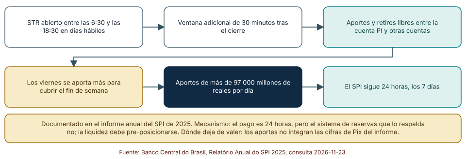

**Cómo leer la figura.** La fila superior es la ventana del sistema de reservas y la inferior, cómo se cubre el fin de semana. **Dónde deja de valer.** Los aportes no integran las cifras de Pix.

**Documentado [P3].** El STR se usa entre las 6:30 y las 18:30 en días hábiles para aportar y retirar libremente entre una cuenta PI y una cuenta movible por el STR (reservas bancarias, cuenta de liquidación o cuenta correspondiente de moneda electrónica), con una ventana adicional de treinta minutos tras el cierre de la grilla regular. Los aportes llegaron a superar 97 mil millones de reales por día. Son mayores los viernes porque hay que dar liquidez a todo el fin de semana, cuando el STR está cerrado. En 2024 los aportes por el STR sumaron 13,68 billones de reales y se contrataron 169,24 millones en redescuento en el mismo periodo [P4]. Desde el 15 de agosto de 2022 se remuneran los saldos de la cuenta PI según el reglamento del SPI [P4].

**Mecanismo.** El Pix funciona de noche y en fines de semana, pero el dinero de reservas se mueve en horario bancario; la solución es que cada institución pre-posicione liquidez. Es un caso real de pagos 24/7 sobre una infraestructura de liquidación con calendario ([SE-417](../../classes/part-34-saas-y-plataformas-de-producto/se-417-pagos-idempotencia-y-conciliacion/README.md) trata pagos y conciliación).

### 6.6 Plazos y niveles de servicio

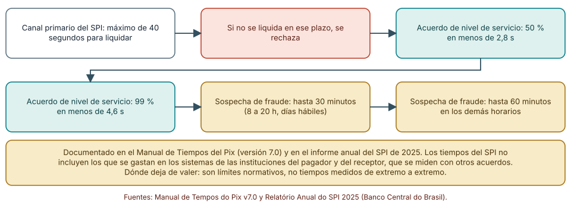

**Cómo leer la figura.** Cada caja es un plazo; los de arriba son del SPI y los de abajo, del SPI y de la autorización. **Dónde deja de valer.** Son límites normativos, no tiempos medidos de extremo a extremo.

**Documentado [P5], [P3].** El Manual de Tiempos del Pix (versión 7.0) fija que una orden enviada al canal primario de mensajes del SPI tiene un máximo de 40 segundos y que, si no se liquida en ese plazo, se rechaza. Existe un canal secundario de transmisión de mensajes con su propia regla. Además, los Pix con sospecha de fraude (salvo retiro, vuelto y transferencias inteligentes) pueden demorar hasta 30 minutos en autorizarse entre las 8 y las 20 horas de días hábiles y hasta 60 minutos en el resto; el plazo se cuenta desde que la institución del pagador recibe la orden. El acuerdo de nivel de servicio del tiempo dentro del SPI exige que el 50 % de todos los Pix liquidados en el mes tarden menos de 2,8 segundos y que el 99 % tarden menos de 4,6 segundos; esos resultados no incluyen el tiempo en los sistemas de las instituciones del pagador y del receptor, que tienen otros acuerdos [P3].

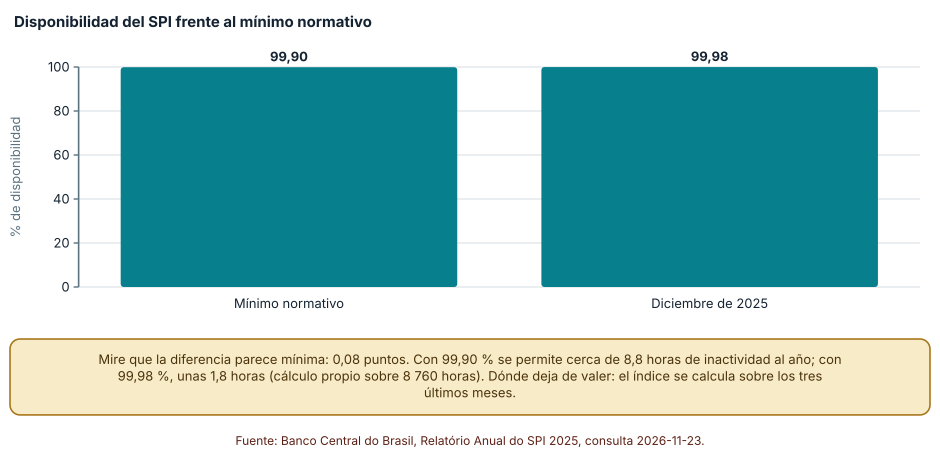

**Cómo leer la figura.** Cada barra es un porcentaje; la diferencia parece pequeña pero equivale a horas al año. **Dónde deja de valer.** El índice se calcula sobre los tres últimos meses.

**Documentado [P3].** El índice de disponibilidad del SPI es la proporción entre las horas de funcionamiento efectivo y las horas en que debería estar disponible en los últimos tres meses. El mínimo normativo es 99,90 % y el índice apurado se mantuvo por encima desde el lanzamiento, cerrando diciembre de 2025 en 99,98 %. Cálculo propio: sobre 8 760 horas al año, 99,90 % permite unas 8,8 horas de indisponibilidad y 99,98 % unas 1,8. Las clases de SLI, SLO y presupuestos de error ([SE-497](../../classes/part-41-observabilidad-sre-e-incidentes/se-497-sli-slo-sla-y-presupuestos-de-error/README.md)) y de disponibilidad ([SE-440](../../classes/part-36-calidad-rendimiento-y-resiliencia/se-440-disponibilidad-durabilidad-y-recuperacion/README.md)) usan este tipo de números.

### 6.7 El DICT: claves como contrato de datos

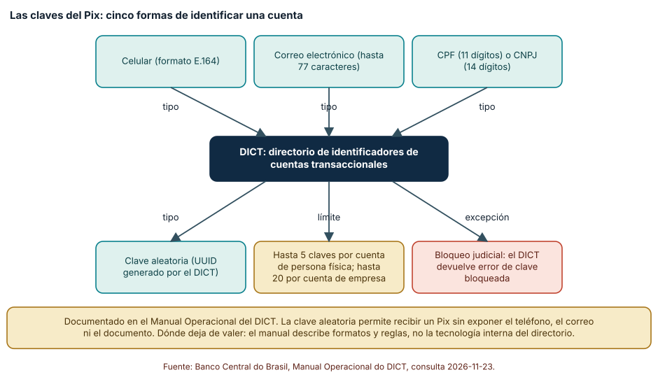

**Cómo leer la figura.** El centro es el directorio y los satélites son los tipos de clave y sus reglas. **Dónde deja de valer.** El manual describe formatos y reglas, no la tecnología.

**Documentado [P6].** Las claves se guardan en el DICT con formatos definidos: el celular con el estándar E.164, el correo con hasta 77 caracteres y validado con una expresión regular de la especificación, el CPF con 11 números y el CNPJ con 14 sin puntos ni guiones, y la clave aleatoria como un UUID generado por el DICT (RFC 4122). Una persona con CPF puede vincular hasta cinco claves por cada cuenta de la que es titular y una con CNPJ hasta veinte; el límite se aplica por cuenta, sin importar cuántos titulares tenga. Cuando hay un pedido de bloqueo de una clave por orden judicial, el DICT devuelve un error de clave bloqueada con código HTTP 400 en consultas, cambios y otras operaciones. **Qué enseña.** Es un contrato de datos con formato, unicidad y límites explícitos ([SE-162](../../classes/part-13-especificaciones-contratos-y-modelos/se-162-esquemas-de-datos-y-validacion/README.md) trata esquemas y validación; [SE-163](../../classes/part-13-especificaciones-contratos-y-modelos/se-163-openapi-asyncapi-graphql-y-contratos-de-eventos/README.md) contratos de API; [SE-164](../../classes/part-13-especificaciones-contratos-y-modelos/se-164-compatibilidad-versionado-y-evolucion-de-contratos/README.md) versionado: el propio Manual de Tiempos está en su versión 7.0).

### 6.8 Seguridad: irrevocable no significa sin remedio

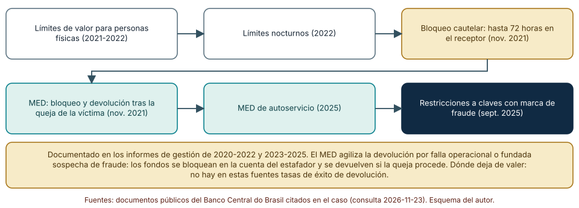

**Cómo leer la figura.** Las cajas siguen el orden en que se añadieron los mecanismos. **Dónde deja de valer.** No hay en las fuentes consultadas tasas de éxito.

**Documentado [P1], [P2].** La liquidación es irrevocable, de modo que la defensa contra el fraude se construye alrededor: **límites de valor** para personas físicas y **límites nocturnos** desde 2022; **bloqueo cautelar** desde noviembre de 2021, que permite a la institución del receptor persona física bloquear preventivamente los fondos recibidos hasta 72 horas, en el acto del crédito, para un análisis antifraude más robusto y los devuelve a la víctima si se confirma el fraude; el **Mecanismo Especial de Devolución (MED)**, también desde noviembre de 2021, un proceso estructurado para agilizar la devolución por falla operacional o fundada sospecha de fraude: tras la queja de la víctima los fondos se bloquean en la cuenta del estafador y se devuelven al terminar el análisis si procede, incluyendo cuentas conectadas por una cadena continua de dispersión; el MED de autoservicio en 2025; y desde septiembre de 2025 las instituciones deben rechazar el registro de una clave y no dar curso a una portabilidad o reivindicación hechos por usuarios reconocidos por ellas mismas como estafadores. Además, el informe cita alertas de estafa que algunas instituciones muestran antes de autorizar un Pix (receptor nuevo, receptor con muchas marcas de fraude o valor muy alto) como soluciones de mercado [P1].

**Qué enseña.** Cuando una operación es irreversible por diseño, la seguridad se desplaza hacia antes (límites, alertas) y hacia después (bloqueo y devolución con proceso). Las clases de modelos de amenaza ([SE-457](../../classes/part-38-seguridad-privacidad-y-cumplimiento/se-457-principios-de-seguridad-y-modelos-de-amenaza/README.md)) y de identidad y autenticación ([SE-458](../../classes/part-38-seguridad-privacidad-y-cumplimiento/se-458-identidad-autenticacion-y-sesiones/README.md)) dan el marco.

### 6.9 Patrón de carga

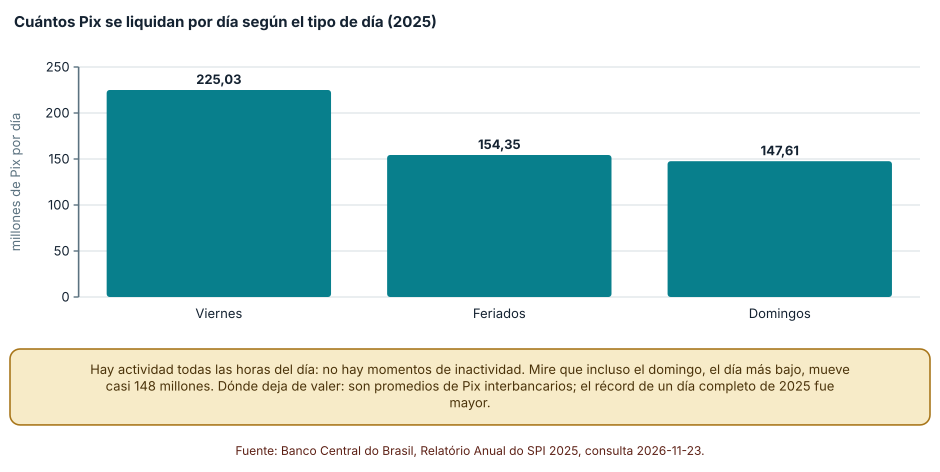

**Cómo leer la figura.** Cada barra es el promedio diario de un tipo de día. **Dónde deja de valer.** Son promedios de Pix interbancarios de 2025.

**Documentado [P3], [P1].** Hay liquidaciones todas las horas, sin momentos de inactividad: la franja de menor actividad va de las 2 a las 6 horas y los picos están entre las 10 y las 14 y entre las 16 y las 19, bajando gradualmente desde las 19. Los viernes promedian 225,03 millones de operaciones por día y los domingos 147,61 millones; diciembre está por encima de la media por el aguinaldo y las fiestas. El récord de un solo día fue el 5 de diciembre de 2025, con 313 339 328 transacciones. En diciembre de 2025 el Pix movió 7 800 millones de transacciones y 3,7 billones de reales, más que el PIB del cuarto trimestre del mismo año según el informe [P1].

### 6.10 Observabilidad y operación

**Documentado.** El Banco Central mide y publica el índice de disponibilidad del SPI y el cumplimiento del acuerdo de nivel de servicio; publica estadísticas diarias de la liquidación y del patrón intradía en la página del SPI y datos abiertos del Pix [P1], [P3]. En 2025 desarrolló un mecanismo para identificar movimientos atípicos en las cuentas PI y avisar a los participantes directos, y publicó una interfaz web (módulo SPI del SPB-Web) para que gestionen y monitoreen su cuenta [P3]. **[No se sabe]** el diseño interno de monitoreo, de guardias y de gestión de incidentes del SPI; no hay en las fuentes consultadas un análisis de un incidente concreto.

### 6.11 Evolución por etapas

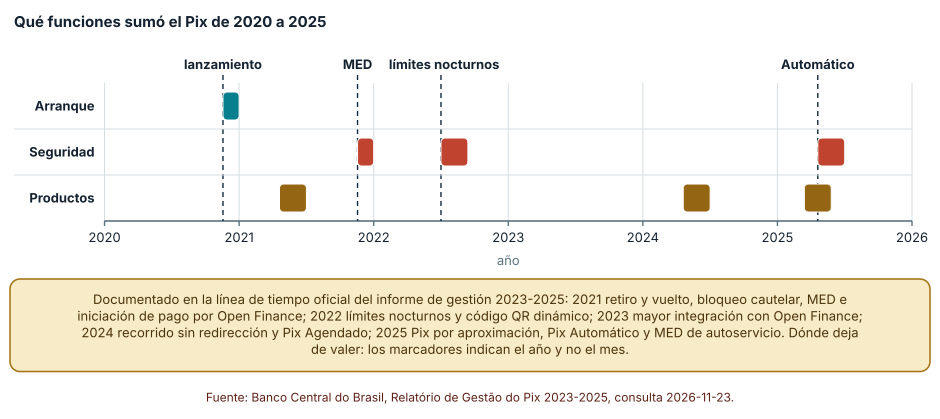

**Cómo leer la figura.** Cada marcador es una función con su año; los carriles las agrupan. **Dónde deja de valer.** El marcador indica el año, no el mes.

**Documentado [P1].** Línea de tiempo oficial: 2020, lanzamiento (16 de noviembre); 2021, retiro y vuelto, bloqueo cautelar, MED e iniciación de pago por Open Finance (y cobros con vencimiento desde julio); 2022, límites nocturnos y código QR dinámico con más funciones; 2023, mayor integración con Open Finance; 2024, recorrido sin redirección (Pix más Open Finance) y Pix Agendado; 2025, Pix por aproximación, Pix Automático y MED de autoservicio. **Inferido.** Cada etapa responde a un uso real o a un abuso observado, no a un plan fijado de antemano: el informe habla de un proceso «continuo, dinámico y colaborativo».

### 6.12 Alternativas descartadas y trade-offs (análisis propio)

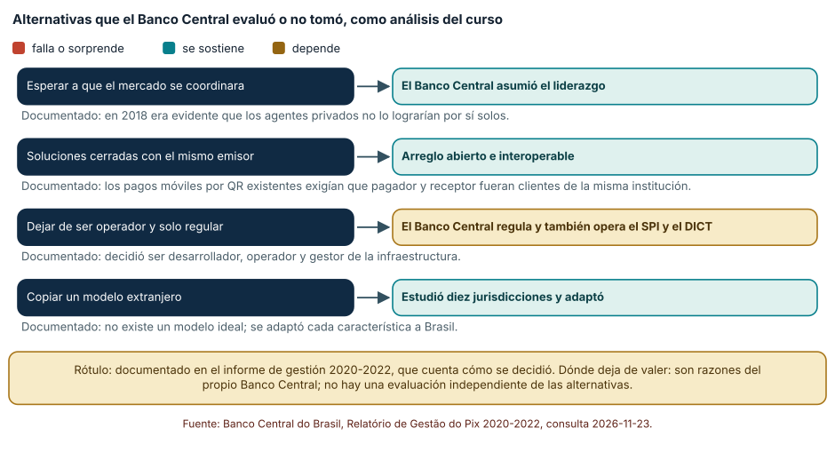

**Cómo leer la figura.** Cada tarjeta enfrenta una alternativa con lo que el Banco Central documenta. **Dónde deja de valer.** Son razones del propio Banco Central.

**Rótulo: documentado.** El informe de gestión cuenta el razonamiento: el mercado no se coordinó; las soluciones existentes eran cerradas; el Banco Central eligió no solo regular sino desarrollar, operar y gestionar el SPI y el DICT; y estudió experiencias extranjeras sin copiarlas [P2]. **[No se sabe]** si evaluó una infraestructura operada por un consorcio privado con supervisión, o los costes comparados de cada alternativa.

### 6.13 Hardware, software, infraestructura y fallos

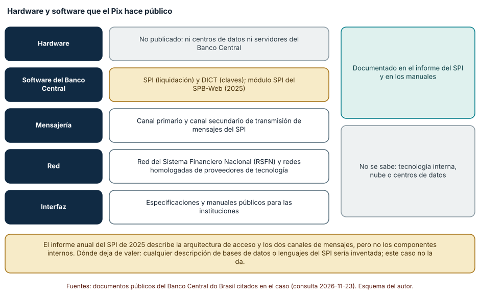

**Cómo leer la figura.** De arriba abajo, de lo conocido a lo no publicado. **Dónde deja de valer.** Todo lo interno es no sabido.

**Hardware utilizado.** **[No se sabe]**: los informes no publican centros de datos, servidores ni proveedor de nube del Banco Central.

**Software utilizado (documentado).** El SPI y el DICT, operados por el Banco Central; un módulo SPI del SPB-Web para participantes directos (2025); dos canales de transmisión de mensajes (primario y secundario) [P3]. **[No se sabe]** lenguajes, bases de datos y arquitectura interna; cualquier descripción de ellos que circule no tiene fuente primaria en este caso.

**Características de la infraestructura.** Un sistema central y único de liquidación; acceso por una estructura única (RSFN) o por proveedores homologados; cuentas PI con liquidez pre-posicionada; funcionamiento continuo [P3].

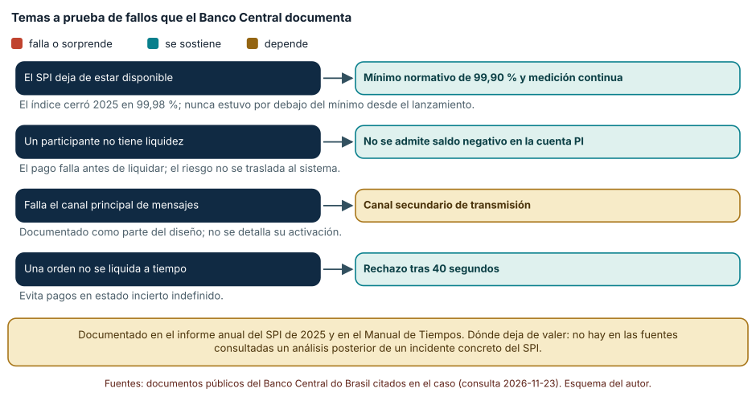

**Cómo leer la figura.** Cada tarjeta enlaza el riesgo con el mecanismo que lo contiene. **Dónde deja de valer.** No hay análisis de incidentes en las fuentes consultadas.

**Temas a prueba de fallos.** Disponibilidad mínima normativa con medición continua; no admitir saldo negativo en las cuentas PI; canal secundario de mensajes; rechazo tras 40 segundos [P3], [P5]. La clase de continuidad y recuperación ([SE-502](../../classes/part-41-observabilidad-sre-e-incidentes/se-502-continuidad-disaster-recovery-y-ejercicios/README.md)) trata cómo se diseñan y se prueban.

## Casos especiales y cómo se resuelven

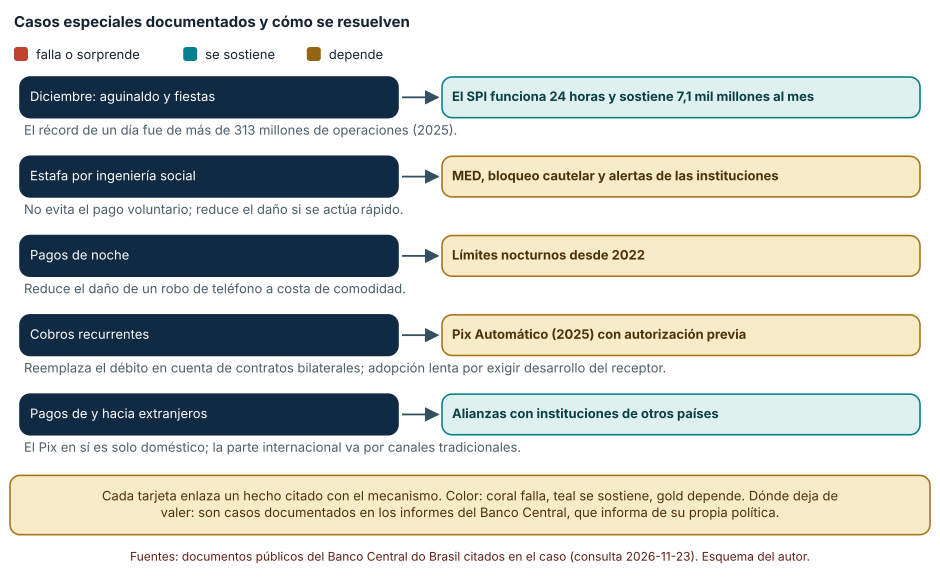

**Cómo leer la figura.** Cada tarjeta enfrenta una situación con lo que hizo el sistema; el color es el veredicto. **Dónde deja de valer.** Son casos documentados por el propio Banco Central.

1. **Pico de diciembre.** El SPI funciona de forma continua y liquidó 7 100 millones de Pix interbancarios en diciembre de 2025 [P3].
2. **Estafa por ingeniería social.** MED, bloqueo cautelar y alertas de las instituciones [P1].
3. **Pagos de noche.** Límites nocturnos desde 2022 [P1].
4. **Cobros recurrentes.** Pix Automático con autorización previa [P1].
5. **Fin de semana.** Liquidez pre-posicionada porque el sistema de reservas está cerrado [P3].
6. **Orden que no se liquida a tiempo.** Rechazo a los 40 segundos [P5].
7. **Participantes pequeños.** Participación indirecta a través de un participante directo [P3].
8. **Uso por no residentes.** Alianzas con instituciones extranjeras con liquidación en reales [P1].

## Línea de tiempo

| Año o fecha | Hecho | Fuente |
| --- | --- | --- |
| 2013 y 2014 | Informe de vigilancia con la primera mención de pagos minoristas en tiempo real e ininterrumpidos | [P2] |
| 2016 | Taller internacional sobre pagos instantáneos | [P2] |
| 21 de diciembre de 2018 | Comunicado con los requisitos fundamentales | [P2] |
| Octubre de 2019 | Comienza el desarrollo de la infraestructura | [P2] |
| 12 de agosto de 2020 | Reglamento del Pix (Resolución BCB nº 1) | [P2] |
| 5 de octubre de 2020 | Registro de claves: más de 25 millones en los primeros días | [P2] |
| 3 de noviembre de 2020 | Operación restringida | [P2] |
| 16 de noviembre de 2020 | Operación plena | [P1], [P2] |
| 2021 | Cobros con vencimiento (julio); retiro y vuelto; bloqueo cautelar y MED (noviembre) | [P1], [P2] |
| 2022 | Límites nocturnos; remuneración de las cuentas PI desde agosto | [P1], [P4] |
| 2024 | Pix Agendado; el SPI liquida 22,12 billones de reales en el año | [P1], [P4] |
| 2025 | Pix por aproximación, Pix Automático y MED de autoservicio; casi 80 000 millones de transacciones | [P1] |
| 5 de diciembre de 2025 | Récord de 313 339 328 transacciones en un día | [P1] |

### Decisiones clave, giros y correcciones

- **Asumir el liderazgo (2018).** Decisión de un banco central ante la falta de coordinación del mercado [P2].
- **Operar el SPI y el DICT (2019).** No solo regular: desarrollar y operar la infraestructura [P2].
- **Lanzar por etapas (2020).** Registro de claves, operación restringida y operación plena en siete semanas [P2].
- **Añadir seguridad tras el lanzamiento (2021-2025).** Bloqueo cautelar, MED, límites nocturnos y restricciones a claves con fraude: correcciones al ver el abuso real [P1], [P2].

## Vínculo con el curso

El caso muestra, en una infraestructura real, mecanismos que el curso desarrolla con ejemplos controlados. Cada enlace dice qué ilustra el caso:

- [SE-351](../../classes/part-29-datos-persistencia-y-recuperacion/se-351-transacciones-aislamiento-y-concurrencia/README.md): transacciones, aislamiento y concurrencia. Liquidación bruta, una operación y un asiento, sin saldo negativo.
- [SE-294](../../classes/part-24-software-especializado-y-dominios/se-294-fintech-contabilidad-e-invariantes-monetarias/README.md): fintech, contabilidad e invariantes monetarias. Las cuentas PI como libro de contabilidad con invariante.
- [SE-142](../../classes/part-11-economia-metricas-y-decisiones-de-producto/se-142-decisiones-reversibles-e-irreversibles/README.md): decisiones reversibles e irreversibles. La liquidación irrevocable y el MED como remedio.
- [SE-417](../../classes/part-34-saas-y-plataformas-de-producto/se-417-pagos-idempotencia-y-conciliacion/README.md): pagos, idempotencia y conciliación. Las informaciones que viajan con la orden facilitan la conciliación.
- [SE-440](../../classes/part-36-calidad-rendimiento-y-resiliencia/se-440-disponibilidad-durabilidad-y-recuperacion/README.md): disponibilidad, durabilidad y recuperación. El índice de 99,98 %.
- [SE-497](../../classes/part-41-observabilidad-sre-e-incidentes/se-497-sli-slo-sla-y-presupuestos-de-error/README.md): SLI, SLO y presupuestos de error. El mínimo normativo y los acuerdos de 2,8 y 4,6 segundos.
- [SE-502](../../classes/part-41-observabilidad-sre-e-incidentes/se-502-continuidad-disaster-recovery-y-ejercicios/README.md): continuidad y recuperación ante desastres. Funcionamiento continuo y canal secundario.
- [SE-457](../../classes/part-38-seguridad-privacidad-y-cumplimiento/se-457-principios-de-seguridad-y-modelos-de-amenaza/README.md): principios de seguridad y modelos de amenaza. Ingeniería social e irrevocabilidad.
- [SE-458](../../classes/part-38-seguridad-privacidad-y-cumplimiento/se-458-identidad-autenticacion-y-sesiones/README.md): identidad, autenticación y sesiones. Claves vinculadas a cuentas y marcas de fraude.
- [SE-163](../../classes/part-13-especificaciones-contratos-y-modelos/se-163-openapi-asyncapi-graphql-y-contratos-de-eventos/README.md): OpenAPI, AsyncAPI y contratos de evento. Manuales públicos y especificaciones para participantes.
- [SE-164](../../classes/part-13-especificaciones-contratos-y-modelos/se-164-compatibilidad-versionado-y-evolucion-de-contratos/README.md): compatibilidad y versionado. El Manual de Tiempos en su versión 7.0.
- [SE-152](../../classes/part-12-ingenieria-de-requisitos/se-152-requisitos-regulatorios-de-datos-y-seguridad/README.md): requisitos regulatorios de datos y seguridad. Un reglamento que es también una especificación técnica.
- [SE-416](../../classes/part-34-saas-y-plataformas-de-producto/se-416-marketplaces-y-plataformas-de-dos-lados/README.md): marketplaces y plataformas de dos lados. Pagadores y receptores con una infraestructura neutral.
- [SE-133](../../classes/part-11-economia-metricas-y-decisiones-de-producto/se-133-modelos-de-negocio-y-sostenibilidad/README.md): modelos de negocio y sostenibilidad. Recuperación de costes sin ánimo de lucro.

### Preguntas de discusión

1. La liquidación bruta en tiempo real exige liquidez previa. ¿Qué cambia para una institución pequeña frente a una grande?
2. El pago es irrevocable. ¿Qué proceso de devolución diseñaría y cómo evitaría que se use para abusos?
3. ¿Qué ventajas y qué riesgos tiene que el regulador sea también el operador de la infraestructura?
4. ¿Cómo diseñaría la pre-posición de liquidez para fines de semana largos?
5. El Banco Central no publica la arquitectura interna. ¿Qué tendría que publicar para que un tercero evalúe la fiabilidad del SPI?

### Mini-ejercicios de análisis

1. Calcule cuánto pagaría una institución que recibe 100 millones de Pix en un mes por la tarifa del SPI y compárelo con 100 millones de Pix de 443 reales medios.
2. Dibuje el camino de un Pix desde que se escribe una clave hasta que se acredita y marque dónde caduca por plazo.
3. Redacte tres reglas de límite de valor y de horario y diga qué fraude evita cada una y qué uso legítimo molesta.

## Qué no generalizar

- **Que un banco central construya y opere la infraestructura.** Fue una decisión ante una falla de coordinación del mercado brasileño; en otros países la solución fue distinta y el propio informe dice que no hay un modelo ideal [P2].
- **La liquidación bruta en tiempo real con cuentas pre-posicionadas.** Es adecuada para pagos minoristas con un regulador que da liquidez; no es una receta para un sistema sin un banco central detrás.
- **Las cifras de adopción.** Casi 80 000 millones de transacciones al año reflejan un país con alta bancarización móvil y una decisión regulatoria de gratuidad para personas; no se transfieren a otro mercado.
- **La seguridad.** El MED y el bloqueo cautelar reducen el daño pero no eliminan las estafas por ingeniería social; el informe no publica tasas de éxito.
- **Las fuentes.** Son oficiales pero interesadas; no hay auditoría externa en las fuentes consultadas.
- **La arquitectura interna.** El caso no la describe porque no es pública; cualquier diagrama de bases de datos o lenguajes del SPI sería inventado.

## Fuentes públicas verificadas

Todas las URL se consultaron el 23 de noviembre de 2026 y devolvieron el documento (HTTP 200). Los PDF se leyeron convertidos a texto; los documentos están en portugués y las traducciones son del curso.

- **[P1]** [Banco Central do Brasil, Relatório de Gestão do Pix 2023-2025](https://www.bcb.gov.br/content/estabilidadefinanceira/pix/relatorio_de_gestao_pix/relatorio_gestao_pix_2026.pdf): cifras de 2025, productos y funciones, seguridad y línea de tiempo.
- **[P2]** [Banco Central do Brasil, Relatório de Gestão do Pix: Concepção e primeiros anos de funcionamento (2020-2022)](https://www.bcb.gov.br/content/estabilidadefinanceira/pix/relatorio_de_gestao_pix/relatorio_gestao_pix_2023.pdf): objetivos, estudio internacional, grupo de trabajo, hitos del lanzamiento y medidas de seguridad.
- **[P3]** [Banco Central do Brasil, Relatório Anual do SPI 2025](https://www.bcb.gov.br/content/estabilidadefinanceira/relatorios_SPI/relatorio_anual_spi_2025.pdf): arquitectura del SPI, participantes, volúmenes, liquidez, disponibilidad, plazos y tarifas.
- **[P4]** [Banco Central do Brasil, Relatório Anual do SPI 2024](https://www.bcb.gov.br/content/estabilidadefinanceira/relatorios_SPI/relatorio_anual_spi_2024.pdf): valor liquidado en 2024, aportes por el STR y remuneración de las cuentas PI.
- **[P5]** [Banco Central do Brasil, Manual de Tempos do Pix, versión 7.0](https://www.bcb.gov.br/content/estabilidadefinanceira/pix/Regulamento_Pix/IX_ManualdeTemposdoPix.pdf): plazos máximos de las transacciones y de la autorización.
- **[P6]** [Banco Central do Brasil, Manual Operacional do Diretório de Identificadores de Contas Transacionais (DICT)](https://www.bcb.gov.br/content/estabilidadefinanceira/pix/Regulamento_Pix/X_ManualOperacionaldoDICT.pdf): tipos de clave, formatos y límites.

[↑ Casos de éxito](README.md) · [← YouTube](youtube.md)
