# Shopify

[↑ Casos de éxito](README.md) · [← Slack](slack.md)

> **Caso de éxito.** Shopify nació en 2004 de un programador que quería vender tablas de snowboard por internet y en 2025 facilitó 378 400 millones de dólares de ventas de sus comerciantes, con ingresos de 11 556 millones. Este caso explica qué se sabe, con fuentes, de cómo lo logró, qué se infiere y qué no se sabe, y lo contrasta con las clases del curso. Es una superficie aparte de las clases.

**Cómo leer las etiquetas de este caso.** Cada afirmación técnica o de negocio lleva una de tres marcas cuando importa la diferencia: **[Documentado]** (lo dice una fuente pública citada al final), **[Inferido]** (lo deduce el curso a partir de lo documentado; puede ser falso) y **[No se sabe]** (no hay fuente pública). Las cifras llevan año y fuente. Ninguna arquitectura interna confidencial se reconstruye aquí. Los esquemas usan trazo continuo para lo documentado y trazo punteado para lo inferido. Los apartados rotulados «análisis propio» son razonamiento del curso, no hechos.

**Cómo usar el caso.** Léalo después de las clases enlazadas en «Vínculo con el curso». La sección de arquitectura se recorre como un mapa con zoom creciente: contexto, capas, enrutado a pods, aislamiento, datos, monolito modular, picos de carga, pagos y operación. Al final hay preguntas y ejercicios.

**Alcance y límites del caso.** Shopify publica cifras auditadas en su informe anual (hasta 2023 en formulario 40-F; desde 2024 en 10-K ante la SEC) y un blog de ingeniería con posts de 2018 a 2026. Los posts describen momentos distintos y algunos son antiguos: el número de pods, la pila exacta y la forma de los almacenes han cambiado. Donde dos fuentes difieren, se muestran ambas. No hay datos públicos de costes de nube, de número de ingenieros ni de organigrama.

## Ficha histórica

| Dato | Valor | Fuente |
| --- | --- | --- |
| Nombre | Shopify Inc. | [H1] |
| Fundador | Tobias Lütke, fundador y consejero delegado | [H1], [H4] |
| Constitución | 28 de septiembre de 2004 | [H1] |
| Origen del producto | En 2004 Lütke construía una tienda en línea de artículos de snowboard; insatisfecho con las plataformas existentes, escribió la suya sobre Ruby on Rails, cuando Rails aún no era la versión 1.0 | [H4] |
| Salida a bolsa | Oferta pública inicial cerrada el 27 de mayo de 2015 | [H1] |
| Sedes ejecutivas | 151 O'Connor Street, Ottawa (Canadá) y 85 10th Avenue, Nueva York | [H1] |
| Escala (2025) | GMV de 378 400 millones de USD; ingresos de 11 556 millones; utilidad neta de 1 231 millones; MRR de 205 millones; unos 7 600 empleados | [H1] |
| Comerciantes | Millones, en más de 175 países; ninguno ha superado nunca 5 % del ingreso en un periodo | [H1] |
| Estado actual | Sociedad cotizada; desde 2024 informa con el formulario 10-K de la SEC | [H1] |

**Nota sobre los fundadores.** El 10-K habla de «our founder» y de Tobias Lütke como consejero delegado [H1]; el post del stack lo describe como «CEO y fundador» [H4]. El caso sabe de otros cofundadores por conocimiento general, pero **[No se sabe]** con las fuentes consultadas quiénes fueron ni su aporte, y por eso no se nombran.

**Qué mide cada cifra de escala.** El GMV («gross merchandise volume») es el valor total en dólares de los pedidos facilitados por la plataforma, incluidas ciertas aplicaciones y canales con reparto de ingresos, neto de reembolsos e incluyendo envío e impuestos [H1]. No es ingreso de Shopify: el ingreso de 2025 equivale a 3,05 % del GMV (cálculo propio). El MRR («Monthly Recurring Revenue», que el 10-K define en su sección de métricas) fue en diciembre de 2025 de 205 millones de USD, 15 % más que un año antes [H1]; el propio 10-K lo prefiere al saldo de ingresos diferidos como indicador del valor a largo plazo de la relación con el comerciante.

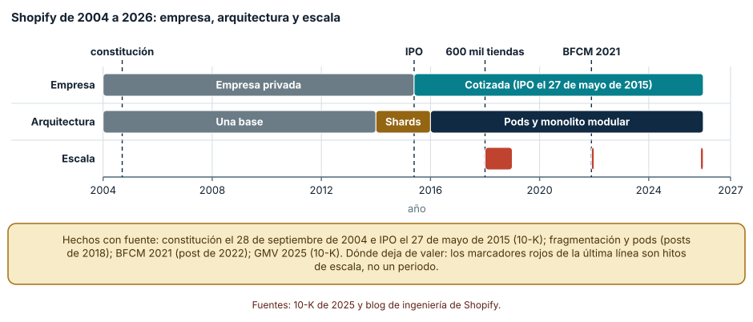

**Cómo leer la figura.** Cada carril es una dimensión del caso y la escala horizontal es el año. Mire el carril de arquitectura: la fragmentación y los pods llegan antes de la oferta pública y de las cifras de escala que se citan después. **Dónde deja de valer.** Los marcadores rojos de la última línea son hitos puntuales, no periodos; las fechas de la fragmentación difieren entre posts.

### Oficinas, plantilla y estructura

**Oficinas (documentado).** El 10-K nombra dos domicilios ejecutivos, Ottawa y Nueva York, y dice que Shopify no posee inmuebles y que adaptará sus instalaciones a sus necesidades [H1]. Se describe como empresa con plantilla «remote-first» global [H1]. **[No se sabe]** la lista de oficinas por ciudad y los centros de ingeniería: el 10-K consultado no los enumera.

**Plantilla (documentado).** A 31 de diciembre de 2025 Shopify tenía unos 7 600 empleados en todo el mundo [H1]. Con ingresos de 11 556 millones, el ingreso por empleado es de unos 1,5 millones de USD (cálculo propio): es un orden de magnitud, no una medida de productividad, porque el ingreso de pagos incluye costes que no son de personal.

**Estructura (documentado y no documentado).** El 10-K menciona un sistema de compensación llamado «Flex Comp» como factor de atracción y retención de personal [H1]. El post de 2018 cuenta que antes de 2015 había un equipo de Operaciones y Rendimiento y que se creó el departamento de Production Engineering fusionando equipos; ese departamento construye la infraestructura común y comparte con los equipos de producto la operación y la respuesta a incidentes [H4]. **[No se sabe]** el organigrama actual, el número de ingenieros y su reparto.

## Contexto y problema

**Documentado.** Antes de Shopify, abrir una tienda en línea exigía integrar el catálogo, el carrito, el cobro con tarjeta, los impuestos y el envío, y alojarlo todo en servidores propios o contratados. El post del stack cuenta que Lütke construía una tienda de snowboard en 2004 y, al no encontrar un producto satisfactorio, construyó su propia plataforma como servicio (SaaS) sobre Ruby on Rails y empezó a contribuir al propio Rails [H4]. El 10-K de 2025 resume la oferta actual como «infraestructura esencial de internet para el comercio»: una plataforma «todo en uno» que facilita empezar, gestionar y hacer crecer un negocio, en línea, en tienda y en cualquier lugar intermedio [H1].

**El problema de fondo** tiene tres capas que cambian de forma con el tamaño:

1. **Que el comerciante empiece rápido** sin ser ingeniero: tienda, pagos y envío listos.
2. **Que el comerciante pueda crecer** sin cambiar de plataforma: desde un emprendedor solo hasta una marca que vende por millones en una hora.
3. **Que nadie sufra por culpa de otro:** en una plataforma multi-inquilino, la venta relámpago de un famoso no puede tumbar la tienda de una panadería. El post de 2018 lo dice con ejemplos: Shopify aloja ventas de gran volumen impredecible, como las de celebridades y cosméticos, descritas como «tricky» para ingeniería [H4].

**Inferido.** La apuesta de producto fue que el comerciante prefiere una plataforma que se encarga de todo lo que no es su negocio y que evoluciona sola: el 10-K lo formula técnicamente como «single branch»: todos los comerciantes usan siempre la última versión, lo que elimina mantener versiones antiguas y permite distribuir cambios con rapidez [H1].

### La apuesta, enunciada como hipótesis

El curso propone leer la apuesta de Shopify como tres hipótesis comprobables ([SE-124](../../classes/part-10-descubrimiento-y-estrategia-de-producto/se-124-hipotesis-supuestos-y-preguntas-criticas/README.md)): (1) los emprendedores pagarán una suscripción y una comisión por tener la infraestructura de comercio ya hecha; (2) un ecosistema de aplicaciones y de pagos integrados aumenta lo que cada comerciante gasta en la plataforma; (3) una sola base de código multi-inquilino se puede operar con fiabilidad suficiente para ventas de gran volumen. Cada una tiene un criterio de fracaso: que los comerciantes se vayan al crecer, que el ingreso de pagos no cubra su coste o que un fallo común tumbe a todos. Esta formulación es del curso; Shopify no publica sus hipótesis internas.

## Mercado, usuarios y casos de uso

La plataforma sirve a varios públicos con intereses distintos. La tabla resume quién es cada uno; lo que la fuente no confirma se marca.

| Rol | Qué hace y qué gana | Qué cambia en su experiencia | Respaldo |
| --- | --- | --- | --- |
| Comerciante pequeño | Abre una tienda con un plan básico | Empieza sin construir infraestructura | [H1] |
| Comerciante grande o empresa (Plus) | Usa el plan Plus u ofertas empresariales; concentra la mayor parte del GMV | Personalización y soporte; la mayor parte del GMV viene de aquí | [H1] |
| Comprador | Compra en línea, en tienda física o en redes; paga con Shop Pay | Pago acelerado con datos recordados | [H1] |
| Desarrollador de aplicaciones y temas | Vende aplicaciones y temas en la App Store | Ingresos por comisión y acceso a comerciantes | [H1] |
| Socio de pagos y redes de tarjetas | Procesa y liquida pagos | **[No se sabe]** los acuerdos con cada uno | [H1] |
| Equipo de ingeniería de Shopify | Opera la plataforma y comparte guardias con producto | **[No se sabe]** herramientas internas | [H4] |

**Uso central.** Montar una tienda, cobrar y enviar. **Mercado.** Millones de comerciantes en más de 175 países: 44 % en Estados Unidos, 31 % en Europa, Oriente Medio y África, 16 % en Asia Pacífico, Australia y China, 5 % en Canadá y 5 % en América Latina a 31 de diciembre de 2025 [H1]. En 2018 Shopify alimentaba 600 000 comerciantes y servía 80 000 peticiones por segundo en el pico [H4]; en 2021 el post de CDC habla de «más de un millón de comerciantes» [H9].

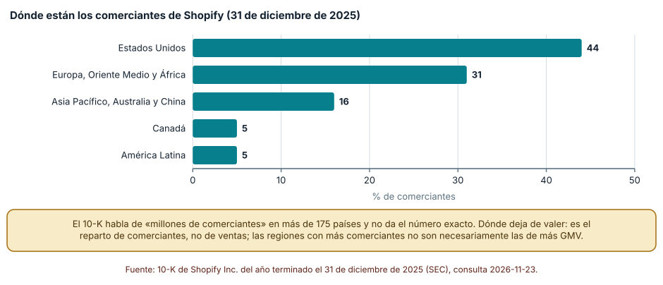

**Cómo leer la figura.** Cada barra es una región y su longitud, el porcentaje de comerciantes. Mire el contraste con la sección de economía: Estados Unidos es 44 % de los comerciantes. **Dónde deja de valer.** Es el reparto de comerciantes y no de ventas; el 10-K no da el GMV por región en el fragmento consultado.

### Quién da qué a quién

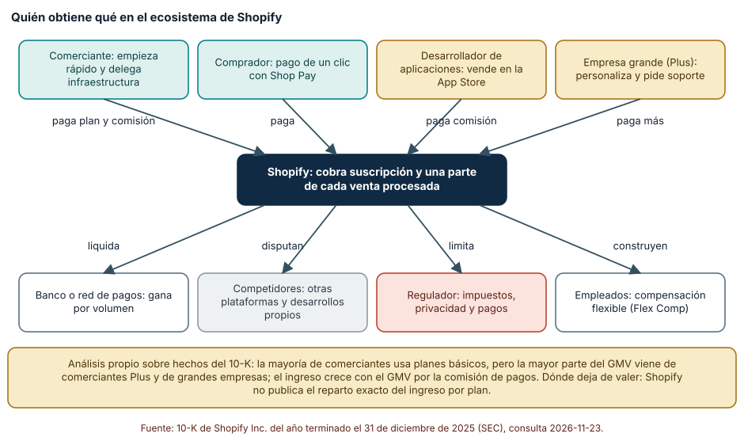

**Cómo leer la figura.** Shopify está en el centro porque es el único actor que habla con todos; las etiquetas de las flechas dicen qué aporta cada uno. Mire primero que el comerciante paga dos veces: plan y comisión por venta. **Dónde deja de valer.** No muestra magnitudes por plan, que Shopify no desglosa.

### Incentivos por tipo de usuario (análisis propio sobre hechos documentados)

- **Emprendedor individual.** Quiere lanzarse sin ingeniería; el plan de suscripción es predecible y la comisión por venta se paga solo si vende. El 10-K dice que la mayoría de comerciantes usa los planes Basic y Grow [H1].
- **Marca grande.** Quiere control y rendimiento en picos; es la fuente de la mayor parte del GMV [H1]. Su incentivo para quedarse es que migrar un negocio de ese tamaño es caro.
- **Comprador.** Quiere pagar rápido y sin reescribir datos; Shop Pay recoge datos de pago del comprador y por eso el 10-K lo cita entre los riesgos de privacidad [H1].
- **Desarrollador.** Quiere llegar a muchos comerciantes por una puerta; el costo es depender de las reglas de la App Store. **[No se sabe]** el reparto exacto del ingreso de las aplicaciones.
- **Shopify.** Su incentivo es crecer el GMV: el ingreso de soluciones para comerciantes, sobre todo comisiones de pago, es 76 % del total en 2025 [H1].

### Competencia y por qué el mercado favoreció a Shopify (análisis propio)

El 10-K describe un mercado competitivo de plataformas de comercio, mercados en línea y soluciones propias, y advierte de que pueden cambiar sus precios o funciones [H1]. La razón por la que Shopify llegó a esta escala no está declarada. El análisis propio plantea cuatro factores combinados: (1) un producto «todo en uno» con pagos integrados que sube el ingreso por comerciante; (2) un ecosistema de aplicaciones que aumenta el coste de cambiar; (3) la ejecución técnica de una plataforma de una sola rama que escaló de miles a millones de tiendas sin reescribirse (el post de 2018 dice que nunca se reescribió y conserva el código original) [H4]; (4) la dirección técnica de su fundador en Rails y en software abierto [H1]. **[No se sabe]** cuánto pesa cada factor.

## Funcionalidad de principio a fin

Se recorre el servicio primero con un comerciante que abre su tienda y luego con otros tipos de usuario, hasta su caso límite.

### Recorrido del comerciante estándar

1. **Primer contacto.** Crea una cuenta y una tienda. **[No se sabe]** el flujo interno de alta y de verificación.
2. **Tienda.** Elige un tema, sube productos y configura el dominio. El 10-K lista entre sus ofertas temas y aplicaciones [H1].
3. **Cobro.** Activa Shopify Payments, la solución de pagos integrada; los ingresos de soluciones para comerciantes provienen sobre todo de comisiones de procesamiento y de conversión de moneda de Shopify Payments, además de préstamos, comisiones de socios, etiquetas de envío, hardware de punto de venta y publicidad en la App Store [H1].
4. **Venta.** Un comprador llega a la tienda: el balanceador consulta la tabla de rutas y envía la petición al pod que contiene los datos de esa tienda [H2], [H3].
5. **Pago e inventario.** Al pagar, el sistema reserva un instante el inventario para evitar que dos compradores se lleven la última unidad y, cuando el pago se confirma, lo descuenta definitivamente del libro de inventario [H7].
6. **Operación diaria.** El comerciante usa la administración, recibe webhooks de eventos y mide ventas; detrás, una plataforma con aislamiento por pods.

### Recorridos por tipo de usuario

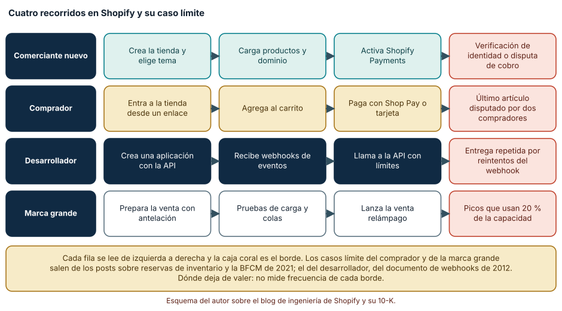

**Cómo leer la figura.** Cada fila es un usuario distinto; las cajas se leen de izquierda a derecha y la última, en coral, es el caso límite. **Dónde deja de valer.** Es un recorrido visible al usuario, no un diagrama de estados; no dice qué fracción llega al borde.

**Comprador.** **[Documentado]** que al pagar se reserva inventario durante una breve ventana de varios minutos y se descuenta al confirmar el pago, y que el sistema prioriza la corrección: ni vender de más ni rechazar de menos [H7]. El caso límite es el último artículo disputado por dos compradores: el post explica por qué esa decisión debe ser atómica.

**Desarrollador de aplicaciones.** **[Documentado]** que en 2012 Shopify publicó buenas prácticas para webhooks: espera 10 segundos la respuesta a cada entrega y, si falla, reintenta varias veces durante las 48 horas siguientes [H10]. El caso límite es la entrega repetida o tardía de un evento: con reintentos, un consumidor que no sea idempotente ([SE-379](../../classes/part-31-integracion-eventos-y-mensajeria/se-379-webhooks-polling-y-suscripciones/README.md)) procesa dos veces el mismo hecho (inferencia del curso a partir de la política de reintentos).

**Marca grande con una venta relámpago.** **[Documentado]** que en el BFCM de 2021 una sola venta relámpago generó carga suficiente para usar más de 20 % de la capacidad total de cómputo en su pico [H6]. El caso límite es que un inquilino consuma una fracción enorme de una plataforma compartida; la respuesta documentada incluye pruebas de carga desde julio y aislamiento por pods [H8], [H2].

**Empresas con varias tiendas y canales.** **[Documentado]** que el 10-K describe la expansión hacia clientes empresariales y los canales fuera de la tienda propia [H1]. **[No se sabe]** el detalle de cómo se aíslan esos clientes.

## Negocio y economía

**Modelo (documentado).** Dos líneas de ingresos: **soluciones de suscripción** (planes, temas y aplicaciones) y **soluciones para comerciantes** (principalmente comisiones de Shopify Payments y de conversión de moneda, más préstamos, referencias de socios, etiquetas de envío, hardware de punto de venta y publicidad) [H1]. En 2025 la primera aportó 2 752 millones y la segunda 8 804 millones de un total de 11 556 [H1].

### La escala de los ingresos a lo largo del tiempo

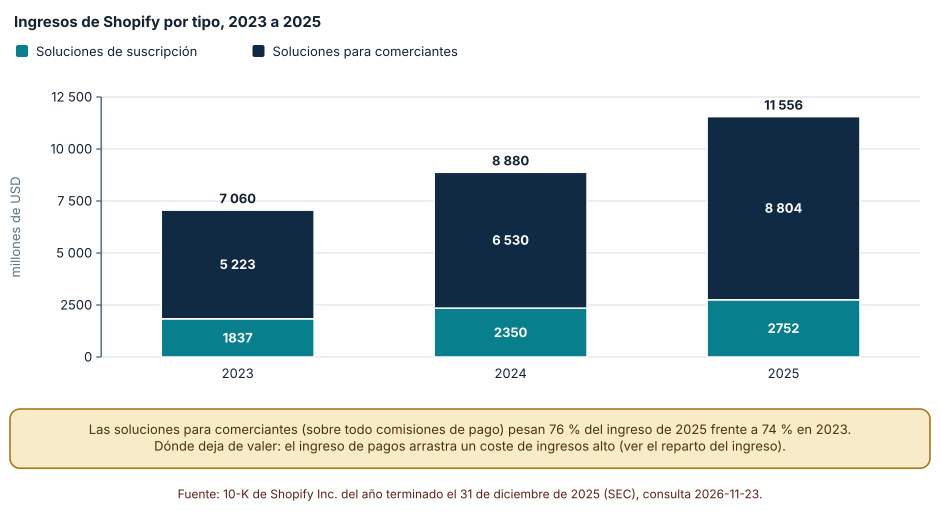

**Cómo leer la figura.** Cada barra es un año y cada tramo, una línea de ingresos. Mire cómo crece más el tramo de comerciantes: pasa de 74 % a 76 % del ingreso. **Dónde deja de valer.** El 10-K reclasifica con el tiempo; la comparación de tres años es la que presenta el propio informe.

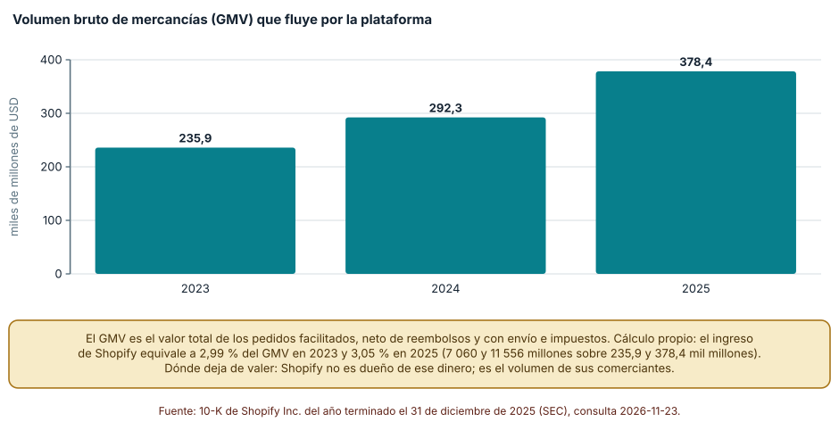

**Cómo leer la figura.** Cada barra es el valor de los pedidos facilitados en el año. Mire que crece 24 % y luego 29 %. **Dónde deja de valer.** No es ingreso de Shopify ni dinero que Shopify posea.

### Unit economics con cifras citadas

| Magnitud | 2023 | 2024 | 2025 | Fuente |
| --- | ---: | ---: | ---: | --- |
| Ingresos (millones de USD) | 7 060 | 8 880 | 11 556 | [H1] |
| Coste de ingresos | 3 545 | 4 408 | 6 001 | [H1] |
| Beneficio bruto | 3 515 | 4 472 | 5 555 | [H1] |
| Margen bruto (cálculo propio) | 49,8 % | 50,4 % | 48,1 % | [H1] |
| Ventas y marketing | 1 220 | 1 393 | 1 663 | [H1] |
| Investigación y desarrollo | 1 730 | 1 367 | 1 536 | [H1] |
| Administración general | 491 | 410 | 471 | [H1] |
| Pérdidas por transacciones y préstamos | 152 | 227 | 417 | [H1] |
| Utilidad neta | 132 | 2 019 | 1 231 | [H1] |
| GMV (miles de millones de USD) | 235,9 | 292,3 | 378,4 | [H1] |

El margen bruto sale de dividir el beneficio bruto entre los ingresos de cada año. Se divide por línea: en 2025 la suscripción tiene un coste de ingresos de 520 millones sobre 2 752 (margen de 81 %), mientras que las soluciones para comerciantes tienen un coste de 5 481 sobre 8 804 (margen de 38 %), ambos cálculos propios. La plataforma gana mucho más por dólar de suscripción que por dólar de pagos, pero los pagos pesan tres veces más en el ingreso.

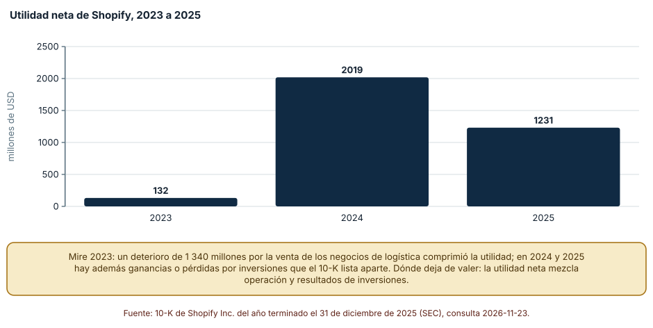

**Cómo leer la figura.** Cada barra es la utilidad neta de un año. **Dónde deja de valer.** 2023 incluye un deterioro de 1 340 millones por la venta de los negocios de logística de Shopify, y los resultados de inversiones suben y bajan la cifra en otros años [H1].

### Dónde crece el negocio

El GMV creció 24 % en 2024 y 29 % en 2025 [H1]. El MRR de diciembre de 2025 fue de 205 millones, 15 % más que un año antes: la suscripción crece más despacio que los pagos, lo que concuerda con el desplazamiento del ingreso hacia soluciones para comerciantes. **[No se sabe]** cuánto del crecimiento es de comerciantes nuevos y cuánto de comerciantes existentes que venden más.

### Eficiencia de la organización

Con unos 7 600 empleados y un gasto de ventas y marketing de 1 663 millones, el gasto de ventas es de unos 219 000 USD por empleado (cálculo propio, orden de magnitud). El gasto de ingeniería de 1 536 millones es 13,3 % del ingreso, menos que el 24,5 % de 2023 (1 730 sobre 7 060, cálculo propio): el ingreso creció más rápido que el gasto.

### Esquema del negocio: flujos de dinero y de valor

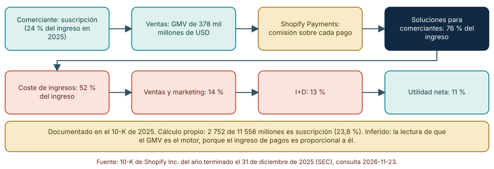

**Cómo leer la figura.** La fila superior es el motor de ingresos y la inferior, el destino de cada dólar. **Dónde deja de valer.** Es un esquema de flujo, no un modelo financiero por comerciante.

### Visión, misión y estrategia

La nota de naturaleza del negocio del 10-K dice que Shopify «proporciona infraestructura esencial de internet para el comercio» y que su misión es «hacer el comercio mejor para todos» [H1]. La estrategia declarada pasa por ampliar la oferta hacia empresas grandes, internacionalizar la plataforma y aumentar la adopción de pagos y de Shop Pay [H1]. **[Inferido]** que mover la plataforma hacia pagos explica el crecimiento del coste de ingresos; el 10-K lo describe como consecuencia de más volumen de procesamiento.

### Costos operativos

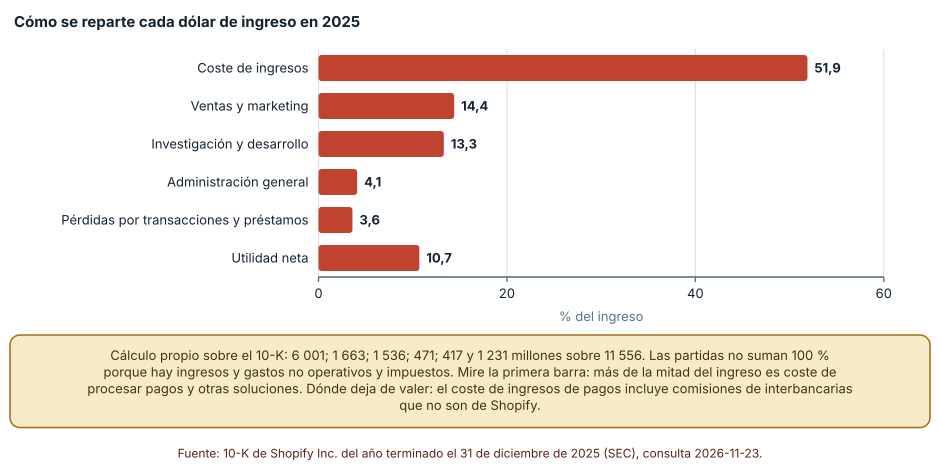

**Cómo leer la figura.** Cada barra es una partida como porcentaje de los 11 556 millones. Mire la primera: el coste de ingresos de 6 001 millones es la mayor parte. **Dónde deja de valer.** Las partidas no suman 100 % porque hay otros ingresos y gastos e impuestos.

**Pérdidas por transacciones y préstamos (documentado).** Subieron de 152 millones en 2023 a 227 en 2024 y a 417 en 2025 [H1]. Es un coste que aparece porque Shopify asume riesgo de pago y de crédito: es la contrapartida de integrar pagos y préstamos.

**Alojamiento.** El 10-K dice que Shopify usa Google Cloud para la mayor parte de las operaciones de la plataforma [H1]. **[No se sabe]** el gasto en nube ni los compromisos mínimos: este caso no los inventa.

### Competidores

El 10-K reconoce competencia de otras plataformas de comercio, de mercados en línea y de soluciones de desarrollo propio [H1]. **[No se sabe]** cuota de mercado por competidor con una fuente primaria comparable; este caso no la inventa.

## Arquitectura y esquemas

Se recorre como un mapa con zoom creciente. Lo que sigue sale de ocho posts del blog de ingeniería de Shopify (de 2018 a 2026) y del 10-K de 2025; lo que no está allí se marca. Los posts describen momentos distintos: donde la fecha importa, se indica.

### 6.1 Contexto del sistema

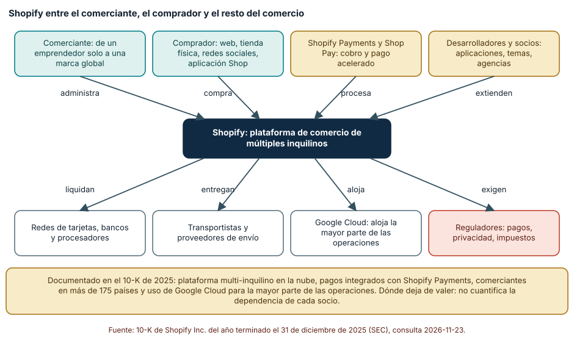

**Cómo leer la figura.** El cuadro central es Shopify y las flechas dicen qué hace cada actor con la plataforma. Mire primero a Google Cloud: es el actor del que depende técnicamente la plataforma. **Dónde deja de valer.** No muestra volúmenes ni contratos.

### 6.2 Capas

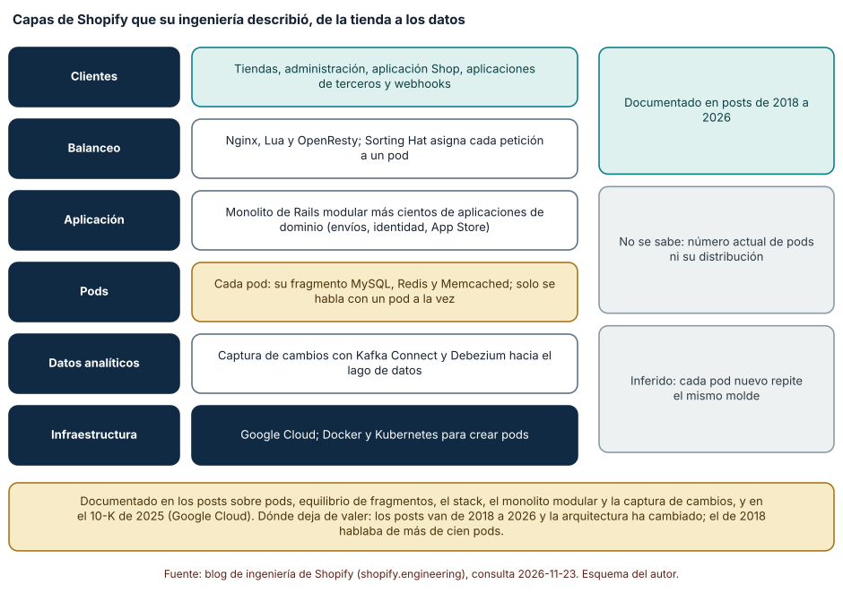

**Cómo leer la figura.** De arriba abajo, cada capa descansa en la siguiente; a la derecha, qué es documentado y qué no. **Dónde deja de valer.** Los posts van de 2018 a 2026; la pila actual puede diferir.

**Documentado.** El núcleo de la plataforma es un monolito de Ruby on Rails que nunca se reescribió desde el código original de 2004 y que convive con cientos de aplicaciones de dominio, también en Rails, que no son microservicios: envíos, identidad (inicio de sesión único) y App Store, entre otras; una aplicación interna, ServicesDB, lleva la lista de comprobación de cada una (dueño, disponibilidad, logs, guardia, excepciones, actualizaciones de seguridad) y abre incidencias en GitHub cuando falla algo [H4]. MySQL es la base relacional, Memcached la caché clave-valor y Redis las colas y trabajos en segundo plano [H4]. Los balanceadores usan Nginx, Lua y OpenResty para ser programables [H4].

### 6.3 Del sitio de la tienda al pod: enrutado

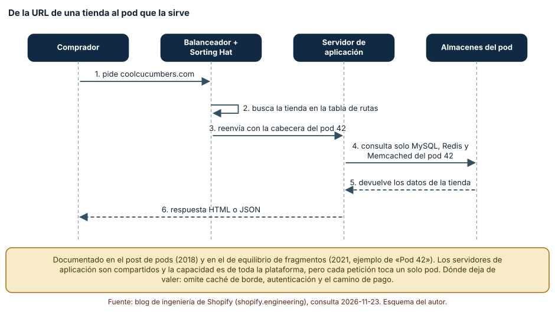

**Cómo leer la figura.** Las flechas son llamadas en orden; las punteadas son respuestas. Mire el segundo paso: la decisión del pod ocurre en el balanceador, no en la aplicación. **Dónde deja de valer.** Omite caché de borde, autenticación y el camino de pago.

**Documentado [H2], [H3].** Sorting Hat es una pieza de software en los balanceadores que, con una lista de reglas, asocia cada petición a un pod y añade una cabecera; los servidores de aplicación usan esa cabecera para conectarse solo a los almacenes de ese pod. Así los recursos compartidos (balanceadores, servidores de aplicación, trabajadores) mantienen capacidad común, pero «ninguna acción cruza pods». El post de 2021 lo ejemplifica: una petición a una tienda de ejemplo la procesa un balanceador que consulta una tabla de rutas y la reenvía al pod 42, que contiene todos los datos para servirla.

### 6.4 Pods: aislamiento como unidad de escala y de recuperación

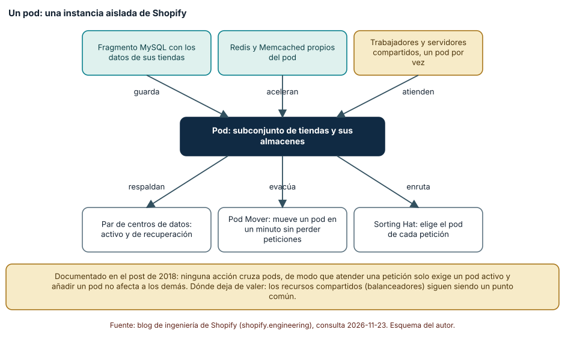

**Cómo leer la figura.** El centro es el pod y los satélites, lo que tiene o lo rodea. **Dónde deja de valer.** Los balanceadores compartidos siguen siendo un punto común.

**Documentado [H2].** En 2015 ya no era posible seguir comprando un servidor de base de datos mayor, así que fragmentaron la base de datos; ganaron escala y perdieron resiliencia, porque el código recorría todos los fragmentos y si uno caía, esa acción dejaba de funcionar en toda la plataforma. En 2016 reorganizaron la arquitectura de ejecución: un **pod** es un conjunto de tiendas que viven en almacenes totalmente aislados; cada unidad de trabajo (petición web o trabajo diferido) se asigna a un solo pod, así que atender una petición solo requiere un pod activo y añadir un pod no interfiere con los demás. Cada pod tiene un par de centros de datos, uno activo y otro de recuperación; la herramienta Pod Mover mueve un pod a su centro de recuperación en un minuto sin perder peticiones ni trabajos, de modo que evacuar un centro de datos entero es evacuar pod por pod. El post de 2018 del stack agrega que un pod es una instancia aislada con su propio MySQL, Redis y Memcached, que puede crearse en cualquier región, que Shopify tenía más de cien y que, desde entonces, no habían tenido una caída mayor que afectara a todo Shopify [H4].

**Por qué es una buena decisión (análisis propio).** Es la aplicación a una plataforma multi-inquilino de la idea de radio de impacto ([SE-344](../../classes/part-28-estilos-arquitectonicos/se-344-arquitectura-celular-y-radio-de-impacto/README.md)) y de aislamiento de vecinos ruidosos ([SE-410](../../classes/part-34-saas-y-plataformas-de-producto/se-410-aislamiento-multi-inquilino-y-vecino-ruidoso/README.md)): el fallo de un recurso afecta a un pod, no a todos. La partición por tienda funciona porque, como dice el post del stack, los comerciantes están aislados entre sí y el negocio no asume datos compartidos entre clientes: «habría sido más difícil» si los asumiera [H4].

### 6.5 El incidente que motivó el aislamiento

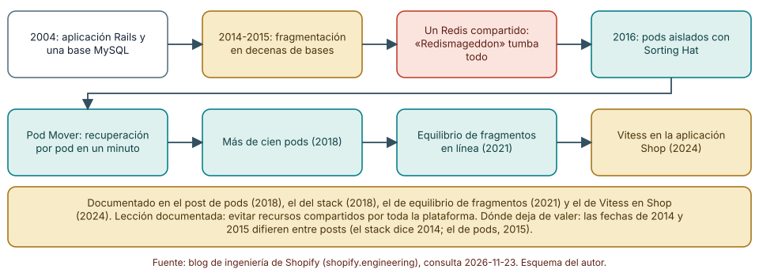

**Cómo leer la figura.** Cada caja es una etapa; las coral son fallos y las teal, respuestas. **Dónde deja de valer.** Las fechas de la fragmentación difieren entre posts (2014 en el del stack, 2015 en el de pods).

**Documentado [H4].** La fragmentación compró capacidad de base de datos, pero dejó un punto único de fallo enorme: todos los fragmentos usaban un solo Redis, y su caída tumbó a todo Shopify (la llamaron «Redismageddon»). La lección que el propio post extrae es evitar cualquier recurso compartido por toda la plataforma; de ahí que cada pod tenga su Redis. Es un caso de manual de fallo en común ([SE-389](../../classes/part-32-concurrencia-y-sistemas-distribuidos/se-389-fallos-parciales-y-modelos-de-red/README.md)).

### 6.6 Mover tiendas entre fragmentos

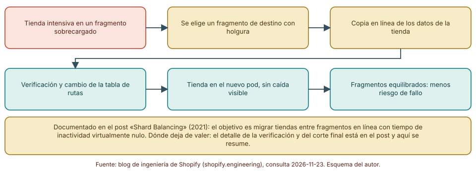

**Cómo leer la figura.** Cada caja es un paso del movimiento. **Dónde deja de valer.** Resume un post largo sin los detalles de verificación.

**Documentado [H3].** A medida que cambian los patrones de tráfico y llegan comerciantes nuevos, tiendas intensivas pueden acabar en el mismo fragmento y desequilibrar su uso; equilibrarlos exige mover tiendas entre fragmentos «en línea» y con un tiempo de inactividad virtualmente nulo, a escala de terabytes. La tabla de rutas del balanceador es lo que permite cambiar el destino de una tienda.

### 6.7 Monolito modular

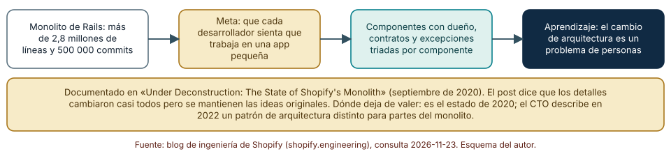

**Cómo leer la figura.** De izquierda a derecha: el punto de partida, la meta, el estado y la lección. **Dónde deja de valer.** Es el estado de septiembre de 2020.

**Documentado [H5].** El monolito central tenía más de 2,8 millones de líneas de Ruby y 500 000 confirmaciones; Shopify fundó hace más de tres años un equipo para hacerlo modular con componentes: unidades pequeñas e independientes con contratos. La visión: onboarding de personas solo a las partes relevantes, ejecutar las pruebas solo sobre los componentes afectados y cambiar un componente libremente si respeta sus contratos. El balance de 2020: casi todos los detalles cambiaron pero las ideas se mantienen; las excepciones se asignan automáticamente a componentes; cada componente tiene un equipo dueño y eso facilita tareas globales como actualizar Rails, tanto que el monolito corre sobre revisiones no publicadas de Rails. La lección central: un cambio de arquitectura en un sistema que sus propios desarrolladores modifican es en gran parte un problema de personas (modelo de comportamiento de Fogg: capacidad, motivación y señal) y los patrones forzados de interfaz de componentes no aumentaron la capacidad ni la motivación.

**Qué enseña.** Un monolito bien delimitado ([SE-327](../../classes/part-27-arquitectura-de-software-y-dominio/se-327-monolito-modular-monolith-y-servicios/README.md)) puede ser una respuesta razonable frente a los costes de los microservicios ([SE-340](../../classes/part-28-estilos-arquitectonicos/se-340-microservicios-y-sus-costes-reales/README.md)): Shopify lo dice explícitamente en 2018: los cientos de aplicaciones «no son microservicios, sino aplicaciones específicas de dominio» [H4]. El 10-K de 2025 no cambia esa elección.

### 6.8 Picos de carga: BFCM

**Cómo leer la figura.** El centro es el evento y cada nodo, una magnitud de su pico. **Dónde deja de valer.** Son cifras de un fin de semana de 2021 y no son comparables entre sí.

**Documentado [H6].** En el BFCM de 2021 los servidores de aplicación superaron 32 millones de peticiones por minuto y los balanceadores 34 millones; una venta relámpago (una venta breve que supera cierto umbral de pagos por minuto) generó carga suficiente para usar más de 20 % de la capacidad total en su pico. Además: casi 145 millones de correos, 30 TB por minuto de tráfico de salida, 42 mil millones de llamadas de API, 13 mil millones de webhooks, 3,18 PB escritos y 15 PB leídos de la caché de tiendas, y más de 11 millones de consultas por segundo con 11 TB por segundo de lectura en la flota MySQL. En 2025 los comerciantes alcanzaron un récord de 5,1 millones de dólares en ventas por minuto en el pico, 11 % más que el año anterior, según el post de 2026 [H7].

**Cómo se preparan (documentado) [H8].** El equipo de pagos cuenta que empezaron las pruebas de carga en julio para el BFCM de 2021, repartiendo la generación de carga por la red global de Google Cloud para simular tráfico mundial. El diseño de capacidad, entonces, es en parte una disciplina de calendario: preparar con meses de antelación un evento conocido.

### 6.9 Pagos resilientes

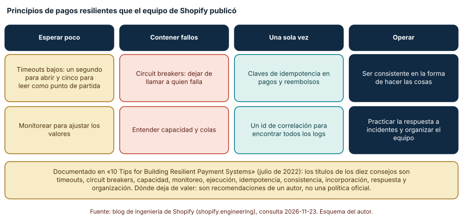

**Cómo leer la figura.** Cada columna agrupa consejos con un mismo objetivo. **Dónde deja de valer.** Son recomendaciones de un ingeniero, no política oficial.

**Documentado [H8].** El post lista diez consejos: bajar los timeouts (el cliente HTTP de Ruby tiene 60 segundos por defecto para abrir, escribir y leer; propone empezar con uno para abrir y cinco para leer), instalar circuit breakers, entender la capacidad, monitorear, usar claves de idempotencia, ser consistente, incorporar a las personas, responder a incidentes y organizar el equipo. Explica la idempotencia con un cálculo: a la escala de Shopify, algo que ocurre una vez entre un millón ocurre muchas veces al día, y un cobro doble genera un posible contracargo para el comerciante. Las clases de timeouts ([SE-438](../../classes/part-36-calidad-rendimiento-y-resiliencia/se-438-timeouts-retries-backoff-y-jitter/README.md)), circuit breakers ([SE-439](../../classes/part-36-calidad-rendimiento-y-resiliencia/se-439-circuit-breakers-bulkheads-y-degradacion/README.md)) y pagos ([SE-417](../../classes/part-34-saas-y-plataformas-de-producto/se-417-pagos-idempotencia-y-conciliacion/README.md)) lo desarrollan.

### 6.10 Inventario: Redis frente a MySQL

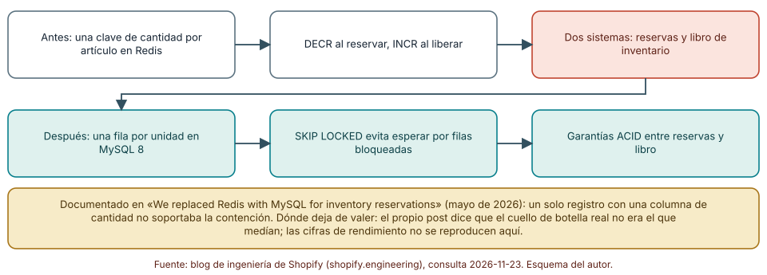

**Cómo leer la figura.** La fila superior es el diseño anterior y la inferior el nuevo. **Dónde deja de valer.** El post dice que el cuello de botella real no era el que medían.

**Documentado [H7].** La protección contra sobreventa tiene dos operaciones: reservar (al iniciar el pago, una retención corta) y reclamar (al confirmar el pago, descuento permanente del libro de inventario, que es la fuente de verdad). Redis servía las reservas con una clave de cantidad (DECR al reservar, INCR al liberar), pero reservas y libro vivían en dos sistemas distintos. Los intentos de hacerlo en MySQL con una fila y una columna de cantidad fallaban por contención; con MySQL 8 y SKIP LOCKED se pasó a una fila por unidad. Esto muestra el criterio de ingeniería: priorizar corrección y ACID entre reservas y libro frente a la comodidad de Redis. La clase de comercio electrónico ([SE-418](../../classes/part-34-saas-y-plataformas-de-producto/se-418-comercio-electronico-carrito-inventario-pagos-y-devoluciones/README.md)) trata ese dominio.

### 6.11 Datos analíticos: captura de cambios

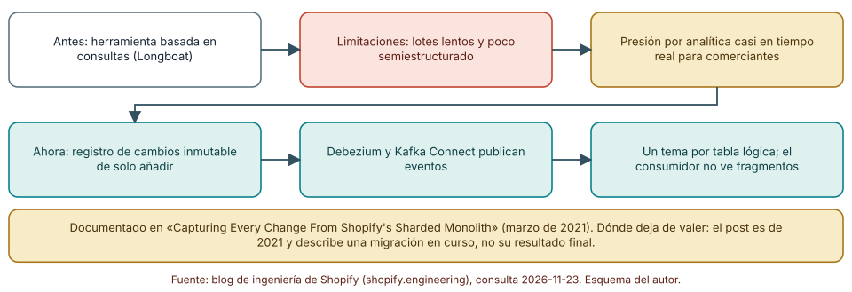

**Cómo leer la figura.** La fila superior es el sistema anterior y la inferior, la migración. **Dónde deja de valer.** Es un post de 2021 sobre una migración en curso.

**Documentado [H9].** Shopify migraba de una herramienta de captura de cambios basada en consultas (Longboat) a un registro inmutable de solo añadir, con Kafka Connect y Debezium; el almacén de datos creció hasta ser un lago con varios sistemas y consumidores, y la plataforma de analítica para comerciantes exigía ingestión más rápida y consultas de baja latencia. El diseño publica un tema por tabla lógica, lo que aísla a los consumidores de la fragmentación de origen ([SE-378](../../classes/part-31-integracion-eventos-y-mensajeria/se-378-cdc-etl-elt-y-sincronizacion/README.md)).

### 6.12 Seguridad, abuso y cumplimiento

**Documentado.** El 10-K trata la seguridad y la privacidad de los datos de pago como riesgos materiales, en particular porque Shop Pay recoge información de pago del comprador, y menciona cortafuegos, cifrado, detección de intrusiones y doble factor [H1]. **[No se sabe]** el diseño interno de identidad, claves y auditoría.

### 6.13 Observabilidad y operación

**Documentado.** Todos los roles técnicos comparten monitoreo y respuesta a incidentes, con escalamiento lateral para traer la habilidad necesaria [H4]; las excepciones se asignan automáticamente a componentes con dueño [H5]; ServicesDB abre incidencias cuando un servicio incumple su lista de comprobación [H4]. **Mecanismo.** La responsabilidad compartida entre producción y producto es el punto de partida de las clases de operación y de gestión de incidentes ([SE-500](../../classes/part-41-observabilidad-sre-e-incidentes/se-500-gestion-de-incidentes-y-comunicacion/README.md)).

### 6.14 Evolución y alternativas descartadas (análisis propio)

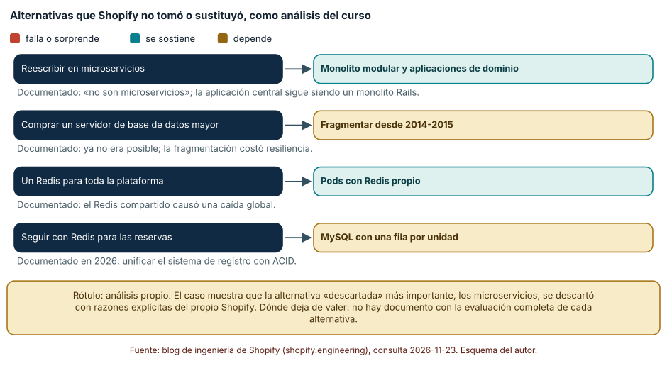

**Cómo leer la figura.** Cada tarjeta enfrenta una alternativa con lo que Shopify hizo. **Dónde deja de valer.** Shopify no publica la evaluación completa de alternativas.

**Rótulo: análisis propio.** Las alternativas con evidencia son: **comprar un servidor mayor** (ya no era posible en 2015, según [H2]), **un Redis compartido** (causó la caída global [H4]), **microservicios** (se descartaron en favor de un monolito modular y aplicaciones de dominio [H4], [H5]) y **mantener Redis para reservas** (sustituido por MySQL en 2026 [H7]). **[No se sabe]** si evaluó otras bases de datos fragmentadas en 2015 o la alternativa de varias nubes.

### 6.15 Hardware, software, infraestructura y fallos

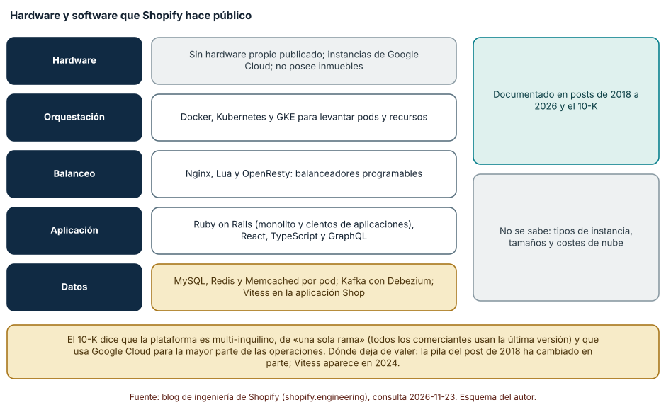

**Cómo leer la figura.** De arriba abajo, de lo lógico a lo físico. **Dónde deja de valer.** No hay datos de tipos de instancia ni de costes.

**Hardware utilizado.** No hay hardware propio publicado: el 10-K dice que Shopify no posee inmuebles y que usa Google Cloud para la mayor parte de las operaciones [H1]; el post de 2018 cuenta que Docker, Kubernetes y Google Kubernetes Engine facilitan crear recursos para pods nuevos [H4].

**Software utilizado (documentado).** Ruby on Rails (monolito y aplicaciones de dominio), MySQL, Memcached, Redis, Nginx con Lua y OpenResty, React, TypeScript y GraphQL en la administración (desde una historia de jQuery, Batman.js en 2013 y HTML estático), Kafka con Debezium, y Vitess en la aplicación Shop [H4], [H9], [H11].

**Características de la infraestructura.** Multi-inquilino y de «una sola rama»; pods aislados en pares de centros de datos; creación de pods en cualquier región; almacenes por pod; pruebas de carga previas a los picos [H1], [H2], [H4], [H8].

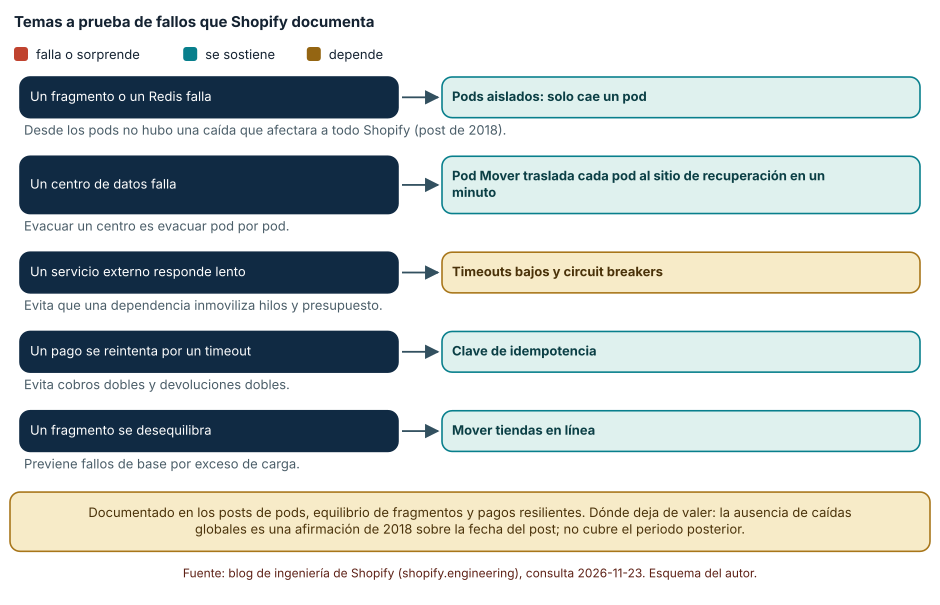

**Cómo leer la figura.** Cada tarjeta enlaza el fallo con el mecanismo que lo contiene. **Dónde deja de valer.** La ausencia de caídas globales es una afirmación del post de 2018.

**Temas a prueba de fallos.** Aislamiento por pod, recuperación por pod en un minuto, timeouts bajos y circuit breakers, claves de idempotencia, equilibrio en línea de fragmentos, pruebas de carga con meses de antelación [H2], [H3], [H8].

## Casos especiales y cómo se resuelven

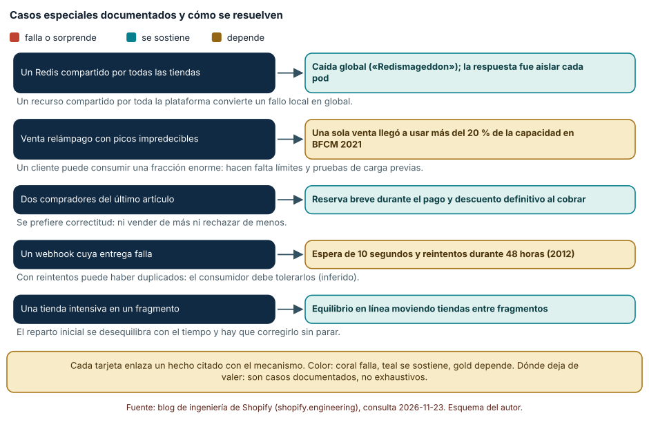

**Cómo leer la figura.** Cada tarjeta enfrenta una situación con lo que hace el sistema; el color es el veredicto. **Dónde deja de valer.** Son casos documentados, no un catálogo exhaustivo.

1. **Venta relámpago de una marca famosa.** El tráfico es impredecible y concentrado: una sola venta usó más de 20 % de la capacidad en BFCM 2021 [H6]. Respuesta: pruebas de carga desde julio y capacidad compartida con aislamiento por pod [H8], [H2]. Límite: sigue habiendo recursos comunes.
2. **El último artículo.** Dos compradores quieren la misma unidad: reserva breve y descuento definitivo [H7].
3. **Reintentos de pago.** Un timeout no dice si el cobro ocurrió: idempotencia para evitar cobros y reembolsos dobles [H8].
4. **Webhooks.** Shopify espera 10 segundos y reintenta durante 48 horas (documento de 2012): una entrega puede repetirse, así que el consumidor debe tolerar duplicados (inferido) [H10].
5. **Fallo de un fragmento.** Solo afecta al pod que lo contiene [H2].
6. **Pérdida de un centro de datos.** Evacuación pod por pod, un minuto por pod [H2].
7. **Fragmento desequilibrado.** Se mueven tiendas en línea [H3].
8. **Cambio de arquitectura en un código que otros modifican.** El problema es de comportamiento de desarrolladores, no solo de diseño [H5].

## Línea de tiempo

| Año o fecha | Hecho | Fuente |
| --- | --- | --- |
| 2004 | Shopify Inc. se constituye el 28 de septiembre; Lütke construye la plataforma sobre Rails | [H1], [H4] |
| Antes de 2015 | Equipo de Operaciones y Rendimiento; luego se crea Production Engineering | [H4] |
| 2014-2015 | Fragmentación de la base de datos; después, el incidente de un Redis compartido | [H2], [H4] |
| 2015 | Oferta pública inicial cerrada el 27 de mayo | [H1] |
| 2016 | Reorganización en pods con Sorting Hat y Pod Mover | [H2] |
| 2018 | 600 000 comerciantes, 80 000 peticiones por segundo; más de cien pods | [H4] |
| 2020 | Balance del monolito modular: 2,8 millones de líneas y 500 000 commits | [H5] |
| 2021 | Equilibrio de fragmentos en línea; migración de captura de cambios; BFCM con más de 32 millones de peticiones por minuto | [H3], [H6], [H9] |
| 2022 | Guía de pagos resilientes | [H8] |
| 2024 | Vitess en la aplicación Shop; primer 10-K | [H1], [H11] |
| 2025 | GMV de 378 400 millones; récord de 5,1 millones de USD por minuto en Black Friday | [H1], [H7] |
| 2026 | Reservas de inventario pasan de Redis a MySQL | [H7] |

### Decisiones clave, giros y correcciones

- **Fragmentar (2014-2015).** Decisión forzada por el límite de un servidor; **[interpretación]** su coste fue resiliencia.
- **Pods (2016).** Corrección del coste de la fragmentación: aislar cada fragmento con todos sus almacenes.
- **Monolito modular en vez de microservicios.** Decisión sostenida durante años; en 2020 el equipo admite que los patrones impuestos a los desarrolladores no funcionaron como esperaban [H5].
- **Reservas en MySQL (2026).** Giro de 2026: unificar la base transaccional y renunciar a Redis para ese caso [H7].

## Vínculo con el curso

El caso muestra, en una plataforma real, mecanismos que el curso desarrolla con ejemplos controlados. Cada enlace dice qué ilustra el caso:

- [SE-342](../../classes/part-28-estilos-arquitectonicos/se-342-multi-tenancy-y-aislamiento/README.md): multi-tenancy y aislamiento. Pods como unidad de aislamiento entre comerciantes.
- [SE-410](../../classes/part-34-saas-y-plataformas-de-producto/se-410-aislamiento-multi-inquilino-y-vecino-ruidoso/README.md): aislamiento multi-inquilino y vecino ruidoso. La venta relámpago que usa 20 % de la capacidad.
- [SE-344](../../classes/part-28-estilos-arquitectonicos/se-344-arquitectura-celular-y-radio-de-impacto/README.md): arquitectura celular y radio de impacto. El pod como celda.
- [SE-355](../../classes/part-29-datos-persistencia-y-recuperacion/se-355-replicacion-particion-y-distribucion/README.md): replicación, partición y distribución. Fragmentación y equilibrio de tiendas.
- [SE-327](../../classes/part-27-arquitectura-de-software-y-dominio/se-327-monolito-modular-monolith-y-servicios/README.md): monolito modular. Componentes con dueño y contratos.
- [SE-340](../../classes/part-28-estilos-arquitectonicos/se-340-microservicios-y-sus-costes-reales/README.md): microservicios y sus costes. Por qué Shopify no los adoptó.
- [SE-417](../../classes/part-34-saas-y-plataformas-de-producto/se-417-pagos-idempotencia-y-conciliacion/README.md): pagos, idempotencia y conciliación. Claves de idempotencia en cobros y reembolsos.
- [SE-418](../../classes/part-34-saas-y-plataformas-de-producto/se-418-comercio-electronico-carrito-inventario-pagos-y-devoluciones/README.md): comercio electrónico, carrito, inventario y pagos. Reservas y libro de inventario.
- [SE-246](../../classes/part-20-backend-apis-y-procesamiento-asincrono/se-246-idempotencia-reintentos-y-deduplicacion/README.md): idempotencia, reintentos y deduplicación. Webhooks y pagos.
- [SE-438](../../classes/part-36-calidad-rendimiento-y-resiliencia/se-438-timeouts-retries-backoff-y-jitter/README.md): timeouts, retries y jitter. Los valores de espera recomendados.
- [SE-439](../../classes/part-36-calidad-rendimiento-y-resiliencia/se-439-circuit-breakers-bulkheads-y-degradacion/README.md): circuit breakers y degradación. Evitar llamadas a servicios caídos.
- [SE-435](../../classes/part-36-calidad-rendimiento-y-resiliencia/se-435-carga-estres-picos-y-endurance/README.md): carga, estrés, picos y resistencia. Pruebas de carga previas a BFCM.
- [SE-378](../../classes/part-31-integracion-eventos-y-mensajeria/se-378-cdc-etl-elt-y-sincronizacion/README.md): CDC, ETL y sincronización. Debezium y Kafka Connect.
- [SE-412](../../classes/part-34-saas-y-plataformas-de-producto/se-412-suscripciones-ciclos-de-facturacion-y-dunning/README.md): suscripciones y facturación. La línea de suscripción del ingreso.
- [SE-133](../../classes/part-11-economia-metricas-y-decisiones-de-producto/se-133-modelos-de-negocio-y-sostenibilidad/README.md): modelos de negocio y sostenibilidad. Suscripción más comisión.
- [SE-405](../../classes/part-33-cloud-plataforma-e-infraestructura/se-405-multi-cloud-hibrido-y-portabilidad-real/README.md): multi-cloud y portabilidad. La dependencia de un proveedor de nube.

### Preguntas de discusión

1. ¿Qué condiciones del negocio hicieron posible particionar por tienda sin datos compartidos entre clientes? ¿Qué pasaría con un marketplace?
2. Un pod aislado reduce el radio de impacto, pero los balanceadores son compartidos. ¿Qué fallos siguen siendo globales?
3. ¿Por qué el equipo de Shopify unificó reservas e inventario en MySQL si Redis ya funcionaba? ¿Qué coste tiene mantener dos sistemas de registro?
4. ¿Cómo decidiría cuánta capacidad ociosa reservar para una venta relámpago que usa 20 % del total?
5. ¿Qué indicadores usaría para saber si el monolito modular mejora la productividad y no solo la estructura?

### Mini-ejercicios de análisis

1. Calcule el ingreso medio por dólar de GMV en 2023, 2024 y 2025 y explique qué lo mueve.
2. Dibuje la cadena de causas de «Redismageddon» y marque qué eslabón corta cada pod.
3. Escriba tres pruebas de carga que habría hecho en julio para un BFCM y diga qué fallo habría detectado cada una.

## Qué no generalizar

- **Particionar por tienda.** Funciona porque los comerciantes son inquilinos aislados que no comparten datos; en productos donde los clientes interactúan entre sí es mucho más difícil.
- **Un monolito de Rails.** Funcionó con una organización que invirtió años en modularizarlo y que cuenta con ingenieros que contribuyen a Rails; no es una receta para cualquier equipo.
- **Rentabilidad y escala.** La utilidad de 2024 y 2025 incluye resultados de inversiones, y el ingreso depende de pagos con alto coste de procesamiento: no es un margen de software puro.
- **Que Shopify no tenga caídas globales.** El post de 2018 lo afirma para esa fecha; no cubre los años posteriores.
- **Que Redis es mala opción.** Shopify lo sustituyó en un caso concreto, las reservas, por razones de consistencia; lo sigue usando como parte de cada pod [H4].
- **El nivel de detalle público.** Shopify publica mucho de su ingeniería, pero no su gasto de nube, su número de ingenieros ni su organigrama.

## Fuentes públicas verificadas

Todas las URL se consultaron el 23 de noviembre de 2026 y devolvieron contenido (HTTP 200). Las cifras de la SEC se leyeron con el acceso de datos públicos de la propia SEC.

- **[H1]** [Shopify Inc., Form 10-K, año terminado el 31 de diciembre de 2025 (SEC)](https://www.sec.gov/Archives/edgar/data/1594805/000159480526000007/shop-20251231.htm): ingresos, GMV, costes, utilidad, comerciantes, plantilla, constitución, IPO y Google Cloud.
- **[H2]** [A Pods Architecture To Allow Shopify To Scale](https://shopify.engineering/a-pods-architecture-to-allow-shopify-to-scale): fragmentación, pods, Sorting Hat y Pod Mover (2018).
- **[H3]** [Shard Balancing: Moving Shops Confidently with Zero-Downtime at Terabyte-scale](https://shopify.engineering/mysql-database-shard-balancing-terabyte-scale): equilibrio de fragmentos en línea (2021).
- **[H4]** [E-Commerce at Scale: Inside Shopify's Tech Stack](https://shopify.engineering/e-commerce-at-scale-inside-shopifys-tech-stack): origen en 2004, pila, Redismageddon, más de cien pods, 600 000 comerciantes (2018).
- **[H5]** [Under Deconstruction: The State of Shopify's Monolith](https://shopify.engineering/shopify-monolith): monolito modular, 2,8 millones de líneas y aprendizajes (2020).
- **[H6]** [Cloud, Load, and Modular Code: What 2022 Looks Like for Shopify](https://shopify.engineering/cloud-load-modular-code-shopify-2022): cifras del BFCM 2021.
- **[H7]** [We replaced Redis with MySQL for inventory reservations—and it scaled](https://shopify.engineering/scaling-inventory-reservations): reservas de inventario y el récord de Black Friday 2025 (2026).
- **[H8]** [10 Tips for Building Resilient Payment Systems](https://shopify.engineering/building-resilient-payment-systems): timeouts, circuit breakers e idempotencia (2022).
- **[H9]** [Capturing Every Change From Shopify's Sharded Monolith](https://shopify.engineering/capturing-every-change-shopify-sharded-monolith): captura de cambios con Debezium y Kafka Connect (2021).
- **[H10]** [Webhook best practices](https://shopify.engineering/17488672-webhook-best-practices): espera de 10 segundos y reintentos durante 48 horas en la entrega de webhooks (2012).
- **[H11]** [Horizontally scaling the Rails backend of Shop app with Vitess](https://shopify.engineering/horizontally-scaling-the-rails-backend-of-shop-app-with-vitess): Vitess en la aplicación Shop (2024).

[↑ Casos de éxito](README.md) · [← Slack](slack.md)
