# Slack

[↑ Casos de éxito](README.md) · [← Stripe](stripe.md) · [Shopify →](shopify.md)

> **Caso de éxito.** Slack pasó de ser un producto lanzado en 2014 a una plataforma que en enero de 2021 tenía más de 756 000 organizaciones y 156 000 clientes de pago, y que Salesforce adquirió en julio de 2021. Este caso explica qué se sabe, con fuentes, de cómo lo logró, qué se infiere y qué no se sabe, y lo contrasta con las clases del curso. Es una superficie aparte de las clases.

**Cómo leer las etiquetas de este caso.** Cada afirmación técnica o de negocio lleva una de tres marcas cuando importa la diferencia: **[Documentado]** (lo dice una fuente pública citada al final), **[Inferido]** (lo deduce el curso a partir de lo documentado; puede ser falso) y **[No se sabe]** (no hay fuente pública). Las cifras llevan año y fuente. Ninguna arquitectura interna confidencial se reconstruye aquí. Los esquemas usan trazo continuo para lo documentado y trazo punteado para lo inferido. Los apartados rotulados «análisis propio» son razonamiento del curso, no hechos.

**Cómo usar el caso.** Léalo después de las clases enlazadas en «Vínculo con el curso». La sección de arquitectura se recorre como un mapa con zoom creciente: contexto, capas, conexión, estado del cliente, canales, datos, cola de trabajos, incidentes, celdas, hardware y software. Al final hay preguntas y ejercicios.

**Alcance y límites del caso.** Slack publica mucho sobre su ingeniería en un blog técnico y, hasta enero de 2021, sus cifras financieras en el 10-K de la SEC (la comisión de valores de Estados Unidos). Desde julio de 2021 es parte de Salesforce y deja de informar por separado, de modo que **no hay cifras financieras públicas de Slack posteriores** a la fusión en las fuentes de este caso. La parte técnica se apoya en posts de 2020 a 2022; el estado actual puede diferir.

## Ficha histórica

| Dato | Valor | Fuente |
| --- | --- | --- |
| Nombre | Slack Technologies, Inc. (hasta 2014 Tiny Speck, Inc.) | [S1] |
| Fundadores | Stewart Butterfield, cofundador, presidente del consejo y consejero delegado, y otros tres cofundadores que la fuente no nombra | [S1] |
| Constitución | 2009, en Delaware, como Tiny Spec, Inc.; ese mismo año cambió su nombre a Tiny Speck, Inc.; en 2014 pasó a llamarse Slack Technologies, Inc. | [S1] |
| Lanzamiento público | 2014 | [S1] |
| Salida a bolsa | Cotización directa en la Bolsa de Nueva York, símbolo WORK; se completó en el año fiscal 2020 (2019) | [S1] |
| Sede | 500 Howard Street, San Francisco, California | [S1] |
| Escala (31 de enero de 2021) | Más de 756 000 organizaciones con tres o más usuarios: más de 600 000 en el plan gratuito y más de 156 000 clientes de pago; ingresos de 902,6 millones de USD en el año fiscal 2021; 2 545 empleados a tiempo completo | [S1] |
| Fusión | Acuerdo con Salesforce el 1 de diciembre de 2020; cierre el 21 de julio de 2021 | [S1], [S2] |
| Estado actual | Producto de Salesforce; el blog de ingeniería de Slack sigue activo en 2026 | [S2], [S4] |

**Nota sobre los fundadores.** El 10-K identifica a Stewart Butterfield como cofundador y habla de «cada uno de nuestros otros tres cofundadores» sin nombrarlos [S1]. Este caso no inventa los nombres: **[No se sabe]** con las fuentes consultadas quiénes son los otros tres. Quien quiera completarlos debe hacerlo con una fuente primaria y fecharla.

**Qué mide cada cifra de escala.** Slack define «organización» como una entidad separada (empresa, institución educativa o gubernamental, o unidad de una empresa) con un plan de suscripción, gratuito o de pago. Cuando una organización tiene tres o más usuarios en un plan de pago, la cuenta como «cliente de pago» y redondea hacia abajo al millar [S1]. Por eso «156 000 clientes de pago» no es el número de personas que pagan, sino de organizaciones, y el ingreso por cliente no se puede calcular con exactitud a partir de ese redondeo.

**Cómo leer la figura.** Cada carril es una dimensión del caso y la escala horizontal es el año. Mire primero el carril de datos: la migración a Vitess (2017–2020) precede a los tres incidentes del carril inferior, que ocurren dentro de los 14 meses siguientes a su cierre. **Dónde deja de valer.** La fecha de la cotización directa se sitúa en el eje de forma aproximada; la fuente solo la fija en el año fiscal 2020.

### Oficinas, plantilla y estructura

**Oficinas (documentado).** La sede es San Francisco: 230 208 pies cuadrados con arriendo hasta 2028 y 210 573 con arriendo hasta 2030. Además alquila o contrata servicios de espacio en San Francisco, Denver, Nueva York, Chicago, Dublín, Londres, Toronto, Vancouver, Melbourne, Sídney, Tokio, Osaka, Pune, Múnich, Seúl y París; no posee inmuebles [S1]. Tenía personal de ventas fuera de Estados Unidos en Australia, Canadá, Francia, Alemania, Irlanda, Japón, Corea, Países Bajos, Suecia y Reino Unido [S1]. **[No se sabe]** cuáles de esas oficinas son centros de ingeniería y cuántas personas trabajan en cada una.

**Plantilla (documentado).** A 31 de enero de 2021 había 2 545 empleados a tiempo completo, además de contratistas y consultores. En junio de 2020 Slack anunció que muchos empleados podían trabajar de forma remota permanente [S1]. El ingreso por empleado, con 902,6 millones y 2 545 personas, es de unos 355 000 USD: es un orden de magnitud, no una medida de productividad, porque incluye remuneración en acciones y trabajo contratado.

**Estructura (documentado y no documentado).** El 10-K describe a Butterfield como presidente, consejero delegado y cofundador con una participación de voto especial vinculada a los otros tres cofundadores [S1]. **[No se sabe]** el organigrama de ingeniería, el número de ingenieros por producto y cómo se organizaron los equipos de infraestructura que escriben en el blog. Los posts firmados muestran cargos como «Staff Engineer, Backend» o «Sr. Staff Engineer, Infrastructure», pero no equivalen a un organigrama.

## Contexto y problema

**Documentado.** Antes de Slack, la comunicación de un equipo de trabajo se repartía entre el correo, la mensajería instantánea personal y herramientas de proyectos. El 10-K de Slack describe su producto como una plataforma de mensajería «basada en canales» y explica la diferencia con el correo en términos de estructura: la actividad ocurre en canales de equipo y no en bandejas individuales, y los canales ofrecen un registro persistente de conversaciones, datos, documentos y flujos de trabajo [S1]. El 10-K también dice que, a diferencia del correo, esa actividad se concentra en espacios compartidos y que el producto sirve para «alinear equipos, unificar sistemas e impulsar negocios» [S1].

**El problema técnico de fondo.** Un sistema de mensajería de equipo tiene tres exigencias que se contradicen:

1. **Inmediatez.** Un mensaje enviado debe aparecer en la pantalla de los demás en una fracción de segundo; por eso hay conexiones persistentes y servidores con estado en memoria [S3].
2. **Persistencia.** Cada mensaje se guarda antes de mostrarse a otros [S5]: el producto es, a la vez, chat y archivo de la organización.
3. **Escala por equipo y por usuario.** El producto nació para equipos de cientos de personas y acabó con equipos de decenas de miles [S4]. Cada decisión de carga inicial, de partición de datos y de difusión tuvo que repensarse.

**Inferido.** La apuesta de producto parece haber sido que la unidad de adopción es el equipo y no la persona: una vez que unos pocos lo usan, el valor de la herramienta crece con cada persona y cada integración que se suma. El 10-K lo respalda indirectamente al medir el negocio por organizaciones y por la retención neta de dólares, es decir, por cuánto crece el gasto de los clientes existentes [S1].

### La apuesta, enunciada como hipótesis

El curso propone leer la apuesta de Slack como tres hipótesis comprobables ([SE-124](../../classes/part-10-descubrimiento-y-estrategia-de-producto/se-124-hipotesis-supuestos-y-preguntas-criticas/README.md)): (1) los equipos adoptarán una herramienta nueva si pueden probarla gratis y la adopción crece desde adentro; (2) un registro conversacional con búsqueda y aplicaciones conectadas supera al correo para el trabajo en equipo; (3) al crecer, el producto aguanta organizaciones mucho mayores que las de sus primeros clientes. Cada una tiene un criterio de fracaso: que los equipos gratuitos no se conviertan en clientes de pago, que la competencia empaquetada dentro de otras suites iguale la función por menos, o que el producto no escale. Esta formulación es del curso; Slack no publica sus hipótesis internas.

## Mercado, usuarios y casos de uso

Slack se vende a organizaciones, pero lo usan personas, y el producto tiene varios públicos con intereses distintos. La tabla resume quién es cada uno; lo que la fuente no confirma se marca.

| Rol | Qué hace y qué gana | Qué cambia en su experiencia | Respaldo |
| --- | --- | --- | --- |
| Persona usuaria | Conversa en canales, mensajes directos y llamadas; busca el historial | Pasa de hilos de correo a canales con contexto | [S1] |
| Administrador de la organización | Define plan, identidad, permisos y retención | Control y trazabilidad a cambio de pagar | [S1] |
| Organización grande (más de 100 000 USD al año) | Unifica varios espacios de trabajo y exige cumplimiento | 1 183 clientes de este tipo a enero de 2021 | [S1] |
| Desarrollador de aplicaciones | Publica aplicaciones y automatizaciones que viven dentro de Slack | Acceso a una audiencia ya reunida | [S1] |
| Socio comercial y revendedor | Vende y despliega Slack en otras empresas | **[No se sabe]** términos de cada acuerdo | [S1] |
| Otra organización conectada | Comparte canales con proveedores y clientes (Slack Connect) | Una conversación entre empresas sin salir de la herramienta | [S5] |
| Salesforce (matriz desde 2021) | Integra colaboración en su plataforma de clientes | **[No se sabe]** la integración interna tras la fusión | [S2] |

**Uso central.** Conversar en equipo con historial, buscar lo dicho y conectar aplicaciones. **Mercado.** El 10-K cita 756 000 organizaciones con tres o más usuarios y clientes que van desde equipos pequeños hasta organizaciones donde más de cien mil empleados usan Slack con regularidad [S1]. **Internacionalización.** El ingreso fuera de Estados Unidos fue 39 % del total en el año fiscal 2021, 37 % en 2020 y 36 % en 2019 [S1].

### Quién da qué a quién

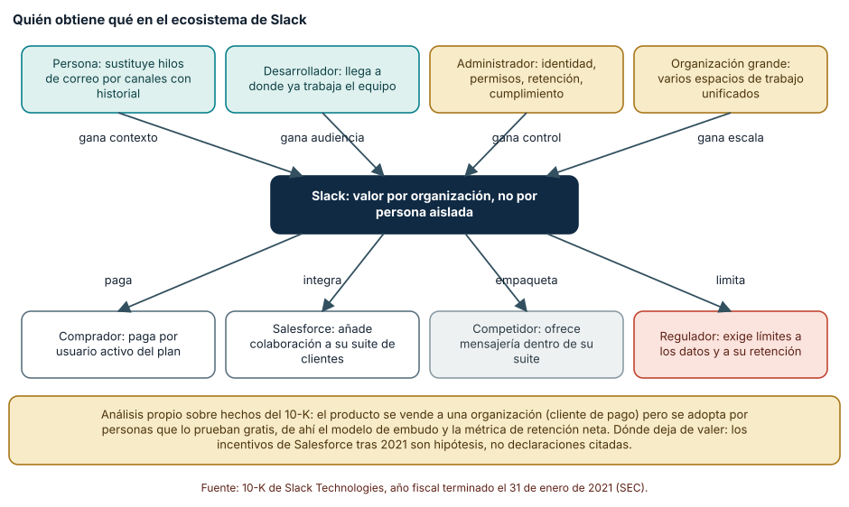

**Cómo leer la figura.** Slack está en el centro porque conecta a todos; las etiquetas de las flechas dicen qué recibe o aporta cada actor. Mire primero la diferencia entre quien usa (personas, desarrolladores) y quien paga (compradores, administradores). **Dónde deja de valer.** No muestra magnitudes ni contratos, que Slack no publica; los incentivos de Salesforce y de los competidores son lectura del curso.

### Incentivos por tipo de usuario (análisis propio sobre hechos documentados)

- **Persona en un equipo pequeño.** Su incentivo es reducir el correo interno; el plan gratuito baja a cero el coste de probarlo. El 10-K muestra que más de 600 000 organizaciones usaban el plan gratuito [S1].
- **Administrador.** Su incentivo es controlar identidad, permisos y retención; es quien convierte una adopción informal en un contrato. El 10-K explica que una organización con tres o más usuarios de pago cuenta como cliente de pago [S1].
- **Comprador de una gran empresa.** Quiere una sola plataforma para miles de personas y funciones de cumplimiento. El crecimiento de los clientes que superan 100 000 USD al año, de 575 a 1 183 en dos años, indica que este segmento crece más rápido que la base total [S1].
- **Desarrollador.** Quiere llegar a donde ya está el equipo. **[No se sabe]** cuánto ingreso depende del ecosistema de aplicaciones.
- **Competidor con una suite.** Puede ofrecer mensajería sin cobrarla por separado; el 10-K lo cita como riesgo, de modo que el modelo depende de que Slack sea mejor y no solo distinto [S1].
- **Regulador.** Exige límites a dónde y cuánto tiempo se guardan los datos; el post de Vitess menciona la residencia de datos internacional como una función que la arquitectura permitió construir [S5].

### Competencia y por qué el mercado favoreció a Slack (análisis propio)

El 10-K reconoce competencia de empresas grandes que incluyen mensajería dentro de suites más amplias y de startups; también advierte de que los competidores pueden bajar precios [S1]. La razón por la que Slack llegó a la escala que alcanzó no está declarada. El análisis propio del curso plantea cuatro factores, ninguno suficiente por sí solo: (1) el modelo de adopción desde abajo con plan gratuito, que baja el coste de captación inicial; (2) la ventaja de integraciones, porque cada aplicación conectada aumenta el coste de cambiar; (3) la ejecución técnica, que permitió que el producto siguiera usable mientras los equipos pasaban de cientos a decenas de miles; (4) el calendario: el producto creció en los años en que el trabajo remoto aumentó la demanda de herramientas de comunicación. **[No se sabe]** cuánto pesa cada factor, y el cuarto es especialmente difícil de separar: el propio 10-K de enero de 2021 menciona el efecto de la pandemia como incertidumbre sobre la demanda [S1].

## Funcionalidad de principio a fin

Se recorre el servicio primero con una persona que recibe una invitación y luego con otros tipos de usuario, hasta su caso límite. Los pasos de implementación se tratan en la sección de arquitectura.

### Recorrido de una persona usuaria

1. **Primer contacto.** La persona recibe una invitación a un espacio de trabajo o crea uno. **[No se sabe]** el flujo interno de verificación.
2. **Registro y espacio.** Crea una cuenta y entra a canales. El 10-K define cada espacio de trabajo como una organización con un plan [S1].
3. **Arranque del cliente.** La aplicación carga lo mínimo y se conecta por una conexión persistente (WebSocket) [S3], [S4]. Con Flannel, el cliente no descarga todo el equipo, sino solo lo necesario, y pide el resto cuando lo necesita [S4].
4. **Conversación.** Escribe, menciona, reacciona y busca. Cada mensaje se guarda antes de difundirse a los demás [S5].
5. **Presencia.** Los puntos verdes de quién está conectado salen de servidores dedicados y solo se envían para los usuarios visibles en pantalla [S3].
6. **Trabajo asíncrono.** Las notificaciones, la expansión de enlaces, los recordatorios y los cálculos de facturación pasan por una cola de trabajos [S6].
7. **Reconexión.** Cuando el cliente pierde la red, vuelve a arrancar; el arranque incremental y el límite de tasa lo protegen en caídas [S8].

### Recorridos por tipo de usuario

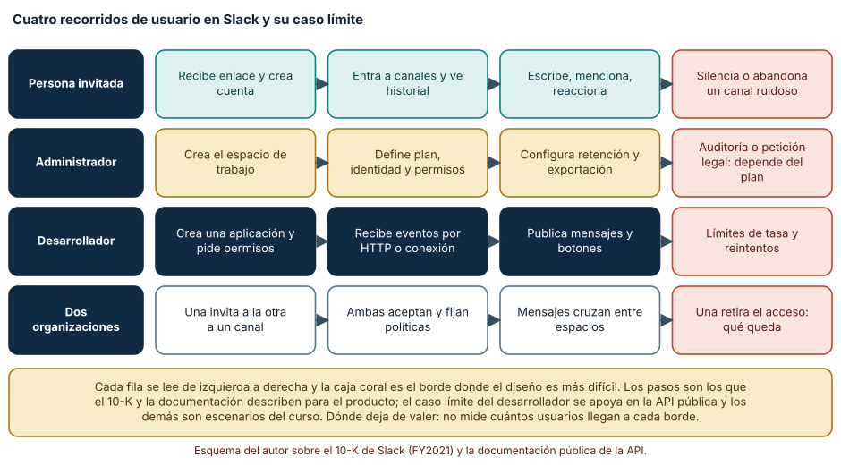

**Cómo leer la figura.** Cada fila es un usuario distinto; las cajas se leen de izquierda a derecha y la última, en coral, es el caso límite donde el diseño es más difícil. **Dónde deja de valer.** Es un recorrido visible al usuario, no un diagrama de estados; no dice cuántos usuarios llegan a cada borde.

**Administrador.** **[Documentado]** que el producto tiene planes gratuito y de pago y funciones de empresa, con ingresos por suscripción reconocidos de forma lineal durante el contrato [S1]. El caso límite es una petición de auditoría o una retención legal: qué datos se pueden exportar depende del plan. **[No se sabe]** el detalle por plan.

**Desarrollador de una aplicación.** **[Documentado]** que el 10-K cita las integraciones de terceros como parte del valor del producto y como un riesgo si se rompen [S1]. El caso límite son los límites de tasa y los reintentos de entrega de eventos; el diseño de la API lo trata la clase de idempotencia ([SE-246](../../classes/part-20-backend-apis-y-procesamiento-asincrono/se-246-idempotencia-reintentos-y-deduplicacion/README.md)).

**Dos organizaciones conectadas.** **[Documentado]** que Slack Connect se construyó sobre Vitess y que la capa de datos fue lo que permitió complejidad entre equipos [S5]. El caso límite es retirar el acceso: qué ve cada lado del historial después. **[No se sabe]** la política exacta.

**Organización grande.** **[Documentado]** que el producto se adaptó a equipos de decenas de miles de personas con carga bajo demanda [S4]. El caso límite es el primer lunes tras las vacaciones, descrito en la sección de incidentes.

## Negocio y economía

**Modelo (documentado).** Suscripción por usuario con plan gratuito y planes de pago. El ingreso se reconoce de forma lineal durante el periodo de suscripción desde la fecha en que se da acceso [S1]. El 10-K define dos indicadores de negocio: clientes de pago y clientes que pagan más de 100 000 USD, y un tercero de retención: la «Net Dollar Retention Rate» [S1].

### La escala de los ingresos a lo largo del tiempo

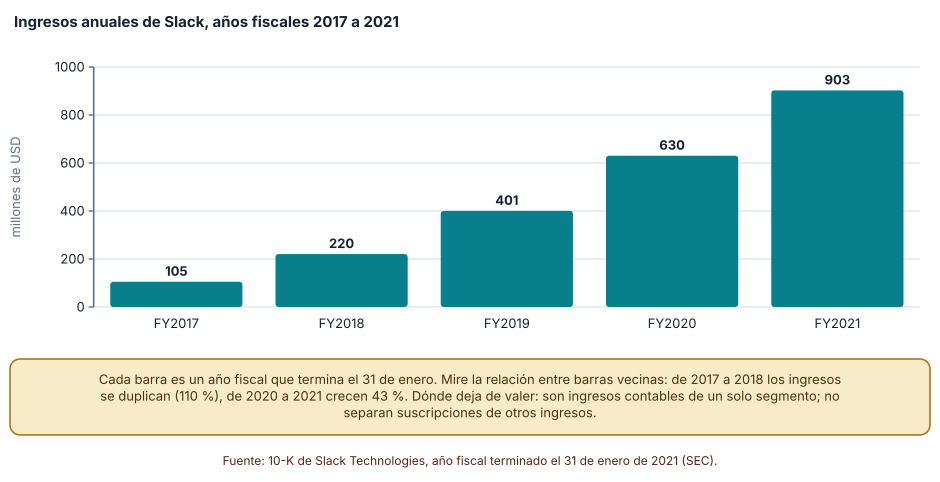

**Cómo leer la figura.** Cada barra es un año fiscal que termina el 31 de enero. **Dónde deja de valer.** Es un solo segmento operativo y no hay desglose por región o por plan; el ingreso fuera de EE. UU. fue 39 % en el año fiscal 2021 [S1].

### Unit economics con cifras citadas

| Magnitud | FY2019 | FY2020 | FY2021 | Fuente |
| --- | ---: | ---: | ---: | --- |
| Ingresos (millones de USD) | 400,6 | 630,4 | 902,6 | [S1] |
| Coste de ingresos (millones de USD) | 51,3 | 97,2 | 121,7 | [S1] |
| Margen bruto (cálculo propio) | 87,2 % | 84,6 % | 86,5 % | [S1] |
| Investigación y desarrollo | 157,5 | 457,4 | 382,1 | [S1] |
| Ventas y marketing | 233,2 | 402,8 | 460,7 | [S1] |
| Pérdida neta (millones de USD) | 138,9 | 568,4 | 292,5 | [S1] |
| Clientes de pago | 88 000 | 110 000 | 156 000 | [S1] |
| Clientes de más de 100 000 USD | 575 | 893 | 1 183 | [S1] |
| Retención neta de dólares | 143 % | 132 % | 123 % | [S1] |

El margen bruto sale de dividir el beneficio bruto entre los ingresos de cada año: 349,3 sobre 400,6; 533,2 sobre 630,4; y 780,9 sobre 902,6. Es un margen de software puro: el coste de ingresos incluye alojamiento, soporte y procesamiento de pagos, pero el 10-K no desglosa cuánto es nube.

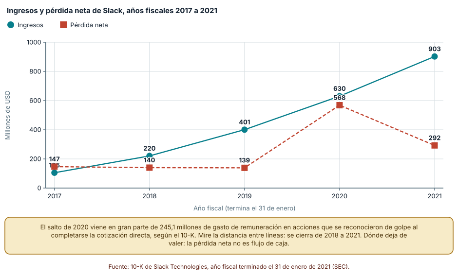

**Cómo leer la figura.** Dos líneas con el mismo eje en millones de dólares. Mire la distancia entre ellas: se cierra en cada año. **Dónde deja de valer.** El pico de pérdida de 2020 incluye 245,1 millones de remuneración en acciones reconocida de una vez al completarse la cotización directa [S1]; la pérdida neta no es caja.

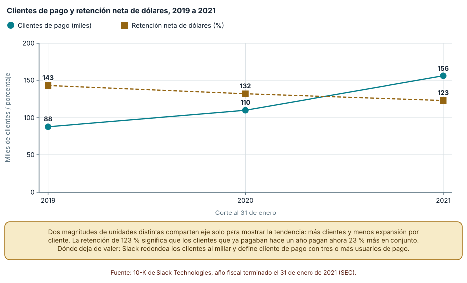

**Cómo leer la figura.** La línea teal son miles de clientes de pago y la dorada, el porcentaje de retención. **Dónde deja de valer.** Dos magnitudes distintas comparten eje solo para la tendencia, y Slack redondea los clientes al millar.

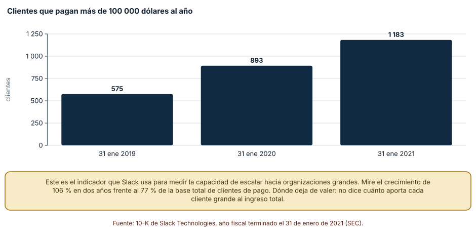

**Cómo leer la figura.** Las barras son tres cortes al 31 de enero. **Dónde deja de valer.** No se sabe cuánto ingreso aportan estos clientes.

### Dónde crece el negocio: clientes grandes y mercado internacional

El segmento de más de 100 000 USD creció 106 % en dos años, frente a 77 % de los clientes de pago totales, lo que sugiere un giro hacia organizaciones grandes. La retención neta de 123 % significa que, en conjunto, quienes ya pagaban hace un año pagaban ahora 23 % más; el descenso desde 143 % indica que la expansión por cliente se enfrió a medida que la base crecía, algo esperable con la ley de los grandes números pero que **[No se sabe]** si se debió a la pandemia, a la saturación o a otros factores.

### Eficiencia de la organización

Con 2 545 empleados, el gasto de ventas y marketing de 460,7 millones equivale a unos 181 000 USD por empleado y año, una cifra de orden de magnitud. La proporción de gasto en ventas, 51 % de los ingresos, es la mayor de las partidas y es consistente con un negocio que está pasando de adopción libre a ventas empresariales. Es un hecho observable, no una recomendación.

### Esquema del negocio: flujos de dinero y de valor

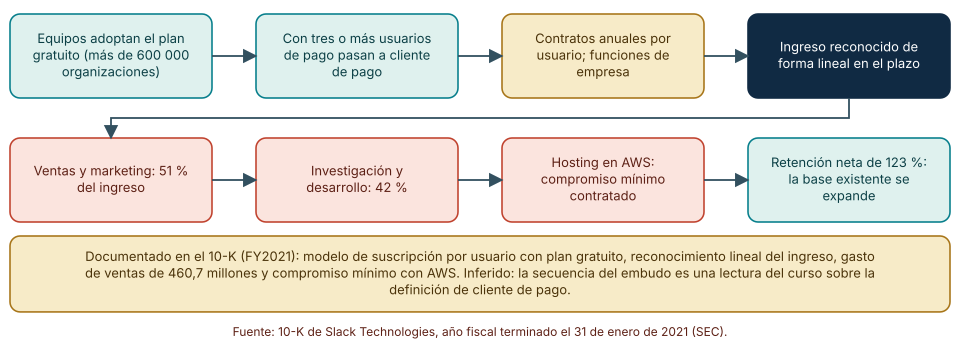

**Cómo leer la figura.** La fila superior es el embudo de ingresos y la inferior, los destinos del gasto y la palanca de retención. **Dónde deja de valer.** Es un esquema de flujo, no un modelo financiero: no hay márgenes por cliente.

### Visión, misión y estrategia

El 10-K presenta a Slack como una plataforma que «alinea equipos, unifica sistemas e impulsa negocios» y como «la plataforma de mensajería basada en canales líder» [S1]. La estrategia declarada tiene tres palancas: ampliar la base de organizaciones, convertir el uso gratuito en pago y crecer dentro de las organizaciones grandes [S1]. **[Inferido]** que la fusión con Salesforce se explica por la lógica de integrar una capa de conversación a una suite de relación con clientes; el 10-K de enero de 2021 solo registra el acuerdo, no su razón estratégica [S1].

### Costos operativos

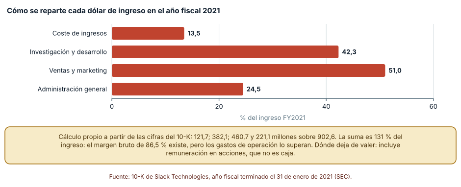

**Cómo leer la figura.** Cada barra es una partida como porcentaje de los 902,6 millones de ingresos. Mire que la suma supera 100 %. **Dónde deja de valer.** Incluye remuneración en acciones; no es caja.

**Alojamiento (documentado).** El 10-K registra un acuerdo con AWS enmendado el 30 de abril de 2020, vigente de mayo de 2020 a abril de 2025, con un compromiso mínimo anual de 75 millones de USD que aumenta 5 millones cada año, para un total mínimo de 425 millones; a 31 de enero de 2021 quedaban 353,7 millones por pagar [S1]. En la tabla de obligaciones contractuales los «compromisos de hospedaje» suman 329,987 millones [S1]; las dos cifras vienen del mismo documento y difieren según la forma de contarlo, y el 10-K no explica la diferencia en el fragmento consultado.

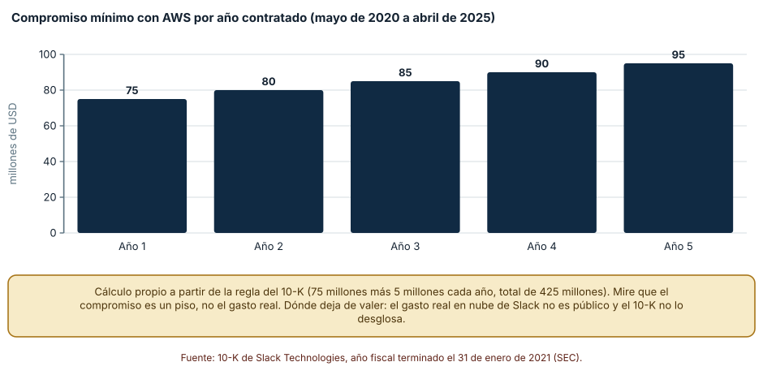

**Cómo leer la figura.** Cada barra es un año del contrato. **Dónde deja de valer.** Es un piso, no el gasto real, que no es público.

**Remuneración y personal.** El 10-K muestra 245,1 millones de gasto acumulado por unidades de acciones al completarse la cotización directa [S1]; es la razón del pico de pérdida de 2020.

### Competidores

El 10-K reconoce competidores grandes que ofrecen mensajería como parte de suites y startups especializadas; no los enumera con cifras comparables en el fragmento consultado [S1]. **[No se sabe]** la cuota de mercado de Slack frente a cada uno; este caso no la inventa.

## Arquitectura y esquemas

Se recorre como un mapa con zoom creciente. Todo lo que sigue sale de siete posts del blog de ingeniería de Slack (de 2020 a 2022) y del 10-K; lo que no está allí se marca. Los posts describen componentes concretos con cifras y con sus incidentes: es una de las fuentes más ricas del conjunto de casos, y por eso este caso es más técnico que financiero.

### 6.1 Contexto del sistema

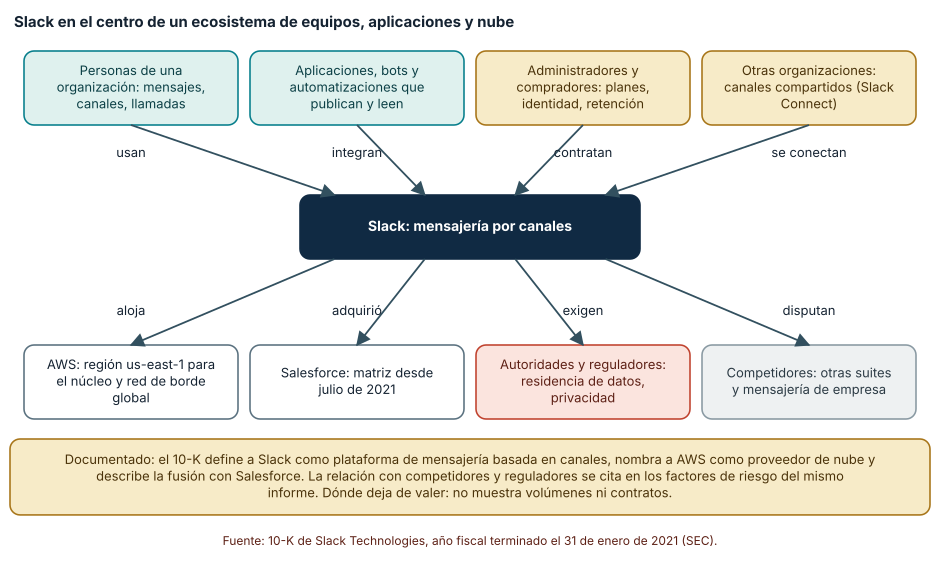

**Cómo leer la figura.** El cuadro central es Slack y las flechas indican qué hace cada actor con él. Mire primero a AWS: es el único actor del que depende técnicamente el servicio entero. **Dónde deja de valer.** No muestra volúmenes ni contratos, y los competidores y reguladores se citan en los factores de riesgo del 10-K sin detalle.

### 6.2 Capas

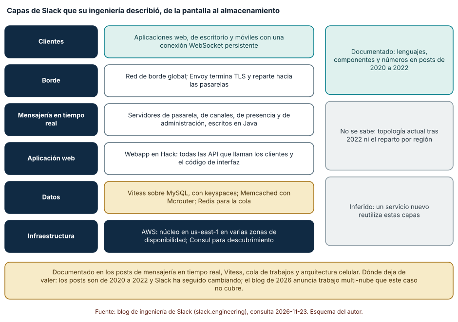

**Cómo leer la figura.** De arriba abajo, cada capa descansa en la siguiente; a la derecha están las notas de qué es documentado y qué no. **Dónde deja de valer.** Los posts son de 2020 a 2022 y el blog de 2026 anuncia trabajo multi-nube para Slack AI que este caso no cubre.

**Documentado.** Los servicios centrales de mensajería (servidores de canal, de pasarela, de administración y de presencia) están escritos en Java; la aplicación web es una base de código en Hack que aloja todas las API que llaman los clientes y el código de interfaz; Envoy balancea la carga y termina TLS; Consul hace el descubrimiento de servicios [S3]. Los servicios del camino de la petición de usuario se escriben en Hack, Go, Java y C++ [S9]. La parte «Slack no comparte una base de código ni un runtime» es relevante: cualquier mecanismo transversal (drenaje, límites de tasa, trazas) debe implementarse en varios lenguajes o salir de la capa de red.

### 6.3 La conexión en tiempo real

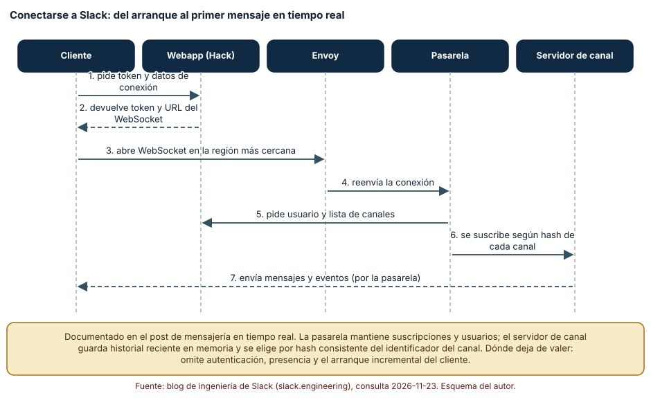

**Cómo leer la figura.** Las flechas son llamadas en orden, de arriba abajo; las punteadas son respuestas. Mire el paso de la pasarela, que traduce una persona en una lista de canales y suscripciones. **Dónde deja de valer.** Omite autenticación, presencia y el arranque incremental.

**Documentado [S3].** El cliente pide a la aplicación web un token y la información de conexión; abre un WebSocket contra la región de borde más cercana; Envoy reenvía a un servidor de pasarela; la pasarela obtiene de la aplicación web los canales del usuario, envía el primer mensaje y se suscribe de forma asíncrona a los servidores de canal que alojan esos canales según el hash consistente. Las pasarelas tienen estado en memoria (usuarios y suscripciones) y, a diferencia de los otros servidores, están desplegadas en varias regiones geográficas, con un mecanismo de drenaje de región que cambia a los usuarios de una región enferma a la más cercana.

**Mecanismo y consecuencia.** La separación pasarela-canal permite escalar por separado «cuántos clientes conectados hay» y «cuántos mensajes pasan por canal». Si una pasarela cae, sus usuarios se reconectan a otra; si un servidor de canal cae, se reemplaza. El coste es que ambos tipos tienen estado en memoria y requieren estrategias de reemplazo rápido, no solo de redundancia.

### 6.4 Servidores de canal y hash consistente

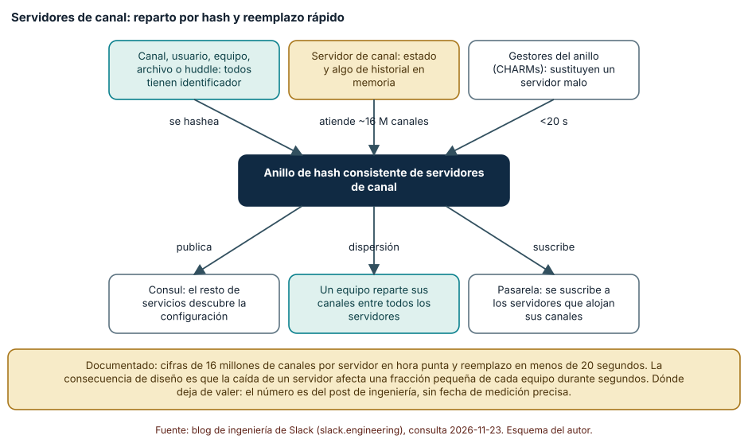

**Cómo leer la figura.** El centro es el anillo; los satélites son lo que se hashea, quién lo atiende, quién lo gestiona y cómo se descubre. **Dónde deja de valer.** Las cifras son de un post sin fecha de medición precisa.

**Documentado [S3].** Un «canal» es un término abstracto: usuario, equipo, empresa, archivo, huddle o canal normal reciben todos un identificador que se hashea a un servidor único. En hora punta cada servidor de canal atiende unos 16 millones de canales. Los gestores del anillo (CHARMs) reemplazan los servidores enfermos y un servidor nuevo está listo en menos de 20 segundos; mientras tanto, los usuarios de los canales afectados notan latencia elevada menos de 20 segundos. Los canales de un equipo se reparten entre todos los servidores, de modo que la caída de uno afecta a un grupo pequeño de cada equipo.

**Por qué es una buena decisión (análisis propio).** Repartir un equipo entre todos los servidores es lo contrario de la partición por equipo que se usa en la base de datos: protege contra el «vecino ruidoso» en memoria porque ningún equipo puede monopolizar un servidor. Es la idea de aislar el radio de impacto ([SE-344](../../classes/part-28-estilos-arquitectonicos/se-344-arquitectura-celular-y-radio-de-impacto/README.md)) aplicada a una capa distinta. El precio es que cada servidor habla con muchos equipos y su estado en memoria debe poder reconstruirse rápido.

### 6.5 Estado del cliente y Flannel

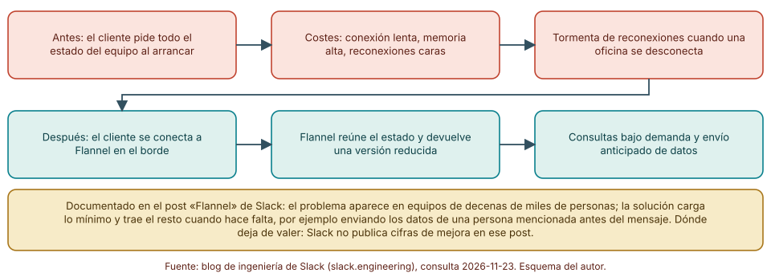

**Cómo leer la figura.** La fila superior es el problema y la inferior la solución. Mire cómo el coste de arranque deja de depender del tamaño del equipo. **Dónde deja de valer.** El post no publica cifras de mejora.

**Documentado [S4].** Originalmente el servidor enviaba una instantánea completa de los datos del equipo con la llamada `rtm.start`: usuarios, canales, miembros, últimos mensajes y mensajes directos. Eso es viable para equipos pequeños; con decenas de miles de usuarios aparecen cuatro problemas: tiempo de conexión largo, memoria del cliente grande, reconexión cara y tormentas de reconexión cuando una oficina entera pierde la red. La solución fue Flannel, un servicio de caché a nivel de aplicación desplegado en los puntos de presencia del borde: el cliente se conecta a Flannel; Flannel junta los datos de arranque, abre su propio WebSocket con los servidores de Slack en la región principal de AWS para mantenerse al día con los eventos, devuelve al cliente una versión reducida y anticipa datos: si alguien menciona a un colega, envía los datos del colega a los clientes que no los tenían justo antes del mensaje, para ahorrar una consulta.

**Qué enseña.** Es un caso de carga perezosa y empuje anticipado ([SE-356](../../classes/part-29-datos-persistencia-y-recuperacion/se-356-caches-y-consistencia-entre-capas/README.md)): el cliente deja de ser una réplica completa y pasa a ser una vista parcial con consultas por demanda. El coste es complejidad: los clientes deben tolerar datos ausentes y Flannel debe mantener coherencia con el origen.

### 6.6 Datos: MySQL, Vitess y el coste de cambiar de motor

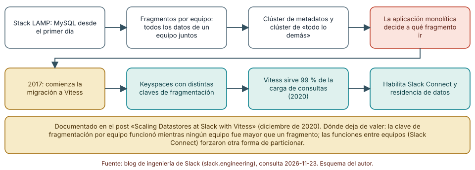

**Cómo leer la figura.** La fila superior es el diseño original y la inferior, la ruta hacia Vitess. **Dónde deja de valer.** Muestra decisiones, no tiempos de migración.

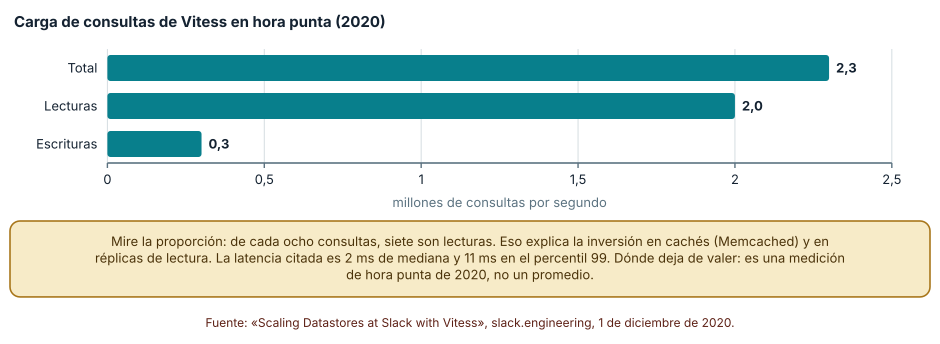

**Cómo leer la figura.** Cada barra es una parte de la carga pico. **Dónde deja de valer.** Es una medición de 2020, no un promedio.

**Documentado [S5].** Desde el principio MySQL fue el motor de almacenamiento de todo. Slack empezó como una pila LAMP (Linux, Apache, MySQL, PHP). Había tres clústeres: fragmentos con casi todos los datos de cliente (mensajes, canales, mensajes directos), particionados por identificador de equipo; un clúster de metadatos que traducía el identificador del equipo al fragmento; y un clúster «de todo lo demás». Cada fragmento alojaba miles de equipos y estaba formado por al menos dos instancias de MySQL en centros de datos distintos con replicación asíncrona. La aplicación monolítica decidía a qué fragmento ir. La migración a Vitess empezó en 2017; a diciembre de 2020 Vitess servía 99 % de la carga de consultas y esperaban completar la migración antes de terminar el año. Cada mensaje se persiste antes de difundirse por el stack de tiempo real. En hora punta atiende 2,3 millones de consultas por segundo (2 millones de lecturas y 300 000 escrituras), con latencia mediana de 2 ms y percentil 99 de 11 ms. Vitess permitió construir Slack Connect y la residencia de datos internacional.

**Mecanismo.** Vitess pone un enrutador (VTGate) delante de los fragmentos MySQL y permite definir keyspaces, es decir, bases lógicas con claves de fragmentación distintas por tabla. Para Slack, la ventaja fue que la lógica de dónde está cada dato dejó de vivir en la aplicación [S5]. La clase de réplica y particionado ([SE-355](../../classes/part-29-datos-persistencia-y-recuperacion/se-355-replicacion-particion-y-distribucion/README.md)) lo explica en abstracto.

**Límite que el propio Slack encuentra.** Una clave de fragmentación sirve para unas consultas y penaliza otras. En el incidente de febrero de 2022 una consulta que buscaba los miembros de un grupo de mensajes directos se resolvía como consulta dispersa a todos los fragmentos del keyspace fragmentado por usuario [S8]; existe otro keyspace fragmentado por canal que habría sido más eficiente para esa consulta. Es el coste clásico de elegir una clave.

### 6.7 La cola de trabajos

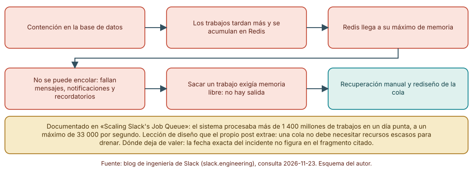

**Cómo leer la figura.** Cada caja es un eslabón de la cadena; las coral son fallos y la teal es la respuesta. **Dónde deja de valer.** La fecha exacta del incidente no figura en el fragmento citado.

**Documentado [S6].** La cola de trabajos ejecuta la lógica de negocio demasiado lenta para una petición web: publicación de cada mensaje, notificaciones push, expansión de URL, recordatorios y cálculo de facturación. En el día más cargado procesa más de 1 400 millones de trabajos con un máximo de 33 000 por segundo; los tiempos de ejecución van de milisegundos a minutos. Su diseño original (con Redis) venía de los primeros días de Slack. Hubo una caída: contención en la base de datos ralentizó los trabajos, Redis llegó a su límite de memoria y ya no se podían encolar trabajos; encima, el sistema necesitaba algo de memoria libre para sacar un trabajo, así que cuando se resolvió la contención la cola seguía bloqueada y exigió intervención manual. El rediseño se hizo con cambios graduales y sin migraciones de «parada total» ni de ida sin vuelta.

**Qué enseña.** Es un ejemplo de falla de recuperación: el sistema podía entrar en un estado del que no podía salir solo. Las clases de jobs y colas ([SE-247](../../classes/part-20-backend-apis-y-procesamiento-asincrono/se-247-jobs-colas-y-procesamiento-diferido/README.md)) y de idempotencia ([SE-246](../../classes/part-20-backend-apis-y-procesamiento-asincrono/se-246-idempotencia-reintentos-y-deduplicacion/README.md)) tratan los mecanismos; el post muestra el coste real de ignorarlos.

### 6.8 Incidente del 4 de enero de 2021

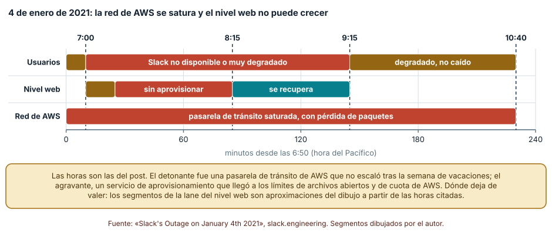

**Cómo leer la figura.** Los carriles son quién sufre o actúa y las líneas verticales son las horas del post. **Dónde deja de valer.** Los segmentos se dibujan a partir de las horas citadas, no de registros.

**Documentado [S7].** El primer día laborable del año, un monitor externo avisó de más errores. Durante la investigación dejó de estar disponible el servicio de paneles y alertas. A las 6:57 el 99 % de los mensajes se enviaba bien, cuando lo normal es más de 99,999 %. El pico de las 7:00 (Slack tiene mini picos cada media hora porque recordatorios y automatizaciones externas disparan mensajes) se sumó a los problemas de red y saturó el nivel web; la pérdida de paquetes aumentó la latencia, que a su vez saturó los recursos del nivel web. El autoescalado bajó instancias porque la CPU cayó mientras los hilos esperaban, y luego subió porque el uso de hilos creció; intentaron añadir 1 200 servidores entre las 7:01 y las 7:15, pero el servicio de aprovisionamiento, que usaba la misma red degradada, llegó a dos límites (el de archivos abiertos de Linux y una cuota de AWS). Cerca de las 8:15 se recuperó el aprovisionamiento; a las 9:15 Slack estaba degradado pero no caído, gracias al «modo pánico» de los balanceadores, que reparte a todas las instancias cuando muchas fallan las pruebas de salud; a las 10:40 AWS aumentó a mano la capacidad de la pasarela de tránsito (Transit Gateway) y la red volvió a la normalidad. Slack explica que su patrón anual es poco común: el tráfico baja durante las vacaciones, y el primer lunes los clientes tienen cachés frías y piden más datos.

**Lecciones que se extraen (interpretación).** (1) El mismo recurso (una red degradada) afectó a lo que necesitaba para arreglarse: el aprovisionamiento y el panel de monitoreo; es una dependencia circular. (2) Los límites configurados como múltiplos de la capacidad normal se agotaron con instancias a medio aprovisionar. (3) Un componente gestionado «que escala solo» tiene un límite de velocidad de escalado que no se conoce hasta que se supera. Las clases de gestión de incidentes ([SE-500](../../classes/part-41-observabilidad-sre-e-incidentes/se-500-gestion-de-incidentes-y-comunicacion/README.md)) y de postmortems sin culpa ([SE-501](../../classes/part-41-observabilidad-sre-e-incidentes/se-501-postmortems-sin-culpa-y-aprendizaje/README.md)) usan casos así.

### 6.9 Incidente del 22 de febrero de 2022

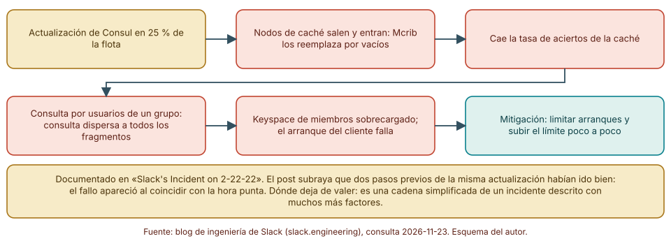

**Cómo leer la figura.** La cadena se lee de izquierda a derecha y de arriba abajo. **Dónde deja de valer.** Es una simplificación: el post describe más factores.

**Documentado [S8].** Poco después de las 6 de la mañana (hora del Pacífico) muchos usuarios no podían conectarse. El arranque del cliente (`boot`) descarga canales, preferencias y conversaciones recientes. La carga se concentró en un keyspace de Vitess con la pertenencia a canales, fragmentado por usuario, y venía de una consulta que listaba mensajes directos de grupo por usuario. La capa de caché es Memcached con Mcrouter (hash consistente) y Mcrib, un plano de control que reemplaza los nodos que salen del catálogo de Consul. Se estaba actualizando el agente de Consul con despliegues porcentuales: dos pasos de 25 % la semana anterior sin incidentes. Cuando el tercer paso coincidió con el pico del día, los nodos de caché se retiraron y reingresaron, la tasa de aciertos cayó y la consulta de miembros de grupos de mensajes directos se resolvió por consulta dispersa. Se mitigó limitando el arranque de clientes; el primer intento de subir el límite fue excesivo, la carga volvió a subir y se aumentó de a poco.

**Qué enseña.** Es un fallo en cascada con varias condiciones latentes: una caché que se vacía al cambiar de nodos, una clave de partición poco adecuada para una consulta, una función de arranque que hace trabajo en la ruta crítica y un cambio operativo seguro «a pasos» que falló por coincidir con la carga. El post lo llama un ejemplo de fallo de sistemas complejos.

### 6.10 Arquitectura celular y drenaje de zonas

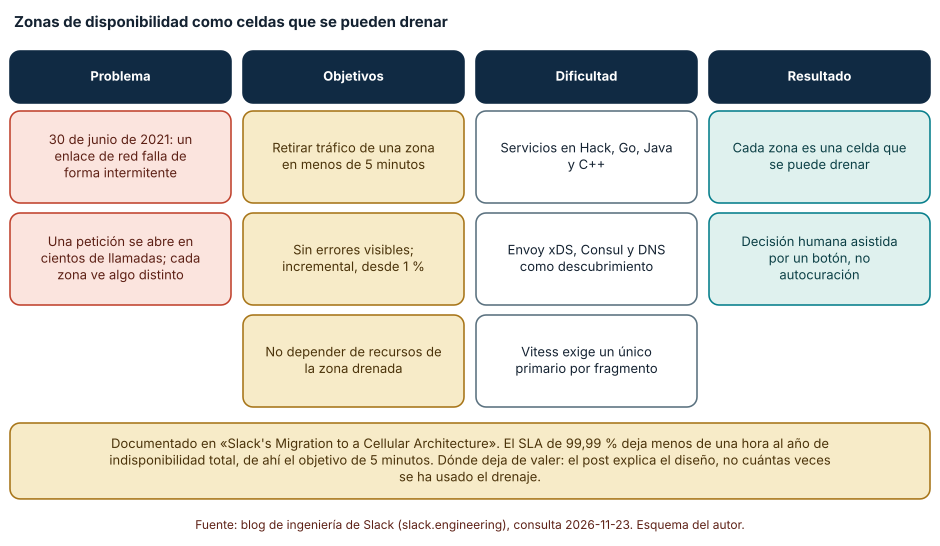

**Cómo leer la figura.** Las columnas van del problema al resultado. **Dónde deja de valer.** El post no dice cuántas veces se ha usado el drenaje.

**Documentado [S9].** El 30 de junio de 2021, un enlace de red de una zona de disponibilidad (AZ) de la región del este de EE. UU. falló de forma intermitente. Pese a que las zonas están aisladas, el servicio fue visible para los usuarios. Slack explica por qué: una petición de usuario puede abrirse en cientos de llamadas a servicios; los frontales intentan detectar y excluir a los backends fallidos, pero antes tienen que registrar fallos; y algunos almacenes, como Vitess, ofrecen consistencia fuerte y exigen un único primario por fragmento. Es un «fallo gris»: componentes distintos ven distinta disponibilidad. En vez de automatizar la remediación, Slack construyó un botón que drena el tráfico de una zona. Objetivos: retirar la mayor parte en menos de 5 minutos (el SLA de 99,99 % deja menos de una hora al año), sin errores visibles, incremental (empezando por 1 %) y sin depender de recursos de la zona drenada. Como los servicios están en cuatro lenguajes y hay varios mecanismos de descubrimiento (Envoy xDS, Consul, DNS), la solución no podía ser una función en cada cliente. Slack migró los servicios más críticos a una arquitectura basada en celdas a lo largo de 1,5 años.

**Mecanismo y límite.** Es la idea de celdas y radio de impacto de la clase de arquitectura celular ([SE-344](../../classes/part-28-estilos-arquitectonicos/se-344-arquitectura-celular-y-radio-de-impacto/README.md)). Un drenaje requiere capacidad de sobra en las otras zonas; el post lo reconoce implícitamente al fijar un objetivo de tiempo. **[No se sabe]** cuánta capacidad extra mantiene Slack.

### 6.11 Seguridad, abuso y cumplimiento

**Documentado.** El 10-K trata la seguridad y la privacidad como riesgos materiales: una brecha podría dañar la reputación, y la ley californiana de privacidad (CCPA) prevé indemnizaciones estatutarias de entre 100 y 750 USD por consumidor afectado [S1]. **[No se sabe]** el diseño interno de identidad, cifrado y auditoría; este caso no lo reconstruye. La clase de principios de seguridad ([SE-457](../../classes/part-38-seguridad-privacidad-y-cumplimiento/se-457-principios-de-seguridad-y-modelos-de-amenaza/README.md)) da el marco para analizarlo.

### 6.12 Observabilidad y operación

**Documentado.** Slack hace una revisión de incidentes tras cada caída notable [S9]. En enero de 2021 describe una monitorización externa que avisa primero y un incidente en el que los paneles de observabilidad dejaron de funcionar, con lo que los ingenieros tuvieron que consultar los almacenes de métricas directamente [S7]. **Mecanismo.** La lección de observabilidad es que el sistema de monitoreo debe estar menos acoplado que el sistema monitoreado ([SE-493](../../classes/part-41-observabilidad-sre-e-incidentes/se-493-senales-eventos-y-observabilidad-util/README.md)).

### 6.13 Evolución de la arquitectura por etapas

**Etapas (documentadas).** (1) Pila LAMP con MySQL particionado por equipo; (2) migración a Vitess desde 2017; (3) carga perezosa con Flannel para equipos grandes; (4) cola de trabajos rediseñada tras un incidente; (5) separación de la red en cuentas y VPC con pasarelas de tránsito (descrita en el incidente de 2021: antes «todo en una cuenta de AWS»); (6) celdas por zona de disponibilidad desde 2021. **Inferido.** Cada etapa responde a un límite que el crecimiento hizo visible, no a un plan de arquitectura trazado de antemano.

### 6.14 Alternativas descartadas y trade-offs (análisis propio)

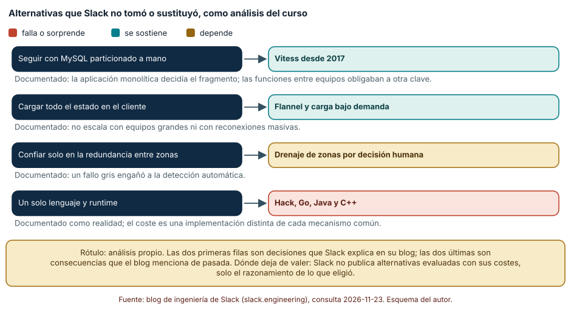

**Cómo leer la figura.** Cada tarjeta enfrenta una alternativa con lo que Slack hizo. **Dónde deja de valer.** Slack no publica alternativas evaluadas; es razonamiento del curso.

**Rótulo: análisis propio.** Las alternativas descartadas sobre las que hay evidencia son pocas: Slack explica por qué dejó la partición manual de MySQL (la lógica de dónde estaban los datos vivía en el monolito) y por qué no siguió cargando todo en el cliente (no escalaba con equipos grandes). **[No se sabe]** si evaluó otras bases de datos distintas de Vitess, o si consideró no hacer celdas.

### 6.15 Hardware, software, infraestructura y fallos

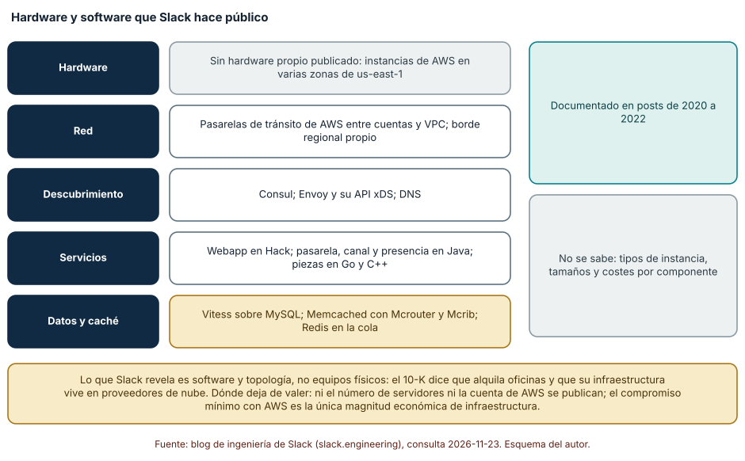

**Cómo leer la figura.** De arriba abajo, de lo físico a lo lógico. **Dónde deja de valer.** No hay datos de tipos de instancia ni de costes por componente.

**Hardware utilizado.** No hay hardware propio publicado: el núcleo corre sobre instancias de AWS, repartido en varias zonas de disponibilidad de una región del este de EE. UU. [S9], con una red de borde global propia. El 10-K confirma que Slack alquila todas sus instalaciones y no posee inmuebles [S1].

**Software utilizado (documentado).** Hack (aplicación web), Java (mensajería en tiempo real), Go y C++ (servicios), Envoy (balanceo y TLS), Consul (descubrimiento), Vitess sobre MySQL (datos), Memcached con Mcrouter y Mcrib (caché), Redis (cola de trabajos) [S3]–[S9].

**Características de la infraestructura.** Servidores con estado en memoria (canales, pasarelas, presencia) con reemplazo rápido; borde global con datos reducidos; almacén fragmentado con consistencia fuerte; cola con Redis; separación en cuentas y VPC unidas por pasarelas de tránsito [S7].

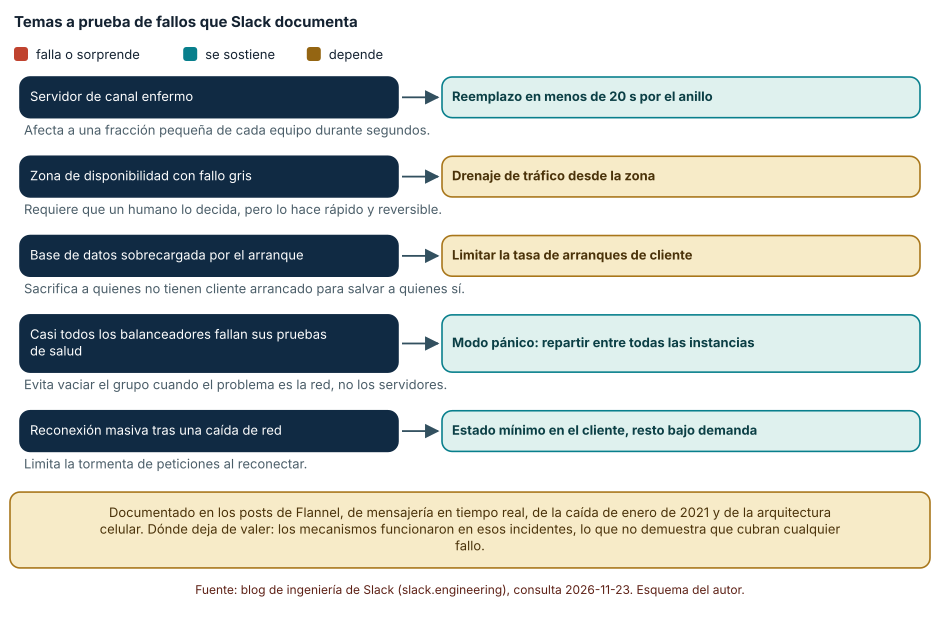

**Cómo leer la figura.** La tarjeta enlaza el fallo con el mecanismo que lo contiene. **Dónde deja de valer.** Funcionaron en esos incidentes, lo que no prueba que cubran otros.

**Temas a prueba de fallos.** Reemplazo en menos de 20 segundos de servidores de canal, drenaje regional de pasarelas, drenaje de zonas, modo pánico de balanceadores, circuit breaking y reintentos, y limitación de la tasa de arranques de cliente [S3], [S7], [S8], [S9].

## Casos especiales y cómo se resuelven

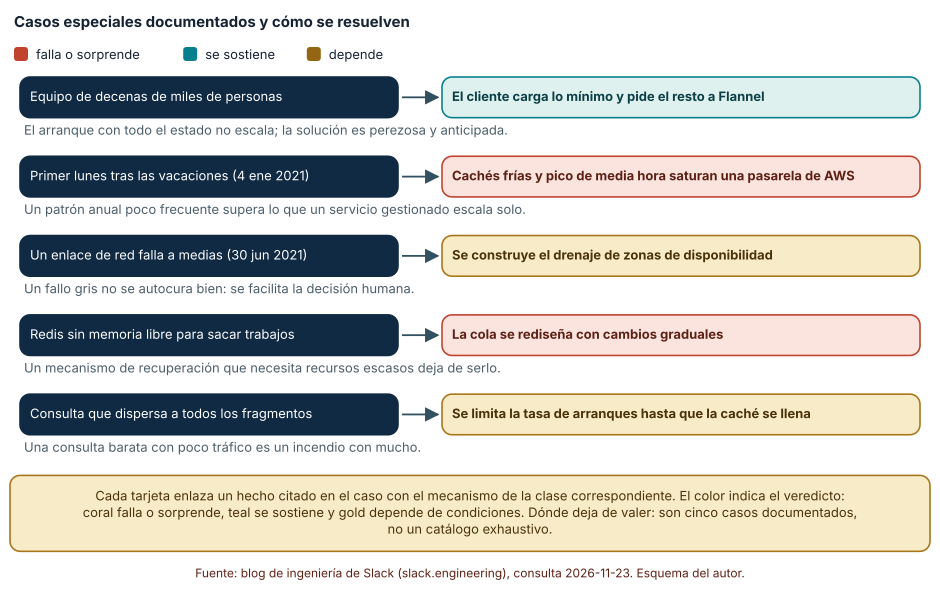

**Cómo leer la figura.** Cada tarjeta enfrenta una situación con lo que hizo el sistema; el color es el veredicto. **Dónde deja de valer.** Son cinco casos documentados, no un catálogo.

1. **Equipo de decenas de miles de personas.** Carga perezosa y empuje anticipado con Flannel [S4]. Límite: más complejidad en el cliente.
2. **Primer lunes del año.** Los clientes tienen cachés frías; el tráfico pasa del mínimo del año a uno de sus máximos «literalmente de la noche a la mañana». Slack escala bien sus propios servicios, pero la pasarela de tránsito de AWS no escaló a tiempo [S7]. Límite: el servicio gestionado no publicaba su ritmo de escalado.
3. **Mini picos cada media hora.** Recordatorios y automatizaciones externas disparan mensajes a la hora y a la media hora, por lo que Slack escala para esos picos [S7]. Es un patrón de carga con forma y no solo de volumen.
4. **Reconexión masiva.** Una oficina pierde la red y todos reconectan a la vez: Flannel reduce el coste de cada reconexión [S4].
5. **Fallo gris de una zona.** Drenar la zona; decisión humana asistida [S9].
6. **Cola sin memoria para drenar.** Rediseño con cambios graduales [S6].
7. **Consulta dispersa.** Limitar el arranque y llenar la caché con calma [S8].
8. **Datos regulados.** Residencia de datos internacional, construida sobre Vitess [S5].

## Línea de tiempo

| Año o fecha | Hecho | Fuente |
| --- | --- | --- |
| 2009 | Se constituye Tiny Spec, Inc. y ese año cambia a Tiny Speck, Inc. | [S1] |
| 2014 | Cambia su nombre a Slack Technologies y lanza Slack públicamente | [S1] |
| Año fiscal 2020 (2019) | Cotización directa en NYSE (WORK); 245,1 millones de gasto de remuneración en acciones al completarse | [S1] |
| 2017 | Comienza la migración a Vitess | [S5] |
| 31 de enero de 2021 | Más de 756 000 organizaciones; 156 000 clientes de pago | [S1] |
| 1 de diciembre de 2020 | Acuerdo de fusión con Salesforce | [S1] |
| 4 de enero de 2021 | Incidente por saturación de la red de AWS | [S7] |
| 30 de junio de 2021 | Fallo intermitente de enlace en una zona de disponibilidad | [S9] |
| 21 de julio de 2021 | Se cierra la fusión con Salesforce | [S2] |
| 22 de febrero de 2022 | Incidente por vaciado de caché y consulta dispersa | [S8] |

### Decisiones clave, giros y correcciones

- **Dejar la partición manual por Vitess (2017).** Decisión de datos con efecto sobre todo lo demás. **[Interpretación]** se tomó con evidencia de que el monolito ya era el cuello de botella.
- **Cargar bajo demanda (Flannel).** Un giro de diseño del cliente motivado por equipos grandes.
- **Construir un botón en vez de automatizar (2021).** Corrección: reconocer que la detección automática de fallos grises es difícil y apoyarse en el juicio humano.
- **Hacer más lento un despliegue «seguro» (2022).** Corrección posterior al incidente: los porcentajes crecientes no bastan si coinciden con la hora punta.

## Vínculo con el curso

El caso muestra, en un sistema real, mecanismos que el curso desarrolla con ejemplos controlados. Cada enlace dice qué mecanismo ilustra el caso:

- [SE-355](../../classes/part-29-datos-persistencia-y-recuperacion/se-355-replicacion-particion-y-distribucion/README.md): réplica y partición. Los fragmentos por equipo y los keyspaces de Vitess son el ejemplo.
- [SE-356](../../classes/part-29-datos-persistencia-y-recuperacion/se-356-caches-y-consistencia-entre-capas/README.md): cachés y consistencia entre capas. Memcached con Mcrouter y el vaciado de febrero de 2022.
- [SE-344](../../classes/part-28-estilos-arquitectonicos/se-344-arquitectura-celular-y-radio-de-impacto/README.md): arquitectura celular y radio de impacto. El drenaje de zonas y el reparto de equipos entre servidores de canal.
- [SE-247](../../classes/part-20-backend-apis-y-procesamiento-asincrono/se-247-jobs-colas-y-procesamiento-diferido/README.md): jobs, colas y procesamiento diferido. La cola de trabajos con Redis.
- [SE-246](../../classes/part-20-backend-apis-y-procesamiento-asincrono/se-246-idempotencia-reintentos-y-deduplicacion/README.md): idempotencia, reintentos y deduplicación. Reintentos en los eventos y en el aprovisionamiento.
- [SE-345](../../classes/part-28-estilos-arquitectonicos/se-345-12-factor-y-aplicaciones-nativas-de-la-nube/README.md): nube nativa. La separación en cuentas y VPC, y la dependencia de límites de servicios gestionados.
- [SE-389](../../classes/part-32-concurrencia-y-sistemas-distribuidos/se-389-fallos-parciales-y-modelos-de-red/README.md): fallos parciales y modelos de red. El fallo gris.
- [SE-438](../../classes/part-36-calidad-rendimiento-y-resiliencia/se-438-timeouts-retries-backoff-y-jitter/README.md): tiempos de espera, reintentos y backoff. Las tormentas de reintentos al reconectar.
- [SE-439](../../classes/part-36-calidad-rendimiento-y-resiliencia/se-439-circuit-breakers-bulkheads-y-degradacion/README.md): circuit breakers y degradación. El modo pánico de los balanceadores.
- [SE-500](../../classes/part-41-observabilidad-sre-e-incidentes/se-500-gestion-de-incidentes-y-comunicacion/README.md): gestión de incidentes. El puesto de comandante de incidentes en el post de 2022.
- [SE-501](../../classes/part-41-observabilidad-sre-e-incidentes/se-501-postmortems-sin-culpa-y-aprendizaje/README.md): postmortems sin culpa. Los tres posts son revisiones públicas con causa y lecciones.
- [SE-497](../../classes/part-41-observabilidad-sre-e-incidentes/se-497-sli-slo-sla-y-presupuestos-de-error/README.md): SLI, SLO y presupuestos de error. El SLA de 99,99 % que fija el objetivo de 5 minutos.
- [SE-133](../../classes/part-11-economia-metricas-y-decisiones-de-producto/se-133-modelos-de-negocio-y-sostenibilidad/README.md): modelos de negocio. Gratuito a pago, retención neta y clientes grandes.
- [SE-342](../../classes/part-28-estilos-arquitectonicos/se-342-multi-tenancy-y-aislamiento/README.md): multi-tenancy y aislamiento. Un equipo es un inquilino; los servidores de canal reparten.

### Preguntas de discusión

1. ¿Qué cambia en el diseño de Flannel si los equipos tienen 50 personas en vez de 50 000? ¿Seguiría valiendo la complejidad?
2. En el incidente de enero de 2021, ¿qué dependencias circulares había? ¿Cómo las detectaría una revisión previa?
3. El drenaje de zonas necesita capacidad ociosa. ¿Cuánta y cómo se justifica económicamente?
4. ¿Qué clave de fragmentación habría evitado la consulta dispersa de 2022 y qué consultas habría perjudicado?
5. ¿Cómo debería informar una empresa de los límites de escalado de un servicio gestionado a sus clientes?

### Mini-ejercicios de análisis

1. Calcule el ingreso medio por cliente de pago en el año fiscal 2021 con 902,6 millones y 156 000 clientes, y explique por qué es una cota gruesa.
2. Dibuje la cadena de causas del incidente de 2022 y marque qué eslabón corta cada mejora posible.
3. Escriba tres alertas útiles para el arranque de clientes y diga cuál habría avisado antes en febrero de 2022.

## Qué no generalizar

- **El modelo de adopción desde abajo.** Funciona si el producto mejora con cada persona que se suma y si el coste marginal de servir a un equipo gratuito es bajo. No es transferible a software donde el valor no es de red.
- **Un blog de ingeniería abierto.** Slack publica sus incidentes con detalle; eso explica que este caso sea técnico, pero no demuestra que sus sistemas sean más fiables que los de empresas que no publican.
- **La arquitectura de servidores con estado en memoria.** Es una elección para latencia muy baja con reemplazo en segundos; en sistemas con pocos usuarios simultáneos, un diseño sin estado y con caché puede ser más simple.
- **Vitess como respuesta.** Resolvió una escala concreta de MySQL con partición por equipo; una empresa con otra forma de datos puede estar mejor con otro motor.
- **La rentabilidad.** Slack perdió dinero en cada año fiscal que muestra el 10-K; su caso no prueba que el crecimiento pague solo.
- **El resultado de la fusión.** El caso no cubre cifras posteriores a julio de 2021: no se sabe cómo han evolucionado ingresos, clientes ni costes.

## Fuentes públicas verificadas

Todas las URL se consultaron el 23 de noviembre de 2026 y devolvieron contenido (HTTP 200). Las cifras de la SEC se leyeron mediante el acceso de datos públicos de la propia SEC.

- **[S1]** [Slack Technologies, Form 10-K, año fiscal terminado el 31 de enero de 2021 (SEC)](https://www.sec.gov/Archives/edgar/data/1764925/000176492521000050/work-20210131.htm): ingresos, costes, clientes, retención, empleados, oficinas, compromiso con AWS, fundadores y constitución.
- **[S2]** [Slack Technologies, Form 8-K del 21 de julio de 2021 (SEC)](https://www.sec.gov/Archives/edgar/data/1764925/000119312521220229/d205267d8k.htm): acuerdo de fusión del 1 de diciembre de 2020 y cierre el 21 de julio de 2021.
- **[S3]** [Real-time Messaging, blog de ingeniería de Slack](https://slack.engineering/real-time-messaging/): servidores de canal, pasarela, presencia y administración; hash consistente; 16 millones de canales; reemplazo en menos de 20 s.
- **[S4]** [Flannel: An Application-Level Edge Cache to Make Slack Scale](https://slack.engineering/flannel-an-application-level-edge-cache-to-make-slack-scale/): carga perezosa y empuje anticipado de datos.
- **[S5]** [Scaling Datastores at Slack with Vitess](https://slack.engineering/scaling-datastores-at-slack-with-vitess/): MySQL, fragmentos por equipo, migración desde 2017, 2,3 millones de consultas por segundo.
- **[S6]** [Scaling Slack's Job Queue](https://slack.engineering/scaling-slacks-job-queue/): 1 400 millones de trabajos y 33 000 por segundo; fallo de Redis por memoria.
- **[S7]** [Slack's Outage on January 4th 2021](https://slack.engineering/slacks-outage-on-january-4th-2021/): saturación de la pasarela de tránsito de AWS y cascada de aprovisionamiento.
- **[S8]** [Slack's Incident on 2-22-22](https://slack.engineering/slacks-incident-on-2-22-22/): caché vaciada, consulta dispersa y limitación de arranque.
- **[S9]** [Slack's Migration to a Cellular Architecture](https://slack.engineering/slacks-migration-to-a-cellular-architecture/): fallo gris del 30 de junio de 2021 y drenaje de zonas.

[↑ Casos de éxito](README.md) · [← Stripe](stripe.md) · [Shopify →](shopify.md)
