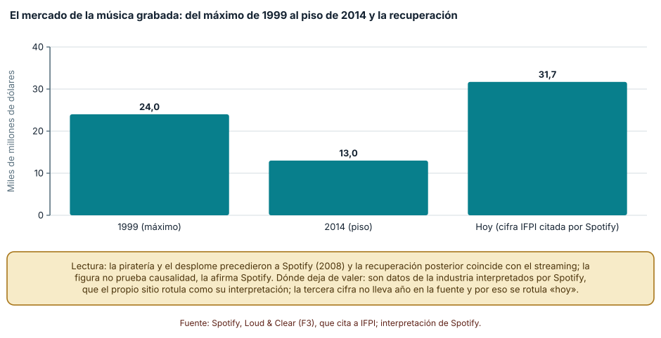
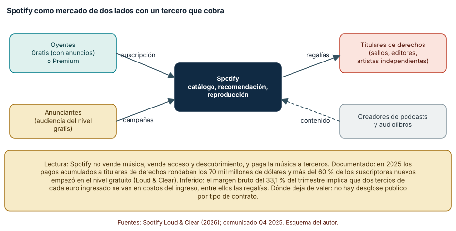
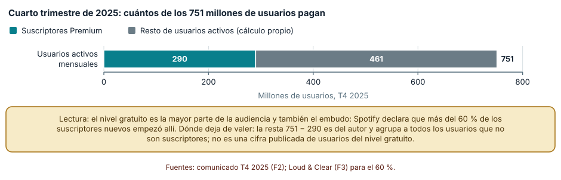
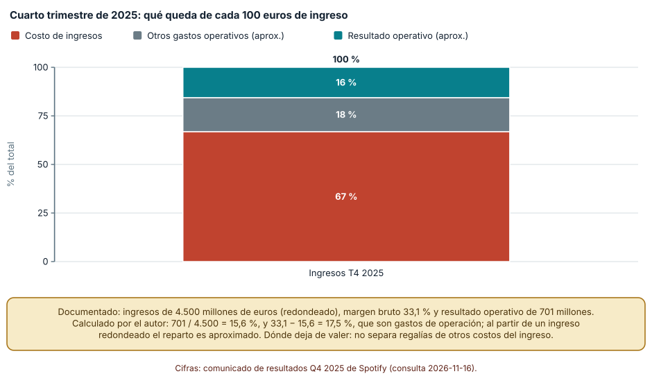
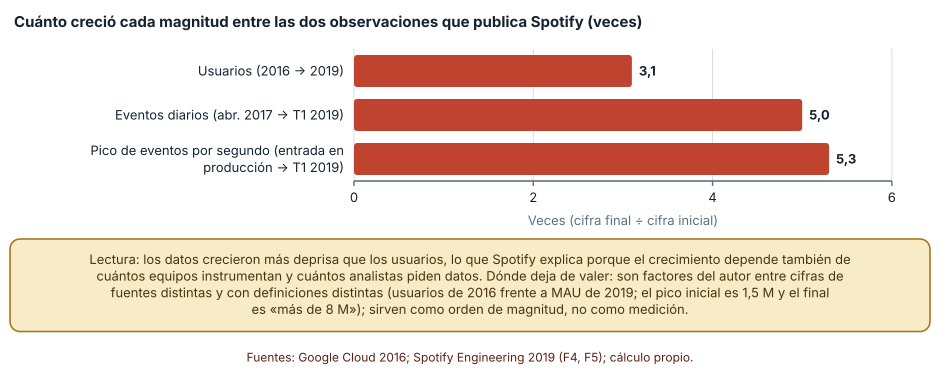
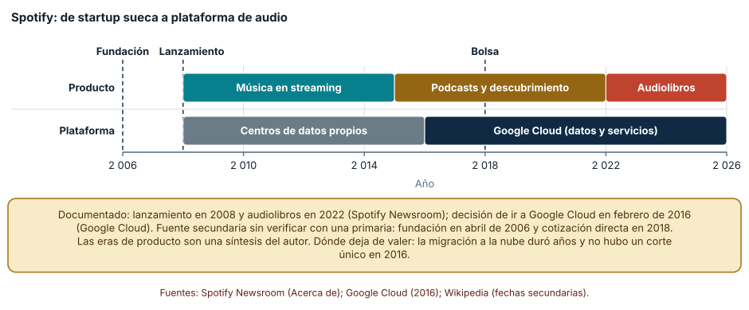

# Spotify

[↑ Casos de éxito](README.md) · [← Amazon](amazon.md) · [Airbnb →](airbnb.md)

> **Qué es este caso.** Un análisis profesional de una empresa real que el programa usa para contrastar la teoría con la práctica. No es una clase ni un rol: es la realidad frente al curso. Se apoya solo en fuentes públicas citadas al final, consultadas el 16 de noviembre de 2026, y separa lo que está **documentado**, lo que es **inferido** y lo que **no se sabe**.

**Cómo leer este caso.**

- **Documentado**: lo dice una fuente citada, por ejemplo «Documentado (F4)». Si la fuente es secundaria, se declara.
- **Observable**: se comprueba usando el producto público, sin una cita específica en este caso.
- **Inferido**: conclusión del autor a partir de lo documentado; puede ser falsa.
- **Análisis propio**: razonamiento, cálculo o alternativa hipotética del autor; se rotula como tal y no es un hecho.
- **No se sabe**: dato que la empresa no ha publicado. No se rellena con suposiciones.

Las cifras de dinero de Spotify están en euros, que es su moneda de reporte, salvo las de regalías, que la empresa publica en dólares y se citan así.

**Mapa de los niveles de arquitectura.** Lo que Spotify ha publicado sobre su ingeniería se concentra en cuatro zonas, y cada una lleva su figura: la **migración a la nube** (2016), la **entrega de eventos** (2016-2021: arquitectura, aislamiento por tipo, reenvíos y deduplicación, antes y después), la **plataforma de experimentación** (2013-2020: componentes, asignación por sal, retenedores, controles de validez) y la **plataforma interna** (Backstage y las escuadras). **Cómo se sirve el audio hoy no está publicado**: el caso no lo inventa y lo declara como el hueco principal.

## Ficha histórica

| Dato | Valor | Estado de la evidencia |
| --- | --- | --- |
| Nombre | Spotify Technology S.A. (servicio operado por Spotify AB en la mayoría de mercados) | Documentado (F1) |
| Fundadores | Daniel Ek y Martin Lorentzon | Fuente secundaria (F11); Daniel Ek figura como fundador y presidente ejecutivo en la propia web (F1) |
| Fundación | abril de 2006, en Estocolmo | Fuente secundaria (F11) |
| Lanzamiento | octubre de 2008 en varios mercados europeos; Estados Unidos en julio de 2011 | 2008: documentado (F1); detalle por mercado y 2011: fuente secundaria (F11) |
| Sede del servicio | Regeringsgatan 19, Estocolmo (Spotify AB) | Documentado (F12) |
| Hitos de producto | 2008 música; podcasts después; 2022 audiolibros | 2008 y 2022: documentado (F1); resto: observable |
| Cambio de infraestructura | Decisión de migrar a Google Cloud, anunciada en febrero de 2016 | Documentado (F4) |
| Escala en 2016 | más de 75 millones de usuarios, más de 2 mil millones de listas y más de 30 millones de canciones | Documentado (F4) |
| Escala actual | 788 millones de usuarios, 306 millones de suscriptores, 184 mercados; más de 100 millones de pistas, 8 millones de títulos de podcast y 800.000 audiolibros | Documentado (F1) |
| Resultados | Cuarto trimestre de 2025: 751 millones de usuarios activos mensuales, 290 millones de suscriptores Premium, ingresos de 4.500 millones de euros, margen bruto del 33,1 % y resultado operativo de 701 millones | Documentado (F2) |
| Pagos a titulares de derechos | más de 11 mil millones de dólares en 2025 y cerca de 70 mil millones acumulados | Documentado (F3), dato de la propia empresa |
| Ingresos de 2025 | 17.186 millones de euros | Fuente secundaria (F11, que cita el informe 20-F; el informe no se pudo leer directamente) |
| Cotización | Bolsa de Nueva York (SPOT), por cotización directa en 2018 | Fecha y modalidad no verificadas con fuente primaria |

La cifra de 788 millones de usuarios de la web corporativa (F1) y la de 751 millones del cuarto trimestre (F2) pueden diferir porque cada una se refiere a un momento y a una definición distintos; no hay contradicción comprobable.

## Contexto y problema

Cuando Spotify nació, la industria musical había perdido casi la mitad de su tamaño. Documentado (F3, con la advertencia de que es la interpretación de Spotify de datos de la industria): el mercado mundial de música grabada pasó de un máximo de 24.000 millones de dólares en 1999 a 13.000 millones en 2014, impulsado por la piratería, y hoy la industria está en 31.700 millones de dólares según la cifra de IFPI que cita Spotify.

**Cómo leer la figura.** Cada barra es el tamaño del mercado en un momento; la altura permite ver la caída de 1999 a 2014 y la recuperación posterior. Mira primero que la tercera barra supera a la primera. **Dónde deja de valer.** Las cifras son de la industria, interpretadas por Spotify en un sitio que defiende su modelo; la tercera no lleva año en la fuente. No prueba que Spotify causara la recuperación: eso lo afirma la empresa, no se demuestra aquí.

El problema de Spotify era ofrecer una **alternativa legal tan cómoda como la copia ilegal**: acceso instantáneo, catálogo enorme y sin descargas manuales, y a la vez conseguir que los titulares de derechos aceptaran licenciar su catálogo. Es un problema de dos caras que mezcla técnica y negocio.

### Lo técnico: que «reproducir» suene ya

Técnicamente, un clic en «reproducir» debe sonar casi de inmediato; esa exigencia empujó a Spotify, en sus primeros años, a una arquitectura que combinaba servidores con una red entre pares (F10: el artículo científico de 2010 de los ingenieros Gunnar Kreitz y Fredrik Niemelä describe el sistema como de «streaming de música bajo demanda a gran escala, baja latencia y P2P»). Fuente secundaria (F11): Spotify terminó la red P2P en 2014. No se pudo leer el texto completo del artículo (el servidor de los autores ya no lo publica), de modo que este caso cita su existencia y su título pero **no sus mediciones**: cualquier cifra de latencia o de reparto entre servidores y pares sería inventada aquí.

### Lo comercial: pagar lo bastante para tener catálogo

En lo comercial, el servicio tuvo que construir un modelo que pagara a los titulares de derechos lo suficiente para que el catálogo estuviera disponible, y a la vez ser rentable con un precio que el consumidor aceptara. Inferido: esa doble restricción explica por qué la historia técnica pública de Spotify se centra en datos, experimentación y eficiencia de ingeniería (donde puede ganar margen) y no en el catálogo, que es un costo cuyo precio fijan terceros.

### La apuesta

Análisis propio, apoyado en F3 y F4: la apuesta fue que una experiencia mejor que la piratería, con un nivel gratuito financiado con anuncios como embudo y una suscripción como producto principal, haría crecer el mercado en lugar de repartirlo. Documentado (F3): más del 60 % de los suscriptores nuevos empezó en el nivel gratuito; el embudo funciona. Documentado (F4): en 2016 la empresa decidió que no quería estar en el negocio de los centros de datos, es decir, que su diferencia no era la infraestructura.

## Mercado, usuarios y casos de uso

**Cómo leer la figura.** El rectángulo oscuro es Spotify; a su izquierda están quienes pagan (oyentes y anunciantes) y a su derecha quienes cobran (titulares de derechos) o aportan contenido (creadores). Las flechas llevan dinero o contenido. Mira primero que el dinero entra por dos vías, suscripción y anuncios, y que la salida principal son las regalías. **Dónde deja de valer.** Es un esquema de flujos, no de cuánto fluye por cada vía; el margen bruto del 33,1 % (F2) sugiere, como inferencia, que dos tercios de cada euro ingresado se van en costos del ingreso, entre ellos las regalías, pero no hay desglose público por tipo de contrato.

Para ver el orden de magnitud de la audiencia, la figura siguiente une cuatro cifras publicadas por la empresa o por su proveedor de nube.

**Cómo leer la figura.** El eje horizontal es el año y el vertical, los millones de usuarios; cada marcador es una observación con su valor. La conclusión que sostiene es el orden de magnitud: de decenas de millones a más de 700 millones en menos de diez años. **Dónde deja de valer.** Los puntos no usan la misma definición (el de 2016 habla de «más de 75 millones de usuarios» y los demás de usuarios activos mensuales), y la línea no mide el crecimiento intermedio: no sirve para estimar años sin dato.

**Cómo leer la figura.** La barra es la audiencia del cuarto trimestre de 2025; el tramo azul verdoso son los suscriptores y el gris, el resto de usuarios activos. Mira que los suscriptores son menos de la mitad (38,6 %, cálculo propio). **Dónde deja de valer.** El 461 es una resta mía (751 − 290) que agrupa a todos los usuarios que no son suscriptores; no es la cifra de usuarios del nivel gratuito que Spotify publica.

### Tipos de usuario y cómo cambia la experiencia

- **Oyente del nivel gratuito.** Observable: escucha con anuncios y con ciertas limitaciones de control. Documentado (F3): más del 60 % de los suscriptores nuevos empieza en el nivel gratuito y luego se pasa a Premium; el nivel gratuito es el embudo. Incentivo: música gratis; límite: anuncios y menos control. Su valor para Spotify es doble: ingreso publicitario y futura conversión.
- **Oyente Premium.** Observable: sin anuncios, con escucha sin conexión y más control; hay variantes individuales, para dúos y familiares (la existencia de planes dúo y familiar aparece en F11). Incentivo: continuidad y control; límite: el precio mensual, que no se documenta aquí.
- **Artista y sello.** Documentado (F3): reciben regalías por cada escucha; los sellos independientes y artistas independientes generaron cerca del 50 % de las regalías de Spotify en 2025, y más de 81.000 artistas ganaron al menos 10.000 dólares solo con Spotify en 2025. Es dato de la propia empresa, publicado para defender su modelo. Incentivo: ser descubierto; límite: la cuota de reproducciones diluye a quien tiene pocas.
- **Creador de podcast y de audiolibros.** Documentado (F1): el catálogo incluye 8 millones de títulos de podcast y 800.000 audiolibros en mercados seleccionados.
- **Anunciante.** Observable: compra audiencia del nivel gratuito. No se sabe la mecánica interna de la subasta de anuncios.
- **Ingeniero de un equipo.** Documentado (F9, F6, F8): la ingeniería se organiza en equipos autónomos que usan una plataforma de experimentación y un portal de desarrolladores. Incentivo: poder lanzar sin pedir permiso; límite: la plataforma y las métricas de guardia.
- **Dueño de un tipo de evento.** Documentado (F5): un equipo declara un tipo de evento con su esquema y empieza a emitirlo; la infraestructura crea todo lo demás sin intervención del equipo de eventos. Incentivo: instrumentar sin fricción; límite: el SLO de su nivel de importancia y el costo.
- **Científico de datos o analista.** Documentado (F5, F6): consume los datos de eventos en BigQuery o en el catálogo de métricas. Incentivo: respuestas rápidas; límite: la calidad de los datos, que depende de los reenvíos y las pérdidas de los clientes móviles.

### Casos de uso característicos

1. Reproducir una canción o una lista en cualquier dispositivo.
2. Descubrir música nueva sin buscar: la lista semanal personalizada.
3. Escuchar sin conexión en un viaje.
4. Que un artista independiente suba su música a través de un distribuidor y cobre regalías.
5. Que un equipo pruebe un cambio con una fracción de usuarios y decida con datos.
6. Que un tipo de evento nuevo llegue a la analítica en horas y no en semanas (F5-bis).

### Qué trabajo contrata cada usuario

Análisis propio, con el enfoque de «trabajos por hacer» ([SE-122](../../classes/part-10-descubrimiento-y-estrategia-de-producto/se-122-usuarios-actores-trabajos-y-contextos/README.md)): el oyente contrata a Spotify para **tener cualquier canción ahora sin gestionar archivos**; el artista, para **llegar a oyentes y cobrar sin intermediarios operativos**; el anunciante, para **alcanzar una audiencia que no paga**; el ingeniero, para **saber si su cambio mejora algo sin depender de otros**. Cada trabajo apunta a una decisión: el primero a la latencia de arranque y al catálogo, el segundo al reparto por cuota, el tercero al nivel gratuito, el cuarto a la plataforma de experimentación.

## Funcionalidad de principio a fin

Cada tipo de usuario recorre su propio viaje. Lo que sigue es **observable** salvo cuando se cita una fuente.

### Instancia 1: oyente del nivel gratuito, de la descarga a la conversión

1. **Primer contacto.** Observable: el usuario descarga la app o abre el reproductor web, y puede empezar a escuchar con una cuenta gratuita.
2. **Registro.** Observable: se crea una cuenta con datos mínimos y se eligen gustos iniciales. No se sabe qué parte del registro es experimento A/B en cada momento, pero documentado (F6) que casi toda decisión de producto pasa por una prueba.
3. **Uso central.** Observable: búsqueda, reproducción, biblioteca y listas. Documentado (F7): cada lunes Spotify entregaba 75 millones de «mixtapes» únicas, la lista Discover Weekly, generadas combinando algoritmos con curaduría humana. Fuente secundaria (F11): se lanzó en julio de 2015.
4. **Anuncios y límites.** Observable: anuncios entre canciones y limitaciones de control. Es el costo del nivel gratuito.
5. **Conversión.** Documentado (F3): más del 60 % de los suscriptores nuevos empieza aquí. Cada pantalla, cada límite y cada recomendación se prueban con experimentos (F6): el embudo es un sistema medido, no una página.
6. **Caso límite.** El usuario escucha sin conexión: Premium permite descargas (observable). Los eventos de escucha no llegan hasta que vuelve la red (F5-bis); la analítica lo corrige con reenvíos y deduplicación.

### Instancia 2: oyente Premium, de la suscripción al uso diario

1. **Contratación.** Observable: la suscripción Premium se contrata desde la cuenta con un método de pago. No se sabe cómo se orquesta el cobro internamente.
2. **Uso diario.** Observable: reproducción sin anuncios, listas, descargas. Documentado (F7): el hábito se refuerza con contenido personalizado semanal.
3. **Planes.** Observable: individual, dúo, familiar (F11). No se sabe la mecánica de verificación de pertenencia al plan.
4. **Fin del viaje.** Observable: cancelar baja al usuario al nivel gratuito. No se sabe cuántos vuelven.
5. **Caso límite.** El usuario cambia de país: el catálogo y los precios dependen del mercado; Spotify opera en 184 mercados (F1) y no publica cómo gestiona las licencias por territorio.

### Instancia 3: artista o sello, del alta al cobro

Documentado (F3): Spotify no paga a artistas ni compositores directamente, sino a titulares de derechos (sellos, distribuidores, editoras), que pagan según sus contratos. La plataforma reparte por cuota de reproducciones: cada titular recibe su porcentaje del total, no una tarifa fija por reproducción. Documentado (F3): para generar regalías de grabación, una pista necesita al menos 1.000 reproducciones al año; Spotify afirma que el 99,5 % de las reproducciones corresponde a pistas que superan ese umbral y que 3,5 millones de artistas tuvieron al menos una pista que lo supera en 2025. Documentado (F3): las reproducciones artificiales detectadas no generan regalías. Caso límite: un pago pequeño que no llega porque el distribuidor tiene un mínimo de retiro (entre 2 y 50 dólares, según F3) y el banco cobra comisión; la empresa lo usa como argumento a favor del umbral.

### Instancia 4: dueño de un tipo de evento, de la idea al conjunto de datos

Documentado (F5, F5-bis): el equipo define el tipo con nombre, esquema (Avro) y metadatos; en el sistema de 2019 la infraestructura crea tema, suscripción, ETL y destino de forma automática y registra el SLO; en el sistema anterior a 2021, pasar de «instrumentar» a «ver datos» tardaba una semana, con horas para propagar un esquema. Caso límite: el equipo emite un evento mal formado; el servicio de eventos lo rechaza (F5); o el tipo se desborda y solo se retrasa su carril.

### Instancia 5: ingeniero que lanza un cambio con una prueba

Documentado (F6): el ingeniero declara propiedades de configuración en un archivo junto al código; crea un experimento en el planificador (interfaz en Backstage), elige métricas de éxito y de guardia y tamaño de muestra; la plataforma asigna usuarios, vigila la validez y recomienda continuar, abortar o esperar. Caso límite: otro experimento toca la misma propiedad; la plataforma avisa de colisión de propiedades (F13).

### Instancia 6: analista, del evento a la decisión

Documentado (F4, F5): consultas complejas en BigQuery y Dataproc dan respuesta en uno o dos minutos y no en horas. Documentado (F6): el catálogo de métricas sirve datos con latencia por debajo de un segundo a interfaces y cuadernos. Caso límite: la métrica incluye usuarios con eventos perdidos; los reenvíos y la deduplicación reducen el problema pero no lo eliminan (F5-bis).

## Negocio y economía

### Modelo

Documentado (F1, F3): freemium financiado con anuncios, más suscripciones Premium; el reparto a titulares de derechos es la mayor partida. Documentado (F3): los pagos acumulados a titulares de derechos rondan los 70.000 millones de dólares, de los cuales más de 11.000 millones corresponden a 2025, el año de mayor pago de su historia, con un aumento superior a 10 veces desde 2014.

**Cómo leer la figura.** La barra es el ingreso del trimestre dividido en 100. El bloque rojo, el más grande, es lo que cuesta producir el ingreso (el margen bruto de 33,1 % es el complemento); lo que queda se reparte entre gastos de operación y resultado operativo. **Dónde deja de valer.** Dos de las tres cifras son documentadas (margen bruto y resultado operativo en euros); el reparto entre ellas depende de un ingreso redondeado a 4.500 millones, por eso están marcadas como aproximadas. Un solo trimestre no representa el año, y la figura no separa las regalías de otros costos.

### Fuentes de ingreso y costos

Documentado (F2): ingresos de 4.500 millones de euros en el cuarto trimestre de 2025, con un crecimiento del 13 % a tipo de cambio constante; los usuarios activos crecieron 11 % interanual y los suscriptores 10 %; el margen bruto mejoró 83 puntos básicos hasta el 33,1 %. Documentado (F1): suscripciones y publicidad (el nivel gratuito financiado con anuncios aparece en F3). Documentado (F2): costos del ingreso del 66,9 % (complemento del margen bruto). Documentado (F4, F5): la infraestructura de datos se movió a un proveedor de nube pública para dejar de operar centros de datos propios.

### El fondo de regalías: la restricción de arquitectura del negocio

**Cómo leer la figura.** De izquierda a derecha: dos entradas de dinero (oyentes Premium y anunciantes), el ingreso de Spotify, la bifurcación entre el fondo de regalías y el resto, y la salida hacia titulares de derechos y de ellos a artistas. Mira que el recuadro del fondo es una fracción de lo que entra. **Dónde deja de valer.** «Dos tercios» es una cifra redondeada de la empresa y no un contrato; Spotify no publica el cálculo con cada sello ni el desglose entre regalías de grabación y de edición.

Documentado (F3): Spotify declara que alrededor de dos tercios del dinero que obtiene de las suscripciones Premium y de la publicidad del nivel gratuito va al fondo de regalías. Documentado (F2): los costos del ingreso fueron el 66,9 % de los ingresos en el cuarto trimestre de 2025. Inferido: ambas cifras son del mismo orden, lo que sugiere que las regalías explican la mayor parte del costo del ingreso, aunque no se sabe cómo se reparte el resto (infraestructura de reproducción, pagos, etc.). Análisis propio: si dos tercios del ingreso es una cuota casi fija pagada a terceros, **el margen bruto de Spotify queda estructuralmente acotado** y el resultado depende de tres palancas: crecer en usuarios y suscriptores, mejorar la mezcla de ingresos con productos de mayor margen (publicidad, podcasts, audiolibros: no se sabe su margen por separado) y controlar el gasto operativo y la infraestructura. Es coherente con que la empresa publique mucho sobre eficiencia de ingeniería y datos. No es un hecho publicado: es una lectura.

### Unit economics: lo que se puede decir

Documentado (F3): una persona que capturó una millonésima parte de todas las reproducciones de Spotify generó unos 11.000 dólares en 2025; con 11.000 millones de dólares de fondo, eso equivale a 11.000 dólares por cada millonésima, cálculo propio coherente con la fuente. Documentado (F3): Spotify afirma que cerca del 40 % de los usuarios de streaming del mundo (excluida China, según MIDiA, citada por la empresa) están en Spotify y generan un 70 % de las reproducciones, de lo que la empresa deduce que su oyente medio escucha de 3 a 4 veces más música al mes que el de otros servicios; es una afirmación de parte. No se publica ARPU por segmento ni costo de adquisición ni valor del cliente en el tiempo: este caso no los calcula porque serían cifras inventadas.

### Efectos de red y por qué este actor

Análisis propio (no documentado como causal): el mercado favoreció a Spotify por una combinación de cuatro mecanismos. Primero, **efectos de red débiles pero reales**: listas compartidas, recomendaciones que mejoran con más datos de escucha y el costo de cambiar de servicio por listas y bibliotecas acumuladas (F7). Segundo, **datos como ventaja**: Spotify llegó a recoger cientos de miles de millones de eventos al día (F5) y a someter casi cada decisión a una prueba (F6); eso acelera el aprendizaje. Tercero, **escala para negociar**: más usuarios dan más poder frente a los titulares de derechos, aunque el fondo de dos tercios limita cuánto. Cuarto, **el embudo gratuito**: el 60 % de los suscriptores nuevos viene de allí (F3). Lo que no se sabe: cuota de mercado por país y cuánto pesa cada mecanismo frente al catálogo y el precio.

### Competidores

Documentado (F3): Spotify cita datos de MIDiA sobre cuota de usuarios de streaming y compara su volumen con «otros servicios» sin nombrarlos. Las fuentes de este caso no incluyen cifras de competidores, por lo que no hay tabla comparativa; hacerla exigiría fuentes adicionales por servicio y año.

### Palancas de crecimiento

Documentado (F2): el trimestre con mayor aumento neto de usuarios de su historia y crecimiento de dos dígitos en suscriptores; audiolibros en Premium en cinco países nuevos del norte de Europa (F2). Documentado (F1): ampliación del catálogo a podcasts y audiolibros. Inferido: la estrategia de añadir audio no musical busca elevar el uso y la mezcla de ingresos, pero no hay desglose público de ingresos por tipo de contenido.

## Arquitectura y esquemas

Lo documentado se limita a la plataforma de datos, las herramientas de ingeniería y la decisión de nube. No hay descripción pública detallada de cómo se sirve el audio hoy.

### Nivel 1: contexto

Ya visto en la figura de dos lados. Evidencia: el reparto de dinero (F3), la audiencia (F1, F2) y la nube (F4) están documentados; el catálogo, la licencia por territorio y la subasta de anuncios no se publican.

### Nivel 2: contenedores y componentes documentados

**Cómo leer la figura.** La fila superior es el camino de un dato: cliente, entrega de eventos, ETL horario y análisis. La fila inferior recoge cómo los equipos lo usan: experimentación, Backstage y las escuadras. Las cajas discontinuas son lo no descrito. Observa que el audio no aparece: no hay fuente que lo detalle. **Dónde deja de valer.** Los blogs son de 2016 a 2021; no sirve para afirmar cómo es la infraestructura hoy.

Documentado (F4): en febrero de 2016 Spotify (75 millones de usuarios o más, más de 2 mil millones de listas y más de 30 millones de canciones) eligió Google Cloud y dividió la migración en dos vías, servicios y datos. Sus servicios se ejecutan como «multitud de microservicios diminutos», varios de ellos ya trasladados con Cloud Storage y Compute Engine, con autoescalado; para almacenamiento adoptó Cloud Datastore y Cloud Bigtable y servicios de red para mover petabytes. En datos, pasó de Hadoop, MapReduce y Hive y herramientas de paneles propias a Pub/Sub, Dataflow, BigQuery y Dataproc; con las nuevas herramientas, consultas complejas dan respuesta en uno o dos minutos en lugar de horas. Documentado (F4): Pub/Sub permitía procesar cientos de miles de mensajes por segundo. Documentado (F4): la razón declarada es que Spotify no quería estar en el negocio de los centros de datos, tras preguntarse repetidamente si el esfuerzo valía la pena frente a trabajar en funciones.

### Nivel 3: la entrega de eventos por dentro

**Cómo leer la figura.** A la izquierda, quien emite; en el centro, la puerta única; a la derecha, un carril por tipo de evento con tema, ETL y destino. Debajo, los tres niveles de importancia y los recuadros del compositor y de la flota. Mira que el aislamiento empieza justo después de la puerta única. **Dónde deja de valer.** Es el sistema de 2016-2019 (F5); la fuente de 2021 describe un rediseño y no se sabe qué parte está vigente hoy.

Documentado (F5): diseñar, escribir, desplegar y escalar el sistema llevó casi un año; se construyó solo para Google Cloud y mantuvo compatible la interfaz de productores y consumidores con el sistema anterior, lo que permitió ejecutar ambos en paralelo y comparar la completitud; ese requisito era crítico por auditorías estrictas. Documentado (F5): se migraron primero los datos críticos del negocio, como el evento de fin de canción (usado para pagar regalías a sellos y artistas y para calcular usuarios activos diarios y mensuales) y la creación de usuario; la razón declarada es que migrar «al pez grande» primero dio estabilidad y masa crítica más rápido. Documentado (F5): el despliegue pasó al 100 % del tráfico en un solo día, contra un plan por etapas, y el sistema basado en Kafka se apagó en febrero de 2017.

Documentado (F5): el servicio de eventos analiza y reconoce el tipo y publica en Pub/Sub; los eventos mal formados o no reconocidos se rechazan. Cada tipo tiene su tema, su proceso ETL y su ubicación final. Los tipos se clasifican por importancia alta, media y baja, con SLO distintos (pocas horas, 24 horas y 72 horas) y alertas escalonadas para no despertar a nadie de madrugada por un tipo poco importante. Documentado (F5): el sistema tiene cerca de 15 microservicios en unas 2.500 máquinas virtuales; hay pruebas de integración de extremo a extremo, un entorno de preparación y máquinas canario; con el autoescalado y la herramienta de despliegue interna, desplegar toda la flota llegó a tardar tres horas. Documentado (F5): el ETL usa clústeres en Compute Engine (uno por tipo), Cloud SQL para metadatos, Dataproc para deduplicar y Dataflow para cifrar datos sensibles; BigQuery sirve como almacén.

**Cómo leer la figura.** La fila superior es el camino sano de un evento; la inferior, qué pasa si un tipo falla: sus particiones quedan abiertas y los demás tipos siguen. Es el principio «priorizar la vitalidad sobre la tardanza». **Dónde deja de valer.** Acepta datos tardíos o incompletos a cambio de que el sistema no se detenga; sirve para analítica, no para decisiones que exigen exactitud, como pagos de regalías.

Documentado (F5): la entrega separa los eventos por tipo; en abril de 2017 capturaban 100.000 millones de eventos diarios y en el primer trimestre de 2019 500.000 millones; el sistema alcanzó 1,5 millones de eventos por segundo al entrar en producción completa, a medio millón de lo máximo que habían probado en el diseño, y a fines del primer trimestre de 2019 superaban 8 millones de eventos por segundo en pico; había más de 500 tipos de evento y más de 350 TB de datos brutos al día; y una prueba A/B en la página de inicio llegó a disparar la curva de forma inesperada. Documentado (F5): entre 2016 y 2018 duplicaron sus usuarios activos mensuales y alcanzaron 232 millones en agosto de 2019. Documentado (F5): la partición por hora hace que cada tipo tenga cubos inmutables; los tipos rotos o ruidosos no detienen el resto.

**Cómo leer la figura.** Cada barra es cuántas veces creció una magnitud entre dos observaciones publicadas; el eje parte de cero. Mira que las dos barras de eventos superan a la de usuarios. **Dónde deja de valer.** Son factores míos entre cifras de fuentes y definiciones distintas; sirven como orden de magnitud.

Documentado (F5): Spotify observó que los datos crecen un orden de magnitud más rápido que el tráfico de servicios, porque el crecimiento depende no solo de los usuarios activos diarios sino del crecimiento de la organización (más ingenieros instrumentan más funciones y más analistas piden más datos). Documentado (F5): «los sistemas grandes cuestan mucho dinero»; la decisión inicial fue abstraer el costo de producción de datos para la comunidad de datos para no frenar el aprendizaje, con el efecto de que desperdiciar resultaba demasiado fácil; la corrección fue lanzar «sprints» de ahorro cortos e intermitentes.

### Nivel 4: secuencia de una operación crítica, el evento del móvil

**Cómo leer la figura.** Cada columna es un actor; el tiempo avanza hacia abajo; las flechas continuas son envíos y las discontinuas confirmaciones; los recuadros son pasos internos. Mira que el paso 5 genera el duplicado del paso 6 y que el paso 7 lo elimina por identificador. **Dónde deja de valer.** Es el diseño anunciado en 2021; no se publica el porcentaje de pérdida residual.

Documentado (F5-bis): antes, la mayoría de los eventos de los clientes móviles se enviaba «dispara y olvida»; como el usuario puede escuchar sin conexión, es difícil saber si un dato falta o aún no llegó, y esto deja un pequeño porcentaje de pérdida en casi todos los datos; los conjuntos de datos que combinan varios tipos de evento sufren más porque un solo evento perdido puede comprometer una trayectoria. Documentado (F5-bis): había código específico para entregar «exactamente una vez» los datos críticos, pero no era extensible a todos los más de 600 tipos de evento. Documentado (F5-bis): en la nueva infraestructura, el cliente reenvía eventos (de inmediato, en minutos, días después o nunca), lo que introduce duplicados; la deduplicación pasó de una ventana de pocas horas a mirar varias semanas atrás usando identificadores de mensaje, y se rehízo con Dataflow en vez de Hadoop. Documentado (F5-bis): el receptor pasó de leer archivos en disco a ser una API con garantías de disponibilidad propias; si cae, los eventos esperan en el cliente según una política de reintento. Documentado (F5-bis): no se exigía entrega del 100 %, porque la recolección no era transaccional; se decidió la disponibilidad aceptable y se asumieron los trade-offs.

### Nivel 5: modelo y flujo de datos, antes y después

**Cómo leer la figura.** Dos columnas, antes y después; cada fila contrasta una limitación con su corrección y una flecha las une. Debajo, la restricción de la «cola larga». **Dónde deja de valer.** Son afirmaciones de Spotify sobre su propio sistema, sin medición independiente.

Documentado (F5-bis): el sistema heredado enviaba cadenas separadas por tabuladores que se convertían a Avro con una biblioteca creada en 2007; los eventos se guardaban primero en disco y se reenviaban (lo que daba resiliencia a caídas pero pérdida si la máquina se retiraba, y hacía imposible aprovechar el autoescalado o Kubernetes sin soluciones difíciles); todos los eventos pasaban por servidores del perímetro heredado. La decisión de mantener compatibilidad hacia atrás en 2016 aceleró la migración, a costa de arrastrar estas decisiones históricas. Documentado (F5-bis): la «cola larga»: las versiones nuevas de las apps tardan meses en alcanzar una proporción alta de usuarios y algunos dispositivos (televisores, altavoces) probablemente nunca se actualicen; por eso se construyó un exportador que lee los eventos de la infraestructura heredada, los convierte y los entrega en la nueva; con el tiempo, ese tráfico se vuelve despreciable. Documentado (F5-bis): se buscaron adoptantes tempranos con una versión alfa y se dejó claro que habría cambios incompatibles; así se probó con producción real antes de congelar las interfaces y se desacopló la migración de los más de 600 tipos de evento de la construcción de la nueva infraestructura. Documentado (F5-bis): la nueva infraestructura tiene un plano de control (donde los usuarios declaran sus eventos, diseñan esquemas y los ligan a SDK) y un plano de datos (recibe eventos, los divide por tipo, deduplica, traduce y seudonimiza datos personales).

Documentado (F5): privacidad por diseño: los campos de cada esquema llevan anotaciones de tipo semántico que determinan si hay datos personales; a partir de ellas, el ETL cifra los datos, y se aplican niveles de acceso y políticas de retención por tipo; 2017 se dedicó en buena parte a adaptar el sistema al GDPR. Documentado (F5): los propietarios pueden evolucionar esquemas de forma compatible hacia atrás con Avro, de modo que los consumidores pueden leer hasta diez años de historia con el mismo código sin rellenar conjuntos.

### Nivel 6: experimentación, el segundo gran sistema

**Cómo leer la figura.** Fila superior: el cliente pide valores a la configuración remota, que registra dos eventos y alimenta al catálogo de métricas; el planificador, debajo, orquesta. Los tres recuadros explican la propiedad, la aplicación diferida y la exposición. **Dónde deja de valer.** Es la plataforma de 2020; no se publica cuántos experimentos se ejecutan ni cuántos se descartan.

Documentado (F6): al principio un equipo llamado Analytics hacía pruebas variadas; en 2013 se creó ABBA, un sistema de pruebas A/B que fue «un cambio de escalón en productividad» y se integró en clientes, servicios, canalizaciones, mensajes dentro de la app y correo. En ABBA cada experimento correspondía uno a uno con una bandera de funcionalidad, y cada resolución de bandera registraba un evento. Hacia 2017 aparecieron los límites: reiniciar un experimento exigía crear otro y actualizar el software; los eventos del sistema de pruebas habían crecido hasta casi un 25 % del volumen total de eventos, lo que encarecía el procesamiento y causaba incidentes en la entrega de eventos; las métricas eran insuficientes y casi todo el análisis se hacía a mano en cuadernos; la asignación de usuarios exigía coordinar rangos de cubos entre equipos, con riesgo de errores. Se esbozó una solución en una semana de hackeo a fines de 2017. Documentado (F6): la nueva plataforma tiene tres partes: configuración remota (propiedades en vez de banderas), catálogo de métricas (canalizaciones SQL hacia un almacén con latencia por debajo de un segundo) y planificador de experimentos.

Documentado (F6): una propiedad es una variable con tipo y valor por defecto, definida en un archivo junto al código; cuando el cliente consulta, una política evaluada como un guion de PlanOut decide qué valores recibe; se registran los eventos «configuración asignada» y «configuración aplicada». Los valores se vuelven a pedir en segundo plano pero solo se aplican al relanzar la app, para que la experiencia no cambie a mitad de sesión. El valor por defecto permite saber qué experiencia tendrá un usuario cuyo cliente no obtenga valores y solo se transfieren los valores que difieren del defecto. Documentado (F6): un usuario está expuesto a un experimento si tiene el evento de asignación y el de aplicación y, opcionalmente, pertenece a una fuente de exposición propia.

**Cómo leer la figura.** El eje horizontal es la fracción de usuarios que cae en la nueva sal y el vertical cuántas veces hay que sobreasignar cubos; la línea discontinua es el umbral práctico de 5. Mira que la curva sube con fuerza al disminuir la fracción. **Dónde deja de valer.** Solo el punto de 0,5 y el umbral de 5 vienen de la fuente; los demás puntos son la misma fórmula calculada por mí.

Documentado (F13): para asignar usuarios a experimentos sin detener a todos cuando uno termina, Spotify desarrolló la «máquina de sal»: los usuarios se reparten en cubos con un hash de identificador y sal; cuando un experimento libera espacio, volver a usar sus cubos produciría solapamiento con el experimento terminado y sesgo por arrastre, así que los usuarios libres se rebarajan con una sal nueva; como los nuevos cubos solo reciben una fracción del tráfico, hay que sobreasignar: con la mitad libre y un experimento que necesita el 25 %, se necesitan cuatro cubos de ocho, un «factor de compensación» de 2; se recomienda no iniciar experimentos cuando el factor es mayor que 5; y cuando se acaba un experimento, el espacio liberado no se puede reutilizar hasta que termina el que dependía de la sal, por lo que se desperdicia parte de los usuarios. Se trabaja en una segunda iteración del esquema.

**Cómo leer la figura.** Tres pasos de izquierda a derecha y debajo la liberación del grupo; los recuadros inferiores explican qué resuelve, qué cuesta y cómo se relaciona con la exclusividad. **Dónde deja de valer.** Spotify no publica la proporción retenida ni los resultados de los cierres.

Documentado (F13): los experimentos pueden ponerse en un «dominio» (superficie o sistema del producto), con una línea de tiempo de experimentos en curso y futuros; muchos deben ser exclusivos para evitar efectos de interacción, y por ahora la exclusividad solo funciona dentro de un dominio; se implementan «retenedores» (holdbacks) por dominio: al empezar el trimestre se crea un grupo que no entra en ningún experimento y al terminar se ejecuta una prueba en que recibe la experiencia combinada de los cambios exitosos, para medir el efecto compuesto de lo lanzado.

**Cómo leer la figura.** Cuatro controles automáticos arriba, dos clases de métricas debajo y la acción final. **Dónde deja de valer.** Son controles declarados por Spotify en 2020.

Documentado (F13): el planificador pide definir de antemano qué se medirá; las métricas de éxito usan pruebas de superioridad con un efecto mínimo detectable y las de guardia pruebas de no inferioridad con un margen; si el experimentador quiere ver resultados mientras corre, debe elegir pruebas secuenciales, y las de horizonte fijo solo dan resultados al detenerse; se recomienda correr siempre el periodo planificado y detener antes solo ante efectos dañinos, para minimizar sesgos por día de la semana, y se ofrece un aumento gradual de asignación; hay una calculadora de tamaño de muestra, obligatoria para pruebas secuenciales. Se monitorean desajuste de proporción de muestra, actividad previa, caídas y colisiones de propiedades. Para los despliegues graduales, la plataforma da cada día una de tres recomendaciones: continuar, abortar o esperar con cautela.

### Nivel 7: despliegue, resiliencia y degradación

Documentado (F5): el despliegue de la entrega de eventos usa pruebas de integración de extremo a extremo, entorno de preparación y máquinas canario; la flota con autoescalado hizo que desplegarla entera tardara hasta tres horas. Documentado (F5): el aislamiento por tipo y los SLO escalonados son el mecanismo de degradación: se prioriza qué se entrega primero en un incidente. Documentado (F5): a falta de Kubernetes Engine en ese momento, se encontraron problemas con unas 2.500 instancias en grupos autoescalados (el verificador de salud por defecto reemplazaba una máquina por otra con el mismo nombre y la infraestructura de configuración la rechazaba), por lo que escribieron su propio verificador. No se sabe: el despliegue y la degradación del servicio de audio, de la búsqueda o del reproductor.

### Nivel 8: seguridad, abuso y cumplimiento

Documentado (F5): el cifrado de datos personales se aplica según anotaciones de esquema; hay niveles de acceso y retención por tipo; y el sistema se adaptó al GDPR en 2017. Documentado (F5-bis): el nuevo diseño seudonimiza información personal en el plano de datos. Documentado (F3): las reproducciones artificiales no generan regalías y Spotify afirma invertir mucho en detectarlas; no se publica cómo. No se sabe: la gestión de licencias por territorio, la verificación de edad, el control de fraude en pagos y el cumplimiento fiscal.

### Nivel 9: observabilidad y operación

Documentado (F5): cada componente se monitorea por separado; las alertas se escalonan según la importancia del tipo para no despertar al equipo por un tipo poco importante; los SLO dependen de la importancia; hay monitoreo de tráfico inesperado para no exceder la cuota de la nube; y el capítulo de «Pipelines de procesamiento de datos» del libro de SRE de Google incluye un estudio de caso de Spotify. Documentado (F13): la plataforma de experimentación monitorea la validez de los experimentos de forma continua. No se sabe: cómo se mide la latencia de arranque de la reproducción ni el SLO del audio.

### Nivel 10: la plataforma interna y las escuadras

Documentado (F8): Backstage es un marco de código abierto para portales de desarrolladores, con catálogo de software, plantillas y documentación técnica («documentos como código»); es un proyecto en incubación de la CNCF. Documentado (F6): la interfaz de experimentación vive en Backstage y todos los equipos internos tienen acceso para crear experimentos. Documentado (F9): el vídeo de cultura de ingeniería de 2014 describe escuadras autónomas y advierte que es un viaje en progreso, con mucha variación entre escuadras.

### Descubrimiento y producto: el caso de Discover Weekly

**Cómo leer la figura.** Seis pasos de izquierda a derecha; los recuadros inferiores recogen decisiones de diseño, un error conservado, un sesgo evitado y un límite de la fuente. **Dónde deja de valer.** Es un relato de la propia empresa sobre su éxito; no publica resultados numéricos de retención.

Documentado (F7): en 2011 el equipo de marketing lanzó «Year in Music», un recap anual; en 2014 se añadió una lista de música nueva, «Play it Forward», cuyo equipo mantenía también la página Discover, enterrada varias capas dentro del producto; al combinar ambas nació la primera versión de Discover Weekly. Las primeras iteraciones experimentaron con la longitud, la frecuencia y el formato; se decidió que la lista fuera una lista (la «unidad nativa» de Spotify), de dos horas, con actualización semanal, para que cada canción se sintiera especial y se formara hábito. Documentado (F7): un fallo que dejaba pasar contenido semiconocido se conservó porque generaba confianza; la prueba con empleados se complementó con una prueba pequeña con usuarios porque los empleados son superusuarios; más de 1.500 oyentes respondieron una encuesta enlazada en la descripción; un grupo de control con una imagen por defecto mostró el efecto de la imagen personalizada. Lecciones declaradas: reutilizar un formato conocido, calidad sobre cantidad, hábito por refresco semanal, imagen personal, e involucrar a marketing y diseño desde temprano.

### Nivel 11: cómo evolucionó la arquitectura (antes y después)

**Cómo leer la figura.** El carril superior son las eras de producto, el central la plataforma y el inferior la práctica de datos y experimentación; las líneas verticales son hitos. Fíjate en que ABBA (2013) precede a la nube (2016) y que Kafka se apaga un año después de decidir la migración. **Dónde deja de valer.** Las eras son síntesis del autor; la migración fue gradual y los años de fundación y bolsa no están verificados con fuente primaria.

Antes y después, con lo documentado: antes de 2016, centros de datos propios, Hadoop, MapReduce y Hive; después, Google Cloud, microservicios en Compute Engine, Pub/Sub, Dataflow y BigQuery (F4). Antes de 2017, un sistema de entrega de eventos basado en Kafka; después, uno en Pub/Sub, con aislamiento por tipo (F5). Antes de 2021, TSV, disco y perímetro; después, SDK, receptor disponible y deduplicación por identificador (F5-bis). Antes de 2020, ABBA con un indicador por experimento; después, propiedades, catálogo de métricas y planificador (F6, F13). No se sabe la arquitectura del audio en ningún momento.

### Alternativas descartadas y trade-offs (análisis propio)

Todo lo que sigue es análisis propio: qué habría ocurrido con otra decisión. No es historia.

| Decisión | Alternativa | Qué habría pasado (hipótesis) | Qué costó la elegida |
| --- | --- | --- | --- |
| Migrar a la nube en 2016 (F4) | Seguir con centros de datos propios | Más control y costo fijo conocido, pero más ingenieros dedicados a hardware y menos a producto; la propia empresa dijo que no quería ese negocio (F4) | Dependencia de un proveedor, costo variable que crece con los datos (F5) y trabajo de adaptación y extensiones (F5) |
| Aislar por tipo de evento (F5) | Un solo flujo para todo | Más simple, pero un tipo ruidoso detendría los pagos de regalías; los eventos de pruebas llegaron a casi el 25 % del volumen (F6) | Más infraestructura por tipo y un compositor que la gestione |
| Vitalidad sobre tardanza (F5) | Bloquear hasta completar cada partición | Datos completos pero analítica detenida por un solo tipo roto | Datos tardíos o incompletos que el consumidor debe tolerar |
| Migrar el «pez grande» primero (F5) | Empezar por eventos de poco riesgo | Más seguro al principio, pero más largo y con menos masa crítica | Riesgo alto de entrada, mitigado con ejecución en paralelo y auditoría |
| Dispara y olvida en móviles (F5-bis) | Garantía de entrega para todo | Menos pérdida, más complejidad en clientes que pueden estar sin red | Pérdida pequeña en casi todos los datos |
| Banderas uno a uno (ABBA) frente a propiedades (F6) | Mantener ABBA | Menos trabajo inicial, pero reiniciar un experimento exigía crear otro y actualizar software | Construir una plataforma completa (hackeo de 2017 a 2020) |
| Rebarajar con sal (F13) | Reservar cubos fijos por equipo | Más sencillo, pero error humano en la coordinación y solapamiento entre experimentos | Desperdicio de usuarios con factor de compensación alto |
| P2P hasta 2014 (F10, F11) | Servidores y redes de distribución desde el inicio | Más costo de ancho de banda en 2008 y menos complejidad | Complejidad de la red de pares; se retiró en 2014 (F11) |

## Casos especiales y cómo se resuelven

| Situación | Qué se documenta | Qué enseña |
| --- | --- | --- |
| Un tipo de evento defectuoso | Aislamiento por tipo y «vitalidad sobre tardanza» (F5). | Acotar el fallo; elegir qué se sacrifica. |
| Crecimiento exponencial | Un experimento en la página de inicio disparó el volumen de eventos; se monitoriza el tráfico inesperado (F5). | Los experimentos también son carga. |
| Cliente sin conexión | Los eventos móviles se envían sin garantía; hay pérdida pequeña y dificultad de deduplicar (F5-bis). | La entrega perfecta no existe con clientes intermitentes. |
| Cambio de sistema en marcha | Migración de la entrega de eventos «cambiando las ruedas con el autobús en marcha» (F5-bis). | Migrar sin parar el servicio. |
| Piratería y abuso | La piratería motivó el producto (F3). Las reproducciones artificiales no generan regalías (F3). No se sabe cómo se detecta hoy. | Documentar también lo que falta. |
| Cumplimiento y regalías | Publica un informe anual de transparencia (F3). No se sabe cómo se calcula internamente cada pago. | La transparencia es parcial. |
| Offline | Observable: descargas para escucha sin conexión en Premium. No se sabe el diseño. | Contrastar con [SE-260](../../classes/part-21-software-movil-escritorio-y-multiplataforma/se-260-offline-first-y-resolucion-de-conflictos/README.md). |

Los siguientes casos ampliados explican mecanismo, decisión y costo.

### Pico o crecimiento de eventos por un experimento

Mecanismo documentado (F5, F6): el volumen de eventos del sistema de pruebas llegó a casi el 25 % del total y un experimento en la página de inicio disparó la curva; se monitorizó el tráfico inesperado y se rediseñó el sistema de pruebas para producir menos eventos. Decisión: tratar los experimentos como carga que se presupuesta. Costo: más ingeniería en la plataforma de pruebas. Qué se mantiene como límite: no se publica el tope de capacidad actual.

### Fallo parcial: un tipo de evento roto

Mecanismo documentado (F5): aislamiento por tipo, particiones abiertas que no bloquean a las demás y alertas escalonadas por importancia. Decisión: vitalidad sobre tardanza. Costo: datos tardíos o incompletos para ese tipo y un consumidor que debe tolerarlo; los tipos con impacto en el negocio, como los que se usan para pagar regalías, tienen acuerdos de nivel de servicio externos de puntualidad y calidad (F5) y la migración exigió auditoría de completitud.

### Consistencia: duplicados y pérdidas

Mecanismo documentado (F5-bis): identificadores de mensaje, índices de búsqueda y ventana de semanas. Decisión: aceptar duplicados del cliente y eliminarlos aguas abajo en vez de exigir entrega exacta en el cliente. Costo: trabajo de deduplicación y la imposibilidad de distinguir pérdida de ausencia.

### Abuso y fraude

Mecanismo documentado (F3): las reproducciones artificiales no generan regalías y el umbral de 1.000 reproducciones evita pagos que se pierden en comisiones y concentra el fondo. Decisión: dar menos a mucho para dar más a quien vive de la música (argumento de Spotify). Costo: los artistas con muy pocas reproducciones no cobran; es una decisión polémica y su efecto lo publica la empresa. No se sabe cómo se detecta el fraude.

### Cumplimiento regional y privacidad

Mecanismo documentado (F5): anotaciones de esquema que cifran y limitan el acceso, adaptación al GDPR en 2017. Decisión: poner la privacidad en el diseño del esquema, no en un control posterior. Costo: más trabajo en cada tipo y dependencia de que las anotaciones sean correctas. No se sabe cómo se cumplen las leyes de licencias por país.

### Costos

Mecanismo documentado (F5): costo abstraído de los equipos al inicio, sprints de ahorro después. Decisión: dar libertad primero, controlar después. Costo: derroche en el intervalo; la fuente reconoce que «es demasiado fácil desperdiciar». Mecanismo documentado (F5): las bibliotecas propias de Pub/Sub se usaron más de un año hasta cambiar a las oficiales de Google; las extensiones propias tienen costo de mantenimiento y complican el soporte del proveedor.

### Offline

Observable: descargas en Premium. Documentado (F5-bis): reenvíos de eventos y almacenamiento en el cliente si falla el receptor. No se sabe el diseño de las descargas ni el cifrado local.

## Línea de tiempo

La figura está en la sección de arquitectura (nivel 11). En prosa, con sus fuentes:

- **1999–2014.** El mercado de música grabada cae de 24.000 a 13.000 millones de dólares (F3, interpretación de Spotify).
- **2006.** Fundación (F11, secundaria).
- **2008.** Lanzamiento (F1).
- **2010.** Publicación científica del sistema de streaming con P2P (F10).
- **2011 y 2014.** «Year in Music» y «Play it Forward» (F7); Estados Unidos en julio de 2011 (F11).
- **2013.** Primer sistema de A/B testing, ABBA (F6).
- **2014.** Fin de la red P2P (F11, secundaria); vídeo de cultura de ingeniería de Henrik Kniberg del 27 de marzo (F9).
- **2015.** Lanzamiento de Discover Weekly, 18 de noviembre de 2015 para el artículo (F7); julio de 2015 el lanzamiento (F11).
- **2016.** Decisión de migrar a Google Cloud, 23 de febrero (F4); inicio del rediseño de la entrega de eventos.
- **2017.** Apagado del sistema de eventos sobre Kafka en febrero; 100.000 millones de eventos diarios en abril (F5). Adaptación al GDPR (F5). Hackeo de experimentación a fines de 2017 (F6).
- **2019.** 500.000 millones de eventos diarios y más de 8 millones por segundo en pico; 232 millones de usuarios activos en agosto (F5).
- **2020.** Nueva plataforma de experimentación (F6, F13); Backstage es hoy un proyecto en incubación de la CNCF (F8); no se verificó el año de su apertura.
- **2021.** Rediseño de la infraestructura de eventos con SDK y deduplicación por identificador (F5-bis).
- **2022.** Audiolibros (F1).
- **2025.** 751 millones de usuarios activos y 290 millones de suscriptores (F2); más de 11.000 millones de dólares pagados a titulares de derechos (F3).

Giros y correcciones: el primer sistema de eventos en la nube salió a producción al 100 % en un día contra un plan por etapas y funcionó (F5); aun así, tres años después reconocieron pérdida de datos y mala experiencia de control y lo rediseñaron (F5-bis); la plataforma de pruebas de 2013 se sustituyó cuando generaba casi un cuarto del volumen de eventos (F6). Un patrón: cada sistema resuelve el cuello de botella de su momento y crea el siguiente.

## Vínculo con el curso

| Concepto | Clases | Qué parte de la teoría ilustra el caso |
| --- | --- | --- |
| Mensajería, topics y logs distribuidos | [SE-327](../../classes/part-27-integracion-eventos-y-mensajeria/se-327-brokers-colas-topics-y-logs-distribuidos/README.md), [SE-328](../../classes/part-27-integracion-eventos-y-mensajeria/se-328-entrega-orden-duplicacion-y-semanticas/README.md), [SE-325](../../classes/part-27-integracion-eventos-y-mensajeria/se-325-integracion-sincrona-y-asincrona/README.md) | Entrega de eventos con aislamiento por tipo, un tema por tipo y semánticas de entrega. |
| Idempotencia y deduplicación | [SE-344](../../classes/part-28-concurrencia-y-sistemas-distribuidos/se-344-idempotencia-y-procesamiento-distribuido/README.md), [SE-246](../../classes/part-20-backend-apis-y-procesamiento-asincrono/se-246-idempotencia-reintentos-y-deduplicacion/README.md), [SE-329](../../classes/part-27-integracion-eventos-y-mensajeria/se-329-outbox-inbox-sagas-y-compensacion/README.md) | Identificadores de mensaje para deduplicar reenvíos del cliente. |
| Compatibilidad de esquemas | [SE-332](../../classes/part-27-integracion-eventos-y-mensajeria/se-332-compatibilidad-de-esquemas-y-registros/README.md) | Más de 600 tipos de evento que evolucionan con Avro y compatibilidad hacia atrás. |
| Etapas ETL y sincronización | [SE-330](../../classes/part-27-integracion-eventos-y-mensajeria/se-330-cdc-etl-elt-y-sincronizacion/README.md), [SE-278](../../classes/part-23-software-especializado-y-dominios/se-278-ingenieria-de-datos-y-procesamiento-analitico/README.md) | ETL por horas, particiones cerradas e inmutables. |
| Telemetría y consentimiento | [SE-137](../../classes/part-11-economia-metricas-y-decisiones-de-producto/se-137-telemetria-de-producto-y-consentimiento/README.md), [SE-421](../../classes/part-35-observabilidad-sre-e-incidentes/se-421-senales-eventos-y-observabilidad-util/README.md), [SE-391](../../classes/part-32-seguridad-privacidad-y-cumplimiento/se-391-privacidad-por-diseno-y-minimizacion/README.md) | Qué se mide de un usuario y con qué límites. |
| Privacidad y retención | [SE-322](../../classes/part-26-datos-persistencia-y-recuperacion/se-322-privacidad-retencion-y-ciclo-de-vida-del-dato/README.md), [SE-389](../../classes/part-32-seguridad-privacidad-y-cumplimiento/se-389-criptografia-aplicada-y-gestion-de-claves/README.md), [SE-152](../../classes/part-12-ingenieria-de-requisitos/se-152-requisitos-regulatorios-de-datos-y-seguridad/README.md) | Anotaciones de esquema que cifran y fijan retención y acceso. |
| Experimentos y causalidad | [SE-138](../../classes/part-11-economia-metricas-y-decisiones-de-producto/se-138-experimentos-sesgos-y-causalidad-basica/README.md), [SE-139](../../classes/part-11-economia-metricas-y-decisiones-de-producto/se-139-north-star-guardrails-y-metricas-contrarias/README.md), [SE-127](../../classes/part-10-descubrimiento-y-estrategia-de-producto/se-127-prototipos-experimentos-y-reduccion-de-incertidumbre/README.md) | Pruebas A/B, grupos de control, métricas de guardia, retenedores. |
| Métricas de adopción y retención | [SE-136](../../classes/part-11-economia-metricas-y-decisiones-de-producto/se-136-metricas-de-adopcion-retencion-y-tarea-util/README.md), [SE-135](../../classes/part-11-economia-metricas-y-decisiones-de-producto/se-135-resultados-outputs-actividad-y-vanity-metrics/README.md) | Conversión del nivel gratuito a Premium. |
| Banderas y despliegue progresivo | [SE-403](../../classes/part-33-build-release-y-cadena-de-suministro/se-403-feature-flags-y-entrega-progresiva/README.md), [SE-404](../../classes/part-33-build-release-y-cadena-de-suministro/se-404-canary-blue-green-y-rollback/README.md) | Configuración remota, despliegues graduales y recomendación diaria. |
| Observabilidad y SLO | [SE-425](../../classes/part-35-observabilidad-sre-e-incidentes/se-425-sli-slo-sla-y-presupuestos-de-error/README.md), [SE-426](../../classes/part-35-observabilidad-sre-e-incidentes/se-426-alertas-accionables-y-fatiga/README.md), [SE-423](../../classes/part-35-observabilidad-sre-e-incidentes/se-423-metricas-dimensiones-y-cardinalidad/README.md) | SLO por importancia y alertas escalonadas. |
| Modelos de negocio y costos | [SE-133](../../classes/part-11-economia-metricas-y-decisiones-de-producto/se-133-modelos-de-negocio-y-sostenibilidad/README.md), [SE-134](../../classes/part-11-economia-metricas-y-decisiones-de-producto/se-134-costos-de-construccion-operacion-y-oportunidad/README.md), [SE-140](../../classes/part-11-economia-metricas-y-decisiones-de-producto/se-140-finops-de-producto-y-costo-por-resultado/README.md) | Margen bruto, fondo de regalías, costo de la nube y sprints de ahorro. |
| Migración a la nube y coexistencia | [SE-349](../../classes/part-29-cloud-plataforma-e-infraestructura/se-349-iaas-paas-saas-y-responsabilidad-compartida/README.md), [SE-357](../../classes/part-29-cloud-plataforma-e-infraestructura/se-357-multi-cloud-hibrido-y-portabilidad-real/README.md), [SE-438](../../classes/part-36-mantenimiento-y-modernizacion-legacy/se-438-migraciones-de-runtime-lenguaje-y-framework/README.md), [SE-440](../../classes/part-36-mantenimiento-y-modernizacion-legacy/se-440-compatibilidad-coexistencia-y-doble-escritura/README.md) | Migrar por vías (servicios y datos) sin corte único; ejecución en paralelo. |
| Retiro de sistemas | [SE-441](../../classes/part-36-mantenimiento-y-modernizacion-legacy/se-441-retiro-archivado-y-disposicion-de-sistemas/README.md), [SE-442](../../classes/part-36-mantenimiento-y-modernizacion-legacy/se-442-economia-de-reescribir-frente-a-evolucionar/README.md) | Apagar Kafka tras el nuevo sistema. |
| Plataformas internas y portales | [SE-358](../../classes/part-29-cloud-plataforma-e-infraestructura/se-358-plataformas-internas-y-golden-paths/README.md), [SE-417](../../classes/part-34-ci-cd-iac-y-platform-engineering/se-417-developer-portals-y-capacidades-de-plataforma/README.md) | Backstage y la plataforma de experimentación. |
| Equipos y propiedad | [SE-310](../../classes/part-25-arquitectura-de-software-y-dominio/se-310-arquitectura-socio-tecnica-y-limites-de-equipo/README.md), [SE-446](../../classes/part-37-gestion-liderazgo-y-practica-profesional/se-446-diseno-de-equipos-y-ownership/README.md), [SE-182](../../classes/part-15-procesos-planificacion-y-estimacion/se-182-agile-como-principios-y-no-como-ceremonia/README.md), [SE-183](../../classes/part-15-procesos-planificacion-y-estimacion/se-183-scrum-kanban-xp-y-shape-up/README.md) | Escuadras autónomas; ver advertencias de la sección de límites. |
| P2P y arquitectura de borde | [SE-307](../../classes/part-25-arquitectura-de-software-y-dominio/se-307-arquitecturas-serverless-edge-y-peer-to-peer/README.md), [SE-342](../../classes/part-28-concurrencia-y-sistemas-distribuidos/se-342-consistencia-disponibilidad-y-particiones/README.md) | Red entre pares en 2010, retirada en 2014. |
| Streaming de archivos y calidad percibida | [SE-248](../../classes/part-20-backend-apis-y-procesamiento-asincrono/se-248-archivos-streaming-y-cargas-extensas/README.md), [SE-382](../../classes/part-31-calidad-rendimiento-y-resiliencia/se-382-calidad-de-experiencia-y-presupuestos/README.md), [SE-376](../../classes/part-31-calidad-rendimiento-y-resiliencia/se-376-latencia-throughput-saturacion-y-capacidad/README.md) | Latencia de inicio de reproducción como requisito. |
| Offline y sincronización | [SE-260](../../classes/part-21-software-movil-escritorio-y-multiplataforma/se-260-offline-first-y-resolucion-de-conflictos/README.md), [SE-256](../../classes/part-21-software-movil-escritorio-y-multiplataforma/se-256-almacenamiento-local-y-sincronizacion/README.md) | Reenvío de eventos y descargas sin conexión. |
| Aprendizaje automático como componente | [SE-279](../../classes/part-23-software-especializado-y-dominios/se-279-machine-learning-como-componente-de-producto/README.md) | Recomendación personalizada. |
| Disponibilidad parcial y fallos | [SE-341](../../classes/part-28-concurrencia-y-sistemas-distribuidos/se-341-fallos-parciales-y-modelos-de-red/README.md), [SE-379](../../classes/part-31-calidad-rendimiento-y-resiliencia/se-379-circuit-breakers-bulkheads-y-degradacion/README.md) | Vitalidad sobre tardanza. |
| Trade-offs y decisiones | [SE-309](../../classes/part-25-arquitectura-de-software-y-dominio/se-309-trade-offs-adr-y-evaluacion-de-alternativas/README.md), [SE-208](../../classes/part-17-documentacion-y-conocimiento-tecnico/se-208-adrs-rfcs-y-registro-de-decisiones/README.md), [SE-142](../../classes/part-11-economia-metricas-y-decisiones-de-producto/se-142-decisiones-reversibles-e-irreversibles/README.md) | La tabla de alternativas es un ADR en potencia; la migración al pez grande como decisión de riesgo. |
| Descubrimiento y propuesta de valor | [SE-121](../../classes/part-10-descubrimiento-y-estrategia-de-producto/se-121-problemas-sintomas-necesidades-y-oportunidades/README.md), [SE-125](../../classes/part-10-descubrimiento-y-estrategia-de-producto/se-125-propuesta-de-valor-y-resultados-deseados/README.md), [SE-126](../../classes/part-10-descubrimiento-y-estrategia-de-producto/se-126-segmentacion-mercado-y-alternativas-existentes/README.md) | Alternativa legal a la piratería. |

### Preguntas de discusión

1. Spotify migró primero los datos que pagan regalías, el «pez grande». ¿Qué riesgos justifica esa decisión y qué condiciones previas (ejecución en paralelo, auditoría) la hacen razonable? ¿Cuándo sería una mala idea?
2. «Vitalidad sobre tardanza» acepta datos incompletos. ¿Qué decisiones de tu producto no pueden aceptarlo? ¿Cómo separarías esos datos de los demás en un diseño como el de Spotify?
3. La plataforma de 2013 reducía un experimento a una bandera. ¿Qué ventajas tenía esa simplicidad y qué límites aparecieron? ¿Qué señales habrías vigilado para detectar los límites antes de 2017?
4. El umbral de 1.000 reproducciones por pista redirige dinero. ¿Quién gana y quién pierde? ¿Qué datos adicionales necesitarías, que Spotify no publica, para juzgarlo?
5. Si dos tercios del ingreso va a regalías, ¿qué palancas le quedan al margen? Enumera tres y estima, sin inventar cifras, qué información faltaría.
6. La deduplicación pasó de horas a semanas. ¿Qué costo de almacenamiento y de latencia implica? ¿Hasta qué ventana lo justificarías?

### Mini-ejercicios de análisis

1. **Clasificar eventos.** Elige un producto tuyo y clasifica diez tipos de evento en importancia alta, media y baja con un SLO de entrega para cada uno. Justifica por qué ninguno de importancia baja puede bloquear a uno de importancia alta.
2. **Compensación de asignación.** Con el factor 1/f, calcula cuántos cubos de 100 necesitas para un experimento del 10 % cuando solo el 20 % de los usuarios cae en una sal nueva. ¿Superas el umbral de 5? ¿Qué harías?
3. **Idempotencia del cliente.** Diseña el identificador de un evento de tu app móvil para deduplicar reenvíos: qué campos lo forman y cuánto tiempo guardas los identificadores. Declara qué pérdida seguirías sin poder detectar.
4. **Retenedor.** Para un producto con 1 millón de usuarios, decide el tamaño de un grupo retenido para detectar un efecto compuesto del 1 %. Declara las hipótesis estadísticas y qué te falta saber.
5. **ADR de nube.** Escribe un ADR breve para migrar tu analítica a un servicio gestionado: contexto, opciones, decisión, consecuencias y cómo salir.
6. **Cuota de reproducciones.** Con un fondo de 100 y tres artistas con el 50 %, 49 % y 1 % de las reproducciones, calcula el reparto; luego aplica un umbral que excluya al tercero y recalcula. ¿Qué cambia para los dos primeros y qué efecto de política muestra?

## Qué no generalizar

**Qué aprender.**

1. **Un modelo de negocio es una restricción de arquitectura.** El margen bruto bajo de un negocio que paga licencias empuja a eficiencia y a datos (F2, F3).
2. **Aísla el fallo por tipo, no por sistema entero.** La entrega de eventos lo hace (F5).
3. **Mide con experimentos y vigila su coste.** Los experimentos aceleran el aprendizaje y también generan carga (F5, F6).
4. **Compra lo que no te diferencia.** Spotify decidió que no quería estar en el negocio de los centros de datos (F4).
5. **Migrar con coexistencia.** Dos vías, ejecución en paralelo y apagado posterior (F4, F5).
6. **Diseña el control de la plataforma, no solo el flujo de datos.** El plano de control tardaba una semana en dar datos y eso bloqueaba el aprendizaje (F5-bis).
7. **Una buena decisión de ayer es la limitación de mañana.** La compatibilidad hacia atrás de 2016 aceleró la migración y dejó TSV y disco hasta 2021 (F5-bis).

**Qué NO generalizar.**

- **El «modelo Spotify» (escuadras, tribus, capítulos y gremios) no es un método.** Documentado (F9): el propio vídeo advierte que es «un viaje en progreso, no completado», que hay mucha variación entre escuadras y que «parece cierto para la mayoría de escuadras la mayor parte del tiempo». Copiar los nombres sin la cultura no replica el resultado.
- **Los datos de lealtad y de regalías son los de la empresa.** El informe Loud & Clear lo publica Spotify para defender su modelo (F3); es útil pero no es una auditoría independiente.
- **El P2P de 2010 fue una respuesta a costes y a una red de entonces.** Se retiró (F11); copiarlo hoy exige comparar con CDN y banda ancha actuales.
- **Sesgo de supervivencia.** Los blogs muestran lo que funcionó y su explicación más favorable; la fuente de 2021 es excepcional porque cuenta limitaciones del sistema propio.
- **Los números de escala (eventos, usuarios) no son una referencia para tu producto.** Sirven para ver órdenes de magnitud y cómo cambian las decisiones.
- **No copies el aislamiento por tipo si tienes diez tipos de evento.** Con pocos tipos, un compositor y un ETL por tipo es un costo mayor que el beneficio.
- **No generalices desde un trimestre.** El margen del cuarto trimestre de 2025 es una foto; el margen anual puede ser distinto y la empresa no desglosa los costos del ingreso.

## Fuentes públicas verificadas

Todas consultadas el 2026-11-16 con `curl`, o verificadas por DOI en Crossref. «Secundaria» significa que no es una fuente primaria de la empresa.

- **F1.** Spotify Newsroom, «About Spotify»: [https://newsroom.spotify.com/company-info/](https://newsroom.spotify.com/company-info/)
- **F2.** Spotify, «Spotify Reports Fourth Quarter 2025 Earnings» (10 de febrero de 2026): [https://newsroom.spotify.com/2026-02-10/spotify-q4-2025-earnings/](https://newsroom.spotify.com/2026-02-10/spotify-q4-2025-earnings/)
- **F3.** Spotify, «Loud & Clear» (preguntas frecuentes y datos de 2025, actualizado el 11 de marzo de 2026): [https://loudandclear.byspotify.com/faq/](https://loudandclear.byspotify.com/faq/). Se usa para el fondo de regalías, la cuota de reproducciones, el umbral de 1.000 reproducciones, las reproducciones artificiales y las cifras de pagos.
- **F4.** Guillaume Leygues, «Spotify chooses Google Cloud Platform to power data infrastructure», Google Cloud Blog, 23 de febrero de 2016: [https://cloud.google.com/blog/products/gcp/spotify-chooses-google-cloud-platform-to-power-data-infrastructure](https://cloud.google.com/blog/products/gcp/spotify-chooses-google-cloud-platform-to-power-data-infrastructure)
- **F5.** Spotify Engineering, «Spotify's Event Delivery – Life in the Cloud», noviembre de 2019: [https://engineering.atspotify.com/2019/11/spotifys-event-delivery-life-in-the-cloud](https://engineering.atspotify.com/2019/11/spotifys-event-delivery-life-in-the-cloud). **F5-bis:** «Changing the Wheels on a Moving Bus — Spotify's Event Delivery Migration», octubre de 2021: [https://engineering.atspotify.com/2021/10/changing-the-wheels-on-a-moving-bus-spotify-event-delivery-migration](https://engineering.atspotify.com/2021/10/changing-the-wheels-on-a-moving-bus-spotify-event-delivery-migration)
- **F6.** Spotify Engineering, «Spotify's New Experimentation Platform (Part 1)», octubre de 2020: [https://engineering.atspotify.com/2020/10/spotifys-new-experimentation-platform-part-1](https://engineering.atspotify.com/2020/10/spotifys-new-experimentation-platform-part-1)
- **F7.** Spotify Engineering, «What made Discover Weekly one of our most successful feature launches to date?», 18 de noviembre de 2015: [https://engineering.atspotify.com/2015/11/what-made-discover-weekly-one-of-our-most-successful-feature-launches-to-date](https://engineering.atspotify.com/2015/11/what-made-discover-weekly-one-of-our-most-successful-feature-launches-to-date)
- **F8.** Backstage, «What is Backstage?»: [https://backstage.io/docs/overview/what-is-backstage](https://backstage.io/docs/overview/what-is-backstage)
- **F9.** Henrik Kniberg, «Spotify engineering culture (part 1)», Spotify Engineering, 27 de marzo de 2014: [https://engineering.atspotify.com/2014/03/spotify-engineering-culture-part-1](https://engineering.atspotify.com/2014/03/spotify-engineering-culture-part-1)
- **F10.** Gunnar Kreitz y Fredrik Niemelä, «Spotify – Large Scale, Low Latency, P2P Music-on-Demand Streaming», IEEE P2P 2010. DOI 10.1109/P2P.2010.5569963 (verificado en Crossref; se cita la existencia y el título, no se leyó el texto completo).
- **F11.** (Secundaria) Wikipedia, «Spotify», edición consultada el 2026-11-16: [https://en.wikipedia.org/wiki/Spotify](https://en.wikipedia.org/wiki/Spotify). Se usa solo para fundación, lanzamiento por mercado, fin del P2P en 2014, planes dúo y familiar e ingresos de 2025, declarando cada vez su carácter secundario.
- **F12.** Spotify, página de contacto con las entidades y la dirección de la sede: [https://www.spotify.com/us/about-us/contact/](https://www.spotify.com/us/about-us/contact/)
- **F13.** Spotify Engineering, «Spotify's New Experimentation Platform (Part 2)», noviembre de 2020: [https://engineering.atspotify.com/2020/11/spotifys-new-experimentation-platform-part-2](https://engineering.atspotify.com/2020/11/spotifys-new-experimentation-platform-part-2). Se usa para dominios, exclusividad, retenedores, máquina de sal, controles de validez y recomendaciones de despliegue.

**Qué no cubren estas fuentes.** No documentan cómo se sirve el audio hoy, el algoritmo de recomendación, el cálculo interno de regalías ni la composición exacta del costo del ingreso; tampoco las mediciones del artículo de P2P de 2010, la cuota de mercado por país ni a los competidores. Quedan como «no se sabe».

---

[↑ Casos de éxito](README.md) · [← Amazon](amazon.md) · [Airbnb →](airbnb.md)
