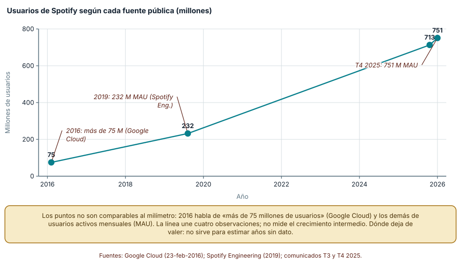
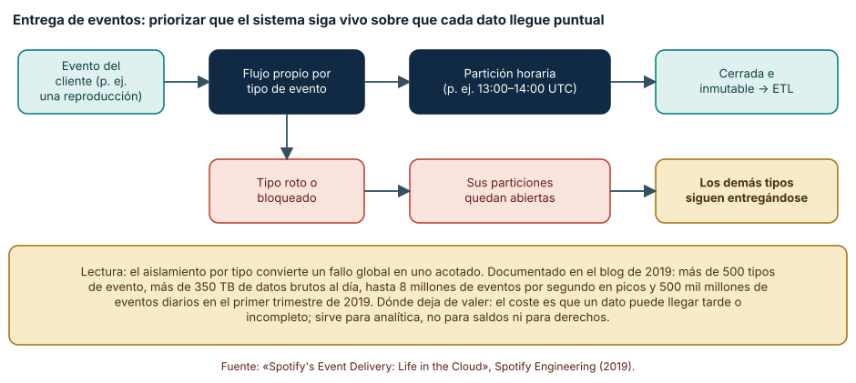

# Caso de éxito: Spotify

> **Qué es este caso.** Un análisis profesional de una empresa real que el programa usa para contrastar la teoría con la práctica. No es una clase ni un rol: es la realidad frente al curso. Se apoya solo en fuentes públicas citadas al final, consultadas el 16 de noviembre de 2026, y separa lo que está **documentado**, lo que es **inferido** y lo que **no se sabe**.

## Cómo leer este caso

- **Documentado**: lo dice una fuente citada, por ejemplo «Documentado (F4)». Si la fuente es secundaria, se declara.
- **Observable**: se comprueba usando el producto público, sin una cita específica en este caso.
- **Inferido**: conclusión del autor a partir de lo documentado; puede ser falsa.
- **No se sabe**: dato que la empresa no ha publicado. No se rellena con suposiciones.

Las cifras de dinero de Spotify están en euros, que es su moneda de reporte.

## 1. Ficha histórica

| Dato | Valor | Estado de la evidencia |
| --- | --- | --- |
| Nombre | Spotify Technology S.A. (servicio operado por Spotify AB en la mayoría de mercados) | Documentado (F1) |
| Fundadores | Daniel Ek y Martin Lorentzon | Fuente secundaria (F11); Daniel Ek figura como fundador y presidente ejecutivo en la propia web (F1) |
| Fundación | abril de 2006, en Estocolmo | Fuente secundaria (F11) |
| Lanzamiento | octubre de 2008 en varios mercados europeos; Estados Unidos en julio de 2011 | 2008: documentado (F1); detalle por mercado y 2011: fuente secundaria (F11) |
| Sede del servicio | Regeringsgatan 19, Estocolmo (Spotify AB) | Documentado (F12) |
| Hitos de producto | 2008 música; podcasts después; 2022 audiolibros | 2008 y 2022: documentado (F1); resto: observable |
| Cambio de infraestructura | Decisión de migrar a Google Cloud, anunciada en febrero de 2016 | Documentado (F4) |
| Escala actual | 788 millones de usuarios, 306 millones de suscriptores, 184 mercados; más de 100 millones de pistas, 8 millones de títulos de podcast y 800.000 audiolibros | Documentado (F1) |
| Resultados | Cuarto trimestre de 2025: 751 millones de usuarios activos mensuales, 290 millones de suscriptores Premium, ingresos de 4.500 millones de euros, margen bruto del 33,1 % y resultado operativo de 701 millones | Documentado (F2) |
| Ingresos de 2025 | 17.186 millones de euros | Fuente secundaria (F11, que cita el informe 20-F; el informe no se pudo leer directamente) |
| Cotización | Bolsa de Nueva York (SPOT), por cotización directa en 2018 | Fecha y modalidad no verificadas con fuente primaria |

La cifra de 788 millones de usuarios de la web corporativa (F1) y la de 751 millones del cuarto trimestre (F2) pueden diferir porque cada una se refiere a un momento y a una definición distintos; no hay contradicción comprobable.

## 2. Contexto y problema que resolvió

Cuando Spotify nació, la industria musical había perdido casi la mitad de su tamaño. Documentado (F3, con la advertencia de que es la interpretación de Spotify de datos de la industria): el mercado mundial de música grabada pasó de un máximo de 24.000 millones de dólares en 1999 a 13.000 millones en 2014, impulsado por la piratería. El problema de Spotify era ofrecer una **alternativa legal tan cómoda como la copia ilegal**: acceso instantáneo, catálogo enorme y sin descargas manuales, y a la vez conseguir que los titulares de derechos aceptaran licenciar su catálogo.

Es un problema de dos caras que mezcla técnica y negocio. Técnicamente, un clic en «reproducir» debe sonar casi de inmediato; esa exigencia empujó a Spotify, en sus primeros años, a una arquitectura que combinaba servidores con una red entre pares (F10: el artículo científico de 2010 de los ingenieros Gunnar Kreitz y Fredrik Niemelä describe el sistema como de «streaming de música bajo demanda a gran escala, baja latencia y P2P»). Fuente secundaria (F11): Spotify terminó la red P2P en 2014. En lo comercial, el servicio tuvo que construir un modelo que pagara a los titulares de derechos lo suficiente para que el catálogo estuviera disponible.

## 3. Mercado, tipos de usuarios y casos de uso

**Cómo leer la figura.** El rectángulo oscuro es Spotify; a su izquierda están quienes pagan (oyentes y anunciantes) y a su derecha quienes cobran (titulares de derechos) o aportan contenido (creadores). Las flechas llevan dinero o contenido. Mira primero que el dinero entra por dos vías, suscripción y anuncios, y que la salida principal son las regalías. **Dónde deja de valer.** Es un esquema de flujos, no de cuánto fluye por cada vía; el margen bruto del 33,1 % (F2) sugiere, como inferencia, que dos tercios de cada euro ingresado se van en costos del ingreso, entre ellos las regalías, pero no hay desglose público por tipo de contrato.

Para ver el orden de magnitud de la audiencia, la figura siguiente une cuatro cifras publicadas por la empresa o por su proveedor de nube.

**Cómo leer la figura.** El eje horizontal es el año y el vertical, los millones de usuarios; cada marcador es una observación con su valor. La conclusión que sostiene es el orden de magnitud: de decenas de millones a más de 700 millones en menos de diez años. **Dónde deja de valer.** Los puntos no usan la misma definición (el de 2016 habla de «más de 75 millones de usuarios» y los demás de usuarios activos mensuales), y la línea no mide el crecimiento intermedio: no sirve para estimar años sin dato.

### Tipos de usuario y cómo cambia la experiencia

- **Oyente del nivel gratuito.** Observable: escucha con anuncios y con ciertas limitaciones de control. Documentado (F3): más del 60 % de los suscriptores nuevos empieza en el nivel gratuito y luego se pasa a Premium; el nivel gratuito es el embudo.
- **Oyente Premium.** Observable: sin anuncios, con escucha sin conexión y más control; hay variantes individuales, para dúos y familiares (la existencia de planes dúo y familiar aparece en F11).
- **Artista y sello.** Documentado (F3): reciben regalías por cada escucha; los sellos independientes y artistas independientes generaron cerca del 50 % de las regalías de Spotify en 2025, y más de 81.000 artistas ganaron al menos 10.000 dólares solo con Spotify en 2025. Es dato de la propia empresa, publicado para defender su modelo.
- **Creador de podcast y de audiolibros.** Documentado (F1): el catálogo incluye 8 millones de títulos de podcast y 800.000 audiolibros en mercados seleccionados.
- **Anunciante.** Observable: compra audiencia del nivel gratuito. No se sabe la mecánica interna de la subasta de anuncios.
- **Equipos internos.** Documentado (F9, F6, F8): la ingeniería se organiza en equipos autónomos que usan una plataforma de experimentación y un portal de desarrolladores.

### Casos de uso característicos

1. Reproducir una canción o una lista en cualquier dispositivo.
2. Descubrir música nueva sin buscar: la lista semanal personalizada.
3. Escuchar sin conexión en un viaje.
4. Que un artista independiente suba su música a través de un distribuidor y cobre regalías.

## 4. Funcionalidad de principio a fin

1. **Primer contacto.** Observable: el usuario descarga la app o abre el reproductor web, y puede empezar a escuchar con una cuenta gratuita.
2. **Registro.** Observable: se crea una cuenta con datos mínimos y se eligen gustos iniciales. No se sabe qué parte del registro es experimento A/B en cada momento.
3. **Uso central.** Observable: búsqueda, reproducción, biblioteca y listas. Documentado (F7): cada lunes Spotify entregaba 75 millones de «mixtapes» únicas, la lista Discover Weekly, generadas combinando algoritmos con curaduría humana; el blog describe cómo se lanzó: pruebas internas, una pequeña prueba con usuarios, una encuesta con más de 1.500 respuestas y un grupo de control con una imagen por defecto para medir el efecto de la imagen personalizada. Fuente secundaria (F11): se lanzó en julio de 2015.
4. **Pagos.** Observable: la suscripción Premium se contrata desde la cuenta con un método de pago. No se sabe cómo se orquesta el cobro internamente.
5. **Soporte.** Observable: ayuda en línea y comunidad. No se sabe su volumen ni su automatización.
6. **Operación diaria.** Documentado (F5, F6): cada acción del cliente se convierte en eventos que se entregan a un sistema central; los equipos diseñan experimentos y los analizan con datos de esos eventos; los resultados deciden qué se lanza.

## 5. Negocio y economía

**Modelo.** Documentado (F1, F3): freemium financiado con anuncios, más suscripciones Premium; el reparto a titulares de derechos es la mayor partida. Documentado (F3): los pagos acumulados a titulares de derechos rondan los 70.000 millones de dólares.

**Cómo leer la figura.** La barra es el ingreso del trimestre dividido en 100. El bloque rojo, el más grande, es lo que cuesta producir el ingreso (el margen bruto de 33,1 % es el complemento); lo que queda se reparte entre gastos de operación y resultado operativo. **Dónde deja de valer.** Dos de las tres cifras son documentadas (margen bruto y resultado operativo en euros); el reparto entre ellas depende de un ingreso redondeado a 4.500 millones, por eso están marcadas como aproximadas. Un solo trimestre no representa el año, y la figura no separa las regalías de otros costos.

**Fuentes de ingreso.** Documentado (F2): ingresos de 4.500 millones de euros en el cuarto trimestre de 2025, con un crecimiento del 13 % a tipo de cambio constante. Documentado (F1): suscripciones y publicidad (el nivel gratuito financiado con anuncios aparece en F3).

**Costos relevantes.** Documentado (F2): costos del ingreso del 66,9 % (complemento del margen bruto). Inferido: las regalías son la mayor parte. Documentado (F4, F5): la infraestructura de datos se movió a un proveedor de nube pública para dejar de operar centros de datos propios.

**Ventajas.** Inferido: escala de usuarios y datos de escucha para personalizar y para negociar; coste de cambiar de servicio por listas y recomendaciones acumuladas. No se sabe cuánto pesa cada una.

## 6. Arquitectura y esquemas

Lo documentado se limita a la plataforma de datos, las herramientas de ingeniería y la decisión de nube. No hay descripción pública detallada de cómo se sirve el audio hoy.

### Componentes documentados

**Cómo leer la figura.** La fila superior es el camino de un dato: cliente, entrega de eventos, ETL horario y análisis. La fila inferior recoge cómo los equipos lo usan: experimentación, Backstage y las escuadras. Las cajas discontinuas son lo no descrito. Observa que el audio no aparece: no hay fuente que lo detalle. **Dónde deja de valer.** Los blogs son de 2016 a 2021; no sirve para afirmar cómo es la infraestructura hoy.

Documentado (F4): en febrero de 2016 Spotify (75 millones de usuarios o más) eligió Google Cloud y dividió la migración en dos vías, servicios y datos; sus servicios se ejecutan como «multitud de microservicios diminutos» y la parte de datos pasaba de Hadoop, MapReduce y Hive a Pub/Sub, Dataflow, BigQuery y Dataproc; con las nuevas herramientas, consultas complejas dan respuesta en uno o dos minutos en lugar de horas. Documentado (F4): Pub/Sub permitía procesar cientos de miles de mensajes por segundo.

### Flujo de la operación crítica de datos: la entrega de eventos

**Cómo leer la figura.** La fila superior es el camino sano de un evento; la inferior, qué pasa si un tipo falla: sus particiones quedan abiertas y los demás tipos siguen. Es el principio «priorizar la vitalidad sobre la tardanza». **Dónde deja de valer.** Acepta datos tardíos o incompletos a cambio de que el sistema no se detenga; sirve para analítica, no para decisiones que exigen exactitud, como pagos de regalías.

Documentado (F5): la entrega separa los eventos por tipo; se construyó sobre Google Cloud; el sistema anterior, basado en Kafka, se apagó en febrero de 2017; el despliegue pasó a producción al 100 % del tráfico en un solo día; en abril de 2017 capturaban 100.000 millones de eventos diarios y en el primer trimestre de 2019 500.000 millones; en picos superaban los 8 millones de eventos por segundo; había más de 500 tipos de evento y más de 350 TB de datos brutos al día; y una prueba A/B en la página de inicio llegó a disparar la curva de forma inesperada. Documentado (F5): entre 2016 y 2018 duplicaron sus usuarios activos mensuales y alcanzaron 232 millones en agosto de 2019.

Documentado (blog de migración de 2021, citado en F5-bis): los eventos de los clientes móviles se enviaban en modo «dispara y olvida»; como un usuario puede escuchar sin conexión, es difícil saber si un dato falta o simplemente no ha llegado, lo que deja un pequeño porcentaje de pérdida en casi todos los datos recogidos; además el sistema antiguo era con estado y dependía de que el disco de la máquina no se perdiera.

### Experimentación y herramientas

Documentado (F6): Spotify tomaba casi todas las decisiones de producto con alguna prueba A/B; en 2013 creó ABBA, un primer sistema que fue «un cambio de escalón en productividad»; en 2020 lo sustituyó por una plataforma nueva con un catálogo de métricas, configuración remota y un planificador de experimentos, cuya interfaz vive en Backstage. Documentado (F8): Backstage es un marco de código abierto para portales de desarrolladores, con catálogo de software, plantillas y documentación técnica; es un proyecto en incubación de la CNCF.

## 7. Casos especiales y cómo se resuelven

| Situación | Qué se documenta | Qué enseña |
| --- | --- | --- |
| Un tipo de evento defectuoso | Aislamiento por tipo y «vitalidad sobre tardanza» (F5). | Acotar el fallo; elegir qué se sacrifica. |
| Crecimiento exponencial | Un experimento en la página de inicio disparó el volumen de eventos; se monitoriza el tráfico inesperado (F5). | Los experimentos también son carga. |
| Cliente sin conexión | Los eventos móviles se envían sin garantía; hay pérdida pequeña y dificultad de deduplicar (blog de 2021). | La entrega perfecta no existe con clientes intermitentes. |
| Cambio de sistema en marcha | Migración de la entrega de eventos «cambiando las ruedas con el autobús en marcha» (blog de 2021). | Migrar sin parar el servicio. |
| Piratería y abuso | La piratería motivó el producto (F3). No se sabe cómo se detecta hoy el abuso de reproducciones. | Documentar también lo que falta. |
| Cumplimiento y regalías | Publica un informe anual de transparencia (F3). No se sabe cómo se calcula internamente cada pago. | La transparencia es parcial. |
| Offline | Observable: descargas para escucha sin conexión en Premium. No se sabe el diseño. | Contrastar con [SE-260](../../classes/part-21-software-movil-escritorio-y-multiplataforma/se-260-offline-first-y-resolucion-de-conflictos/). |

## 8. Línea de tiempo de la evolución

**Cómo leer la figura.** El carril superior son las eras de producto y el inferior la plataforma técnica; las líneas verticales son hitos. Fíjate en que el cambio de plataforma (2016) ocurre cuando ya había decenas de millones de usuarios. **Dónde deja de valer.** Las eras son síntesis del autor; la migración fue gradual y los años de fundación y bolsa no están verificados con fuente primaria.

- **2006.** Fundación (F11, secundaria).
- **2008.** Lanzamiento (F1).
- **2010.** Publicación científica del sistema de streaming con P2P (F10).
- **2013.** Primer sistema de A/B testing, ABBA (F6).
- **2014.** Fin de la red P2P (F11, secundaria); vídeo de cultura de ingeniería de Henrik Kniberg (F9).
- **2015.** Lanzamiento de Discover Weekly (F7, F11).
- **2016.** Decisión de migrar a Google Cloud (F4).
- **2017.** Apagado del sistema de eventos sobre Kafka (F5).
- **2020.** Nueva plataforma de experimentación (F6); Backstage es hoy un proyecto en incubación de la CNCF (F8); no se verificó el año de su apertura.
- **2022.** Audiolibros (F1).
- **2025.** 751 millones de usuarios activos y 290 millones de suscriptores (F2).

## 9. Vínculo con el curso

| Concepto | Clases | Qué parte de la teoría ilustra el caso |
| --- | --- | --- |
| Mensajería, topics y logs distribuidos | [SE-327](../../classes/part-27-integracion-eventos-y-mensajeria/se-327-brokers-colas-topics-y-logs-distribuidos/), [SE-328](../../classes/part-27-integracion-eventos-y-mensajeria/se-328-entrega-orden-duplicacion-y-semanticas/), [SE-325](../../classes/part-27-integracion-eventos-y-mensajeria/se-325-integracion-sincrona-y-asincrona/) | Entrega de eventos con aislamiento por tipo y semánticas de entrega. |
| Compatibilidad de esquemas | [SE-332](../../classes/part-27-integracion-eventos-y-mensajeria/se-332-compatibilidad-de-esquemas-y-registros/) | Más de 500 tipos de evento que deben evolucionar. |
| Etapas ETL y sincronización | [SE-330](../../classes/part-27-integracion-eventos-y-mensajeria/se-330-cdc-etl-elt-y-sincronizacion/), [SE-278](../../classes/part-23-software-especializado-y-dominios/se-278-ingenieria-de-datos-y-procesamiento-analitico/) | ETL por horas, particiones cerradas e inmutables. |
| Telemetría y consentimiento | [SE-137](../../classes/part-11-economia-metricas-y-decisiones-de-producto/se-137-telemetria-de-producto-y-consentimiento/), [SE-421](../../classes/part-35-observabilidad-sre-e-incidentes/se-421-senales-eventos-y-observabilidad-util/), [SE-391](../../classes/part-32-seguridad-privacidad-y-cumplimiento/se-391-privacidad-por-diseno-y-minimizacion/) | Qué se mide de un usuario y con qué límites. |
| Experimentos y causalidad | [SE-138](../../classes/part-11-economia-metricas-y-decisiones-de-producto/se-138-experimentos-sesgos-y-causalidad-basica/), [SE-139](../../classes/part-11-economia-metricas-y-decisiones-de-producto/se-139-north-star-guardrails-y-metricas-contrarias/), [SE-127](../../classes/part-10-descubrimiento-y-estrategia-de-producto/se-127-prototipos-experimentos-y-reduccion-de-incertidumbre/) | Pruebas A/B, grupos de control, métricas de guardia. |
| Métricas de adopción y retención | [SE-136](../../classes/part-11-economia-metricas-y-decisiones-de-producto/se-136-metricas-de-adopcion-retencion-y-tarea-util/), [SE-135](../../classes/part-11-economia-metricas-y-decisiones-de-producto/se-135-resultados-outputs-actividad-y-vanity-metrics/) | Conversión del nivel gratuito a Premium. |
| Modelos de negocio y costos | [SE-133](../../classes/part-11-economia-metricas-y-decisiones-de-producto/se-133-modelos-de-negocio-y-sostenibilidad/), [SE-134](../../classes/part-11-economia-metricas-y-decisiones-de-producto/se-134-costos-de-construccion-operacion-y-oportunidad/), [SE-140](../../classes/part-11-economia-metricas-y-decisiones-de-producto/se-140-finops-de-producto-y-costo-por-resultado/) | Margen bruto, regalías y costo de infraestructura. |
| Migración a la nube y coexistencia | [SE-349](../../classes/part-29-cloud-plataforma-e-infraestructura/se-349-iaas-paas-saas-y-responsabilidad-compartida/), [SE-357](../../classes/part-29-cloud-plataforma-e-infraestructura/se-357-multi-cloud-hibrido-y-portabilidad-real/), [SE-438](../../classes/part-36-mantenimiento-y-modernizacion-legacy/se-438-migraciones-de-runtime-lenguaje-y-framework/), [SE-440](../../classes/part-36-mantenimiento-y-modernizacion-legacy/se-440-compatibilidad-coexistencia-y-doble-escritura/) | Migrar por vías (servicios y datos) sin corte único. |
| Retiro de sistemas | [SE-441](../../classes/part-36-mantenimiento-y-modernizacion-legacy/se-441-retiro-archivado-y-disposicion-de-sistemas/), [SE-442](../../classes/part-36-mantenimiento-y-modernizacion-legacy/se-442-economia-de-reescribir-frente-a-evolucionar/) | Apagar Kafka tras el nuevo sistema. |
| Plataformas internas y portales | [SE-358](../../classes/part-29-cloud-plataforma-e-infraestructura/se-358-plataformas-internas-y-golden-paths/), [SE-417](../../classes/part-34-ci-cd-iac-y-platform-engineering/se-417-developer-portals-y-capacidades-de-plataforma/) | Backstage y la plataforma de experimentación. |
| Equipos y propiedad | [SE-310](../../classes/part-25-arquitectura-de-software-y-dominio/se-310-arquitectura-socio-tecnica-y-limites-de-equipo/), [SE-446](../../classes/part-37-gestion-liderazgo-y-practica-profesional/se-446-diseno-de-equipos-y-ownership/), [SE-182](../../classes/part-15-procesos-planificacion-y-estimacion/se-182-agile-como-principios-y-no-como-ceremonia/), [SE-183](../../classes/part-15-procesos-planificacion-y-estimacion/se-183-scrum-kanban-xp-y-shape-up/) | Escuadras autónomas; ver advertencias de la sección 10. |
| P2P y arquitectura de borde | [SE-307](../../classes/part-25-arquitectura-de-software-y-dominio/se-307-arquitecturas-serverless-edge-y-peer-to-peer/), [SE-342](../../classes/part-28-concurrencia-y-sistemas-distribuidos/se-342-consistencia-disponibilidad-y-particiones/) | Red entre pares en 2010, retirada en 2014. |
| Streaming de archivos y calidad percibida | [SE-248](../../classes/part-20-backend-apis-y-procesamiento-asincrono/se-248-archivos-streaming-y-cargas-extensas/), [SE-382](../../classes/part-31-calidad-rendimiento-y-resiliencia/se-382-calidad-de-experiencia-y-presupuestos/), [SE-376](../../classes/part-31-calidad-rendimiento-y-resiliencia/se-376-latencia-throughput-saturacion-y-capacidad/) | Latencia de inicio de reproducción como requisito. |
| Aprendizaje automático como componente | [SE-279](../../classes/part-23-software-especializado-y-dominios/se-279-machine-learning-como-componente-de-producto/) | Recomendación personalizada. |
| Disponibilidad parcial y fallos | [SE-341](../../classes/part-28-concurrencia-y-sistemas-distribuidos/se-341-fallos-parciales-y-modelos-de-red/), [SE-379](../../classes/part-31-calidad-rendimiento-y-resiliencia/se-379-circuit-breakers-bulkheads-y-degradacion/) | Vitalidad sobre tardanza. |
| Descubrimiento y propuesta de valor | [SE-121](../../classes/part-10-descubrimiento-y-estrategia-de-producto/se-121-problemas-sintomas-necesidades-y-oportunidades/), [SE-125](../../classes/part-10-descubrimiento-y-estrategia-de-producto/se-125-propuesta-de-valor-y-resultados-deseados/), [SE-126](../../classes/part-10-descubrimiento-y-estrategia-de-producto/se-126-segmentacion-mercado-y-alternativas-existentes/) | Alternativa legal a la piratería. |

## 10. Qué aprender y qué NO generalizar

**Qué aprender.**

1. **Un modelo de negocio es una restricción de arquitectura.** El margen bruto bajo de un negocio que paga licencias empuja a eficiencia y a datos (F2, F3).
2. **Aísla el fallo por tipo, no por sistema entero.** La entrega de eventos lo hace (F5).
3. **Mide con experimentos y vigila su coste.** Los experimentos aceleran el aprendizaje y también generan carga (F5, F6).
4. **Compra lo que no te diferencia.** Spotify decidió que no quería estar en el negocio de los centros de datos (F4).
5. **Migrar con coexistencia.** Dos vías y apagado posterior (F4, F5).

**Qué NO generalizar.**

- **El «modelo Spotify» (escuadras, tribus, capítulos y gremios) no es un método.** Documentado (F9): el propio vídeo advierte que es «un viaje en progreso, no completado», que hay mucha variación entre escuadras y que «parece cierto para la mayoría de escuadras la mayor parte del tiempo». Copiar los nombres sin la cultura no replica el resultado.
- **Los datos de lealtad y de regalías son los de la empresa.** El informe Loud & Clear lo publica Spotify para defender su modelo (F3); es útil pero no es una auditoría independiente.
- **El P2P de 2010 fue una respuesta a costes y a una red de entonces.** Se retiró (F11); copiarlo hoy exige comparar con CDN y banda ancha actuales.
- **Sesgo de supervivencia.** Los blogs muestran lo que funcionó y su explicación más favorable.
- **Los números de escala (eventos, usuarios) no son una referencia para tu producto.** Sirven para ver órdenes de magnitud y cómo cambian las decisiones.

## 11. Fuentes

Todas consultadas el 2026-11-16 con `curl`, o verificadas por DOI en Crossref. «Secundaria» significa que no es una fuente primaria de la empresa.

- **F1.** Spotify Newsroom, «About Spotify»: <https://newsroom.spotify.com/company-info/>
- **F2.** Spotify, «Spotify Reports Fourth Quarter 2025 Earnings» (10 de febrero de 2026): <https://newsroom.spotify.com/2026-02-10/spotify-q4-2025-earnings/>
- **F3.** Spotify, «Loud & Clear» (preguntas frecuentes y datos de 2025, actualizado el 11 de marzo de 2026): <https://loudandclear.byspotify.com/faq/>
- **F4.** Guillaume Leygues, «Spotify chooses Google Cloud Platform to power data infrastructure», Google Cloud Blog, 23 de febrero de 2016: <https://cloud.google.com/blog/products/gcp/spotify-chooses-google-cloud-platform-to-power-data-infrastructure>
- **F5.** Spotify Engineering, «Spotify's Event Delivery – Life in the Cloud», noviembre de 2019: <https://engineering.atspotify.com/2019/11/spotifys-event-delivery-life-in-the-cloud>. **F5-bis:** «Changing the Wheels on a Moving Bus — Spotify's Event Delivery Migration», octubre de 2021: <https://engineering.atspotify.com/2021/10/changing-the-wheels-on-a-moving-bus-spotify-event-delivery-migration>
- **F6.** Spotify Engineering, «Spotify's New Experimentation Platform (Part 1)», octubre de 2020: <https://engineering.atspotify.com/2020/10/spotifys-new-experimentation-platform-part-1>
- **F7.** Spotify Engineering, «What made Discover Weekly one of our most successful feature launches to date?», noviembre de 2015: <https://engineering.atspotify.com/2015/11/what-made-discover-weekly-one-of-our-most-successful-feature-launches-to-date>
- **F8.** Backstage, «What is Backstage?»: <https://backstage.io/docs/overview/what-is-backstage>
- **F9.** Henrik Kniberg, «Spotify engineering culture (part 1)», Spotify Engineering, 27 de marzo de 2014: <https://engineering.atspotify.com/2014/03/spotify-engineering-culture-part-1>
- **F10.** Gunnar Kreitz y Fredrik Niemelä, «Spotify – Large Scale, Low Latency, P2P Music-on-Demand Streaming», IEEE P2P 2010. DOI 10.1109/P2P.2010.5569963 (verificado en Crossref; se cita la existencia y el título, no se leyó el texto completo).
- **F12.** Spotify, página de contacto con las entidades y la dirección de la sede: <https://www.spotify.com/us/about-us/contact/>
- **F11.** (Secundaria) Wikipedia, «Spotify», edición consultada el 2026-11-16: <https://en.wikipedia.org/wiki/Spotify>. Se usa solo para fundación, lanzamiento por mercado, fin del P2P en 2014, planes dúo y familiar e ingresos de 2025, declarando cada vez su carácter secundario.

**Qué no cubren estas fuentes.** No documentan cómo se sirve el audio hoy, el algoritmo de recomendación, el cálculo interno de regalías ni la composición exacta del costo del ingreso; quedan como «no se sabe».
