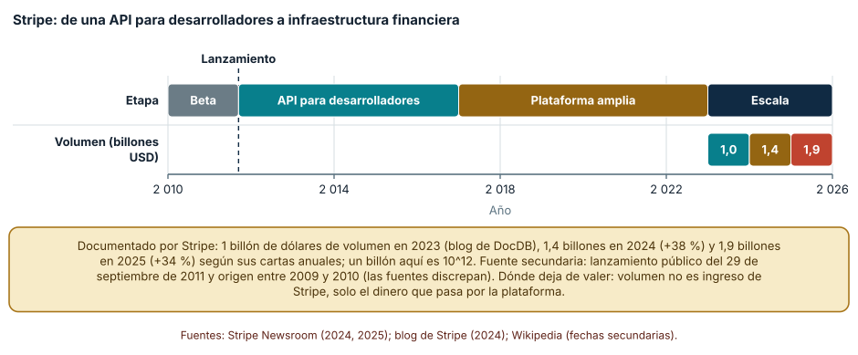

# Caso de éxito: Stripe

> **Qué es este caso.** Un análisis profesional de una empresa real que el programa usa para contrastar la teoría con la práctica. No es una clase ni un rol: es la realidad frente al curso. Se apoya solo en fuentes públicas citadas al final, consultadas el 16 de noviembre de 2026, y separa lo que está **documentado**, lo que es **inferido** y lo que **no se sabe**.

## Cómo leer este caso

- **Documentado**: lo dice una fuente citada, por ejemplo «Documentado (F2)». Si la fuente es secundaria, se declara.
- **Observable**: se comprueba usando el producto público o su documentación, sin una cita específica en este caso.
- **Inferido**: conclusión del autor a partir de lo documentado; puede ser falsa.
- **No se sabe**: dato que la empresa no ha publicado. No se rellena con suposiciones.

Las cifras de dinero están en dólares estadounidenses. Un «billón» es 10^12 (en inglés, *trillion*).

## 1. Ficha histórica

| Dato | Valor | Estado de la evidencia |
| --- | --- | --- |
| Nombre | Stripe, Inc. | Documentado (F2) |
| Fundadores | Patrick Collison y John Collison | Documentado (F2, F3: «cofundadores Patrick y John Collison») |
| Año de origen | 2009 o 2010, según la fuente | Fuente secundaria (F16): las fuentes discrepan; no hay primaria consultada |
| Lanzamiento público | septiembre de 2011, tras una larga beta privada | Fuente secundaria (F16) |
| Sede | San Francisco y Dublín | Documentado (F2: comunicados fechados en «San Francisco y Dublín») |
| Hitos de ingeniería | 2017: artículos sobre idempotencia (22 de febrero), migraciones en línea (2 de febrero), límites de tasa (30 de marzo) y versionado (5 de agosto); 2024: base de documentos DocDB con más de 2.000 fragmentos | Documentado (F4 a F8) |
| Volumen de pagos | 2023: 1 billón; 2024: 1,4 billones (+38 %); 2025: 1,9 billones (+34 %, cerca del 1,6 % del PIB mundial) | Documentado (F2, F3, F8) |
| Negocios en la plataforma | más de 5 millones | Documentado (F1) |
| Valoración | oferta de recompra de acciones a empleados con una valoración de 159.000 millones de dólares (febrero de 2026) | Documentado (F2) |
| Línea de ingresos de suscripción | la suite «Revenue» va camino de 1.000 millones de dólares de ingreso anual recurrente en 2026 | Documentado (F2) |
| Ingresos totales | no se publican; hay estimaciones de prensa no verificadas aquí | No se sabe |
| Estado actual | empresa privada | Documentado (F2: ofertas de recompra a empleados) |

## 2. Contexto y problema que resolvió

A comienzos de la década de 2010, aceptar un pago con tarjeta en un sitio web era un trámite largo: una cuenta de comerciante con un banco, una pasarela de pago, certificaciones de seguridad y una integración difícil. El problema que Stripe atacó fue **reducir ese trámite a una API que un desarrollador pudiera integrar en un día**, escondiendo detrás las redes de tarjetas, los bancos, el cumplimiento y el fraude.

El diseño de producto se ve en cómo Stripe describe su propia misión hoy: documentado (F1), «más de 5 millones de negocios» se apoyan en la plataforma, que dice procesar trillones de dólares al año, equivalentes a cerca del 1,8 % del PIB mundial (la cifra de 2025 que da Stripe en su comunicado de febrero de 2026 es 1,6 %; la diferencia procede de fechas y bases distintas y no se ha podido reconciliar). Para este curso, lo interesante es una pregunta técnica: **qué tiene que cumplir una API de dinero para que miles de programadores externos confíen en ella**. La respuesta documentada en los blogs de ingeniería de Stripe (F4 a F8) es: ser predecible ante reintentos, protegerse de sobrecarga, cambiar sin romper integraciones ya existentes y migrar datos sin parar el servicio.

## 3. Mercado, tipos de usuarios y casos de uso

**Cómo leer la figura.** El centro es Stripe; a la izquierda, el comercio que lo integra y su cliente final; a la derecha, el sistema financiero tradicional con el que Stripe habla por el comercio; abajo a la derecha, los reguladores. Mira primero qué evita el comercio: hablar con las redes de tarjetas. **Dónde deja de valer.** Muestra relaciones, no tarifas ni tiempos; no cubre todos los productos de Stripe (por ejemplo, cobro recurrente o pagos a terceros) y simplifica los participantes de cada país.

### Tipos de usuario y cómo cambia la experiencia

- **Desarrollador de un comercio.** Observable (F12, F14): integra componentes de interfaz y una API; no maneja datos de tarjeta en crudo. Documentado (F14): Stripe.js tokeniza los datos sensibles dentro de un componente sin que toquen el servidor del comercio.
- **Comercio pequeño o startup.** Documentado (F9): tarifa estándar de pago por uso, sin cuotas de alta ni mensuales.
- **Empresa grande.** Documentado (F9): puede acordar un paquete personalizado, con precios «IC+» y descuentos por volumen.
- **Plataforma o marketplace.** Documentado (F15): Stripe Connect permite construir una plataforma, un marketplace o un negocio fintech que necesita modelar varias cuentas y mover dinero entre partes.
- **Cliente final del comercio.** Observable: ve un formulario de pago, a veces una autenticación del banco, y un recibo. No sabe que Stripe participa.
- **Operador de riesgo y finanzas del comercio.** Observable: usa el panel y las herramientas de fraude. Documentado (F9): hay protección contra fraude con inteligencia artificial (Radar Lite) como producto.
- **Equipos internos y de cumplimiento de Stripe.** No se sabe su estructura.

### Casos de uso característicos

1. Una tienda en línea que cobra con tarjeta o billetera.
2. Una aplicación de suscripción que cobra de forma recurrente.
3. Un marketplace que cobra a compradores y paga a vendedores.
4. Una empresa que cobra en persona con terminales (Stripe Terminal, F13).

## 4. Funcionalidad de principio a fin

1. **Primer contacto.** Observable: el desarrollador abre la documentación, crea una cuenta y obtiene claves de prueba. Inferido: el producto se vende primero a quien lo integra.
2. **Registro y activación.** Observable: para cobrar dinero real hay que completar la verificación del negocio. No se sabe el detalle de la verificación ni sus tiempos.
3. **Uso central.** Documentado (F14, F12): el cliente teclea su tarjeta en un componente tokenizado; el servidor del comercio crea una intención de pago que sigue el ciclo de vida del cobro, desde su creación hasta el pago, y dispara pasos de autenticación adicionales cuando se requieren. Documentado (F12): la API de intenciones de pago promete autenticación automática y «sin doble cobro».
4. **Pagos y liquidación.** Documentado (F9): la tarifa estándar para tarjetas nacionales es de 2,9 % más 30 centavos por transacción exitosa; se suma 0,5 % si la tarjeta se teclea manualmente, 1,5 % si es internacional y 1 % si hay conversión de moneda.

**Cómo leer la figura.** El eje horizontal es el monto cobrado en escala logarítmica y el vertical, lo que cuesta cada cobro como porcentaje de ese monto. La curva verde es la tarjeta nacional, la dorada suma el recargo internacional y la roja suma además la conversión de moneda. Mira primero cómo cae la curva cuando el monto crece: la parte fija de 30 centavos pesa mucho en una venta de 10 dólares y casi nada en una de 1.000. **Dónde deja de valer.** Es un cálculo del autor con la tarifa estándar publicada; no incluye acuerdos personalizados, otros métodos de pago, impuestos ni cambios futuros de la lista de precios.

5. **Soporte y disputas.** Observable: panel con historial, reembolsos y disputas. No se sabe el volumen ni su automatización.
6. **Operación diaria del comercio.** Documentado (F11): el comercio recibe eventos por webhook de lo que ocurre (cobro exitoso, fallo, disputa) y debe procesarlos de forma segura.

## 5. Negocio y economía

**Modelo.** Documentado (F9): comisión por transacción exitosa, sin cuotas de alta ni mensuales en el plan estándar; paquetes personalizados para volúmenes grandes. Documentado (F2): además de pagos, hay productos de ingresos recurrentes (Billing, Invoicing, Tax) que están en camino a 1.000 millones de dólares de ingreso anual recurrente.

**Cómo leer la figura.** Cada barra es el dinero que pasó por Stripe en un año, en billones de dólares (10^12). La altura crece cada año; el rótulo da el valor exacto. La conclusión que sostiene: el volumen casi se duplicó en dos años. **Dónde deja de valer.** Volumen no es ingreso: Stripe no publica sus ingresos y la comisión es solo una fracción del volumen; la cifra de 2023 procede de un blog de ingeniería y no de una carta anual.

**Costos relevantes.** Inferido: una parte de cada comisión se paga a bancos emisores y a redes de tarjetas (la tarifa «IC+» que ofrece Stripe a clientes grandes separa precisamente ese componente, F9). No se sabe cuánto retiene Stripe después de esos costos ni su costo de infraestructura.

**Ventajas.** Inferido: efecto de integración (un desarrollador que ya aprendió la API la reutiliza), confianza en la corrección técnica y amplitud de productos. Documentado (F2): Stripe dice alimentar al 90 % de las empresas del índice Dow Jones y al 80 % de las del Nasdaq 100; es una afirmación de la empresa.

## 6. Arquitectura y esquemas

### Componentes documentados

**Cómo leer la figura.** La fila superior es el camino de una petición: cliente, protección de capacidad, servicios y datos. La fila inferior son los componentes de integración con el comercio: tokenización y eventos. Las cajas discontinuas son lo que no se sabe. **Dónde deja de valer.** Los posts de ingeniería son de 2017 y 2024; no describen despliegue ni conexión con cada red de pagos.

Documentado (F5): Stripe usa cuatro tipos de limitadores: de tasa de peticiones por usuario, de peticiones concurrentes, y dos de descarte de carga por utilización de la flota y de trabajadores que reservan capacidad para peticiones críticas; la implementación usa el algoritmo de cubo de fichas con un anfitrión centralizado, un cubo por usuario. Documentado (F5): el limitador de concurrencia protege los endpoints costosos, porque los clientes frustrados reintentan y eso agrava la sobrecarga.

Documentado (F6): el versionado usa versiones «rodantes» con nombre de fecha (por ejemplo 2017-05-24); aunque cada una es incompatible hacia atrás, contiene pocos cambios para que actualizar sea sencillo; la primera petición de una cuenta fija su versión a la más reciente disponible. Documentado (F16-docs, documentación de versionado): una petición sin la cabecera de versión usa la versión por defecto de la cuenta, y los eventos de webhook también.

Documentado (F8): DocDB es el servicio de base de datos de Stripe, una extensión de MongoDB Community con servicios propios; atiende más de cinco millones de consultas por segundo, con más de 10.000 formas distintas de consulta sobre petabytes de datos en más de 5.000 colecciones repartidas en más de 2.000 fragmentos; se construyó a mano porque en 2011 no existía MongoDB Atlas. Documentado (F8): su plataforma de movimiento de datos permitió migrar datos sin interrupción; en 2023 se agruparon miles de bases subutilizadas con 1,5 petabytes y se redujo el número de fragmentos en cerca de tres cuartas partes.

### Flujo de la operación crítica: un cobro

**Cómo leer la figura.** Los cinco pasos son el camino sano; las cajas de abajo son las dos defensas contra duplicados: la clave de idempotencia (paso 2) y el registro de identificadores de evento (paso 5). **Dónde deja de valer.** Simplifica: omite redirecciones, métodos de pago asíncronos y pagos fallidos; los eventos pueden llegar desordenados.

Documentado (F4): una clave de idempotencia es un identificador único que el cliente genera para una operación y envía en la cabecera `Idempotency-Key`; si la respuesta se pierde, el servidor devuelve el resultado guardado en lugar de repetir el efecto; en operaciones que cambian estado, el cliente puede reintentar con seguridad. Documentado (F10): las claves tienen hasta 255 caracteres; en la versión 1 de la API las claves pueden eliminarse tras 24 horas; la capa de idempotencia compara los parámetros con los de la petición original y devuelve un error si no coinciden, para evitar usos erróneos. Documentado (F11): los eventos se reintentan hasta tres días con espera exponencial en modo real; el comercio debe devolver un 2xx rápido, verificar la firma con el cuerpo en crudo, guardar los identificadores de evento para ignorar duplicados y no depender del orden.

### Datos y escala

Documentado (F8): 2023, un billón de dólares de volumen; DocDB con 99,999 % de disponibilidad según el título de su artículo; el objetivo de la fase clave de una migración es que dure menos que una conmutación planificada del primario, normalmente de unos segundos y dentro del presupuesto de reintentos de las aplicaciones. Documentado (F7): el patrón de migración en línea tiene cuatro pasos: escritura doble, cambio de lecturas, cambio de escrituras y eliminación de datos antiguos.

## 7. Casos especiales y cómo se resuelven

| Situación | Qué se documenta | Qué enseña |
| --- | --- | --- |
| Reintento tras un corte de red | Clave de idempotencia; mismo resultado guardado (F4, F10). | Reintentar es seguro solo si el servidor lo permite. |
| Cliente que reintenta sin freno | Limitador de concurrencia y descarte de carga para proteger lo crítico (F5). | Proteger la capacidad es parte de la API. |
| Cambio de la API sin romper a nadie | Versiones por fecha fijadas por cuenta; cambios pequeños (F6). | Compatibilidad como producto. |
| Migrar datos sin parar | Escritura doble en cuatro pasos (F7); movimiento de datos con una ventana de segundos (F8). | Migración en línea reversible. |
| Webhooks duplicados o desordenados | Registrar identificadores; no depender del orden (F11). | Diseñar el receptor como idempotente. |
| Autenticación fuerte del cliente | La intención de pago activa pasos de autenticación adicionales cuando se requieren (F12). | El cumplimiento está en el flujo. |
| Seguridad de datos de tarjeta | Certificación PCI de proveedor de servicios nivel 1 y tokenización (F13, F14). | Reducir el alcance de cumplimiento del comercio. |
| Fraude | Producto de protección con inteligencia artificial (F9). No se sabe cómo se entrena ni cómo se mide su error. | Ausencia de datos como parte del caso. |
| Cumplimiento regulatorio por país | No se sabe: la documentación consultada no detalla qué licencias tiene en cada jurisdicción. | Un punto que exige fuentes propias. |

## 8. Línea de tiempo de la evolución

**Cómo leer la figura.** El carril superior son etapas del producto; el inferior, el volumen de pagos en billones de dólares. La línea vertical es el lanzamiento público. Mira que el volumen documentado solo cubre tres años: antes de 2023 no hay dato citado en este caso. **Dónde deja de valer.** Las etapas son síntesis del autor; las fechas de origen y lanzamiento provienen de una fuente secundaria.

- **2009 o 2010.** Origen de la empresa; las fuentes discrepan (F16).
- **Septiembre de 2011.** Lanzamiento público tras una beta privada (F16, secundaria).
- **Febrero a agosto de 2017.** Publicaciones sobre migraciones en línea, idempotencia, límites de tasa y versionado (F4 a F7).
- **2023.** Un billón de dólares de volumen (F8).
- **2024.** 1,4 billones, +38 % (F3).
- **2025.** 1,9 billones, +34 %, y recompra de acciones a empleados con una valoración de 159.000 millones de dólares (F2).

## 9. Vínculo con el curso

| Concepto | Clases | Qué parte de la teoría ilustra el caso |
| --- | --- | --- |
| Idempotencia, reintentos y deduplicación | [SE-246](../../classes/part-20-backend-apis-y-procesamiento-asincrono/se-246-idempotencia-reintentos-y-deduplicacion/), [SE-344](../../classes/part-28-concurrencia-y-sistemas-distribuidos/se-344-idempotencia-y-procesamiento-distribuido/), [SE-378](../../classes/part-31-calidad-rendimiento-y-resiliencia/se-378-timeouts-retries-backoff-y-jitter/) | Cabecera `Idempotency-Key`, resultado guardado y reintento seguro. |
| Rate limiting y protección | [SE-249](../../classes/part-20-backend-apis-y-procesamiento-asincrono/se-249-caching-rate-limiting-y-proteccion/), [SE-379](../../classes/part-31-calidad-rendimiento-y-resiliencia/se-379-circuit-breakers-bulkheads-y-degradacion/), [SE-376](../../classes/part-31-calidad-rendimiento-y-resiliencia/se-376-latencia-throughput-saturacion-y-capacidad/) | Cubo de fichas, concurrencia y descarte de carga. |
| Diseño de APIs y contratos | [SE-242](../../classes/part-20-backend-apis-y-procesamiento-asincrono/se-242-rest-y-semantica-de-recursos/), [SE-244](../../classes/part-20-backend-apis-y-procesamiento-asincrono/se-244-validacion-errores-y-contratos-consistentes/), [SE-163](../../classes/part-13-especificaciones-contratos-y-modelos/se-163-openapi-asyncapi-graphql-y-contratos-de-eventos/) | API predecible con errores consistentes. |
| Versionado y compatibilidad | [SE-110](../../classes/part-09-bibliotecas-paquetes-sdk-y-automatizacion/se-110-semver-compatibilidad-y-contratos-publicos/), [SE-164](../../classes/part-13-especificaciones-contratos-y-modelos/se-164-compatibilidad-versionado-y-evolucion-de-contratos/), [SE-402](../../classes/part-33-build-release-y-cadena-de-suministro/se-402-versionado-compatibilidad-y-changelog/) | Versiones por fecha fijadas por cuenta. |
| Experiencia del desarrollador | [SE-118](../../classes/part-09-bibliotecas-paquetes-sdk-y-automatizacion/se-118-diseno-de-experiencia-para-desarrolladores/), [SE-120](../../classes/part-09-bibliotecas-paquetes-sdk-y-automatizacion/se-120-proyecto-sdk-y-cli-con-compatibilidad-verificada/) | Documentación, claves de prueba y SDK. |
| Webhooks y entrega de eventos | [SE-331](../../classes/part-27-integracion-eventos-y-mensajeria/se-331-webhooks-polling-y-suscripciones/), [SE-328](../../classes/part-27-integracion-eventos-y-mensajeria/se-328-entrega-orden-duplicacion-y-semanticas/), [SE-329](../../classes/part-27-integracion-eventos-y-mensajeria/se-329-outbox-inbox-sagas-y-compensacion/) | Reintentos, duplicados y orden no garantizado. |
| Migraciones de datos sin interrupción | [SE-439](../../classes/part-36-mantenimiento-y-modernizacion-legacy/se-439-migraciones-de-datos-sin-interrupcion/), [SE-440](../../classes/part-36-mantenimiento-y-modernizacion-legacy/se-440-compatibilidad-coexistencia-y-doble-escritura/), [SE-318](../../classes/part-26-datos-persistencia-y-recuperacion/se-318-migraciones-compatibles-y-evolucion-de-esquema/), [SE-437](../../classes/part-36-mantenimiento-y-modernizacion-legacy/se-437-strangler-branch-by-abstraction-y-anticorruption/) | Escritura doble en cuatro pasos y retiro de datos antiguos. |
| Bases de datos, fragmentación y recuperación | [SE-314](../../classes/part-26-datos-persistencia-y-recuperacion/se-314-relacional-documental-clave-valor-grafos-y-series/), [SE-319](../../classes/part-26-datos-persistencia-y-recuperacion/se-319-replicacion-particion-y-distribucion/), [SE-345](../../classes/part-28-concurrencia-y-sistemas-distribuidos/se-345-replicacion-sharding-y-balanceo/), [SE-321](../../classes/part-26-datos-persistencia-y-recuperacion/se-321-backups-restauracion-y-pruebas-de-recuperacion/), [SE-380](../../classes/part-31-calidad-rendimiento-y-resiliencia/se-380-disponibilidad-durabilidad-y-recuperacion/) | DocDB, fragmentos y 99,999 % de disponibilidad. |
| Dominio fintech e invariantes | [SE-282](../../classes/part-23-software-especializado-y-dominios/se-282-fintech-contabilidad-e-invariantes-monetarias/), [SE-316](../../classes/part-26-datos-persistencia-y-recuperacion/se-316-restricciones-invariantes-y-consistencia/) | Exactitud monetaria y consistencia. |
| Seguridad y secretos | [SE-389](../../classes/part-32-seguridad-privacidad-y-cumplimiento/se-389-criptografia-aplicada-y-gestion-de-claves/), [SE-390](../../classes/part-32-seguridad-privacidad-y-cumplimiento/se-390-secretos-configuracion-y-separacion-de-ambientes/), [SE-385](../../classes/part-32-seguridad-privacidad-y-cumplimiento/se-385-principios-de-seguridad-y-modelos-de-amenaza/) | Tokenización y claves de API. |
| Privacidad y cumplimiento | [SE-391](../../classes/part-32-seguridad-privacidad-y-cumplimiento/se-391-privacidad-por-diseno-y-minimizacion/), [SE-394](../../classes/part-32-seguridad-privacidad-y-cumplimiento/se-394-cumplimiento-evidencia-y-limites-legales/), [SE-152](../../classes/part-12-ingenieria-de-requisitos/se-152-requisitos-regulatorios-de-datos-y-seguridad/) | PCI, autenticación fuerte y límites legales. |
| Aprendizaje automático como componente | [SE-279](../../classes/part-23-software-especializado-y-dominios/se-279-machine-learning-como-componente-de-producto/) | Detección de fraude. |
| Modelos de negocio y costos | [SE-133](../../classes/part-11-economia-metricas-y-decisiones-de-producto/se-133-modelos-de-negocio-y-sostenibilidad/), [SE-134](../../classes/part-11-economia-metricas-y-decisiones-de-producto/se-134-costos-de-construccion-operacion-y-oportunidad/), [SE-453](../../classes/part-37-gestion-liderazgo-y-practica-profesional/se-453-economia-del-software-y-costo-total/) | Comisión por transacción, IC+ y volumen. |
| Multiinquilino y plataformas | [SE-534](../../classes/part-44-estilos-arquitectonicos/se-534-multi-tenancy-y-aislamiento/), [SE-358](../../classes/part-29-cloud-plataforma-e-infraestructura/se-358-plataformas-internas-y-golden-paths/) | Connect y cuentas múltiples. |
| Observabilidad y SLO | [SE-425](../../classes/part-35-observabilidad-sre-e-incidentes/se-425-sli-slo-sla-y-presupuestos-de-error/), [SE-421](../../classes/part-35-observabilidad-sre-e-incidentes/se-421-senales-eventos-y-observabilidad-util/) | Disponibilidad objetivo en un servicio de pagos. |

## 10. Qué aprender y qué NO generalizar

**Qué aprender.**

1. **La compatibilidad es una decisión de producto.** El versionado fijado por cuenta permite cambiar la API sin que los clientes dejen de funcionar (F6).
2. **Un efecto monetario se diseña para repetirse.** Idempotencia en el servidor y deduplicación en el receptor del evento son dos mitades de la misma garantía (F4, F11).
3. **Protege la capacidad antes de que falle.** Los limitadores y el descarte de carga mantienen lo crítico vivo (F5).
4. **Migra con un patrón.** Escribir doble, mover lecturas, mover escrituras y limpiar (F7), con una ventana corta (F8).
5. **Documentar es parte del producto.** Los blogs y la documentación sirven de confianza para quien integra.

**Qué NO generalizar.**

- **No necesitas la infraestructura de Stripe.** DocDB, con más de 2.000 fragmentos, resuelve una escala que casi ningún sistema tiene; usar una base de datos gestionada suele ser mejor.
- **Las claves de idempotencia de Stripe no protegen de todo.** Evitan duplicados por reintento, no cobros equivocados (F10).
- **No uses el volumen como medida de éxito de tu producto.** Es volumen bruto; la empresa no publica ingresos.
- **Las cifras de adopción («90 % del Dow Jones») son afirmaciones de la empresa** en comunicados con interés comercial (F2).
- **Las tarifas cambian por país y fecha.** El cálculo del caso solo es válido con la lista de precios consultada (F9).
- **Sesgo de supervivencia.** Se publican las decisiones que salieron bien; no hay documento sobre incidentes graves en las fuentes consultadas.

## 11. Fuentes

Todas consultadas el 2026-11-16 con `curl` salvo lo indicado. «Secundaria» significa que no es una fuente primaria de la empresa.

- **F1.** Stripe, «About Stripe»: <https://stripe.com/about>
- **F2.** Stripe Newsroom, «Stripe publishes 2025 annual letter and announces tender offer to provide liquidity to current and former employees» (24 de febrero de 2026): <https://stripe.com/newsroom/news/stripe-2025-update>
- **F3.** Stripe Newsroom, «Stripe's total payment volume reaches $1.4T, fueled by long-standing investments in AI» (2025): <https://stripe.com/newsroom/news/stripe-2024-update>
- **F4.** Brandur Leach, «Designing robust and predictable APIs with idempotency», Stripe Blog, 22 de febrero de 2017: <https://stripe.com/blog/idempotency>
- **F5.** Paul Tarjan, «Scaling your API with rate limiters», Stripe Blog, 30 de marzo de 2017: <https://stripe.com/blog/rate-limiters>
- **F6.** Brandur Leach, «APIs as infrastructure: future-proofing Stripe with versioning», Stripe Blog, 5 de agosto de 2017: <https://stripe.com/blog/api-versioning>
- **F7.** Jacqueline Xu, «Online migrations at scale», Stripe Blog, 2 de febrero de 2017: <https://stripe.com/blog/online-migrations>
- **F8.** Jimmy Morzaria y Suraj Narkhede, «How Stripe's document databases supported 99.999% uptime with zero-downtime data migrations», 6 de junio de 2024: <https://stripe.com/blog/how-stripes-document-databases-supported-99.999-uptime-with-zero-downtime-data-migrations>
- **F9.** Stripe, página de precios: <https://stripe.com/pricing>
- **F10.** Stripe Docs, «Idempotent requests»: <https://docs.stripe.com/api/idempotent_requests>
- **F11.** Stripe Docs, «Webhooks»: <https://docs.stripe.com/webhooks>
- **F12.** Stripe Docs, «The Payment Intents API»: <https://docs.stripe.com/payments/payment-intents>
- **F13.** Stripe Docs, «Security at Stripe»: <https://docs.stripe.com/security>
- **F14.** Stripe Docs, «Elements»: <https://docs.stripe.com/payments/elements>
- **F15.** Stripe Docs, «Connect»: <https://docs.stripe.com/connect>
- **F16.** (Secundaria) Wikipedia, «Stripe, Inc.», edición consultada el 2026-11-16: <https://en.wikipedia.org/wiki/Stripe,_Inc.>. Se usa solo para el origen y el lanzamiento público, y se declara que las fuentes discrepan. **F16-docs:** Stripe Docs, «Versioning»: <https://docs.stripe.com/api/versioning>

**Qué no cubren estas fuentes.** No documentan los ingresos de Stripe, su estructura de costos, las licencias por país, la arquitectura de despliegue, el entrenamiento ni el desempeño del sistema de fraude, ni incidentes de disponibilidad; esos puntos quedan como «no se sabe». Tampoco se pudo leer ningún documento regulatorio de la SEC porque Stripe es privada.
