# Stripe

[↑ Casos de éxito](README.md) · [← Airbnb](airbnb.md)

> **Qué es este caso.** Un análisis profesional de una empresa real que el programa usa para contrastar la teoría con la práctica. No es una clase ni un rol: es la realidad frente al curso. Se apoya solo en fuentes públicas citadas al final, consultadas el 16 de noviembre de 2026, y separa lo que está **documentado**, lo que es **inferido** y lo que **no se sabe**.

**Cómo leer este caso.**

- **Documentado**: lo dice una fuente citada, por ejemplo «Documentado (F4)». Si la fuente es secundaria, se declara.
- **Observable**: se comprueba usando el producto público, sin una cita específica en este caso.
- **Inferido**: conclusión del autor a partir de lo documentado; puede ser falsa.
- **Análisis propio**: razonamiento, cálculo o alternativa hipotética del autor; se rotula como tal y no es un hecho.
- **No se sabe**: dato que la empresa no ha publicado. No se rellena con suposiciones.

Las cifras de dinero están en dólares estadounidenses. Un «billón» es 10^12 (en inglés, *trillion*).

**Mapa de los niveles de arquitectura.** Stripe publica su ingeniería con una disciplina poco habitual: cuatro artículos de 2017 y uno de 2024 describen mecanismos concretos, y la documentación para desarrolladores completa el resto. La sección de arquitectura recorre el caso a varias distancias, cada una con su figura: contexto y producto; el camino de un cobro (estados, idempotencia, webhooks); la protección de la capacidad (cuatro limitadores); la evolución de la API (versionado); la evolución de los datos (migraciones en línea, DocDB, plataforma de movimiento de datos); la seguridad de las tarjetas; y la economía. **No hay un diagrama interno completo y público**: los ingresos, los costos, las licencias por país y el motor de fraude no se publican.

## Ficha histórica

| Dato | Valor | Estado de la evidencia |
| --- | --- | --- |
| Nombre | Stripe, Inc. | Documentado (F2) |
| Fundadores | Patrick Collison y John Collison | Documentado (F2, F3: «cofundadores Patrick y John Collison») |
| Año de origen | 2009 o 2010, según la fuente | Fuente secundaria (F16): las fuentes discrepan; no hay primaria consultada |
| Lanzamiento público | septiembre de 2011, tras una larga beta privada | Fuente secundaria (F16) |
| Base de datos inicial | MongoDB, elegida al lanzar en 2011 por productividad del desarrollador | Documentado (F8) |
| Sede | San Francisco y Dublín | Documentado (F2: comunicados fechados en «San Francisco y Dublín») |
| Hitos de ingeniería | 2017: artículos sobre idempotencia (22 de febrero), migraciones en línea (2 de febrero), límites de tasa (30 de marzo) y versionado (5 de agosto); 2024: base de documentos DocDB con más de 2.000 fragmentos | Documentado (F4 a F8) |
| Volumen de pagos | 2023: 1 billón; 2024: 1,4 billones (+38 %, cerca del 1,3 % del PIB mundial); 2025: 1,9 billones (+34 %, cerca del 1,6 % del PIB mundial) | Documentado (F2, F3, F8) |
| Negocios en la plataforma | más de 5 millones, directamente o a través de plataformas | Documentado (F1, F2) |
| Rentabilidad | «robustamente rentable» en 2025 | Documentado (F2), afirmación de la empresa; sin cifras |
| Valoración | oferta de recompra de acciones a empleados con una valoración de 159.000 millones de dólares (febrero de 2026) | Documentado (F2) |
| Línea de ingresos de suscripción | la suite «Revenue» va camino de 1.000 millones de dólares de ingreso anual recurrente en 2026 | Documentado (F2) |
| Ingresos totales | no se publican; hay estimaciones de prensa no verificadas aquí | No se sabe |
| Estado actual | empresa privada | Documentado (F2: ofertas de recompra a empleados) |

## Contexto y problema

A comienzos de la década de 2010, aceptar un pago con tarjeta en un sitio web era un trámite largo: una cuenta de comerciante con un banco, una pasarela de pago, certificaciones de seguridad y una integración difícil. El problema que Stripe atacó fue **reducir ese trámite a una API que un desarrollador pudiera integrar en un día**, escondiendo detrás las redes de tarjetas, los bancos, el cumplimiento y el fraude.

El diseño de producto se ve en cómo Stripe describe su propia misión hoy: documentado (F1), «más de 5 millones de negocios» se apoyan en la plataforma, que dice procesar trillones de dólares al año, equivalentes a cerca del 1,8 % del PIB mundial (la cifra de 2025 que da Stripe en su comunicado de febrero de 2026 es 1,6 %; la diferencia procede de fechas y bases distintas y no se ha podido reconciliar). Para este curso, lo interesante es una pregunta técnica: **qué tiene que cumplir una API de dinero para que miles de programadores externos confíen en ella**. La respuesta documentada en los blogs de ingeniería de Stripe (F4 a F8) es: ser predecible ante reintentos, protegerse de sobrecarga, cambiar sin romper integraciones ya existentes y migrar datos sin parar el servicio.

### La apuesta, en cuatro decisiones

Análisis propio, apoyado en las fuentes: la apuesta de Stripe puede leerse como cuatro decisiones que se refuerzan. Primera, **tratar la API como producto y como contrato** (el versionado conserva compatibilidad con todas las versiones desde 2011, F6). Segunda, **tratar el fallo como caso normal** (idempotencia, reintentos con retroceso, descarte de carga, F4 y F5). Tercera, **absorber la complejidad regulatoria** para que no la absorba el comercio (tokenización, autenticación fuerte, certificación PCI, F13 y F14). Cuarta, **reinvertir** en ingeniería: los fundadores dicen que en cada uno de los últimos seis años reinvirtieron en I+D una proporción mayor de sus ganancias que cualquier empresa comparable (F3, autodeclaración).

## Mercado, usuarios y casos de uso

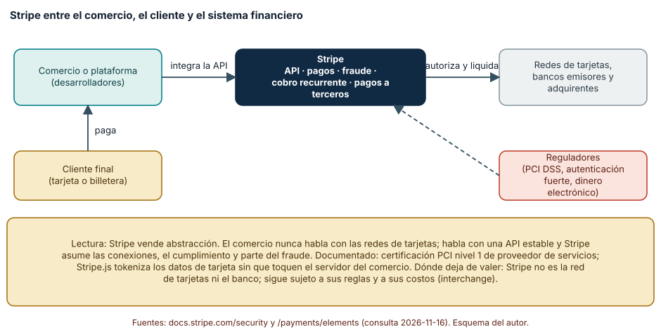

**Cómo leer la figura.** El centro es Stripe; a la izquierda, el comercio que lo integra y su cliente final; a la derecha, el sistema financiero tradicional con el que Stripe habla por el comercio; abajo a la derecha, los reguladores. Mira primero qué evita el comercio: hablar con las redes de tarjetas. **Dónde deja de valer.** Muestra relaciones, no tarifas ni tiempos; no cubre todos los productos de Stripe (por ejemplo, cobro recurrente o pagos a terceros) y simplifica los participantes de cada país.

### Tipos de usuario y cómo cambia la experiencia

- **Desarrollador de un comercio.** Observable (F12, F14): integra componentes de interfaz y una API; no maneja datos de tarjeta en crudo. Documentado (F14): Stripe.js tokeniza los datos sensibles dentro de un componente sin que toquen el servidor del comercio. Incentivo: integrar en poco tiempo; límite: los límites de tasa y las versiones de API.
- **Comercio pequeño o startup.** Documentado (F9): tarifa estándar de pago por uso, sin cuotas de alta ni mensuales. Documentado (F2): en 2025 se unieron más negocios que nunca (más de la mitad, 57 %, fuera de Estados Unidos) y la cohorte de 2025 creció cerca de un 50 % más rápido que la de 2024.
- **Empresa grande.** Documentado (F9): puede acordar un paquete personalizado, con precios «IC+» y descuentos por volumen. Documentado (F3): la empresa dice que la mitad de las 100 mayores empresas de Fortune la usa (2024); documentado (F2): el 90 % de las del índice Dow Jones y el 80 % de las del Nasdaq 100 (2025), autodeclaraciones.
- **Plataforma o marketplace.** Documentado (F15): Stripe Connect permite construir una plataforma, un marketplace o un negocio fintech que necesita modelar varias cuentas y mover dinero entre partes. Incentivo: monetizar la plataforma sin ser banco; límite: asume la relación con sus vendedores.
- **Fundador que crea una empresa.** Documentado (F2): Stripe Atlas permite constituir una empresa; el 25 % de las nuevas sociedades de Delaware se crean con Atlas, y el 20 % de las startups de Atlas cobró a su primer cliente en 30 días en 2025 (8 % en 2020). Es una afirmación de la empresa.
- **Empresa de inteligencia artificial.** Documentado (F2, F3): Stripe dice servir a la mayoría de las principales empresas de IA y desarrolla protocolos de comercio con agentes; es un segmento declarado por la empresa, sin cifras públicas de ingresos.
- **Cliente final del comercio.** Observable: ve un formulario de pago, a veces una autenticación del banco, y un recibo. No sabe que Stripe participa.
- **Operador de riesgo y finanzas del comercio.** Observable: usa el panel y las herramientas de fraude. Documentado (F9): hay protección contra fraude con inteligencia artificial (Radar Lite) como producto; hay una tarifa de 15 dólares por cada disputa recibida.
- **Equipos internos y de cumplimiento de Stripe.** No se sabe su estructura.

### Casos de uso característicos

1. Una tienda en línea que cobra con tarjeta o billetera.
2. Una aplicación de suscripción que cobra de forma recurrente.
3. Un marketplace que cobra a compradores y paga a vendedores.
4. Una empresa que cobra en persona con terminales (Stripe Terminal, F13).
5. Un desarrollador de IA que cobra por uso con micropagos en stablecoins (F2).
6. Una empresa que constituye su sociedad y abre su cuenta de cobro en un mismo flujo (Atlas, F2).

### Qué trabajo contrata cada usuario

Análisis propio, con el enfoque de «trabajos por hacer» ([SE-122](../../classes/part-10-descubrimiento-y-estrategia-de-producto/se-122-usuarios-actores-trabajos-y-contextos/README.md)): el desarrollador contrata a Stripe para **cobrar sin aprender el sistema financiero**; el comercio, para **no perder ventas por fallos de pago** (la empresa afirma que sus modelos de optimización aumentan las tasas de autorización: Hertz habría ganado un 4 %, F3, caso de cliente); la plataforma, para **repartir dinero entre terceros con cumplimiento**; el equipo de riesgo, para **reducir fraude y disputas**; el regulador no contrata nada pero condiciona todo. Cada trabajo apunta a una decisión: la API simple, la tokenización, Connect y el motor de riesgo.

## Funcionalidad de principio a fin

Cada tipo de usuario recorre su propio viaje. Lo que sigue es **observable** salvo cuando se cita una fuente.

### Instancia 1: el desarrollador, de la documentación al primer cobro real

1. **Primer contacto.** Observable: el desarrollador abre la documentación, crea una cuenta y obtiene claves de prueba. Inferido: el producto se vende primero a quien lo integra.
2. **Entorno de pruebas.** Documentado (F5, F17): el modo de pruebas tiene el mismo comportamiento de límites que el modo real, con un tope menor (25 frente a 100 peticiones por segundo), para que los scripts no encuentren sorpresas al pasar a producción.
3. **Registro y activación.** Observable: para cobrar dinero real hay que completar la verificación del negocio. No se sabe el detalle de la verificación ni sus tiempos.
4. **Uso central.** Documentado (F14, F12): el cliente teclea su tarjeta en un componente tokenizado; el servidor del comercio crea una intención de pago que sigue el ciclo de vida del cobro, desde su creación hasta el pago, y dispara pasos de autenticación adicionales cuando se requieren. Documentado (F12): la API de intenciones de pago promete autenticación automática y «sin doble cobro».
5. **Caso límite.** El servidor del comercio reintenta tras un corte de red: la clave de idempotencia evita duplicar el cobro (F4, F10).

### Instancia 2: el comprador final, del formulario al recibo

1. El comprador teclea la tarjeta en un componente; observable: el formulario lo muestra el comercio, pero el número va a Stripe (F14).
2. Si el banco lo exige, aparece una autenticación adicional (3D Secure); documentado (F12): la intención pasa al estado «requiere acción».
3. Observable: confirmación y recibo. Documentado (F12): con métodos de pago asíncronos, como débitos bancarios, el pago queda «procesando» y puede tardar hasta unos días.
4. Caso límite: el pago es rechazado; documentado (F12): la intención vuelve al estado de requerir método de pago para reintentar.

### Instancia 3: el comercio que cobra suscripciones

Documentado (F7): Stripe Billing ayuda a clientes como DigitalOcean y Squarespace a gestionar la facturación recurrente; al principio cada cliente tenía como máximo una suscripción y se guardaba junto al cliente; al crecer los casos (varias suscripciones, pruebas gratuitas, cupones, facturas) hubo que sacarlas a su propia tabla, la migración descrita más abajo. Documentado (F17): límites como 10 facturas nuevas por suscripción por minuto y 200 actualizaciones de cantidad por suscripción por hora protegen el sistema. Documentado (F3): Billing lo usan más de 300.000 empresas y gestiona casi 200 millones de suscripciones activas (2024).

### Instancia 4: la plataforma o marketplace

Documentado (F15): la plataforma crea cuentas conectadas con identidad unificada, activa capacidades, cobra a los compradores y paga a los vendedores. Documentado (F17): hay un tope de 30 cuentas conectadas creadas por segundo en modo real. Caso límite: un vendedor genera una disputa; documentado (F9): la plataforma no puede trasladar las tarifas de disputa a sus cuentas conectadas. No se sabe cómo se liquida cada flujo ni los plazos.

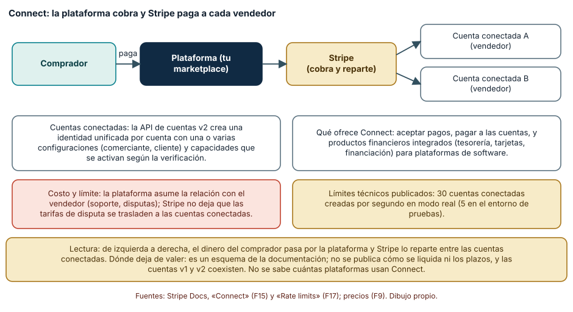

**Cómo leer la figura.** De izquierda a derecha: el comprador, la plataforma, Stripe y las cuentas conectadas de los vendedores; los recuadros de abajo dicen qué ofrece Connect y qué cuesta. **Dónde deja de valer.** Es un esquema de la documentación; no se publica cómo se liquida ni los plazos, y las cuentas v1 y v2 coexisten.

### Instancia 5: el receptor de eventos (webhooks)

Documentado (F11): el comercio recibe eventos por webhook de lo que ocurre (cobro exitoso, fallo, disputa); debe verificar la firma con el cuerpo en crudo, responder 2xx rápido, guardar los identificadores de evento y no depender del orden. Caso límite: el receptor está caído; Stripe reintenta hasta tres días con espera exponencial (modo real).

### Instancia 6: el equipo de ingeniería de Stripe que migra datos

Documentado (F7, F8): usa el patrón de cuatro pasos para migraciones pequeñas y una plataforma de movimiento de datos de seis pasos para mover fragmentos enteros sin parar. Caso límite: la migración exige reescribir miles de líneas de código en varios servicios; se hace en trozos de unos cientos de líneas, con experimentos de comparación en producción.

### Instancia 7: el soporte y la operación del comercio

Observable: panel con historial, reembolsos y disputas. No se sabe el volumen ni su automatización. Documentado (F9): cada disputa recibida cuesta 15 dólares, y responderla a mano otros 15 que se devuelven solo si se gana.

## Negocio y economía

### Modelo y precios

Documentado (F9): comisión por transacción exitosa, sin cuotas de alta ni mensuales en el plan estándar; paquetes personalizados para volúmenes grandes. La tarifa estándar para tarjetas nacionales es de 2,9 % más 30 centavos por transacción exitosa; se suma 0,5 % si la tarjeta se teclea manualmente, 1,5 % si es internacional y 1 % si hay conversión de moneda.

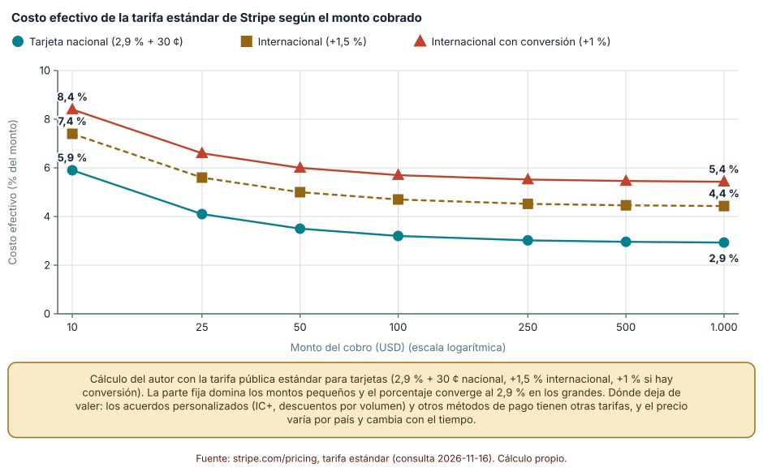

**Cómo leer la figura.** El eje horizontal es el monto cobrado en escala logarítmica y el vertical, lo que cuesta cada cobro como porcentaje de ese monto. La curva verde es la tarjeta nacional, la dorada suma el recargo internacional y la roja suma además la conversión de moneda. Mira primero cómo cae la curva cuando el monto crece: la parte fija de 30 centavos pesa mucho en una venta de 10 dólares y casi nada en una de 1.000. **Dónde deja de valer.** Es un cálculo del autor con la tarifa estándar publicada; no incluye acuerdos personalizados, otros métodos de pago, impuestos ni cambios futuros de la lista de precios.

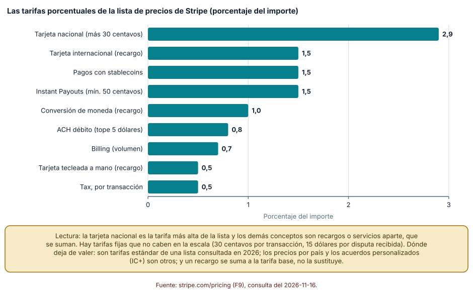

**Cómo leer la figura.** Cada barra es una tarifa porcentual de la lista; mira primero que la tarjeta nacional supera a todas las demás. Los recargos se suman a la tarifa base. **Dónde deja de valer.** Son tarifas estándar de una lista de 2026; las fijas (30 centavos, 15 dólares por disputa) no caben en la escala, y los precios cambian por país y por acuerdo.

Documentado (F9): otros precios de la lista: Billing, 0,7 % del volumen de Billing; Tax, 0,5 % por transacción en la integración sin código o 0,50 dólares por transacción con API; ACH, 0,8 % con tope de 5 dólares; pagos con stablecoins, 1,5 %; pagos instantáneos, 1,5 % con mínimo de 50 centavos; 3D Secure incluido en la tarifa estándar; 15 dólares por disputa recibida. Inferido: los productos de ingresos recurrentes (Billing, Invoicing, Tax) suben el ingreso por cliente sin aumentar el costo de adquisición, pero no se publica el margen.

### Volumen, escala y crecimiento

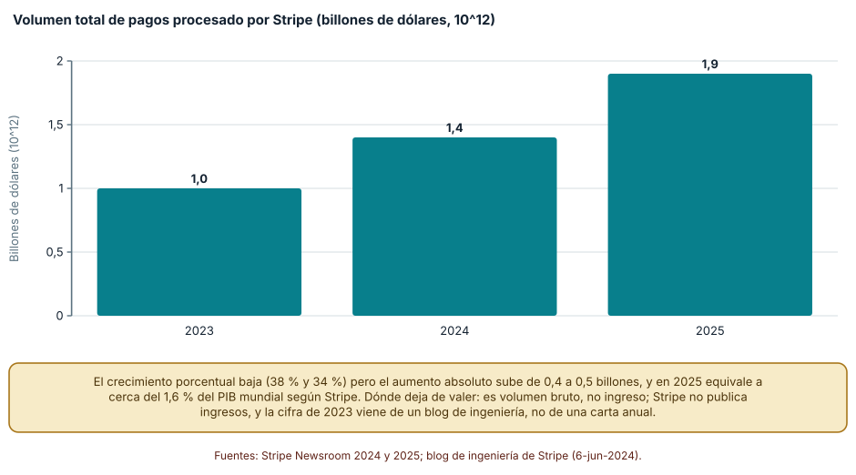

**Cómo leer la figura.** Cada barra es el dinero que pasó por Stripe en un año, en billones de dólares (10^12). La altura crece cada año; el rótulo da el valor exacto. La conclusión que sostiene: el volumen casi se duplicó en dos años. **Dónde deja de valer.** Volumen no es ingreso: Stripe no publica sus ingresos y la comisión es solo una fracción del volumen; la cifra de 2023 procede de un blog de ingeniería y no de una carta anual.

Documentado (F2, F3): +38 % en 2024 y +34 % en 2025; equivalentes al 1,3 % y al 1,6 % del PIB mundial. Documentado (F2): más de 350 actualizaciones de producto en 2025; el volumen de stablecoins en el sector se duplicó hasta unos 400.000 millones de dólares en 2025 (dato del sector citado por Stripe), con adquisiciones de Bridge (orquestación de stablecoins) y Privy (billeteras programables), y un blockchain para pagos llamado Tempo; protocolos para comercio con agentes en colaboración con OpenAI. Análisis propio: Stripe amplía su definición de «infraestructura de pagos» a stablecoins y agentes de IA; son apuestas con resultados todavía no publicados.

### Estructura de costos

Inferido: una parte de cada comisión se paga a bancos emisores y a redes de tarjetas (la tarifa «IC+» que ofrece Stripe a clientes grandes separa precisamente ese componente, F9). No se sabe cuánto retiene Stripe después de esos costos ni su costo de infraestructura. Documentado (F3, F2): la empresa afirma ser rentable y reinvertir una gran proporción de sus ganancias en I+D; no hay cifras de beneficio ni de costos.

### Unit economics: lo que se puede y no se puede decir

Análisis propio con las cifras citadas: con la tarifa estándar, una venta de 10 dólares con tarjeta nacional cuesta 0,59 dólares al comercio (5,9 %) y una de 1.000 dólares cuesta 29,30 (2,93 %); es una lección de diseño de precios: la parte fija castiga las ventas pequeñas. No se publica el costo que Stripe paga por cada transacción ni su margen, de modo que este caso **no** calcula un margen por transacción: sería inventar cifras. Documentado (F3, casos de clientes citados por la empresa): Hertz +4 % de autorización, Forbes +23 % de ingresos por suscripciones y Turo 114 millones de dólares anuales adicionales con la suite de checkout optimizado; son testimonios de la empresa, sin metodología publicada.

### Efectos de red y por qué ganó este actor

Análisis propio (no documentado como causal): el mercado favoreció a Stripe por cuatro mecanismos. Primero, **efecto de integración y de aprendizaje**: un desarrollador que aprendió la API la reutiliza y la recomienda. Segundo, **efecto de escala de datos**: la empresa afirma reentrenar de forma continua docenas de modelos de aprendizaje automático sobre un conjunto de datos de escala económica para mejorar autorización y fraude (F3); si es cierto, más volumen mejora el producto, pero no hay medición independiente. Tercero, **compatibilidad como confianza**: conservar compatibilidad con todas las versiones desde 2011 (F6) reduce el costo de cambio para el cliente y el riesgo percibido. Cuarto, **amplitud de productos**: pagos, facturación, impuestos, constitución de empresas, tarjetas, stablecoins. Lo que no se sabe: cuota de mercado por país ni cuánto pesan estos factores frente al precio o a las ventas.

### Competidores

Las fuentes de este caso no incluyen cifras de competidores. Documentado (F2): la propia empresa se compara con la propia industria («comparable») sin nombrar rivales. Este caso no incluye tabla de competidores porque haría falta documentación adicional por segmento y año.

### Palancas de crecimiento

Documentado (F2): nuevos negocios en 2025 (más del 57 % fuera de Estados Unidos), productos de ingresos recurrentes, stablecoins, comercio con agentes, y crecimiento de clientes grandes (F3). Inferido: la expansión geográfica se apoya en métodos de pago locales (la lista de precios menciona 100 métodos de pago, F9).

### Visión y misión

Documentado (F1): la página «About» de Stripe (consulta del 16 de noviembre de 2026) dice que es una empresa tecnológica centrada en mejorar las condiciones del crecimiento económico y la prosperidad, que construye infraestructura financiera programable repensando desde cero cómo deberían funcionar los servicios financieros para que empezar y escalar un negocio sea más fácil y barato; afirma que su crecimiento depende por completo del éxito de las empresas que construyen sobre ella y que por eso reinvierte en tecnología a un ritmo inusual. Documentado (F2, F3): las cartas anuales lo reformulan como «servicios financieros programables» (2025) y como «plataforma de infraestructura financiera» (2024). Análisis propio: el vocabulario pasa de pagos a infraestructura económica y a servicios financieros programables, a la vez que el producto se amplía a facturación, impuestos, constitución de empresas y stablecoins. No se sabe si existe una declaración de visión distinta de la misión.

### Estructura, plantilla y presencia mundial

Documentado (F2): comunicados fechados en San Francisco y Dublín; la carta de 2025 menciona más de 350 actualizaciones de producto, adquisiciones y una oferta de recompra a empleados actuales y antiguos. Documentado (F13): una parte de la seguridad (la bóveda de tarjetas) la gestiona un equipo dedicado en un entorno aislado. No se sabe: la plantilla total y por área, el organigrama de alto nivel, las oficinas de ingeniería por país con su año de apertura y cómo se organizan los equipos de ingeniería.

### Esquema del negocio

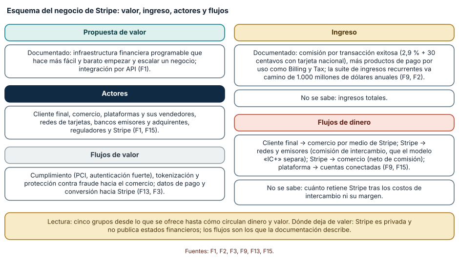

**Cómo leer la figura.** Cinco grupos de arriba abajo: qué se ofrece, cómo cobra, quién participa y cómo circulan dinero y valor. **Dónde deja de valer.** Stripe no publica estados financieros; el esquema usa lo que dicen la lista de precios, las cartas anuales y la documentación.

Documentado (F9, F15): el dinero fluye del cliente final al comercio con Stripe en medio, que paga a las redes de tarjetas y a los bancos emisores (el precio «IC+» separa esos costos) y se queda con una comisión; en Connect, la plataforma cobra y Stripe reparte a las cuentas conectadas. Documentado (F2): el volumen de pagos fue de 1,9 billones de dólares en 2025 y la empresa se declara robustamente rentable.

### Costos operativos y márgenes

No se sabe. Stripe es una empresa privada: no presenta formularios 10-K, S-1 ni 20-F ante la SEC en lo consultado, y sus cartas anuales y comunicados (F2, F3) no publican ingresos, costos ni márgenes. Lo único cuantificado sobre costos es el ahorro de 2023 por agrupar bases de datos (menos fragmentos en cerca de tres cuartas partes) (F8). Documentado (F3): la empresa dice reinvertir en I+D una proporción mayor de sus ganancias que cualquier empresa comparable. Cualquier cifra de ingresos de prensa no está verificada y no se usa. Este vacío es parte del caso: una empresa privada puede publicar muchísima ingeniería y casi nada de economía.

### Competidores nombrados en documentos oficiales

No se sabe. Las fuentes oficiales consultadas (F1, F2, F3) no nombran competidores ni dan cuota de mercado; la propia empresa se compara con «cualquier empresa comparable» sin nombres. Este caso no incluye una lista de rivales ni cuotas porque no las puede sustentar con fuente.

### Plantilla, oficinas y estructura

Documentado (F2): comunicados fechados en San Francisco y Dublín. No se sabe: plantilla total y por área, organigrama, oficinas de ingeniería por país con su año de apertura y cómo se organiza la ingeniería.

## Arquitectura y esquemas

### Nivel 1: contexto

Ver la figura de contexto de la sección de mercado. Evidencia: documentado (F1, F2, F9) para los productos y las cifras; no se sabe la arquitectura de conexión con cada red de pagos.

### Nivel 2: contenedores y componentes documentados

**Cómo leer la figura.** La fila superior es el camino de una petición: cliente, protección de capacidad, servicios y datos. La fila inferior son los componentes de integración con el comercio: tokenización y eventos. Las cajas discontinuas son lo que no se sabe. **Dónde deja de valer.** Los posts de ingeniería son de 2017 y 2024; no describen despliegue ni conexión con cada red de pagos.

Documentado (F5): Stripe usa cuatro tipos de limitadores; documentado (F6): versiones rodantes; documentado (F8): DocDB sobre MongoDB Community con proxies, metadatos de fragmentos y movimiento de datos. Documentado (F4): idempotencia en puntos finales que cambian estado. Documentado (F11): webhooks. No se sabe: el número de servicios, el lenguaje y el despliegue, aunque el artículo de versionado muestra código en Ruby (F6) y los proxies de base de datos están escritos en Go (F8).

### Nivel 3: componentes de la operación crítica (el cobro)

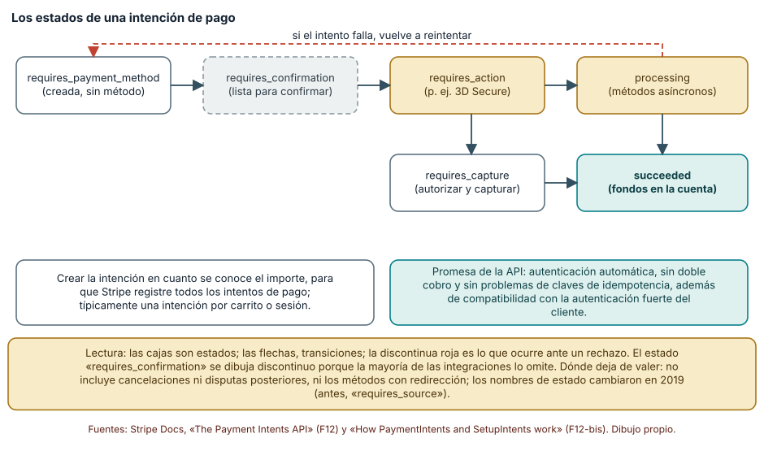

**Cómo leer la figura.** Cada caja es un estado; las flechas, transiciones; la flecha discontinua roja es el reintento tras un rechazo. Mira primero el camino de arriba, que es el de la mayoría de pagos. **Dónde deja de valer.** No incluye cancelaciones ni disputas posteriores ni los métodos con redirección.

Documentado (F12-bis): una intención de pago y una de configuración pasan por los mismos estados: requiere método de pago (tras crearla), requiere confirmación (que la mayoría de las integraciones omite), requiere acción (por ejemplo autenticación con 3D Secure), procesando (tras las acciones, con métodos asíncronos como débitos bancarios que pueden tardar unos días) o requiere captura (si se autoriza y captura por separado), y realizado, que significa que los fondos están en la cuenta y es seguro cumplir el pedido. Si el intento falla (por ejemplo, un rechazo), vuelve al estado inicial para reintentar. Documentado: versiones anteriores al 11 de febrero de 2019 usaban los nombres «requires_source» y «requires_source_action». Documentado (F12): la intención típicamente corresponde a un carrito o sesión del comprador, y se recomienda crearla en cuanto se conoce el importe para registrar todos los intentos.

**Cómo leer la figura.** Los cinco pasos son el camino sano; las cajas de abajo son las dos defensas contra duplicados: la clave de idempotencia (paso 2) y el registro de identificadores de evento (paso 5). **Dónde deja de valer.** Simplifica: omite redirecciones, métodos de pago asíncronos y pagos fallidos; los eventos pueden llegar desordenados.

### Nivel 4: flujos de secuencia de dos operaciones clave

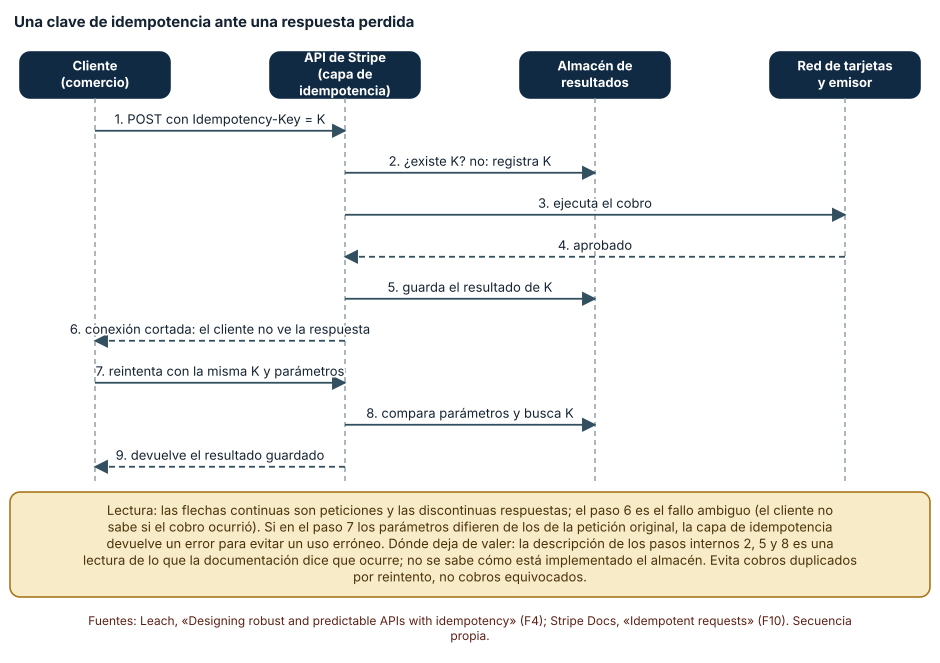

**Cómo leer la figura.** Cada columna es un actor y el tiempo avanza hacia abajo; las flechas continuas son peticiones y las discontinuas respuestas. Mira el paso 6, el fallo ambiguo, y el paso 9, la respuesta guardada. **Dónde deja de valer.** Los pasos internos 2, 5 y 8 son una lectura de la documentación; no se sabe cómo se implementa el almacén.

Documentado (F4): las redes fallan de formas exóticas; una llamada entre dos nodos puede fallar al conectar, a mitad de la operación o después de que la operación tuvo éxito pero antes de que el cliente lo sepa; el cliente queda en una situación incierta. La forma más fácil de manejarlo es que los puntos finales sean idempotentes. Los verbos PUT y DELETE de HTTP lo son por definición; para operaciones que deben ejecutarse una sola vez, como cobrar, se usan claves de idempotencia: el cliente genera un identificador único para la operación y lo envía con la carga; si falla, reintenta con el mismo identificador; el servidor, ante una falla de la respuesta, devuelve el resultado guardado de la operación exitosa; ante una falla a mitad de la operación, retoma el trabajo (si una base ACID revirtió la operación, es seguro repetirla). Documentado (F4): la API implementa claves en los puntos finales que mutan (todo lo que está bajo POST) con la cabecera `Idempotency-Key`.

**Cómo leer la figura.** Una sola decisión arriba, qué pasó antes con esa clave, y cuatro desenlaces abajo. **Dónde deja de valer.** Es el comportamiento documentado en 2026; la ventana de 24 horas es un mínimo, no una garantía de retención exacta.

Documentado (F10): las claves tienen hasta 255 caracteres y se recomienda un UUID v4 u otra cadena aleatoria con suficiente entropía; no deben llevar datos sensibles; en la API v1 pueden eliminarse tras al menos 24 horas, y si se reutiliza una clave podada se genera una petición nueva; la capa compara los parámetros con los de la petición original y devuelve error si no coinciden; se guardan resultados solo después de que empieza la ejecución del punto final (si fallan la validación o chocan con otra petición en curso, no se guardan) y los reintentos con la misma clave devuelven la respuesta guardada, incluidos los errores 500; en la API v2 los reintentos no repiten las operaciones exitosas y Stripe reintenta el trabajo fallido o a medias hasta completarlo cuando es posible. Documentado (F10): todas las peticiones POST de la v1 aceptan claves y no se envían en GET ni DELETE. Documentado (F4): además del lado del servidor, el cliente debe reintentar con retroceso exponencial y variación aleatoria para evitar el efecto de manada, y la biblioteca de Ruby de Stripe lo hace automáticamente con clave de idempotencia.

**Cómo leer la figura.** Stripe envía; el receptor verifica y responde rápido; después procesa. El paso 6 es el reintento si no hubo 2xx y el 7 el duplicado que se ignora por identificador. **Dónde deja de valer.** Es una lectura de la documentación, no un diagrama de Stripe.

Documentado (F11): Stripe reintenta la entrega durante hasta tres días con espera exponencial en modo real (en el entorno de pruebas, tres veces en unas horas); el receptor debe devolver 2xx rápido antes de la lógica compleja, no manipular el cuerpo en crudo (la firma lo exige), aplicar una tolerancia de tiempo (cinco minutos por defecto en las bibliotecas, nunca cero) y sincronizar su reloj; Stripe no garantiza el orden de entrega (por ejemplo, la creación de una suscripción puede generar varios eventos en otro orden), y no se debe usar la marca de tiempo para decidir orden ni si ya se procesó: hay que guardar los identificadores de evento para detectar duplicados y usar la API para recuperar objetos que falten. La versión de la API de la cuenta en el momento del evento dicta la versión del evento.

### Nivel 5: protección de capacidad

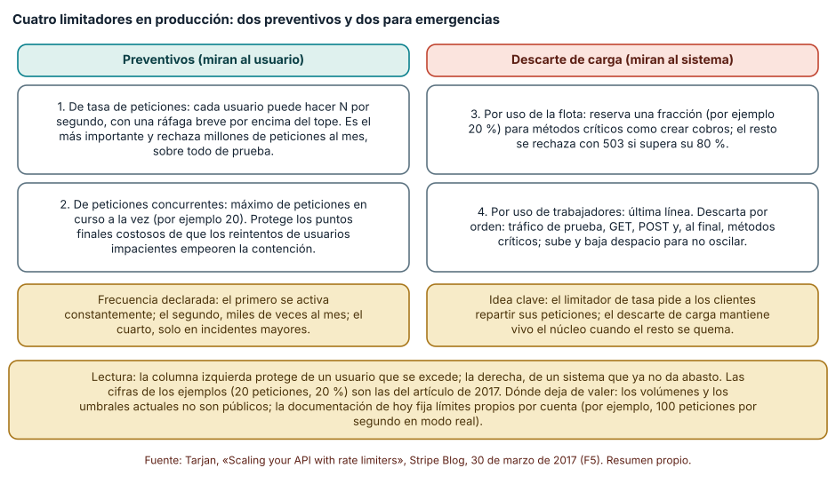

**Cómo leer la figura.** Dos columnas: a la izquierda los limitadores que miran al usuario, a la derecha los que miran al sistema; abajo, qué tan seguido se activan y la idea clave. **Dónde deja de valer.** Los números son los de un artículo de 2017; no se publican los umbrales actuales.

Documentado (F5): hay situaciones en que limitar mejora la fiabilidad: un usuario provoca un pico, un script defectuoso envía muchas peticiones, un usuario intenta abrumar a propósito, un usuario envía muchas peticiones de baja prioridad que podrían afectar a las críticas, o algo falla internamente y hay que descartar tráfico de baja prioridad. Documentado (F5): el limitador de tasa de peticiones es el más importante y rechazó millones de peticiones en un mes, sobre todo de modo de pruebas; se añadió una ráfaga breve por encima del tope para eventos en tiempo real como una venta flash; el de peticiones concurrentes (por ejemplo, 20 en curso) se activó unas 12.000 veces en un mes y resolvió la contención en los puntos finales costosos; el descarte por uso de la flota reserva una fracción (por ejemplo, 20 %) para métodos críticos como crear cobros, usa un clúster Redis para contar peticiones de cada tipo y rechaza con 503 las no críticas que superen su cuota; el descarte por uso de trabajadores es la última línea de defensa, divide el tráfico en cuatro categorías (métodos críticos, POST, GET y tráfico de prueba), empieza por descartar el de prueba y sube y baja despacio para no oscilar; solo rechazó unas 100 peticiones en un mes. Los tres primeros son preventivos y el cuarto limita el daño de incidentes en curso.

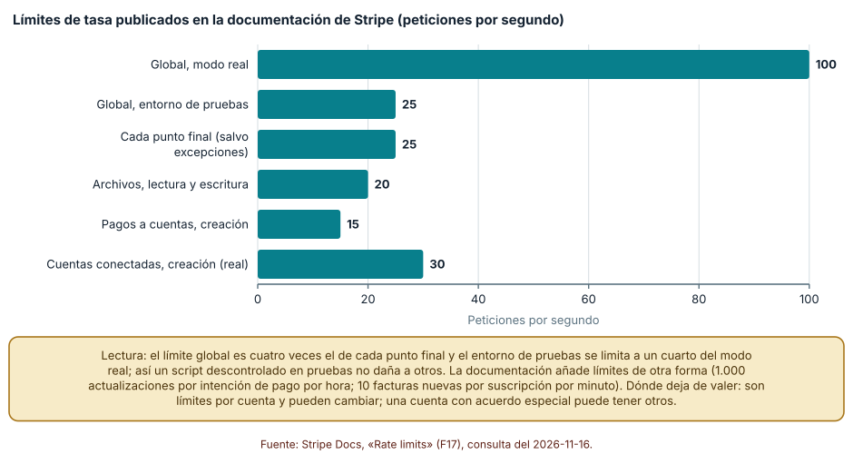

**Cómo leer la figura.** Cada barra es un límite en peticiones por segundo; el eje parte de cero. Mira que el límite global duplica o cuadruplica los de cada punto final. **Dónde deja de valer.** Son límites por cuenta y pueden cambiar; algunos acuerdos tienen otros.

Documentado (F17): en general los límites se miden en peticiones por segundo y por cuenta; el global es de 100 en modo real y 25 en el entorno de pruebas; cada punto final con nombre tiene un límite de 25 por segundo salvo que se indique otra cosa; hay límites propios, como 1.000 actualizaciones por intención de pago por hora y por objeto, 10 facturas nuevas por suscripción por minuto y 20 por día, 200 actualizaciones de cantidad por suscripción por hora, 15 creaciones de pagos por segundo y 30 peticiones concurrentes por negocio en la API de pagos a cuentas. Superar el límite devuelve 429.

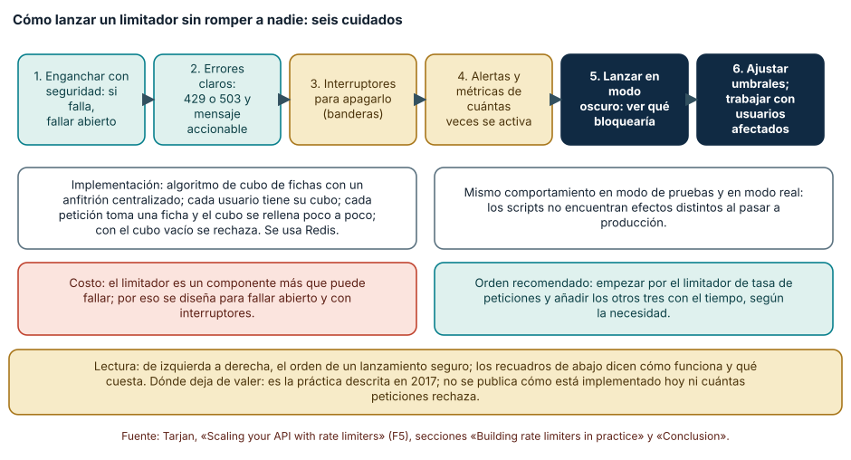

**Cómo leer la figura.** De izquierda a derecha, el orden de un lanzamiento seguro; debajo, la implementación y el costo. **Dónde deja de valer.** Es la práctica de 2017.

Documentado (F5): la implementación usa el algoritmo de cubo de fichas con un anfitrión centralizado: cada usuario tiene un cubo, cada petición retira una ficha y se rellena poco a poco; con el cubo vacío se rechaza; se implementa con Redis. Cuidados: enganchar los limitadores al middleware para que, si hay un error en el código o cae Redis, las peticiones no se vean afectadas (fallar abierto); decidir entre 429 y 503 con mensajes accionables; interruptores para apagarlos; alertas y métricas; y lanzar cada limitador en modo oscuro para ver qué tráfico bloquearía antes de bloquear, ajustando los umbrales y, a veces, trabajando con usuarios para cambiar su código. Recomendación: empezar por el limitador de tasa y añadir los otros con el tiempo.

### Nivel 6: evolución de la API (versionado)

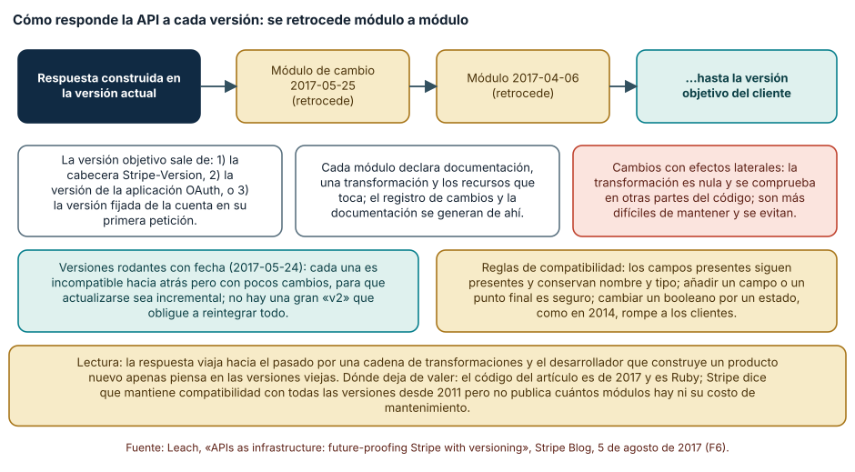

**Cómo leer la figura.** La respuesta nace a la izquierda en la versión actual y viaja hacia el pasado por una cadena de transformaciones; debajo, de dónde sale la versión objetivo, qué declara cada módulo y qué reglas de compatibilidad aplica Stripe. **Dónde deja de valer.** El código del artículo es de 2017 y la documentación posterior cambió el proceso de versiones (ver más abajo).

Documentado (F6): la API es un contrato que no se puede cambiar sin cooperación; Stripe conserva compatibilidad con todas las versiones desde 2011; un cambio incompatible típico es sustituir un campo booleano (como `verified`) por un campo de estado (lo que hicieron en 2014); los campos presentes deben seguir presentes con el mismo nombre y tipo, mientras que añadir un punto final o un campo es seguro. Las versiones mayores de tipo v1, v2, v3 cambian tanto que son casi tan dolorosas como reintegrar, y dejan usuarios atrapados en versiones viejas; Stripe usa versiones rodantes con nombre de fecha (por ejemplo, 2017-05-24): cada una es incompatible hacia atrás pero con pocos cambios para que actualizar sea incremental; la primera petición de una cuenta fija su versión a la más reciente; la versión puede anularse con la cabecera Stripe-Version o actualizarse desde el panel. «Casi cien actualizaciones incompatibles en seis años». Documentado (F6): cada posible respuesta se codifica como un recurso de API en la versión actual; los cambios incompatibles se encapsulan en módulos de cambio de versión con descripción, transformación y recursos afectados; la respuesta se formatea en la versión actual y luego se retrocede aplicando módulos hasta la versión objetivo (cabecera, versión de la aplicación OAuth o versión fijada de la cuenta); los cambios con efectos laterales se anotan y la transformación es nula, y se evitan porque son más difíciles de mantener; el registro de cambios y la documentación se generan de los mismos módulos.

Documentado (F16-docs): desde la versión 2024-09-30.acacia, Stripe publica versiones nuevas cada mes sin cambios incompatibles y dos veces al año una versión mayor (con un nombre, como «Basil») que sí puede traerlos; actualizar a una versión mensual no exige cambiar código; la versión actual a la fecha de consulta es 2026-10-28.endive; una petición sin cabecera usa la versión por defecto de la cuenta y los eventos de webhook también. Esto es una evolución de la propia estrategia: de «versiones rodantes con pocos cambios» (2017) a «mensuales sin rupturas y mayores semestrales» (2024).

### Nivel 7: modelo y evolución de los datos (migraciones y DocDB)

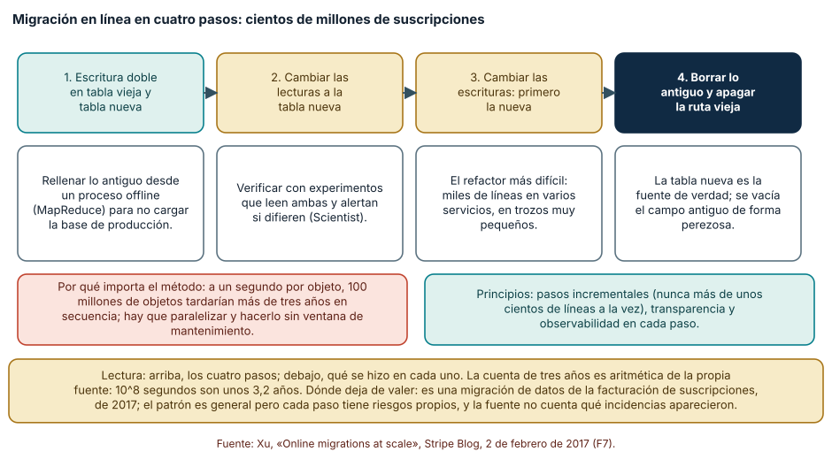

**Cómo leer la figura.** Cuatro pasos de izquierda a derecha, con qué se hizo en cada uno; abajo, por qué importa el método y los principios. **Dónde deja de valer.** Es una migración de 2017; la fuente no cuenta incidencias.

Documentado (F7): Stripe tiene cientos de millones de objetos de suscripción; con un segundo por objeto, migrar cien millones en secuencia tardaría más de tres años; las migraciones se hacen siempre en línea, sin ventanas de mantenimiento, y los datos y los servicios deben seguir exactos. El patrón de cuatro pasos: 1) escritura doble en la tabla vieja y la nueva (con aumento gradual del porcentaje de objetos duplicados vigilando el rendimiento, copia perezosa al actualizar y relleno del resto con un proceso offline en Hadoop con MapReduce y Scalding sobre instantáneas, para no cargar la base de producción; un segundo trabajo comprueba que no falte nada); 2) cambiar las lecturas, verificadas con Scientist de GitHub, que lee ambas tablas y alerta si difieren sin afectar a la aplicación; 3) cambiar las escrituras (primero la nueva y luego se archiva en la vieja), refactorizando miles de líneas en varios servicios con cambios de pocos cientos de líneas cada vez; 4) eliminar el código que escribe en la vieja y los datos antiguos, vaciando el arreglo de forma perezosa. La razón de la migración: cada cliente tenía como máximo una suscripción y se guardaba junto con él; al aparecer varias suscripciones y funciones, cualquier cambio exigía actualizar el registro completo y las consultas escaneaban clientes.

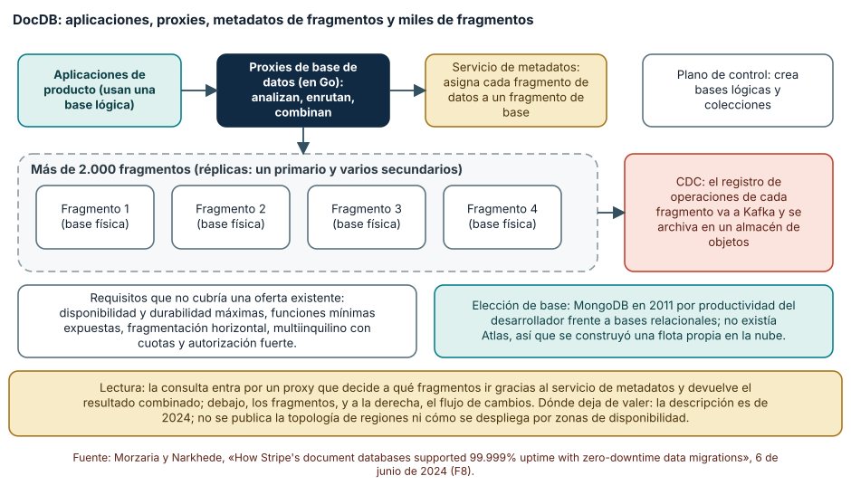

**Cómo leer la figura.** La consulta entra por un proxy y, con ayuda del servicio de metadatos, llega a uno o varios fragmentos; a la derecha, el flujo de cambios hacia Kafka y el almacén de objetos. **Dónde deja de valer.** Es la descripción de 2024; no hay topología por regiones.

Documentado (F8): DocDB es una extensión de MongoDB Community con servicios propios; en 2023 Stripe procesó un billón de dólares con una disponibilidad de 99,999 %; atiende más de cinco millones de consultas por segundo, con más de 10.000 formas de consulta distintas sobre petabytes de datos en más de 5.000 colecciones y más de 2.000 fragmentos. Al lanzar en 2011 eligieron MongoDB por productividad del desarrollador frente a las bases relacionales, y construyeron su flota porque MongoDB Atlas no existía; no encontraron una oferta que cumpliera los requisitos: disponibilidad, durabilidad y rendimiento de primer nivel; exponer pocas funciones para evitar consultas subóptimas; fragmentación horizontal; multiinquilino con cuotas y seguridad con autorización. Las aplicaciones acceden por proxies escritos en Go que aplican fiabilidad, escalabilidad, control de admisión y control de acceso; un servicio de metadatos asigna fragmentos de datos a bases; cada base física es un conjunto de réplicas con primario y secundarios con conmutación automática; y los cambios van por captura de datos a Kafka y se archivan en un almacén de objetos.

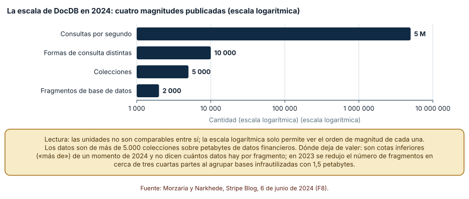

**Cómo leer la figura.** Cada barra es una cantidad con una unidad distinta; la escala logarítmica solo muestra el orden de magnitud. **Dónde deja de valer.** Son cotas inferiores de 2024.

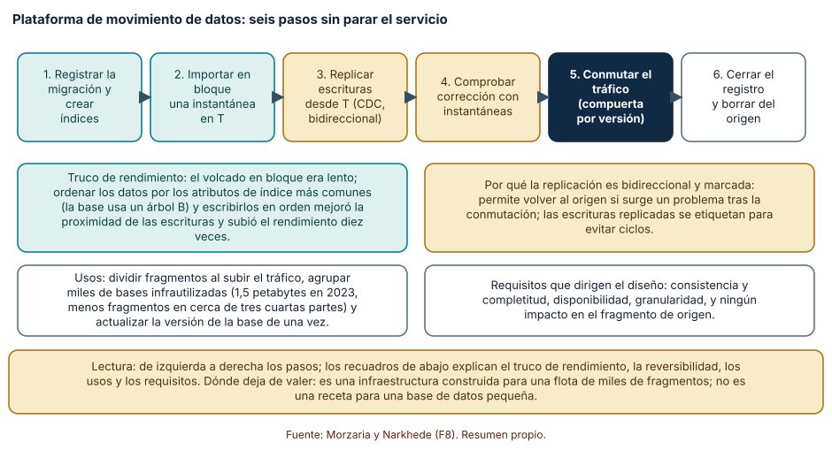

**Cómo leer la figura.** Seis pasos de izquierda a derecha; los recuadros de abajo explican un truco de rendimiento, la reversibilidad, los usos y los requisitos. **Dónde deja de valer.** Es una infraestructura para una flota de miles de fragmentos.

Documentado (F8): la plataforma de movimiento de datos migra fragmentos de forma transparente para el cliente y sin interrupción; sus requisitos son consistencia y completitud, disponibilidad (la fase clave debe durar menos que una conmutación planificada del primario, de unos segundos y dentro del presupuesto de reintentos de las aplicaciones), granularidad y adaptabilidad, y ningún impacto en el fragmento de origen. Pasos: registrar la intención y crear índices en el destino; importar una instantánea en bloque (el rendimiento se multiplicó por diez al ordenar los datos por los atributos de índice más comunes aprovechando que la base usa un árbol B); replicar de forma asíncrona las escrituras desde el instante de la instantánea leyendo el registro de operaciones de Kafka y del almacén de objetos, con replicación bidireccional etiquetada para poder volver atrás; comprobar la corrección comparando instantáneas; conmutar el tráfico; y cerrar el registro. Usos: dividir fragmentos con un clic, agrupar miles de bases infrautilizadas (en 2023, 1,5 petabytes y una reducción de cerca de tres cuartas partes de los fragmentos) y subir de versión la base en un solo paso.

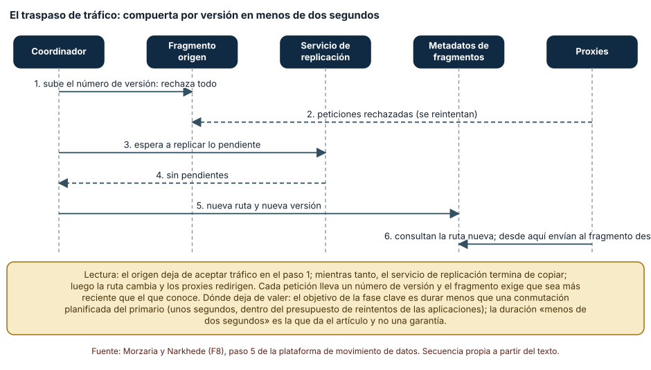

**Cómo leer la figura.** Cada columna es un componente; el tiempo avanza hacia abajo; las flechas discontinuas son respuestas. **Dónde deja de valer.** El texto dice que el protocolo dura menos de dos segundos y que las peticiones fallidas tienen éxito al reintentar; no es una garantía.

Documentado (F8): el traspaso se basa en una compuerta por versión: cada proxy anota sus peticiones con un número de versión y un parche de MongoDB hace que el fragmento solo sirva peticiones con un número más nuevo del que conoce; el coordinador sube el número de versión en el origen (que rechaza lecturas y escrituras), espera a que el servicio de replicación vuelque lo pendiente y actualiza la ruta y la versión en el servicio de metadatos; los proxies recogen la ruta nueva; el protocolo entero dura menos de dos segundos y las lecturas y escrituras fallidas dirigidas al origen tienen éxito al reintentar.

### Nivel 8: seguridad, abuso y cumplimiento

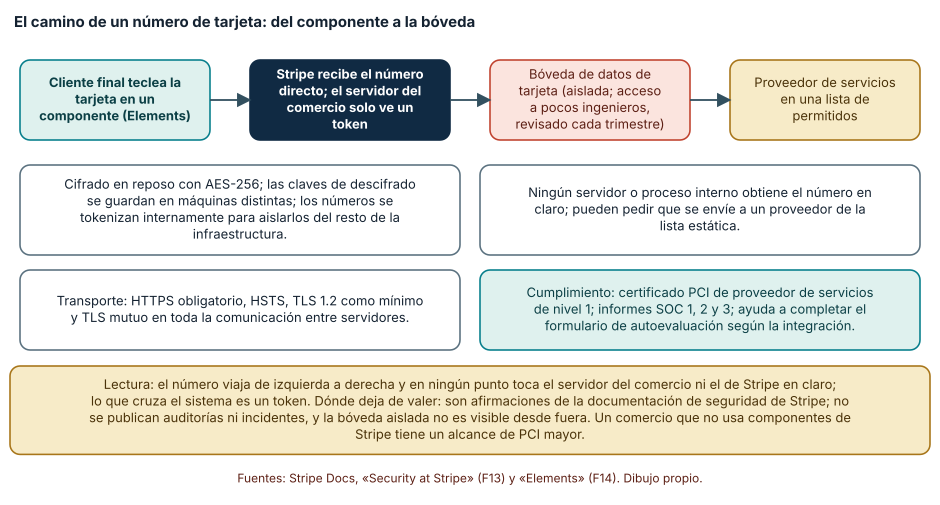

**Cómo leer la figura.** De izquierda a derecha, el número de tarjeta; los recuadros de abajo explican cifrado, acceso, transporte y cumplimiento. **Dónde deja de valer.** Son afirmaciones de la documentación de seguridad de Stripe; no se publican auditorías ni incidentes.

Documentado (F13): un auditor certificó a Stripe como proveedor de servicios PCI de nivel 1, la certificación más estricta de la industria, que incluye la bóveda de datos de tarjeta y el desarrollo seguro del código de integración; Stripe ayuda a completar el formulario de autoevaluación según la integración del usuario; se auditan informes SOC 1 y SOC 2 de tipo II anualmente y hay un SOC 3 público. Todos los números de tarjeta se cifran en reposo con AES-256, con las claves de descifrado en máquinas distintas; los números se tokenizan internamente; ningún servidor o proceso interno puede obtener números en claro, pero pueden pedir que se envíen a un proveedor de una lista estática; el acceso a la bóveda aislada es de pocos ingenieros con revisión trimestral. HTTPS y HSTS obligatorios, TLS 1.2 como mínimo, y TLS mutuo entre servidores internos; hay un programa de recompensas por vulnerabilidades. Documentado (F14): Stripe.js tokeniza los datos dentro de un componente sin que lleguen al servidor del comercio. Documentado (F9): hay un producto de protección contra fraude con IA y una tarifa por disputa. No se sabe: cómo se entrena el modelo de fraude, su tasa de error ni cuántas disputas se ganan.

### Nivel 9: observabilidad y operación

Documentado (F5): alertas y métricas sobre cuántas veces se activan los limitadores, interruptores para apagarlos y lanzamiento en modo oscuro. Documentado (F7): experimentos de comparación en producción que alertan de la primera inconsistencia. Documentado (F11): la pestaña de entregas de eventos muestra el siguiente reintento. No se sabe: SLO internos, guardia, gestión de incidentes y regiones; el título del artículo de 2024 afirma 99,999 % de disponibilidad de DocDB, pero no publica su definición ni el período medido.

### Nivel 10: despliegue y regiones

No se sabe. Las fuentes de este caso no describen cómo se despliegan los servicios ni en qué regiones corren. Documentado (F8): las bases viven en la nube y los nodos de réplica con conmutación automática; la plataforma de movimiento de datos permite subir de versión la base con un salto en lugar de pasos intermedios.

### Nivel 11: cómo evolucionó la arquitectura (antes y después)

**Cómo leer la figura.** El carril superior son las etapas de la plataforma y el inferior, el volumen de pagos en billones de dólares. Las líneas verticales son hitos. Mira que el volumen documentado solo cubre tres años: antes de 2023 no hay dato citado en este caso. **Dónde deja de valer.** Las etapas son síntesis del autor; las fechas de origen y lanzamiento provienen de una fuente secundaria.

Antes y después, con lo documentado: antes de 2017, migraciones de datos de una vez; después, un patrón de cuatro pasos con experimentos de comparación (F7). Antes de 2024, fragmentos con rangos de datos grandes y pocos; después, miles de fragmentos con un coordinador que mueve datos sin parar el servicio (F8). Antes de 2024-09, versiones rodantes por fecha con pocos cambios incompatibles; después, versiones mensuales sin rupturas y mayores semestrales (F16-docs). Antes del 11 de febrero de 2019, los estados de pago se llamaban «requires_source» (F12-bis). No se sabe cómo era la arquitectura de 2011 más allá de MongoDB.

### Hardware utilizado

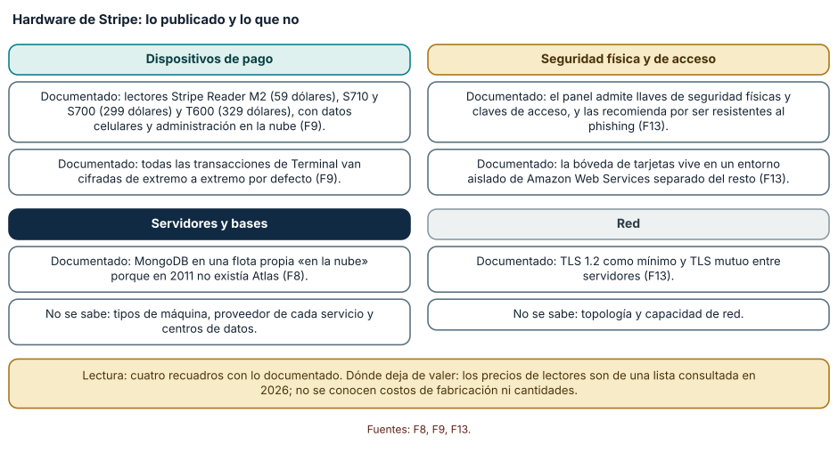

**Cómo leer la figura.** Dispositivos de pago, seguridad física, servidores y bases, y red. **Dónde deja de valer.** Los precios son de una lista de 2026.

Documentado (F9): lectores Stripe Reader M2 por 59 dólares, S710 y S700 por 299 y T600 por 329, con datos celulares incluidos para las aplicaciones en el dispositivo (límite de 10 GB mensuales) y administración en la nube; Terminal cifra de extremo a extremo por defecto. Documentado (F13): el panel admite llaves de seguridad físicas; la bóveda de tarjetas vive en un entorno aislado de AWS. Documentado (F8): flota propia de MongoDB en la nube desde 2011. No se sabe: tipos de servidor, proveedor de cada servicio y centros de datos.

### Software utilizado

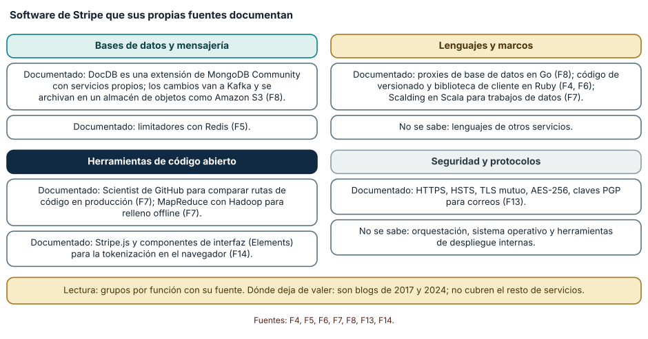

**Cómo leer la figura.** Cuatro grupos tecnológicos con su fuente. **Dónde deja de valer.** Blogs de 2017 y 2024.

Documentado (F8): DocDB extiende MongoDB Community con servicios propios; proxies en Go; Kafka y un almacén de objetos para los cambios. Documentado (F5): limitadores con Redis (ElastiCache se cita como opción en AWS). Documentado (F4, F6): clientes y código de versionado en Ruby. Documentado (F7): Hadoop, MapReduce y Scalding para el relleno, y Scientist de GitHub para comparar rutas de código. Documentado (F13, F14): HTTPS, HSTS, TLS mutuo, AES-256, claves PGP, componentes de interfaz y Stripe.js. No se sabe: orquestación, sistemas operativos y herramientas internas de despliegue.

### Características de la infraestructura

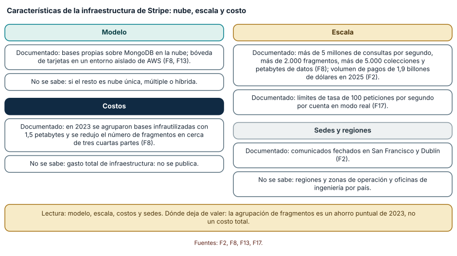

**Cómo leer la figura.** Modelo, escala, costos y sedes. **Dónde deja de valer.** La agrupación de fragmentos es un ahorro puntual.

Documentado (F8): más de 5 millones de consultas por segundo, más de 10.000 formas de consulta, más de 5.000 colecciones y más de 2.000 fragmentos sobre petabytes de datos; en 2023 se agruparon bases con 1,5 petabytes y se redujeron fragmentos en cerca de tres cuartas partes. Documentado (F2): volumen de 1,9 billones de dólares en 2025. Documentado (F17): 100 peticiones por segundo por cuenta en modo real. No se sabe: modelo de nube completo (única, múltiple o híbrida), regiones, zonas y gasto total de infraestructura.

### Tolerancia a fallos: qué pasa si cae cada componente

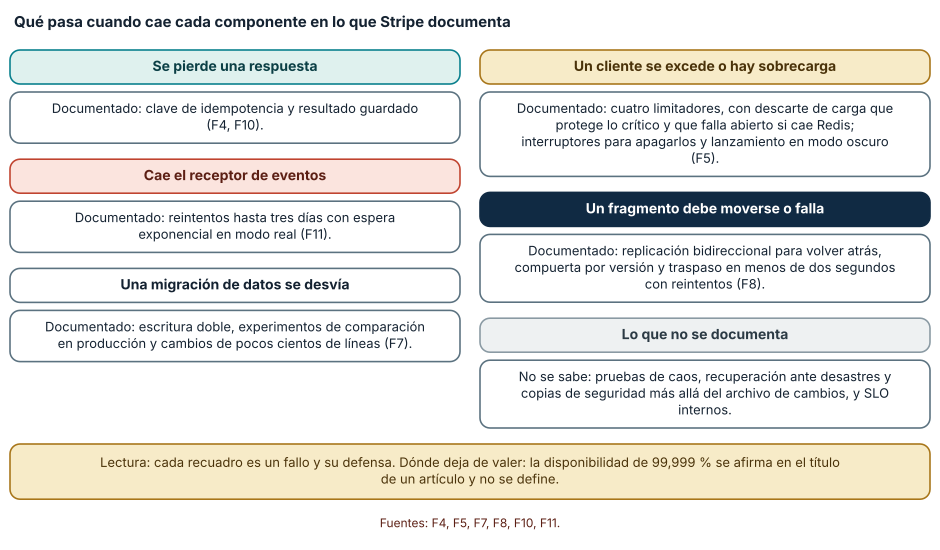

**Cómo leer la figura.** Cada recuadro es un fallo y su defensa; el último lista lo que falta. **Dónde deja de valer.** Los 99,999 % de disponibilidad son una afirmación sin definición pública.

Documentado (F4, F10): claves de idempotencia. Documentado (F5): limitadores y descarte de carga que fallan abiertos, con interruptores y lanzamiento en modo oscuro. Documentado (F11): reintentos de eventos durante tres días. Documentado (F8): replicación bidireccional etiquetada para poder volver al origen, compuerta por versión, traspaso en menos de dos segundos y control de que la fase clave sea más corta que una conmutación del primario. Documentado (F7): escritura doble y experimentos de comparación en producción. No se sabe: pruebas de caos, recuperación ante desastres, copias de seguridad más allá del archivo de cambios en el almacén de objetos, y SLO internos.

### Alternativas descartadas y trade-offs (análisis propio)

Todo lo que sigue es análisis propio: qué habría ocurrido con otra decisión. No es historia.

| Decisión | Alternativa | Qué habría pasado (hipótesis) | Qué costó la elegida |
| --- | --- | --- | --- |
| Idempotencia en el servidor (F4) | Confiar en que el cliente no reintente | Cobros duplicados cuando una respuesta se pierde, con daño de confianza | Almacén de resultados, claves que gestionar y una ventana de retención |
| Versiones por fecha (F6) | Versiones mayores v1, v2, v3 | Cambios grandes y raros, usuarios atrapados en versiones viejas y dos bases de código | Una capa de módulos de cambio que mantener y una cadena de transformaciones |
| Limitador de tasa y descarte de carga (F5) | Solo más capacidad | Más fácil al principio; un usuario puede degradar el servicio a todos | Cuatro limitadores, Redis y umbrales que afinar con trabajo con usuarios |
| Fallar abierto en los limitadores (F5) | Fallar cerrado | Protección más estricta, pero un error del limitador tumbaría la API | Durante una caída de Redis, no hay protección |
| Migración por escritura doble (F7) | Corte único con ventana de mantenimiento | Más simple, pero imposible para un servicio de pagos siempre activo | Meses de dos fuentes de verdad y un refactor largo |
| Fragmentación horizontal en DocDB (F8) | Una base relacional gestionada | Menos código propio, pero sin los requisitos de 2011 y sin escala | Flota propia, proxies y una plataforma de movimiento de datos |
| Tokenización en el componente (F14) | Que el comercio maneje la tarjeta | Más control para el comercio, pero un alcance de PCI mucho mayor | Dependencia de Stripe.js y de su componente |
| Plataforma de Connect (F15) | Cada plataforma construye su cuenta de pagos | Más control, pero más licencias y cumplimiento para cada plataforma | Estructura de cuentas, límites y tarifas de Stripe |

## Casos especiales y cómo se resuelven

| Situación | Qué se documenta | Qué enseña |
| --- | --- | --- |
| Reintento tras un corte de red | Clave de idempotencia; mismo resultado guardado (F4, F10). | Reintentar es seguro solo si el servidor lo permite. |
| Cliente que reintenta sin freno | Limitador de concurrencia y descarte de carga para proteger lo crítico (F5). | Proteger la capacidad es parte de la API. |
| Cambio de la API sin romper a nadie | Versiones por fecha fijadas por cuenta; cambios pequeños (F6). | Compatibilidad como producto. |
| Migrar datos sin parar | Escritura doble en cuatro pasos (F7); movimiento de datos con una ventana de segundos (F8). | Migración en línea reversible. |
| Webhooks duplicados o desordenados | Registrar identificadores; no depender del orden (F11). | Diseñar el receptor como idempotente. |
| Autenticación fuerte del cliente | La intención de pago activa pasos de autenticación adicionales cuando se requieren (F12). | El cumplimiento está en el flujo. |
| Seguridad de datos de tarjeta | Certificación PCI de proveedor de servicios nivel 1 y tokenización (F13, F14). | Reducir el alcance de cumplimiento del comercio. |
| Fraude | Producto de protección con inteligencia artificial (F9). No se sabe cómo se entrena ni cómo se mide su error. | Ausencia de datos como parte del caso. |
| Cumplimiento regulatorio por país | No se sabe: la documentación consultada no detalla qué licencias tiene en cada jurisdicción. | Un punto que exige fuentes propias. |

Los siguientes casos especiales amplían la tabla con su mecanismo, la decisión y el costo.

### Pico de tráfico o script descontrolado

Mecanismo documentado (F5, F17): límite global por cuenta, límites por punto final, ráfaga breve por encima del tope y limitador de concurrencia; descarte de carga por flota y por trabajadores. Decisión: pedir a los clientes que repartan sus peticiones y proteger primero los métodos críticos como crear cobros. Costo: algunos usuarios ven errores 429 o 503; la fuente asume que los clientes pueden repartirse y no verse afectados.

### Fallo parcial: una dependencia lenta o caída

Mecanismo documentado (F5): el descarte por uso de trabajadores descarta primero el tráfico de prueba y luego lecturas, escrituras y, al final, lo crítico; baja y sube despacio para no oscilar. Mecanismo documentado (F5): los limitadores fallan abiertos si cae Redis. Decisión: preferir disponibilidad sobre una protección perfecta. Costo: durante una caída del limitador no hay protección.

### Consistencia: respuestas perdidas, eventos desordenados y duplicados

Mecanismo documentado (F4, F10, F11): claves de idempotencia en el servidor; deduplicación por identificador de evento y recuperación de objetos por la API en el receptor. Decisión: aceptar entrega al menos una vez y convertirla en efecto una vez en ambos extremos. Costo: almacén de claves, ventana de retención de 24 horas (v1) y lógica en el receptor.

### Abuso y fraude

Mecanismo documentado (F5): el limitador de tasa y el de concurrencia limitan a un usuario que intente abrumar los servidores; mecanismo documentado (F9): Radar Lite como producto. Decisión: proteger a todos de uno. Costo: falsos positivos que no se publican. No se sabe cómo se entrena el modelo de fraude.

### Cumplimiento regional y regulatorio

Mecanismo documentado (F12, F13): autenticación fuerte del cliente (3D Secure) integrada en la intención de pago; PCI nivel 1 y SOC; tokenización. Decisión: poner el cumplimiento dentro del flujo y no en una auditoría posterior. Costo: dependencia de Stripe para el comercio. No se sabe qué licencias tiene en cada país.

### Offline

No aplica al servidor; en clientes, el reintento con la misma clave de idempotencia cubre desconexiones intermitentes (F4). No se sabe nada del comportamiento de las aplicaciones móviles de Stripe.

### Costos

Mecanismo documentado (F8): en 2023 se agruparon miles de bases infrautilizadas con 1,5 petabytes y se redujo el número de fragmentos en cerca de tres cuartas partes; decisión: mejorar la utilización de la flota; costo: ingeniería de la plataforma de movimiento de datos. Documentado (F7): relleno offline en Hadoop para no cargar la base de producción; decisión de costo y riesgo.

## Línea de tiempo

La figura está en la sección de arquitectura (nivel 11). En prosa, con sus fuentes:

- **2009 o 2010.** Origen de la empresa; las fuentes discrepan (F16).
- **2011.** MongoDB como base inicial (F8); lanzamiento público en septiembre tras una beta privada (F16, secundaria); compatibilidad con todas las versiones de la API desde este año (F6).
- **2014.** Cambio incompatible de un campo booleano a un estado, ejemplo del propio artículo de versionado (F6).
- **Febrero a agosto de 2017.** Publicaciones sobre migraciones en línea (2 de febrero), idempotencia (22 de febrero), límites de tasa (30 de marzo) y versionado (5 de agosto) (F4 a F7).
- **11 de febrero de 2019.** Versión de la API a partir de la cual los estados de las intenciones de pago usan los nombres actuales (F12-bis).
- **2023.** Un billón de dólares de volumen; 99,999 % de disponibilidad de DocDB; consolidación de miles de bases (F8).
- **Junio de 2024.** Artículo sobre DocDB y movimiento de datos (F8).
- **Septiembre de 2024.** Nuevo proceso de versiones, desde la versión 2024-09-30.acacia (F16-docs).
- **2024.** 1,4 billones, +38 % (F3).
- **2025.** 1,9 billones, +34 %, y recompra de acciones a empleados con una valoración de 159.000 millones de dólares en febrero de 2026 (F2).

Giros y correcciones: el modelo de «una suscripción por cliente» se reemplazó cuando los casos de uso crecieron (F7); el particionado de DocDB pasó de pocos fragmentos grandes a miles pequeños (F8); el esquema de versiones pasó de rodantes por fecha a mensuales y mayores semestrales (F16-docs). No hay en las fuentes un relato de incidentes graves de disponibilidad; no se inventa.

## Vínculo con el curso

| Concepto | Clases | Qué parte de la teoría ilustra el caso |
| --- | --- | --- |
| Idempotencia, reintentos y deduplicación | [SE-246](../../classes/part-20-backend-apis-y-procesamiento-asincrono/se-246-idempotencia-reintentos-y-deduplicacion/README.md), [SE-344](../../classes/part-28-concurrencia-y-sistemas-distribuidos/se-344-idempotencia-y-procesamiento-distribuido/README.md), [SE-378](../../classes/part-31-calidad-rendimiento-y-resiliencia/se-378-timeouts-retries-backoff-y-jitter/README.md) | Cabecera `Idempotency-Key`, resultado guardado y reintento seguro con retroceso. |
| Rate limiting y protección | [SE-249](../../classes/part-20-backend-apis-y-procesamiento-asincrono/se-249-caching-rate-limiting-y-proteccion/README.md), [SE-379](../../classes/part-31-calidad-rendimiento-y-resiliencia/se-379-circuit-breakers-bulkheads-y-degradacion/README.md), [SE-376](../../classes/part-31-calidad-rendimiento-y-resiliencia/se-376-latencia-throughput-saturacion-y-capacidad/README.md) | Cubo de fichas, concurrencia y descarte de carga. |
| Diseño de APIs y contratos | [SE-242](../../classes/part-20-backend-apis-y-procesamiento-asincrono/se-242-rest-y-semantica-de-recursos/README.md), [SE-244](../../classes/part-20-backend-apis-y-procesamiento-asincrono/se-244-validacion-errores-y-contratos-consistentes/README.md), [SE-163](../../classes/part-13-especificaciones-contratos-y-modelos/se-163-openapi-asyncapi-graphql-y-contratos-de-eventos/README.md) | API predecible con errores consistentes. |
| Versionado y compatibilidad | [SE-110](../../classes/part-09-bibliotecas-paquetes-sdk-y-automatizacion/se-110-semver-compatibilidad-y-contratos-publicos/README.md), [SE-164](../../classes/part-13-especificaciones-contratos-y-modelos/se-164-compatibilidad-versionado-y-evolucion-de-contratos/README.md), [SE-402](../../classes/part-33-build-release-y-cadena-de-suministro/se-402-versionado-compatibilidad-y-changelog/README.md) | Versiones por fecha fijadas por cuenta, módulos de cambio y versiones mensuales sin rupturas. |
| Experiencia del desarrollador | [SE-118](../../classes/part-09-bibliotecas-paquetes-sdk-y-automatizacion/se-118-diseno-de-experiencia-para-desarrolladores/README.md), [SE-120](../../classes/part-09-bibliotecas-paquetes-sdk-y-automatizacion/se-120-proyecto-sdk-y-cli-con-compatibilidad-verificada/README.md) | Documentación, claves de prueba y SDK. |
| Webhooks y entrega de eventos | [SE-331](../../classes/part-27-integracion-eventos-y-mensajeria/se-331-webhooks-polling-y-suscripciones/README.md), [SE-328](../../classes/part-27-integracion-eventos-y-mensajeria/se-328-entrega-orden-duplicacion-y-semanticas/README.md), [SE-329](../../classes/part-27-integracion-eventos-y-mensajeria/se-329-outbox-inbox-sagas-y-compensacion/README.md) | Reintentos, duplicados y orden no garantizado. |
| Migraciones de datos sin interrupción | [SE-439](../../classes/part-36-mantenimiento-y-modernizacion-legacy/se-439-migraciones-de-datos-sin-interrupcion/README.md), [SE-440](../../classes/part-36-mantenimiento-y-modernizacion-legacy/se-440-compatibilidad-coexistencia-y-doble-escritura/README.md), [SE-318](../../classes/part-26-datos-persistencia-y-recuperacion/se-318-migraciones-compatibles-y-evolucion-de-esquema/README.md), [SE-437](../../classes/part-36-mantenimiento-y-modernizacion-legacy/se-437-strangler-branch-by-abstraction-y-anticorruption/README.md) | Escritura doble en cuatro pasos y retiro de datos antiguos. |
| Bases de datos, fragmentación y recuperación | [SE-314](../../classes/part-26-datos-persistencia-y-recuperacion/se-314-relacional-documental-clave-valor-grafos-y-series/README.md), [SE-319](../../classes/part-26-datos-persistencia-y-recuperacion/se-319-replicacion-particion-y-distribucion/README.md), [SE-345](../../classes/part-28-concurrencia-y-sistemas-distribuidos/se-345-replicacion-sharding-y-balanceo/README.md), [SE-321](../../classes/part-26-datos-persistencia-y-recuperacion/se-321-backups-restauracion-y-pruebas-de-recuperacion/README.md), [SE-380](../../classes/part-31-calidad-rendimiento-y-resiliencia/se-380-disponibilidad-durabilidad-y-recuperacion/README.md) | DocDB, fragmentos y 99,999 % de disponibilidad. |
| Dominio fintech e invariantes | [SE-282](../../classes/part-23-software-especializado-y-dominios/se-282-fintech-contabilidad-e-invariantes-monetarias/README.md), [SE-316](../../classes/part-26-datos-persistencia-y-recuperacion/se-316-restricciones-invariantes-y-consistencia/README.md) | Exactitud monetaria y consistencia. |
| Seguridad y secretos | [SE-389](../../classes/part-32-seguridad-privacidad-y-cumplimiento/se-389-criptografia-aplicada-y-gestion-de-claves/README.md), [SE-390](../../classes/part-32-seguridad-privacidad-y-cumplimiento/se-390-secretos-configuracion-y-separacion-de-ambientes/README.md), [SE-385](../../classes/part-32-seguridad-privacidad-y-cumplimiento/se-385-principios-de-seguridad-y-modelos-de-amenaza/README.md) | Tokenización, cifrado y claves de API. |
| Privacidad y cumplimiento | [SE-391](../../classes/part-32-seguridad-privacidad-y-cumplimiento/se-391-privacidad-por-diseno-y-minimizacion/README.md), [SE-394](../../classes/part-32-seguridad-privacidad-y-cumplimiento/se-394-cumplimiento-evidencia-y-limites-legales/README.md), [SE-152](../../classes/part-12-ingenieria-de-requisitos/se-152-requisitos-regulatorios-de-datos-y-seguridad/README.md) | PCI, autenticación fuerte y límites legales. |
| Aprendizaje automático como componente | [SE-279](../../classes/part-23-software-especializado-y-dominios/se-279-machine-learning-como-componente-de-producto/README.md) | Detección de fraude y optimización de autorización. |
| Modelos de negocio y costos | [SE-133](../../classes/part-11-economia-metricas-y-decisiones-de-producto/se-133-modelos-de-negocio-y-sostenibilidad/README.md), [SE-134](../../classes/part-11-economia-metricas-y-decisiones-de-producto/se-134-costos-de-construccion-operacion-y-oportunidad/README.md), [SE-453](../../classes/part-37-gestion-liderazgo-y-practica-profesional/se-453-economia-del-software-y-costo-total/README.md) | Comisión por transacción, IC+ y volumen. |
| Multiinquilino y plataformas | [SE-534](../../classes/part-44-estilos-arquitectonicos/se-534-multi-tenancy-y-aislamiento/README.md), [SE-358](../../classes/part-29-cloud-plataforma-e-infraestructura/se-358-plataformas-internas-y-golden-paths/README.md) | Connect, cuentas múltiples y cuotas por cuenta. |
| Observabilidad y SLO | [SE-425](../../classes/part-35-observabilidad-sre-e-incidentes/se-425-sli-slo-sla-y-presupuestos-de-error/README.md), [SE-421](../../classes/part-35-observabilidad-sre-e-incidentes/se-421-senales-eventos-y-observabilidad-util/README.md), [SE-426](../../classes/part-35-observabilidad-sre-e-incidentes/se-426-alertas-accionables-y-fatiga/README.md) | Disponibilidad objetivo en un servicio de pagos y alertas sobre la activación de limitadores. |
| Experimentos y banderas | [SE-138](../../classes/part-11-economia-metricas-y-decisiones-de-producto/se-138-experimentos-sesgos-y-causalidad-basica/README.md), [SE-403](../../classes/part-33-build-release-y-cadena-de-suministro/se-403-feature-flags-y-entrega-progresiva/README.md) | Experimentos de comparación en producción (Scientist) e interruptores para apagar limitadores. |
| Radio de impacto | [SE-536](../../classes/part-44-estilos-arquitectonicos/se-536-arquitectura-celular-y-radio-de-impacto/README.md) | Fragmentos como unidades de aislamiento y el descarte de carga que protege lo crítico. |
| Trade-offs y decisiones | [SE-309](../../classes/part-25-arquitectura-de-software-y-dominio/se-309-trade-offs-adr-y-evaluacion-de-alternativas/README.md), [SE-208](../../classes/part-17-documentacion-y-conocimiento-tecnico/se-208-adrs-rfcs-y-registro-de-decisiones/README.md) | La tabla de alternativas es un ADR en potencia. |

### Preguntas de discusión

1. Una clave de idempotencia protege contra duplicados por reintento, no contra cobros equivocados. ¿Qué otras invariantes de un sistema de dinero necesitarías verificar con un mecanismo distinto?
2. Stripe falla abierto en sus limitadores. ¿En qué sistemas tuyos preferirías fallar cerrado y por qué? ¿Qué cambia en el diseño?
3. Las versiones rodantes por fecha frente a v1, v2, v3 tienen un costo oculto. ¿Qué equipo en tu organización paga el costo de mantener la cadena de transformaciones y cómo se vería su carga?
4. La migración de suscripciones tardó pasos, no un salto. ¿Qué parte del proceso podrías automatizar y cuál debe seguir siendo manual y por qué?
5. DocDB se construyó a mano porque no existía una alternativa en 2011. ¿Qué criterios usarías hoy para decidir entre construir y comprar una base de datos?
6. Stripe cambió su proceso de versiones en 2024. ¿Qué señales en el uso de la API habrían sugerido ese cambio?

### Mini-ejercicios de análisis

1. **Cálculo de tarifas.** Con 2,9 % + 0,30 dólares, calcula el costo efectivo para 5, 20, 100 y 1.000 dólares. ¿A partir de qué importe la parte fija pesa menos del 1 % del total? Respuesta esperada: una tabla propia con el porcentaje y la condición.
2. **Diseño de claves.** Define el identificador de idempotencia para tres operaciones de un sistema tuyo: crear un pedido, reembolsar y enviar un correo. Decide en cada caso si es por solicitud o por entidad y qué parámetros cuentan para detectar un uso erróneo.
3. **Orden de eventos.** Dibuja dos órdenes de llegada de eventos de una suscripción (creada, factura creada, factura pagada) que rompan un receptor ingenuo y propón un receptor que funcione con cualquier orden.
4. **Presupuesto de límites.** Para una API con 100 peticiones por segundo por cuenta y 25 por punto final, calcula cuántos puntos finales distintos puede usar un cliente al máximo a la vez y qué conclusión sacas sobre la estrategia de reparto.
5. **Plan de migración.** Para una tabla tuya de 100 millones de filas, diseña los cuatro pasos con el criterio de salida de cada uno y estima el tiempo del relleno con un ritmo de 5.000 filas por segundo.
6. **Compuerta por versión.** Dibuja una compuerta por versión para mover un fragmento: qué estado guarda cada componente antes y después del traspaso y qué pasa si el coordinador cae tras subir la versión.

## Qué no generalizar

**Qué aprender.**

1. **La compatibilidad es una decisión de producto.** El versionado fijado por cuenta permite cambiar la API sin que los clientes dejen de funcionar (F6).
2. **Un efecto monetario se diseña para repetirse.** Idempotencia en el servidor y deduplicación en el receptor del evento son dos mitades de la misma garantía (F4, F11).
3. **Protege la capacidad antes de que falle.** Los limitadores y el descarte de carga mantienen lo crítico vivo (F5).
4. **Migra con un patrón.** Escribir doble, mover lecturas, mover escrituras y limpiar (F7), con una ventana corta (F8).
5. **Documentar es parte del producto.** Los blogs y la documentación sirven de confianza para quien integra.
6. **Lanza lo riesgoso en modo oscuro.** Mide lo que habría pasado antes de bloquear a nadie (F5, F7).
7. **Revisa tus propias decisiones.** El proceso de versiones cambió en 2024 (F16-docs); lo que fue lo mejor en 2017 pudo dejar de serlo.

**Qué NO generalizar.**

- **No necesitas la infraestructura de Stripe.** DocDB, con más de 2.000 fragmentos, resuelve una escala que casi ningún sistema tiene; usar una base de datos gestionada suele ser mejor.
- **Las claves de idempotencia de Stripe no protegen de todo.** Evitan duplicados por reintento, no cobros equivocados (F10).
- **No uses el volumen como medida de éxito de tu producto.** Es volumen bruto; la empresa no publica ingresos.
- **Las cifras de adopción («90 % del Dow Jones») y los testimonios de clientes son afirmaciones de la empresa** en comunicados con interés comercial (F2, F3).
- **Las tarifas cambian por país y fecha.** El cálculo del caso solo es válido con la lista de precios consultada (F9).
- **Sesgo de supervivencia.** Se publican las decisiones que salieron bien; no hay documento sobre incidentes graves en las fuentes consultadas.
- **La actitud de «compatibilidad con todo» tiene un costo.** Mantener cada versión desde 2011 exige una capa de transformaciones y disciplina que una API pequeña no necesita.
- **No copies los límites numéricos.** Los 100 por segundo son de las cuentas de Stripe en 2026; los tuyos dependen de tu capacidad.

## Fuentes públicas verificadas

Todas consultadas el 2026-11-16 con `curl` salvo lo indicado. «Secundaria» significa que no es una fuente primaria de la empresa.

- **F1.** Stripe, «About Stripe»: [https://stripe.com/about](https://stripe.com/about)
- **F2.** Stripe Newsroom, «Stripe publishes 2025 annual letter and announces tender offer to provide liquidity to current and former employees» (24 de febrero de 2026): [https://stripe.com/newsroom/news/stripe-2025-update](https://stripe.com/newsroom/news/stripe-2025-update). Se usa para el volumen de 2025, la valoración, la cohorte de 2025, Atlas, stablecoins y comercio con agentes.
- **F3.** Stripe Newsroom, «Stripe's total payment volume reaches $1.4T, fueled by long-standing investments in AI» (27 de febrero de 2025): [https://stripe.com/newsroom/news/stripe-2024-update](https://stripe.com/newsroom/news/stripe-2024-update). Se usa para el volumen de 2024, Billing y los casos de clientes.
- **F4.** Brandur Leach, «Designing robust and predictable APIs with idempotency», Stripe Blog, 22 de febrero de 2017: [https://stripe.com/blog/idempotency](https://stripe.com/blog/idempotency)
- **F5.** Paul Tarjan, «Scaling your API with rate limiters», Stripe Blog, 30 de marzo de 2017: [https://stripe.com/blog/rate-limiters](https://stripe.com/blog/rate-limiters)
- **F6.** Brandur Leach, «APIs as infrastructure: future-proofing Stripe with versioning», Stripe Blog, 5 de agosto de 2017: [https://stripe.com/blog/api-versioning](https://stripe.com/blog/api-versioning)
- **F7.** Jacqueline Xu, «Online migrations at scale», Stripe Blog, 2 de febrero de 2017: [https://stripe.com/blog/online-migrations](https://stripe.com/blog/online-migrations)
- **F8.** Jimmy Morzaria y Suraj Narkhede, «How Stripe's document databases supported 99.999% uptime with zero-downtime data migrations», 6 de junio de 2024: [https://stripe.com/blog/how-stripes-document-databases-supported-99.999-uptime-with-zero-downtime-data-migrations](https://stripe.com/blog/how-stripes-document-databases-supported-99.999-uptime-with-zero-downtime-data-migrations)
- **F9.** Stripe, página de precios: [https://stripe.com/pricing](https://stripe.com/pricing)
- **F10.** Stripe Docs, «Idempotent requests»: [https://docs.stripe.com/api/idempotent_requests](https://docs.stripe.com/api/idempotent_requests)
- **F11.** Stripe Docs, «Webhooks»: [https://docs.stripe.com/webhooks](https://docs.stripe.com/webhooks)
- **F12.** Stripe Docs, «The Payment Intents API»: [https://docs.stripe.com/payments/payment-intents](https://docs.stripe.com/payments/payment-intents). **F12-bis:** Stripe Docs, «How PaymentIntents and SetupIntents work»: [https://docs.stripe.com/payments/paymentintents/lifecycle](https://docs.stripe.com/payments/paymentintents/lifecycle)
- **F13.** Stripe Docs, «Security at Stripe»: [https://docs.stripe.com/security](https://docs.stripe.com/security)
- **F14.** Stripe Docs, «Elements»: [https://docs.stripe.com/payments/elements](https://docs.stripe.com/payments/elements)
- **F15.** Stripe Docs, «Connect»: [https://docs.stripe.com/connect](https://docs.stripe.com/connect)
- **F16.** (Secundaria) Wikipedia, «Stripe, Inc.», edición consultada el 2026-11-16: [https://en.wikipedia.org/wiki/Stripe,_Inc.](https://en.wikipedia.org/wiki/Stripe,_Inc.). Se usa solo para el origen y el lanzamiento público, y se declara que las fuentes discrepan. **F16-docs:** Stripe Docs, «Versioning»: [https://docs.stripe.com/api/versioning](https://docs.stripe.com/api/versioning)
- **F17.** Stripe Docs, «Rate limits»: [https://docs.stripe.com/rate-limits](https://docs.stripe.com/rate-limits)

**Qué no cubren estas fuentes.** No documentan los ingresos de Stripe, su estructura de costos, las licencias por país, la arquitectura de despliegue, el entrenamiento ni el desempeño del sistema de fraude, ni incidentes de disponibilidad; tampoco a competidores ni cuota de mercado. Esos puntos quedan como «no se sabe». Tampoco se pudo leer ningún documento regulatorio de la SEC porque Stripe es privada.

---

[↑ Casos de éxito](README.md) · [← Airbnb](airbnb.md)
