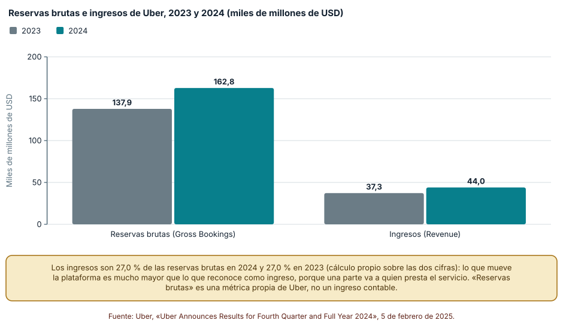
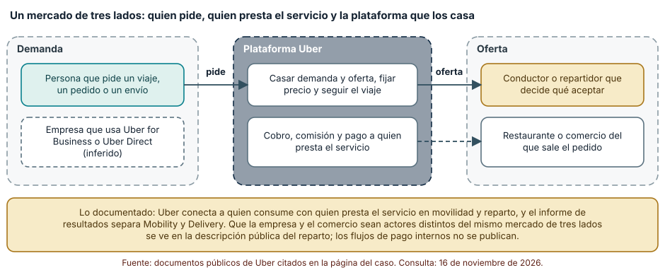
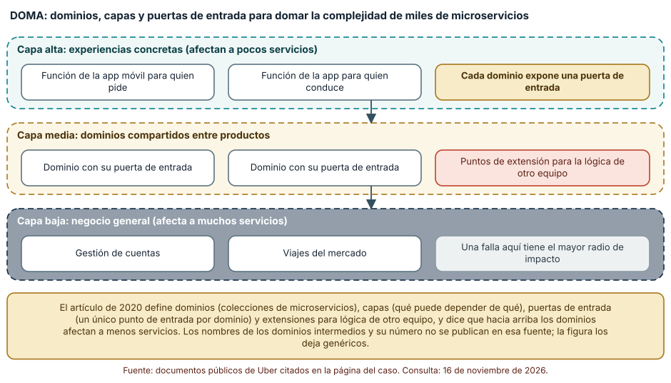
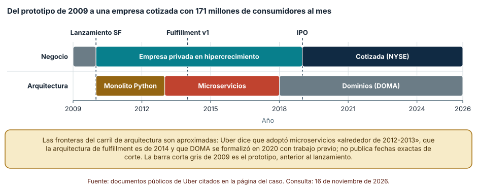

# Uber

[↑ Casos de éxito](README.md) · [← WhatsApp](whatsapp.md) · [Mercado Libre →](mercado-libre.md)

> **Caso de éxito.** Uber pasó de una idea de limusinas compartidas, nacida en una conferencia en París a fines de 2008, a una plataforma con 171 millones de consumidores activos al mes y unos 33 millones de viajes diarios (cuarto trimestre de 2024). Este caso explica qué se sabe, con fuentes, de su negocio y de su ingeniería, qué se infiere y qué no se sabe. Es éxito comercial y de escala; no es un juicio sobre todas sus decisiones.

**Cómo leer las etiquetas.** **[Documentado]** = lo dice una fuente pública citada al final; **[Inferido]** = deducción del curso, puede ser falsa; **[No se sabe]** = no hay fuente pública consultada. Las cifras llevan fecha y fuente. No se reconstruye arquitectura confidencial.

## Ficha histórica

| Dato | Valor | Fuente |
| --- | --- | --- |
| Nombre | Uber Technologies, Inc. | [U2] |
| Fundadores | Garrett Camp y Travis Kalanick | [U1] |
| Origen de la idea | Invierno de fines de 2008, en la conferencia LeWeb de París; la idea de Camp comenzó como una «limusina compartida» y terminó siendo un servicio bajo demanda desde un iPhone | [U1] |
| Trabajo en serio | Desde marzo de 2009 Camp desarrolla el prototipo; Kalanick se suma en el verano de 2009 como «Chief Incubator» | [U1] |
| Primer gerente general | Ryan Graves; su primer día fue el 1 de marzo (de 2010) | [U1] |
| Prueba inicial | Enero de 2010, Nueva York, con tres coches | [U1] |
| Lanzamiento | San Francisco, 31 de mayo de 2010 | [U1] |
| Sede | San Francisco (datación de sus comunicados) | [U2] |
| Salida a bolsa | Precio fijado el 9 de mayo de 2019: 180 millones de acciones a 45 dólares; cotiza en la NYSE (UBER) | [U3] |
| Escala (cuarto trimestre de 2024) | 171 millones de consumidores activos al mes (MAPCs); 3 100 millones de viajes, unos 33 millones por día; 44 200 millones de USD en reservas brutas | [U2] |
| Escala (año 2024) | 11 273 millones de viajes; 162 773 millones de USD en reservas brutas; 43 978 millones en ingresos; 2 799 millones de resultado operativo | [U2] |
| Estado actual | Sociedad cotizada; su director ejecutivo, Dara Khosrowshahi, presenta los vehículos autónomos como una oportunidad central | [U2] |

**Qué no se afirma.** El nombre original del producto, la ronda de financiación inicial, el número de ciudades por año y las fechas de lanzamiento de Uber Eats, Freight y otros productos no se verificaron en fuentes primarias consultadas y por eso no figuran con fecha. Que Kalanick fuera cofundador lo dice él mismo en el texto de 2010; las cifras bursátiles proceden del comunicado de la empresa.

## Contexto y problema

**Documentado.** Kalanick cuenta que el punto de partida fue «el horrible problema de los taxis en San Francisco»: quedarse varado en la calle era familiar para cualquiera. La propuesta inicial de Camp fue un servicio de limusinas compartidas con un coche, un conductor y una aplicación de iPhone para pedirlo a demanda ([U1]).

Los autores esperaban que el negocio fuera «de baja tecnología, sobre todo operativo»; el propio texto añade «poco sabíamos» ([U1]). Ese contraste es la lección de ingeniería del caso: un problema aparentemente operativo (encontrar un coche cercano) exige localización, emparejamiento, precios, pagos y confianza.

**Problemas que el negocio tuvo que resolver a la vez.**

1. **Encontrar oferta cercana rápido,** en una ciudad con miles de personas pidiendo y conduciendo.
2. **Fijar un precio** que equilibre demanda y oferta de forma continua. El artículo sobre H3 dice que la rejilla sirve para «optimizar precios y despacho» y «fijar precios dinámicos» a escala de ciudad ([U5]).
3. **Mantener el estado correcto de millones de viajes** aunque fallen servicios o regiones ([U7]).
4. **Crecer en producto** sin que cada función nueva multiplique la complejidad de los microservicios ([U6]).

## Mercado, usuarios y casos de uso

| Rol | Qué hace y qué gana | Qué cambia en su experiencia | Respaldo |
| --- | --- | --- | --- |
| Persona que pide un viaje | Llega a un destino sin esperar en la calle | Ve el precio y el estado del viaje en la app | [U1], [U2] |
| Persona que pide comida o un paquete | Recibe un pedido | La plataforma gestiona un mercado con tres partes: quien pide, quien reparte y quien vende | [U7] |
| Conductor o repartidor | Decide cuándo trabajar y qué aceptar, y cobra por viaje | La plataforma le ofrece el trabajo; en el cuarto trimestre de 2024 conductores y repartidores ganaron en conjunto 20 000 millones de USD, propinas incluidas | [U2] |
| Restaurante o comercio | Vende a través de la plataforma | **[No se sabe]** las condiciones comerciales | [U7] |
| Empresa cliente | Usa Uber para movilidad de empleados o envíos | **[No se sabe]** el detalle en las fuentes consultadas | — |
| Ingeniería y operaciones de Uber | Construye y opera la plataforma | Dominios, capas y puertas de entrada ordenan quién puede llamar a quién | [U6] |
| Reguladores y administraciones locales | Fijan reglas de transporte y de trabajo en cada ciudad | **[No se sabe]**; el caso no entra en regulación | — |

**Escala del mercado.** Entre 2023 y 2024 la plataforma pasó de 150 a 171 millones de consumidores activos al mes y de 2 601 a 3 068 millones de viajes por trimestre ([U2]). **Variación de experiencia:** la misma plataforma ofrece reglas distintas según el producto: reservas con conductor confirmado por adelantado, ofertas de varios viajes simultáneos, colas virtuales en aeropuertos, el mercado de tres lados de Uber Eats y envíos con Uber Direct ([U7]).

## Funcionalidad de principio a fin

1. **Primer contacto.** Se instala la aplicación. En 2010 el crecimiento comenzó con invitaciones a amigos y una gerencia que recorría el circuito de demos de empresas emergentes ([U1]).
2. **Registro.** **[No se sabe]** el proceso actual de verificación de usuarios y conductores en las fuentes consultadas.
3. **Pedir.** La persona indica origen y destino. **[Inferido]** que la app muestra un precio estimado antes de aceptar; no se documenta el cálculo.
4. **Emparejar.** La plataforma de cumplimiento (fulfillment) captura la intención y la satisface emparejándola con el proveedor adecuado ([U7]). Modela un viaje con una entidad Viaje (al menos dos puntos de paso) y una entidad Oferta, que representa a una persona real capaz de hacer el trabajo ([U7]).
5. **Viaje en curso.** El ciclo de vida se representa como un diagrama de estados jerárquico, formalizado con Protobuf y un marco genérico en Java ([U7]).
6. **Pago.** **[No se sabe]** cómo se procesa el cobro ni qué proveedores se usan. **[Documentado]** que Uber informa «reservas brutas» e «ingresos» como cifras distintas (sección 5).
7. **Soporte.** **[No se sabe]** el flujo de atención en las fuentes consultadas.
8. **Operación diaria.** La plataforma gestiona más de un millón de usuarios simultáneos y miles de millones de viajes al año en más de diez mil ciudades ([U7]); cientos de microservicios dependen de ella como fuente de verdad del estado de viajes y sesiones.

## Negocio y economía

**Modelo (documentado).** Uber informa dos métricas separadas: las **reservas brutas** (el valor de lo que se compra en la plataforma) y los **ingresos** (lo que Uber reconoce como suyo). En 2024 las reservas fueron de 162 773 millones de USD y los ingresos de 43 978 millones ([U2]).

**Cómo leer la figura.** Hay dos grupos de columnas: a la izquierda las reservas brutas y a la derecha los ingresos; en cada grupo la barra gris es 2023 y la teal 2024. Compare la altura de los dos grupos: los ingresos son una fracción de las reservas. **Dónde deja de valer.** La proporción (27 % en ambos años) es un cálculo propio y no es «la comisión» de Uber: los ingresos incluyen distintas líneas y reconocimientos contables que el comunicado no desglosa. Tampoco dice nada de rentabilidad por viaje.

**Mezcla por línea.** En el cuarto trimestre de 2024 la movilidad aportó 22 800 millones de reservas (+18 % en dólares) y el reparto 20 100 millones (+18 %) ([U2]); el resto, hasta los 44 197 millones, es diferencia no desglosada en esa fuente.

**Costos.** **[Documentado]** que el resultado operativo de 2024 fue de 2 799 millones de USD, frente a 1 110 millones en 2023 ([U2]). **[No se sabe]** el coste por viaje, de infraestructura, de seguros o de incentivos. **[Inferido]** que, como la plataforma no es dueña de los vehículos, sus costos relevantes son tecnología, incentivos, seguros y operaciones locales; el comunicado no los separa.

**Ventajas competitivas. [Inferido]** Una red con densidad en cada ciudad (más oferta reduce la espera, más demanda atrae oferta); datos de ubicación y de precios a escala; y una plataforma de cumplimiento que sirve a varias verticales, que Uber describe como «una capacidad fundacional que permite escalar rápido nuevas verticales» ([U7]).

## Arquitectura y esquemas

### 6.1 Contexto

**Cómo leer la figura.** Se lee de izquierda a derecha: la demanda pide, la plataforma casa y la oferta responde. Las flechas continuas son el camino principal y la punteada es la relación con el comercio. **Dónde deja de valer.** No incluye mapas, medios de pago, seguros ni reguladores, que existen pero no se describen en las fuentes consultadas.

### 6.2 Componentes: de un monolito a microservicios y a dominios

**Monolito inicial.** El artículo de Uber sobre bases de datos cuenta que la arquitectura temprana era un backend monolítico en Python que usaba Postgres ([U4]).

**Postgres a MySQL.** El mismo artículo enumera las limitaciones que encontraron en Postgres: arquitectura ineficiente para escrituras (amplificación de escritura), replicación ineficiente, corrupción de tablas, soporte pobre de MVCC en réplicas y dificultad para actualizar de versión (el procedimiento exigía parar el maestro durante horas con `pg_upgrade`). En muchos casos usaron en su lugar Schemaless, una capa de particionado sobre MySQL ([U4]).

**Microservicios.** Uber adoptó microservicios «alrededor de 2012-2013» por flexibilidad, despliegue independiente y propiedad clara; con unos 2 200 microservicios críticos, sintió «los mismos compromisos»: más complejidad y funciones sencillas difíciles de construir ([U6]).

**DOMA (2020).** El artículo define cuatro ideas ([U6]): **dominios** (colecciones de microservicios relacionados), **capas** (qué puede llamar a qué), **puertas de entrada** (un único punto de entrada por dominio) y **extensiones** (puntos de extensión definidos para que un equipo añada lógica en el dominio de otro sin meterla en su código).

**Cómo leer la figura.** Cada banda es una capa; las flechas bajan porque una capa solo depende de las de abajo. Lea la etiqueta entre paréntesis de cada banda: más arriba, menos servicios afectados si falla; más abajo, más dependientes. **Dónde deja de valer.** Muestra la regla de diseño, no el inventario real de dominios (que el artículo no publica) ni cuántas capas hay.

**Piezas de infraestructura documentadas.**

- **Ringpop (de código abierto):** biblioteca Node.js que convierte una aplicación en un conjunto de nodos que cooperan; implementa un protocolo de pertenencia tipo SWIM sobre TCP, hashing consistente para repartir el trabajo y reenvío de peticiones ([U8]).
- **H3:** rejilla hexagonal y jerárquica del globo con 16 resoluciones; cada resolución más fina tiene celdas de un séptimo del área, y el hexágono tiene una sola distancia a sus vecinos, lo que simplifica el análisis ([U5]).
- **Cadence:** plataforma de orquestación de flujos de trabajo (código abierto) que da persistencia, colas y temporizadores a código escrito en Go para evitar «un laberinto de callbacks» entre microservicios asíncronos ([U9]).
- **Plataforma de cumplimiento (rediseño):** la versión de 2014 usaba servicios `rt-demand` y `rt-supply` sin estado compartido, con entidades en Apache Cassandra y Redis y una preferencia explícita por disponibilidad sobre consistencia; la nueva usa Google Cloud Spanner (arquitectura NewSQL) como almacenamiento principal tras compararlo con CockroachDB y FoundationDB ([U7]).

### 6.3 Flujo de la operación crítica: un viaje

**Cómo leer la figura.** Siga los pasos de izquierda a derecha. Las cajas azul oscuro son las entidades y estados documentados; la dorada es el emparejamiento y la teal el cierre; las punteadas son inferidas. **Dónde deja de valer.** No describe el algoritmo de emparejamiento, el cálculo de precio ni la integración de pagos: Uber no los publica en las fuentes consultadas.

**Documentado sobre este flujo.**

- **Modelo del dominio.** Viaje (con al menos dos puntos de paso) y Oferta como entidades; `rt-demand` administra Viajes y `rt-supply` administra Ofertas ([U7]).
- **Estados.** Un diagrama de estados (statechart) es una máquina de estados finita en la que cada estado puede tener subestados anidados; permite niveles de abstracción jerárquicos ([U7]).
- **Fragmentación.** `rt-demand` se particionaba por identificador: todas las peticiones de un viaje van al trabajador que lo posee, y para consultar por pasajero se mantenía una tabla índice aparte ([U7]).

### 6.4 Datos y escala

| Magnitud | Valor | Fuente |
| --- | --- | --- |
| Usuarios simultáneos en la plataforma de cumplimiento | más de un millón | [U7] |
| Viajes al año | miles de millones | [U7] |
| Transacciones de base de datos por día | miles de millones | [U7] |
| Ciudades | más de diez mil | [U7] |
| Microservicios críticos (antes de DOMA) | unos 2 200 | [U6] |
| Aislamiento de fallos | dos dominios de fallo y dos regiones; «pods» con servicios fundamentales por ciudad | [U7] |

**[No se sabe]** el número actual de servicios, el reparto por regiones y cuánto del tráfico corre en nube pública o en centros de datos propios.

## Casos especiales y cómo se resuelven

- **Picos de demanda.** **[Inferido]** que la rejilla H3 y los precios dinámicos reparten demanda en el espacio y en el tiempo ([U5]); el artículo no describe un pico concreto.
- **Fallos parciales y regiones.** La arquitectura de 2014 usaba dos dominios de fallo y dos regiones independientes, y para reducir el radio de impacto se añadieron «pods» con los servicios fundamentales; las ciudades se asignan a pods según varios criterios ([U7]).
- **Consistencia.** El diseño anterior sacrificó consistencia por disponibilidad y latencia: la consistencia dependía de mecanismos «de mejor esfuerzo»; sin atomicidad había que reconciliar fallos; con Cassandra y la regla del último que escribe, las escrituras concurrentes (durante despliegues o failovers regionales) podían sobrescribirse ([U7]). Por eso se pasó a una base transaccional.
- **Orquestación de procesos largos.** Cadence mantiene un registro de cada acción para recuperar el estado tras un error ([U9]).
- **Abuso y seguridad.** **[No se sabe]** en las fuentes consultadas: el caso no aborda fraude, verificación de identidad ni incidentes de seguridad.
- **Cumplimiento y regulación.** **[No se sabe]**; ver la sección 3.
- **Sin conexión.** **[No se sabe]** cómo se comporta la app sin red.
- **Crecimiento de producto.** DOMA se creó para que añadir una función no obligue a cambiar muchos servicios de equipos distintos ([U6]).

## Línea de tiempo

**Cómo leer la figura.** El eje es el año. El carril de arriba es la vida corporativa; el de abajo, las etapas de arquitectura. Las tres líneas verticales son hitos. **Dónde deja de valer.** Las fronteras del carril de arquitectura son aproximadas: Uber dice «alrededor de 2012-2013» y no fecha cada corte.

- **Fines de 2008.** Conversación en LeWeb, París, entre Camp y Kalanick ([U1]).
- **Marzo de 2009.** Camp trabaja «en serio» en el prototipo ([U1]).
- **Verano de 2009.** Kalanick se suma como «Chief Incubator» ([U1]).
- **Enero de 2010.** Prueba en Nueva York con tres coches ([U1]).
- **Marzo de 2010.** Primer día de Ryan Graves como gerente general ([U1]).
- **31 de mayo de 2010.** Lanzamiento en San Francisco ([U1]).
- **Circa 2012-2013.** Adopción de microservicios ([U6]).
- **2014.** Se construye la arquitectura de cumplimiento que luego se reescribe ([U7]).
- **9 de mayo de 2019.** Se fija el precio de la salida a bolsa ([U3]).
- **23 de julio de 2020.** Se publica DOMA ([U6]).
- **5 de febrero de 2025.** Resultados de 2024 ([U2]).

## Vínculo con el curso

| Concepto | Clases | Qué ilustra el caso |
| --- | --- | --- |
| Modelos de negocio de plataforma y métricas | [SE-133](../../classes/part-11-economia-metricas-y-decisiones-de-producto/se-133-modelos-de-negocio-y-sostenibilidad/README.md), [SE-136](../../classes/part-11-economia-metricas-y-decisiones-de-producto/se-136-metricas-de-adopcion-retencion-y-tarea-util/README.md), [SE-139](../../classes/part-11-economia-metricas-y-decisiones-de-producto/se-139-north-star-guardrails-y-metricas-contrarias/README.md) | Mercado de tres lados; reservas brutas frente a ingresos; MAPCs como métrica de adopción |
| Costos y economía del software | [SE-134](../../classes/part-11-economia-metricas-y-decisiones-de-producto/se-134-costos-de-construccion-operacion-y-oportunidad/README.md), [SE-453](../../classes/part-37-gestion-liderazgo-y-practica-profesional/se-453-economia-del-software-y-costo-total/README.md) | Qué parte de lo que mueve la plataforma se queda como ingreso |
| Domain-driven design | [SE-305](../../classes/part-25-arquitectura-de-software-y-dominio/se-305-domain-driven-design-estrategico-y-tactico/README.md), [SE-310](../../classes/part-25-arquitectura-de-software-y-dominio/se-310-arquitectura-socio-tecnica-y-limites-de-equipo/README.md) | Dominios con puertas de entrada y propiedad por equipo |
| Monolito, servicios y microservicios | [SE-303](../../classes/part-25-arquitectura-de-software-y-dominio/se-303-monolito-modular-monolith-y-servicios/README.md), [SE-532](../../classes/part-44-estilos-arquitectonicos/se-532-microservicios-y-sus-costes-reales/README.md), [SE-533](../../classes/part-44-estilos-arquitectonicos/se-533-bff-api-gateway-y-service-mesh/README.md) | Del monolito Python a 2 200 microservicios y el coste de complejidad |
| Arquitectura hexagonal y puertos | [SE-304](../../classes/part-25-arquitectura-de-software-y-dominio/se-304-capas-hexagonal-clean-y-ports-and-adapters/README.md) | Gateways y extensiones como fronteras de un dominio |
| Arquitectura celular y radio de impacto | [SE-536](../../classes/part-44-estilos-arquitectonicos/se-536-arquitectura-celular-y-radio-de-impacto/README.md), [SE-379](../../classes/part-31-calidad-rendimiento-y-resiliencia/se-379-circuit-breakers-bulkheads-y-degradacion/README.md) | Pods por ciudad para limitar fallos |
| Event-driven y CQRS | [SE-306](../../classes/part-25-arquitectura-de-software-y-dominio/se-306-event-driven-cqrs-y-event-sourcing/README.md) | Eventos emitidos por la plataforma de cumplimiento |
| Modelado de datos y consultas | [SE-313](../../classes/part-26-datos-persistencia-y-recuperacion/se-313-modelado-conceptual-logico-y-fisico/README.md), [SE-317](../../classes/part-26-datos-persistencia-y-recuperacion/se-317-consultas-indices-y-patrones-de-acceso/README.md) | Tabla índice por pasajero; índices espaciales |
| Bases relacionales, documentales y clave-valor | [SE-314](../../classes/part-26-datos-persistencia-y-recuperacion/se-314-relacional-documental-clave-valor-grafos-y-series/README.md) | Postgres frente a MySQL; Cassandra frente a Spanner |
| Transacciones, aislamiento e invariantes | [SE-315](../../classes/part-26-datos-persistencia-y-recuperacion/se-315-transacciones-aislamiento-y-concurrencia/README.md), [SE-316](../../classes/part-26-datos-persistencia-y-recuperacion/se-316-restricciones-invariantes-y-consistencia/README.md) | Pasar de «mejor esfuerzo» a transacciones |
| Consistencia, disponibilidad y particiones | [SE-342](../../classes/part-28-concurrencia-y-sistemas-distribuidos/se-342-consistencia-disponibilidad-y-particiones/README.md), [SE-319](../../classes/part-26-datos-persistencia-y-recuperacion/se-319-replicacion-particion-y-distribucion/README.md), [SE-345](../../classes/part-28-concurrencia-y-sistemas-distribuidos/se-345-replicacion-sharding-y-balanceo/README.md) | Último que escribe en Cassandra frente a consistencia en Spanner |
| Consenso y coordinación | [SE-343](../../classes/part-28-concurrencia-y-sistemas-distribuidos/se-343-consenso-eleccion-y-coordinacion/README.md) | Ringpop: pertenencia por gossip y hashing consistente |
| Sagas y compensación | [SE-329](../../classes/part-27-integracion-eventos-y-mensajeria/se-329-outbox-inbox-sagas-y-compensacion/README.md), [SE-344](../../classes/part-28-concurrencia-y-sistemas-distribuidos/se-344-idempotencia-y-procesamiento-distribuido/README.md), [SE-246](../../classes/part-20-backend-apis-y-procesamiento-asincrono/se-246-idempotencia-reintentos-y-deduplicacion/README.md) | Cadence como orquestación de flujos largos |
| Máquinas de estados | [SE-520](../../classes/part-43-patrones-de-diseno-empresariales-y-de-resiliencia/se-520-gof-conductuales-strategy-observer-command-state-y-template-method/README.md), [SE-313](../../classes/part-26-datos-persistencia-y-recuperacion/se-313-modelado-conceptual-logico-y-fisico/README.md) | Viaje y Oferta modelados con statecharts |
| Sistemas geoespaciales | [SE-285](../../classes/part-23-software-especializado-y-dominios/se-285-sistemas-geoespaciales-y-temporales/README.md) | H3: rejilla hexagonal jerárquica |
| Migraciones de datos sin interrupción | [SE-439](../../classes/part-36-mantenimiento-y-modernizacion-legacy/se-439-migraciones-de-datos-sin-interrupcion/README.md), [SE-440](../../classes/part-36-mantenimiento-y-modernizacion-legacy/se-440-compatibilidad-coexistencia-y-doble-escritura/README.md), [SE-318](../../classes/part-26-datos-persistencia-y-recuperacion/se-318-migraciones-compatibles-y-evolucion-de-esquema/README.md) | De Postgres a Schemaless y de Cassandra a Spanner sin parar el servicio |
| Evolución y reescritura | [SE-442](../../classes/part-36-mantenimiento-y-modernizacion-legacy/se-442-economia-de-reescribir-frente-a-evolucionar/README.md), [SE-437](../../classes/part-36-mantenimiento-y-modernizacion-legacy/se-437-strangler-branch-by-abstraction-y-anticorruption/README.md), [SE-308](../../classes/part-25-arquitectura-de-software-y-dominio/se-308-fitness-functions-y-arquitectura-evolutiva/README.md) | Reescribir la plataforma de 2014 «desde cero» tras un análisis |
| Observabilidad y SLO | [SE-421](../../classes/part-35-observabilidad-sre-e-incidentes/se-421-senales-eventos-y-observabilidad-util/README.md), [SE-425](../../classes/part-35-observabilidad-sre-e-incidentes/se-425-sli-slo-sla-y-presupuestos-de-error/README.md) | Visibilidad de dependencias profundas (mapas de microservicios) |
| Plataformas internas | [SE-358](../../classes/part-29-cloud-plataforma-e-infraestructura/se-358-plataformas-internas-y-golden-paths/README.md), [SE-417](../../classes/part-34-ci-cd-iac-y-platform-engineering/se-417-developer-portals-y-capacidades-de-plataforma/README.md) | Plataforma de cumplimiento como capacidad reutilizable |

## Qué no generalizar

**Qué aprender.**

- Un problema «operativo» puede ser un problema de sistemas distribuidos; subestimar eso es parte de la historia ([U1]).
- La arquitectura que sirve a 10 000 usuarios no sirve a 10 000 000: Uber reescribió componentes centrales (base de datos y plataforma de cumplimiento) con razones declaradas (consistencia y escala) ([U4], [U7]).
- Los microservicios cuestan: con 2 200 servicios, Uber introdujo reglas (dominios, capas, puertas) para reducir complejidad sin abandonarlos ([U6]).
- Elegir consistencia o disponibilidad es una decisión de negocio con consecuencias: la regla del último que escribe provocó sobrescrituras durante despliegues y failovers ([U7]).

**Qué no generalizar.**

- **No** hace falta Spanner, Ringpop ni DOMA a menos que tenga un problema de esa magnitud. Un monolito modular suele ser el punto de partida correcto.
- **No** se debe asumir que los artículos describen el sistema actual: cada uno retrata un momento.
- Las métricas de Uber (reservas brutas, MAPCs) son suyas; no son comparables sin comprobar las definiciones.
- Este caso no valora la regulación del trabajo en plataformas, la seguridad ni los incidentes: están fuera del alcance de las fuentes citadas.

## Fuentes públicas verificadas

Fecha de consulta de todas: 16 de noviembre de 2026. Verificadas con `curl` (algunas exigen cabeceras de navegador estándar).

- **[U1]** Travis Kalanick, «Uber's Founding», 22 de diciembre de 2010: <https://www.uber.com/us/en/newsroom/ubers-founding>. Respalda la idea de 2008, el prototipo de 2009, Ryan Graves, la prueba de enero de 2010 y el lanzamiento del 31 de mayo de 2010.
- **[U2]** Uber, «Uber Announces Results for Fourth Quarter and Full Year 2024», 5 de febrero de 2025: <https://investor.uber.com/news-events/news/press-release-details/2025/Uber-Announces-Results-for-Fourth-Quarter-and-Full-Year-2024/default.aspx>. Respalda las cifras de 2023-2024 y del cuarto trimestre.
- **[U3]** Uber, «Uber announces pricing of initial public offering», 9 de mayo de 2019: <https://investor.uber.com/news-events/news/press-release-details/2019/Uber-Announces-Pricing-of-Initial-Public-Offering/default.aspx>.
- **[U4]** Uber Engineering, «Why Uber Engineering Switched from Postgres to MySQL»: <https://www.uber.com/blog/postgres-to-mysql-migration/>. La fecha de publicación no se verificó.
- **[U5]** Uber Engineering, «H3: Uber's Hexagonal Hierarchical Spatial Index»: <https://www.uber.com/blog/h3/>. Fecha no verificada.
- **[U6]** Adam Gluck, «Introducing Domain-Oriented Microservice Architecture», 23 de julio de 2020: <https://www.uber.com/blog/microservice-architecture/>.
- **[U7]** Uber Engineering, «Fulfillment Platform Rearchitecture»: <https://www.uber.com/blog/fulfillment-platform-rearchitecture/>. Fecha no verificada; el texto dice que el trabajo de reescritura lleva dos años.
- **[U8]** Uber Engineering, «Ringpop»: <https://www.uber.com/blog/ringpop-open-source-nodejs-library/>. Fecha no verificada.
- **[U9]** Uber Engineering, «Cadence overview»: <https://www.uber.com/blog/open-source-orchestration-tool-cadence-overview/>. Fecha no verificada.

**Límites.** No se ejecutó ni midió ningún sistema de Uber; todo es lectura de fuentes públicas. El documento S-1 de la SEC no pudo leerse con `curl` (403) y no se usa.

---

[↑ Casos de éxito](README.md) · [← WhatsApp](whatsapp.md) · [Mercado Libre →](mercado-libre.md)
