# Uber

[↑ Casos de éxito](README.md) · [← WhatsApp](whatsapp.md) · [Mercado Libre →](mercado-libre.md)

> **Caso de éxito.** Uber pasó de una idea de limusinas compartidas, nacida en una conferencia en París a fines de 2008, a una plataforma con 202 millones de consumidores activos al mes y 13 567 millones de viajes en 2025. Este caso explica qué se sabe, con fuentes, de su negocio y de su ingeniería, qué se infiere y qué no se sabe. Es éxito comercial y de escala, con una historia larga de pérdidas, regulación y reescrituras; no es un juicio sobre todas sus decisiones.

**Cómo leer las etiquetas.** **[Documentado]** = lo dice una fuente pública citada al final; **[Inferido]** = deducción del curso, puede ser falsa; **[No se sabe]** = no hay fuente pública consultada. Las cifras llevan fecha y fuente. No se reconstruye arquitectura confidencial. En los esquemas, trazo continuo es lo documentado y trazo punteado lo inferido; los apartados rotulados «análisis propio» son razonamiento del curso, no hechos.

**Cómo usar el caso.** Léalo después de las clases enlazadas en «Vínculo con el curso». La sección de arquitectura se recorre con zoom creciente: contexto, contenedores, componentes, secuencias, datos, despliegue, resiliencia, seguridad y abuso, operación, evolución y alternativas. Al final hay preguntas y ejercicios para aplicar el método a un caso propio.

## Ficha histórica

| Dato | Valor | Fuente |
| --- | --- | --- |
| Nombre | Uber Technologies, Inc. | [U2] |
| Fundadores | Garrett Camp y Travis Kalanick | [U1] |
| Origen de la idea | Invierno de fines de 2008, en la conferencia LeWeb de París; la idea de Camp comenzó como una «limusina compartida» y terminó siendo un servicio bajo demanda desde un iPhone | [U1] |
| Trabajo en serio | Desde marzo de 2009 Camp desarrolla el prototipo; Kalanick se suma en el verano de 2009 como «Chief Incubator» | [U1] |
| Primer gerente general | Ryan Graves; su primer día fue el 1 de marzo (de 2010) | [U1] |
| Prueba inicial | Enero de 2010, Nueva York, con tres coches | [U1] |
| Lanzamiento | San Francisco, 31 de mayo de 2010 | [U1] |
| Sede | San Francisco (datación de sus comunicados) | [U2] |
| Salida a bolsa | Precio fijado el 9 de mayo de 2019: 180 millones de acciones a 45 dólares; cotiza en la NYSE (UBER) | [U3] |
| Escala (cuarto trimestre de 2024) | 171 millones de consumidores activos al mes (MAPCs); 3 100 millones de viajes, unos 33 millones por día; 44 200 millones de USD en reservas brutas | [U2] |
| Escala (año 2025) | 202 millones de MAPCs; 13 567 millones de viajes; 193 454 millones de USD en reservas brutas; 52 017 millones en ingresos; 5 565 millones de resultado operativo; unos 34 000 empleados en más de 70 países y más de 15 000 ciudades | [U10] |
| Estado actual | Sociedad cotizada; su director ejecutivo, Dara Khosrowshahi, presenta los vehículos autónomos como una oportunidad central | [U2] |

**Qué no se afirma.** El nombre original del producto, la ronda de financiación inicial, el número de ciudades por año y las fechas de lanzamiento de Uber Eats, Freight y otros productos no se verificaron en fuentes primarias consultadas y por eso no figuran con fecha. Que Kalanick fuera cofundador lo dice él mismo en el texto de 2010; las cifras bursátiles proceden del comunicado de la empresa. El número de ciudades difiere según la fuente: más de 15 000 según el 10-K de 2025 y más de 10 000 según el artículo de ingeniería de 2021 sobre la plataforma de cumplimiento; son definiciones y fechas distintas.

## Contexto y problema

**Documentado.** Kalanick cuenta que el punto de partida fue «el horrible problema de los taxis en San Francisco»: quedarse varado en la calle era familiar para cualquiera. La propuesta inicial de Camp fue un servicio de limusinas compartidas con un coche, un conductor y una aplicación de iPhone para pedirlo a demanda ([U1]).

Los autores esperaban que el negocio fuera «de baja tecnología, sobre todo operativo»; el propio texto añade «poco sabíamos» ([U1]). Ese contraste es la lección de ingeniería del caso: un problema aparentemente operativo (encontrar un coche cercano) exige localización, emparejamiento, precios, pagos y confianza.

**Problemas que el negocio tuvo que resolver a la vez.**

1. **Encontrar oferta cercana rápido,** en una ciudad con miles de personas pidiendo y conduciendo.
2. **Fijar un precio** que equilibre demanda y oferta de forma continua. El artículo sobre H3 dice que la rejilla sirve para medir oferta y demanda por celda y calcular precios dinámicos ([U5]).
3. **Mantener el estado correcto de millones de viajes** aunque fallen servicios o regiones ([U7]).
4. **Crecer en producto** sin que cada función nueva multiplique la complejidad de los microservicios ([U6]).
5. **Operar bajo regulación local fragmentada:** licencias, seguros, antecedentes, clasificación de conductores y límites de precios, que el 10-K de 2025 describe como un entorno de «incertidumbre y fragmentación» ([U10]).

**El mundo anterior.** El taxi tradicional se pedía por la calle o por teléfono, con licencias limitadas y precio regulado. **Inferido:** la ineficiencia que la aplicación atacó fue de información (dónde hay un coche libre, cuánto costará, cuándo llega), no de transporte físico; por eso la primera versión podía ser «sobre todo operativa» y la complejidad técnica apareció con la escala.

### La apuesta, formulada como hipótesis

El curso propone leer la apuesta como tres hipótesis comprobables ([SE-124](../../classes/part-10-descubrimiento-y-estrategia-de-producto/se-124-hipotesis-supuestos-y-preguntas-criticas/README.md)): (1) la gente pagará un precio algo superior al taxi por certeza de llegada y de costo; (2) habrá suficientes conductores con coche propio para cubrir la demanda si el trabajo es flexible; (3) la densidad de oferta en una ciudad crea una ventaja que se refuerza sola. Cada una tiene un criterio de fracaso: baja conversión, escasez de conductores, o densidad que no reduce la espera. Es una formulación del curso; Uber no publica sus hipótesis internas.

## Mercado, usuarios y casos de uso

| Rol | Qué hace y qué gana | Qué cambia en su experiencia | Respaldo |
| --- | --- | --- | --- |
| Persona que pide un viaje | Llega a un destino sin esperar en la calle | Ve el precio y el estado del viaje en la app; en muchos mercados el precio es fijo por adelantado | [U1], [U10] |
| Persona que pide comida o un paquete | Recibe un pedido | La plataforma gestiona un mercado con tres partes: quien pide, quien reparte y quien vende | [U7] |
| Conductor o repartidor | Decide cuándo trabajar y qué aceptar, y cobra por viaje | La plataforma le ofrece el trabajo; se le paga según tiempo y distancia reales; en el cuarto trimestre de 2024 conductores y repartidores ganaron en conjunto 20 000 millones de USD, propinas incluidas | [U2], [U10] |
| Restaurante o comercio | Vende a través de la plataforma | **[No se sabe]** las condiciones comerciales | [U7] |
| Empresa cliente y cargador | Usa Uber para movilidad de empleados o envíos (Freight) | **[No se sabe]** el detalle; la línea Freight tuvo resultado ligeramente negativo en 2025 | [U10] |
| Anunciante | Compra publicidad cruzada en la plataforma; la división de publicidad se lanzó oficialmente en octubre de 2022 | Segundo ingreso por consumidor | [U10] |
| Miembro de Uber One | Programa único de membresía con descuentos, devolución de dinero y prioridad; 46 millones de miembros al 31 de diciembre de 2025 en más de 30 países | Costo fijo a cambio de beneficios | [U10] |
| Ingeniería y operaciones de Uber | Construye y opera la plataforma | Dominios, capas y puertas de entrada ordenan quién puede llamar a quién | [U6] |
| Reguladores y administraciones locales | Fijan reglas de transporte y de trabajo en cada ciudad | Licencias, seguros, antecedentes, clasificación de conductores y límites de tarifas | [U10] |

**Escala del mercado.** Entre 2023 y 2024 la plataforma pasó de 150 a 171 millones de consumidores activos al mes y de 2 601 a 3 068 millones de viajes por trimestre ([U2]); en 2025 son 202 millones de MAPCs y 13 567 millones de viajes en el año, un 20 % más que en 2024 ([U10]). **Variación de experiencia:** la misma plataforma ofrece reglas distintas según el producto: reservas con conductor confirmado por adelantado, ofertas de varios viajes simultáneos, colas virtuales en aeropuertos, el mercado de tres lados de Uber Eats y envíos con Uber Direct ([U7]).

### Quién da qué a quién

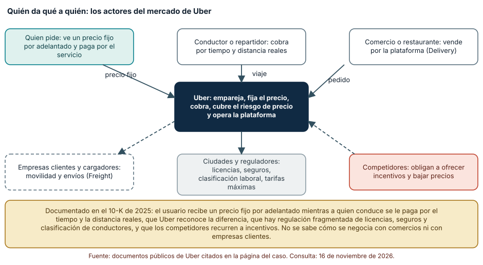

**Cómo leer la figura.** Uber está en el centro y cada flecha es un flujo de valor. Mire los dos actores de la fila inferior que no son clientes: las ciudades (que fijan reglas) y los competidores (que empujan incentivos); ambos limitan cuánto puede cobrar o retener Uber. **Dónde deja de valer.** No muestra magnitudes ni condiciones contractuales; el flujo hacia empresas clientes y cargadores es una indicación y no un dato publicado.

### Incentivos por tipo de usuario (análisis propio sobre hechos documentados)

- **Pasajero.** Quiere certeza de llegada y de costo; la plataforma le da un precio fijo por adelantado en muchos mercados ([U10]). Su incentivo para volver es el tiempo de espera, que depende de la densidad de conductores.
- **Conductor.** Quiere ingresos por hora y flexibilidad. La plataforma le paga por tiempo y distancia reales ([U10]); el incentivo de Uber es retenerlo con incentivos cuando la oferta escasea, y el 10-K reconoce que ha ofrecido «incentivos significativos» a conductores para competir ([U10]).
- **Repartidor y comercio.** El comercio busca ventas sin montar logística; el repartidor, trabajo de corta duración. La plataforma coordina tres partes ([U7]).
- **Cargador y transportista (Freight).** Segmento con ingresos de 5 099 millones y resultado ajustado de menos 33 millones en 2025 ([U10]): el dato sugiere que el mercado de carga no obtuvo las mismas economías de densidad.
- **Anunciante y miembro de Uber One.** Son palancas de ingreso por consumidor: publicidad cruzada desde 2022 y membresía con 46 millones de miembros ([U10]).
- **Regulador.** Incentivo propio: seguridad, competencia con el taxi y empleo. El 10-K describe límites de precios en emergencias, topes de tarifas en India y una ley de Honolulu de 2018 que limita el precio dinámico ([U10]).

### Competencia y por qué el mercado favoreció a Uber (análisis propio)

El 10-K de 2025 lista competidores en movilidad (Bolt, Didi, Lyft y Ola, entre otros), en autónomos (Waymo, Zoox y Tesla) y en reparto (DoorDash, Instacart, Gopuff, Rappi, Delivery Hero, Just Eat Takeaway y Amazon, entre otros) y afirma que los mercados tienen barreras de entrada bajas, costes de cambio bajos y competidores bien capitalizados ([U10]). Con esas condiciones, la ventaja de Uber no es automática. El análisis propio del curso plantea cuatro factores: (1) densidad local de oferta y demanda, que reduce la espera y refuerza la demanda; (2) una plataforma de cumplimiento reutilizable que permite lanzar verticales nuevas sin reconstruir ([U7]); (3) datos de ubicación y precios acumulados; (4) acceso a capital durante años de pérdidas ([U11]). **[No se sabe]** cuánto pesa cada factor ni por qué ganó en cada ciudad.

## Funcionalidad de principio a fin

### Recorrido de quien pide un viaje

1. **Primer contacto.** Se instala la aplicación. En 2010 el crecimiento comenzó con invitaciones a amigos y una gerencia que recorría el circuito de demos de empresas emergentes ([U1]).
2. **Registro.** **[No se sabe]** el proceso actual de verificación de usuarios y conductores en las fuentes consultadas.
3. **Pedir.** La persona indica origen y destino. **[Documentado]** que en mercados donde Uber gana la diferencia entre lo que paga el usuario y lo que cobra el conductor, el usuario recibe un precio fijo por adelantado ([U10]); no se documenta el cálculo.
4. **Emparejar.** La plataforma de cumplimiento (fulfillment) captura la intención y la satisface emparejándola con el proveedor adecuado ([U7]). Modela un viaje con una entidad Viaje (al menos dos puntos de paso) y una entidad Oferta, que representa a una persona real capaz de hacer el trabajo ([U7]).
5. **Viaje en curso.** El ciclo de vida se representa como un diagrama de estados jerárquico, formalizado con Protobuf y un marco genérico en Java ([U7]).
6. **Pago.** **[No se sabe]** cómo se procesa el cobro ni qué proveedores se usan. **[Documentado]** que Uber informa «reservas brutas» e «ingresos» como cifras distintas y que los pagos a conductores se registran como coste de ingresos ([U10]); y que en algunos mercados los usuarios pueden pagar en efectivo ([U10]).
7. **Soporte.** **[No se sabe]** el flujo de atención en las fuentes consultadas; el 10-K clasifica el soporte al cliente entre los costes «otros» del segmento ([U10]).
8. **Operación diaria.** La plataforma gestiona más de un millón de usuarios simultáneos y miles de millones de viajes al año ([U7]); cientos de microservicios dependen de ella como fuente de verdad del estado de viajes y sesiones.

### Recorridos por tipo de usuario

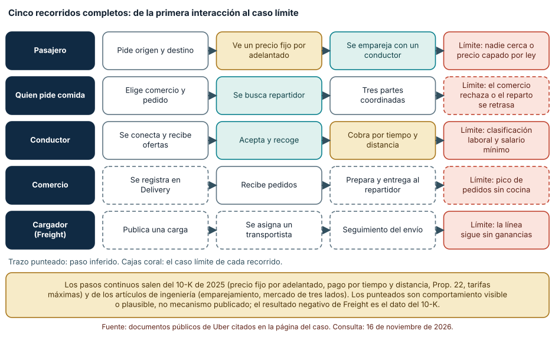

**Cómo leer la figura.** Cada fila es un usuario distinto; se lee de izquierda a derecha y la caja en coral es el caso límite. Los trazos punteados son pasos inferidos. Mire qué filas tienen más pasos punteados: son los segmentos de los que menos se publica (comercio y Freight). **Dónde deja de valer.** Es un recorrido visible, no un diagrama de estados del sistema; no mide cuántos usuarios llegan a cada límite.

**Pasajero y su caso límite.** **[Documentado]** el precio fijo por adelantado y las restricciones de precio: el 10-K cuenta que Uber aceptó no calcular tarifas por encima de los máximos gubernamentales en las principales ciudades de India donde procesos legales limitaron el precio dinámico, y que en 2018 Honolulu fue la primera ciudad de EE. UU. en limitar el precio dinámico cuando supera la tarifa máxima fijada por la ciudad ([U10]). El caso límite es el viaje sin oferta cercana o con precio topado: el diseño debe decidir entre esperar, subir incentivos o rechazar.

**Quien pide comida.** **[Documentado]** que la plataforma de cumplimiento modela un mercado con tres partes ([U7]). El caso límite, inferido, es la fricción entre dos reglas de tiempo: el repartidor espera mientras el comercio termina de preparar, y el cliente espera más. **[No se sabe]** cómo se decide la asignación de pedidos combinados.

**Conductor.** **[Documentado]** que se paga por tiempo y distancia reales y que su clasificación laboral es una cuestión regulatoria central: California aprobó la Proposición 22 en noviembre de 2020, vigente desde diciembre de 2020, que establece un marco para conductores independientes, y el Tribunal Supremo de California confirmó su constitucionalidad, aunque pueden seguir presentándose desafíos legales ([U10]). Otros lugares pueden clasificar a los conductores como empleados o cuasi empleados, y el 10-K lo reconoce como riesgo para el negocio ([U10]).

**Comercio.** **[No se sabe]** las condiciones comerciales. El caso límite, inferido, es el pico de pedidos sin capacidad de cocina, que el sistema no controla.

**Cargador (Freight).** **[Documentado]** que la línea de Freight tuvo ingresos de 5 245, 5 141 y 5 099 millones en 2023, 2024 y 2025, y un resultado ajustado de menos 64, menos 74 y menos 33 millones ([U10]). El caso límite: una línea de negocio que no crece ni gana dinero convive con las otras dentro de la misma plataforma.

## Negocio y economía

**Modelo (documentado).** Uber informa dos métricas separadas: las **reservas brutas** (el valor de lo que se compra en la plataforma) y los **ingresos** (lo que Uber reconoce como suyo). En 2024 las reservas fueron de 162 773 millones de USD y los ingresos de 43 978 millones ([U2]); en 2025, de 193 454 y 52 017 millones ([U10]).

**Cómo leer la figura.** Hay dos grupos de columnas: a la izquierda las reservas brutas y a la derecha los ingresos; en cada grupo la barra gris es 2023 y la teal 2024. Compare la altura de los dos grupos: los ingresos son una fracción de las reservas. **Dónde deja de valer.** La proporción (27 % en ambos años) es un cálculo propio y no es «la comisión» de Uber: los ingresos incluyen distintas líneas y reconocimientos contables que el comunicado no desglosa. Tampoco dice nada de rentabilidad por viaje.

**Por qué reservas e ingresos difieren: ingresos netos o brutos.** El 10-K explica que, en las transacciones de movilidad y reparto en las que Uber presta el servicio a conductores y comercios y no controla el bien o servicio que ellos prestan al usuario, el ingreso se registra en términos netos; y que en los mercados donde Uber se obliga a prestar el servicio al usuario por una tarifa, es responsable principal y registra el ingreso en términos brutos, con los pagos a conductores como coste de ingresos ([U10]). Es un dato contable que cambia la lectura: el «27 %» es una mezcla de modelos y no una comisión uniforme.

**Mezcla por línea.** En el cuarto trimestre de 2024 la movilidad aportó 22 800 millones de reservas (+18 % en dólares) y el reparto 20 100 millones (+18 %) ([U2]); el resto, hasta los 44 197 millones, es diferencia no desglosada en esa fuente. En 2025, los ingresos por segmento fueron 29 670 millones en movilidad (+18 %), 17 248 en reparto (+25 %) y 5 099 en carga (−1 %) ([U10]).

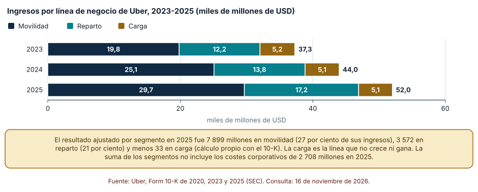

**Cómo leer la figura.** Cada barra es un año y cada color un segmento; la longitud total es el ingreso. Compare los segmentos: reparto crece más rápido que movilidad en 2025 y carga queda plana. **Dónde deja de valer.** Mide ingresos, no rentabilidad ni reservas; en los segmentos con ingreso neto y bruto, la comparación de tamaños mezcla definiciones contables.

### Unit economics con cifras citadas

El 10-K de 2025 permite ver qué se queda Uber de cada dólar de ingreso en cada segmento. Los «costes directos de participantes» son los pagos a quienes conducen o reparten y los incentivos a usuarios; «otros» incluye seguro de viaje, comisiones de tarjetas y bancos, soporte, tecnología y personal ([U10]).

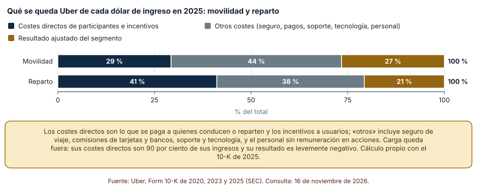

**Cómo leer la figura.** Cada barra es un segmento reducido a 100 % de sus ingresos; de izquierda a derecha, costes directos, otros costes y resultado. Mire cuánto pesa el segmento dorado: 27 % en movilidad y 21 % en reparto. **Dónde deja de valer.** Es el resultado ajustado del segmento antes de costes corporativos, de investigación de plataforma (2 708 millones) y de remuneración en acciones; no es el resultado operativo, que fue de 5 565 millones en total (10,7 % de los ingresos). Carga, cuyos costes directos son 90 % de sus ingresos, queda fuera.

**Cálculos propios con el 10-K de 2025 ([U10]).**

- **Margen de ingresos sobre reservas:** 26,9 % en 2025 (52 017 / 193 454) y 27,0 % en 2024.
- **Resultado operativo sobre ingresos:** 10,7 % en 2025 y 6,4 % en 2024 (2 799 / 43 978).
- **Viajes por consumidor activo:** unos 67 viajes por MAPC al año en 2025 (13 567 / 202) y 66 en 2024 (11 273 / 171); es un promedio grueso porque el MAPC es un promedio mensual y los viajes incluyen reparto.
- **Ingresos por empleado:** unos 1,5 millones de USD (52 017 / 34 000), una cifra de orden de magnitud: la plataforma opera con conductores independientes que no cuentan como empleados.

**Costos relevantes.** **[Documentado]** que los costes del segmento se dividen en pagos a participantes e incentivos, y «otros» (seguro de viaje, comisiones de pago, soporte al cliente, tecnología, personal) ([U10]). **[No se sabe]** el coste por viaje, de infraestructura o de seguros por separado. **[Inferido]** que, como la plataforma no es dueña de los vehículos, sus costos relevantes son tecnología, incentivos, seguros y operaciones locales.

### Años de pérdidas: de cuánto y cómo se financió

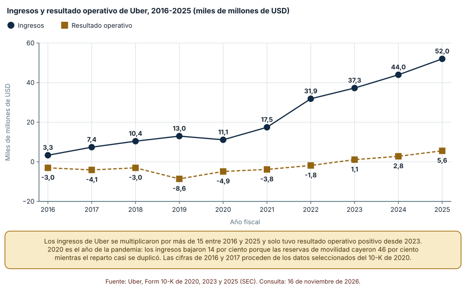

**Cómo leer la figura.** El eje horizontal es el año fiscal y el vertical los miles de millones de USD; la línea azul son los ingresos y la dorada el resultado operativo. Mire cuándo la línea dorada cruza el cero: en 2023. **Dónde deja de valer.** El resultado operativo no incluye las ganancias por inversiones (la partida «otros ingresos» fue de 4 993 millones en 2018 y de menos 7 029 en 2022), de modo que el resultado neto cuenta otra historia ([U11], [U12]); y no dice cuánto de las pérdidas fue incentivos para crecer frente a coste estructural.

**Interpretación.** Entre 2016 y 2022 Uber sumó pérdidas operativas cada año, con un mínimo de 8 596 millones en 2019, el año de la salida a bolsa ([U11]); los ingresos se multiplicaron por casi diez en seis años. El 10-K reconoce que, para competir, Uber ha bajado tarifas o comisiones y ofrecido incentivos significativos ([U10]). Un modelo de plataforma con efectos de densidad puede justificar pérdidas mientras busca esa densidad; la prueba es que el margen mejore cuando cada ciudad madura. **[No se sabe]** cuánto de la mejora de 2023-2025 es madurez y cuánto reducción de incentivos.

### Eficiencia, publicidad y membresía

Uber One tenía 46 millones de miembros al 31 de diciembre de 2025 y la división de publicidad se lanzó en octubre de 2022 ([U10]). Ambas son palancas de ingreso por consumidor que no requieren más conductores. **[No se sabe]** cuánto aportan al ingreso.

**Ventajas competitivas. [Inferido]** Una red con densidad en cada ciudad (más oferta reduce la espera, más demanda atrae oferta); datos de ubicación y de precios a escala; y una plataforma de cumplimiento que sirve a varias verticales, que Uber describe como «una capacidad fundacional que permite escalar rápido nuevas verticales» ([U7]).

## Arquitectura y esquemas

La arquitectura se recorre con zoom creciente. La regla de fondo: cada artículo de ingeniería de Uber retrata un sistema en un momento; no hay un plano vigente publicado.

### 6.1 Contexto

**Cómo leer la figura.** Se lee de izquierda a derecha: la demanda pide, la plataforma casa y la oferta responde. Las flechas continuas son el camino principal y la punteada es la relación con el comercio. **Dónde deja de valer.** No incluye mapas, medios de pago, seguros ni reguladores, que existen pero no se describen en las fuentes consultadas.

### 6.2 Contenedores

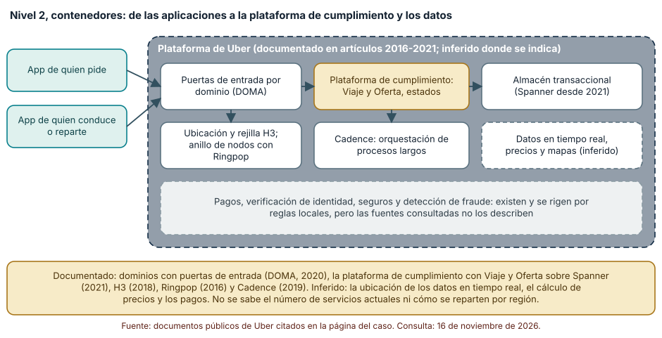

**Cómo leer la figura.** Cada caja es una pieza desplegable. Las aplicaciones entran por puertas de entrada por dominio; la plataforma de cumplimiento guarda el estado de viajes y ofertas en un almacén transaccional; debajo están ubicación, orquestación y datos. La caja gris punteada reúne lo que existe pero no se describe. **Dónde deja de valer.** Mezcla artículos de 2016 a 2021; no muestra cuántos servicios hay ni qué hace cada región.

**Qué documenta cada pieza.**

- **Aplicaciones.** **[No se sabe]** el detalle de los clientes móviles.
- **Dominios y puertas de entrada (DOMA).** Ver 6.3.
- **Plataforma de cumplimiento.** Ver 6.3 y 6.5.
- **Ubicación.** Ringpop sirvió primero al servicio geoespacial, que sigue la ubicación de los conductores en tiempo real para emparejar, y reemplazó a un sistema en memoria que buscaba entre todos los vehículos activos y se había vuelto insostenible ([U8]). H3 organiza el espacio en celdas ([U5]).
- **Orquestación.** Cadence, abierto en 2017, coordina la comunicación entre microservicios; ejemplos: registro, cumplimiento de pedidos, canalizaciones de aprendizaje automático y los flujos de Uber Eats ([U9]).
- **Datos en tiempo real.** Un artículo académico de 2021 de dos ingenieros de Uber describe una infraestructura de datos en tiempo real que recoge petabytes diarios de usuarios, conductores, restaurantes y clientes; menciona casos como incentivos a clientes, detección de fraude y predicción con modelos de aprendizaje automático, y dice que Uber usa mucho código abierto con adaptaciones ([U13]). **[Inferido]** que alimenta precios y despacho.

### 6.3 Componentes: de un monolito a microservicios y a dominios

**Monolito inicial.** El artículo de Uber sobre bases de datos cuenta que la arquitectura temprana era un backend monolítico en Python que usaba Postgres ([U4]).

**Postgres a MySQL.** El mismo artículo (26 de julio de 2016) enumera las limitaciones que encontraron en Postgres: arquitectura ineficiente para escrituras (amplificación de escritura, un campo cambia varios índices), replicación física verbosa que tensiona el ancho de banda entre centros de datos, soporte pobre de MVCC en réplicas (las transacciones largas bloquean la reproducción del registro y las réplicas se atrasan) y dificultad para actualizar de versión (la replicación física no cruza versiones mayores; las actualizaciones exigían muchas horas, y las instancias antiguas siguieron en la 9.2). En muchos casos usaron en su lugar Schemaless, una capa de particionado sobre MySQL ([U4]).

**Microservicios.** Uber adoptó microservicios «alrededor de 2012-2013» por flexibilidad, despliegue independiente y propiedad clara; con unos 2 200 microservicios críticos, sintió «los mismos compromisos»: más complejidad y funciones sencillas difíciles de construir ([U6]).

**DOMA (2020).** El artículo define cuatro ideas ([U6]): **dominios** (colecciones de microservicios relacionados), **capas** (qué puede llamar a qué), **puertas de entrada** (un único punto de entrada por dominio) y **extensiones** (puntos de extensión definidos para que un equipo añada lógica en el dominio de otro sin meterla en su código).

**Cómo leer la figura.** Cada banda es una capa; las flechas bajan porque una capa solo depende de las de abajo. Lea la etiqueta entre paréntesis de cada banda: más arriba, menos servicios afectados si falla; más abajo, más dependientes. **Dónde deja de valer.** Muestra la regla de diseño, no el inventario real de dominios (que el artículo no publica) ni cuántas capas hay.

**H3: la rejilla de oferta y demanda.** Un artículo de 27 de junio de 2018 explica que Uber mide oferta y demanda dentro de hexágonos en cada ciudad para calcular precios dinámicos, y que las celdas ayudan en el despacho: por ejemplo, detectar dos solicitudes cercanas a un conductor en un viaje compartido ([U5]). Las zonas por código postal o definidas por operaciones tienen formas irregulares y cambian, mientras las celdas de H3 son de tamaño comparable y estables. H3 tiene 16 resoluciones (0 a 15); cada una tiene celdas de un séptimo del área de la anterior; el hexágono tiene una sola distancia a sus seis vecinos (el cuadrado tiene dos); la rejilla se apoya en un icosaedro con 122 celdas base y doce pentágonos; las ubicaciones son enteros de 64 bits ([U5]).

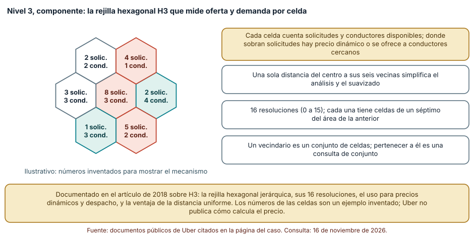

**Cómo leer la figura.** El hexágono central y sus seis vecinos muestran el mecanismo: cada celda cuenta solicitudes y conductores; las celdas coral tienen más solicitudes que conductores. A la derecha, los hechos de H3. **Dónde deja de valer.** Los números son un ejemplo inventado para ver el mecanismo; Uber no publica cómo calcula el precio, y la figura no muestra el efecto temporal ni la suavización entre celdas.

**Ringpop: pertenencia y reparto de trabajo.** Un artículo de 4 de febrero de 2016 describe una biblioteca de Node.js que convierte instancias independientes en nodos que cooperan: detectan miembros y fallos con una variante del protocolo SWIM sobre TCP, reparten el trabajo con hashing consistente sobre un anillo (con FarmHash) y reenvían cada petición al propietario («manejar o reenviar»), de modo que los clientes no necesitan saber cómo está particionada la aplicación ([U8]).

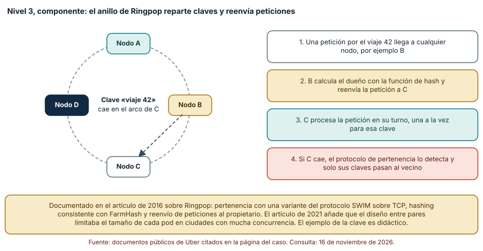

**Cómo leer la figura.** El círculo es el espacio de hashing y cada nodo es dueño del arco que sigue; la flecha punteada es el reenvío de B a C. Los cuatro pasos de la derecha se leen en orden. **Dónde deja de valer.** Es un esquema didáctico de la idea: no muestra el protocolo de pertenencia con detalle, las réplicas ni la serialización de peticiones por clave; el artículo de 2021 añade que el diseño entre pares limitaba el tamaño de cada pod ([U7]).

**Cadence.** Plataforma de orquestación abierta en 2017 que ofrece persistencia, colas y temporizadores propios, captura errores antes de que fallen los flujos y guarda un registro de cada acción para recuperar el estado si un trabajador muere y se reinicia; corre en capas (interfaz, historial, emparejamiento) con Cassandra como almacenamiento ([U9]).

**Plataforma de cumplimiento (rediseño).** La versión de 2014 usaba servicios `rt-demand` y `rt-supply` sin estado compartido, con entidades en Apache Cassandra y Redis, Ringpop para el particionado y la serialización por clave, y el patrón saga para transacciones de varias entidades; el diseño favorecía disponibilidad sobre consistencia ([U7]). El rediseño de 2021 usa Google Cloud Spanner como almacenamiento principal tras compararlo con otras bases, construyó el mecanismo LATE para garantizar la ejecución posterior a la confirmación al menos una vez (porque la versión pública de Spanner no tenía captura de cambios) y fue la primera base NewSQL de Uber ([U7]).

### 6.4 Secuencias de las operaciones críticas

**Operación 1: pedir un viaje.**

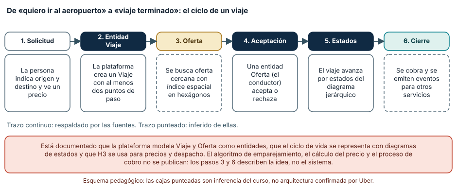

**Cómo leer la figura.** Siga los pasos de izquierda a derecha. Las cajas azul oscuro son las entidades y estados documentados; la dorada es el emparejamiento y la teal el cierre; las punteadas son inferidas. **Dónde deja de valer.** No describe el algoritmo de emparejamiento, el cálculo de precio ni la integración de pagos: Uber no los publica en las fuentes consultadas.

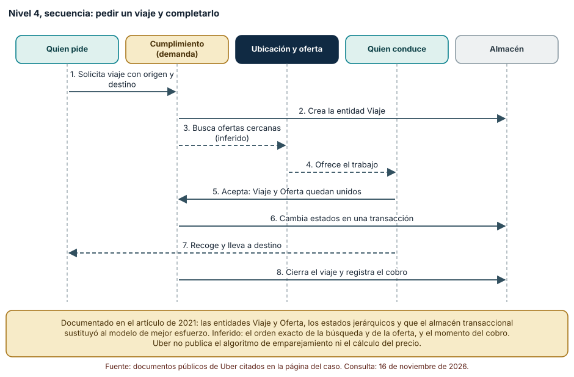

**Cómo leer la figura.** Cada columna es un participante y el tiempo baja; las flechas punteadas son inferidas. Mire qué mensajes llegan al almacén: crear, cambiar estados y cerrar; son los que deben ser transaccionales. **Dónde deja de valer.** Un diagrama de secuencia sugiere un orden único; en la realidad hay reintentos, ofertas a varios conductores y cancelaciones que no se muestran.

**Documentado sobre este flujo.**

- **Modelo del dominio.** Viaje (con al menos dos puntos de paso) y Oferta como entidades; `rt-demand` administra Viajes y `rt-supply` administra Ofertas ([U7]).
- **Estados.** Un diagrama de estados (statechart) es una máquina de estados finita en la que cada estado puede tener subestados anidados; permite niveles de abstracción jerárquicos ([U7]).
- **Fragmentación.** `rt-demand` se particionaba por identificador: todas las peticiones de un viaje van al trabajador que lo posee, y para consultar por pasajero se mantenía una tabla índice aparte ([U7]).

**Operación 2: escrituras concurrentes y el motivo del rediseño.** El artículo de 2021 explica que el diseño de 2014 no tenía atomicidad entre operaciones, de modo que había que reconciliar cuando fallaba una segunda escritura; que durante despliegues o conmutaciones de región podía haber «cerebro dividido» con escrituras concurrentes que se sobrescribían por la regla del último que escribe de Cassandra; y que las escrituras de varias entidades dejaban el sistema inconsistente de forma temporal ([U7]).

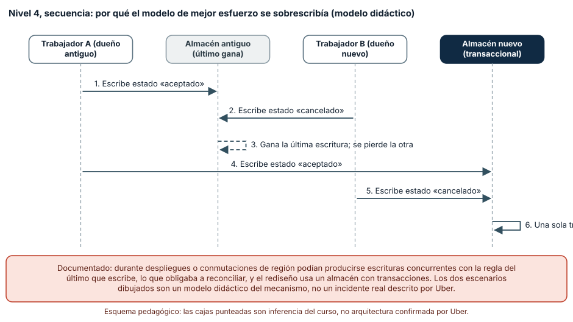

**Cómo leer la figura.** Las dos primeras columnas son el diseño antiguo; las dos últimas, el nuevo. En el antiguo, ambas escrituras tienen éxito y solo queda una; en el nuevo, una sola transacción gana. **Dónde deja de valer.** Es un modelo didáctico del mecanismo descrito, no un incidente real de Uber ni una reproducción del protocolo de Cassandra o de Spanner.

### 6.5 Datos y escala

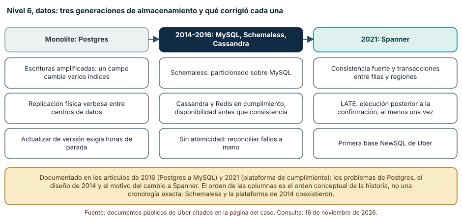

**Cómo leer la figura.** Cada columna es una generación y las cajas, qué rasgo tenía o qué corrigió. Mire cómo cada generación responde a un problema de la anterior. **Dónde deja de valer.** El orden es conceptual y las generaciones coexistieron; no muestra volúmenes ni los almacenes actuales de otros dominios.

| Magnitud | Valor | Fuente |
| --- | --- | --- |
| Usuarios simultáneos en la plataforma de cumplimiento | más de un millón | [U7] |
| Viajes al año en la plataforma de cumplimiento | miles de millones | [U7] |
| Transacciones de base de datos por día | miles de millones | [U7] |
| Ciudades | más de diez mil (artículo de 2021); más de 15 000 (10-K de 2025) | [U7], [U10] |
| Desarrolladores y flujos de cumplimiento | más de 500 y más de 120 | [U7] |
| Microservicios críticos (antes de DOMA) | unos 2 200 | [U6] |
| Aislamiento de fallos | dos dominios de fallo y dos regiones; «pods» con servicios fundamentales por ciudad | [U7] |

**[No se sabe]** el número actual de servicios, el reparto por regiones y cuánto del tráfico corre en nube pública o en centros de datos propios.

### 6.6 Despliegue y regiones

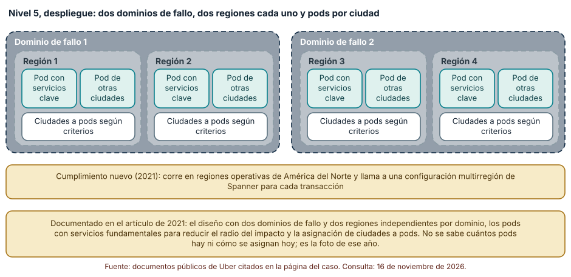

**Cómo leer la figura.** Cada grupo gris es un dominio de fallo y cada subgrupo, una región; dentro, los pods son las unidades de aislamiento. Mire cómo una ciudad vive en un pod, de modo que un fallo se limita a las ciudades de ese pod. **Dónde deja de valer.** Es la foto del artículo de 2021; no dice cuántos pods hay ni cómo se asignan hoy, y no muestra qué parte corre en nube pública.

**Documentado.** El diseño de 2014 usaba dos dominios de fallo con dos regiones independientes cada uno; para reducir el radio del impacto se añadieron pods con los servicios fundamentales y las ciudades se asignan a pods según varios criterios. El cumplimiento nuevo corre en regiones operativas de América del Norte y, para cada transacción, llama a una configuración multirregión de Spanner en Google Cloud ([U7]). Es una decisión de latencia frente a durabilidad que la teoría del curso llama arquitectura celular ([SE-536](../../classes/part-44-estilos-arquitectonicos/se-536-arquitectura-celular-y-radio-de-impacto/README.md)).

### 6.7 Resiliencia y degradación

| Nivel | Qué falla | Respuesta documentada o inferida | Coste |
| --- | --- | --- | --- |
| 1 | Un nodo del anillo | El protocolo de pertenencia detecta el fallo y las claves pasan a otro nodo ([U8]) | Posible reproceso de peticiones en vuelo |
| 2 | Un proceso largo falla a medias | Cadence guarda un registro de cada acción y recupera el estado ([U9]) | Un servicio más que operar |
| 3 | Un servicio de un dominio | Las puertas de entrada y las capas limitan quién depende de quién ([U6]) | Disciplina de diseño y costo de gobierno |
| 4 | Una ciudad o un pod | Los pods aíslan el impacto a las ciudades asignadas ([U7]) | Capacidad redundante por pod |
| 5 | Una región | Dos dominios de fallo con dos regiones independientes ([U7]) | Datos y capacidad replicados |
| 6 | Un proveedor completo | **[No se sabe]**; el cumplimiento nuevo depende de Spanner de Google Cloud ([U7]) | Dependencia explícita |

### 6.8 Seguridad, abuso y cumplimiento

- **Documentado: incidentes de datos.** El 10-K de 2020 cuenta que en abril de 2018 Uber firmó un decreto de consentimiento con la Comisión Federal de Comercio de EE. UU. que dura hasta 2038 y cubre dos incidentes de datos (los de 2014 y 2016), y que reguladores del Reino Unido, los Países Bajos y Francia impusieron multas por unos 1,6 millones de USD relacionadas con el de 2016 ([U11]). Es un dato de gobierno de la seguridad: un incidente produce obligaciones que duran veinte años.
- **Documentado: clasificación laboral y precios.** Ver el recorrido del conductor y del pasajero: Proposición 22 en California, topes de tarifa en India y Honolulu ([U10]).
- **Documentado: regulación de datos.** El 10-K de 2020 describe el RGPD, las leyes de California y la ley de Brasil como marcos que afectan el tratamiento de datos personales y las transferencias transfronterizas ([U11]).
- **Documentado: reglas de seguridad local.** Los regímenes de transporte exigen antecedentes, inspecciones, accesibilidad, seguro y capacitación ([U10]).
- **No se sabe.** El diseño de verificación de identidad de conductores y pasajeros, la detección de fraude, el modelo de amenazas y la gestión de claves.

**Cómo lo razonaría el curso.** Un mercado de tres lados con ubicación en tiempo real y pagos tiene activos sensibles (ubicación, identidad, medios de pago) y abusos propios (cuentas falsas, fraude de incentivos, manipulación de ubicación). El método del curso ([SE-385](../../classes/part-32-seguridad-privacidad-y-cumplimiento/se-385-principios-de-seguridad-y-modelos-de-amenaza/README.md), [SE-391](../../classes/part-32-seguridad-privacidad-y-cumplimiento/se-391-privacidad-por-diseno-y-minimizacion/README.md), [SE-394](../../classes/part-32-seguridad-privacidad-y-cumplimiento/se-394-cumplimiento-evidencia-y-limites-legales/README.md)) pide enumerar activos, atacantes y controles; las respuestas concretas de Uber no son públicas.

### 6.9 Observabilidad y operación

**Documentado.** Un mapa de dependencias entre cientos de microservicios es un problema de observabilidad que DOMA intenta reducir con capas y puertas ([U6]); Cadence ofrece un registro de cada acción como base de la depuración de flujos largos ([U9]); la infraestructura de datos en tiempo real recoge petabytes diarios que alimentan decisiones en segundos ([U13]). **No se sabe.** Los objetivos de nivel de servicio, la gestión de incidentes y la práctica de guardia.

### 6.10 Evolución de la arquitectura por etapas

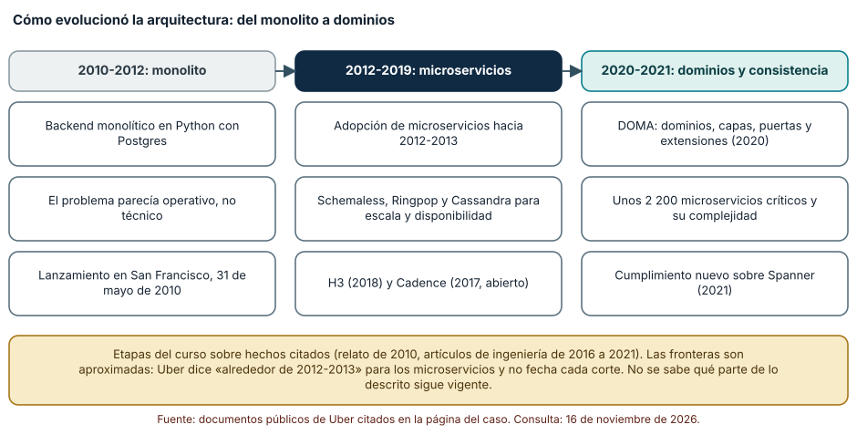

**Cómo leer la figura.** Cada columna es una etapa y las cajas son rasgos documentados; las flechas indican la secuencia. Mire cómo cada etapa responde a la anterior: del monolito a los servicios por flexibilidad, y de los servicios a los dominios por complejidad. **Dónde deja de valer.** La periodización es del curso; Uber dice «alrededor de 2012-2013» para los microservicios y no fecha cada corte.

**Por qué DOMA.** Con unos 2 200 microservicios críticos, Uber describe tanto los beneficios de los microservicios (despliegue independiente, propiedad) como sus costos (complejidad, dificultad de construir funciones simples) ([U6]). DOMA no los elimina: los agrupa en dominios con puertas de entrada. Es la evolución arquitectónica propia de una organización que creció por equipos ([SE-310](../../classes/part-25-arquitectura-de-software-y-dominio/se-310-arquitectura-socio-tecnica-y-limites-de-equipo/README.md)).

### 6.11 Alternativas descartadas y trade-offs (análisis propio)

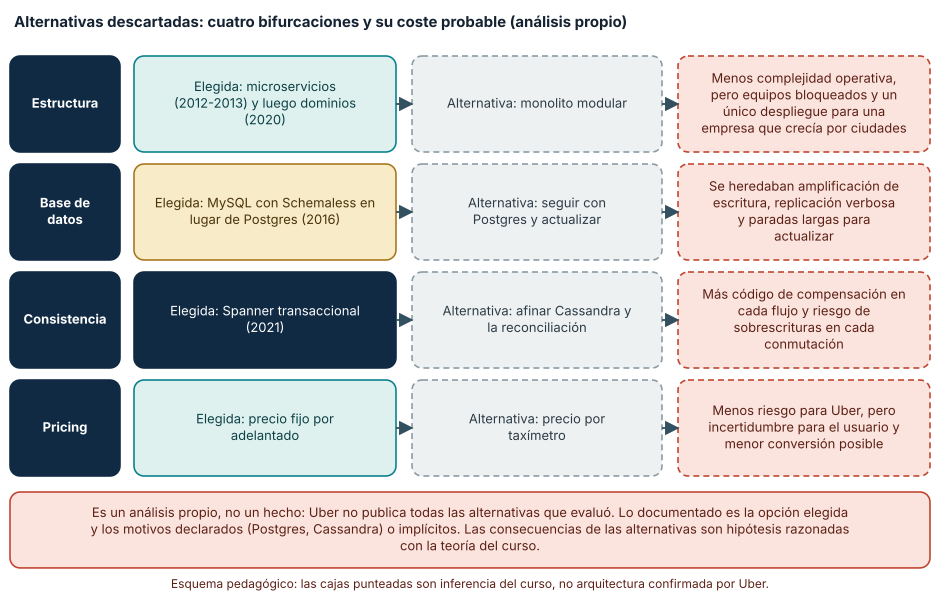

**Cómo leer la figura.** Cada fila es una bifurcación: lo elegido, la alternativa y su coste probable. Los trazos punteados son hipótesis. **Dónde deja de valer.** Son hipótesis del curso: Uber no publica todo lo que evaluó, aunque sí cuenta, para Spanner, que comparó con otras bases ([U7]).

**Precio fijo por adelantado.** En los mercados donde Uber gana la diferencia entre lo que paga el usuario y lo que cobra el conductor, el usuario recibe un precio fijo por adelantado y al conductor se le paga según tiempo y distancia reales ([U10]); es una elección con un efecto económico claro: traslada el riesgo de la duración del viaje del usuario a Uber.

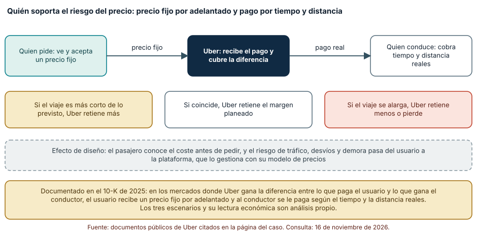

**Cómo leer la figura.** La fila superior son los dos pagos y Uber en medio; la fila inferior, tres escenarios según la duración real frente a la prevista. Mire el escenario coral, donde Uber retiene menos. **Dónde deja de valer.** Los escenarios son análisis propio de un mecanismo documentado; no hay cifras de cuánto se gana o pierde por viaje y el esquema no incluye precios dinámicos ni incentivos.

**Monolito frente a microservicios.** Un monolito modular habría evitado la complejidad que Uber reporta con 2 200 servicios, pero habría atado el despliegue de equipos que crecían por ciudades y productos ([U6]). Hoy la teoría del curso sugiere empezar por un monolito modular y dividir con razones; Uber lo hizo al revés por la velocidad de crecimiento ([SE-303](../../classes/part-25-arquitectura-de-software-y-dominio/se-303-monolito-modular-monolith-y-servicios/README.md), [SE-532](../../classes/part-44-estilos-arquitectonicos/se-532-microservicios-y-sus-costes-reales/README.md)).

**Cassandra frente a una base transaccional.** Afinar Cassandra habría mantenido la disponibilidad pero habría dejado la reconciliación en cada flujo; el rediseño cambió disponibilidad por consistencia ([U7]). La decisión muestra que la elección entre consistencia y disponibilidad ([SE-342](../../classes/part-28-concurrencia-y-sistemas-distribuidos/se-342-consistencia-disponibilidad-y-particiones/README.md)) no es una vez y para siempre: cambia con las necesidades del producto.

## Casos especiales y cómo se resuelven

Cada caso se expone como: situación, mecanismo, decisión, trade-off, y qué se sabe.

- **Picos de demanda.** **[Inferido]** que la rejilla H3 y los precios dinámicos reparten demanda en el espacio y en el tiempo ([U5]); el artículo no describe un pico concreto. *Trade-off documentado:* los precios dinámicos están limitados en emergencias y en algunas ciudades ([U10]).
- **Fallos parciales y regiones.** La arquitectura de 2014 usaba dos dominios de fallo y dos regiones independientes, y para reducir el radio de impacto se añadieron «pods» con los servicios fundamentales; las ciudades se asignan a pods según varios criterios ([U7]).
- **Consistencia.** El diseño anterior sacrificó consistencia por disponibilidad y latencia: la consistencia dependía de mecanismos «de mejor esfuerzo»; sin atomicidad había que reconciliar fallos; con Cassandra y la regla del último que escribe, las escrituras concurrentes (durante despliegues o failovers regionales) podían sobrescribirse ([U7]). Por eso se pasó a una base transaccional. *Trade-off:* mayor latencia por la coordinación de transacciones multirregión.
- **Orquestación de procesos largos.** Cadence mantiene un registro de cada acción para recuperar el estado tras un error ([U9]).
- **Riesgo de precio.** El precio fijo por adelantado traslada a Uber el riesgo de que el viaje dure más ([U10], análisis propio).
- **Pandemia.** En 2020 las reservas de movilidad cayeron 46 % y las de reparto crecieron 109 %; los ingresos bajaron 14 % ([U11]). La plataforma de tres lados permitió rebalancear hacia el reparto; el sistema técnico no se rediseñó por ello según las fuentes consultadas.
- **Clasificación laboral.** California aprobó la Proposición 22 en noviembre de 2020 y el 10-K de 2025 recoge que se confirmó su constitucionalidad, con riesgo de nuevos litigios y de pasivos por periodos anteriores ([U10]). *Decisión de negocio, no técnica,* que condiciona la estructura de costes.
- **Precios regulados.** Topes de tarifa en India y en Honolulu ([U10]).
- **Incidentes de datos.** Decreto de consentimiento hasta 2038 por los incidentes de 2014 y 2016 ([U11]).
- **Abuso y fraude.** **[No se sabe]** en las fuentes consultadas; el artículo académico menciona la detección de fraude como caso de uso de datos en tiempo real ([U13]).
- **Cumplimiento regional.** Regímenes de licencias, seguro, antecedentes y accesibilidad que varían por jurisdicción ([U10]); algunas jurisdicciones prohíben ciertos productos o imponen restricciones operativas ([U10]).
- **Sin conexión.** **[No se sabe]** cómo se comporta la app sin red.
- **Costes.** Los pagos en efectivo se reconocen solo cuando se cobran a los conductores, porque la cobrabilidad no es probable hasta entonces ([U10]).
- **Crecimiento de producto.** DOMA se creó para que añadir una función no obligue a cambiar muchos servicios de equipos distintos ([U6]).

## Línea de tiempo

**Cómo leer la figura.** El eje es el año. El carril de arriba es la vida corporativa; el de abajo, las etapas de arquitectura. Las tres líneas verticales son hitos. **Dónde deja de valer.** Las fronteras del carril de arquitectura son aproximadas: Uber dice «alrededor de 2012-2013» y no fecha cada corte.

- **Fines de 2008.** Conversación en LeWeb, París, entre Camp y Kalanick ([U1]).
- **Marzo de 2009.** Camp trabaja «en serio» en el prototipo ([U1]).
- **Verano de 2009.** Kalanick se suma como «Chief Incubator» ([U1]).
- **Enero de 2010.** Prueba en Nueva York con tres coches ([U1]).
- **Marzo de 2010.** Primer día de Ryan Graves como gerente general ([U1]).
- **31 de mayo de 2010.** Lanzamiento en San Francisco ([U1]).
- **Circa 2012-2013.** Adopción de microservicios ([U6]).
- **2014.** Se construye la arquitectura de cumplimiento que luego se reescribe; primer incidente de datos citado en el decreto de 2018 ([U7], [U11]).
- **4 de febrero de 2016.** Se publica Ringpop ([U8]).
- **26 de julio de 2016.** Se publica el artículo de Postgres a MySQL ([U4]); en 2016 ocurre el segundo incidente de datos ([U11]).
- **2017.** Cadence se abre como código ([U9]).
- **Abril de 2018.** Decreto de consentimiento con la FTC hasta 2038 ([U11]).
- **27 de junio de 2018.** Se publica H3 ([U5]).
- **9 de mayo de 2019.** Se fija el precio de la salida a bolsa ([U3]); pérdida operativa de 8 596 millones en el año ([U11]).
- **23 de julio de 2020.** Se publica DOMA ([U6]).
- **Noviembre de 2020.** Se aprueba la Proposición 22 en California ([U10]).
- **27 de julio de 2021.** Se publica el rediseño de la plataforma de cumplimiento ([U7]).
- **Octubre de 2022.** Lanzamiento oficial de la división de publicidad ([U10]).
- **2023.** Primer resultado operativo positivo del periodo analizado: 1 110 millones ([U12]).
- **5 de febrero de 2025.** Resultados de 2024 ([U2]).
- **Febrero de 2026.** Se presenta el 10-K de 2025: 52 017 millones de ingresos y 5 565 millones de resultado operativo ([U10]).

### Decisiones clave, giros y correcciones

- **2010: empezar «poco técnico».** Una apuesta de operación que descubrió después su complejidad ([U1]).
- **2012-2013: microservicios por velocidad.** Una decisión de organización que luego exigió reglas ([U6]).
- **2016: abandonar Postgres.** Una corrección documentada por límites de escritura, replicación y actualización ([U4]).
- **2018: asumir un decreto de veinte años.** Una corrección de gobierno de seguridad tras dos incidentes ([U11]).
- **2020: DOMA.** Una corrección de complejidad sin volver al monolito ([U6]).
- **2020: Proposición 22.** Un giro regulatorio que consolida el modelo de contratistas en California ([U10]).
- **2021: transaccional.** Una corrección técnica: del mejor esfuerzo a las transacciones ([U7]).
- **2022-2025: de crecer a rentabilizar.** Publicidad, membresía y reparto como palancas; el resultado operativo pasa de negativo a positivo ([U10]).

## Vínculo con el curso

| Concepto | Clases | Qué ilustra el caso |
| --- | --- | --- |
| Modelos de negocio de plataforma y métricas | [SE-133](../../classes/part-11-economia-metricas-y-decisiones-de-producto/se-133-modelos-de-negocio-y-sostenibilidad/README.md), [SE-136](../../classes/part-11-economia-metricas-y-decisiones-de-producto/se-136-metricas-de-adopcion-retencion-y-tarea-util/README.md), [SE-139](../../classes/part-11-economia-metricas-y-decisiones-de-producto/se-139-north-star-guardrails-y-metricas-contrarias/README.md) | Mercado de tres lados; reservas brutas frente a ingresos; MAPCs como métrica de adopción |
| Costos y economía del software | [SE-134](../../classes/part-11-economia-metricas-y-decisiones-de-producto/se-134-costos-de-construccion-operacion-y-oportunidad/README.md), [SE-453](../../classes/part-37-gestion-liderazgo-y-practica-profesional/se-453-economia-del-software-y-costo-total/README.md) | Qué parte de lo que mueve la plataforma se queda como ingreso |
| FinOps y costo por resultado | [SE-140](../../classes/part-11-economia-metricas-y-decisiones-de-producto/se-140-finops-de-producto-y-costo-por-resultado/README.md) | Costes por segmento: directos, seguros, pagos y soporte |
| Hipótesis y criterios de abandono | [SE-124](../../classes/part-10-descubrimiento-y-estrategia-de-producto/se-124-hipotesis-supuestos-y-preguntas-criticas/README.md), [SE-130](../../classes/part-10-descubrimiento-y-estrategia-de-producto/se-130-criterios-de-no-exito-y-decisiones-de-abandono/README.md) | Las apuestas de densidad y de oferta flexible |
| Domain-driven design | [SE-305](../../classes/part-25-arquitectura-de-software-y-dominio/se-305-domain-driven-design-estrategico-y-tactico/README.md), [SE-310](../../classes/part-25-arquitectura-de-software-y-dominio/se-310-arquitectura-socio-tecnica-y-limites-de-equipo/README.md) | Dominios con puertas de entrada y propiedad por equipo |
| Monolito, servicios y microservicios | [SE-303](../../classes/part-25-arquitectura-de-software-y-dominio/se-303-monolito-modular-monolith-y-servicios/README.md), [SE-532](../../classes/part-44-estilos-arquitectonicos/se-532-microservicios-y-sus-costes-reales/README.md), [SE-533](../../classes/part-44-estilos-arquitectonicos/se-533-bff-api-gateway-y-service-mesh/README.md) | Del monolito Python a 2 200 microservicios y el coste de complejidad |
| Arquitectura hexagonal y puertos | [SE-304](../../classes/part-25-arquitectura-de-software-y-dominio/se-304-capas-hexagonal-clean-y-ports-and-adapters/README.md) | Gateways y extensiones como fronteras de un dominio |
| Arquitectura celular y radio de impacto | [SE-536](../../classes/part-44-estilos-arquitectonicos/se-536-arquitectura-celular-y-radio-de-impacto/README.md), [SE-379](../../classes/part-31-calidad-rendimiento-y-resiliencia/se-379-circuit-breakers-bulkheads-y-degradacion/README.md) | Pods por ciudad para limitar fallos |
| Vistas de arquitectura | [SE-302](../../classes/part-25-arquitectura-de-software-y-dominio/se-302-vistas-logica-runtime-datos-y-despliegue/README.md) | Los niveles de la sección de arquitectura |
| Event-driven y CQRS | [SE-306](../../classes/part-25-arquitectura-de-software-y-dominio/se-306-event-driven-cqrs-y-event-sourcing/README.md) | Eventos emitidos por la plataforma de cumplimiento |
| Modelado de datos y consultas | [SE-313](../../classes/part-26-datos-persistencia-y-recuperacion/se-313-modelado-conceptual-logico-y-fisico/README.md), [SE-317](../../classes/part-26-datos-persistencia-y-recuperacion/se-317-consultas-indices-y-patrones-de-acceso/README.md) | Tabla índice por pasajero; índices espaciales |
| Bases relacionales, documentales y clave-valor | [SE-314](../../classes/part-26-datos-persistencia-y-recuperacion/se-314-relacional-documental-clave-valor-grafos-y-series/README.md) | Postgres frente a MySQL; Cassandra frente a Spanner |
| Transacciones, aislamiento e invariantes | [SE-315](../../classes/part-26-datos-persistencia-y-recuperacion/se-315-transacciones-aislamiento-y-concurrencia/README.md), [SE-316](../../classes/part-26-datos-persistencia-y-recuperacion/se-316-restricciones-invariantes-y-consistencia/README.md) | Pasar de «mejor esfuerzo» a transacciones |
| Consistencia, disponibilidad y particiones | [SE-342](../../classes/part-28-concurrencia-y-sistemas-distribuidos/se-342-consistencia-disponibilidad-y-particiones/README.md), [SE-319](../../classes/part-26-datos-persistencia-y-recuperacion/se-319-replicacion-particion-y-distribucion/README.md), [SE-345](../../classes/part-28-concurrencia-y-sistemas-distribuidos/se-345-replicacion-sharding-y-balanceo/README.md) | Último que escribe en Cassandra frente a consistencia en Spanner |
| Consenso y coordinación | [SE-343](../../classes/part-28-concurrencia-y-sistemas-distribuidos/se-343-consenso-eleccion-y-coordinacion/README.md) | Ringpop: pertenencia por gossip y hashing consistente |
| Sagas y compensación | [SE-329](../../classes/part-27-integracion-eventos-y-mensajeria/se-329-outbox-inbox-sagas-y-compensacion/README.md), [SE-344](../../classes/part-28-concurrencia-y-sistemas-distribuidos/se-344-idempotencia-y-procesamiento-distribuido/README.md), [SE-246](../../classes/part-20-backend-apis-y-procesamiento-asincrono/se-246-idempotencia-reintentos-y-deduplicacion/README.md) | Cadence como orquestación de flujos largos |
| Máquinas de estados | [SE-520](../../classes/part-43-patrones-de-diseno-empresariales-y-de-resiliencia/se-520-gof-conductuales-strategy-observer-command-state-y-template-method/README.md), [SE-057](../../classes/part-04-pensamiento-computacional-y-resolucion-de-problemas/se-057-modelado-de-estado-transiciones-y-eventos/README.md) | Viaje y Oferta modelados con statecharts |
| Sistemas geoespaciales | [SE-285](../../classes/part-23-software-especializado-y-dominios/se-285-sistemas-geoespaciales-y-temporales/README.md) | H3: rejilla hexagonal jerárquica |
| Migraciones de datos sin interrupción | [SE-439](../../classes/part-36-mantenimiento-y-modernizacion-legacy/se-439-migraciones-de-datos-sin-interrupcion/README.md), [SE-440](../../classes/part-36-mantenimiento-y-modernizacion-legacy/se-440-compatibilidad-coexistencia-y-doble-escritura/README.md), [SE-318](../../classes/part-26-datos-persistencia-y-recuperacion/se-318-migraciones-compatibles-y-evolucion-de-esquema/README.md) | De Postgres a Schemaless y de Cassandra a Spanner sin parar el servicio |
| Evolución y reescritura | [SE-442](../../classes/part-36-mantenimiento-y-modernizacion-legacy/se-442-economia-de-reescribir-frente-a-evolucionar/README.md), [SE-437](../../classes/part-36-mantenimiento-y-modernizacion-legacy/se-437-strangler-branch-by-abstraction-y-anticorruption/README.md), [SE-308](../../classes/part-25-arquitectura-de-software-y-dominio/se-308-fitness-functions-y-arquitectura-evolutiva/README.md) | Reescribir la plataforma de 2014 tras un análisis |
| Observabilidad y SLO | [SE-421](../../classes/part-35-observabilidad-sre-e-incidentes/se-421-senales-eventos-y-observabilidad-util/README.md), [SE-425](../../classes/part-35-observabilidad-sre-e-incidentes/se-425-sli-slo-sla-y-presupuestos-de-error/README.md) | Visibilidad de dependencias profundas (mapas de microservicios) |
| Plataformas internas | [SE-358](../../classes/part-29-cloud-plataforma-e-infraestructura/se-358-plataformas-internas-y-golden-paths/README.md), [SE-417](../../classes/part-34-ci-cd-iac-y-platform-engineering/se-417-developer-portals-y-capacidades-de-plataforma/README.md) | Plataforma de cumplimiento como capacidad reutilizable |
| Seguridad, privacidad y cumplimiento | [SE-385](../../classes/part-32-seguridad-privacidad-y-cumplimiento/se-385-principios-de-seguridad-y-modelos-de-amenaza/README.md), [SE-391](../../classes/part-32-seguridad-privacidad-y-cumplimiento/se-391-privacidad-por-diseno-y-minimizacion/README.md), [SE-394](../../classes/part-32-seguridad-privacidad-y-cumplimiento/se-394-cumplimiento-evidencia-y-limites-legales/README.md), [SE-152](../../classes/part-12-ingenieria-de-requisitos/se-152-requisitos-regulatorios-de-datos-y-seguridad/README.md) | Decretos, datos de ubicación y regulación local |

### Preguntas de discusión

1. Uber trasladó a su balance el riesgo de la duración del viaje con el precio fijo por adelantado. ¿Qué otras decisiones de producto trasladan riesgo del usuario a la plataforma y cómo se gestionan?
2. El diseño de 2014 priorizó disponibilidad; el de 2021, consistencia. ¿Qué cambió en el producto que justificara el cambio? ¿Qué datos del sistema le habrían advertido antes?
3. Con 2 200 microservicios críticos, Uber creó DOMA. ¿Cuándo, en el crecimiento de una empresa, cree que sería el momento de introducir dominios y puertas de entrada, y qué señales usaría?
4. La línea Freight tuvo resultado ajustado negativo en 2023, 2024 y 2025. ¿Qué criterios usaría para decidir mantener, rediseñar o cerrar una línea que comparte la plataforma?
5. Un decreto de consentimiento de veinte años cubre dos incidentes de datos. ¿Qué prácticas de ingeniería reducirían la probabilidad y el coste de un episodio así?
6. Los «ingresos» de Uber mezclan modelos neto y bruto. ¿Qué cuidado pondría para comparar su margen con el de otra empresa de plataforma?

### Mini-ejercicios de análisis

1. **Mida su densidad.** Para un marketplace que conozca, defina una unidad geográfica o de categoría (como una celda de H3), defina qué contaría en ella (oferta y demanda) y cómo detectaría un desequilibrio.
2. **Reproduzca el cálculo de estructura de ingresos.** Con los datos de un segmento de una empresa pública, descomponga los ingresos en costes directos, otros y resultado, como en la figura de 2025, e interprete cuál es la palanca principal.
3. **Escriba un modelo didáctico de una carrera de escrituras.** Describa, en una secuencia de seis pasos, un caso de escrituras concurrentes en un sistema suyo y cómo lo evitaría con una transacción.
4. **Construya una escalera de resiliencia** de seis niveles para una plataforma con ciudades y regiones, y diga qué prueba haría en cada nivel.
5. **Clasifique las afirmaciones de este caso.** Tome diez afirmaciones técnicas y márquelas como documentadas, inferidas o desconocidas, y busque en qué fuente se apoya cada una.

## Qué no generalizar

**Qué aprender.**

- Un problema «operativo» puede ser un problema de sistemas distribuidos; subestimar eso es parte de la historia ([U1]).
- La arquitectura que sirve a 10 000 usuarios no sirve a 10 000 000: Uber reescribió componentes centrales (base de datos y plataforma de cumplimiento) con razones declaradas (consistencia y escala) ([U4], [U7]).
- Los microservicios cuestan: con 2 200 servicios, Uber introdujo reglas (dominios, capas, puertas) para reducir complejidad sin abandonarlos ([U6]).
- Elegir consistencia o disponibilidad es una decisión de negocio con consecuencias: la regla del último que escribe provocó sobrescrituras durante despliegues y failovers ([U7]).
- Un modelo de plataforma puede operar con pérdidas durante años si hay un camino a efectos de densidad; no todas las líneas lo logran (Freight) ([U10], [U11]).
- La regulación es parte de la arquitectura del negocio: clasificación laboral, precios y datos condicionan costos y diseño ([U10]).

**Qué no generalizar.**

- **No** hace falta Spanner, Ringpop ni DOMA a menos que tenga un problema de esa magnitud. Un monolito modular suele ser el punto de partida correcto.
- **No** se debe asumir que los artículos describen el sistema actual: cada uno retrata un momento.
- Las métricas de Uber (reservas brutas, MAPCs) son suyas; no son comparables sin comprobar las definiciones.
- Las pérdidas de Uber no son una receta: dependieron de acceso a capital, de efectos de densidad y de un contexto de tasas e inversión concretos.
- Este caso no valora de forma completa la regulación del trabajo en plataformas ni la seguridad de los pasajeros: solo recoge lo que dicen las fuentes citadas.

## Fuentes públicas verificadas

Fecha de consulta de todas: 16 de noviembre de 2026. Verificadas con `curl` (para los documentos de la SEC, con un agente de usuario identificado) o, cuando el sitio rechaza clientes automáticos, con la herramienta de lectura web.

- **[U1]** Travis Kalanick, «Uber's Founding», 22 de diciembre de 2010: [https://www.uber.com/us/en/newsroom/ubers-founding](https://www.uber.com/us/en/newsroom/ubers-founding). Respalda la idea de 2008, el prototipo de 2009, Ryan Graves, la prueba de enero de 2010 y el lanzamiento del 31 de mayo de 2010.
- **[U2]** Uber, «Uber Announces Results for Fourth Quarter and Full Year 2024», 5 de febrero de 2025: [https://investor.uber.com/news-events/news/press-release-details/2025/Uber-Announces-Results-for-Fourth-Quarter-and-Full-Year-2024/default.aspx](https://investor.uber.com/news-events/news/press-release-details/2025/Uber-Announces-Results-for-Fourth-Quarter-and-Full-Year-2024/default.aspx). Respalda las cifras de 2023-2024 y del cuarto trimestre.
- **[U3]** Uber, «Uber announces pricing of initial public offering», 9 de mayo de 2019: [https://investor.uber.com/news-events/news/press-release-details/2019/Uber-Announces-Pricing-of-Initial-Public-Offering/default.aspx](https://investor.uber.com/news-events/news/press-release-details/2019/Uber-Announces-Pricing-of-Initial-Public-Offering/default.aspx).
- **[U4]** Evan Klitzke, Uber Engineering, «Why Uber Engineering Switched from Postgres to MySQL», 26 de julio de 2016: [https://www.uber.com/blog/postgres-to-mysql-migration/](https://www.uber.com/blog/postgres-to-mysql-migration/).
- **[U5]** Isaac Brodsky, Uber Engineering, «H3: Uber's Hexagonal Hierarchical Spatial Index», 27 de junio de 2018: [https://www.uber.com/blog/h3/](https://www.uber.com/blog/h3/).
- **[U6]** Adam Gluck, «Introducing Domain-Oriented Microservice Architecture», 23 de julio de 2020: [https://www.uber.com/blog/microservice-architecture/](https://www.uber.com/blog/microservice-architecture/).
- **[U7]** Ashwin Neerabail, Kamran Massoudi y Ankit Srivastava, Uber Engineering, «Fulfillment Platform Rearchitecture», 27 de julio de 2021: [https://www.uber.com/blog/fulfillment-platform-rearchitecture/](https://www.uber.com/blog/fulfillment-platform-rearchitecture/).
- **[U8]** Lucie Lozinski, Uber Engineering, «Ringpop», 4 de febrero de 2016: [https://www.uber.com/blog/ringpop-open-source-nodejs-library/](https://www.uber.com/blog/ringpop-open-source-nodejs-library/).
- **[U9]** Uber Engineering, «Cadence overview», 12 de noviembre de 2019: [https://www.uber.com/blog/open-source-orchestration-tool-cadence-overview/](https://www.uber.com/blog/open-source-orchestration-tool-cadence-overview/).
- **[U10]** Uber Technologies, Form 10-K del año fiscal 2025 (SEC, presentado el 13 de febrero de 2026; descarga con agente de usuario identificado): [https://www.sec.gov/Archives/edgar/data/1543151/000154315126000015/uber-20251231.htm](https://www.sec.gov/Archives/edgar/data/1543151/000154315126000015/uber-20251231.htm). Respalda las cifras de 2024 y 2025, los segmentos, los costes por segmento, el precio fijo por adelantado, el reconocimiento neto y bruto, la competencia, la Proposición 22, los topes de tarifa, Uber One y la publicidad.
- **[U11]** Uber Technologies, Form 10-K del año fiscal 2020 (SEC, presentado el 1 de marzo de 2021): [https://www.sec.gov/Archives/edgar/data/1543151/000154315121000014/uber-20201231.htm](https://www.sec.gov/Archives/edgar/data/1543151/000154315121000014/uber-20201231.htm). Respalda los datos de 2016 a 2020, la pandemia, el decreto con la FTC y las multas de 2018.
- **[U12]** Uber Technologies, Form 10-K del año fiscal 2023 (SEC, presentado el 15 de febrero de 2024): [https://www.sec.gov/Archives/edgar/data/1543151/000154315124000012/uber-20231231.htm](https://www.sec.gov/Archives/edgar/data/1543151/000154315124000012/uber-20231231.htm). Respalda los datos de 2021 a 2023.
- **[U13]** Yupeng Fu y Chinmay Soman, «Real-time Data Infrastructure at Uber», arXiv 2104.00087, 31 de marzo de 2021 (SIGMOD '21): [https://arxiv.org/abs/2104.00087](https://arxiv.org/abs/2104.00087). Respalda la descripción general de la infraestructura de datos en tiempo real.

**Límites.** No se ejecutó ni midió ningún sistema de Uber; todo es lectura de fuentes públicas. El documento S-1 de la SEC no pudo leerse con `curl` (403) y no se usa. El sitio del blog de ingeniería rechaza clientes automáticos, por lo que sus artículos se leyeron con la herramienta de lectura web y solo se usan sus datos explícitos. Las cifras de 2016 y 2017 pueden estar reexpresadas respecto a los informes originales. Los apartados rotulados «análisis propio» no son hechos de la empresa.

---

[↑ Casos de éxito](README.md) · [← WhatsApp](whatsapp.md) · [Mercado Libre →](mercado-libre.md)
