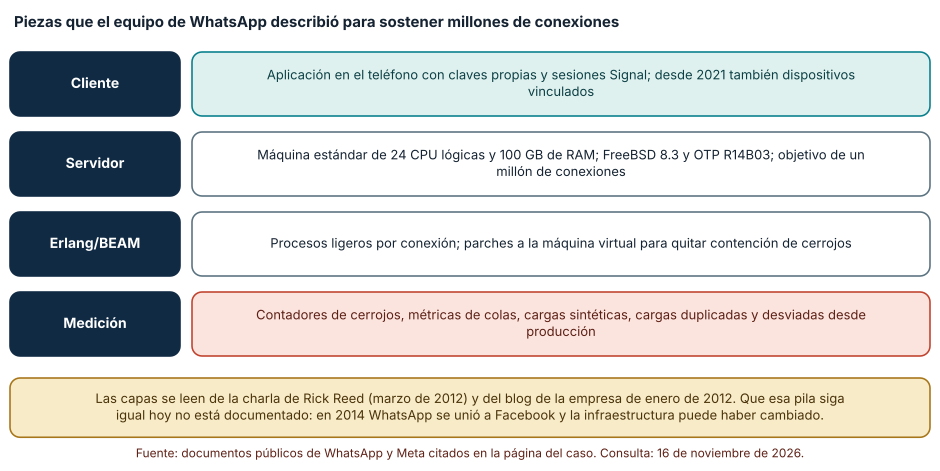
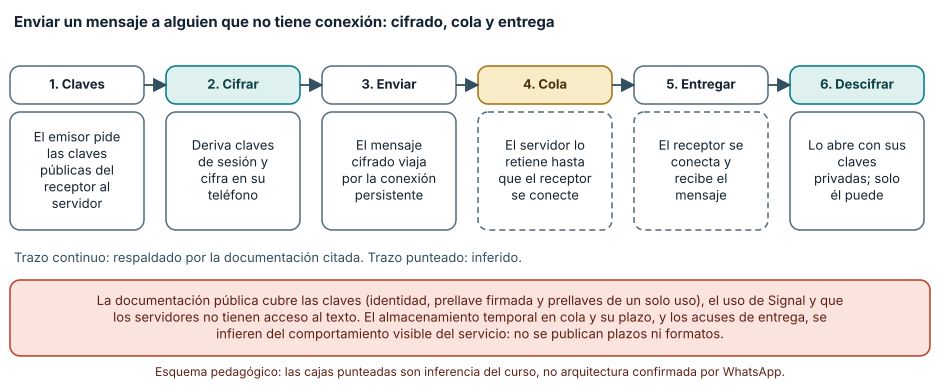
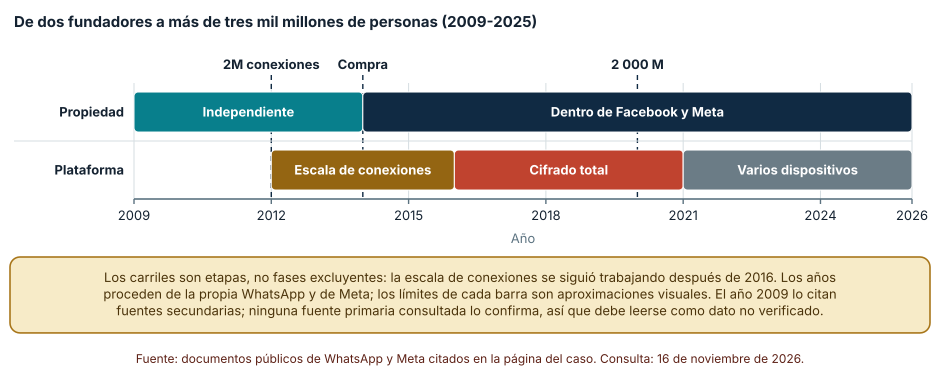

# WhatsApp

[↑ Casos de éxito](README.md) · [← Netflix](netflix.md) · [Uber →](uber.md)

> **Caso de éxito.** WhatsApp llegó a más de 450 millones de usuarios mensuales antes de ser comprada por Facebook y hoy declara más de 3 000 millones de personas en más de 180 países. Es un caso de escala por simplicidad: pocas funciones, una tecnología elegida con criterio y cifrado como propiedad del producto. Este caso separa lo que está publicado de lo que se supone.

**Cómo leer las etiquetas.** **[Documentado]** = lo dice una fuente pública citada al final; **[Inferido]** = lo deduce el curso y puede ser falso; **[No se sabe]** = no hay fuente pública consultada. Las cifras llevan año y fuente. No se reconstruye ninguna arquitectura confidencial.

## Ficha histórica

| Dato | Valor | Fuente |
| --- | --- | --- |
| Nombre | WhatsApp (hoy parte de Meta) | [W1] |
| Fundadores | Jan Koum y Brian Acton, que habían pasado 20 años combinados en Yahoo | [W1] |
| Año de fundación | 2009 según fuentes secundarias; **[No se sabe]** con fuente primaria: WhatsApp no publica la fecha en las páginas consultadas | — |
| Lanzamiento | **[No se sabe]** con fuente primaria en este caso | — |
| Sede | **[No se sabe]** con las fuentes citadas | — |
| Adquisición | Anunciada el 19 de febrero de 2014 por Facebook: unos 16 000 millones de USD (4 000 en efectivo y 12 000 en acciones) más 3 000 millones en acciones restringidas para fundadores y empleados, en total unos 19 000 millones | [W2] |
| Cifras al ser comprada | Más de 450 millones de personas usándola cada mes; 70 % activas en un día; más de un millón de registros nuevos por día | [W2] |
| Escala posterior | Más de 2 000 millones de usuarios (12 de febrero de 2020); más de 3 000 millones en más de 180 países en la página oficial de 2026 | [W3], [W1] |
| Estado actual | Aplicación separada dentro de Meta; Koum entró al directorio de Facebook al cerrarse la compra | [W1], [W2] |

**Qué no se afirma.** Hay relatos muy difundidos sobre el inicio de la empresa (financiación inicial, nombre de la oficina, número de empleados). Ninguna de las fuentes primarias consultadas los confirma, así que el caso no los repite.

## Contexto y problema

**Documentado.** El comunicado de la compra describe a WhatsApp como una empresa de mensajería móvil multiplataforma con un volumen de mensajes que «se aproxima a todo el volumen mundial de SMS» ([W2]). El problema que atacó, en palabras de la propia empresa, fue que las personas se comunicaran en cualquier lugar sin barreras ([W1]).

**Inferido.** El SMS cobraba por mensaje, dependía del operador y no funcionaba bien entre países; una aplicación que usa los datos del teléfono y la misma cuenta en cualquier plataforma elimina esas tres fricciones. Esta lectura es del curso, no una declaración de los fundadores.

**Documentado (problema técnico).** En una charla de 2012 un ingeniero explica que el servicio crecía con rapidez y que los picos (terremotos, partidos de fútbol) tensaban el clúster: la carga inicial era de unas 200 000 conexiones por servidor, el pronóstico de crecimiento era «desalentador» y el clúster era «frágil» ante fallos y sobrecargas ([W7]). La meta fue un millón de conexiones por servidor y resistencia ante disrupciones.

## Mercado, usuarios y casos de uso

| Rol | Qué hace | Qué cambia en su experiencia | Respaldo |
| --- | --- | --- | --- |
| Persona (usuario final) | Mensajes, llamadas de voz y vídeo, estados, grupos | Cifrado de extremo a extremo por defecto desde 2016 | [W4], [W5] |
| Administrador de grupo | Gestiona miembros del grupo | El cifrado de grupo usa una clave de remitente distribuida a los miembros | [W5] |
| Empresa pequeña | Atiende clientes con la aplicación WhatsApp Business | La conversación sigue en un dispositivo que la empresa controla, con cifrado de extremo a extremo | [W5] |
| Empresa grande o desarrollador | Envía y recibe mensajes mediante la **Cloud API**, un producto de Meta | Los mensajes con Cloud API usan Signal pero WhatsApp no los considera de extremo a extremo | [W5] |
| Usuario con varios dispositivos | Vincula hasta cuatro dispositivos que no son teléfono | La web, el escritorio y otros dispositivos funcionan sin el teléfono | [W8] |
| Meta (operador) | Aloja y opera la infraestructura | **[No se sabe]** el detalle | [W1] |
| Reguladores y fuerzas de seguridad | Solicitudes legales | **[No se sabe]** el detalle en las fuentes consultadas | — |

**Mercado.** Un usuario por teléfono, en 180 países: la oferta es la misma en todos, y esa uniformidad es la característica. **Casos de uso:** familia, trabajo, comunidades, atención al cliente. **Cambio de experiencia por segmento:** la empresa grande que usa Cloud API pierde la propiedad de cifrado de extremo a extremo según la propia definición de WhatsApp (sección 7).

## Funcionalidad de principio a fin

1. **Primer contacto.** Se instala la aplicación desde la tienda móvil. WhatsApp se anuncia gratuita ([W1]).
2. **Registro.** **[Documentado]** que, al registrarse, el cliente envía al servidor su clave pública de identidad, una prellave firmada y un lote de prellaves de un solo uso ([W5]). **[Inferido]** que la cuenta se asocia a un número de teléfono y que se verifica con un código; el libro blanco consultado no describe esa verificación.
3. **Conversar.** El primer mensaje inicia una sesión cifrada con las claves del receptor. Los mensajes siguientes reutilizan la sesión con claves que cambian, de modo que comprometer las claves actuales no permite descifrar mensajes ya transmitidos ([W5]).
4. **Adjuntos.** Los archivos grandes se cifran en el dispositivo con una clave efímera de 32 bytes (AES-256) y un MAC (HMAC-SHA256), se suben a un almacén de blobs y el mensaje cifrado lleva las claves y un puntero ([W5]).
5. **Grupos.** El primer mensaje a un grupo genera una clave de remitente que se distribuye a cada miembro por una sesión cifrada individual; el contenido se cifra una vez con esa clave, lo que evita cifrar el mensaje por separado para cada miembro ([W5]).
6. **Dispositivos vinculados.** La experiencia original hacía del teléfono la fuente de verdad. El rediseño de 2021 permite usar el servicio en el teléfono y en hasta cuatro dispositivos más, incluso con la batería del teléfono agotada, con cifrado de extremo a extremo y sincronización de datos ([W8]).
7. **Copias de seguridad.** Desde septiembre de 2021 se anunció la opción de respaldos cifrados de extremo a extremo; si el usuario elige una contraseña, la clave se guarda en un «Backup Key Vault» basado en módulos de seguridad de hardware ([W9]).
8. **Pagos y soporte.** **[No se sabe]** qué ofrece cada país en pagos o soporte según las fuentes consultadas; el caso no lo cubre.
9. **Operación diaria.** Invisible para la persona: conexiones persistentes, colas y entrega. El detalle público es de 2012 (sección 6).

## Negocio y economía

**Documentado.**

- Para la persona es gratuita ([W1]).
- La empresa ofrece productos para negocios: la aplicación WhatsApp Business y la Cloud API, «un producto de API seguro para empresas proporcionado por Meta» ([W5]).
- Meta informa sus resultados por segmentos: WhatsApp está dentro de «Family of Apps» y no se desglosa en el comunicado de resultados del primer trimestre de 2025 que se consultó ([W10]).

**[No se sabe]** cuánto ingresa WhatsApp, qué cobra por mensaje a las empresas ni cuál es el coste por usuario. Cualquier cifra circulante sobre esos puntos no se contrastó con una fuente primaria.

**Inferido.** La estructura de costos de una mensajería con cifrado de extremo a extremo es distinta de la de una red social: el servidor no procesa el contenido de los mensajes (no puede indexarlo ni usarlo para publicidad personalizada), y el coste dominante son conexiones, colas, medios y ancho de banda. Es una hipótesis razonada con la arquitectura publicada, no una cifra.

**Ventaja competitiva declarada.** Simplicidad, fiabilidad y privacidad ([W1]: «simple, segura, confiable»). La escala está respaldada por las cifras de [W2], [W3] y [W1].

## Arquitectura y esquemas

### 6.1 Contexto

**Cómo leer la figura.** Cada recuadro de borde discontinuo agrupa un actor; las flechas llevan siempre texto cifrado. Mire qué hay dentro de los servidores: conexiones, cola, claves públicas y un almacén de adjuntos cifrados, no el contenido en claro. **Dónde deja de valer.** No muestra cuántos servidores hay, cómo se reparten por región ni qué sistemas de Meta intervienen. Y la excepción es importante: los mensajes que pasan por la Cloud API de una empresa no cumplen la definición de WhatsApp de extremo a extremo (sección 7).

### 6.2 Piezas de escala (2012)

**Cómo leer la figura.** Cada fila es una capa; la caja derecha dice qué elementos concretos citó el ingeniero. Mire la fila de medición: las mejoras salieron de medir contención, no de añadir hardware. **Dónde deja de valer.** Es la configuración de marzo de 2012; no es la de hoy.

**Qué documenta la charla de Rick Reed (30 de marzo de 2012).**

- Servidor estándar: doble procesador Westmere de seis núcleos (24 CPU lógicas), 100 GB de RAM, SSD, dos tarjetas de red (una para usuarios y otra para el interior), FreeBSD 8.3 y OTP R14B03 ([W7]).
- Herramientas: monitoreo de actividad del sistema, contadores de hardware (`pmcstat`), `dtrace`, contadores de cerrojos de la máquina virtual BEAM («invaluables»), y tres tipos de carga: sintética, duplicada (tee) y desviada desde producción ([W7]).
- Los cuellos de botella aparecieron alrededor de 425 000 conexiones; la primera ronda de correcciones llevó a un millón, y un mes después a dos millones ([W7]).
- «De 200 000 a 2 millones, todo fueron correcciones de contención»: algunas internas de BEAM, otras de la aplicación (en especial partir bien la carga) y la mayoría con parches a la máquina virtual ([W7]).
- Ajustes de FreeBSD (reloj, controlador de red, límites de `sysctl`) y de BEAM (planificador, asignadores), y cambios en OTP: control de recolección de basura cuando la cola es larga, mayor búfer de recepción distribuido y un parche en `mnesia_tm` para ejecutar transacciones asíncronas por tabla ([W7]).
- El blog de enero de 2012 informa más de dos millones de conexiones TCP en una sola máquina ([W6]).

**Cómo leer la figura.** El eje vertical son miles de conexiones simultáneas por servidor; cada barra es un hito de la charla. Compare la primera con la última: son diez veces más con la misma clase de máquina. **Dónde deja de valer.** Son valores del autor de la charla, con «alrededor de» en el segundo y el tercero; no dicen cuánto soporta hoy un servidor ni cuánta carga útil por conexión.

### 6.3 Flujo de la operación crítica: enviar un mensaje

**Cómo leer la figura.** Siga los pasos de izquierda a derecha. Las cajas teal ocurren en el teléfono del emisor o del receptor y la dorada es la cola en el servidor. Los pasos punteados son inferidos. **Dónde deja de valer.** No cubre grupos grandes, llamadas ni estados, que usan otros mecanismos descritos en el libro blanco; tampoco describe plazos de retención de mensajes pendientes.

### 6.4 Datos, claves y escala

| Elemento | Qué es | Fuente |
| --- | --- | --- |
| Clave de identidad | Par Curve25519 de larga duración, creado en la instalación | [W5] |
| Prellave firmada | Par de duración media, firmado con la clave de identidad y rotado periódicamente | [W5] |
| Prellaves de un solo uso | Cola de pares Curve25519 para iniciar sesiones | [W5] |
| Firma de cuenta y de dispositivo | Firmas que vinculan un dispositivo compañero al principal | [W5] |
| Conexiones por servidor | De 200 mil a 2 millones en 2012 | [W7], [W6] |

**[No se sabe]** el volumen de mensajes por día actual, el número de servidores, las regiones, el motor de almacenamiento y el estado actual de Erlang en la plataforma. La escala se conoce por el número de usuarios, no por métricas internas.

## Casos especiales y cómo se resuelven

- **Picos de demanda.** Los eventos de 2012 (terremoto, fútbol) se usaron como casos de prueba con carga duplicada y desviada desde producción ([W7]). **[No se sabe]** cómo se gestionan hoy (por ejemplo, Nochevieja).
- **Fallos parciales.** La resistencia a fallos de software, hardware y red, y a «eventos del mundo», fue un objetivo explícito de la charla de 2012 ([W7]). **[No se sabe]** el mecanismo actual.
- **Receptor desconectado.** Por diseño, el emisor sube un mensaje cifrado y el receptor lo obtiene cuando se conecta; el servidor es un intermediario sin acceso al texto ([W5]). **[Inferido]** la existencia de una cola temporal y de los estados de envío visibles para el usuario.
- **Compromiso de una clave.** Las claves efímeras y la sesión por dispositivo evitan que la fuga de una clave abra el pasado ni otros dispositivos ([W5]).
- **Cuenta con empresa.** Con la Cloud API, la comunicación usa Signal pero no es de extremo a extremo según la definición de WhatsApp; cuando el chat no está protegido así, se indica con un mensaje del sistema ([W5]).
- **Abuso.** **[No se sabe]** los mecanismos de detección de spam o fraude en las fuentes consultadas.
- **Cumplimiento.** **[No se sabe]** el detalle; el cifrado de extremo a extremo limita lo que WhatsApp puede entregar sobre el contenido, y es una decisión de producto con consecuencias legales distintas en cada país.
- **Sin conexión.** El mensaje se entrega al reconectar. **[Inferido]** que el cliente conserva el historial en el teléfono, porque el rediseño de 2021 describe al teléfono como fuente de verdad en el modelo anterior ([W8]).
- **Varios dispositivos.** Cada dispositivo tiene sus propias claves; añadir uno exige firmas de cuenta y de dispositivo, y quitar el compañero provoca la renovación de la clave de identidad del principal ([W5]).

## Línea de tiempo

**Cómo leer la figura.** El eje es el año. Las barras del primer carril son quién es el dueño y las del segundo, la etapa técnica dominante. Fíjese en cómo el cifrado total (2016) llega dos años después de la compra. **Dónde deja de valer.** Las barras son etapas simplificadas; el año 2009 de inicio es un dato secundario no confirmado con fuente primaria.

- **2009.** Año habitual de fundación (**no verificado** con fuente primaria).
- **Enero de 2012.** Más de dos millones de conexiones TCP en un servidor ([W6]).
- **Marzo de 2012.** Charla «Scaling to Millions of Simultaneous Connections» ([W7]).
- **19 de febrero de 2014.** Facebook anuncia la compra ([W2]).
- **5 de abril de 2016.** Cifrado de extremo a extremo completo por defecto, incluidos grupos, llamadas y adjuntos ([W4]).
- **12 de febrero de 2020.** Más de 2 000 millones de usuarios ([W3]).
- **Julio de 2021.** Beta pública del soporte de varios dispositivos ([W8]).
- **Septiembre de 2021.** Respaldos cifrados de extremo a extremo ([W9]).
- **2026.** Más de 3 000 millones de personas en más de 180 países, según la propia aplicación ([W1]).

## Vínculo con el curso

| Concepto | Clases | Qué ilustra el caso |
| --- | --- | --- |
| Concurrencia, paralelismo y asincronía | [SE-337](../../classes/part-28-concurrencia-y-sistemas-distribuidos/se-337-concurrencia-paralelismo-y-asincronia/README.md), [SE-339](../../classes/part-28-concurrencia-y-sistemas-distribuidos/se-339-actores-canales-y-structured-concurrency/README.md) | Procesos ligeros de Erlang por conexión; el modelo de actores como respuesta a millones de conexiones |
| Memoria compartida y contención | [SE-338](../../classes/part-28-concurrencia-y-sistemas-distribuidos/se-338-memoria-compartida-locks-y-condiciones-de-carrera/README.md) | La mejora de 200 mil a 2 millones fue casi toda quitar contención |
| Perfiles y errores de medición | [SE-377](../../classes/part-31-calidad-rendimiento-y-resiliencia/se-377-perfiles-benchmarks-y-errores-de-medicion/README.md), [SE-376](../../classes/part-31-calidad-rendimiento-y-resiliencia/se-376-latencia-throughput-saturacion-y-capacidad/README.md) | Contadores de cerrojos, cargas duplicadas y desviadas: medir antes de optimizar |
| Carga, picos y capacidad | [SE-375](../../classes/part-31-calidad-rendimiento-y-resiliencia/se-375-carga-estres-picos-y-endurance/README.md), [SE-356](../../classes/part-29-cloud-plataforma-e-infraestructura/se-356-escalado-capacidad-y-costos/README.md) | Eventos mundiales como picos; objetivo de un millón por servidor |
| Fallos parciales y modelos de red | [SE-341](../../classes/part-28-concurrencia-y-sistemas-distribuidos/se-341-fallos-parciales-y-modelos-de-red/README.md), [SE-342](../../classes/part-28-concurrencia-y-sistemas-distribuidos/se-342-consistencia-disponibilidad-y-particiones/README.md) | Cluster frágil ante fallos y sobrecargas; diseñar para ellos |
| Colas, entrega y duplicación | [SE-327](../../classes/part-27-integracion-eventos-y-mensajeria/se-327-brokers-colas-topics-y-logs-distribuidos/README.md), [SE-328](../../classes/part-27-integracion-eventos-y-mensajeria/se-328-entrega-orden-duplicacion-y-semanticas/README.md), [SE-246](../../classes/part-20-backend-apis-y-procesamiento-asincrono/se-246-idempotencia-reintentos-y-deduplicacion/README.md) | Entrega a un receptor desconectado; confirmaciones y reintentos |
| Mensajes, eventos y comandos | [SE-326](../../classes/part-27-integracion-eventos-y-mensajeria/se-326-mensajes-eventos-comandos-y-documentos/README.md) | Un mensaje de chat como documento cifrado entregado una vez |
| Criptografía aplicada y gestión de claves | [SE-389](../../classes/part-32-seguridad-privacidad-y-cumplimiento/se-389-criptografia-aplicada-y-gestion-de-claves/README.md), [SE-386](../../classes/part-32-seguridad-privacidad-y-cumplimiento/se-386-identidad-autenticacion-y-sesiones/README.md) | Signal: claves de identidad, prellaves, claves efímeras, firmas de dispositivo |
| Privacidad por diseño | [SE-391](../../classes/part-32-seguridad-privacidad-y-cumplimiento/se-391-privacidad-por-diseno-y-minimizacion/README.md), [SE-322](../../classes/part-26-datos-persistencia-y-recuperacion/se-322-privacidad-retencion-y-ciclo-de-vida-del-dato/README.md) | El servidor sin acceso al texto como minimización de datos |
| Modelos de amenaza | [SE-385](../../classes/part-32-seguridad-privacidad-y-cumplimiento/se-385-principios-de-seguridad-y-modelos-de-amenaza/README.md) | Qué protege el cifrado de extremo a extremo y qué no (Cloud API, metadatos) |
| Cumplimiento y límites legales | [SE-394](../../classes/part-32-seguridad-privacidad-y-cumplimiento/se-394-cumplimiento-evidencia-y-limites-legales/README.md) | Decisiones de cifrado con consecuencias jurídicas |
| Offline-first y sincronización | [SE-260](../../classes/part-21-software-movil-escritorio-y-multiplataforma/se-260-offline-first-y-resolucion-de-conflictos/README.md), [SE-256](../../classes/part-21-software-movil-escritorio-y-multiplataforma/se-256-almacenamiento-local-y-sincronizacion/README.md) | Fuente de verdad en el teléfono y su reemplazo por varios dispositivos |
| Multi-tenancy y aislamiento | [SE-534](../../classes/part-44-estilos-arquitectonicos/se-534-multi-tenancy-y-aislamiento/README.md) | Cuentas y empresas en la misma red con garantías distintas |
| Copias de seguridad y recuperación | [SE-321](../../classes/part-26-datos-persistencia-y-recuperacion/se-321-backups-restauracion-y-pruebas-de-recuperacion/README.md) | Respaldos cifrados con claves en HSM |
| Servicios de plataforma y APIs | [SE-242](../../classes/part-20-backend-apis-y-procesamiento-asincrono/se-242-rest-y-semantica-de-recursos/README.md), [SE-245](../../classes/part-20-backend-apis-y-procesamiento-asincrono/se-245-autenticacion-autorizacion-y-contexto/README.md) | Una Cloud API que expone mensajería a terceros |
| Modelo de negocio y métricas | [SE-133](../../classes/part-11-economia-metricas-y-decisiones-de-producto/se-133-modelos-de-negocio-y-sostenibilidad/README.md), [SE-136](../../classes/part-11-economia-metricas-y-decisiones-de-producto/se-136-metricas-de-adopcion-retencion-y-tarea-util/README.md) | Gratuito para personas; negocios como línea posible; usuarios activos como métrica |

## Qué no generalizar

**Qué aprender.**

- Una elección tecnológica acorde con el problema (conexiones masivas, tolerancia a fallos) puede reemplazar a mucho hardware: la mejora de 10x vino de contención, no de máquinas mayores ([W7]).
- Medir con cargas reales (duplicada y desviada) es más fiable que una carga sintética para sistemas orientados al usuario ([W7]).
- Una propiedad de seguridad (cifrado de extremo a extremo) es una decisión de arquitectura: cambia qué guarda el servidor, qué puede entregar y cómo se hace la sincronización entre dispositivos ([W5], [W8]).
- Una definición precisa evita decir de más: WhatsApp declara que las conversaciones con empresas por Cloud API no son de extremo a extremo.

**Qué no generalizar.**

- **No** hace falta Erlang ni FreeBSD para escalar; fue una elección de un equipo con experiencia en ellos y un problema muy específico.
- **No** se deben extrapolar las cifras de 2012 a hoy.
- **No** se puede concluir que «un equipo muy pequeño basta» para cualquier producto: las fuentes consultadas no documentan el tamaño del equipo.
- La gratuidad y la monetización posterior de WhatsApp dependen de estar dentro de Meta; no es un modelo transferible sin esa cobertura.

## Fuentes públicas verificadas

Fecha de consulta de todas: 16 de noviembre de 2026. Verificadas con `curl` salvo indicación.

- **[W1]** WhatsApp, «About WhatsApp»: [https://www.whatsapp.com/about](https://www.whatsapp.com/about). Respalda fundadores, Yahoo, ingreso a Facebook en 2014, más de 3 000 millones en más de 180 países, gratuidad.
- **[W2]** Facebook, «Facebook to Acquire WhatsApp», 19 de febrero de 2014: [https://about.fb.com/news/2014/02/facebook-to-acquire-whatsapp/](https://about.fb.com/news/2014/02/facebook-to-acquire-whatsapp/). Respalda el precio, las cifras de usuarios y la independencia de la marca.
- **[W3]** WhatsApp, «Two Billion Users — Connecting the World Privately», 12 de febrero de 2020: [https://blog.whatsapp.com/two-billion-users-connecting-the-world-privately](https://blog.whatsapp.com/two-billion-users-connecting-the-world-privately).
- **[W4]** WhatsApp, «end-to-end encryption», 5 de abril de 2016: [https://blog.whatsapp.com/end-to-end-encryption](https://blog.whatsapp.com/end-to-end-encryption).
- **[W5]** WhatsApp, «WhatsApp Encryption Overview» (libro blanco técnico, versión fechada el 30 de octubre de 2026): [https://www.whatsapp.com/security/WhatsApp-Security-Whitepaper.pdf](https://www.whatsapp.com/security/WhatsApp-Security-Whitepaper.pdf). Respalda protocolo Signal, claves, adjuntos, grupos, dispositivos vinculados y Cloud API.
- **[W6]** WhatsApp, «1 million is so 2011», enero de 2012: [https://blog.whatsapp.com/1-million-is-so-2011](https://blog.whatsapp.com/1-million-is-so-2011).
- **[W7]** Rick Reed, «Scaling to Millions of Simultaneous Connections», Erlang Factory SF, 30 de marzo de 2012: [https://www.erlang-factory.com/upload/presentations/558/efsf2012-whatsapp-scaling.pdf](https://www.erlang-factory.com/upload/presentations/558/efsf2012-whatsapp-scaling.pdf).
- **[W8]** Meta Engineering, «How WhatsApp enables multi-device capability», julio de 2021: [https://engineering.fb.com/2021/07/14/security/whatsapp-multi-device/](https://engineering.fb.com/2021/07/14/security/whatsapp-multi-device/).
- **[W9]** Meta Engineering, «How WhatsApp is enabling end-to-end encrypted backups», septiembre de 2021: [https://engineering.fb.com/2021/09/10/security/whatsapp-e2ee-backups/](https://engineering.fb.com/2021/09/10/security/whatsapp-e2ee-backups/).
- **[W10]** Meta, «Meta Reports First Quarter 2025 Results»: [https://investor.atmeta.com/investor-news/press-release-details/2025/Meta-Reports-First-Quarter-2025-Results/default.aspx](https://investor.atmeta.com/investor-news/press-release-details/2025/Meta-Reports-First-Quarter-2025-Results/default.aspx). Respalda que WhatsApp se reporta dentro del segmento Family of Apps.

**Límites.** No se ejecutó ni se midió WhatsApp. El año de fundación y el lanzamiento no se pudieron verificar en fuentes primarias. Las fechas de [W8] y [W9] se tomaron de la URL de cada artículo.

---

[↑ Casos de éxito](README.md) · [← Netflix](netflix.md) · [Uber →](uber.md)
