# WhatsApp

[↑ Casos de éxito](README.md) · [← Netflix](netflix.md) · [Uber →](uber.md)

> **Caso de éxito.** WhatsApp llegó a más de 450 millones de usuarios mensuales antes de ser comprada por Facebook y hoy declara más de 3 000 millones de personas en más de 180 países. Es un caso de escala por simplicidad: pocas funciones, una tecnología elegida con criterio y cifrado como propiedad del producto. También es un caso de cambio de modelo: de una cuota anual y la promesa de no vender publicidad a un servicio gratuito dentro de Meta con ingresos por mensajería de empresas. Este caso separa lo que está publicado de lo que se supone.

**Cómo leer las etiquetas.** **[Documentado]** = lo dice una fuente pública citada al final; **[Inferido]** = lo deduce el curso y puede ser falso; **[No se sabe]** = no hay fuente pública consultada. Las cifras llevan año y fuente. No se reconstruye ninguna arquitectura confidencial. En los esquemas, trazo continuo es lo documentado y trazo punteado lo inferido. Los apartados rotulados «análisis propio» son razonamiento del curso, no hechos.

**Cómo usar el caso.** Léalo después de las clases enlazadas en «Vínculo con el curso». La sección de arquitectura va de lo general a lo particular: contexto, contenedores, componentes, secuencias de tres operaciones, claves y datos, despliegue, resiliencia, seguridad, operación y evolución. Al final hay preguntas y ejercicios para aplicar el método a un caso propio.

## Ficha histórica

| Dato | Valor | Fuente |
| --- | --- | --- |
| Nombre | WhatsApp (hoy parte de Meta); el nombre es un juego de palabras con «What's up» | [W1] |
| Fundadores | Jan Koum y Brian Acton, que habían pasado 20 años combinados en Yahoo | [W1], [W11] |
| Año de fundación | Alrededor de 2009: un texto de junio de 2012 dice que los fundadores empezaron «hace tres años». WhatsApp no publica la fecha exacta en las páginas consultadas | [W11] |
| Lanzamiento | **[No se sabe]** con fuente primaria en este caso | — |
| Sede | **[No se sabe]** con las fuentes citadas | — |
| Origen del producto | Nació como alternativa al SMS; hoy envía texto, fotos, vídeos, documentos, ubicación y llamadas de voz | [W1] |
| Adquisición | Anunciada el 19 de febrero de 2014 por Facebook: unos 16 000 millones de USD (4 000 en efectivo y 12 000 en acciones) más 3 000 millones en acciones restringidas para fundadores y empleados. Cerrada en octubre de 2014; el 10-K de Facebook registra una contraprestación contable de 17 193 millones | [W2], [W15] |
| Cifras al ser comprada | Más de 450 millones de personas usándola cada mes; 70 % activas en un día; más de un millón de registros nuevos por día | [W2] |
| Escala posterior | Más de 2 000 millones de usuarios (12 de febrero de 2020); más de 3 000 millones en más de 180 países en la página oficial de 2026 | [W3], [W1] |
| Estado actual | Aplicación separada dentro de Meta; Koum entró al directorio de Facebook al cerrarse la compra | [W1], [W2] |

**Qué no se afirma.** Hay relatos muy difundidos sobre el inicio de la empresa (financiación inicial, nombre de la oficina, número de empleados). Ninguna de las fuentes primarias consultadas los confirma, así que el caso no los repite. Tampoco se afirma el tamaño del equipo: ninguna fuente primaria consultada lo da.

### Oficinas, plantilla y estructura

**[No se sabe]** las oficinas de WhatsApp, su plantilla ni su organigrama: ninguna de las fuentes primarias consultadas los publica, y los relatos sobre el tamaño del equipo no se repiten. Lo que sí es público es el marco de Meta: su sede está en Menlo Park, California; al 31 de diciembre de 2025 tenía una plantilla de 78 865 personas, 6 % más que un año antes; y tiene oficinas en más de 90 ciudades de América del Norte, Europa, Oriente Medio, África, Asia-Pacífico y Latinoamérica ([W14]). **Documentado** que WhatsApp se describe como una aplicación separada dentro de Meta ([W1]); **[Inferido]** que su ingeniería forma parte de la organización de la familia de aplicaciones, que el 10-K trata como un solo segmento de informe junto con Facebook, Instagram y Messenger ([W14]). El único dato público de tamaño de equipo es indirecto y antiguo: en 2012 un ingeniero de WhatsApp había entrado en 2011 y la empresa anunciaba contrataciones de servidores y clientes ([W6], [W7]), sin cifras de plantilla.

## Contexto y problema

**Documentado.** El comunicado de la compra describe a WhatsApp como una empresa de mensajería móvil multiplataforma con un volumen de mensajes que «se aproxima a todo el volumen mundial de SMS» ([W2]). El problema que atacó, en palabras de la propia empresa, fue que las personas se comunicaran en cualquier lugar sin barreras ([W1]).

**Inferido.** El SMS cobraba por mensaje, dependía del operador y no funcionaba bien entre países; una aplicación que usa los datos del teléfono y la misma cuenta en cualquier plataforma elimina esas tres fricciones. Esta lectura es del curso, no una declaración de los fundadores.

**Documentado (problema técnico).** En una charla de 2012 un ingeniero explica que el servicio crecía con rapidez y que los picos (terremotos, partidos de fútbol) tensaban el clúster: la carga inicial era de unas 200 000 conexiones por servidor, el pronóstico de crecimiento era «desalentador» y el clúster era «frágil» ante fallos y sobrecargas ([W7]). La meta fue un millón de conexiones por servidor y resistencia ante disrupciones.

### Los fundadores explican su apuesta (junio de 2012)

**Documentado.** En un texto de junio de 2012, los fundadores explican por qué no venden publicidad: habían pasado 20 años combinados en Yahoo, vieron cómo esa empresa vendía anuncios con datos de los usuarios y quisieron construir un servicio que la gente usara porque funcionaba y les ahorraba dinero, y al que se pudiera cobrar directamente ([W11]). Afirman que sus ingenieros dedican su tiempo a corregir errores y añadir funciones, y no a minar datos. La respuesta a por qué cobran es una pregunta retórica: «¿Han considerado la alternativa?».

**Interpretación.** El pasaje describe una apuesta de modelo de negocio que condiciona la arquitectura: un servicio que no necesita explotar el contenido de los mensajes puede diseñarse para no verlos. Esa coherencia entre modelo de ingreso y diseño técnico es una de las lecciones del caso, pero también muestra cuánto cambió después (véase «Negocio y economía»).

### La apuesta, formulada como hipótesis

El curso propone leer la apuesta como tres hipótesis comprobables ([SE-124](../../classes/part-10-descubrimiento-y-estrategia-de-producto/se-124-hipotesis-supuestos-y-preguntas-criticas/README.md)): (1) las personas preferirán una aplicación que use sus datos móviles y su número de teléfono antes que pagar por mensaje; (2) la confiabilidad y la simplicidad pesan más que la riqueza de funciones; (3) un equipo con una tecnología adecuada puede servir a cientos de millones. Esta formulación es del curso; WhatsApp no publica sus hipótesis internas.

## Mercado, usuarios y casos de uso

| Rol | Qué hace | Qué cambia en su experiencia | Respaldo |
| --- | --- | --- | --- |
| Persona (usuario final) | Mensajes, llamadas de voz y vídeo, estados, grupos | Cifrado de extremo a extremo por defecto desde 2016 | [W4], [W5] |
| Administrador de grupo | Gestiona miembros del grupo | El cifrado de grupo usa una clave de remitente distribuida a los miembros | [W5] |
| Empresa pequeña | Atiende clientes con la aplicación WhatsApp Business | La conversación sigue en un dispositivo que la empresa controla, con cifrado de extremo a extremo | [W5] |
| Empresa grande o desarrollador | Envía y recibe mensajes mediante la **Cloud API**, un producto de Meta | Los mensajes con Cloud API usan Signal pero WhatsApp no los considera de extremo a extremo | [W5] |
| Usuario con varios dispositivos | Vincula hasta cuatro dispositivos que no son teléfono | La web, el escritorio y otros dispositivos funcionan sin el teléfono | [W8] |
| Meta (operador) | Aloja y opera la infraestructura | **[No se sabe]** el detalle | [W1] |
| Reguladores y fuerzas de seguridad | Solicitudes legales y revisión de concentraciones | La Comisión Europea sancionó a Facebook en 2017 por información engañosa en la revisión de la compra | [W16] |

**Mercado.** Un usuario por teléfono, en 180 países: la oferta es la misma en todos, y esa uniformidad es la característica. **Casos de uso:** familia, trabajo, comunidades, atención al cliente. **Cambio de experiencia por segmento:** la empresa grande que usa Cloud API pierde la propiedad de cifrado de extremo a extremo según la propia definición de WhatsApp (véase la sección de arquitectura).

### Quién da qué a quién

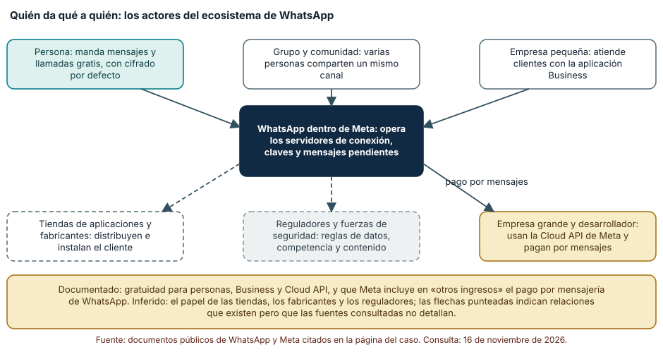

**Cómo leer la figura.** WhatsApp está en el centro porque conecta a todos los demás. Las flechas indican quién entrega valor a quién; fíjese en que el único flujo de dinero que las fuentes confirman es el pago por mensajes de empresas, y que las personas no pagan. **Dónde deja de valer.** No muestra magnitudes; los actores de borde punteado (tiendas, fabricantes, reguladores) existen pero las fuentes consultadas no detallan su relación contractual.

### Incentivos por tipo de usuario (análisis propio sobre hechos documentados)

- **Persona.** Quiere llegar a cualquiera con la mínima fricción; no paga y obtiene cifrado por defecto ([W1], [W4]). Su incentivo para quedarse es que sus contactos ya estén allí.
- **Administrador de grupo.** Quiere un canal compartido sin gestionar claves; el diseño de clave de remitente le da un mensaje que se cifra una sola vez para todos ([W5]).
- **Empresa pequeña.** Quiere atender clientes donde ya están; la aplicación Business le da cifrado de extremo a extremo en su propio dispositivo ([W5]).
- **Empresa grande.** Quiere automatizar y escalar la atención; la Cloud API le da integración programática a cambio de un modelo de cifrado distinto ([W5]) y de pagar por mensajería ([W14]).
- **Persona con varios dispositivos.** Quiere seguir trabajando sin el teléfono; el rediseño de 2021 se lo permite con claves por dispositivo ([W8]).
- **Meta.** Obtiene un canal de mensajería con 3 000 millones de personas y una línea de ingreso por mensajería de empresas ([W1], [W14]); pierde visibilidad sobre el contenido, y el 10-K lo reconoce como límite para medir usuarios y abuso ([W14]).
- **Reguladores.** Su incentivo es acotar el poder de mercado y proteger datos; el caso de 2017 lo ilustra ([W16]).

### Por qué el mercado favoreció a WhatsApp (análisis propio)

La razón no está declarada. El análisis propio plantea cuatro factores combinados, ninguno suficiente por sí solo: (1) el efecto de red: una mensajería vale por las personas que ya están en ella, y el costo de cambiar es social, no técnico; (2) un coste marginal por usuario muy bajo gracias a un servidor eficiente en conexiones (véase 6.3) y a no procesar el contenido; (3) la identidad por número de teléfono, que permite descubrir contactos sin crear una red social nueva; (4) un producto sin publicidad ni juegos que reduce la fricción. **[No se sabe]** cuánto pesa cada factor. Como contrapunto, el efecto de red también explica que el producto sea difícil de sustituir por una alternativa técnicamente mejor.

## Funcionalidad de principio a fin

Se recorre primero a la persona y luego a los demás tipos de usuario, cada uno hasta su caso límite.

### Recorrido de la persona

1. **Primer contacto.** Se instala la aplicación desde la tienda móvil. WhatsApp se anuncia gratuita ([W1]).
2. **Registro.** **[Documentado]** que, al registrarse, el cliente envía al servidor su clave pública de identidad, una prellave firmada y un lote de prellaves de un solo uso ([W5]). **[Inferido]** que la cuenta se asocia a un número de teléfono y que se verifica con un código; el libro blanco consultado no describe esa verificación, aunque define el dispositivo principal como el que registra la cuenta con un número de teléfono ([W5]).
3. **Conversar.** El primer mensaje inicia una sesión cifrada con las claves del receptor. Los mensajes siguientes reutilizan la sesión con claves que cambian, de modo que comprometer las claves actuales no permite descifrar mensajes ya transmitidos ([W5]).
4. **Adjuntos.** Los archivos grandes se cifran en el dispositivo con una clave efímera de 32 bytes (AES-256) y un MAC (HMAC-SHA256), se suben a un almacén de blobs y el mensaje cifrado lleva las claves y un puntero ([W5]).
5. **Grupos.** El primer mensaje a un grupo genera una clave de remitente que se distribuye a cada miembro por una sesión cifrada individual; el contenido se cifra una vez con esa clave, lo que evita cifrar el mensaje por separado para cada miembro ([W5]).
6. **Estados y llamadas.** Los estados usan el mismo esquema que los grupos; las llamadas de grupo cambian las claves cada vez que alguien entra o sale ([W5]).
7. **Dispositivos vinculados.** La experiencia original hacía del teléfono la fuente de verdad. El rediseño de 2021 permite usar el servicio en el teléfono y en hasta cuatro dispositivos más, incluso con la batería del teléfono agotada, con cifrado de extremo a extremo y sincronización de datos ([W8]).
8. **Copias de seguridad.** Desde septiembre de 2021 se anunció la opción de respaldos cifrados de extremo a extremo; si el usuario elige una contraseña, la clave se guarda en un «Backup Key Vault» basado en módulos de seguridad de hardware ([W9]).
9. **Pagos y soporte.** **[No se sabe]** qué ofrece cada país en pagos o soporte según las fuentes consultadas; el caso no lo cubre.
10. **Operación diaria.** Invisible para la persona: conexiones persistentes, colas y entrega. El detalle público es de 2012 (sección de arquitectura).

### Recorridos por tipo de usuario

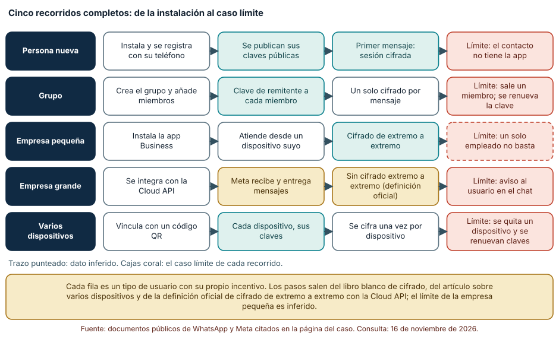

**Cómo leer la figura.** Cada fila es un usuario; las cajas se leen de izquierda a derecha y la última, en coral, es el caso límite. Los trazos punteados son pasos inferidos. Compare la fila de la empresa grande con las demás: es la única donde un paso intermedio es de color dorado, porque cambia la garantía de cifrado. **Dónde deja de valer.** Es un recorrido visible al usuario, no un diagrama de estados del sistema; no mide cuántos usuarios llegan a cada caso límite.

**Persona nueva y su caso límite.** El caso límite es que el contacto no tenga la aplicación: sin clave pública publicada, no hay sesión cifrada posible. **[Documentado]** que el diseño del acuerdo inicial asume que el receptor publicó previamente claves en el servidor; **[Inferido]** que la invitación a instalar la aplicación es la respuesta del producto, por el diseño de identidad por número de teléfono ([W5], [W17]).

**Grupo.** **[Documentado]** el modelo de clave de remitente ([W5]). El caso límite es el cambio de miembros: cuando alguien sale o es expulsado, el remitente debe renovar su clave de remitente para que quien salió no descifre mensajes posteriores. En los estados, la documentación dice que cuando el remitente quita a un receptor borra su clave de remitente y empieza de nuevo ([W5]). **[Inferido]** que los grupos funcionan igual.

**Empresa pequeña con la aplicación Business.** **[Documentado]** que la conversación sigue en un dispositivo controlado por la empresa con cifrado de extremo a extremo ([W5]). El caso límite, inferido, es la escala: un negocio con muchos clientes necesita varios operadores y una integración, y esa necesidad lleva a la Cloud API, que cambia la garantía de cifrado.

**Empresa grande con la Cloud API.** **[Documentado]** que los mensajes usan Signal pero no se consideran de extremo a extremo, porque no llegan a un punto final controlado por la empresa; que el chat lo indica con un mensaje del sistema; que Cloud API no puede unirse a un grupo cifrado de extremo a extremo; y que si una persona vincula la Cloud API como dispositivo, una copia de los chats recientes y del estado de la aplicación se le transmite ([W5]).

**Persona con varios dispositivos.** **[Documentado]** que cada dispositivo tiene su propia clave de identidad, que el servidor mantiene el mapa entre cuenta y dispositivos, que se vincula con un código QR con autenticación biométrica si está activada, y que se pueden ver y cerrar sesión remota en los dispositivos vinculados ([W8]). El caso límite: quitar un dispositivo obliga a renovar claves; el libro blanco describe que, al quitar un compañero que es la Cloud API, el principal genera una nueva clave de identidad y se invalidan los demás compañeros ([W5]).

**Verificación de claves.** **[Documentado]** que la persona puede verificar las claves de otro comparando un código QR o un número de 60 dígitos, para descartar un ataque de intermediario; el código QR incluye una versión, los identificadores de usuario, la clave de identidad o su hash y una marca si se vinculó Cloud API ([W5]). Cuántas personas lo hacen **[No se sabe]**.

## Negocio y economía

### Modelo por etapas (documentado)

- **Hasta 2016: cuota.** WhatsApp cobraba una cuota anual después del primer año y declaraba que no vendía publicidad ([W11], [W12]). La cifra de 0,99 USD al año circula en prensa secundaria y no aparece en las fuentes primarias consultadas; no se usa aquí como dato.
- **18 de enero de 2016: gratis.** WhatsApp anunció que dejaría de cobrar cuotas porque el modelo «no había funcionado bien»: muchos usuarios no tenían tarjeta de débito o crédito y temían perder el contacto con familia y amigos tras el primer año. Anunció que no habría publicidad de terceros y que probaría herramientas para comunicarse con empresas, como un banco o una aerolínea ([W12]).
- **Hoy: empresas.** La empresa ofrece la aplicación Business y la Cloud API, «un producto de API seguro para empresas proporcionado por Meta» ([W5]). El 10-K de Meta de 2025 incluye en «otros ingresos» de la familia de aplicaciones el pago por mensajería de WhatsApp, las suscripciones Meta Verified, las tarifas de pagos y otras fuentes, y dice que el aumento de 2025 provino sobre todo de la mensajería de pago de WhatsApp y de Meta Verified ([W14]).
- **Publicidad.** El mismo 10-K dice que los anunciantes compran anuncios que pueden aparecer en varios lugares, entre ellos WhatsApp ([W14]). **[No se sabe]** en qué parte de la aplicación ni desde cuándo. El contraste con el texto de 2012 es un dato en sí mismo: la promesa de no vender publicidad estaba ligada a un modelo de cuota que la propia empresa abandonó.

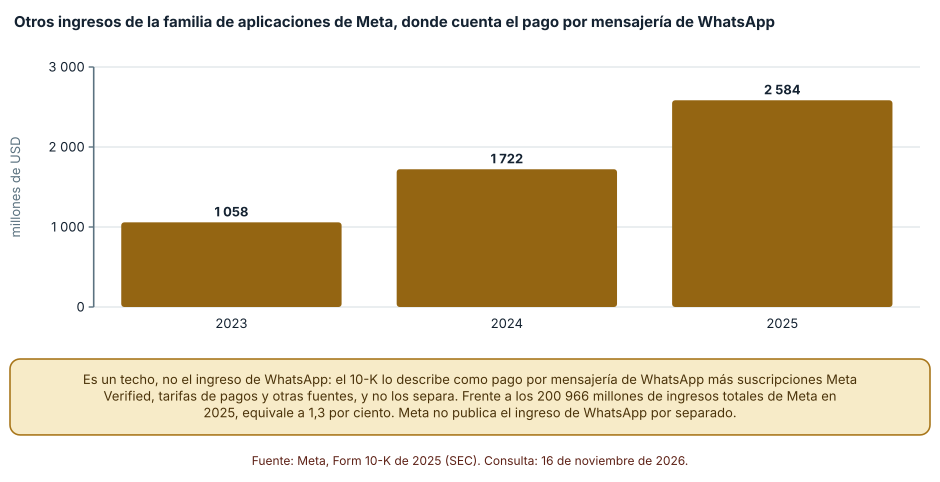

**Cómo leer la figura.** Cada barra es un año; la altura es el ingreso de «otros» de la familia de aplicaciones, en millones de dólares. Mire el crecimiento de 50 % entre 2024 y 2025. **Dónde deja de valer.** Es un techo, no el ingreso de WhatsApp: mezcla el pago por mensajería de WhatsApp con Meta Verified, tarifas de pagos y otras fuentes, y Meta no los separa. No sirve para estimar el ingreso por usuario de WhatsApp.

**Análisis propio de cota superior.** Si se atribuyera a WhatsApp todo el ingreso de «otros» de 2025 (2 584 millones) y se dividiera entre las más de 3 000 millones de personas que la página oficial declara, saldrían menos de 0,9 USD por persona al año. Es una cota superior imposible de alcanzar con exactitud, porque «otros» incluye ingresos que no son de WhatsApp. Sirve para ver el orden de magnitud: la monetización directa de WhatsApp es pequeña frente a la escala de usuarios, y el valor está en el canal y en la posición dentro de la familia de aplicaciones. Meta no publica el ingreso de WhatsApp por separado.

### El precio de la compra y el valor por usuario

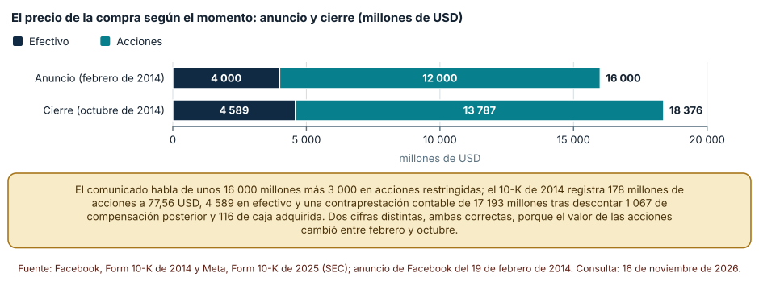

**Cómo leer la figura.** Cada barra es un momento (anuncio y cierre) dividido en efectivo y acciones. Compare la longitud total: las acciones valían más al cierre. **Dónde deja de valer.** Es el precio nominal; el 10-K usa una contraprestación contable de 17 193 millones tras descontar la compensación posterior a la adquisición y la caja adquirida ([W15]), y no incluye los 3 000 millones de acciones restringidas del comunicado, que se reconocen como gasto durante el periodo de servicio.

**Cálculo propio.** Con 450 millones de personas activas cada mes en 2014 ([W2]), la contraprestación contable equivale a unos 38 USD por persona activa al mes (17 193 / 450), y el precio anunciado con las acciones restringidas (19 000 millones) a unos 42. Es un orden de magnitud para comparar con otras compras de mensajería, no un valor de mercado.

### Estructura de costes

**Inferido.** La estructura de costos de una mensajería con cifrado de extremo a extremo es distinta de la de una red social: el servidor no procesa el contenido de los mensajes (no puede indexarlo ni usarlo para publicidad personalizada), y el coste dominante son conexiones, colas, medios y ancho de banda. Es una hipótesis razonada con la arquitectura publicada, no una cifra. **Documentado**, como evidencia indirecta, que en 2012 un servidor mantuvo más de dos millones de conexiones simultáneas con CPU de sobra ([W6]) y que Meta dice tener visibilidad limitada de los productos cifrados ([W14]). **[No se sabe]** cuánto cuesta servir a un usuario.

**Segmento de reporte.** El comunicado de resultados del primer trimestre de 2025 sitúa a WhatsApp dentro de la familia de aplicaciones, sin desglosarla ([W10]).

**Ventaja competitiva declarada.** Simplicidad, fiabilidad y privacidad ([W1]: «simple, segura, confiable»). La escala está respaldada por las cifras de [W2], [W3] y [W1].

**Palancas y límites.** Documentado: el cambio de cuota a gratuito amplió el acceso a quien no tenía tarjeta ([W12]); la mensajería de pago a empresas es la vía de ingreso elegida ([W12], [W14]). Límites: la regulación (concentraciones y datos, [W16]), el cifrado (menos señales para segmentar, [W14]) y la expectativa de los usuarios, que se formó con una promesa de no publicidad ([W11]).

### Esquema del negocio: flujos de dinero y de valor

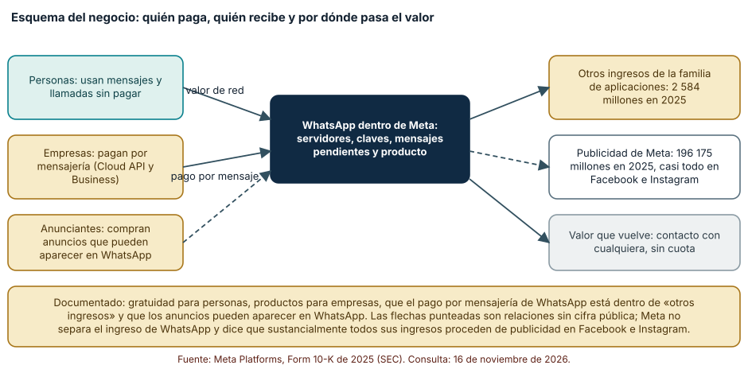

**Cómo leer la figura.** A la izquierda están quienes aportan valor o dinero; en el centro, WhatsApp dentro de Meta; a la derecha, dónde se reconoce el ingreso. Mire cuál es el único flujo directo con cifra pública (otros ingresos de 2 584 millones, que mezcla varias fuentes) y qué flechas son punteadas. **Dónde deja de valer.** No hay un ingreso de WhatsApp por separado: es una vista cualitativa, no una cuenta de resultados, y la flecha de anuncios solo refleja que el 10-K nombra a WhatsApp como un lugar donde pueden aparecer.

**Flujo de valor (análisis propio sobre hechos documentados).** El valor lo crea la red: cada persona vale lo que valen sus contactos ([SE-133](../../classes/part-11-economia-metricas-y-decisiones-de-producto/se-133-modelos-de-negocio-y-sostenibilidad/README.md)). La empresa captura valor por dos vías públicas: cobrando a empresas por mensajería y, como dice el 10-K de Meta, permitiendo anuncios en varias aplicaciones, entre ellas WhatsApp ([W14]). El ingreso por usuario es bajo (cota superior de menos de 0,9 USD al año con todos los «otros ingresos»), de modo que el modelo depende de la escala.

### Visión, misión y estrategia

**Documentado.** La página oficial de WhatsApp dice que empezó como una alternativa al SMS y que detrás de cada decisión de producto está el deseo de que las personas se comuniquen en cualquier lugar sin barreras; que ofrece mensajería y llamadas «simples, seguras y confiables»; y que opera como una aplicación separada con foco en un servicio rápido y confiable en cualquier parte ([W1]). El texto de 2012 formula la visión de producto en negativo: no vender publicidad ni minar datos y cobrar directamente por un servicio que funciona ([W11]); la entrada de 2020 reafirma que «simple, confiable y privado» es el objetivo desde el principio y que no se comprometerá la seguridad ([W3]). La misión de la matriz, en el 10-K de 2025, es construir el futuro de la conexión humana y la tecnología que lo hace posible, con una visión de «superinteligencia personal para todos» ([W14]).

**Evolución.** De «sin publicidad, cuota anual» (2012) a «sin cuota, sin publicidad de terceros, herramientas para empresas» (2016) a la misión de Meta, en la que WhatsApp es una de las aplicaciones de la familia (2025). El énfasis en privacidad se mantiene en los tres textos.

### Costos operativos

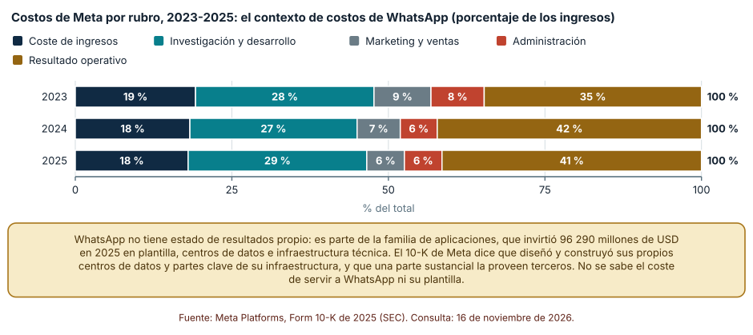

**Cómo leer la figura.** Cada barra es un año de ingresos de Meta reducido a 100 %; los segmentos son rubros del estado de resultados. Mire el segmento dorado: el resultado operativo crece siete puntos. **Dónde deja de valer.** Es Meta, no WhatsApp: no hay costos publicados por aplicación, y los rubros no separan servidores, ancho de banda ni soporte de la mensajería.

**Cifras de 2025 de Meta ([W14]).** Ingresos de 200 966 millones de USD; coste de ingresos de 36 175; investigación y desarrollo de 57 372; marketing y ventas de 11 991; administración de 12 152; resultado operativo de 83 276 (41,4 %). Las inversiones de la familia de aplicaciones fueron de 96 290 millones de USD e incluyen plantilla, centros de datos e infraestructura técnica ([W14]). **[No se sabe]** el coste de servir a WhatsApp, los rubros de infraestructura, pagos o soporte. **Análisis propio:** la visibilidad limitada del contenido cifrado que reconoce Meta ([W14]) implica que el servidor no puede usarse para segmentación, y que los costes dominantes de una mensajería cifrada son conexiones, medios y ancho de banda, no cómputo sobre el contenido; es una hipótesis.

### Competidores

**Documentado.** El 10-K de Meta describe una competencia general con empresas que ofrecen productos de conexión, compartición, descubrimiento y comunicación en línea, con anunciantes y desarrolladores, y señala competencia en inteligencia artificial y hardware ([W14]); no nombra competidores de mensajería ni da cuotas de mercado en el fragmento consultado. **[No se sabe]** con fuente primaria quiénes son los competidores de WhatsApp por país ni su cuota. El comunicado de 2014 solo compara WhatsApp con el volumen mundial de SMS ([W2]). **Análisis propio** de por qué el mercado favoreció a WhatsApp: efecto de red, identidad por número de teléfono, coste marginal bajo y producto simple (ver la sección de mercado).

## Arquitectura y esquemas

La arquitectura se recorre con zoom creciente: contexto, contenedores, componentes, secuencias de tres operaciones (primer mensaje, adjunto y grupo, varios dispositivos), claves y datos, despliegue, resiliencia, seguridad, operación y evolución. La regla de fondo es la de las etiquetas: lo publicado por WhatsApp y Meta describe un momento y un alcance; no es un plano vigente.

### 6.1 Contexto

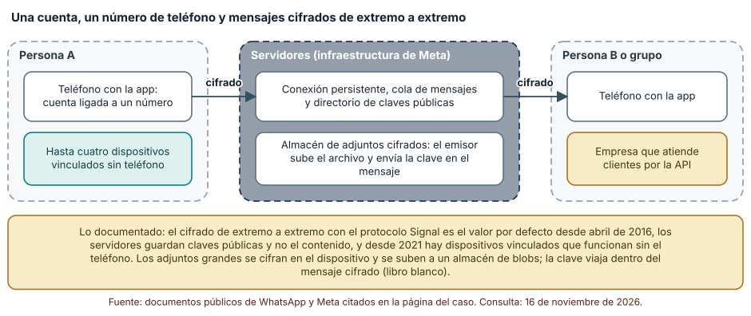

**Cómo leer la figura.** Cada recuadro de borde discontinuo agrupa un actor; las flechas llevan siempre texto cifrado. Mire qué hay dentro de los servidores: conexiones, cola, claves públicas y un almacén de adjuntos cifrados, no el contenido en claro. **Dónde deja de valer.** No muestra cuántos servidores hay, cómo se reparten por región ni qué sistemas de Meta intervienen. Y la excepción es importante: los mensajes que pasan por la Cloud API de una empresa no cumplen la definición de WhatsApp de extremo a extremo.

### 6.2 Contenedores

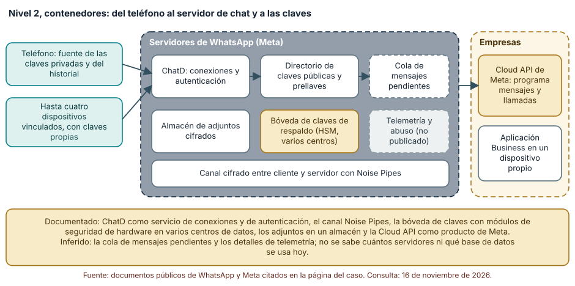

**Cómo leer la figura.** Cada caja es una pieza desplegable. El teléfono y los dispositivos vinculados se conectan a ChatD, el servicio de conexiones; detrás están el directorio de claves, los adjuntos y la bóveda de claves. A la derecha, las empresas. **Dónde deja de valer.** Mezcla documentos de años distintos y no muestra la base de datos, el reparto por regiones ni la telemetría de abuso, que no son públicos.

**Qué documenta cada pieza.**

- **Cliente y canal.** El canal entre clientes y servidores de chat usa Noise Pipes con Curve25519, AES-GCM y SHA256, para conexiones largas e interactivas: conexión y reanudación muy rápidas, cifrado de los metadatos de conexión para ocultarlos a observadores de la red, y ningún secreto de autenticación del cliente guardado en el servidor, que solo almacena la clave pública de autenticación ([W5]).
- **ChatD.** El artículo de ingeniería de 2021 sitúa a ChatD como el servicio de entrada de WhatsApp que maneja las conexiones de los clientes y su autenticación ([W9]).
- **Directorio de claves.** El servidor guarda las claves públicas (identidad, prellave firmada y prellaves de un solo uso) y las entrega a quien quiere iniciar una sesión ([W5], [W17]).
- **Almacén de adjuntos.** Un almacén de blobs donde se suben los archivos ya cifrados ([W5]).
- **Bóveda de claves de respaldo.** Un servicio apoyado en módulos de seguridad de hardware, distribuido geográficamente en varios centros de datos, que guarda la clave de respaldo si el usuario elige contraseña y la bloquea tras un número limitado de intentos fallidos ([W9]).
- **Cola de mensajes pendientes.** **[Inferido]**: un mensaje para un receptor desconectado debe esperar en algún sitio; no hay documento que describa su diseño.
- **Cloud API.** Un producto de Meta para empresas ([W5]).

### 6.3 Componentes: un servidor de conexiones en 2012

**Cómo leer la figura.** Cada fila es una capa; la caja derecha dice qué elementos concretos citó el ingeniero. Mire la fila de medición: las mejoras salieron de medir contención, no de añadir hardware. **Dónde deja de valer.** Es la configuración de marzo de 2012; no es la de hoy.

**Qué documenta la charla de Rick Reed (30 de marzo de 2012).**

- Servidor estándar: doble procesador Westmere de seis núcleos (24 CPU lógicas), 100 GB de RAM, SSD, dos tarjetas de red (una para usuarios y otra para el interior), FreeBSD 8.3 y OTP R14B03 ([W7]).
- Herramientas: monitoreo de actividad del sistema, contadores de hardware (`pmcstat`), `dtrace`, contadores de cerrojos de la máquina virtual BEAM («invaluables»), y tres tipos de carga: sintética, duplicada (tee) y desviada desde producción ([W7]).
- Los cuellos de botella aparecieron alrededor de 425 000 conexiones; la primera ronda de correcciones llevó a un millón, y un mes después a dos millones ([W7]).
- «De 200 000 a 2 millones, todo fueron correcciones de contención»: algunas internas de BEAM, otras de la aplicación (en especial partir bien la carga) y la mayoría con parches a la máquina virtual ([W7]).
- Ajustes de FreeBSD (reloj, controlador de red, límites de `sysctl`) y de BEAM (planificador, asignadores), y cambios en OTP: control de recolección de basura cuando la cola es larga, mayor búfer de recepción distribuido (de 4 KB a 256 KB) y un parche en `mnesia_tm` para ejecutar transacciones asíncronas por tabla ([W7]).
- Cambios de uso de Erlang: preferir `os:timestamp` a `erlang:now`, llamadas entre nodos sin monitores y particionar las tablas ETS y Mnesia ([W7]).
- El blog de enero de 2012 informa más de dos millones de conexiones TCP en una sola máquina, con 41,9 % de CPU libre y 27 GB de memoria libre ([W6]).
- En febrero de 2012 hubo un intento de récord «no intencionado» que alcanzó 2,8 millones de conexiones, con 571 000 paquetes por segundo y más de 200 000 mensajes distribuidos por segundo, antes de que el equipo interviniera; la charla indica que seguían sin alcanzar los 3 millones ([W7]).
- Erlang escaló con más de 85 % de uso de CPU en las 24 CPU lógicas ([W7]).

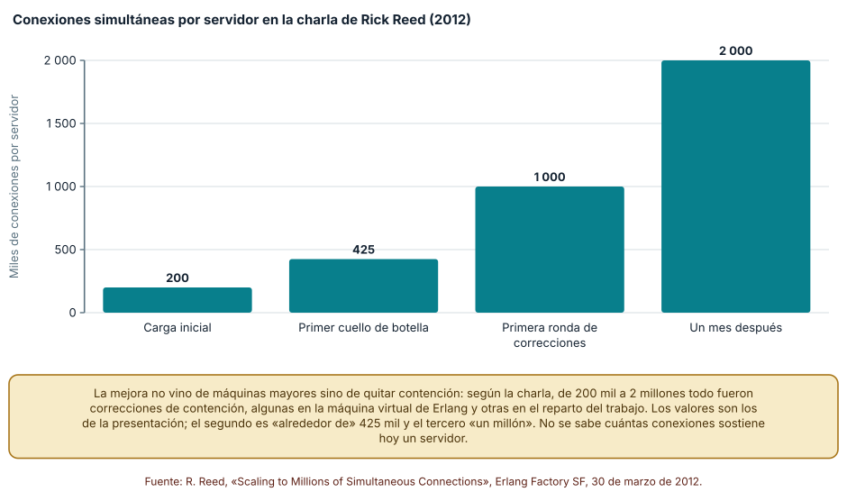

**Cómo leer la figura.** El eje vertical son miles de conexiones simultáneas por servidor; cada barra es un hito de la charla. Compare la primera con la última: son diez veces más con la misma clase de máquina. **Dónde deja de valer.** Son valores del autor de la charla, con «alrededor de» en el segundo y el tercero; no dicen cuánto soporta hoy un servidor ni cuánta carga útil por conexión.

**Cómo se midió.** La charla distingue tres clases de carga, y esa distinción es una lección de método.

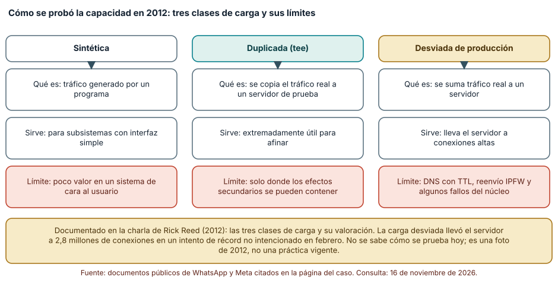

**Cómo leer la figura.** Cada columna es una clase de carga; de arriba abajo: qué es, para qué sirve y qué límite tiene. Mire el límite de la sintética: es la que más se usa por comodidad y la que menos sirve para un sistema de cara al usuario. **Dónde deja de valer.** Es la práctica descrita en 2012; no dice cómo se prueba hoy, y la carga desviada produjo fallos de núcleo a conexiones altas, de modo que no es gratuita ni segura.

**Por qué Erlang (análisis propio).** La charla afirma que Erlang tiene una escalabilidad multiprocesador excelente y que FreeBSD también rinde bien ([W7]). El curso lo conecta con el modelo de actores: un proceso ligero por conexión, con paso de mensajes y sin memoria compartida ([SE-387](../../classes/part-32-concurrencia-y-sistemas-distribuidos/se-387-actores-canales-y-structured-concurrency/README.md)). La mejora de 200 mil a 2 millones, sin embargo, fue casi toda contención en la máquina virtual y en la aplicación ([SE-386](../../classes/part-32-concurrencia-y-sistemas-distribuidos/se-386-memoria-compartida-locks-y-condiciones-de-carrera/README.md)), lo que muestra el límite de la teoría: un modelo adecuado no elimina el trabajo de medir.

### 6.4 Secuencias de las operaciones críticas

**Operación 1: enviar un mensaje.**

**Cómo leer la figura.** Siga los pasos de izquierda a derecha. Las cajas teal ocurren en el teléfono del emisor o del receptor y la dorada es la cola en el servidor. Los pasos punteados son inferidos. **Dónde deja de valer.** No cubre grupos grandes, llamadas ni estados, que usan otros mecanismos descritos en el libro blanco; tampoco describe plazos de retención de mensajes pendientes.

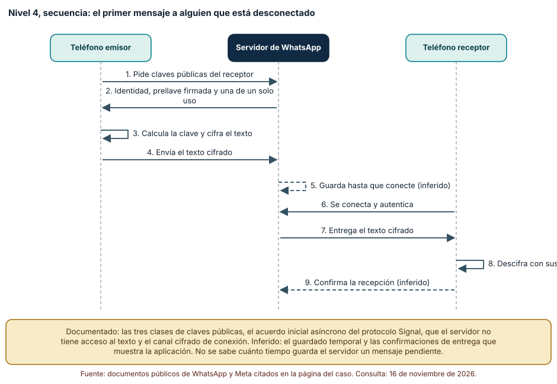

**Cómo leer la figura.** Cada columna es un participante y el tiempo avanza hacia abajo; las flechas punteadas son pasos inferidos. Mire que el texto en claro solo existe en las dos columnas de los teléfonos. **Dónde deja de valer.** Un diagrama de secuencia sugiere un orden único; el protocolo real incluye renovaciones de claves, reintentos y mensajes fuera de orden que la especificación del algoritmo trata aparte ([W18]).

**Por qué el diseño es asíncrono.** El protocolo de acuerdo inicial está diseñado para el caso en que el receptor está desconectado pero publicó información en un servidor: el emisor usa esos datos para enviarle datos cifrados y establecer una clave compartida para comunicaciones futuras, con autenticación mutua y secreto hacia adelante ([W17]). El segundo protocolo, el del «doble trinquete», renueva claves con cada mensaje y gestiona mensajes fuera de orden ([W18]). El servidor es un buzón, no un participante criptográfico.

**Operación 2: un adjunto y un mensaje a un grupo.**

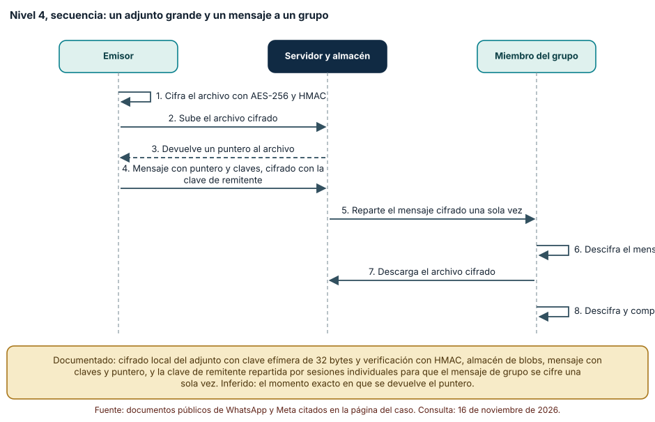

**Cómo leer la figura.** Hay dos flujos entrelazados: el archivo cifrado, que va al almacén, y el mensaje, que lleva la clave y el puntero. Mire que el servidor reparte el mensaje cifrado una sola vez, aunque el grupo tenga muchos miembros. **Dónde deja de valer.** No muestra los límites de tamaño de archivo ni de miembros de un grupo, ni el reintento si falla la subida; no se publica el detalle de esos límites en las fuentes consultadas.

**Qué decisión de diseño resuelve esto.** Cifrar el mensaje una vez con una clave de remitente, y no una vez por miembro, hace que enviar a un grupo cueste lo mismo que enviar a una persona en el emisor, y mueve el coste a la distribución de la clave de remitente al crear el grupo o cuando cambia la membresía ([W5]). Separar el archivo del mensaje evita que el canal de mensajes cargue con bytes grandes y permite al almacén escalar por su cuenta.

**Operación 3: un mensaje con varios dispositivos.**

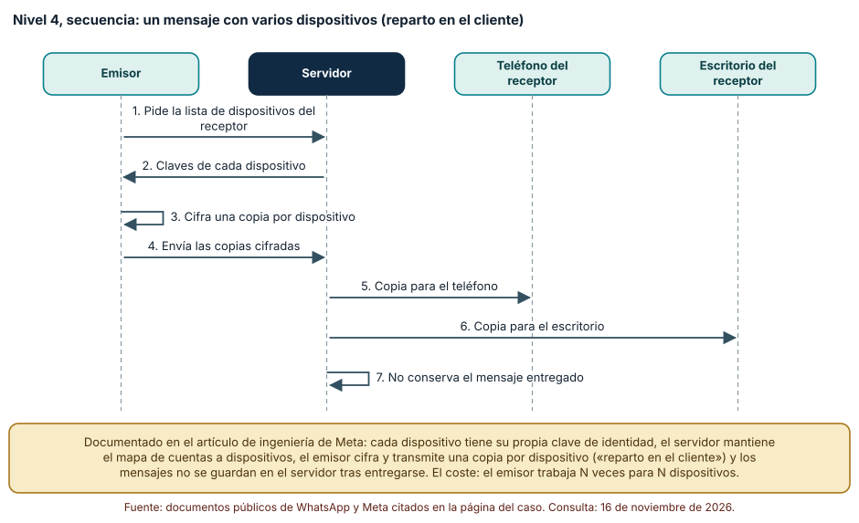

**Cómo leer la figura.** El emisor hace el trabajo: consulta, cifra una copia por dispositivo y las manda todas. El servidor solo las reparte. **Dónde deja de valer.** Es un esquema para mensajes uno a uno; los grupos siguen usando la clave de remitente del protocolo Signal ([W8]), y la figura no muestra la sincronización del historial ni del estado de la aplicación.

**El coste del diseño.** El artículo de ingeniería lo llama un enfoque de «reparto en el cliente»: el cliente cifra y transmite N veces para N dispositivos, cada copia con la sesión de ese dispositivo, y los mensajes no se guardan en el servidor después de entregarse ([W8]). El beneficio es que el servidor no necesita ver ni retener el contenido; el coste es más trabajo y más tráfico en el emisor, proporcional a los dispositivos del receptor, además de más claves que verificar.

### 6.5 Datos y claves

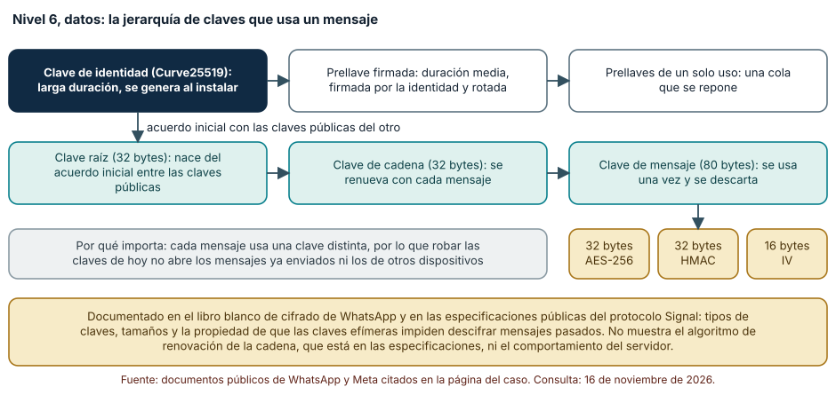

**Cómo leer la figura.** La fila superior son las claves públicas que el cliente publica al instalar; la inferior es la cadena de claves de sesión. Mire el tamaño de la clave de mensaje: 80 bytes divididos en una clave de cifrado, una de autenticación y un vector inicial, y que se usa una sola vez. **Dónde deja de valer.** Muestra los tipos y tamaños, no el algoritmo de renovación, que está en las especificaciones públicas del protocolo ([W17], [W18]).

| Elemento | Qué es | Fuente |
| --- | --- | --- |
| Clave de identidad | Par Curve25519 de larga duración, creado en la instalación | [W5] |
| Prellave firmada | Par de duración media, firmado con la clave de identidad y rotado periódicamente | [W5] |
| Prellaves de un solo uso | Cola de pares Curve25519 para iniciar sesiones | [W5] |
| Clave raíz | Valor de 32 bytes que crea las claves de cadena | [W5] |
| Clave de cadena | Valor de 32 bytes que crea las claves de mensaje | [W5] |
| Clave de mensaje | 80 bytes: 32 para AES-256, 32 para HMAC-SHA256 y 16 para el vector inicial | [W5] |
| Firma de cuenta y de dispositivo | Firmas que vinculan un dispositivo compañero al principal | [W5] |
| Conexiones por servidor | De 200 mil a 2 millones en 2012 | [W7], [W6] |

**[No se sabe]** el volumen de mensajes por día actual, el número de servidores, las regiones, el motor de almacenamiento y el estado actual de Erlang en la plataforma. La escala se conoce por el número de usuarios, no por métricas internas.

**Qué guarda el servidor y qué no.** **[Documentado]** que el servidor solo almacena claves públicas de autenticación y que, si su base de usuarios se comprometiera, no se revelarían credenciales privadas ([W5]); que los mensajes no se guardan en el servidor después de entregarse ([W8]); que los adjuntos que sube el cliente están cifrados ([W5]). **[Inferido]** que quedan en el servidor metadatos como número de teléfono, momentos de conexión y relaciones entre cuentas. Meta dice en su 10-K que, por la visibilidad limitada de los productos cifrados, usa sobre todo números de teléfono e información del dispositivo para asociar cuentas de WhatsApp con otras ([W14]). La frontera entre contenido y metadatos es la parte más debatida de cualquier sistema cifrado, y las fuentes consultadas no detallan los metadatos.

### 6.6 Despliegue

**Documentado.** El servidor estándar de 2012 tenía dos tarjetas de red, una para usuarios y otra para la distribución interior ([W7]); los respaldos cifrados de 2021 usan una bóveda de claves geográficamente distribuida en varios centros de datos ([W9]). **[No se sabe]** cuántas regiones, qué proveedor o centros de datos propios, cómo se reparte el tráfico, ni qué parte de la infraestructura es de WhatsApp y cuál de Meta. Es una de las mayores lagunas del caso y se declara en lugar de rellenarse.

**Lectura del curso.** Una mensajería con conexiones persistentes tiene un modelo de despliegue distinto al de una API de peticiones: la unidad de capacidad es la conexión abierta, no la petición, y el reparto de usuarios entre servidores debe ser estable. La carga desviada de 2012 usó alias de IP y reenvío con IPFW, lo que muestra que mover usuarios entre servidores no era trivial ([W7]).

### 6.7 Resiliencia y degradación

| Nivel | Qué falla | Respuesta documentada o inferida | Coste |
| --- | --- | --- | --- |
| 1 | Un proceso interno | **[Inferido]** de Erlang: aislamiento de procesos y supervisión; la charla de 2012 no lo detalla | Complejidad del modelo |
| 2 | Un servidor sobrecargado | Objetivo de 2012: resistencia a fallos de software, hardware y red, y a eventos del mundo ([W7]) | Capacidad de reserva y pruebas con carga real |
| 3 | El receptor desconectado | Mensaje en cola hasta que se conecte ([W5], inferido) | Estado pendiente en el servidor |
| 4 | Un centro de datos del servicio de claves | Bóveda distribuida geográficamente ([W9]) | Replicación de un servicio muy sensible |
| 5 | Pérdida de un teléfono | Respaldos cifrados con contraseña y bóveda; con varios dispositivos el servicio continúa sin teléfono ([W9], [W8]) | Gestión de claves por el usuario |

**Un límite de seguridad como límite de resiliencia.** La bóveda de respaldo bloquea la clave tras un número limitado de intentos fallidos ([W9]): protege contra la fuerza bruta, pero significa que una contraseña olvidada puede hacer irrecuperable el respaldo. Es un compromiso entre seguridad y recuperación que el diseño toma conscientemente.

### 6.8 Seguridad, abuso y cumplimiento

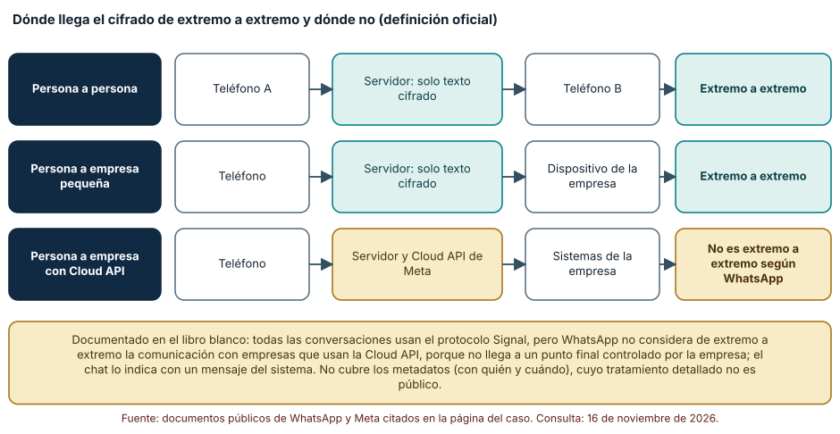

**Cómo leer la figura.** Cada fila es un tipo de conversación; el color de la caja central y del veredicto indica si el servidor ve solo texto cifrado (verde) o si el mensaje termina en un sistema de Meta (dorado). Mire la tercera fila: el protocolo es el mismo, pero el extremo ya no es la empresa. **Dónde deja de valer.** Solo trata del contenido; no dice qué metadatos conserva el servidor, que las fuentes consultadas no detallan.

- **Modelo de amenazas del cifrado.** El protocolo busca impedir que terceros y WhatsApp tengan acceso al texto de los mensajes o las llamadas; las claves efímeras impiden que el robo de las claves actuales descifre mensajes pasados; cada dispositivo tiene sus claves, así que comprometer uno no abre los demás ([W5]).
- **Ataque de intermediario.** La verificación de claves por QR o de 60 dígitos permite detectarlo; con varios dispositivos, los códigos de seguridad representan la combinación de todas las identidades de dispositivo y existe verificación automática entre dispositivos ([W5], [W8]).
- **Servidor malicioso.** El artículo de 2021 identifica el riesgo de que un servidor comprometido añada dispositivos en silencio, y lo mitiga con los códigos de seguridad ampliados, la verificación automática de dispositivos y el aviso de los dispositivos vinculados ([W8]).
- **Abuso: reenvíos masivos.** En julio de 2018 se probó un límite de reenvíos (cinco chats a la vez en India y sin botón de reenvío rápido en medios); tras seis meses de pruebas, en enero de 2019 el límite de cinco chats se aplicó a todos, y la empresa dijo que el límite redujo significativamente los mensajes reenviados en todo el mundo ([W13]). Es una medida de producto que actúa sobre metadatos (cuántos chats) y no sobre contenido, coherente con el cifrado. **[No se sabe]** cómo se detecta el spam ni el fraude.
- **Cumplimiento.** El caso de 2017 es el dato público: la Comisión Europea impuso a Facebook 110 millones de euros por dar información incorrecta o engañosa en la revisión de la compra de 2014, al decir que no podría establecer una coincidencia automática fiable entre cuentas de Facebook y de WhatsApp cuando ya era técnicamente posible ([W16]). La Comisión anota que en agosto de 2016 WhatsApp actualizó sus términos para permitir vincular teléfonos con identidades de Facebook ([W16]). **[No se sabe]** el estado actual de ese vínculo; el 10-K de Meta describe métodos de coincidencia por número de teléfono y dispositivo ([W14]).
- **Cifrado como decisión con consecuencias.** WhatsApp declara que debilitar el cifrado expondría a las personas a abusos de ciberdelincuentes y estados ([W4], [W3]); el efecto legal varía por país y las fuentes consultadas no lo detallan.

### 6.9 Observabilidad y operación

**Documentado (2012).** Un conjunto de herramientas de medición a varios niveles: monitor de actividad del sistema operativo y de BEAM, contadores de hardware, `dtrace`, contadores de cerrojos y métricas de colas de mensajes (mensajes en cola, colas no vacías, cola más larga, tasas de entrada y salida) ([W7]). Se midieron tasas como 571 000 paquetes por segundo y más de 200 000 mensajes distribuidos por segundo en el pico de febrero. La lección es que las métricas de colas son una señal temprana de saturación en un sistema de actores ([SE-436](../../classes/part-36-calidad-rendimiento-y-resiliencia/se-436-latencia-throughput-saturacion-y-capacidad/README.md)).

**No se sabe.** La observabilidad actual, los objetivos de nivel de servicio, la gestión de incidentes y el tamaño de los equipos de guardia. Las incidencias públicas de la plataforma no son una fuente consultada en este caso.

### 6.10 Evolución de la arquitectura por etapas

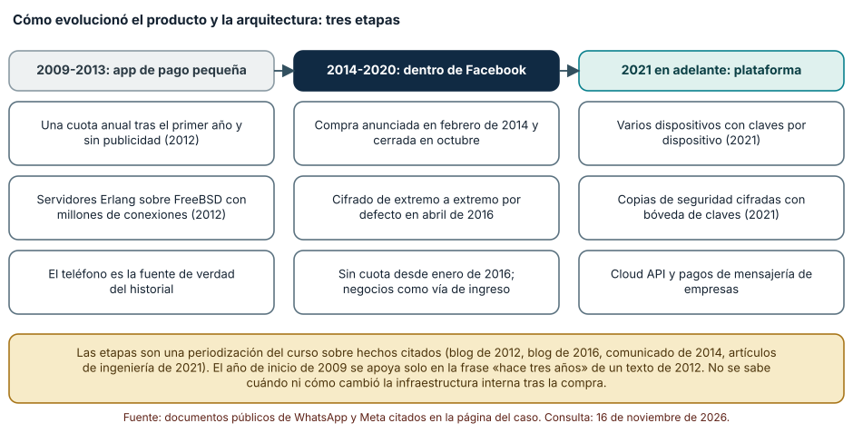

**Cómo leer la figura.** Cada columna es una etapa y las cajas, rasgos documentados de producto y de arquitectura; las flechas indican la secuencia. Mire cómo cada etapa agrega una propiedad que la anterior no tenía: escala, privacidad, autonomía de dispositivos. **Dónde deja de valer.** La periodización es del curso; el año de inicio se apoya en una frase de 2012 y no existe fuente primaria sobre cuándo cambió la infraestructura interna tras la compra.

**El cifrado total como proyecto de arquitectura.** El 5 de abril de 2016, WhatsApp anunció que cada llamada, mensaje, foto, vídeo, archivo y mensaje de voz, incluidos los grupos, quedaba cifrado de extremo a extremo por defecto con la última versión de la aplicación ([W4]). El libro blanco enumera el protocolo, y las especificaciones públicas de Signal documentan el acuerdo de claves asíncrono y el doble trinquete ([W5], [W17], [W18]). El cambio es de arquitectura, no de interfaz: modifica qué guarda el servidor, qué puede entregar y cómo se sincroniza entre dispositivos, y por eso el rediseño de varios dispositivos de 2021 tuvo que reinventar la sincronización sin una copia central en claro ([W8]).

**Del teléfono como fuente de verdad a varios dispositivos.** El diseño original hacía del teléfono el origen de todas las operaciones: los dispositivos compañeros eran más lentos y se desconectaban si el teléfono tenía mala conexión, poca batería o el sistema cerraba la aplicación, y solo podía haber un compañero operativo ([W8]). El rediseño dio a cada dispositivo su identidad y sus claves, con un servidor que mapea cuentas a dispositivos. Es el patrón de [SE-260](../../classes/part-21-software-movil-escritorio-y-multiplataforma/se-260-offline-first-y-resolucion-de-conflictos/README.md) aplicado a un sistema cifrado.

### 6.11 Alternativas descartadas y trade-offs (análisis propio)

**Cómo leer la figura.** Cada fila es una bifurcación: lo elegido, la alternativa y su coste probable. Los trazos punteados indican hipótesis. **Dónde deja de valer.** Son hipótesis del curso, no hechos: WhatsApp no publica las alternativas que evaluó. Sirve para entrenar el razonamiento, no para afirmar qué habría pasado.

**Erlang frente a una pila convencional.** Con una pila de un hilo por conexión, un servidor habría mantenido muchas menos conexiones y la misma base habría exigido muchos más servidores; la elección convirtió la eficiencia de conexiones en una ventaja de costes. El precio fue un ecosistema menos común y la necesidad de parchear la máquina virtual ([W7]). **Análisis propio:** con 200 mil conexiones por servidor, atender 450 millones de usuarios activos (no todos conectados a la vez) exigiría una flota de un orden de magnitud mayor que con 2 millones; es un cálculo de proporción, no una cifra de flota.

**Cifrado de extremo a extremo frente a cifrado en tránsito.** El cifrado solo en tránsito permite funciones de servidor (búsqueda, moderación del contenido, copias en la nube) a cambio de que el servidor pueda leer; el de extremo a extremo las traslada al cliente y complica la sincronización. La decisión de 2016 y su declaración pública ([W4]) fijaron esa frontera.

**Cuota frente a publicidad.** La cuota exigía un medio de pago que muchos no tenían ([W12]). La publicidad habría exigido señales de usuario, lo que choca con el cifrado y con la promesa de 2012 ([W11]). El camino elegido en 2016 fue una tercera vía, la mensajería con empresas ([W12]).

**Claves por dispositivo frente al teléfono como fuente de verdad.** El diseño de 2021 aumentó el trabajo de cifrado en el emisor y la superficie de verificación, a cambio de eliminar el teléfono como punto único de fallo ([W8]).

### 6.12 Hardware utilizado

**Documentado (2012).** El servidor estándar de la charla de marzo de 2012 era de doble procesador Westmere de seis núcleos (24 CPU lógicas), 100 GB de RAM, SSD y dos tarjetas de red, una para los usuarios y otra para la distribución interna ([W7]). El blog de enero de 2012 da el detalle de una máquina concreta: procesador Intel Xeon X5675 a 3,07 GHz, 24 CPU lógicas y unos 103 GB de memoria física ([W6]). La charla menciona contadores de hardware (`pmcstat`) como herramienta de medición ([W7]).

**Documentado (2021).** Los respaldos cifrados usan módulos de seguridad de hardware (HSM) para guardar claves, en un servicio distribuido geográficamente ([W9]). **Documentado (dispositivos del usuario).** El cliente corre en teléfonos Android y iPhone como dispositivos principales y en dispositivos compañeros como escritorio y web, hasta cuatro ([W5], [W8]).

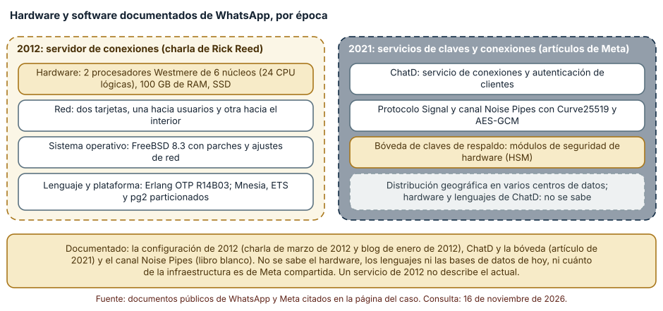

**Cómo leer la figura.** A la izquierda, el servidor de 2012; a la derecha, lo documentado en 2021. Las cajas punteadas son lo que no se sabe. Mire la diferencia de naturaleza: el hardware de 2012 es de cómputo y red; el de 2021 es de seguridad (HSM). **Dónde deja de valer.** Son dos fotos de épocas distintas, no una evolución continua; no hay datos de hardware actual, de aceleradores ni de red de transporte.

**[No se sabe]** el hardware de hoy: tipo de servidores, redes entre centros de datos, almacenamiento de adjuntos y si usa aceleradores. Meta declara que diseñó y construyó sus propios centros de datos y partes clave de su infraestructura técnica, y que una parte sustancial la proveen terceros ([W14]).

### 6.13 Software utilizado

**Documentado (2012).** Sistema operativo FreeBSD (8.2-STABLE en el blog de enero; 8.3 en la charla de marzo) con parches de reloj, controlador de red y límites; Erlang/OTP R14B03 con su máquina virtual BEAM y parches propios, la base de datos distribuida Mnesia (con un parche en `mnesia_tm`), tablas ETS particionadas y la biblioteca de grupos `pg2` ([W6], [W7]); herramientas de medición `dtrace`, `fprof` y contadores de cerrojos ([W7]).

**Documentado (cifrado y conexión).** Protocolo Signal para el cifrado de extremo a extremo (acuerdo de claves X3DH y doble trinquete); Noise Pipes con Curve25519, AES-GCM y SHA256 para el canal cliente-servidor; AES-256 y HMAC-SHA256 para adjuntos; SRTP para llamadas ([W5], [W17], [W18]). **Documentado (servicios).** ChatD como servicio de entrada y un servicio de bóveda con HSM ([W9]).

**[No se sabe]** los lenguajes y frameworks actuales del servidor y del cliente, las bases de datos y colas, el orquestador y las herramientas internas de código abierto de WhatsApp. El estado actual de Erlang en la plataforma tampoco es público. Esta es una de las lagunas más grandes del caso y se declara en lugar de rellenarse.

### 6.14 Características de la infraestructura

**Modelo.** El 10-K de Meta dice que la empresa diseñó y construyó sus propios centros de datos y partes clave de su infraestructura técnica, que una parte sustancial la proveen terceros, y que es propietaria de 30 ubicaciones de centros de datos en el mundo y arrienda algunos más ([W14]). **[No se sabe]** qué parte de WhatsApp corre en esos centros de datos, en cuáles regiones o con qué red. El servicio de claves de respaldo está repartido en varios centros de datos ([W9]).

**Capacidad y escala.** En 2012 un servidor llegó a 2,8 millones de conexiones con más de 200 000 mensajes distribuidos por segundo ([W7]); en 2020 había más de 2 000 millones de usuarios ([W3]); en 2026, más de 3 000 millones ([W1]). **Costos.** La inversión de la familia de aplicaciones fue de 96 290 millones de USD en 2025 ([W14]); no hay una cifra para WhatsApp.

### 6.15 Temas a prueba de fallos

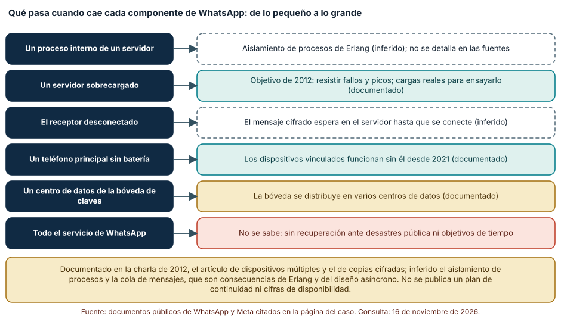

**Cómo leer la figura.** Cada fila es un componente de tamaño creciente; a la derecha el efecto y el mecanismo, con su rótulo. La última fila, coral, no tiene respuesta pública. **Dónde deja de valer.** Mezcla documentos de 2012 y 2021 y supone el diseño actual; no es un plan de continuidad.

**Tolerancia a fallos y degradación.** El objetivo de 2012 era resistir fallos de software, hardware y red, y eventos del mundo ([W7]); las cargas duplicadas y desviadas ensayaban picos reales y producían fallos de núcleo a conexiones altas, lo que muestra que las pruebas también tienen riesgo ([W7]). **Redundancia y replicación.** La bóveda de claves se distribuye geográficamente ([W9]); los dispositivos vinculados mantienen la experiencia sin el teléfono ([W8]). **Aislamiento.** Cada dispositivo tiene sus claves, de modo que la fuga de una no abre las demás ([W5]). **Límites de velocidad.** El límite de reenvíos a cinco chats es un control de abuso a nivel de producto ([W13]); la bóveda limita los intentos de contraseña ([W9]). **Pruebas de caos.** No se sabe de una práctica pública de WhatsApp. **Recuperación ante desastres.** No se sabe: el único dato es la distribución de la bóveda de claves.

**Qué pasa cuando cae cada componente.** (1) El receptor desconectado: el mensaje espera (**[Inferido]**). (2) El teléfono principal: los dispositivos vinculados siguen ([W8]). (3) Un centro de datos de la bóveda: otro lo sustituye ([W9]). (4) Un servidor sobrecargado: depende de la capacidad reservada y de la contención ([W7]). (5) El servicio de conexiones completo: sin información pública.

## Casos especiales y cómo se resuelven

Cada caso se expone como: situación, mecanismo, decisión de diseño, trade-off, y qué se sabe.

- **Picos de demanda.** Los eventos de 2012 (terremoto, fútbol) se usaron como casos de prueba con carga duplicada y desviada desde producción ([W7]). *Mecanismo:* carga real contenida y desviada. *Trade-off:* la carga desviada provocó fallos de núcleo a conexiones altas ([W7]). **[No se sabe]** cómo se gestionan hoy (por ejemplo, Nochevieja).
- **Fallos parciales.** La resistencia a fallos de software, hardware y red, y a «eventos del mundo», fue un objetivo explícito de la charla de 2012 ([W7]). **[No se sabe]** el mecanismo actual.
- **Receptor desconectado.** Por diseño, el emisor sube un mensaje cifrado y el receptor lo obtiene cuando se conecta; el servidor es un intermediario sin acceso al texto ([W5], [W17]). **[Inferido]** la existencia de una cola temporal y de los estados de envío visibles para el usuario. *Trade-off:* el servidor guarda un estado pendiente cuyo plazo de retención no se publica.
- **Compromiso de una clave.** Las claves efímeras y la sesión por dispositivo evitan que la fuga de una clave abra el pasado ni otros dispositivos ([W5]). *Trade-off:* quien pierde las claves de un dispositivo pierde los mensajes que solo estaban allí.
- **Cuenta con empresa.** Con la Cloud API, la comunicación usa Signal pero no es de extremo a extremo según la definición de WhatsApp; cuando el chat no está protegido así, se indica con un mensaje del sistema, y el estado de cifrado de un chat no puede cambiar sin un mensaje visible para el usuario ([W5]). *Decisión:* definir con precisión para no prometer de más.
- **Abuso.** El límite de reenvíos (cinco chats) es el mecanismo público: actúa sobre un comportamiento observable sin leer contenido ([W13]). **[No se sabe]** los mecanismos de detección de spam o fraude en las fuentes consultadas. *Trade-off:* se limita también a quien reenvía legítimamente.
- **Cumplimiento y regulación.** La revisión de la compra y la sanción de 2017 ([W16]) muestran que un cambio de dueño puede generar obligaciones de información precisa; el cifrado limita lo que WhatsApp puede entregar sobre el contenido, y es una decisión de producto con consecuencias legales distintas en cada país, que las fuentes consultadas no detallan.
- **Sin conexión.** El mensaje se entrega al reconectar. **[Inferido]** que el cliente conserva el historial en el teléfono, porque el rediseño de 2021 describe al teléfono como fuente de verdad en el modelo anterior ([W8]).
- **Varios dispositivos.** Cada dispositivo tiene sus propias claves; añadir uno exige firmas de cuenta y de dispositivo, y quitar el compañero provoca la renovación de la clave de identidad del principal si el compañero es la Cloud API ([W5], [W8]). *Trade-off:* más trabajo en el emisor y más claves que verificar.
- **Respaldo y recuperación.** Los respaldos cifrados guardan la clave en una bóveda con módulos de seguridad de hardware y límite de intentos; hay opción de una clave de 64 dígitos que el usuario custodia ([W9]). *Trade-off:* sin la clave o la contraseña, nadie puede recuperar el respaldo, ni siquiera WhatsApp.
- **Costes.** La conexión persistente es el recurso escaso; el diseño de 2012 buscó más conexiones por servidor, y el cifrado de extremo a extremo evita procesar contenido en el servidor ([W7], [W5]). **[No se sabe]** el coste por usuario.
- **Identidad y números de teléfono.** El dispositivo principal registra la cuenta con un número de teléfono ([W5]); un número reutilizado por otra persona es un riesgo de identidad que las fuentes consultadas no tratan.

## Línea de tiempo

**Cómo leer la figura.** El eje es el año. Las barras del primer carril son quién es el dueño y las del segundo, la etapa técnica dominante. Fíjese en cómo el cifrado total (2016) llega dos años después de la compra. **Dónde deja de valer.** Las barras son etapas simplificadas; el año 2009 de inicio es un dato indirecto y no está confirmado con una fecha primaria.

- **2009.** Año aproximado de fundación (el texto de 2012 dice «hace tres años», [W11]).
- **Enero de 2012.** Más de dos millones de conexiones TCP en un servidor ([W6]).
- **Febrero de 2012.** Pico no intencionado de 2,8 millones de conexiones ([W7]).
- **Marzo de 2012.** Charla «Scaling to Millions of Simultaneous Connections» ([W7]).
- **18 de junio de 2012.** Texto «Why we don't sell ads» ([W11]).
- **19 de febrero de 2014.** Facebook anuncia la compra ([W2]); se cierra en octubre ([W15]).
- **18 de enero de 2016.** Fin de las cuotas anuales y anuncio de herramientas para empresas ([W12]).
- **5 de abril de 2016.** Cifrado de extremo a extremo completo por defecto, incluidos grupos, llamadas y adjuntos ([W4]).
- **Agosto de 2016.** Actualización de términos que permite vincular teléfonos con identidades de Facebook ([W16]).
- **18 de mayo de 2017.** Sanción de 110 millones de euros de la Comisión Europea a Facebook por información engañosa ([W16]).
- **19 de julio de 2018 y 21 de enero de 2019.** Prueba y aplicación global del límite de reenvíos a cinco chats ([W13]).
- **12 de febrero de 2020.** Más de 2 000 millones de usuarios ([W3]).
- **Julio de 2021.** Beta pública del soporte de varios dispositivos ([W8]).
- **Septiembre de 2021.** Respaldos cifrados de extremo a extremo ([W9]).
- **2025.** Meta incluye el pago por mensajería de WhatsApp entre las causas del aumento de 50 % de «otros ingresos» a 2 584 millones ([W14]).
- **2026.** Más de 3 000 millones de personas en más de 180 países, según la propia aplicación ([W1]).

### Decisiones clave, giros y correcciones

- **2012: no vender publicidad.** Una decisión de modelo que condicionó el diseño ([W11]).
- **2012: medir antes de comprar hardware.** La mejora de diez veces vino de contención y no de máquinas mayores ([W7]).
- **2014: vender.** La compañía aceptó una compra por un precio que el 10-K cifra en 17 193 millones, contabilizado ([W15]).
- **2016: dos giros el mismo año.** El fin de la cuota (enero) y el cifrado total (abril): la empresa abandonó su modelo de ingreso y reforzó su propuesta de privacidad ([W12], [W4]).
- **2016-2017: la corrección regulatoria.** El episodio de la información engañosa muestra que una declaración técnica («no se puede coincidir cuentas») dicha en una revisión puede ser revisada después ([W16]).
- **2018-2019: acotar la viralidad.** El límite de reenvíos como respuesta de producto a un problema de abuso ([W13]).
- **2021: rehacer la base de dispositivos.** Un rediseño completo del modelo de identidad y sincronización sin sacrificar el cifrado ([W8], [W9]).

## Vínculo con el curso

| Concepto | Clases | Qué ilustra el caso |
| --- | --- | --- |
| Concurrencia, paralelismo y asincronía | [SE-385](../../classes/part-32-concurrencia-y-sistemas-distribuidos/se-385-concurrencia-paralelismo-y-asincronia/README.md), [SE-387](../../classes/part-32-concurrencia-y-sistemas-distribuidos/se-387-actores-canales-y-structured-concurrency/README.md) | Procesos ligeros de Erlang por conexión; el modelo de actores como respuesta a millones de conexiones |
| Memoria compartida y contención | [SE-386](../../classes/part-32-concurrencia-y-sistemas-distribuidos/se-386-memoria-compartida-locks-y-condiciones-de-carrera/README.md) | La mejora de 200 mil a 2 millones fue casi toda quitar contención |
| Perfiles y errores de medición | [SE-437](../../classes/part-36-calidad-rendimiento-y-resiliencia/se-437-perfiles-benchmarks-y-errores-de-medicion/README.md), [SE-436](../../classes/part-36-calidad-rendimiento-y-resiliencia/se-436-latencia-throughput-saturacion-y-capacidad/README.md) | Contadores de cerrojos, cargas duplicadas y desviadas: medir antes de optimizar |
| Carga, picos y capacidad | [SE-435](../../classes/part-36-calidad-rendimiento-y-resiliencia/se-435-carga-estres-picos-y-endurance/README.md), [SE-404](../../classes/part-33-cloud-plataforma-e-infraestructura/se-404-escalado-capacidad-y-costos/README.md) | Eventos mundiales como picos; objetivo de un millón por servidor |
| Sockets y conexiones persistentes | [SE-045](../../classes/part-03-redes-internet-y-protocolos/se-045-sockets-conexiones-persistentes-y-tiempo-real/README.md) | La unidad de capacidad es la conexión abierta |
| Fallos parciales y modelos de red | [SE-389](../../classes/part-32-concurrencia-y-sistemas-distribuidos/se-389-fallos-parciales-y-modelos-de-red/README.md), [SE-390](../../classes/part-32-concurrencia-y-sistemas-distribuidos/se-390-consistencia-disponibilidad-y-particiones/README.md) | Cluster frágil ante fallos y sobrecargas; diseñar para ellos |
| Colas, entrega y duplicación | [SE-375](../../classes/part-31-integracion-eventos-y-mensajeria/se-375-brokers-colas-topics-y-logs-distribuidos/README.md), [SE-376](../../classes/part-31-integracion-eventos-y-mensajeria/se-376-entrega-orden-duplicacion-y-semanticas/README.md), [SE-246](../../classes/part-20-backend-apis-y-procesamiento-asincrono/se-246-idempotencia-reintentos-y-deduplicacion/README.md) | Entrega a un receptor desconectado; confirmaciones y reintentos |
| Mensajes, eventos y comandos | [SE-374](../../classes/part-31-integracion-eventos-y-mensajeria/se-374-mensajes-eventos-comandos-y-documentos/README.md) | Un mensaje de chat como documento cifrado entregado una vez |
| Criptografía aplicada y gestión de claves | [SE-461](../../classes/part-38-seguridad-privacidad-y-cumplimiento/se-461-criptografia-aplicada-y-gestion-de-claves/README.md), [SE-458](../../classes/part-38-seguridad-privacidad-y-cumplimiento/se-458-identidad-autenticacion-y-sesiones/README.md) | Signal: claves de identidad, prellaves, claves efímeras, firmas de dispositivo |
| Privacidad por diseño | [SE-463](../../classes/part-38-seguridad-privacidad-y-cumplimiento/se-463-privacidad-por-diseno-y-minimizacion/README.md), [SE-358](../../classes/part-29-datos-persistencia-y-recuperacion/se-358-privacidad-retencion-y-ciclo-de-vida-del-dato/README.md) | El servidor sin acceso al texto como minimización de datos |
| Modelos de amenaza | [SE-457](../../classes/part-38-seguridad-privacidad-y-cumplimiento/se-457-principios-de-seguridad-y-modelos-de-amenaza/README.md) | Qué protege el cifrado de extremo a extremo y qué no (Cloud API, metadatos) |
| Cumplimiento y límites legales | [SE-466](../../classes/part-38-seguridad-privacidad-y-cumplimiento/se-466-cumplimiento-evidencia-y-limites-legales/README.md), [SE-152](../../classes/part-12-ingenieria-de-requisitos/se-152-requisitos-regulatorios-de-datos-y-seguridad/README.md) | Decisiones de cifrado con consecuencias jurídicas; la sanción de 2017 |
| Offline-first y sincronización | [SE-260](../../classes/part-21-software-movil-escritorio-y-multiplataforma/se-260-offline-first-y-resolucion-de-conflictos/README.md), [SE-256](../../classes/part-21-software-movil-escritorio-y-multiplataforma/se-256-almacenamiento-local-y-sincronizacion/README.md) | Fuente de verdad en el teléfono y su reemplazo por varios dispositivos |
| Multi-tenancy y aislamiento | [SE-342](../../classes/part-28-estilos-arquitectonicos/se-342-multi-tenancy-y-aislamiento/README.md) | Cuentas y empresas en la misma red con garantías distintas |
| Copias de seguridad y recuperación | [SE-357](../../classes/part-29-datos-persistencia-y-recuperacion/se-357-backups-restauracion-y-pruebas-de-recuperacion/README.md) | Respaldos cifrados con claves en HSM |
| Servicios de plataforma y APIs | [SE-242](../../classes/part-20-backend-apis-y-procesamiento-asincrono/se-242-rest-y-semantica-de-recursos/README.md), [SE-245](../../classes/part-20-backend-apis-y-procesamiento-asincrono/se-245-autenticacion-autorizacion-y-contexto/README.md) | Una Cloud API que expone mensajería a terceros |
| Modelo de negocio y métricas | [SE-133](../../classes/part-11-economia-metricas-y-decisiones-de-producto/se-133-modelos-de-negocio-y-sostenibilidad/README.md), [SE-136](../../classes/part-11-economia-metricas-y-decisiones-de-producto/se-136-metricas-de-adopcion-retencion-y-tarea-util/README.md) | De cuota a gratuito; negocios como línea de ingreso; usuarios activos como métrica |
| Hipótesis y criterios de abandono | [SE-124](../../classes/part-10-descubrimiento-y-estrategia-de-producto/se-124-hipotesis-supuestos-y-preguntas-criticas/README.md), [SE-130](../../classes/part-10-descubrimiento-y-estrategia-de-producto/se-130-criterios-de-no-exito-y-decisiones-de-abandono/README.md) | Las apuestas de simplicidad, cifrado y modelo de ingreso como hipótesis |
| Decisiones reversibles e irreversibles | [SE-142](../../classes/part-11-economia-metricas-y-decisiones-de-producto/se-142-decisiones-reversibles-e-irreversibles/README.md) | La venta de 2014 y el cifrado total como decisiones difíciles de revertir |
| Vistas de arquitectura | [SE-326](../../classes/part-27-arquitectura-de-software-y-dominio/se-326-vistas-logica-runtime-datos-y-despliegue/README.md) | Los niveles de la sección de arquitectura |
| Idempotencia en procesamiento distribuido | [SE-392](../../classes/part-32-concurrencia-y-sistemas-distribuidos/se-392-idempotencia-y-procesamiento-distribuido/README.md) | Reentregas de mensajes y confirmaciones |
| Protección del borde y abuso | [SE-249](../../classes/part-20-backend-apis-y-procesamiento-asincrono/se-249-caching-rate-limiting-y-proteccion/README.md) | Límite de reenvíos como control de abuso |

### Preguntas de discusión

1. WhatsApp afirmó en 2012 que no vendería publicidad y en 2025 el 10-K de Meta menciona anuncios que pueden aparecer en WhatsApp. ¿Qué cambió en el contexto? ¿Qué promesas de un producto deberían tratarse como decisiones reversibles y cuáles no?
2. El cifrado de extremo a extremo limita lo que el servidor puede hacer. Nombre tres funciones de un producto de mensajería que se complican por eso y diga en qué lado (cliente o servidor) las implementaría.
3. El diseño de varios dispositivos hace que el emisor cifre una copia por dispositivo. ¿A partir de cuántos dispositivos por persona dejaría de ser razonable? ¿Qué cambiaría?
4. La carga desviada de producción llevó a fallos de núcleo. ¿En qué casos aceptaría ese riesgo para medir y en qué casos usaría solo carga duplicada?
5. Si no se publica el ingreso de WhatsApp, ¿qué conclusiones sobre su rentabilidad se pueden extraer del 10-K de Meta y cuáles serían abusivas?
6. La sanción de 2017 se debió a una declaración técnica que luego resultó inexacta. ¿Qué proceso interno reduciría ese riesgo en una concentración de empresas?

### Mini-ejercicios de análisis

1. **Aplique los niveles de zoom a una aplicación de mensajería propia.** Dibuje contexto, contenedores, una secuencia de envío y una de grupo, y marque cada flecha como documentada, inferida o desconocida.
2. **Diseñe su jerarquía de claves.** Para un sistema que guarde datos sensibles de sus usuarios, defina qué claves serían de larga, media y corta duración, quién las genera y qué ocurre si se compromete cada una. Compare con la figura de claves.
3. **Calcule una cota superior.** Con una cifra de ingresos de un segmento que agrupa varios productos, calcule la cota superior por usuario de uno de ellos, como se hizo con «otros ingresos» de Meta, y diga por qué es solo una cota.
4. **Escriba una escalera de resiliencia** para un servicio de conexiones persistentes con cinco niveles de falla, la respuesta de cada uno y cómo probaría esa respuesta con carga duplicada.
5. **Defina el alcance de una promesa.** Escriba, con la precisión del libro blanco, una definición de «extremo a extremo» para un producto suyo con una integración de empresa, y qué mensajes quedarían fuera.

## Qué no generalizar

**Qué aprender.**

- Una elección tecnológica acorde con el problema (conexiones masivas, tolerancia a fallos) puede reemplazar a mucho hardware: la mejora de 10x vino de contención, no de máquinas mayores ([W7]).
- Medir con cargas reales (duplicada y desviada) es más fiable que una carga sintética para sistemas orientados al usuario ([W7]).
- Una propiedad de seguridad (cifrado de extremo a extremo) es una decisión de arquitectura: cambia qué guarda el servidor, qué puede entregar y cómo se hace la sincronización entre dispositivos ([W5], [W8]).
- Una definición precisa evita decir de más: WhatsApp declara que las conversaciones con empresas por Cloud API no son de extremo a extremo.
- El modelo de ingreso y la arquitectura se condicionan mutuamente: la promesa de 2012 y su abandono posterior muestran que ninguno de los dos es permanente ([W11], [W12], [W14]).

**Qué no generalizar.**

- **No** hace falta Erlang ni FreeBSD para escalar; fue una elección de un equipo con experiencia en ellos y un problema muy específico.
- **No** se deben extrapolar las cifras de 2012 a hoy.
- **No** se puede concluir que «un equipo muy pequeño basta» para cualquier producto: las fuentes consultadas no documentan el tamaño del equipo.
- La gratuidad y la monetización posterior de WhatsApp dependen de estar dentro de Meta; no es un modelo transferible sin esa cobertura.
- El efecto de red de una mensajería no se transfiere a un producto sin masa crítica: el valor de WhatsApp es en gran parte quién más está en él.
- Los precios de compra y los «ingresos por usuario» comparados entre empresas dependen de definiciones contables distintas.

## Fuentes públicas verificadas

Fecha de consulta de todas: 16 de noviembre de 2026. Verificadas con `curl` (para los documentos de la SEC, con un agente de usuario identificado) salvo indicación.

- **[W1]** WhatsApp, «About WhatsApp»: [https://www.whatsapp.com/about](https://www.whatsapp.com/about). Respalda fundadores, Yahoo, ingreso a Facebook en 2014, más de 3 000 millones en más de 180 países, gratuidad, origen como alternativa al SMS.
- **[W2]** Facebook, «Facebook to Acquire WhatsApp», 19 de febrero de 2014: [https://about.fb.com/news/2014/02/facebook-to-acquire-whatsapp/](https://about.fb.com/news/2014/02/facebook-to-acquire-whatsapp/). Respalda el precio, las cifras de usuarios y la independencia de la marca.
- **[W3]** WhatsApp, «Two Billion Users — Connecting the World Privately», 12 de febrero de 2020: [https://blog.whatsapp.com/two-billion-users-connecting-the-world-privately](https://blog.whatsapp.com/two-billion-users-connecting-the-world-privately).
- **[W4]** WhatsApp, «end-to-end encryption», 5 de abril de 2016: [https://blog.whatsapp.com/end-to-end-encryption](https://blog.whatsapp.com/end-to-end-encryption).
- **[W5]** WhatsApp, «WhatsApp Encryption Overview» (libro blanco técnico, versión fechada el 30 de octubre de 2026): [https://www.whatsapp.com/security/WhatsApp-Security-Whitepaper.pdf](https://www.whatsapp.com/security/WhatsApp-Security-Whitepaper.pdf). Respalda protocolo Signal, claves, adjuntos, grupos, estados, llamadas de grupo, verificación, canal Noise Pipes, dispositivos vinculados y Cloud API.
- **[W6]** WhatsApp, «1 million is so 2011», 6 de enero de 2012: [https://blog.whatsapp.com/1-million-is-so-2011](https://blog.whatsapp.com/1-million-is-so-2011).
- **[W7]** Rick Reed, «Scaling to Millions of Simultaneous Connections», Erlang Factory SF, 30 de marzo de 2012: [https://www.erlang-factory.com/upload/presentations/558/efsf2012-whatsapp-scaling.pdf](https://www.erlang-factory.com/upload/presentations/558/efsf2012-whatsapp-scaling.pdf).
- **[W8]** Meta Engineering, «How WhatsApp enables multi-device capability», julio de 2021: [https://engineering.fb.com/2021/07/14/security/whatsapp-multi-device/](https://engineering.fb.com/2021/07/14/security/whatsapp-multi-device/).
- **[W9]** Meta Engineering, «How WhatsApp is enabling end-to-end encrypted backups», septiembre de 2021: [https://engineering.fb.com/2021/09/10/security/whatsapp-e2ee-backups/](https://engineering.fb.com/2021/09/10/security/whatsapp-e2ee-backups/). Respalda ChatD, la bóveda con HSM y la distribución geográfica.
- **[W10]** Meta, «Meta Reports First Quarter 2025 Results»: [https://investor.atmeta.com/investor-news/press-release-details/2025/Meta-Reports-First-Quarter-2025-Results/default.aspx](https://investor.atmeta.com/investor-news/press-release-details/2025/Meta-Reports-First-Quarter-2025-Results/default.aspx). Respalda que WhatsApp se reporta dentro del segmento Family of Apps.
- **[W11]** WhatsApp, «Why we don't sell ads», 18 de junio de 2012: [https://blog.whatsapp.com/why-we-don-t-sell-ads](https://blog.whatsapp.com/why-we-don-t-sell-ads). Respalda la declaración de no vender publicidad, el cobro directo y «hace tres años».
- **[W12]** WhatsApp, «Making WhatsApp free and more useful», 18 de enero de 2016: [https://blog.whatsapp.com/making-whats-app-free-and-more-useful](https://blog.whatsapp.com/making-whats-app-free-and-more-useful). Respalda el fin de las cuotas, el motivo y el anuncio de herramientas para empresas.
- **[W13]** WhatsApp, «More changes to forwarding», 19 de julio de 2018, actualizado el 21 de enero de 2019: [https://blog.whatsapp.com/more-changes-to-forwarding](https://blog.whatsapp.com/more-changes-to-forwarding). Respalda el límite de reenvíos.
- **[W14]** Meta Platforms, Form 10-K del año fiscal 2025 (SEC, presentado el 29 de enero de 2026): [https://www.sec.gov/Archives/edgar/data/1326801/000162828026003942/meta-20251231.htm](https://www.sec.gov/Archives/edgar/data/1326801/000162828026003942/meta-20251231.htm). Respalda los otros ingresos de la familia de aplicaciones (2 584, 1 722 y 1 058 millones), el pago por mensajería de WhatsApp, los anuncios en WhatsApp y la visibilidad limitada de los productos cifrados.
- **[W15]** Facebook, Form 10-K del año fiscal 2014 (SEC, presentado el 29 de enero de 2015): [https://www.sec.gov/Archives/edgar/data/1326801/000132680115000006/fb-12312014x10k.htm](https://www.sec.gov/Archives/edgar/data/1326801/000132680115000006/fb-12312014x10k.htm). Respalda el cierre en octubre de 2014, 178 millones de acciones, 4 589 millones en efectivo y la contraprestación de 17 193 millones.
- **[W16]** Comisión Europea, «Mergers: Commission fines Facebook €110 million for providing misleading information about WhatsApp takeover», 18 de mayo de 2017: [https://ec.europa.eu/commission/presscorner/api/files/document/print/en/ip_17_1369/IP_17_1369_EN.pdf](https://ec.europa.eu/commission/presscorner/api/files/document/print/en/ip_17_1369/IP_17_1369_EN.pdf).
- **[W17]** Signal, «The X3DH Key Agreement Protocol», revisión 1 (2016): [https://signal.org/docs/specifications/x3dh/](https://signal.org/docs/specifications/x3dh/). Respalda el acuerdo de claves asíncrono.
- **[W18]** Signal, «The Double Ratchet Algorithm»: [https://signal.org/docs/specifications/doubleratchet/](https://signal.org/docs/specifications/doubleratchet/). Respalda la renovación de claves por mensaje y los mensajes fuera de orden.

**Límites.** No se ejecutó ni se midió WhatsApp. El año de fundación se apoya en una frase de un texto de 2012 y el lanzamiento no se pudo verificar en fuentes primarias. Las fechas de [W8] y [W9] se tomaron de la URL de cada artículo. La cifra de la cuota anual circula en prensa y no se usa. Los apartados rotulados «análisis propio» no son hechos de la empresa.

---

[↑ Casos de éxito](README.md) · [← Netflix](netflix.md) · [Uber →](uber.md)
