# YouTube

[↑ Casos de éxito](README.md) · [← Dropbox](dropbox.md)

> **Caso de éxito.** YouTube se fundó en febrero de 2005, Google anunció su compra por 1 650 millones de dólares en acciones el 9 de octubre de 2006 y en 2025 sus anuncios generaron 40 367 millones de dólares dentro de Alphabet. Su base de datos dio origen a un proyecto abierto, Vitess, y su procesamiento de vídeo acabó en hardware propio. Este caso explica qué se sabe, con fuentes, de cómo lo logró, qué se infiere y qué no se sabe, y lo contrasta con las clases del curso. Es una superficie aparte de las clases.

**Cómo leer las etiquetas de este caso.** Cada afirmación técnica o de negocio lleva una de tres marcas cuando importa la diferencia: **[Documentado]** (lo dice una fuente pública citada al final), **[Inferido]** (lo deduce el curso a partir de lo documentado; puede ser falso) y **[No se sabe]** (no hay fuente pública). Las cifras llevan año y fuente. Ninguna arquitectura interna confidencial se reconstruye aquí. Los esquemas usan trazo continuo para lo documentado y trazo punteado para lo inferido. Los apartados rotulados «análisis propio» son razonamiento del curso, no hechos.

**Cómo usar el caso.** Léalo después de las clases enlazadas en «Vínculo con el curso». La sección de arquitectura se recorre como un mapa con zoom creciente: contexto, capas, una subida, la base de datos, el procesamiento de vídeo, la recomendación y los derechos. Al final hay preguntas y ejercicios.

**Alcance y límites del caso: léalo antes de seguir.** Este es el caso más acotado por las fuentes. YouTube es una división de Alphabet, que solo publica de ella una línea de ingresos (los anuncios) y no separa beneficios, costes, usuarios, horas de vídeo ni empleados. YouTube no tiene un blog de ingeniería comparable al de otros casos de esta serie. Lo técnico documentado se reduce a cuatro fuentes: la historia de Vitess (un proyecto abierto nacido en YouTube), dos trabajos de investigación de Google (recomendaciones, 2016; aceleración de vídeo, 2021) y la ayuda pública de YouTube (Content ID y programa de socios). **[No se sabe]** cómo almacena y entrega vídeo, cómo modera a escala ni cómo opera sus incidentes: este caso no rellena esos huecos con memoria ni con estimaciones de prensa.

## Ficha histórica

| Dato | Valor | Fuente |
| --- | --- | --- |
| Nombre | YouTube | [Y4] |
| Fundadores | Chad Hurley (consejero delegado y cofundador) y Steven Chen, descritos como los fundadores en la conferencia de la compra; las fuentes consultadas no nombran a un tercer cofundador | [Y4], [Y5] |
| Fundación | Febrero de 2005 | [Y4] |
| Descripción oficial en 2006 | «Empresa de medios para consumidores para ver y compartir vídeos originales» mediante una experiencia web | [Y3], [Y4] |
| Compra | Anunciada el 9 de octubre de 2006 por 1 650 millones de dólares en acciones; cerrada en noviembre de 2006 | [Y3], [Y4] |
| Precio contable | 1 194 millones de USD (21,2 millones en efectivo y 1 173 millones en acciones y opciones), más 564,5 millones en acciones sujetas a permanencia | [Y3] |
| Equipo y sede en 2006 | 65 empleados; sede en San Bruno (California) | [Y5] |
| Escala (2025) | Anuncios de YouTube: 40 367 millones de USD dentro de los 402 836 millones de Alphabet | [Y1] |
| Estado actual | Servicio de Alphabet; su infraestructura de datos dio origen a Vitess, proyecto abierto | [Y1], [Y6] |

**Nota sobre las cifras de la compra.** Tres cifras describen el mismo hecho y no se contradicen: 1 650 millones es el valor anunciado en octubre de 2006 [Y4]; 1 194 millones es el precio contable de la combinación con la cotización del cierre [Y3]; y 564,5 millones es la compensación diferida de acciones de empleados que se reconoce con el tiempo [Y3]. Cálculo propio: 1 194 + 564,5 = 1 758,5, que no coincide con 1 650 porque la cotización cambió entre el anuncio y el cierre. El 10-K de Google dice que la transacción fue «de acciones por acciones» y se contabilizó como combinación de negocios [Y3].

**Qué mide cada cifra de escala.** «Anuncios de YouTube» es una partida de Alphabet que suma los ingresos publicitarios de YouTube (no incluye suscripciones) [Y1]. No es el ingreso total de YouTube: las suscripciones de YouTube (YouTube TV, Music, Premium y NFL Sunday Ticket) se reparten en la partida «suscripciones, plataformas y dispositivos» junto con Google One, Google Play y los dispositivos Pixel [Y1]. Por eso **no se puede calcular** el ingreso total de YouTube.

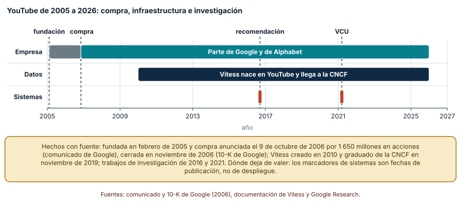

**Cómo leer la figura.** Cada carril es una dimensión del caso y la escala horizontal es el año. Mire cómo el origen de Vitess (2010) ocurre cuatro años después de la compra, ya dentro de Google. **Dónde deja de valer.** Los marcadores de sistemas son fechas de publicación, no de despliegue.

### Oficinas, plantilla y estructura

**Oficinas (documentado).** En 2006 YouTube tenía su sede en San Bruno y 65 empleados que seguirían allí tras la compra [Y5]. La sede de Alphabet está en 1600 Amphitheatre Parkway, Mountain View [Y1]. **[No se sabe]** dónde trabajan hoy los equipos de YouTube.

**Plantilla.** **[No se sabe]** el número de empleados de YouTube. Alphabet tenía 190 820 empleados a fines de 2025 y 182 502 a fines de 2023, sin desglose por división [Y1], [Y2].

**Estructura.** El comunicado de 2006 decía que YouTube «operará de forma independiente» tras la compra para preservar su marca y su comunidad [Y4]. **[No se sabe]** el organigrama actual.

## Contexto y problema

**Documentado.** El comunicado de Google de 2006 describe a YouTube como una empresa de medios para que la gente vea y comparta vídeos originales a través de la web, una de las comunidades de entretenimiento de vídeo más grandes y de más rápido crecimiento, y a su fundador como alguien que quería construir «la plataforma de nueva generación para servir medios» [Y4]. En el 10-K de Google de 2006, YouTube figura entre sus productos de comunicación y entretenimiento que compiten con empresas de medios tradicionales [Y3].

**El problema de fondo.** Compartir vídeo por Internet es un problema técnico y de derechos a la vez:

1. **Técnico.** Cada vídeo subido debe convertirse a varios formatos y resoluciones para reproducirse en cualquier dispositivo y conexión, almacenarse y entregarse a cualquier lugar. El trabajo de Google de 2021 dice que el vídeo es la mayor parte del tráfico de Internet [Y8].
2. **De derechos.** Cualquiera puede subir cualquier vídeo, incluido contenido de terceros. YouTube lo resuelve con Content ID: un sistema automático que escanea cada subida contra archivos de referencia y deja al titular decidir qué hacer [Y9].
3. **Económico.** Servir vídeo a escala cuesta mucho; el modelo de anuncios y de suscripciones debe pagarlo.

**Inferido.** La apuesta de producto fue que la subida abierta, sin intermediarios, genera la oferta de contenido más amplia y que esa oferta atrae la demanda de atención que se vende a anunciantes. El comunicado de 2006 lo respalda al hablar de «crear nuevas oportunidades para usuarios y propietarios de contenido de todo el mundo» [Y4].

### La apuesta, enunciada como hipótesis

El curso propone leer la apuesta como tres hipótesis comprobables ([SE-124](../../classes/part-10-descubrimiento-y-estrategia-de-producto/se-124-hipotesis-supuestos-y-preguntas-criticas/README.md)): (1) un sitio de subida abierta de vídeo con reproducción en la web atraerá a más usuarios que cualquier videoteca editorial; (2) la atención se podrá monetizar con anuncios sin ahuyentar a los espectadores; (3) los problemas de derechos se podrán gestionar con herramientas automáticas y acuerdos. La tercera fue la crítica en 2006: en la conferencia de la compra se preguntó por la tecnología de YouTube para reconocer contenido protegido por derechos y las notas de la llamada no recogen una respuesta detallada [Y5]. Esta formulación es del curso; YouTube no publica sus hipótesis internas.

## Mercado, usuarios y casos de uso

YouTube sirve a varios públicos con intereses distintos. La tabla resume quién es cada uno; lo que la fuente no confirma se marca.

| Rol | Qué hace y qué gana | Qué cambia en su experiencia | Respaldo |
| --- | --- | --- | --- |
| Espectador | Ve vídeos, busca y recibe recomendaciones en la página de inicio y en «Siguiente» | Descubrimiento guiado por su comportamiento y suscripciones | [Y11] |
| Creador | Sube vídeos y gestiona un canal; puede monetizar al cumplir umbrales | Audiencia e ingresos a partir de un umbral | [Y10] |
| Anunciante | Compra anuncios | 40 367 millones de USD en 2025 | [Y1] |
| Suscriptor | Paga por YouTube TV, Music, Premium o NFL Sunday Ticket | Servicios sin anuncios o de contenido de pago | [Y1] |
| Titular de derechos | Usa Content ID para bloquear, monetizar o seguir | Control sobre sus obras subidas por otros | [Y9] |
| Familias y menores | Usan cuentas supervisadas | **[No se sabe]** el detalle técnico del filtro | [Y9] |
| Alphabet (matriz) | Aporta infraestructura y es dueña | **[No se sabe]** cómo se reparte el coste interno | [Y1] |

**Uso central.** Ver vídeo bajo demanda y en directo. **Mercado.** **[No se sabe]** el número de usuarios y de horas de visualización en las fuentes consultadas: Alphabet no los publica en el 10-K.

### Quién da qué a quién

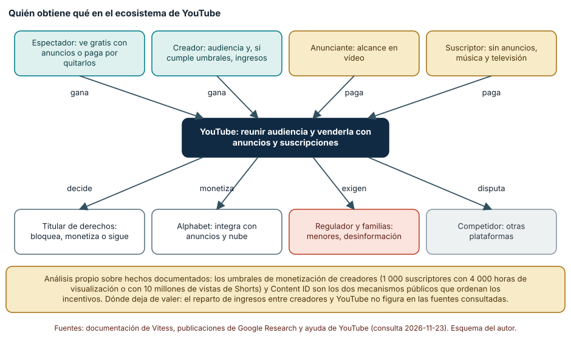

**Cómo leer la figura.** YouTube está en el centro porque junta atención y la vende; las etiquetas dicen qué aporta o gana cada actor. Mire primero que el espectador no paga si acepta anuncios. **Dónde deja de valer.** No hay cifras por actor.

### Incentivos por tipo de usuario (análisis propio sobre hechos documentados)

- **Espectador.** Quiere ver lo que le interesa; el sistema de recomendación considera su comportamiento, gustos, suscripciones y encuestas de satisfacción, y le permite pausar, editar o borrar su historial [Y11].
- **Creador.** Quiere audiencia e ingresos; el programa de socios exige 1 000 suscriptores con 4 000 horas de visualización cualificadas en 12 meses, o con 10 millones de vistas de Shorts en 90 días [Y10]. El umbral protege al sistema de pagos pero deja fuera a quien empieza.
- **Anunciante.** Quiere alcance; el 10-K atribuye el crecimiento de los anuncios de 2025 a los productos de respuesta directa y de marca [Y1].
- **Titular de derechos.** Quiere controlar sus obras; Content ID le permite bloquear, monetizar o seguir, con diferencias por país [Y9].
- **YouTube.** Su incentivo es crecer la atención y equilibrar creadores, espectadores y titulares. **[No se sabe]** el reparto de ingresos entre creadores y plataforma en las fuentes consultadas.

### Competencia y por qué el mercado favoreció a YouTube (análisis propio)

El 10-K de Google de 2006 reconoce que YouTube compite con empresas de medios tradicionales y con productos de comunicación y entretenimiento integrados en otros servicios [Y3]. La razón por la que YouTube llegó a su escala no está declarada. El análisis propio plantea cuatro factores combinados, ninguno suficiente por sí solo: (1) la subida abierta y la reproducción en el navegador; (2) la integración con la infraestructura y la plataforma de anuncios de Google tras 2006 (Chad Hurley dijo en la conferencia de la compra que la plataforma de anuncios de Google «se integrará perfectamente» [Y5]); (3) la inversión técnica propia: base de datos, aceleradores de vídeo, recomendación [Y6]–[Y8]; (4) la gestión de derechos con Content ID, que permitió contenido licenciado. **[No se sabe]** cuánto pesa cada uno ni la cuota frente a otras plataformas de vídeo.

## Funcionalidad de principio a fin

Se recorre el servicio primero con un espectador y luego con otros tipos de usuario, hasta su caso límite.

### Recorrido de un espectador

1. **Primer contacto.** Abre la página de inicio; si está registrado, ve una mezcla de recomendaciones personalizadas, suscripciones y noticias; si no, hay controles para decidir cuántos datos aporta [Y11].
2. **Búsqueda.** Los resultados se priorizan por relevancia, interacción y calidad, con distinto peso según el tipo de búsqueda [Y11].
3. **Reproducción.** Elige un vídeo; en el panel «Siguiente» ve más contenido relacionado y recomendado [Y11].
4. **Anuncios o suscripción.** Ve anuncios o paga por YouTube Premium [Y1].
5. **Historial.** Puede pausar, editar o borrar su historial de búsqueda y de visualización [Y11].
6. **Operación diaria.** Para el espectador, que el vídeo cargue; detrás, el procesamiento y la entrega que las fuentes no describen.

### Recorridos por tipo de usuario

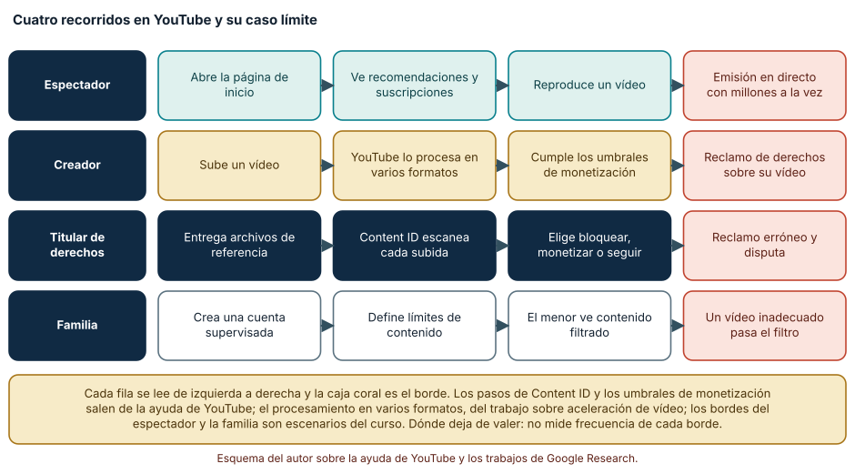

**Cómo leer la figura.** Cada fila es un usuario distinto; las cajas se leen de izquierda a derecha y la última, en coral, es el caso límite. **Dónde deja de valer.** Es un recorrido visible al usuario, no un diagrama de estados.

**Creador.** **[Documentado]** que para entrar en el programa de socios hacen falta 1 000 suscriptores y 4 000 horas de visualización cualificadas en 12 meses o 10 millones de vistas de Shorts en 90 días; recibe un correo al alcanzarlo [Y10]. El caso límite es un reclamo de Content ID sobre su vídeo: según los ajustes del titular puede bloquearse, monetizarse para el titular o solo rastrearse [Y9].

**Titular de derechos.** **[Documentado]** que debe tener derechos exclusivos sobre un cuerpo sustancial de material original que se suba con frecuencia para ser aprobado, y que quien reclama erróneamente de forma repetida puede perder el acceso [Y9]. El caso límite es un reclamo erróneo y la disputa posterior. **[No se sabe]** la tasa de error.

**Familia.** **[Documentado]** que existen cuentas supervisadas para niños y adolescentes [Y9]. **[No se sabe]** el diseño técnico.

**Espectador de un directo.** **[Documentado]** que la plataforma ofrece emisión en directo [Y9]. **[No se sabe]** cómo se sirve a millones de espectadores a la vez.

## Negocio y economía

**Modelo (documentado).** Los ingresos de YouTube que Alphabet separa son los anuncios; las suscripciones de YouTube (TV, Music, Premium, NFL Sunday Ticket) se reportan dentro de «suscripciones, plataformas y dispositivos» [Y1]. El reparto con los creadores y los costes no se publican.

### La escala de los ingresos a lo largo del tiempo

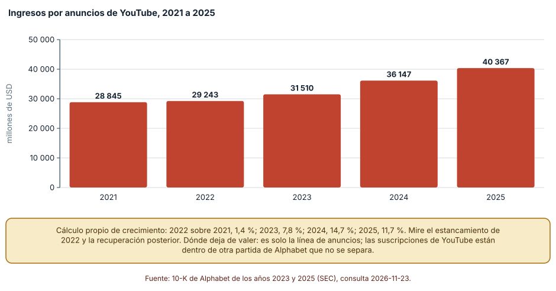

**Cómo leer la figura.** Cada barra es un año. Mire el estancamiento de 2022 y la aceleración de 2024. **Dónde deja de valer.** Es solo la línea de anuncios, no el ingreso total.

### Unit economics con cifras citadas

| Magnitud (millones de USD) | 2021 | 2022 | 2023 | 2024 | 2025 | Fuente |
| --- | ---: | ---: | ---: | ---: | ---: | --- |
| Anuncios de YouTube | 28 845 | 29 243 | 31 510 | 36 147 | 40 367 | [Y1], [Y2] |
| Crecimiento anual (cálculo propio) | — | 1,4 % | 7,8 % | 14,7 % | 11,7 % | [Y1], [Y2] |
| Suscripciones, plataformas y dispositivos (Alphabet) | 28 032 | 29 055 | 34 688 | 40 340 | 48 030 | [Y1], [Y2] |
| Ingresos totales de Alphabet | — | 282 836 | 307 394 | 350 018 | 402 836 | [Y1], [Y2] |

Los anuncios de YouTube pasaron de 10,3 % a 10,0 % de los ingresos de Alphabet entre 2022 y 2025 (cálculo propio: 29 243 sobre 282 836 y 40 367 sobre 402 836): crecen, pero algo menos que el conjunto. Las celdas con «—» son valores que este caso no encontró en las fuentes consultadas.

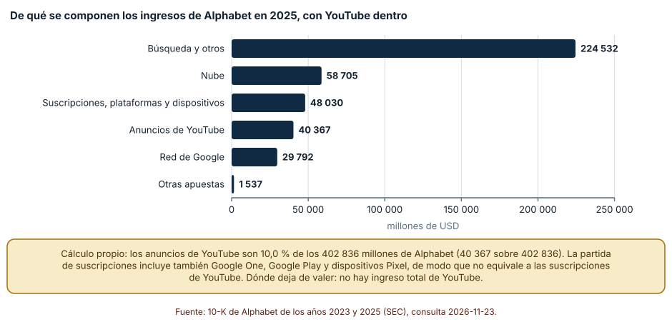

**Cómo leer la figura.** Cada barra es una línea de ingresos de Alphabet en 2025. Mire que YouTube es una de las líneas más grandes, pero menos de la quinta parte de la búsqueda. **Dónde deja de valer.** «Suscripciones, plataformas y dispositivos» incluye mucho más que YouTube.

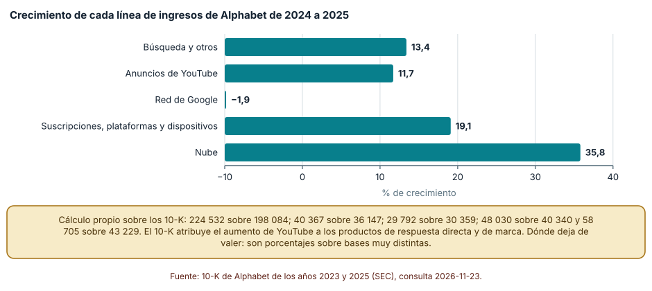

**Cómo leer la figura.** Cada barra es el crecimiento de una línea. Mire que los anuncios de YouTube crecen menos que las suscripciones y la nube. **Dónde deja de valer.** Son porcentajes sobre bases muy distintas.

### El precio de la compra

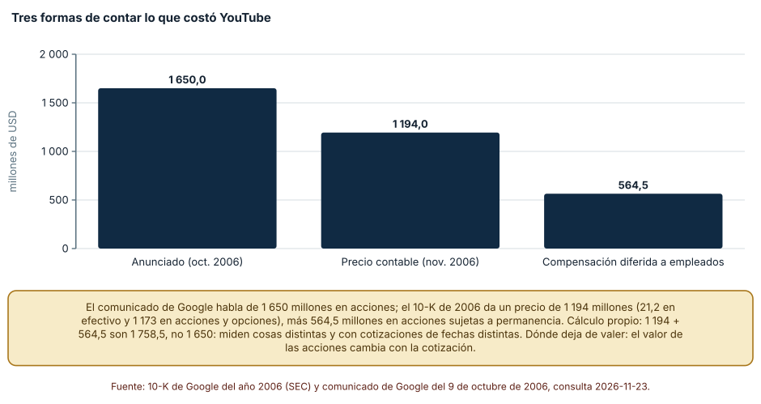

**Cómo leer la figura.** Cada barra es una forma de contar lo mismo. Mire que no se suman. **Dónde deja de valer.** El valor de las acciones depende de la cotización de cada fecha.

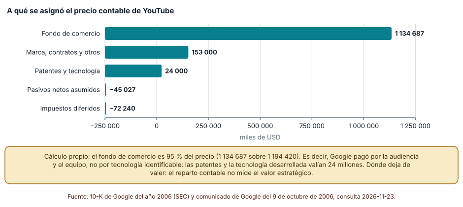

**Cómo leer la figura.** Las barras son partidas del balance de la compra, en miles de dólares. Mire la primera: el fondo de comercio. **Dónde deja de valer.** El reparto contable no mide el valor estratégico.

**Qué enseña.** El 10-K de 2006 asigna 1 134,7 millones de 1 194,4 al fondo de comercio (95 %, cálculo propio) y solo 24 millones a patentes y tecnología desarrollada [Y3]: Google pagó por la audiencia y el equipo más que por tecnología identificable. Es un caso extremo de adquisición de producto y comunidad.

### Dónde crece el negocio

**[Documentado]** que el aumento de 4 200 millones de dólares en anuncios de 2024 a 2025 vino de los productos de respuesta directa, seguidos de los de marca [Y1]. **[No se sabe]** cuánto aportan los Shorts, la televisión o los directos a ese crecimiento.

### Eficiencia de la organización

**[No se sabe]** el número de empleados de YouTube. El ingreso por empleado de Alphabet es de unos 2,1 millones de USD (402 836 sobre 190 820, cálculo propio, orden de magnitud) y no es una cifra de YouTube.

### Esquema del negocio: flujos de dinero y de valor

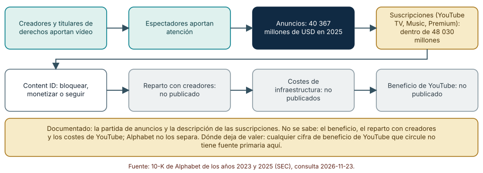

**Cómo leer la figura.** La fila superior sigue el valor desde el contenido hasta el dinero y la inferior marca en gris lo que no se publica. **Dónde deja de valer.** Es un esquema cualitativo.

### Visión, misión y estrategia

El 10-K de 2006 describe a «Google Video y YouTube» como herramientas para encontrar, subir, ver y compartir vídeo en todo el mundo [Y3]. El 10-K de 2025 sitúa los servicios de suscripción de YouTube entre las fuentes de ingresos de Google Services junto con el modelo de anuncios [Y1]. **[Inferido]** que la estrategia es combinar anuncios con suscripciones; Alphabet no la enuncia con esas palabras.

### Costos operativos

**[No se sabe]** los costes de YouTube. Alphabet menciona que su infraestructura técnica incluye TPU propios y centros de datos que busca hacer más eficientes [Y1]; el trabajo de aceleración de vídeo es una evidencia de que el procesamiento es un coste importante: mejoró 20 a 33 veces la eficiencia frente a su base anterior [Y8]. Cálculo propio: no se puede convertir esa mejora en un ahorro en dólares sin el coste de partida, que no es público.

### Competidores

El 10-K de 2006 menciona competencia de medios tradicionales [Y3]. **[No se sabe]** la cuota de mercado por competidor en las fuentes consultadas.

## Arquitectura y esquemas

Se recorre como un mapa con zoom creciente. **Esta sección es deliberadamente corta**: lo documentado públicamente sobre la arquitectura de YouTube se reduce a la historia de Vitess, dos trabajos de investigación de Google y la ayuda de YouTube. Lo que falta (almacenamiento y entrega de vídeo, moderación, operación) se declara como no sabido en lugar de reconstruirse. El caso queda más corto que los demás de la serie y lo dice.

### 6.1 Contexto del sistema

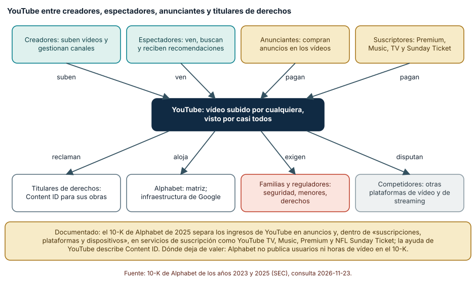

**Cómo leer la figura.** El cuadro central es YouTube y los satélites son quienes lo usan, lo financian o lo limitan. Mire primero a los titulares de derechos: son el actor que más condiciona el diseño. **Dónde deja de valer.** No hay volúmenes.

### 6.2 Capas

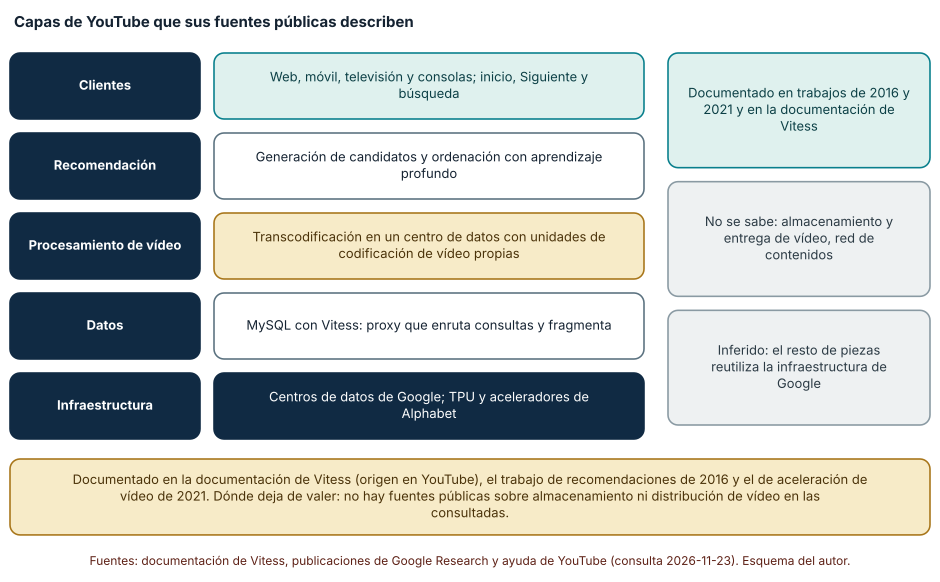

**Cómo leer la figura.** De arriba abajo, cada capa descansa en la siguiente; a la derecha, qué es documentado y qué no. **Dónde deja de valer.** Faltan almacenamiento y entrega de vídeo, de los que no hay fuentes públicas consultadas.

**Documentado.** El 10-K de 2025 describe que Alphabet usa TPU propios y centros de datos [Y1]; la historia de Vitess cuenta que la base de datos de YouTube es MySQL servida mediante Vitess [Y6]; el trabajo de 2021 describe el procesamiento de vídeo acelerado por hardware [Y8]; y el de 2016, el sistema de recomendación en dos etapas [Y7].

### 6.3 Una subida

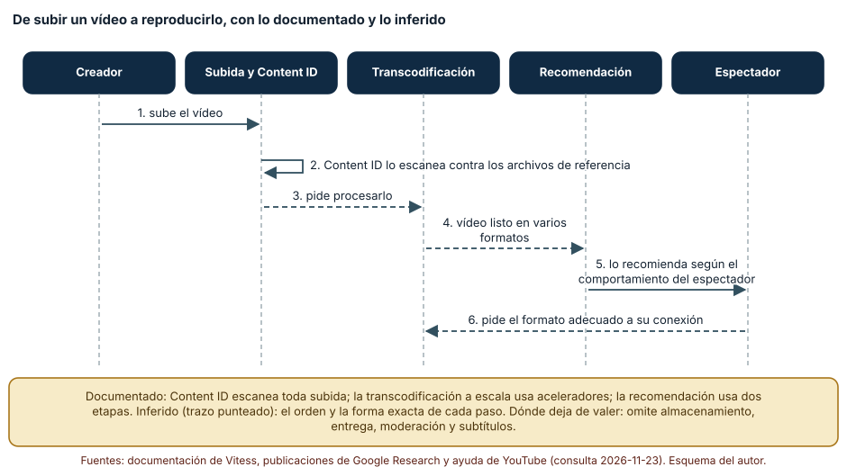

**Cómo leer la figura.** Las flechas continuas son hechos documentados y las punteadas, inferencias. Mire que el escaneo de Content ID es un paso de la subida y no posterior. **Dónde deja de valer.** Omite almacenamiento, entrega, moderación y subtítulos.

**Documentado.** Cuando se sube un vídeo, Content ID lo escanea automáticamente contra una base de archivos de audio y vídeo enviados por los titulares [Y9]. El trabajo de 2021 dice que la transcodificación de vídeo es una carga de gran escala [Y8]. **Inferido.** Que la transcodificación produce varios formatos y resoluciones, y que el espectador recibe el adecuado a su conexión; los documentos consultados no lo describen paso por paso. **[No se sabe]** el orden de las etapas y el sistema de almacenamiento.

### 6.4 La base de datos: del MySQL único a Vitess

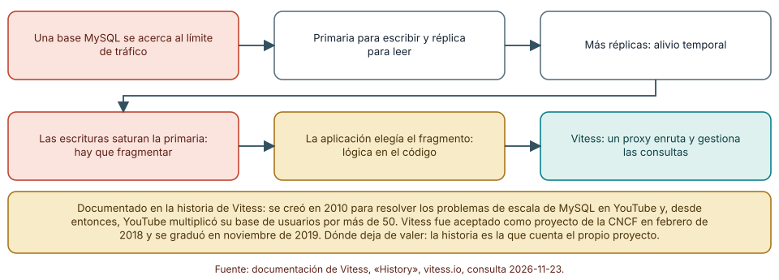

**Cómo leer la figura.** Cada caja es un paso de la historia que cuenta Vitess. **Dónde deja de valer.** Es la historia que cuenta el propio proyecto.

**Documentado [Y6].** Vitess se creó en 2010 para resolver los problemas de escalabilidad de MySQL que tenía el equipo de YouTube. La base llegó a un punto en que el tráfico máximo pronto superaría su capacidad. Para aliviarlo crearon una base primaria para el tráfico de escritura y una réplica para el de lectura. Con la demanda de vídeos de gatos «en máximos históricos», la lectura seguía sobrecargando la réplica y añadieron más réplicas, de nuevo como alivio temporal. Al final el tráfico de escritura fue demasiado para la primaria y hubo que fragmentar los datos (la fragmentación también habría sido necesaria si el tamaño total superara una sola instancia). La capa de aplicación se modificó para identificar el fragmento correcto antes de cada operación; Vitess permitió quitar esa lógica del código con un proxy entre la aplicación y la base que enruta y gestiona las interacciones. Desde entonces, YouTube multiplicó su base de usuarios por más de 50. Vitess fue aceptado como proyecto de incubación de la CNCF en febrero de 2018 y se graduó en noviembre de 2019.

**Qué enseña.** Es la secuencia clásica de escalado de una base relacional: una instancia, primaria con réplicas de lectura, y por último fragmentación; y el patrón de sacar la lógica de enrutado de la aplicación a un proxy ([SE-355](../../classes/part-29-datos-persistencia-y-recuperacion/se-355-replicacion-particion-y-distribucion/README.md); [SE-393](../../classes/part-32-concurrencia-y-sistemas-distribuidos/se-393-replicacion-sharding-y-balanceo/README.md)). El coste es operar el proxy y las migraciones de fragmentos. **Nota:** Slack también migró a Vitess (caso de Slack de esta serie), lo que muestra su difusión; la afirmación es del curso.

### 6.5 Procesar vídeo: aceleración por hardware

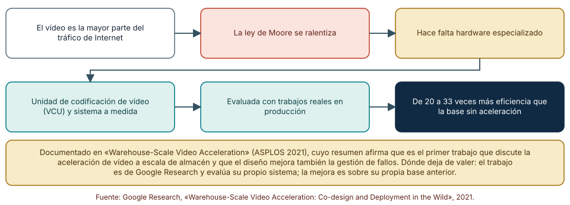

**Cómo leer la figura.** La fila superior es la motivación y la inferior la solución y su resultado. **Dónde deja de valer.** Google evalúa su propio sistema frente a su propia base anterior.

**Documentado [Y8].** El trabajo «Warehouse-Scale Video Acceleration: Co-design and Deployment in the Wild» (ASPLOS 2021) afirma que compartir vídeo (YouTube, Vimeo, Facebook, TikTok) es la mayor parte del tráfico de Internet y que el procesamiento de vídeo es la base de otras cargas (videoconferencia, realidad aumentada, juegos en la nube). Con la ralentización de la ley de Moore, aparece la necesidad de aceleradores especializados. Describe el diseño y el despliegue a escala de un nuevo acelerador dirigido a la transcodificación de vídeo a escala de almacén: un bloque nuevo, la **unidad de codificación de vídeo** (VCU), y las decisiones de diseño para sistemas equilibrados a escala de centro de datos y para co-diseñar aceleradores con software distribuido. Lo evalúan «en la naturaleza» con trabajos reales y obtienen una eficiencia de 20 a 33 veces la de su base anterior bien afinada sin aceleración; el diseño permite adaptarse a cuellos de botella cambiantes, mejora la gestión de fallos y habilita capacidades nuevas. Aseguran que es el primer trabajo que discute la aceleración de vídeo a escala en entornos de almacén.

**Qué enseña.** Cuando una carga es tan grande y uniforme, especializar el hardware compensa; es un tema de las clases de aceleradores y de su rendimiento y coste ([SE-280](../../classes/part-23-runtimes-y-plataformas-modernas/se-280-gpu-y-aceleradores-modelo-de-ejecucion/README.md); [SE-281](../../classes/part-23-runtimes-y-plataformas-modernas/se-281-rendimiento-y-costo-en-aceleradores/README.md)) y de archivos, streaming y cargas extensas ([SE-248](../../classes/part-20-backend-apis-y-procesamiento-asincrono/se-248-archivos-streaming-y-cargas-extensas/README.md)). **[No se sabe]** cuánto del vídeo de YouTube se procesa hoy en esa unidad.

### 6.6 Recomendar: dos etapas

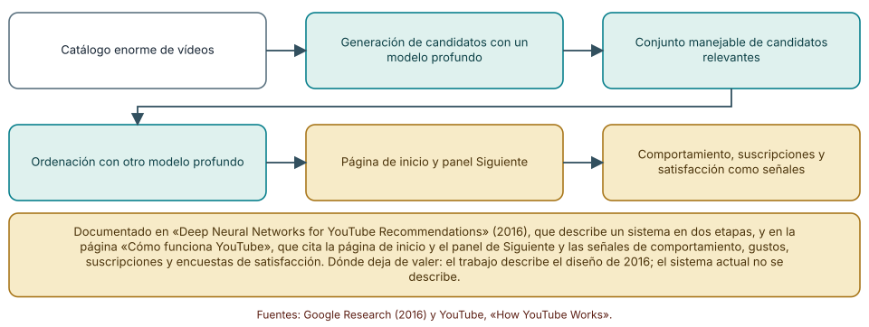

**Cómo leer la figura.** La fila superior reduce el catálogo y la inferior ordena y muestra. **Dónde deja de valer.** El trabajo es de 2016; el sistema actual no se describe.

**Documentado [Y7], [Y11].** El trabajo «Deep Neural Networks for YouTube Recommendations» (2016) describe YouTube como uno de los sistemas de recomendación industriales más grandes y sofisticados, y se centra en las mejoras de rendimiento del aprendizaje profundo. Divide el sistema en las dos etapas clásicas de recuperación de información: un modelo profundo de generación de candidatos y, aparte, un modelo profundo de ordenación; añade lecciones prácticas de diseñar, iterar y mantener un sistema masivo. La página «Cómo funciona YouTube» explica que el sistema busca anticipar las necesidades del espectador con su comportamiento, gustos, suscripciones y encuestas de satisfacción, considera la reputación y calidad del canal, usa evaluadores externos y ofrece controles de privacidad; las recomendaciones están en la página de inicio y en el panel de «Siguiente», y en temas como noticias, finanzas o salud se elevan voces de alta calidad.

**Qué enseña.** Dividir el problema en recuperación y ordenación es la forma de convertir un catálogo enorme en una lista corta con un presupuesto de cómputo ([SE-594](../../classes/part-49-patrones-agenticos-y-sistemas-con-llm/se-594-embeddings-recuperacion-y-agentic-rag/README.md) para recuperación; [SE-606](../../classes/part-50-machine-learning-en-produccion-y-mlops/se-606-servir-modelos-latencia-lotes-y-gpu/README.md) para servir modelos; [SE-608](../../classes/part-50-machine-learning-en-produccion-y-mlops/se-608-monitoreo-deriva-y-reentrenamiento/README.md) para monitoreo y deriva). **[No se sabe]** cómo se evalúa y se corrige el sistema ante sesgos o daños; las clases de evaluación y sesgos ([SE-604](../../classes/part-50-machine-learning-en-produccion-y-mlops/se-604-evaluacion-sesgos-y-validacion-de-modelos/README.md)) dan el marco.

### 6.7 Derechos: Content ID

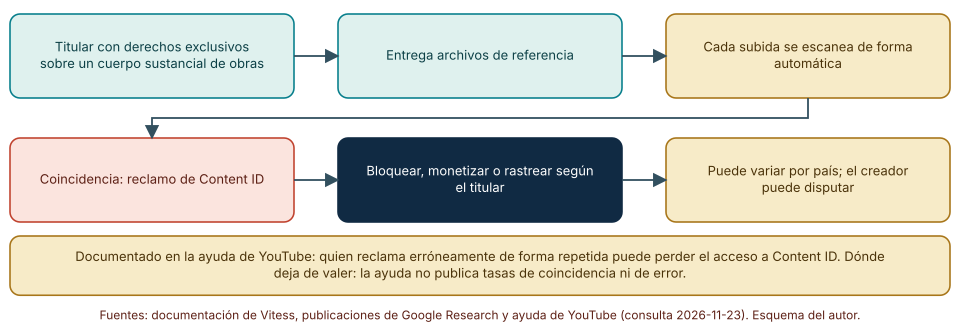

**Cómo leer la figura.** La fila superior es la entrada de datos y el escaneo y la inferior, el reclamo y su resultado. **Dónde deja de valer.** No hay tasas de coincidencia ni de error.

**Documentado [Y9].** Content ID es el sistema automático de identificación de contenido de YouTube. Con una base de archivos de audio y vídeo enviados por los titulares, identifica coincidencias con contenido protegido; cada vídeo subido se escanea automáticamente; si hay coincidencia, el vídeo recibe un reclamo, que según los ajustes del titular puede bloquear el vídeo, monetizarlo con anuncios (a veces compartiendo ingresos con quien lo subió) o seguir sus estadísticas, con diferencias por país. Solo lo usan titulares que cumplen criterios: derechos exclusivos sobre un cuerpo sustancial de material original que se sube con frecuencia; sus usos y disputas se vigilan, y quien reclama erróneamente de forma repetida puede perder el acceso y la relación con YouTube.

**Qué enseña.** Es un mecanismo de coincidencia a escala con un dueño del derecho que decide la política y un control de abuso: las clases de propiedad intelectual y contratos ([SE-536](../../classes/part-44-gestion-liderazgo-y-practica-profesional/se-536-propiedad-intelectual-contratos-y-etica/README.md)) y de privacidad por diseño ([SE-463](../../classes/part-38-seguridad-privacidad-y-cumplimiento/se-463-privacidad-por-diseno-y-minimizacion/README.md)) discuten los equilibrios. **No generalice:** la ayuda describe el diseño, no su eficacia.

### 6.8 Monetización de creadores

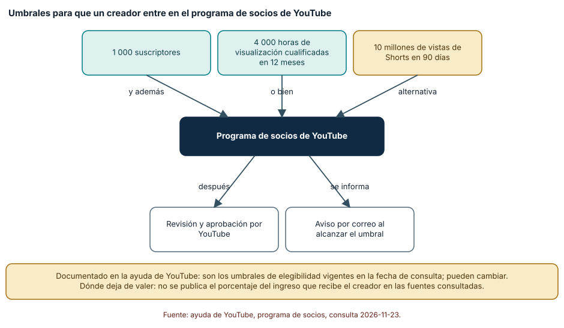

**Cómo leer la figura.** Cada nodo es una condición o un paso. **Dónde deja de valer.** Son los umbrales vigentes en la fecha de consulta y pueden cambiar.

**Documentado [Y10].** Para entrar en el programa se requiere llegar a 1 000 suscriptores con 4 000 horas de visualización cualificadas en los últimos 12 meses, o a 1 000 suscriptores con 10 millones de vistas cualificadas de Shorts en los últimos 90 días; la herramienta avisa por correo al alcanzar uno de los umbrales. **[No se sabe]** el porcentaje que recibe el creador.

### 6.9 Seguridad, abuso y cumplimiento

**Documentado.** La ayuda describe cuentas supervisadas para niños y adolescentes, políticas y mecanismos de denuncia y aplicación [Y9]; la página de recomendaciones menciona controles para pausar, editar o borrar el historial [Y11]. **[No se sabe]** el diseño técnico de la moderación a escala y de la detección de contenido dañino: no hay un documento público consultado que lo describa.

### 6.10 Observabilidad y operación

**No documentado en las fuentes consultadas.** No hay posmortems públicos de caídas de YouTube ni descripciones de su observabilidad o de sus guardias en lo consultado. Este caso no los inventa ni los toma de otros casos.

### 6.11 Evolución y alternativas descartadas (análisis propio)

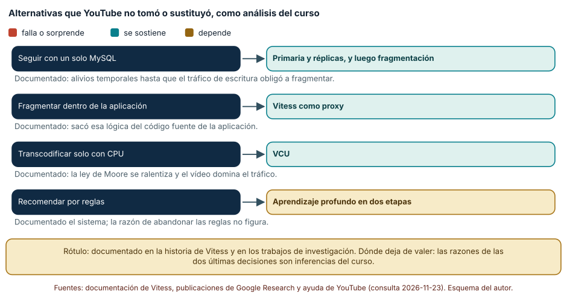

**Cómo leer la figura.** Cada tarjeta enfrenta una alternativa con lo que se documenta. **Dónde deja de valer.** Las razones de las dos últimas son inferencias del curso.

**Rótulo: documentado en parte.** La historia de Vitess razona por qué se pasó de una base única a réplicas y a fragmentos, y el trabajo de 2021 por qué se pasó de CPU a un acelerador. **[No se sabe]** si se evaluaron otras bases de datos en 2010 o recomendadores sin aprendizaje profundo, o por qué.

### 6.12 Hardware, software, infraestructura y fallos

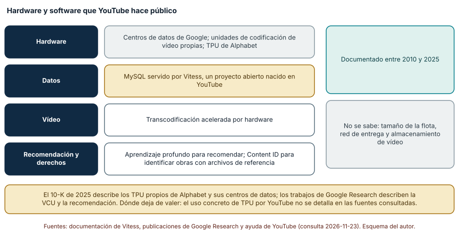

**Cómo leer la figura.** De arriba abajo, de lo físico a lo lógico. **Dónde deja de valer.** No hay números de servidores ni de capacidad.

**Hardware utilizado.** Los centros de datos de Google; el acelerador de vídeo VCU; los TPU de Alphabet [Y1], [Y8]. **[No se sabe]** el reparto por función.

**Software utilizado (documentado).** MySQL servido por Vitess; modelos de aprendizaje profundo para recomendar; Content ID [Y6], [Y7], [Y9].

**Características de la infraestructura.** Base de datos fragmentada detrás de un proxy; procesamiento de vídeo acelerado por hardware; recomendación en dos etapas [Y6]–[Y8].

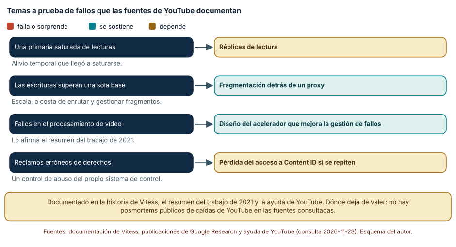

**Cómo leer la figura.** Cada tarjeta enlaza un riesgo con el mecanismo que lo contiene. **Dónde deja de valer.** Solo hay cuatro mecanismos documentados; no es un plan de continuidad.

**Temas a prueba de fallos.** Réplicas de lectura, fragmentación con proxy, diseño del acelerador que mejora la gestión de fallos y control de abuso de Content ID [Y6], [Y8], [Y9].

## Casos especiales y cómo se resuelven

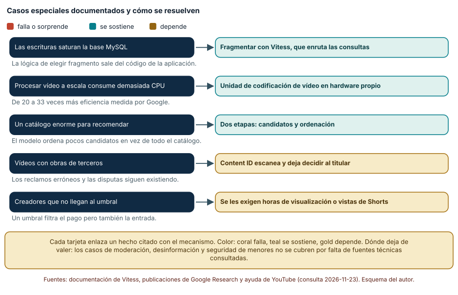

**Cómo leer la figura.** Cada tarjeta enfrenta una situación con lo que hizo el sistema; el color es el veredicto. **Dónde deja de valer.** Faltan los casos de moderación, directos y seguridad de menores por falta de fuentes técnicas.

1. **Escrituras que saturan una base.** Fragmentación con Vitess [Y6].
2. **Vídeo a escala.** Unidad de codificación de vídeo [Y8].
3. **Catálogo enorme.** Recomendación en dos etapas [Y7].
4. **Obras de terceros.** Content ID [Y9].
5. **Creadores nuevos.** Umbrales del programa de socios [Y10].
6. **Control de privacidad del espectador.** Pausar, editar o borrar el historial [Y11].

## Línea de tiempo

| Año o fecha | Hecho | Fuente |
| --- | --- | --- |
| Febrero de 2005 | Se funda YouTube | [Y4] |
| 9 de octubre de 2006 | Google anuncia la compra por 1 650 millones de dólares en acciones | [Y4], [Y5] |
| 13 de noviembre de 2006 | Google emite 3 217 560 acciones de clase A a los accionistas de YouTube | [Y3] |
| 2010 | Nace Vitess para resolver la escala de MySQL en YouTube | [Y6] |
| 2016 | Se publica el sistema de recomendación con redes neuronales profundas | [Y7] |
| Febrero de 2018 | Vitess entra en la CNCF como proyecto de incubación | [Y6] |
| Noviembre de 2019 | Vitess se gradúa en la CNCF | [Y6] |
| 2021 | Se publica la aceleración de vídeo a escala (VCU) | [Y8] |
| 2025 | Anuncios de YouTube de 40 367 millones de USD | [Y1] |

### Decisiones clave, giros y correcciones

- **Vender a Google (2006).** Decisión de los fundadores; la razón que dieron fue integrar la plataforma de anuncios de Google [Y5].
- **Fragmentar con un proxy en lugar de en la aplicación (2010).** Una decisión de ingeniería documentada [Y6].
- **Construir hardware de vídeo propio.** Respuesta a la ralentización de la ley de Moore [Y8].

## Vínculo con el curso

El caso muestra, en una plataforma real, mecanismos que el curso desarrolla con ejemplos controlados. Cada enlace dice qué ilustra el caso:

- [SE-355](../../classes/part-29-datos-persistencia-y-recuperacion/se-355-replicacion-particion-y-distribucion/README.md): réplica, partición y distribución. Primaria con réplicas y luego fragmentos.
- [SE-393](../../classes/part-32-concurrencia-y-sistemas-distribuidos/se-393-replicacion-sharding-y-balanceo/README.md): replicación, sharding y balanceo. Vitess como proxy de enrutado.
- [SE-280](../../classes/part-23-runtimes-y-plataformas-modernas/se-280-gpu-y-aceleradores-modelo-de-ejecucion/README.md): GPU y aceleradores. La unidad de codificación de vídeo.
- [SE-281](../../classes/part-23-runtimes-y-plataformas-modernas/se-281-rendimiento-y-costo-en-aceleradores/README.md): rendimiento y costo en aceleradores. La mejora de 20 a 33 veces.
- [SE-248](../../classes/part-20-backend-apis-y-procesamiento-asincrono/se-248-archivos-streaming-y-cargas-extensas/README.md): archivos, streaming y cargas extensas. El vídeo como carga.
- [SE-594](../../classes/part-49-patrones-agenticos-y-sistemas-con-llm/se-594-embeddings-recuperacion-y-agentic-rag/README.md): embeddings, recuperación y RAG agéntico. La generación de candidatos antes de ordenar.
- [SE-606](../../classes/part-50-machine-learning-en-produccion-y-mlops/se-606-servir-modelos-latencia-lotes-y-gpu/README.md): servir modelos, latencia y GPU. La ordenación con un modelo profundo.
- [SE-608](../../classes/part-50-machine-learning-en-produccion-y-mlops/se-608-monitoreo-deriva-y-reentrenamiento/README.md): monitoreo, deriva y reentrenamiento. Mantener un recomendador masivo.
- [SE-604](../../classes/part-50-machine-learning-en-produccion-y-mlops/se-604-evaluacion-sesgos-y-validacion-de-modelos/README.md): evaluación, sesgos y validación. Los efectos de un recomendador.
- [SE-536](../../classes/part-44-gestion-liderazgo-y-practica-profesional/se-536-propiedad-intelectual-contratos-y-etica/README.md): propiedad intelectual, contratos y ética. Content ID y los titulares de derechos.
- [SE-463](../../classes/part-38-seguridad-privacidad-y-cumplimiento/se-463-privacidad-por-diseno-y-minimizacion/README.md): privacidad por diseño. El control del historial de visualización.
- [SE-416](../../classes/part-34-saas-y-plataformas-de-producto/se-416-marketplaces-y-plataformas-de-dos-lados/README.md): marketplaces y plataformas de dos lados. Creadores y espectadores con anunciantes detrás.
- [SE-133](../../classes/part-11-economia-metricas-y-decisiones-de-producto/se-133-modelos-de-negocio-y-sostenibilidad/README.md): modelos de negocio. Anuncios y suscripciones.
- [SE-134](../../classes/part-11-economia-metricas-y-decisiones-de-producto/se-134-costos-de-construccion-operacion-y-oportunidad/README.md): costos de construcción, operación y oportunidad. El precio de la compra frente al valor de la audiencia.

### Preguntas de discusión

1. El 95 % del precio de compra se asignó a fondo de comercio. ¿Qué dice eso de qué se compró y de cómo se justifica ese precio?
2. Vitess nació como respuesta a una saturación de escrituras. ¿Qué otras opciones había en 2010 y qué habría cambiado cada una?
3. ¿Qué información necesitaría para decidir si construir un acelerador de vídeo propio es rentable en su caso?
4. Content ID deja decidir al titular. ¿Qué incentivos crea eso para creadores, titulares y plataforma?
5. Alphabet no publica el beneficio de YouTube. ¿Qué decisiones serían difíciles de evaluar sin esa cifra?

### Mini-ejercicios de análisis

1. Calcule la participación de los anuncios de YouTube en los ingresos de Alphabet de 2021 a 2025 con los datos del caso y diga qué se necesitaría para 2021.
2. Dibuje la secuencia de Vitess de una consulta antes y después del proxy y marque qué lógica sale de la aplicación.
3. Escriba tres métricas para evaluar un recomendador de dos etapas y diga cuál detectaría primero un empeoramiento de la ordenación.

## Qué no generalizar

- **La compra.** Google pagó por una audiencia y un equipo de 65 personas; el valor se justificó después con la integración de anuncios; no se transfiere a una empresa sin ese activo.
- **Las cifras de ingresos.** Los anuncios de YouTube no son el ingreso total y no hay beneficio público: no se debe afirmar que YouTube es rentable ni cuánto.
- **El acelerador de vídeo.** Requiere una escala y una uniformidad de carga que pocas empresas tienen; la mejora de 20 a 33 veces es de Google sobre su base anterior.
- **Vitess.** Su historia es la de un equipo concreto; otras bases pueden escalar de forma distinta.
- **El recomendador.** El trabajo de 2016 es un diseño, no el sistema de hoy.
- **El tamaño del caso.** Es corto porque las fuentes son pocas, no porque YouTube sea simple.

## Fuentes públicas verificadas

Todas las URL se consultaron el 23 de noviembre de 2026 y devolvieron contenido (HTTP 200). Las cifras de la SEC se leyeron con el acceso de datos públicos de la propia SEC.

- **[Y1]** [Alphabet, Form 10-K del año terminado el 31 de diciembre de 2025 (SEC)](https://www.sec.gov/Archives/edgar/data/1652044/000165204426000018/goog-20251231.htm): ingresos por línea, anuncios de YouTube, servicios de suscripción y plantilla.
- **[Y2]** [Alphabet, Form 10-K del año terminado el 31 de diciembre de 2023 (SEC)](https://www.sec.gov/Archives/edgar/data/1652044/000165204424000022/goog-20231231.htm): anuncios de YouTube de 2021 a 2023.
- **[Y3]** [Google, Form 10-K del año 2006 (SEC)](https://www.sec.gov/Archives/edgar/data/1288776/000119312507044494/d10k.htm): compra de YouTube, precio contable y asignación.
- **[Y4]** [Google To Acquire YouTube for $1.65 Billion in Stock (comunicado de Google, 9 de octubre de 2006)](https://googlepress.blogspot.com/2006/10/google-to-acquire-youtube-for-165_09.html): fundación en febrero de 2005 y precio anunciado.
- **[Y5]** [Google Has Acquired YouTube (TechCrunch, 9 de octubre de 2006)](https://techcrunch.com/2006/10/09/google-has-acquired-youtube/): fundadores, 65 empleados y San Bruno.
- **[Y6]** [Vitess, History](https://vitess.io/docs/overview/history/): origen en YouTube y fragmentación.
- **[Y7]** [Deep Neural Networks for YouTube Recommendations (Google Research, 2016)](https://research.google/pubs/deep-neural-networks-for-youtube-recommendations/): recomendación en dos etapas.
- **[Y8]** [Warehouse-Scale Video Acceleration: Co-design and Deployment in the Wild (Google Research, 2021)](https://research.google/pubs/warehouse-scale-video-acceleration-co-design-and-deployment-in-the-wild/): unidad de codificación de vídeo.
- **[Y9]** [How Content ID works (ayuda de YouTube)](https://support.google.com/youtube/answer/2797370): escaneo de subidas y acciones del titular.
- **[Y10]** [YouTube Partner Program overview and eligibility (ayuda de YouTube)](https://support.google.com/youtube/answer/72851): umbrales de monetización.
- **[Y11]** [Recommendations (YouTube, «How YouTube Works»)](https://www.youtube.com/howyoutubeworks/product-features/recommendations/): señales, página de inicio y controles.

[↑ Casos de éxito](README.md) · [← Dropbox](dropbox.md)
