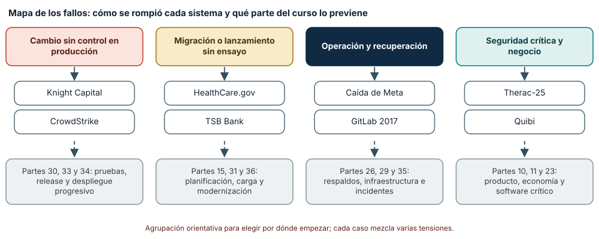

# Casos de estudio · Plataformas y sistemas que fallaron

[↑ Programa](../../README.md) · [Guía de casos](../GUIDE.md) · [Casos de éxito →](../exito/README.md)

> Esta superficie no son clases ni roles: no cuenta en las clases ni en las partes del programa. Es la realidad
> frente a la teoría del curso.

## Qué es

Esta página reúne diez fallos de plataformas y sistemas: Knight Capital, HealthCare.gov, TSB Bank, Caída global de Meta, CrowdStrike, Therac-25, Incidente de base de datos de GitLab, Quibi, Ariane 5, vuelo 501 y Boeing 737 MAX y MCAS. Cada uno tiene su propio caso, con lo que falló en cada instancia, la causa raíz, los factores que contribuyeron y las mejoras que debieron hacerse.

## Por qué se construyó

Los fallos son la evidencia más barata de por qué existen las prácticas del curso: pruebas, despliegue progresivo, respaldos verificados, observabilidad, gestión de incidentes y ética profesional. Se construyó para que cada práctica tenga un daño concreto detrás y para entrenar el análisis sin culpables: separar hechos, interpretación y lecciones.

## Cómo usar esta página pedagógicamente

1. Léelos **después** de la teoría del curso; el objetivo es reconocer los mecanismos, no juzgar a las personas.
2. Antes de leer la causa raíz, escribe tu hipótesis sobre qué falló y qué señal habría avisado.
3. Distingue en cada caso el detonante (lo que ocurrió ese día) de las condiciones latentes (lo que hizo posible el daño).
4. Termina con «Mejoras que debieron hacerse» y comprueba cuáles ya existen en tu propio sistema.

## Cómo se lee un caso

Todos los casos siguen el mismo esquema (definido en la [guía de casos](../GUIDE.md)) para poder
compararlos: ficha histórica, contexto y problema, mercado y usuarios, funcionalidad de principio a fin,
negocio y economía, arquitectura y esquemas, casos especiales, línea de tiempo, qué falló, causa raíz y mejoras, vínculo con el curso, qué no generalizar y fuentes públicas.
Las afirmaciones llevan fuente; lo inferido se marca como interpretación.

## Mapa visual

**Cómo leer el mapa.** Cada columna es una tensión de ingeniería; las cajas blancas son los casos que mejor
la ilustran y la caja gris inferior nombra las partes del curso con las herramientas para analizarla. La
agrupación es orientativa: sirve para elegir por dónde empezar, no para clasificar de forma excluyente.

## Índice de casos

- [Knight Capital](knight-capital.md) — **2012** · Knight Capital Group (organización). Un despliegue incompleto reactivó código antiguo en producción y una firma de trading perdió cientos de millones de dólares en menos de una hora.
- [HealthCare.gov](healthcare-gov.md) — **2013** · CMS y contratistas federales (organización). Un sitio público de inscripción que se lanzó sin haber sido probado de extremo a extremo con la carga real y dejó a muchos usuarios sin poder inscribirse en las primeras semanas.
- [TSB Bank](tsb.md) — **2018** · TSB Bank (organización). Una migración de plataforma bancaria hecha de una sola vez dejó a clientes sin acceso y con datos de otras personas durante semanas.
- [Caída global de Meta](meta-2021.md) — **2021** · Meta, entonces Facebook, Inc. (organización). Un cambio de configuración de red desconectó los servicios de la empresa de Internet y, además, dejó sin herramientas a quienes debían repararlos.
- [CrowdStrike](crowdstrike.md) — **2024** · CrowdStrike (organización). Una actualización de contenido de un agente de seguridad dejó inservibles millones de equipos Windows a la vez, en aeropuertos, hospitales y bancos.
- [Therac-25](therac-25.md) — **1985** · Atomic Energy of Canada Limited (organización). Una máquina de radioterapia cuyo software sustituyó a los enclavamientos de hardware causó sobredosis de radiación mortales entre 1985 y 1987.
- [Incidente de base de datos de GitLab](gitlab-2017.md) — **2017** · GitLab Inc. (organización). Un comando ejecutado en el servidor equivocado borró datos de producción y los respaldos que debían salvarlos resultaron no servir.
- [Quibi](quibi.md) — **2018** · Jeffrey Katzenberg y Meg Whitman. Una plataforma de vídeo corto para móvil que recaudó más de mil millones de dólares y cerró en 2020, meses después de lanzarse, porque resolvía un problema que casi nadie tenía.
- [Ariane 5, vuelo 501](ariane-5-vuelo-501.md) — **1996** · ESA y CNES (organizaciones). En el primer vuelo del cohete europeo, software de Ariane 4 reutilizado sin revisar sus supuestos detuvo las dos unidades de guiado idénticas y el lanzador se destruyó a los 39 segundos.
- [Boeing 737 MAX y MCAS](boeing-737-max-mcas.md) — **2018** · Boeing y la FAA (organizaciones). Una función nueva del control de vuelo que dependía de un solo sensor empujó el morro de dos aviones hacia abajo, y los análisis de seguridad suponían que los pilotos la reconocerían y la cortarían.

## Límites

Los informes públicos son incompletos y a veces contradictorios. Los casos citan investigaciones y post-mortems, declaran lo que no se sabe y no atribuyen intención donde la evidencia solo muestra error.

[↑ Programa](../../README.md) · [Guía de casos](../GUIDE.md) · [Casos de éxito →](../exito/README.md)
