# Ariane 5, vuelo 501

[↑ Casos de fallo](README.md) · [← Quibi](quibi.md)

> **Qué es esta página.** Un caso de estudio de fallo: la realidad frente a la teoría del curso. No es una clase ni un rol. Separa lo que las fuentes **documentan**, lo que este análisis **infiere** y lo que **no se sabe**. Habla de decisiones, procesos y sistemas, no de personas. Fecha de consulta de todas las fuentes: 23 de noviembre de 2026.

**Resumen.** El 4 de junio de 1996, en el primer vuelo del cohete europeo Ariane 5, el lanzador se desvió de su trayectoria a unos 37 segundos del encendido del motor principal y se rompió a los 39; el sistema de autodestrucción actuó como estaba previsto. La comisión de investigación, nombrada por la ESA y el CNES, estableció una cadena técnica precisa: las dos unidades de referencia inercial, idénticas en hardware y software, se detuvieron con 0,05 segundos de diferencia porque un módulo heredado de Ariane 4 intentó convertir un número demasiado grande para un entero de 16 bits; el ordenador de a bordo interpretó el diagnóstico de la unidad averiada como datos de vuelo y ordenó una corrección enorme. La comisión concluyó que la causa fueron errores de especificación y diseño del software de la unidad inercial, y que las revisiones y pruebas no incluyeron un análisis y una prueba adecuados de ella ni de todo el sistema de control de vuelo. Este caso recorre el sistema en varios niveles de zoom, separa lo que el informe afirma de lo que no dice, y propone, rotulado como análisis propio, qué controles habrían cortado cada eslabón. Declaración de alcance: la fuente principal es un informe de catorce páginas; por eso el caso es más corto que otros de esta superficie y marca como «no se sabe» todo lo que ese informe y las notas de la ESA no cubren (datos económicos del programa, contratos, nombres de proveedores).

**Cómo leer esta página.** Cada afirmación factual lleva entre paréntesis su fuente; «informe, apartado n» remite a los apartados del informe de la comisión del 19 de julio de 1996. Lo que no lleva fuente es análisis propio y está rotulado. Las figuras son dibujos propios; ninguna repite una tabla y todas dicen dónde dejan de valer.

## Ficha histórica

| Dato | Detalle | Fuente |
| --- | --- | --- |
| Organizaciones | Agencia Espacial Europea (ESA) y Centro Nacional de Estudios Espaciales de Francia (CNES), que nombraron a la comisión; el vuelo era la primera prueba de cualificación del lanzador Ariane 5 | Informe, prólogo |
| Fecha y hora | 4 de junio de 1996; H0 = 9:33:59 hora local (12:33:59 UT) | Informe, apartado 1.1 |
| Lugar | Kourou, Guayana Francesa | Informe, apartado 1.1 |
| Incidente | Desviación a los 37 s del inicio de la secuencia de encendido (unos 30 s tras el despegue), rotura a los 39 s y autodestrucción a unos 4 km de altitud y 1 km de la plataforma | Informe, apartado 3.1 (e, i, j) |
| Daño | El lanzador y su carga útil, la misión científica Cluster de cuatro satélites, se perdieron; repetir la misión supuso un coste adicional de 214 millones de ecus (MECU) | ESA, comunicado 12-1997 |
| Comisión | Diez miembros presididos por J.-L. Lions; empezó el 13 de junio de 1996; informe fechado en París el 19 de julio de 1996 | Informe, prólogo y portada |
| Estado posterior | Ariane 5 voló 117 veces entre 1996 y 2023; el último vuelo fue el 6 de julio de 2023 | ESA, ficha de Ariane 5 |

Las fuentes no dan un coste total del vuelo 501 ni del programa; este caso no lo estima. El único importe que consta es el sobrecoste de repetir la misión científica, y es una cifra del programa Cluster, no del lanzador.

### Sedes, centros y lugares

| Lugar | Qué consta | Fuente |
| --- | --- | --- |
| Kourou, Guayana Francesa | Campaña de lanzamiento, cuenta atrás y lanzamiento; la telemetría se recibió allí hasta H0 + 42 s | Informe, apartados 1.1 y 1.2 |
| Toulouse, Francia | El CNES recibió toda la telemetría y la convirtió en gráficos de parámetros frente al tiempo; entregó una copia a Aérospatiale | Informe, apartado 1.2 |
| París, Francia | Sede de la ESA donde el Comité del Programa Científico aprobó en 1997 repetir Cluster; el informe está fechado en París | ESA, comunicado 12-1997; informe, portada |
| Zona de restos | Unos 12 km² al este de la plataforma, casi todo manglar y sabana; el apartado de conclusiones da 5 por 2,5 km | Informe, apartados 1.3 y 3.1 (k) |

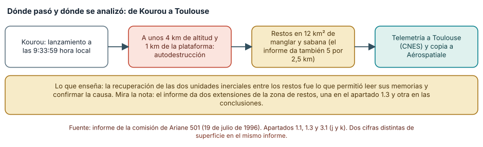

**Cómo leer la figura.** Cada caja es un lugar o un hecho, de izquierda a derecha. Mira la tercera: el informe da dos superficies distintas para la zona de restos (12 km² en un apartado y 5 por 2,5 km en otro) y este caso las muestra ambas sin elegir. **Dónde deja de valer:** no es un mapa; no hay distancias a escala.

### Organización: la comisión de investigación

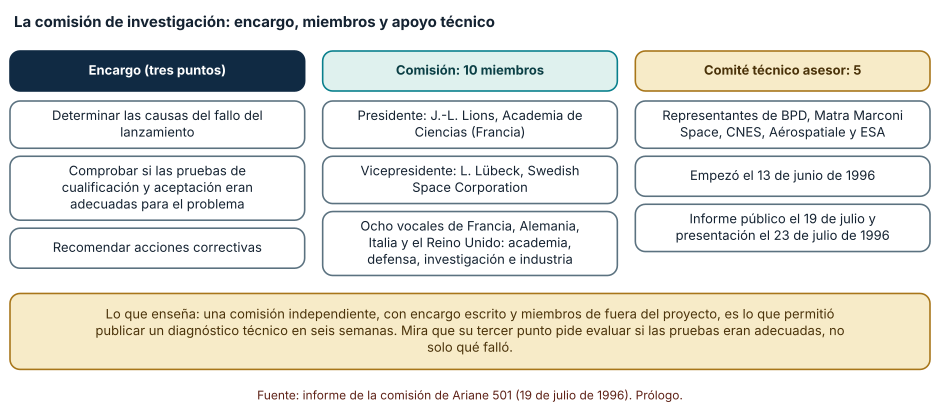

**Cómo leer la figura.** Tres columnas: el encargo, quién investigó y quién apoyó con asesoría técnica. Mira el segundo punto del encargo: pedía evaluar si las pruebas de cualificación y aceptación eran adecuadas para el problema, es decir, no solo qué falló sino por qué no se detectó. **Dónde deja de valer:** el prólogo enumera a las personas por organización y no describe cómo se dividió el trabajo.

Documentado. La comisión la nombraron el director general de la ESA y el presidente del CNES en los días siguientes al fallo; presidió J.-L. Lions (Academia de Ciencias, Francia) y fue vicepresidente L. Lübeck (Swedish Space Corporation). Los otros ocho miembros procedían de organizaciones de Francia, Alemania, Italia y el Reino Unido. Un comité técnico asesor de cinco personas, de BPD, Matra Marconi Space, CNES, Aérospatiale y ESA, la asistió (informe, prólogo). El informe aclara sus límites: se centró en las causas, en los sistemas supuestamente responsables y en los fallos de naturaleza similar; no evaluó los datos de telemetría ni revisó todo el lanzador; y existe un informe de circulación restringida con los hallazgos con más detalle técnico (informe, prólogo). **No se sabe:** la organización interna del programa Ariane 5, la línea de responsabilidad entre ESA, CNES y las empresas, el tamaño de los equipos y el contenido del informe restringido.

### Visión y misión

Las fuentes consultadas no contienen una declaración de visión o misión del programa Ariane 5 ni de las organizaciones. La ESA describe a Ariane 5 como el sistema de lanzamiento principal de Europa durante más de un cuarto de siglo, con 117 vuelos entre 1996 y 2023 (ESA, ficha de Ariane 5). El análisis propio es que un primer vuelo de cualificación tiene una misión mixta: demostrar que el lanzador funciona y ofrecer una oportunidad de lanzamiento a cargas útiles reales, y esa combinación es la que hizo costoso el fallo.

## Contexto y problema

Un lanzador espacial es una máquina que debe poner una carga en una órbita con una tolerancia pequeña, durante unos minutos, sin posibilidad de intervención humana ni de reparación. El control de vuelo de Ariane 5 es, según el informe, de diseño estándar: una unidad de referencia inercial (SRI) mide los ángulos y movimientos del lanzador con una plataforma «strap-down» con giróscopos láser y acelerómetros, tiene su propio ordenador interno que calcula ángulos y velocidades, y envía los datos por un bus al ordenador de a bordo (OBC), que ejecuta el programa de vuelo y manda por servoválvulas y actuadores hidráulicos las toberas de los dos aceleradores de combustible sólido y del motor criogénico Vulcain (informe, apartado 2.1).

**El problema que el sistema resolvía.** Mantener la actitud del lanzador exige conocerla con exactitud y corregirla en milisegundos; ningún operador humano puede hacerlo. Para que un defecto aleatorio de un equipo no pierda la misión, se duplicó el equipo: dos unidades inerciales con hardware y software idénticos, una activa y otra en reserva «en caliente», y dos ordenadores de a bordo; si el ordenador detecta que la activa ha fallado, conmuta de inmediato a la otra si funciona (informe, apartado 2.1).

**La apuesta (documentado).** El diseño de la unidad inercial de Ariane 5 era prácticamente el mismo que el de la unidad que se usaba en Ariane 4, en particular el software (informe, apartado 2.1). Reutilizar un equipo con muchos vuelos reales reduce el riesgo de lo desconocido. La comisión lo expresa así: se mantuvo una función «por comunalidad», presumiblemente por la idea de que, si no hay una necesidad probada, no es prudente cambiar software que funcionó bien en Ariane 4 (informe, apartado 2.2).

**El problema oculto (análisis propio).** La reutilización transfiere también los supuestos del entorno original. El software heredado asumía una trayectoria, la de Ariane 4, en la que una variable no podía superar cierto valor; en Ariane 5 la trayectoria era distinta y el supuesto dejó de ser cierto, sin que nadie lo hubiera escrito como límite de uso.

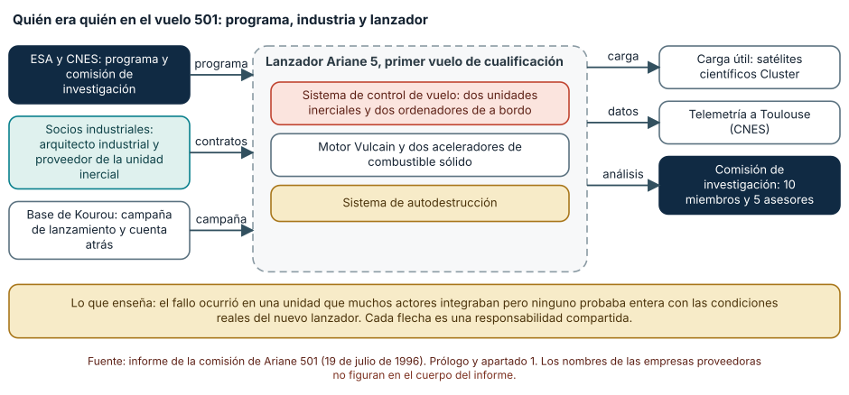

**Cómo leer la figura.** Izquierda: quienes impulsan y construyen; centro: el lanzador con sus tres subsistemas relevantes; derecha: lo que transporta y quien investigó. Mira la caja roja del centro: es la única que el informe señala como origen. **Dónde deja de valer:** los nombres de las empresas proveedoras no figuran en el cuerpo del informe; se dibuja el papel, no la empresa.

## Mercado, usuarios y casos de uso

- **Usuarios de un lanzador:** quienes contratan o encargan la puesta en órbita de una carga. En el vuelo 501 la carga era la misión científica Cluster, de cuatro satélites que debían estudiar la interacción entre el Sol y la magnetosfera terrestre (ESA, comunicado 12-1997; ficha de Cluster).
- **Programa y operadores:** la ESA y el CNES, que promovían el programa, y los socios industriales, que construían el lanzador y sus equipos (informe, prólogo). Un vuelo de cualificación es una demostración del programa, no un servicio comercial regular.
- **Usuarios internos:** los equipos de campaña de lanzamiento en Kourou, de cuya cuenta atrás el informe dice que transcurrió sin incidencias relacionadas con el fallo (informe, apartado 3.1 a); los ingenieros de pruebas y simulación, y los de telemetría.
- **Afectados:** la comunidad científica de Cluster. La ESA recuerda que fue necesaria una «muestra de solidaridad» de los Estados miembros y de la comunidad científica para decidir repetir la misión (ESA, comunicado 12-1997).
- **Seguridad pública:** el sistema de autodestrucción actuó correctamente y los restos cayeron en una zona de manglar a unos 4 km de altitud y 1 km de la plataforma (informe, apartado 3.1 j). El informe no menciona víctimas; este caso no afirma nada fuera de lo que el informe dice.

**Casos de uso del control de vuelo.** (1) Mantener la actitud nominal durante el ascenso; (2) corregir perturbaciones; (3) tolerar el fallo de un equipo con otro idéntico; (4) autodestruirse si el lanzador se rompe o se sale de su trayectoria. Los casos (1), (2) y (4) funcionaron; el (3) falló por el motivo que se explica más abajo.

## Funcionalidad de principio a fin

1. **Preparación y cuenta atrás.** La campaña y la cuenta atrás, que incluye el llenado de la etapa principal, transcurrieron sin incidentes hasta H0 − 7 minutos, cuando la cuenta se detuvo porque no se cumplían los criterios de visibilidad; mejoró el tiempo y el lanzamiento se inició a H0 = 9:33:59 hora local (informe, apartado 1.1).
2. **Modo de vuelo de la unidad inercial.** Las unidades pasan a modo de vuelo a H0 − 3 s para Ariane 5 (informe, apartado 2.1).
3. **Medida y control.** La unidad mide, calcula y envía; el ordenador de a bordo decide y manda las toberas (informe, apartado 2.1).
4. **Autodestrucción.** Si los aceleradores se separan de la etapa principal, se rompen los enlaces eléctricos y se activa la autodestrucción; es el comportamiento previsto y se produjo (informe, apartados 1.1 y 3.1 j).

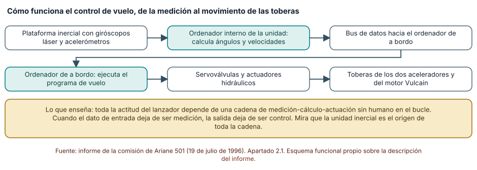

**Cómo leer la figura.** De izquierda a derecha y de arriba abajo: medición, cálculo, transporte, decisión y actuación. Mira que en toda la cadena no hay un humano; si el primer eslabón entrega algo que no es medición, el último se mueve igualmente. **Dónde deja de valer:** es un esquema funcional hecho con la descripción del informe, no un diagrama del sistema real.

### El día a día de una versión del software de la unidad inercial

Documentado. El software de la unidad inercial de Ariane 4 se reutilizó en Ariane 5 con pocos cambios (informe, apartado 2.1). La función de alineación, que prepara la plataforma antes del despegue, se mantuvo activa tras el despegue durante unos 40 segundos porque un requisito de hace más de diez años en versiones anteriores de Ariane pedía poder reiniciar la cuenta atrás sin esperar la alineación normal, que tarda 45 minutos o más (informe, apartado 2.2). **No se sabe:** el proceso de cambios y de configuración del software de la unidad, su tamaño, su historia de versiones y el modo de trabajo del proveedor; el informe dice solo que el proveedor siguió la especificación que recibió (informe, apartado 2.2).

## Negocio y economía

Las fuentes públicas consultadas no describen el modelo de negocio, el presupuesto del programa ni los contratos de Ariane 5, y este caso no los reconstruye. Lo que consta es:

- El sobrecoste de repetir la misión científica fue de 214 MECU, una cifra que la ESA presenta como contenida gracias a la elección de lanzadores Soyuz y al esfuerzo de la agencia, la industria y los institutos científicos (ESA, comunicado 12-1997).
- La nueva misión, Cluster 2, combinó la nave Phoenix, construida con repuestos de los cuatro satélites originales, y tres satélites nuevos de un consorcio industrial europeo liderado por DASA/Daimler Benz Aerospace (Alemania); los lanzadores Soyuz se contrataron mediante el consorcio Starsem, una empresa conjunta franco-rusa (ESA, comunicado 12-1997).
- La ESA reconoce que la decisión de repetir Cluster implicó retrasos inevitables en misiones científicas posteriores, un coste de oportunidad que el comunicado califica de precio que la comunidad científica estaba dispuesta a pagar (ESA, comunicado 12-1997).

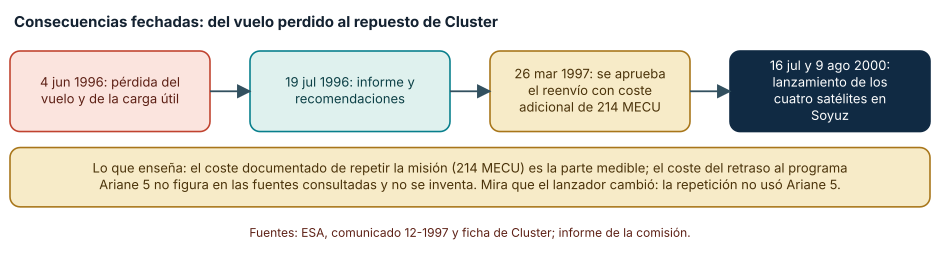

**Cómo leer la figura.** Cada caja es un hecho fechado, de izquierda a derecha. Mira la distancia entre el segundo y el cuarto: la misión científica tardó cuatro años en llegar a órbita. **Dónde deja de valer:** que cada hito sea consecuencia del anterior no consta como relación causal en un informe; es una ordenación en el tiempo de hechos documentados.

### Esquema de la operación

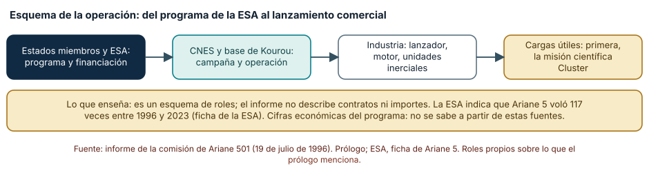

**Cómo leer la figura.** Cuatro roles en cadena; no es un organigrama ni un flujo de dinero. Mira la última caja: la carga útil es quien más pierde cuando el lanzador falla y, en este vuelo, era una misión científica. **Dónde deja de valer:** el informe y los comunicados no describen contratos ni importes del lanzador; el esquema muestra roles, no cantidades.

### Costos operativos y costo del incidente

| Rubro | Cifra | Fuente |
| --- | --- | --- |
| Sobrecoste de repetir la misión científica Cluster | 214 MECU | ESA, comunicado 12-1997 |
| Coste del lanzador perdido | No se sabe | No consta en las fuentes consultadas |
| Coste del programa Ariane 5 hasta 1996 | No se sabe | No consta en las fuentes consultadas |
| Retraso a otras misiones científicas | Reconocido, no cuantificado | ESA, comunicado 12-1997 |
| Duración de la investigación | Del 13 de junio al 19 de julio de 1996 | Informe, prólogo y portada |

No se inventa ninguna cifra para las filas sin fuente. La conclusión económica que sí permite el material es cualitativa: el coste de un error de software en un sistema sin reparación posible no se mide en horas de desarrollo sino en misiones.

### Competidores y contexto de mercado

Las fuentes consultadas no describen el mercado de lanzadores de 1996 ni a sus competidores. El comunicado de la ESA muestra una consecuencia de mercado concreta: para repetir Cluster, la agencia compró lanzadores Soyuz en lugar de Ariane 5, y lo hizo a través del consorcio Starsem, de modo que el coste adicional se mantuviera en 214 MECU (ESA, comunicado 12-1997). La ESA no afirma que ese cambio de lanzador fuese consecuencia directa del fallo y el informe de la comisión no trata el tema; es información documentada, no una explicación.

## Arquitectura y esquemas

Los hechos de esta sección vienen del informe de la comisión. Los dibujos son un modelo funcional con lo que el informe describe, porque el informe no publica el diseño interno de la unidad inercial.

### Nivel 1 · Contexto

La figura de contexto está en «Contexto y problema». Resumen: un programa de la ESA y el CNES, con industria; un lanzador de tres subsistemas relevantes (control de vuelo, propulsión y autodestrucción); una carga útil científica; y una comisión independiente.

### Nivel 2 · Redundancia del control de vuelo

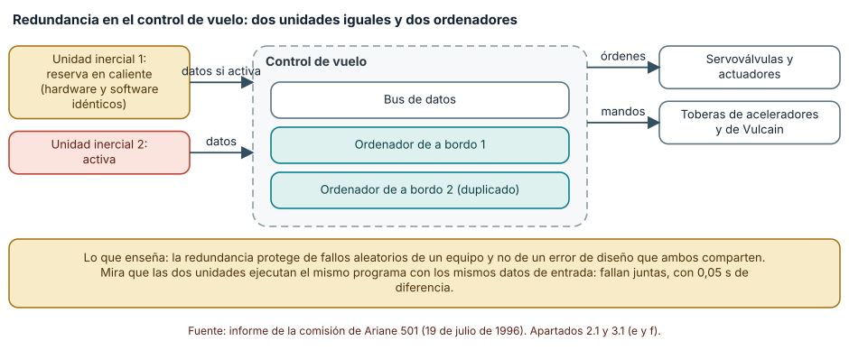

**Cómo leer la figura.** Izquierda: las dos fuentes de actitud; centro: el bus y los ordenadores; derecha: lo que se mueve. Las dos unidades tienen hardware y software idénticos. Mira que la copia ejecuta exactamente el mismo programa: lo que falla en una falla en la otra si recibe las mismas entradas. **Dónde deja de valer:** el informe no describe el bus ni el mecanismo exacto de conmutación; solo que el ordenador conmuta si detecta fallo y la reserva funciona.

El informe lo dice así: con el fin de mejorar la fiabilidad hay una redundancia considerable a nivel de equipo; hay dos unidades inerciales con hardware y software idénticos, una activa y otra en reserva en caliente, y dos ordenadores de a bordo (informe, apartado 2.1). Esa redundancia protege de fallos aleatorios del equipo, que son los que el diseño tenía como modelo de fallo.

### Nivel 3 · Componentes dentro de la unidad inercial

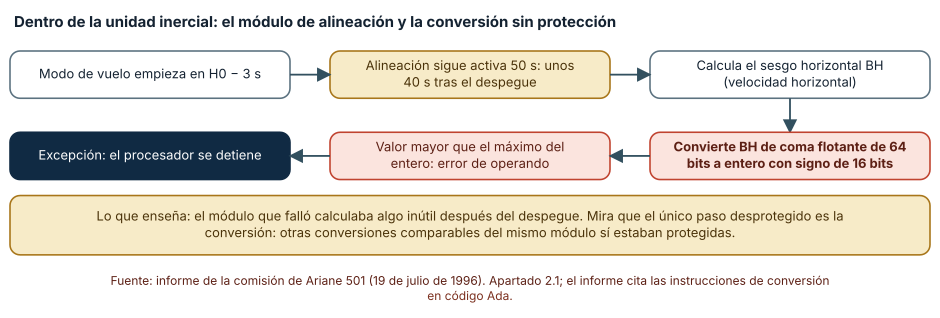

**Cómo leer la figura.** Cada caja es un paso; la caja roja intensa es la conversión sin protección. Mira que el módulo calcula el sesgo horizontal BH, un indicador de la precisión de la alineación, y que BH es el valor que se salió de rango. **Dónde deja de valer:** el informe cita los nombres BH y «Horizontal Bias» y las instrucciones Ada, pero no publica el código; el esquema muestra la lógica, no el programa.

Los hechos que respalda el informe son estos. La excepción interna se produjo al ejecutar una conversión de coma flotante de 64 bits a entero con signo de 16 bits; el número tenía un valor mayor del que cabe en un entero de 16 bits y eso produjo un error de operando. Las instrucciones de conversión, en Ada, no estaban protegidas contra el error, aunque otras conversiones de variables comparables en el mismo lugar del código sí lo estaban (informe, apartado 2.1). La parte del software que falló solo realiza la alineación de la plataforma inercial: calcula resultados significativos solo antes del despegue y, una vez que el lanzador despega, no sirve de nada. La alineación sigue activa 50 segundos tras empezar el modo de vuelo, que en Ariane 5 ocurre a H0 − 3 s; por tanto, al despegar continúa unos 40 segundos más (informe, apartado 2.1).

### Nivel 4 · Secuencia del fallo

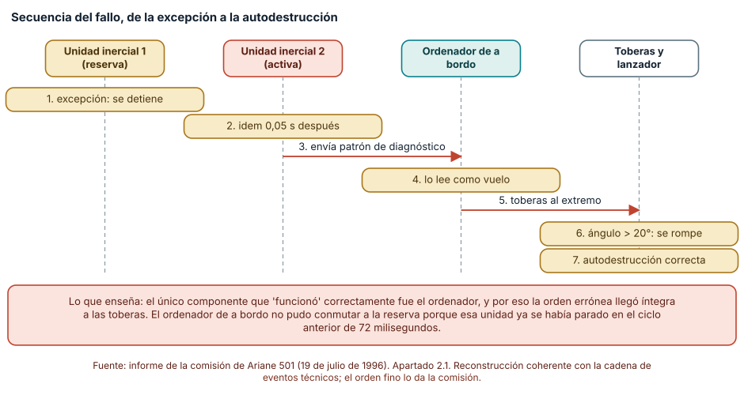

**Cómo leer la figura.** Cada columna es un participante y el tiempo avanza hacia abajo; las flechas rojas son las que llevan el error al resto del sistema; las cajas doradas son estados. Mira que la orden errónea la da el único componente que funcionaba como se había diseñado: el ordenador de a bordo. **Dónde deja de valer:** el informe da la cadena y los tiempos de 36,7 s y 0,05 s; no da el orden fino de cada paso interno.

En palabras. (1) A H0 + 36,7 s el ordenador de la unidad de reserva, que trabajaba en espera para guiado y control de actitud, se detiene: una variable interna relacionada con la velocidad horizontal superó un límite del software (informe, apartado 3.1 e). (2) Unos 0,05 s después la unidad activa, idéntica en hardware y software, falla por la misma razón. Como la reserva ya estaba inoperante, no se podía obtener información de guiado ni de actitud y la pérdida de la misión era inevitable (informe, apartado 3.1 f). (3) La unidad activa transmitió al ordenador principal información esencialmente de diagnóstico, que se interpretó como datos de vuelo (informe, apartado 3.1 g). (4) Con ellos, el ordenador mandó a las toberas de los aceleradores y, algo después, a la del motor, una gran corrección para una desviación de actitud que no había ocurrido (informe, apartado 3.1 h). (5) El cambio rápido de actitud rompió el lanzador a los 39 s por cargas aerodinámicas (apartado 3.1 i), y la autodestrucción se inició automáticamente, como estaba previsto (apartado 3.1 j).

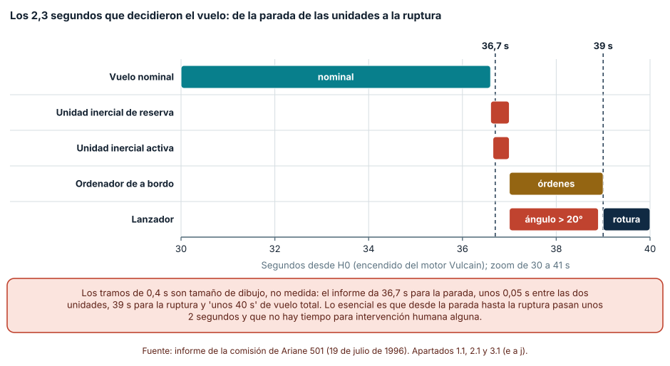

**Cómo leer la figura.** Eje horizontal: segundos desde H0, ampliado entre 30 y 41 s. Cada fila es un actor. Las dos barras rojas cortas son las unidades inerciales deteniéndose; la dorada, el ordenador obedeciendo; la roja y la azul, el lanzador. Mira cuánto cabe entre la parada y la ruptura: unos dos segundos. **Dónde deja de valer:** las duraciones de los tramos cortos son de dibujo; el informe da 36,7 s, unos 0,05 s entre las dos unidades, y 39 s.

### Nivel 5 · Datos que viajaban por el bus

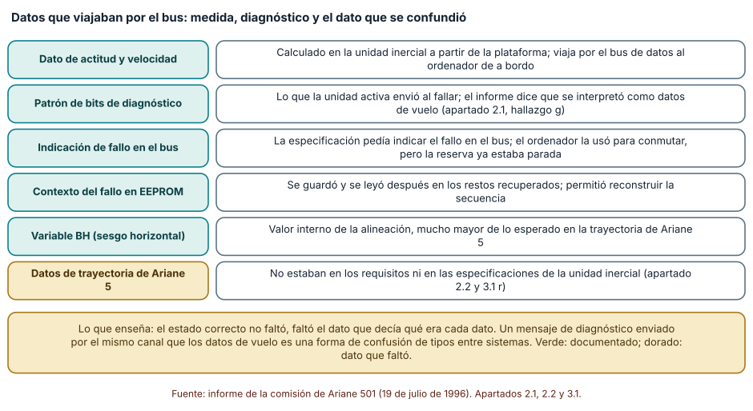

**Cómo leer la figura.** Cada fila es un dato; la columna izquierda dice cómo se clasifica (verde documentado, dorado lo que faltaba) y la derecha qué pasó con él. Mira la última fila: el dato que habría permitido detectar el problema no estaba en los requisitos. **Dónde deja de valer:** son categorías descriptivas; el informe no publica el formato del bus ni los campos.

La lección de datos es que **el sistema tenía la información correcta del fallo y no la usó como tal**. La especificación pedía que, ante cualquier excepción, se indicara el fallo en el bus, se guardara el contexto en una memoria EEPROM (que se recuperó y se leyó en 501) y se detuviera el procesador (informe, apartado 2.2). Detener el procesador es la decisión que resultó fatal: reiniciar no es viable, porque la actitud es difícil de recalcular tras una parada, y la unidad se vuelve inútil (informe, apartado 2.2). El informe explica el origen de esa decisión en la cultura del programa: los mecanismos de tratamiento de excepciones se diseñaban para un fallo aleatorio de hardware, que un sistema de reserva puede resolver (informe, apartado 2.2).

### Nivel 6 · Un mismo software, dos lanzadores

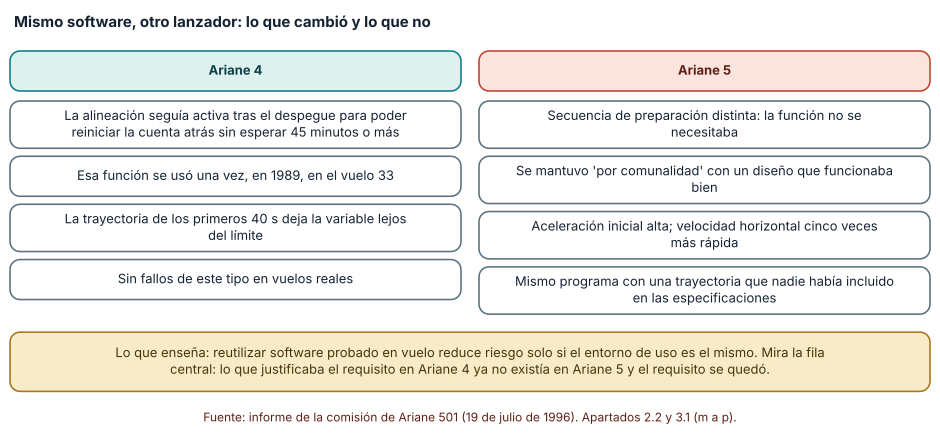

**Cómo leer la figura.** Verde: el entorno en que el diseño era correcto; coral: el entorno en que dejó de serlo. Mira que cada fila de la izquierda tiene su contraparte a la derecha: lo que justificaba la función en Ariane 4 ya no existía. **Dónde deja de valer:** las dos columnas muestran lo que dice el informe y no una comparación completa entre lanzadores.

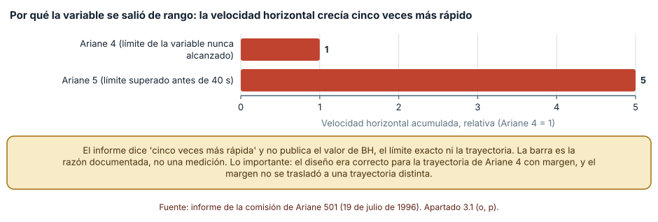

**Cómo leer la figura.** Cada barra es la rapidez relativa con que crece la velocidad horizontal en los primeros 40 segundos; Ariane 4 vale uno. Mira la proporción: el informe dice que en Ariane 5 es cinco veces más rápida. **Dónde deja de valer:** no es una medición. El informe no publica los valores de BH ni el límite del entero; solo la razón.

Documentado. En los vuelos de Ariane 4 con el mismo tipo de unidad no hubo este fallo porque la trayectoria de los primeros 40 s es tal que la variable de velocidad horizontal no puede alcanzar, con un margen operativo adecuado, un valor superior al límite del software. Ariane 5 tiene una aceleración inicial alta y una trayectoria que produce una acumulación de velocidad horizontal cinco veces más rápida, y ese valor excesivo hizo que los ordenadores de las unidades dejaran de funcionar (informe, apartado 3.1 o y p). La función de alineación continuada se pidió hace más de diez años, para el caso improbable de una espera en la cuenta atrás entre −9 s (cuando empieza el modo de vuelo en Ariane 4) y −5 s; el periodo de 50 s se basó en el tiempo que necesitaba el equipo de tierra para recuperar el control. Se usó una vez, en 1989, en el vuelo 33 de Ariane 4 (informe, apartado 2.2).

### Nivel 7 · Qué se probó en cada nivel de cualificación

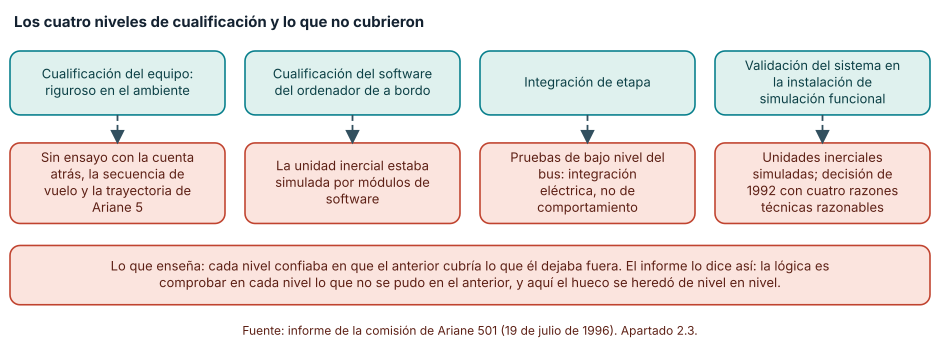

**Cómo leer la figura.** Arriba, cada nivel; debajo, el hueco que dejó. Los cuatro niveles son los que el informe nombra: cualificación del equipo, cualificación del software del ordenador de a bordo, integración de etapa y validación del sistema. Mira que cada nivel remite al anterior: la lógica es comprobar en cada nivel lo que el anterior no pudo. **Dónde deja de valer:** el informe describe la estrategia, no el contenido de cada prueba.

El informe describe la cualificación del control de vuelo en esos cuatro niveles y concluye que las pruebas del equipo, en el caso de la unidad inercial, se hicieron con rigor respecto de los factores ambientales, incluso más allá de lo esperado para Ariane 5, pero que no hubo ninguna prueba para verificar que la unidad se comportaría bien sometida a la cuenta atrás, a la secuencia de tiempos de vuelo y a la trayectoria de Ariane 5. La causa principal de esa ausencia es que la especificación de la unidad, que debía ser el documento de requisitos, no contiene los datos de trayectoria de Ariane 5 como requisito funcional (informe, apartado 2.3). Tampoco declaraba restricciones de uso que se derivaran de la implementación elegida; una declaración así, dice, debería ser obligatoria para todo equipo crítico para la misión, y habría permitido identificar el incumplimiento con la trayectoria de Ariane 5.

**La simulación del sistema.** En la instalación de simulación funcional se hicieron numerosas simulaciones en lazo cerrado de todo el vuelo; en ellas muchos equipos estaban físicamente presentes, pero no las dos unidades inerciales, simuladas por módulos de software. Al definir la filosofía de pruebas se había decidido, por reconocer su importancia, poner las unidades reales en el lazo con un método de señales simuladas; en 1992 se decidió no hacerlo por cuatro razones: que las unidades se consideraban plenamente cualificadas a nivel de equipo, que la precisión de la navegación depende de la de las unidades y la electrónica de prueba no la alcanzaba, que la simulación de modos de fallo no es posible con equipo real sino con modelo, y que el periodo base de la unidad (1 ms) frente al de la simulación (6 ms) añadía complejidad (informe, apartado 2.3). La comisión juzgó los argumentos técnicamente válidos, pero dice que, como el fin de una prueba de sistema es verificar también el sistema como un todo para la aplicación concreta, había un riesgo definido en suponer que equipos críticos como la unidad habían sido validados por su cualificación a nivel de equipo o por su uso previo en Ariane 4; es mejor comprometer la precisión que dejar de alcanzar los demás objetivos, y sería técnicamente factible haber incluido casi toda la unidad en las simulaciones, con lo que el fallo se habría detectado (informe, apartados 2.3 y 3.1 s).

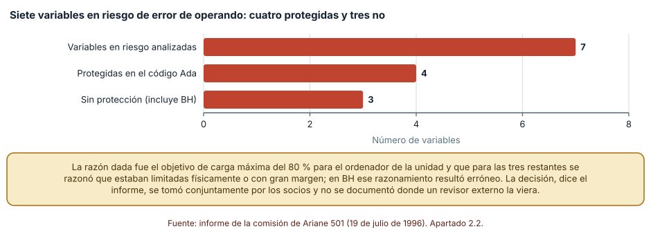

**Cómo leer la figura.** Cada barra es un número de variables; la primera es el total analizado y las otras dos lo reparten. Mira la tercera barra: son tres, y entre ellas está BH. **Dónde deja de valer:** el informe no dice cuáles eran las otras dos sin proteger, solo que eran tres con la de BH.

Documentado. No todas las conversiones se protegieron porque se había fijado un objetivo máximo de carga del 80 % para el ordenador de la unidad. Para determinar la vulnerabilidad del código sin protección se analizó cada operación que pudiera dar una excepción, incluido un error de operando; en la conversión de coma flotante a entero se analizaron siete variables con riesgo, se añadió protección a cuatro y se dejaron tres sin ella, entre ellas la del sesgo horizontal. No se encontró una justificación de esa decisión en el código fuente; la decisión de proteger unas variables y otras no se tomó conjuntamente por los socios del proyecto, a varios niveles contractuales, y el razonamiento de que las tres restantes estaban físicamente limitadas o tenían gran margen resultó erróneo en el caso de BH. El informe señala además que no hay evidencia de que se usaran datos de trayectoria para analizar las variables sin proteger, y que se acordó conjuntamente no incluir los datos de trayectoria de Ariane 5 en los requisitos y la especificación de la unidad (informe, apartado 2.2).

### Nivel 8 · Puntos únicos de fallo

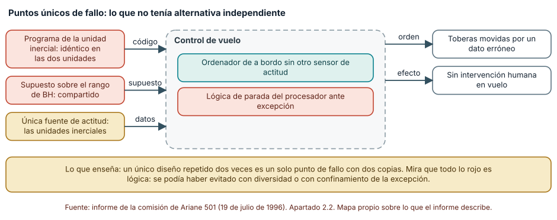

**Cómo leer la figura.** Las cajas rojas son decisiones de diseño con efecto directo sobre el resultado; las doradas, dependencias sin alternativa. Mira que casi todo lo rojo es lógica y no hardware. **Dónde deja de valer:** es un análisis propio de la estructura que el informe describe; no enumera dependencias, y puede haber otras que no figuran.

### Nivel 9 · Defensa en profundidad: ocho barreras

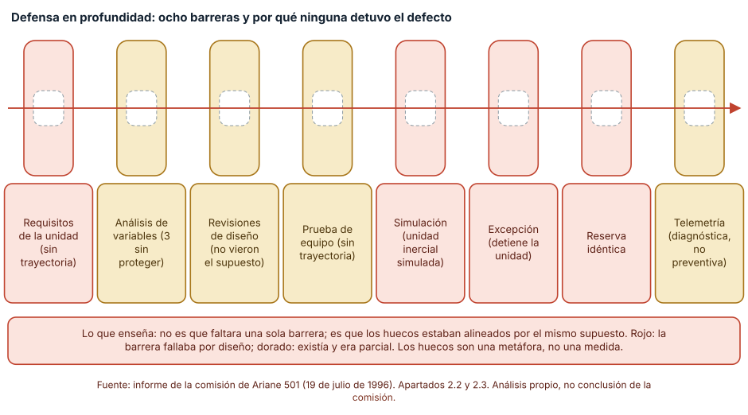

**Cómo leer la figura.** Cada lámina es una barrera; la flecha es el defecto activo. Las rojas fallaban por diseño y las doradas existían pero eran parciales. Mira que todos los huecos están alineados: el mismo supuesto, que la trayectoria de Ariane 4 valía para Ariane 5, los atravesaba. **Dónde deja de valer:** el modelo de láminas es una metáfora, no una medición; la lista de barreras sale de los apartados 2.2 y 2.3 del informe y la agrupación en ocho es propia.

El informe lo dice sobre las revisiones: el medio principal para prevenir fallos son las revisiones, que forman parte del proceso de diseño y cualificación y se hacen a todos los niveles con todos los socios y expertos externos; en un programa de este tamaño se tratan miles de problemas y fallos potenciales. Aun así, es evidente que las limitaciones del software de la unidad no se analizaron del todo en las revisiones, que no se advirtió que la cobertura de las pruebas era inadecuada para exponerlas, y que no se advirtieron las posibles implicaciones de permitir que la alineación siguiera funcionando en vuelo; en ese sentido, el proceso de revisión fue un factor contribuyente (informe, apartado 2.3).

### Hardware utilizado

El informe documenta una plataforma inercial «strap-down» con giróscopos láser y acelerómetros, un ordenador interno por unidad, un bus de datos, dos ordenadores de a bordo, servoválvulas, actuadores hidráulicos y las toberas (informe, apartado 2.1). **No se sabe:** fabricante y modelo de las unidades, procesador, memoria, frecuencia de reloj y capacidad; el informe solo da el objetivo de carga del 80 % y los periodos de 1 ms de la unidad y de 72 ms del ciclo de datos en que se detectó el fallo de la reserva (informe, apartados 2.1 y 2.3).

### Software utilizado

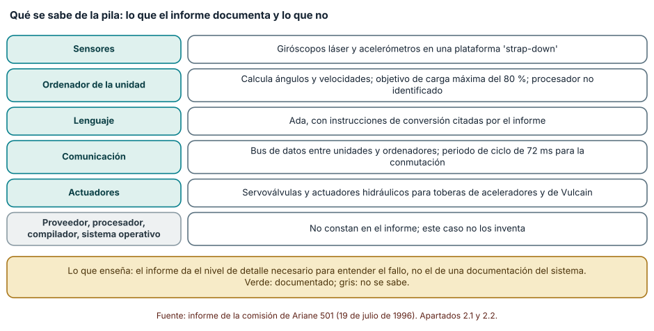

**Cómo leer la figura.** Cada fila es una capa; verde, documentada; gris, no se sabe. Mira que lo documentado coincide con lo necesario para entender el fallo. **Dónde deja de valer:** no pretende describir la pila real, solo el límite de lo público.

Documentado: el software de la unidad está en Ada; el ordenador de a bordo ejecuta el programa de vuelo; el informe cita un software de simulación que sustituía a las unidades y módulos de software especialmente desarrollados para eso (informe, apartados 2.1 y 2.3). **No se sabe:** el compilador, las herramientas de verificación, el sistema operativo o ejecutivo en tiempo real y el tamaño del código.

### Infraestructura

La infraestructura documentada es la de la campaña de lanzamiento (Kourou), la recepción y el tratamiento de telemetría (Toulouse) y la instalación de simulación funcional del arquitecto industrial (informe, apartados 1.2 y 2.3). **No se sabe:** la capacidad de cada una, su propiedad y las redes entre ellas.

### A prueba de fallos: qué existía, qué falló y qué debió existir

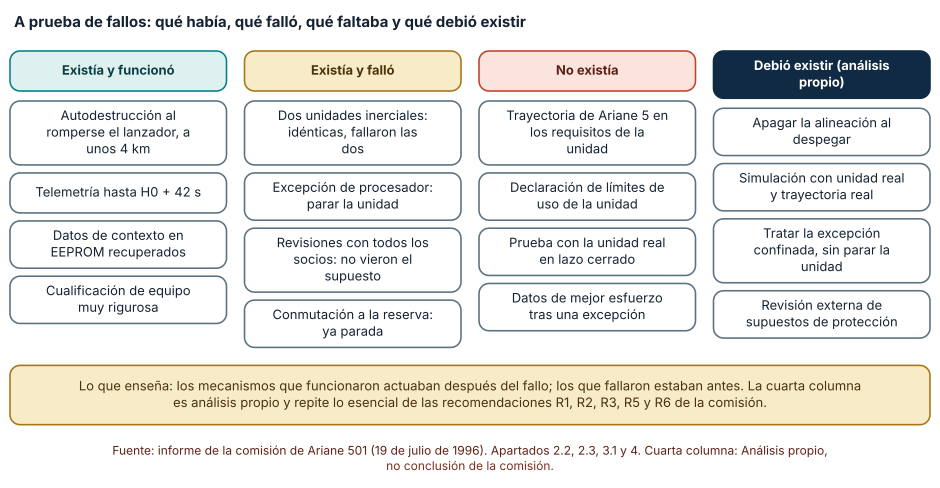

**Cómo leer la figura.** Verde: lo que había y funcionó; dorado: lo que había y falló; coral: lo que no existía; azul oscuro: análisis propio de lo que debió existir. Las filas no se corresponden una a una. Mira que lo que funcionó actúa después del fallo (autodestrucción, telemetría) y lo que falló estaba antes (requisitos, pruebas). **Dónde deja de valer:** no mide eficacia; la cuarta columna es análisis propio apoyado en las recomendaciones R1, R2, R3, R5 y R6 de la comisión.

Redundancia: existía y falló por ser idéntica. Interruptor de parada: la excepción detenía la unidad, que fue justamente lo contrario de la degradación elegante. Límites: existían protecciones para cuatro de siete variables, no para tres. Pruebas: rigurosas a nivel de equipo, no a nivel de sistema con la trayectoria real. Despliegue gradual: no aplica a un vuelo único. Recuperación: ninguna posible en vuelo. Lo que sí funcionó fue la autodestrucción y el hecho de que los datos de contexto se guardaran en memoria y se pudieran leer tras recuperar las unidades, lo que permitió reproducirlo en simulación (informe, apartados 1.3 y 3.1 t).

## Casos especiales y cómo fallan

- **La cuenta atrás detenida.** El requisito de alineación continuada existe por el caso límite de una parada de la cuenta atrás entre −9 s y −5 s, que obliga a reiniciar horas; con esa función se podía reiniciar sin esperar 45 minutos o más. Se usó una vez en 1989. Un caso límite improbable mantuvo viva una función durante más de diez años y se llevó a un lanzador donde no tenía sentido (informe, apartado 2.2).
- **Una excepción que no es un fallo de hardware.** La excepción fue un error sistemático, de diseño, y no una falla aleatoria; el sistema de reserva, idéntico, la reprodujo. El informe afirma que el proveedor solo cumplió la especificación, que decía que ante cualquier excepción se detuviera el procesador (informe, apartado 2.2).
- **Datos de diagnóstico como datos de vuelo.** Al fallar, la unidad activa mandó un patrón de bits de diagnóstico que el ordenador interpretó como datos de vuelo (informe, apartado 2.1). Un canal que mezcla mensajes de estado y datos de misión produce este tipo de confusión.
- **Una anomalía no relacionada.** Desde H0 + 22 s aparecieron variaciones de unos 10 Hz en la presión hidráulica de los actuadores de la tobera del motor principal; la comisión consideró que era significativa, que no estaba plenamente explicada y que no tuvo relación con el fallo (informe, apartado 1.4 y 3.1 d). Una investigación honesta registra lo que no entiende sin forzarlo en la historia principal.
- **Unidad averiada que no se puede mirar.** La unidad que había funcionado como activa y se detuvo la última no tenía información de telemetría, porque la transmisión se limitaba a la que fallara primero; hubo que recuperarla entre los restos del manglar (informe, apartado 1.3). Esa dificultad es el motivo de la recomendación R7, más datos de telemetría ante el fallo de cualquier componente.
- **La reserva no sirve si falló antes.** El ordenador de a bordo no pudo conmutar a la reserva porque esa unidad ya se había detenido en el ciclo de datos anterior, de 72 ms, por la misma razón (informe, apartado 2.1).
- **Diferencia entre software y mecánica.** El informe pide recordar que el software es expresión de un diseño muy detallado y no falla en el mismo sentido que un sistema mecánico; es flexible y expresivo y por eso admite requisitos muy exigentes, que producen implementaciones complejas difíciles de evaluar (informe, apartado 2.2).

## Línea de tiempo

El caso tiene tres escalas: años (cómo se formó el defecto), semanas (la investigación) y segundos (el vuelo).

### Antecedentes: decisiones y condiciones latentes

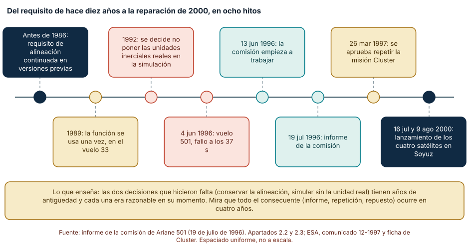

**Cómo leer la figura.** Los hitos están espaciados de manera uniforme, no a escala de años; los años de las cajas son los reales. El color distingue decisiones técnicas, controles y consecuencias. Mira la distancia entre 1992 y 1996: la decisión de no poner las unidades reales en la simulación esperó cuatro años. **Dónde deja de valer:** «antes de 1986» es una inferencia del texto «hace más de diez años» de un informe de 1996; el informe no da año.

| Cuándo | Hecho | Fuente |
| --- | --- | --- |
| Hace más de diez años (antes de 1986, inferido) | Se pide la alineación continuada en versiones anteriores de Ariane | Informe, apartado 2.2 |
| 1989 | La función se usa una vez, en el vuelo 33 | Informe, apartado 2.2 |
| 1992 | Se decide no incluir las unidades inerciales reales en el lazo de simulación | Informe, apartado 2.3 |
| Fecha no consta | Se decide proteger cuatro de siete variables y dejar tres sin proteger | Informe, apartado 2.2 |
| 4 de junio de 1996 | Vuelo 501 | Informe, apartado 1.1 |
| 13 de junio de 1996 | La comisión empieza su trabajo | Informe, prólogo |
| 19 de julio de 1996 | Fecha del informe de la comisión | Informe, portada |
| 23 de julio de 1996 | La ESA presenta el informe en su comunicado 33-1996 | ESA, comunicado 33-1996 |
| 26 de marzo de 1997 | Se aprueba repetir la misión Cluster | ESA, comunicado 12-1997 |
| 16 de julio y 9 de agosto de 2000 | Se lanzan los cuatro satélites de Cluster 2 | ESA, ficha de Cluster |

### El 4 de junio de 1996, hora a hora

| Hora o momento (H0 = 9:33:59 hora local) | Hecho | Fuente |
| --- | --- | --- |
| H0 − 7 min | La cuenta atrás se detiene porque no se cumplen los criterios de visibilidad | Informe, apartado 1.1 |
| Apertura de la ventana, 8:35 hora local | Se había previsto abrirla a esa hora | Informe, apartado 1.1 |
| H0 | Inicio del lanzamiento; el encendido del motor Vulcain y de los aceleradores y el despegue son nominales | Informe, apartado 1.1 |
| H0 + 22 s | Empiezan variaciones de presión hidráulica de unos 10 Hz, no relacionadas con el fallo | Informe, apartados 1.4 y 3.1 d |
| H0 + 36,7 s | Se detiene el ordenador de la unidad de reserva | Informe, apartado 3.1 e |
| unos 0,05 s después | Falla la unidad activa por la misma razón | Informe, apartado 3.1 f |
| H0 + 39 s | El lanzador se rompe por cargas aerodinámicas con un ángulo de ataque de más de 20° | Informe, apartados 2.1 y 3.1 i |
| Tras la rotura | La autodestrucción se activa automáticamente a unos 4 km de altitud | Informe, apartado 3.1 j |
| Hasta H0 + 42 s | La telemetría se recibe en tierra | Informe, apartado 1.2 |

## Qué falló en cada instancia

| Instancia | Qué se esperaba | Qué ocurrió | Fuente |
| --- | --- | --- | --- |
| Unidad inercial de reserva | Funcionar en espera y asumir el control si la activa falla | Se detuvo a H0 + 36,7 s por una excepción de conversión | Informe, apartado 3.1 e |
| Unidad inercial activa | Entregar actitud y velocidad correctas | Se detuvo unos 0,05 s después; transmitió diagnóstico | Informe, apartado 3.1 f y g |
| Ordenador de a bordo | Usar datos válidos y conmutar a la reserva si la activa fallaba | Tomó el diagnóstico por datos de vuelo y no pudo conmutar | Informe, apartados 2.1 y 3.1 g y h |
| Módulo de alineación | Servir solo antes del despegue | Siguió activo unos 40 s en vuelo y produjo el valor fuera de rango | Informe, apartado 2.1 |
| Especificación de la unidad | Contener los requisitos de la misión | No incluía los datos de trayectoria de Ariane 5 ni restricciones de uso | Informe, apartado 2.2 y 2.3 |
| Pruebas de equipo | Detectar el defecto antes del vuelo | Rigurosas en el ambiente, sin la trayectoria de Ariane 5 | Informe, apartado 2.3 |
| Simulación del sistema | Verificar el sistema completo | Las dos unidades estaban simuladas por módulos de software | Informe, apartado 2.3 |
| Revisiones con los socios | Validar las decisiones de diseño | No analizaron los límites de la alineación ni las implicaciones de dejarla activa en vuelo | Informe, apartado 2.3 y 3.1 q |
| Autodestrucción | Actuar si el lanzador se rompe | Actuó correctamente | Informe, apartado 3.1 j |

## Causa raíz y factores

**Detonante (documentado).** A H0 + 36,7 s, el sesgo horizontal BH de la alineación, mucho mayor de lo previsto porque la trayectoria de Ariane 5 difiere de la de Ariane 4, no cabía en un entero de 16 bits y la conversión no estaba protegida; el procesador de la unidad se detuvo, primero en la reserva y 0,05 s después en la activa (informe, apartados 2.1 y 3.1 e a h).

**Condiciones latentes (documentado).** Mantener la alineación activa tras el despegue «por comunalidad»; no proteger tres de siete variables por un razonamiento de márgenes que falló en BH; una especificación sin los datos de trayectoria de Ariane 5 ni restricciones de uso; una prueba de sistema con las unidades simuladas; revisiones que no analizaron la limitación; un criterio de tratamiento de excepciones que detiene el procesador (informe, apartados 2.2, 2.3 y 3.1).

**Factores de contexto (documentado).** La cultura del programa de tratar las excepciones como fallos aleatorios de hardware resolubles por un equipo de reserva, la aceptación de que el software está correcto hasta que se demuestre lo contrario y el reparto de decisiones entre socios a varios niveles contractuales (informe, apartado 2.2 y recomendación R14).

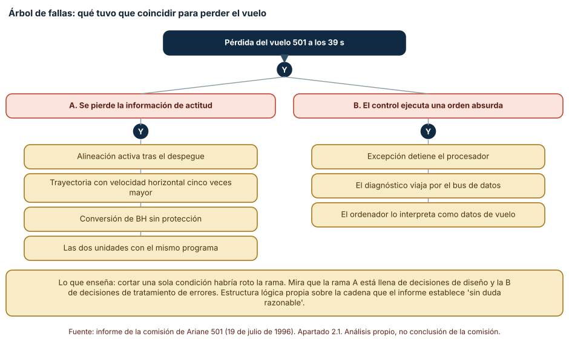

**Cómo leer la figura.** Arriba, el evento final; los círculos con «Y» exigen que todas las ramas ocurran. Las cajas doradas son las condiciones. Mira que la rama A es de diseño y la B de tratamiento de errores: cortar una sola condición de cualquiera de las dos rompe el árbol. **Dónde deja de valer:** la estructura es análisis propio; en la realidad las condiciones no eran independientes. Por ejemplo, que ambas unidades llevaran el mismo programa es lo que hace que A4 y B1 se refuercen.

**Cadena causal ordenada (según el informe).**

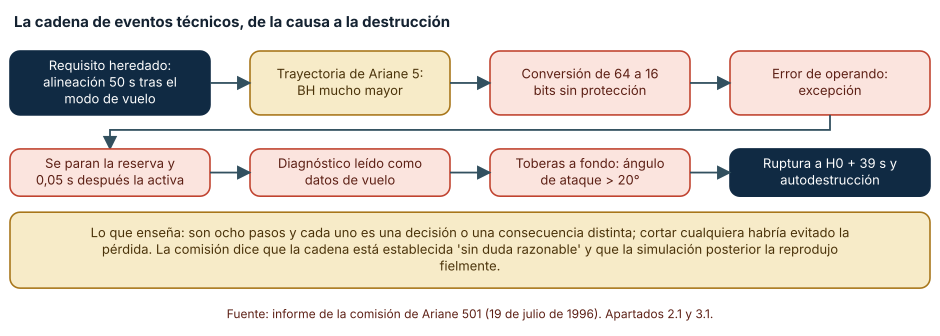

**Cómo leer la figura.** Cada caja es un paso de la cadena que el informe establece; las rojas son las que ocurren en el vuelo. Mira la primera: la cadena empieza en una decisión de diseño de años antes. **Dónde deja de valer:** el informe numera los eslabones en el sentido contrario, de la destrucción hacia atrás; aquí están en orden temporal.

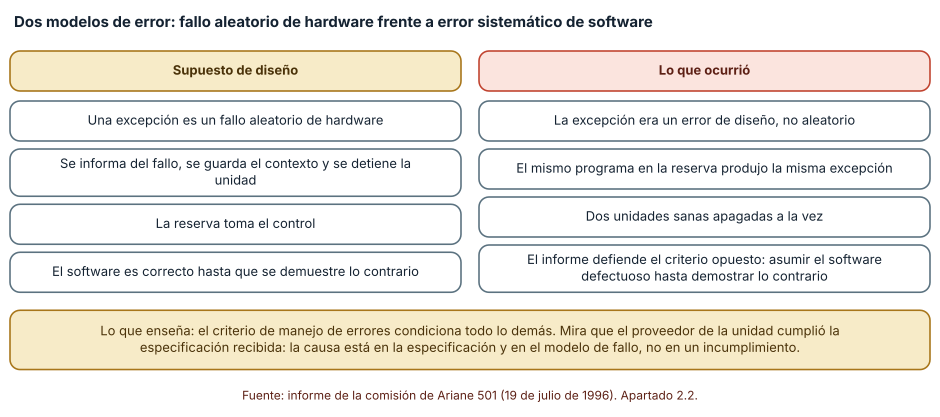

**Cómo leer la figura.** A la izquierda, lo que el diseño daba por cierto; a la derecha, lo que ocurrió. Mira la última línea de la derecha: la comisión defiende el criterio opuesto, suponer el software defectuoso hasta que los métodos aceptados demuestren que es correcto. **Dónde deja de valer:** la frase del informe habla de «otras áreas» del diseño de software de Ariane 5 con cautela («tiene motivos para creer»); no es una auditoría completa.

### Documentado, inferido y no se sabe

| Categoría | Contenido |
| --- | --- |
| Documentado | La cadena técnica completa; las 14 recomendaciones; el rigor de la cualificación de equipo; la ausencia de trayectoria en la especificación; la decisión de 1992; las siete variables, cuatro protegidas y tres no; el costo adicional de 214 MECU para repetir Cluster |
| Inferido (análisis propio) | Que una reutilización sin análisis de entorno es la forma general del fallo; la estructura del árbol y de las ocho barreras; que «antes de 1986» corresponde a «hace más de diez años»; que el cambio de lanzador para Cluster no es una conclusión de las fuentes |
| No se sabe | Quién tomó cada decisión; el código de la unidad; el contenido del informe restringido; los contratos, el costo del vuelo y del programa; qué se corrigió exactamente en la unidad antes del vuelo siguiente |

La declaración «es evidente más allá de toda duda razonable» sobre la cadena de eventos es de la comisión (informe, apartado 2.1). Lo que este caso añade es la clasificación de lo que está fuera del informe.

## Mejoras que debieron hacerse

La comisión publicó catorce recomendaciones (R1 a R14). Todo lo de esta sección que no sea esa lista, incluidos los costes y los trade-offs, es **análisis propio apoyado en la fuente**: no son conclusiones de la comisión ni descripciones de lo que el programa adoptó. La ESA solo dice en su comunicado de julio de 1996 que el programa actuaría en línea con todas las recomendaciones: corregir el problema de la unidad inercial, reexaminar todo el software embebido en equipos, mejorar la representatividad del entorno de cualificación y añadir solapes y redundancia deliberada entre pruebas sucesivas (ESA, comunicado 33-1996).

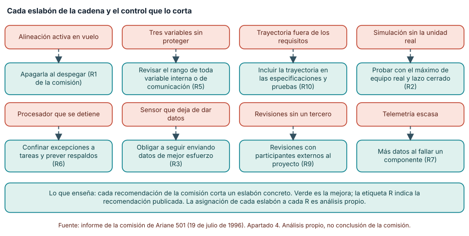

**Cómo leer la figura.** Arriba el eslabón de la cadena, debajo la mejora que lo corta, con la recomendación publicada entre paréntesis. Mira que cada recomendación corta un eslabón concreto. **Dónde deja de valer:** la asignación de cada eslabón a cada R es análisis propio; las R son del informe.

### Las 14 recomendaciones

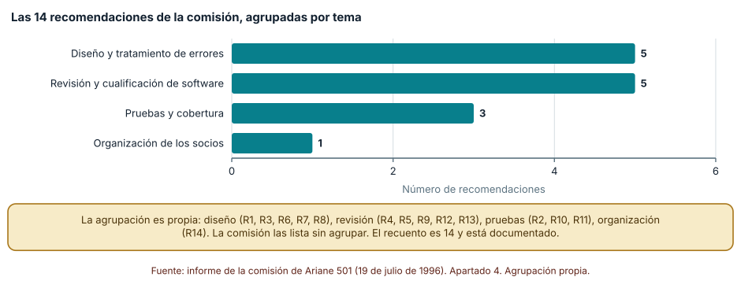

**Cómo leer la figura.** Cada barra es el número de recomendaciones de un tema. Mira que el diseño y la revisión pesan igual: la comisión no solo pide arreglar el código, pide arreglar cómo se revisa. **Dónde deja de valer:** la agrupación es propia; el informe las lista sin agrupar.

| R | Qué pide la comisión (resumen propio) | Eslabón que corta |
| --- | --- | --- |
| R1 | Apagar la alineación justo después del despegue; en general, que ninguna función de software corra en vuelo si no es necesaria | Módulo de alineación activo en vuelo |
| R2 | Una instalación de pruebas con el máximo equipo real posible, datos de entrada realistas y pruebas de sistema completas en lazo cerrado antes de cada misión | Simulación con la unidad simulada |
| R3 | Que ningún sensor, como la unidad inercial, deje de enviar sus mejores datos | Parada de la unidad |
| R4 | Revisión de cualificación de software para cada equipo con software, con el arquitecto industrial presente; hacer explícitas las restricciones de uso; todo el software crítico como elemento de configuración controlado | Falta de declaración de límites |
| R5 | Revisar todo el software de vuelo, incluidas las suposiciones implícitas, el rango de las variables internas y de comunicación, y la conmutación de ordenadores, con expertos externos | Tres variables sin proteger |
| R6 | Confinar las excepciones a tareas y prever capacidades de respaldo | Excepción que detiene el procesador |
| R7 | Más datos de telemetría ante el fallo de cualquier componente | Recuperar unidades entre restos |
| R8 | Reconsiderar la definición de componente crítico incluyendo fallos de origen software, en particular fallos únicos | Redundancia idéntica |
| R9 | Participantes externos al proyecto en revisiones de especificaciones, código y justificaciones; que juzguen los argumentos, no que comprueben que se hicieron verificaciones | Revisión sin tercero |
| R10 | Datos de trayectoria en especificaciones y requisitos de pruebas | Especificación sin trayectoria |
| R11 | Revisar la cobertura de pruebas de equipos existentes y ampliarla | Cobertura insuficiente |
| R12 | Dar a los documentos de justificación la misma atención que al código y mantener ambos coherentes | Supuestos fuera de la vista de la revisión |
| R13 | Un equipo que prepare el procedimiento de cualificación del software con reglas estrictas, con expertos externos en fiabilidad, disponibilidad, mantenibilidad y seguridad | Cualificación sin norma común |
| R14 | Organización más transparente de la cooperación entre socios, con autoridad y responsabilidad claras e interfaces simples | Decisiones repartidas entre socios |

### La arquitectura «después»

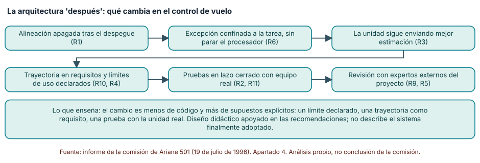

**Cómo leer la figura.** Cada caja es un cambio de la arquitectura de control; las etiquetas R indican la recomendación publicada que lo respalda. Mira que ningún cambio es una función nueva: son límites, supuestos y pruebas explícitos. **Dónde deja de valer:** es un diseño didáctico apoyado en las recomendaciones; no describe lo que el programa finalmente implantó. La ESA dice en su comunicado que la actuación no implicaba cuestionar la arquitectura del sistema (ESA, comunicado 33-1996).

### Para cada factor: control técnico, de proceso y de gobierno

| Factor causal | Control técnico | Control de proceso | Control de gobierno | Costo y trade-off | Clases |
| --- | --- | --- | --- | --- | --- |
| Función heredada activa sin necesidad | Apagarla por diseño tras el despegue; retirar lo que la misión no usa | Lista de «funciones activas por fase» revisada en cada reutilización | Registro de requisitos heredados con dueño | Pequeño; exige reconstruir por qué existía el requisito | [SE-520 · Dependencias obsoletas y riesgo acumulado](../../classes/part-43-mantenimiento-y-modernizacion-legacy/se-520-dependencias-obsoletas-y-riesgo-acumulado/README.md), [SE-518 · Arqueología de código y recuperación de conocimiento](../../classes/part-43-mantenimiento-y-modernizacion-legacy/se-518-arqueologia-de-codigo-y-recuperacion-de-conocimiento/README.md), [SE-153 · Gestión de cambios y líneas base](../../classes/part-12-ingenieria-de-requisitos/se-153-gestion-de-cambios-y-lineas-base/README.md) |
| Variables sin protección | Saturar o validar el rango en toda conversión de tipos | Revisión de supuestos de rango por una persona ajena al código | Política: sin conversiones de reducción no justificadas por escrito | Carga de proceso del 80 % es un límite real; hay que presupuestar la protección | [SE-452 · Codificación segura: MISRA y CERT](../../classes/part-37-sistemas-criticos-tiempo-real-y-normas-de-seguridad/se-452-codificacion-segura-misra-y-cert/README.md), [SE-159 · Contratos, invariantes y diseño por contrato](../../classes/part-13-especificaciones-contratos-y-modelos/se-159-contratos-invariantes-y-diseno-por-contrato/README.md), [SE-147 · Atributos de calidad y restricciones](../../classes/part-12-ingenieria-de-requisitos/se-147-atributos-de-calidad-y-restricciones/README.md) |
| Especificación sin trayectoria | Datos de misión como requisito de cada equipo | Trazabilidad de la especificación del equipo a las condiciones de misión | Declaración de restricciones de uso obligatoria | Más documentación; evita el supuesto oculto | [SE-151 · Trazabilidad desde necesidad hasta evidencia](../../classes/part-12-ingenieria-de-requisitos/se-151-trazabilidad-desde-necesidad-hasta-evidencia/README.md), [SE-154 · Ambigüedad, contradicción e incompletitud](../../classes/part-12-ingenieria-de-requisitos/se-154-ambiguedad-contradiccion-e-incompletitud/README.md), [SE-450 · Casos de seguridad y trazabilidad](../../classes/part-37-sistemas-criticos-tiempo-real-y-normas-de-seguridad/se-450-casos-de-seguridad-y-trazabilidad/README.md) |
| Simulación sin la unidad real | Lazo cerrado con equipo real y datos realistas | Regla de que lo simulado se sustituye solo tras demostrar que niveles previos lo cubrieron | Criterio de salida de pruebas aprobado por quien responde del riesgo | Caro y menos preciso que la simulación pura; aun así, descubre defectos de integración | [SE-454 · Verificación y cobertura: MC/DC, HIL y SIL](../../classes/part-37-sistemas-criticos-tiempo-real-y-normas-de-seguridad/se-454-verificacion-y-cobertura-mc-dc-hil-y-sil/README.md), [SE-427 · Dobles, virtualización y entornos de prueba](../../classes/part-35-estrategia-y-tecnicas-de-prueba/se-427-dobles-virtualizacion-y-entornos-de-prueba/README.md), [SE-421 · Calidad por riesgo y propósito de las pruebas](../../classes/part-35-estrategia-y-tecnicas-de-prueba/se-421-calidad-por-riesgo-y-proposito-de-las-pruebas/README.md) |
| Excepción que detiene la unidad | Degradación elegante: seguir con la mejor estimación | Diseño de modos de fallo que incluya fallos sistemáticos | Criterio de «software defectuoso hasta que se demuestre» | Puede propagar un dato malo; hay que marcarlo como degradado | [SE-439 · Circuit breakers, bulkheads y degradación](../../classes/part-36-calidad-rendimiento-y-resiliencia/se-439-circuit-breakers-bulkheads-y-degradacion/README.md), [SE-445 · Riesgo, peligro y seguridad funcional: HARA, FMEA, FTA y STPA](../../classes/part-37-sistemas-criticos-tiempo-real-y-normas-de-seguridad/se-445-riesgo-peligro-y-seguridad-funcional-hara-fmea-fta-y-stpa/README.md), [SE-274 · Safety, seguridad y vida útil prolongada](../../classes/part-22-embedded-iot-y-tiempo-real/se-274-safety-seguridad-y-vida-util-prolongada/README.md) |
| Reserva idéntica | Diversidad o confinamiento del defecto | Análisis de causa común en cada redundancia | Definición de componente crítico que incluya software | Diversidad cuesta; solo vale en lo crítico | [SE-445 · Riesgo, peligro y seguridad funcional: HARA, FMEA, FTA y STPA](../../classes/part-37-sistemas-criticos-tiempo-real-y-normas-de-seguridad/se-445-riesgo-peligro-y-seguridad-funcional-hara-fmea-fta-y-stpa/README.md), [SE-440 · Disponibilidad, durabilidad y recuperación](../../classes/part-36-calidad-rendimiento-y-resiliencia/se-440-disponibilidad-durabilidad-y-recuperacion/README.md), [SE-448 · Aviación: DO-178C, DO-254 y ARP4754](../../classes/part-37-sistemas-criticos-tiempo-real-y-normas-de-seguridad/se-448-aviacion-do-178c-do-254-y-arp4754/README.md) |
| Revisión sin tercero | Listas de supuestos verificables | Revisión por pares ajenos al proyecto | Participación externa independiente | Tiempo de revisión; evita el sesgo de quien conoce el diseño | [SE-434 · Revisión, análisis estático y quality gates](../../classes/part-36-calidad-rendimiento-y-resiliencia/se-434-revision-analisis-estatico-y-quality-gates/README.md), [SE-450 · Casos de seguridad y trazabilidad](../../classes/part-37-sistemas-criticos-tiempo-real-y-normas-de-seguridad/se-450-casos-de-seguridad-y-trazabilidad/README.md), [SE-501 · Postmortems sin culpa y aprendizaje](../../classes/part-41-observabilidad-sre-e-incidentes/se-501-postmortems-sin-culpa-y-aprendizaje/README.md) |
| Prueba de lo que no ocurre | Experimento de fallo en el sistema completo con criterio de aborto | Ejercicios de fallo inyectado antes de cada vuelo o lanzamiento | Plan de aprendizaje con hipótesis | Exige entorno representativo | [SE-505 · Principios de la ingeniería del caos: estado estable e hipótesis](../../classes/part-42-ingenieria-del-caos/se-505-principios-de-la-ingenieria-del-caos-estado-estable-e-hipotesis/README.md), [SE-506 · Diseñar experimentos de fallo: alcance y radio de impacto](../../classes/part-42-ingenieria-del-caos/se-506-disenar-experimentos-de-fallo-alcance-y-radio-de-impacto/README.md), [SE-510 · Fallos de datos y de estado: réplicas, particiones y corrupción](../../classes/part-42-ingenieria-del-caos/se-510-fallos-de-datos-y-de-estado-replicas-particiones-y-corrupcion/README.md) |

### Cómo lo habría evitado lo que enseña el curso

Cada línea es análisis propio y, como tal, una hipótesis defendible, no una afirmación de la comisión. (1) La clase de atributos de calidad y restricciones ([SE-147 · Atributos de calidad y restricciones](../../classes/part-12-ingenieria-de-requisitos/se-147-atributos-de-calidad-y-restricciones/README.md)) enseña a escribir un límite de uso como requisito; una frase del tipo «esta unidad valida su correcto funcionamiento solo para trayectorias con velocidad horizontal menor que X» habría puesto el supuesto en un papel. (2) Contratos e invariantes ([SE-159 · Contratos, invariantes y diseño por contrato](../../classes/part-13-especificaciones-contratos-y-modelos/se-159-contratos-invariantes-y-diseno-por-contrato/README.md)) convierten el rango de BH en una precondición que se comprueba. (3) La codificación segura ([SE-452 · Codificación segura: MISRA y CERT](../../classes/part-37-sistemas-criticos-tiempo-real-y-normas-de-seguridad/se-452-codificacion-segura-misra-y-cert/README.md)) trata las conversiones numéricas como un riesgo clásico. (4) Las pruebas con doble de lo real ([SE-427 · Dobles, virtualización y entornos de prueba](../../classes/part-35-estrategia-y-tecnicas-de-prueba/se-427-dobles-virtualizacion-y-entornos-de-prueba/README.md)) y las de hardware y software en el lazo ([SE-454 · Verificación y cobertura: MC/DC, HIL y SIL](../../classes/part-37-sistemas-criticos-tiempo-real-y-normas-de-seguridad/se-454-verificacion-y-cobertura-mc-dc-hil-y-sil/README.md)) enseñan cuándo un simulador esconde justo el defecto que debía mostrar. (5) El análisis de riesgos y la causa común ([SE-445 · Riesgo, peligro y seguridad funcional: HARA, FMEA, FTA y STPA](../../classes/part-37-sistemas-criticos-tiempo-real-y-normas-de-seguridad/se-445-riesgo-peligro-y-seguridad-funcional-hara-fmea-fta-y-stpa/README.md)) obligan a preguntar qué falla igual en las dos copias. (6) La ingeniería del caos ([SE-505 · Principios de la ingeniería del caos: estado estable e hipótesis](../../classes/part-42-ingenieria-del-caos/se-505-principios-de-la-ingenieria-del-caos-estado-estable-e-hipotesis/README.md), [SE-510 · Fallos de datos y de estado: réplicas, particiones y corrupción](../../classes/part-42-ingenieria-del-caos/se-510-fallos-de-datos-y-de-estado-replicas-particiones-y-corrupcion/README.md)) practica la inyección de fallos de datos y estado con una hipótesis de estado estable: aquí, «el vuelo nominal continúa si el sensor entrega un valor fuera de rango». (7) Los postmortems sin culpa ([SE-501 · Postmortems sin culpa y aprendizaje](../../classes/part-41-observabilidad-sre-e-incidentes/se-501-postmortems-sin-culpa-y-aprendizaje/README.md)) describen lo que hizo la comisión: preguntar por qué la decisión era razonable entonces y qué señal la habría desmentido.

## Vínculo con el curso

Cada enlace es una clase real; el texto dice qué mecanismo del caso ilustra. Las partes de sistemas críticos y de ingeniería del caos son las que más aportan.

| Concepto | Clase | Cómo lo ilustra el caso |
| --- | --- | --- |
| Peligro, FMEA y causa común | [SE-445 · Riesgo, peligro y seguridad funcional: HARA, FMEA, FTA y STPA](../../classes/part-37-sistemas-criticos-tiempo-real-y-normas-de-seguridad/se-445-riesgo-peligro-y-seguridad-funcional-hara-fmea-fta-y-stpa/README.md) | Dos unidades idénticas fallan juntas: la causa común es el mecanismo central |
| Aviación y software crítico | [SE-448 · Aviación: DO-178C, DO-254 y ARP4754](../../classes/part-37-sistemas-criticos-tiempo-real-y-normas-de-seguridad/se-448-aviacion-do-178c-do-254-y-arp4754/README.md) | El tratamiento de fallos de software en equipos con redundancia y el nivel de rigor de la cualificación |
| Casos de seguridad y trazabilidad | [SE-450 · Casos de seguridad y trazabilidad](../../classes/part-37-sistemas-criticos-tiempo-real-y-normas-de-seguridad/se-450-casos-de-seguridad-y-trazabilidad/README.md) | La especificación no traía los datos de misión: la cadena necesidad-requisito-evidencia estaba rota |
| Codificación segura | [SE-452 · Codificación segura: MISRA y CERT](../../classes/part-37-sistemas-criticos-tiempo-real-y-normas-de-seguridad/se-452-codificacion-segura-misra-y-cert/README.md) | Una conversión de 64 a 16 bits sin protección |
| Cobertura, HIL y SIL | [SE-454 · Verificación y cobertura: MC/DC, HIL y SIL](../../classes/part-37-sistemas-criticos-tiempo-real-y-normas-de-seguridad/se-454-verificacion-y-cobertura-mc-dc-hil-y-sil/README.md) | La unidad real no estaba en el lazo de simulación; el defecto se habría visto |
| Taller de un fallo real frente a las normas | [SE-455 · Taller: analizar un fallo real frente a las normas](../../classes/part-37-sistemas-criticos-tiempo-real-y-normas-de-seguridad/se-455-taller-analizar-un-fallo-real-frente-a-las-normas/README.md) | Este caso es un ejercicio de ese tipo |
| Atributos de calidad y restricciones | [SE-147 · Atributos de calidad y restricciones](../../classes/part-12-ingenieria-de-requisitos/se-147-atributos-de-calidad-y-restricciones/README.md) | Un límite de uso que no se declara se pierde |
| Contratos e invariantes | [SE-159 · Contratos, invariantes y diseño por contrato](../../classes/part-13-especificaciones-contratos-y-modelos/se-159-contratos-invariantes-y-diseno-por-contrato/README.md) | El rango de BH como precondición explícita |
| Trazabilidad | [SE-151 · Trazabilidad desde necesidad hasta evidencia](../../classes/part-12-ingenieria-de-requisitos/se-151-trazabilidad-desde-necesidad-hasta-evidencia/README.md) | Del requisito de Ariane 4 a la decisión de conservarlo |
| Doble y virtualización en pruebas | [SE-427 · Dobles, virtualización y entornos de prueba](../../classes/part-35-estrategia-y-tecnicas-de-prueba/se-427-dobles-virtualizacion-y-entornos-de-prueba/README.md) | Simular la unidad ocultó su defecto |
| Calidad por riesgo | [SE-421 · Calidad por riesgo y propósito de las pruebas](../../classes/part-35-estrategia-y-tecnicas-de-prueba/se-421-calidad-por-riesgo-y-proposito-de-las-pruebas/README.md) | Qué probar más cuando el coste del fallo es una misión |
| Degradación y circuit breakers | [SE-439 · Circuit breakers, bulkheads y degradación](../../classes/part-36-calidad-rendimiento-y-resiliencia/se-439-circuit-breakers-bulkheads-y-degradacion/README.md) | Detener una unidad frente a seguir con la mejor estimación |
| Tiempo real y deadlines | [SE-268 · Sistemas de tiempo real y deadlines](../../classes/part-22-embedded-iot-y-tiempo-real/se-268-sistemas-de-tiempo-real-y-deadlines/README.md) | Ciclos de 72 ms y un periodo base de 1 ms frente a 6 ms de la simulación |
| Safety y vida útil | [SE-274 · Safety, seguridad y vida útil prolongada](../../classes/part-22-embedded-iot-y-tiempo-real/se-274-safety-seguridad-y-vida-util-prolongada/README.md) | Un sistema sin reparación posible exige una disciplina distinta |
| Principios de la ingeniería del caos | [SE-505 · Principios de la ingeniería del caos: estado estable e hipótesis](../../classes/part-42-ingenieria-del-caos/se-505-principios-de-la-ingenieria-del-caos-estado-estable-e-hipotesis/README.md) | Estado estable e hipótesis para el vuelo con un sensor fuera de rango |
| Fallos de datos y de estado | [SE-510 · Fallos de datos y de estado: réplicas, particiones y corrupción](../../classes/part-42-ingenieria-del-caos/se-510-fallos-de-datos-y-de-estado-replicas-particiones-y-corrupcion/README.md) | Inyectar valores fuera de rango antes del vuelo |
| Postmortems sin culpa | [SE-501 · Postmortems sin culpa y aprendizaje](../../classes/part-41-observabilidad-sre-e-incidentes/se-501-postmortems-sin-culpa-y-aprendizaje/README.md) | Una comisión que explica por qué las decisiones eran razonables |
| Mantenimiento y dependencias obsoletas | [SE-520 · Dependencias obsoletas y riesgo acumulado](../../classes/part-43-mantenimiento-y-modernizacion-legacy/se-520-dependencias-obsoletas-y-riesgo-acumulado/README.md) | Reutilizar software de otro entorno sin revisar sus supuestos |

### Preguntas de discusión

1. Si en lugar de una unidad detenida se hubiera enviado un valor saturado, ¿habría mejorado el vuelo? ¿Qué riesgos nuevos trae seguir con una estimación degradada?
2. ¿Qué diferencia hay entre «probado en vuelo» y «probado en estas condiciones»? Escribe un criterio de reutilización para un componente heredado.
3. La comisión dice que el proveedor solo cumplió la especificación. ¿Dónde debe residir la responsabilidad de un supuesto que ningún documento recoge?
4. El 80 % de carga máxima es un límite razonable de ingeniería. ¿Cómo se decide qué protecciones sacrificar cuando faltan ciclos de cálculo, y quién debería firmar esa decisión?
5. ¿Qué habría que medir en un simulador para saber que no esconde el fallo que se busca?

### Mini-ejercicios

1. **Conversión que desborda.** Escribe una función de conversión de decimal de 64 bits a entero de 16 bits con saturación y una prueba que demuestre el valor límite; luego redáctala sin protección y haz que la prueba falle.
2. **Inventario de funciones activas por fase.** Para un servicio propio, lista qué módulos siguen activos tras el arranque aunque ya no sirvan, y decide cuáles apagar.
3. **Causa común.** Dibuja las dos copias de un componente redundante tuyo y marca todo lo que comparten (código, datos de entrada, reloj, configuración).
4. **Declaración de restricciones de uso.** Escribe media página de restricciones de uso de una biblioteca interna: rangos, tamaños, fases en que es válida.

## Qué no generalizar

**Aprender.**

1. Un supuesto que no está escrito como requisito no se revisa: declara los límites de uso de cada componente crítico.
2. Reutilizar es seguro solo si el entorno es el mismo: re-valida los supuestos al cambiar de contexto.
3. Una prueba con el componente simulado no prueba el componente: lo que se simula es lo que no se verifica.
4. Si el error es sistemático, una copia idéntica falla igual: la redundancia protege de fallos aleatorios, no de errores de diseño.
5. Un sensor no debe dejar de enviar su mejor estimación: detener la fuente de actitud puede ser peor que degradarla.
6. Un canal que mezcla diagnóstico y datos de misión necesita que el receptor distinga ambos.

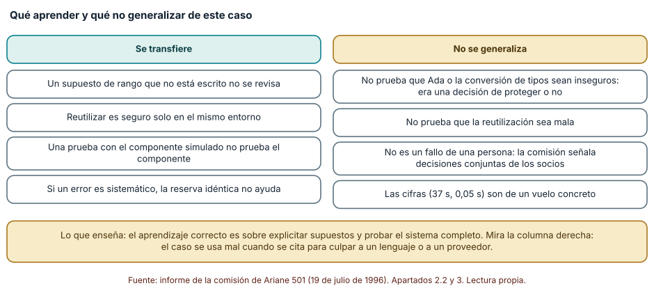

**Cómo leer la figura.** Verde: lo que se transfiere; dorado: lo que no. Mira la columna derecha: el caso se usa mal cuando se cita para culpar a un lenguaje o a un proveedor. **Dónde deja de valer:** es una lectura propia de los apartados 2.2 y 3 del informe.

**No generalizar.**

- No prueba que Ada, la reutilización de software o los entornos de simulación sean malos: el informe señala decisiones concretas de protección, de especificación y de pruebas.
- No es un fallo de una persona: la comisión describe decisiones tomadas conjuntamente por socios a varios niveles contractuales y revisadas por todos ellos.
- El informe evalúa solo lo que su encargo cubría; no hizo una revisión completa del lanzador ni evaluó los datos de telemetría (informe, prólogo).
- Las cifras (36,7 s, 0,05 s, 39 s, cinco veces) son de un vuelo y de una trayectoria; no son parámetros generales.
- Lo que Ariane 5 hizo después (117 vuelos entre 1996 y 2023) no demuestra que cada recomendación se aplicara como se escribió: el informe de la comisión y los comunicados no detallan la implantación.

### Casos comparables y diferencias

| Caso | Parecido | Diferencia |
| --- | --- | --- |
| [Therac-25 (1985)](therac-25.md) | Software heredado de un modelo anterior, sin la verificación de hardware que lo protegía | Allí el daño fue a pacientes y la causa incluyó condiciones de carrera; aquí no hubo víctimas documentadas en el informe y el fallo fue un desbordamiento numérico |
| [Knight Capital (2012)](knight-capital.md) | Código antiguo que despertó en un entorno distinto sin retest | Allí la causa fue un despliegue incompleto y falta de control de salida; aquí, un supuesto de rango en un equipo duplicado |
| [CrowdStrike (2024)](crowdstrike.md) | Una lectura fuera de límites que detiene un componente sin degradar | Allí el contenido llegó a millones de equipos a la vez; aquí hay un único vuelo y dos copias idénticas |

## Fuentes públicas verificadas

Todas consultadas el 23 de noviembre de 2026. El informe de la comisión es un PDF escaneado sin capa de texto; se leyó página a página como imagen.

1. Comisión de investigación de Ariane 501 (presidente J.-L. Lions), *Ariane 5, Flight 501 Failure, Report by the Inquiry Board*, París, 19 de julio de 1996. [https://esamultimedia.esa.int/docs/esa-x-1819eng.pdf](https://esamultimedia.esa.int/docs/esa-x-1819eng.pdf) (respalda la cadena técnica, los tiempos, las siete variables, las pruebas, los hallazgos y las 14 recomendaciones; el cuerpo del informe ocupa las páginas 5 a 18 del archivo).
2. ESA, comunicado N.º 33-1996, «Ariane 501 - Presentation of Inquiry Board report», 23 de julio de 1996. [https://www.esa.int/Newsroom/Press_Releases/Ariane_501_-_Presentation_of_Inquiry_Board_report](https://www.esa.int/Newsroom/Press_Releases/Ariane_501_-_Presentation_of_Inquiry_Board_report) (respalda el resumen oficial de la causa y las acciones del programa).
3. ESA, comunicado N.º 12-1997, «Cluster will fly again!», 26 de marzo de 1997. [https://www.esa.int/Newsroom/Press_Releases/Cluster_will_fly_again](https://www.esa.int/Newsroom/Press_Releases/Cluster_will_fly_again) (respalda la pérdida de Cluster, la reposición, los 214 MECU y la elección de Soyuz).
4. ESA, «Cluster overview». [https://www.esa.int/Science_Exploration/Space_Science/Cluster/Cluster_overview](https://www.esa.int/Science_Exploration/Space_Science/Cluster/Cluster_overview) (respalda los cuatro satélites y los lanzamientos del 16 de julio y el 9 de agosto de 2000).
5. ESA, «Ariane 5». [https://www.esa.int/Enabling_Support/Space_Transportation/Launch_vehicles/Ariane_5](https://www.esa.int/Enabling_Support/Space_Transportation/Launch_vehicles/Ariane_5) (respalda los 117 vuelos entre 1996 y 2023 y el último, el 6 de julio de 2023).

---

[↑ Casos de fallo](README.md) · [← Quibi](quibi.md)
