# Interrupción de Amazon S3 en 2017

[↑ Casos de fallo](README.md) · [← Cloudflare 2019](cloudflare-2019.md) · [Southwest Airlines 2022 →](southwest-2022.md)

> **Qué es esta página.** Un caso de estudio de fallo: la realidad frente a la teoría del curso. No es una clase ni un rol. Separa lo que las fuentes **documentan**, lo que este análisis **infiere** y lo que **no se sabe**. Habla de decisiones, procesos y sistemas, no de personas. Fecha de consulta de todas las fuentes: 23 de noviembre de 2026.

**Resumen.** El 28 de febrero de 2017, a las 9:37 hora del Pacífico, un miembro autorizado del equipo de Amazon S3 ejecutó, siguiendo un procedimiento establecido, un comando que debía retirar unos pocos servidores de un subsistema de facturación. Una de las entradas del comando se escribió mal y se retiró un conjunto mayor de servidores, que soportaban otros dos subsistemas: el índice, que guarda los metadatos y la ubicación de todos los objetos de la región y es necesario para servir cualquier petición, y el de ubicación, que asigna almacenamiento a los objetos nuevos. Ambos necesitaron un reinicio completo y, mientras tanto, S3 en la región Norte de Virginia (US-EAST-1) no pudo atender peticiones; la consola de S3, el lanzamiento de instancias de EC2, los volúmenes de EBS que necesitaban datos de instantáneas y AWS Lambda se vieron afectados. S3 volvió a operar con normalidad a las 13:54, unas cuatro horas y diecisiete minutos después del comando. Este caso es el más corto de la serie en fuentes: se apoya casi por completo en el resumen oficial de AWS, que es breve, y por eso es también el más corto en palabras; lo que ese resumen no dice (clientes afectados, pérdidas, detalles del software) se declara «no se sabe». Recorre el sistema en varios niveles de zoom, separa lo documentado de lo inferido y propone, rotulado como análisis propio, los controles que habrían cortado cada eslabón.

**Cómo leer esta página.** Cada afirmación factual lleva entre paréntesis su fuente: «Resumen AWS» es el texto *Summary of the Amazon S3 Service Disruption in the Northern Virginia (US-EAST-1) Region*. Las horas son las que da ese texto, en hora del Pacífico; los minutos entre hitos son restas propias. Lo que no lleva fuente es análisis propio y está rotulado. Las figuras son dibujos propios; ninguna repite una tabla y todas dicen dónde dejan de valer.

## Ficha histórica

| Dato | Detalle | Fuente |
| --- | --- | --- |
| Organización | Amazon Web Services (AWS), servicio Amazon Simple Storage Service (S3) | Resumen AWS |
| Incidente | 28 de febrero de 2017, región Norte de Virginia (US-EAST-1); comando a las 9:37 PST; S3 normal a las 13:54 | Resumen AWS |
| Detonante | Un comando con una entrada mal escrita retiró un conjunto mayor de servidores del previsto | Resumen AWS |
| Servicios afectados | S3 (GET, LIST, PUT y DELETE), consola de S3, nuevas instancias de EC2, volúmenes de EBS con datos de instantáneas en S3 y AWS Lambda | Resumen AWS |
| Comunicación | El panel de estado (SHD) no pudo actualizarse hasta las 11:37 porque su consola dependía de S3 | Resumen AWS |
| Magnitud del daño | Clientes afectados, pérdidas y costes: no se sabe a partir del resumen | No consta |
| Estado posterior | AWS anunció cambios en la herramienta, el índice y el panel de estado | Resumen AWS |

Las fuentes consultadas no dan fundadores ni historia corporativa; este caso no la inventa. AWS lista el resumen en su página de resúmenes de eventos de servicio, con la fecha del 28 de febrero de 2017 (AWS, página de resúmenes de eventos).

### Sedes, centros y lugares

| Lugar | Qué consta | Fuente |
| --- | --- | --- |
| Región Norte de Virginia (US-EAST-1) | Región afectada | Resumen AWS |
| Otras regiones | No consta que el incidente las afectara; el resumen habla solo de US-EAST-1 | Resumen AWS |
| Centros de datos | No se describen su número, ubicación ni propiedad | No consta |

**No se sabe:** cuántos servidores, zonas de disponibilidad y centros de datos tenía S3 en la región; el resumen no lo dice.

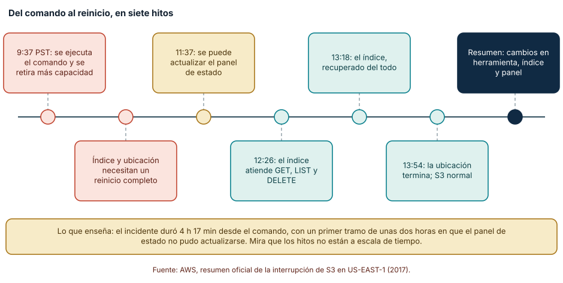

**Cómo leer la figura.** Siete hitos de izquierda a derecha, con las horas reales; los colores distinguen el defecto, la recuperación y la respuesta. Mira que el panel de estado se actualiza a las 11:37, dos horas después del comando. **Dónde deja de valer:** el espaciado es uniforme, no a escala; el resumen no da horas de cada paso interno.

### Organización

El resumen menciona un equipo, el de S3, que depuraba un problema de lentitud en el sistema de facturación; un procedimiento establecido (*playbook*) y un miembro autorizado del equipo que lo ejecutó; y equipos de ingeniería que evalúan y ensayan procesos de recuperación (Resumen AWS). **No se sabe:** el organigrama, el tamaño del equipo, la distribución de responsabilidades entre equipos y quién aprobaba los comandos.

### Visión y misión

El resumen no contiene una declaración de misión. Sí describe una filosofía de diseño: los subsistemas de S3 están diseñados para soportar la retirada o el fallo de mucha capacidad con poco o ningún impacto en los clientes; los sistemas se construyen con la hipótesis de que las cosas fallan ocasionalmente, y la capacidad de retirar y reponer capacidad es uno de los procesos operativos centrales (Resumen AWS). El análisis propio es que el incidente nace de esa misma filosofía: una operación que se hace constantemente no se trata como peligrosa.

## Contexto y problema

Amazon S3 es un servicio de almacenamiento de objetos. Cada región de AWS lo ofrece mediante una API con cuatro operaciones principales, GET, LIST, PUT y DELETE; detrás hay varios subsistemas. El resumen describe tres: el de facturación, el de índice y el de ubicación (Resumen AWS).

**El problema que el sistema resolvía.** Guardar y devolver objetos a una enorme cantidad de clientes y de otros servicios con alta disponibilidad. Para conseguirlo, los subsistemas se diseñan con redundancia y con la capacidad de retirar y reponer servidores sin interrumpir el servicio (Resumen AWS).

**La apuesta (documentado).** AWS afirma que retirar capacidad es una operación que se usa desde el lanzamiento de S3 para mantener los sistemas, y que S3 tiene una larga trayectoria de disponibilidad (Resumen AWS). La apuesta es razonable: una operación tan frecuente debe ser fácil y rápida.

**El problema oculto (análisis propio).** Una operación frecuente y fácil necesita límites de seguridad que no dependan de que quien la ejecuta acierte siempre: un comando que acepta una entrada que retira demasiado, demasiado deprisa, convierte un error de tecleo en un incidente regional.

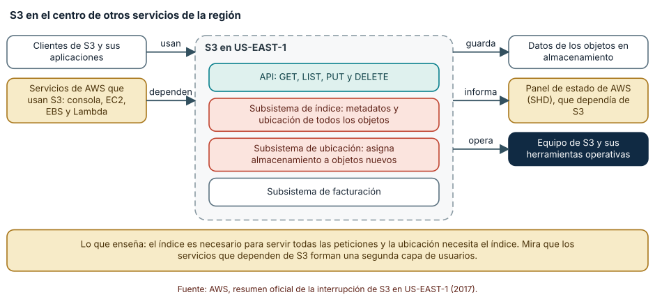

**Cómo leer la figura.** Izquierda: clientes y servicios que usan S3; centro: S3 con cuatro elementos; derecha: datos, panel de estado y equipo. Mira las dos cajas rojas: el índice y la ubicación. **Dónde deja de valer:** es un modelo funcional de lo que describe el resumen, no el diseño real de S3.

## Mercado, usuarios y casos de uso

- **Clientes de S3.** Quienes guardan y leen objetos; el resumen no da cifras (Resumen AWS).
- **Otros servicios de AWS.** La consola de S3, el lanzamiento de instancias de EC2, los volúmenes de EBS cuando necesitaban datos de una instantánea de S3 y Lambda (Resumen AWS).
- **El equipo de S3.** Opera el servicio con herramientas y procedimientos propios.
- **Los usuarios del panel de estado.** Clientes que consultan el estado de cada servicio durante un incidente (Resumen AWS).

**Casos de uso de la API.** GET (leer un objeto), LIST (listar), PUT (escribir un objeto nuevo) y DELETE (borrar). Los tres primeros dependen del índice; el PUT, además, de la ubicación (Resumen AWS).

## Funcionalidad de principio a fin

1. **Escritura (PUT).** El subsistema de ubicación asigna almacenamiento al objeto nuevo; necesita el índice para funcionar (Resumen AWS).
2. **Lectura, listado y borrado (GET, LIST, DELETE).** El índice, que guarda los metadatos y la ubicación de todos los objetos de la región, es necesario para servir estas peticiones (Resumen AWS).
3. **Facturación.** Un subsistema registra el uso para facturar; el 28 de febrero se estaba depurando una lentitud suya (Resumen AWS).
4. **Operación diaria.** El equipo retira y repone capacidad con procedimientos establecidos (Resumen AWS).

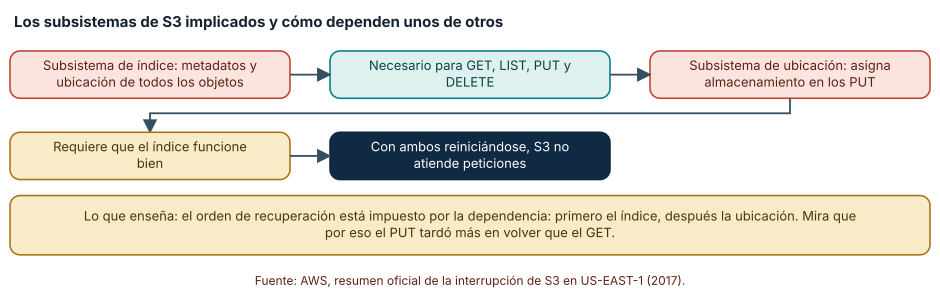

**Cómo leer la figura.** De izquierda a derecha: qué hace el índice, quién lo necesita, qué hace la ubicación y qué ocurre cuando ambos se reinician. Mira la cuarta caja: la ubicación requiere el índice. **Dónde deja de valer:** es un esquema funcional; el resumen no describe los componentes internos.

### El día a día de una operación de capacidad

Documentado. Retirar servidores de un subsistema es una operación habitual; el 28 de febrero un miembro autorizado ejecutó, con un procedimiento establecido, un comando para retirar unos pocos servidores de un subsistema de facturación; una de las entradas se escribió mal y se retiró un conjunto mayor (Resumen AWS). Después del incidente, AWS dice que la herramienta permitía retirar demasiada capacidad demasiado deprisa (Resumen AWS). **No se sabe:** el formato del comando, qué comprobaciones tenía, cuántas veces se había ejecutado antes y si había una segunda persona que lo revisara.

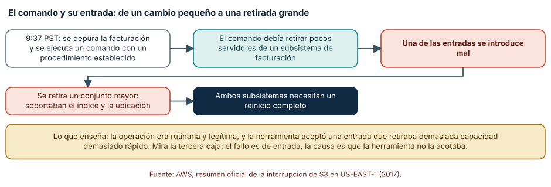

**Cómo leer la figura.** Cada caja es un paso; la tercera, la entrada mal escrita, es el detonante. Mira que el procedimiento se siguió y la herramienta aceptó la entrada. **Dónde deja de valer:** el resumen no detalla el comando.

## Negocio y economía

El resumen no da datos económicos. Documenta la posición de AWS: S3 tiene una larga trayectoria de disponibilidad y sus servicios son críticos para clientes, aplicaciones y negocios (Resumen AWS). La página del acuerdo de nivel de servicio de S3, en su versión vigente en la consulta, establece créditos de servicio escalonados si el porcentaje de disponibilidad mensual cae por debajo de umbrales: por ejemplo, 10 % de crédito si es inferior a 99,9 % pero igual o superior a 99,0 %, 25 % si es inferior a 99,0 % pero igual o superior a 95,0 % y 100 % si es inferior a 95,0 % (AWS, acuerdo de nivel de servicio de S3). Esa es la versión vigente hoy, no necesariamente la de 2017; este caso no calcula el crédito que correspondió a febrero de 2017.

- **Coste para los clientes.** No se sabe.
- **Coste para AWS.** No se sabe.
- **Efecto comercial.** No se sabe.

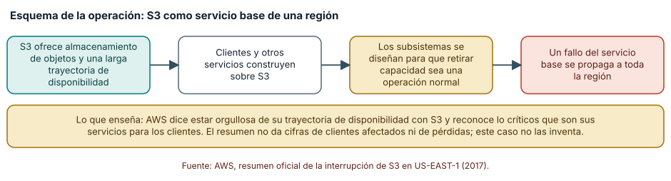

**Cómo leer la figura.** Cuatro etapas de izquierda a derecha; la última nombra el riesgo. Mira la tercera: la retirada habitual de capacidad es una operación normal. **Dónde deja de valer:** no es un flujo de dinero; el resumen no da cifras.

### Costos operativos y costo del incidente

| Rubro | Cifra | Fuente |
| --- | --- | --- |
| Duración desde el comando hasta S3 normal | 4 horas y 17 minutos (9:37 a 13:54, resta propia) | Resumen AWS |
| Tiempo hasta que el índice atiende GET, LIST y DELETE | 2 horas y 49 minutos (hasta las 12:26) | Resumen AWS |
| Tiempo hasta que el panel de estado pudo actualizarse | 2 horas (hasta las 11:37) | Resumen AWS |
| Clientes afectados, pérdidas y créditos | No se sabe | No consta |

No se inventa ninguna cifra para las filas sin fuente.

### Competidores y contexto de mercado

El resumen no menciona competidores. El contexto que consta es el de una región con muchos servicios que dependen de S3 (Resumen AWS). Qué ocurrió con la cuota o la confianza no consta y este caso no lo inventa.

## Arquitectura y esquemas

Los hechos de esta sección vienen del resumen de AWS. Los dibujos de componentes son un modelo funcional hecho con lo que describe; el resumen no publica el diseño interno de S3.

### Nivel 1 · Contexto

La figura de contexto está en «Contexto y problema». Resumen: S3 como servicio base de una región, con tres subsistemas y varios servicios que lo usan.

### Nivel 2 · Dependencias entre subsistemas

El esquema de dependencias está en «Funcionalidad de principio a fin».

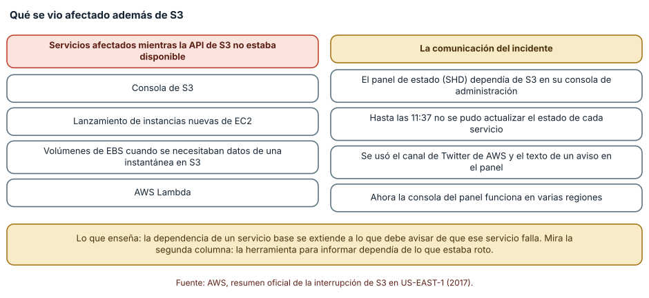

**Cómo leer la figura.** La primera columna lista los servicios afectados; la segunda, la comunicación. Mira la segunda: la herramienta para informar dependía del servicio que fallaba. **Dónde deja de valer:** el resumen no describe cuántos clientes de cada servicio se vieron afectados.

### Nivel 3 · La secuencia del incidente

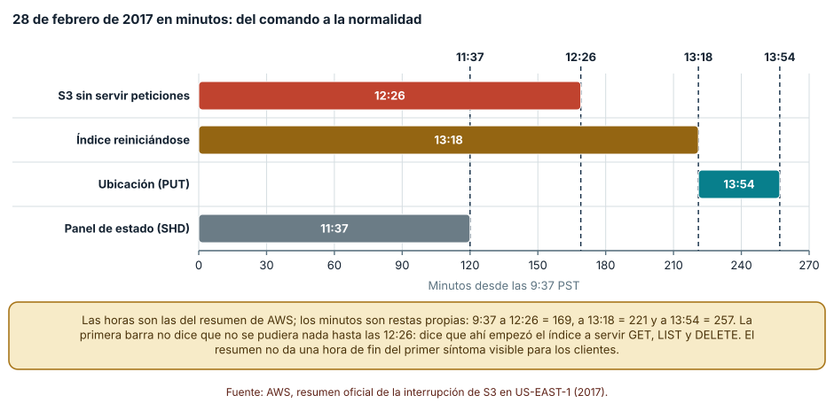

**Cómo leer la figura.** Eje horizontal: minutos desde el comando; cada fila es un componente. Mira que la ubicación empieza a recuperarse cuando el índice ya funciona. **Dónde deja de valer:** los minutos son restas propias sobre las horas del resumen; el resumen no da horas de otros pasos.

Documentado. A las 9:37 se ejecuta el comando; los dos subsistemas necesitaron un reinicio completo y, mientras se reiniciaban, S3 no pudo atender peticiones. A las 12:26 el índice había recuperado capacidad suficiente para empezar a atender GET, LIST y DELETE; a las 13:18 estaba totalmente recuperado y esas tres operaciones funcionaban con normalidad; la ubicación empezó a recuperarse cuando el índice estuvo operativo y terminó a las 13:54, momento en que S3 funcionaba con normalidad. Otros servicios con trabajo acumulado necesitaron más tiempo (Resumen AWS).

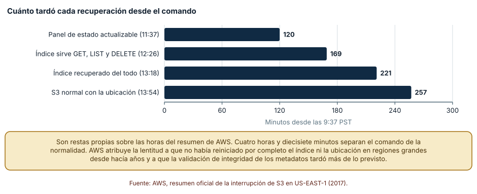

**Cómo leer la figura.** Cada barra son minutos desde las 9:37 hasta un hito; el eje parte de cero. Mira que la recuperación completa tardó 257 minutos. **Dónde deja de valer:** son restas propias; el comienzo del síntoma visible para los clientes no se da.

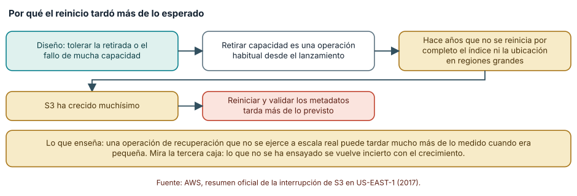

**Cómo leer la figura.** Cada caja es una razón; la última es el resultado. Mira la tercera: hacía años que no se reiniciaba el índice ni la ubicación por completo en regiones grandes. **Dónde deja de valer:** son las razones que da AWS; no se comparan con una medición independiente.

### Nivel 4 · Dependencias y puntos únicos de fallo

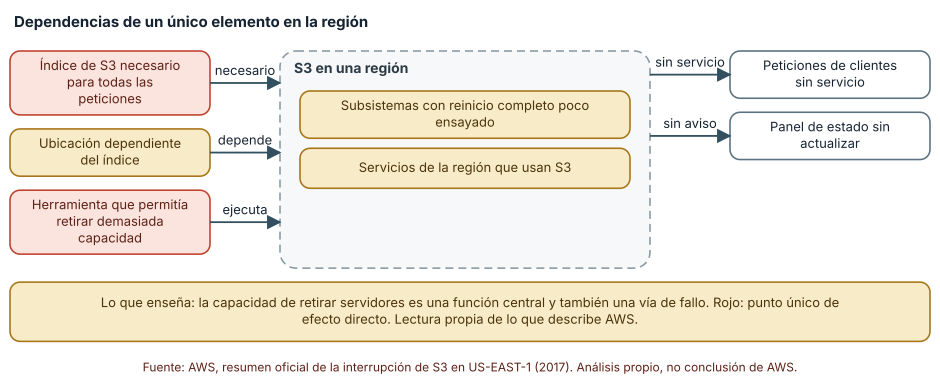

**Cómo leer la figura.** Izquierda: tres dependencias; centro: la región; derecha: lo que ocurrió. Mira que casi todo lo rojo es una propiedad del diseño de la herramienta o del subsistema. **Dónde deja de valer:** es un análisis propio; el resumen no enumera dependencias.

### Nivel 5 · Defensa en profundidad: ocho barreras

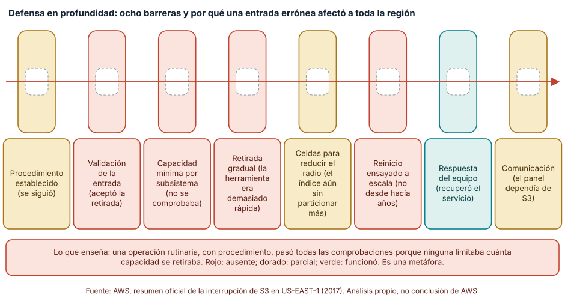

**Cómo leer la figura.** Cada lámina es una barrera; el hueco es el punto por el que el error pasó. Mira que el procedimiento se cumplió y que ninguna barrera limitaba cuánta capacidad se retiraba. **Dónde deja de valer:** el modelo de láminas es una metáfora; la lista sale del resumen y la agrupación en ocho es propia.

### Hardware utilizado

El resumen no describe hardware más allá de «servidores». **No se sabe:** modelos, capacidades y redes.

### Software utilizado

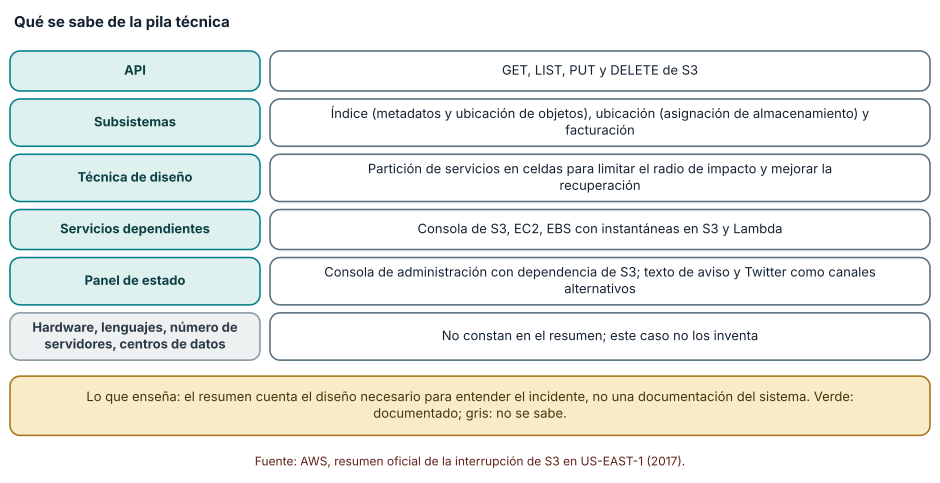

**Cómo leer la figura.** Cada fila es una capa; verde, documentada; gris, no se sabe. Mira que lo documentado es de diseño, no de implementación. **Dónde deja de valer:** no pretende describir S3 completo.

Documentado: los subsistemas de índice, ubicación y facturación, la API y la técnica de dividir servicios en pequeñas particiones, que AWS llama celdas, para limitar el radio de impacto y mejorar la recuperación (Resumen AWS). **No se sabe:** lenguaje, base de datos de metadatos, protocolos y versiones.

### Infraestructura

La infraestructura documentada es la región US-EAST-1 y los servicios que la usan (Resumen AWS). **No se sabe:** el número de zonas de disponibilidad y de centros de datos.

### A prueba de fallos: qué existía, qué falló y qué debió existir

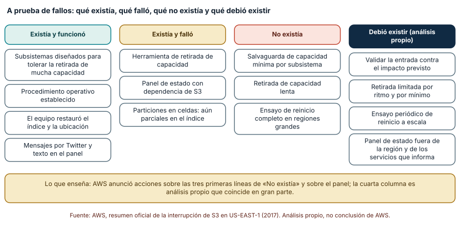

**Cómo leer la figura.** Verde: lo que había y funcionó; dorado: lo que había y falló; coral: lo que no existía; azul oscuro: análisis propio de lo que debió existir. Mira que lo que no existía era una salvaguarda en la herramienta. **Dónde deja de valer:** no mide eficacia; la cuarta columna es análisis propio.

## Casos especiales y cómo fallan

- **Una operación frecuente que se vuelve peligrosa.** Retirar capacidad es habitual; con una entrada errónea se retiró demasiada (Resumen AWS).
- **Un reinicio que no se había hecho en años.** El índice y la ubicación no se habían reiniciado por completo en regiones grandes desde hacía años y, con el crecimiento, el reinicio y la validación de integridad de metadatos tardaron más de lo esperado (Resumen AWS).
- **Dependencias entre subsistemas.** La ubicación necesita el índice: el orden de recuperación está impuesto (Resumen AWS).
- **Servicios arrastrados.** La consola de S3, EC2, EBS con instantáneas y Lambda se vieron afectados mientras la API de S3 no estaba disponible, y algunos acumularon trabajo que tardó en digerirse (Resumen AWS).
- **El aviso que depende del servicio caído.** El panel de estado no pudo actualizarse hasta las 11:37 porque su consola dependía de S3; se usaron el canal de Twitter de AWS y un texto de aviso en el panel (Resumen AWS).
- **Un plan de mejora ya previsto.** El equipo ya tenía previsto dividir el índice en más particiones más adelante en el año; tras el incidente, ese trabajo se reprioriza para empezar de inmediato (Resumen AWS).

## Línea de tiempo

Una sola escala, la de horas del 28 de febrero de 2017 (hora del Pacífico).

| Hora | Hecho | Fuente |
| --- | --- | --- |
| 9:37 | Se ejecuta el comando; se retiran más servidores de los previstos | Resumen AWS |
| Desde entonces hasta las 11:37 | El panel de estado no se puede actualizar | Resumen AWS |
| 11:37 | Se puede actualizar el estado de cada servicio | Resumen AWS |
| 12:26 | El índice atiende GET, LIST y DELETE | Resumen AWS |
| 13:18 | El índice, totalmente recuperado; GET, LIST y DELETE normales | Resumen AWS |
| 13:54 | La ubicación termina de recuperarse; S3 funciona con normalidad | Resumen AWS |

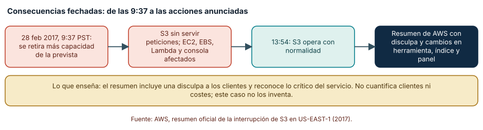

**Cómo leer la figura.** Cuatro hitos de izquierda a derecha. Mira que el resumen incluye una disculpa. **Dónde deja de valer:** el resumen no cuantifica clientes ni costes.

## Qué falló en cada instancia

| Instancia | Qué se esperaba | Qué ocurrió | Fuente |
| --- | --- | --- | --- |
| Herramienta de retirada de capacidad | Retirar pocos servidores del subsistema indicado | Aceptó una entrada que retiraba un conjunto mayor, demasiado rápido | Resumen AWS |
| Subsistemas de índice y ubicación | Tolerar la retirada de capacidad | Necesitaron un reinicio completo | Resumen AWS |
| Recuperación | Reiniciar y validar con rapidez | Tardó más de lo esperado por el crecimiento y la falta de reinicios completos en años | Resumen AWS |
| Servicios dependientes | Seguir funcionando | Consola, EC2, EBS y Lambda se vieron afectados | Resumen AWS |
| Panel de estado | Informar durante el incidente | No pudo actualizarse hasta las 11:37 | Resumen AWS |

## Causa raíz y factores

**Detonante (documentado).** Un comando con una entrada mal escrita que retiró un conjunto mayor de servidores del previsto de un subsistema de facturación, servidores que soportaban el índice y la ubicación (Resumen AWS).

**Condiciones latentes (documentado).** Una herramienta que permitía retirar demasiada capacidad demasiado deprisa; la ausencia de una comprobación de capacidad mínima por subsistema; un reinicio completo no ejercitado en regiones grandes desde hacía años; un índice cuyas particiones en celdas más pequeñas estaban previstas para más adelante; un panel de estado dependiente de S3 (Resumen AWS).

**Factores de contexto (documentado).** El gran crecimiento de S3, que alargó el reinicio; la filosofía de que retirar capacidad es normal (Resumen AWS).

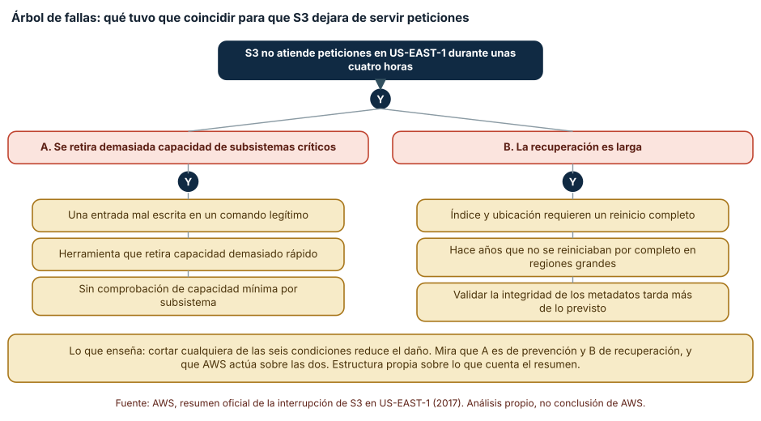

**Cómo leer la figura.** Arriba, el evento final; los círculos con «Y» exigen que todas las ramas ocurran. Las cajas doradas son las condiciones. Mira que A es de prevención y B de recuperación. **Dónde deja de valer:** la estructura es análisis propio; en la realidad las condiciones no son independientes.

**Cadena causal ordenada (análisis propio, apoyado en el resumen).**

1. S3 crece mucho y el reinicio completo de sus subsistemas no se ejerce en regiones grandes (contexto).
2. La retirada de capacidad se normaliza como operación habitual y la herramienta no limita su efecto (condición de diseño).
3. Un comando con una entrada errónea retira más capacidad de la prevista (detonante).
4. El índice y la ubicación requieren un reinicio completo (efecto técnico).
5. El reinicio y la validación tardan más de lo previsto (condición de recuperación).
6. Servicios dependientes y el panel de estado quedan afectados (propagación).
7. S3 opera con normalidad a las 13:54 (resolución).

### Documentado, inferido y no se sabe

| Categoría | Contenido |
| --- | --- |
| Documentado | La secuencia con horas; el comando y su entrada errónea; los subsistemas y su dependencia; los servicios afectados; las razones de la lentitud; los cambios anunciados |
| Inferido (análisis propio) | Que la normalización de una operación frecuente es la causa de fondo; la estructura del árbol y de las ocho barreras |
| No se sabe | Clientes afectados y pérdidas; el formato y las comprobaciones previas del comando; el diseño interno; si las acciones se cumplieron y cuándo |

## Mejoras que debieron hacerse

El resumen lista los cambios que AWS anunció; la elección de qué otros controles habrían cortado cada eslabón es análisis nuestro. Todo lo de esta sección, incluidos costes y trade-offs, es **análisis propio apoyado en la fuente**: no son conclusiones de AWS, salvo donde se cita lo anunciado.

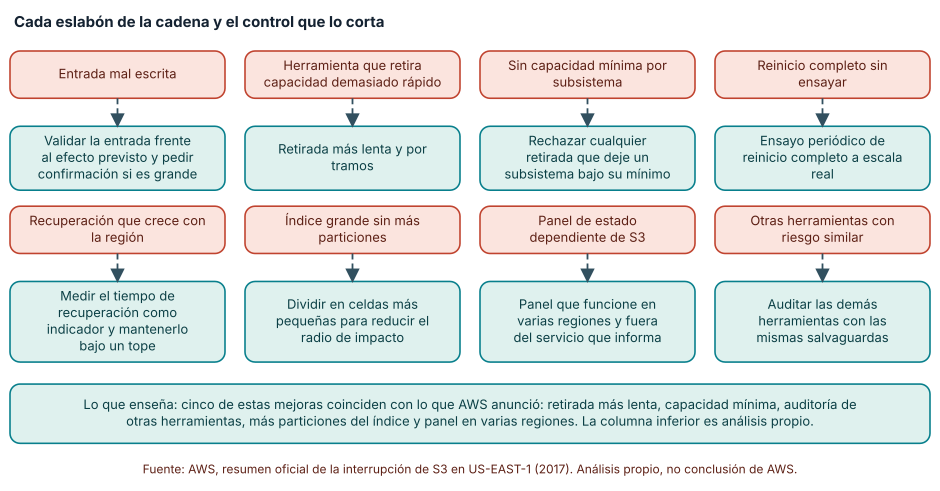

**Cómo leer la figura.** Arriba el eslabón de la cadena, debajo el control que lo corta. Mira que cinco coinciden con lo que AWS anunció. **Dónde deja de valer:** son propuestas educativas, no prescripciones; cada una tiene coste y falsos positivos.

### Las acciones que AWS anunció

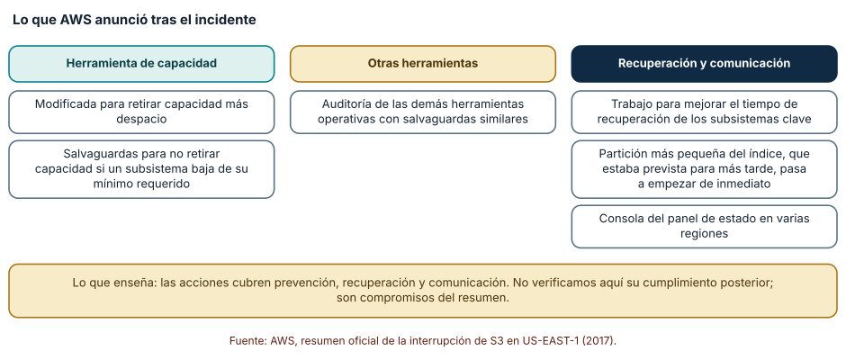

**Cómo leer la figura.** Cada columna es un grupo de acciones. Mira la primera: la herramienta retira capacidad más despacio y no deja bajar de un mínimo. **Dónde deja de valer:** son compromisos del resumen; no se verificó su cumplimiento.

### La arquitectura «después»

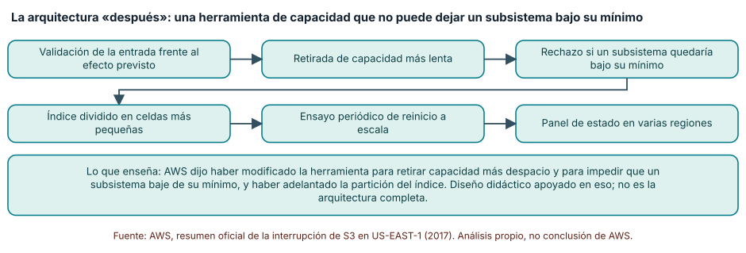

**Cómo leer la figura.** Cada caja es un cambio. Mira que la capacidad mínima impide que una entrada errónea deje un subsistema inoperante. **Dónde deja de valer:** es un diseño didáctico; no describe lo que AWS implantó con detalle.

### Para cada factor: control técnico, de proceso y de gobierno

| Factor causal | Control técnico | Control de proceso | Control de gobierno | Costo y trade-off | Clases |
| --- | --- | --- | --- | --- | --- |
| Entrada mal escrita | Validación de la entrada frente al efecto previsto | Confirmación explícita si el efecto es grande | Segunda persona para operaciones de gran radio | Fricción en operaciones habituales | [SE-499 · Runbooks, on-call y escalamiento](../../classes/part-41-observabilidad-sre-e-incidentes/se-499-runbooks-on-call-y-escalamiento/README.md), [SE-483 · Tests, seguridad y políticas como gates](../../classes/part-40-ci-cd-iac-y-platform-engineering/se-483-tests-seguridad-y-politicas-como-gates/README.md), [SE-445 · Riesgo, peligro y seguridad funcional: HARA, FMEA, FTA y STPA](../../classes/part-37-sistemas-criticos-tiempo-real-y-normas-de-seguridad/se-445-riesgo-peligro-y-seguridad-funcional-hara-fmea-fta-y-stpa/README.md) |
| Retirada demasiado rápida | Retirada por tramos y con ritmo máximo | Procedimiento con pausas de verificación | Límite de radio por tipo de operación | Operaciones más lentas | [SE-439 · Circuit breakers, bulkheads y degradación](../../classes/part-36-calidad-rendimiento-y-resiliencia/se-439-circuit-breakers-bulkheads-y-degradacion/README.md), [SE-476 · Canary, blue-green y rollback](../../classes/part-39-build-release-y-cadena-de-suministro/se-476-canary-blue-green-y-rollback/README.md), [SE-492 · Proyecto: camino a producción con rollback](../../classes/part-40-ci-cd-iac-y-platform-engineering/se-492-proyecto-camino-a-produccion-con-rollback/README.md) |
| Sin capacidad mínima | Salvaguarda que rechaza bajar de un mínimo | Revisión de mínimos por subsistema | Mínimos aprobados por quien responde del servicio | Falsos positivos en mantenimiento | [SE-440 · Disponibilidad, durabilidad y recuperación](../../classes/part-36-calidad-rendimiento-y-resiliencia/se-440-disponibilidad-durabilidad-y-recuperacion/README.md), [SE-433 · Modelos de calidad y atributos medibles](../../classes/part-36-calidad-rendimiento-y-resiliencia/se-433-modelos-de-calidad-y-atributos-medibles/README.md), [SE-534 · Gestión de riesgos y decisiones ejecutivas](../../classes/part-44-gestion-liderazgo-y-practica-profesional/se-534-gestion-de-riesgos-y-decisiones-ejecutivas/README.md) |
| Reinicio completo no ensayado | Ensayo periódico a escala | Calendario de ensayos de recuperación | Tiempo de recuperación como indicador | Coste y riesgo del ensayo | [SE-502 · Continuidad, disaster recovery y ejercicios](../../classes/part-41-observabilidad-sre-e-incidentes/se-502-continuidad-disaster-recovery-y-ejercicios/README.md), [SE-511 · Game days y ejercicios de respuesta a incidentes](../../classes/part-42-ingenieria-del-caos/se-511-game-days-y-ejercicios-de-respuesta-a-incidentes/README.md), [SE-505 · Principios de la ingeniería del caos: estado estable e hipótesis](../../classes/part-42-ingenieria-del-caos/se-505-principios-de-la-ingenieria-del-caos-estado-estable-e-hipotesis/README.md) |
| Índice grande, radio amplio | Particiones en celdas más pequeñas | Priorizar el particionado por riesgo | Presupuesto de radio por servicio | Complejidad operativa | [SE-393 · Replicación, sharding y balanceo](../../classes/part-32-concurrencia-y-sistemas-distribuidos/se-393-replicacion-sharding-y-balanceo/README.md), [SE-355 · Replicación, partición y distribución](../../classes/part-29-datos-persistencia-y-recuperacion/se-355-replicacion-particion-y-distribucion/README.md), [SE-396 · Proyecto: servicio distribuido con degradación](../../classes/part-32-concurrencia-y-sistemas-distribuidos/se-396-proyecto-servicio-distribuido-con-degradacion/README.md) |
| Panel de estado dependiente | Panel en varias regiones y fuera del servicio | Plan de comunicación alternativo | Independencia de las herramientas de aviso | Coste de duplicar | [SE-500 · Gestión de incidentes y comunicación](../../classes/part-41-observabilidad-sre-e-incidentes/se-500-gestion-de-incidentes-y-comunicacion/README.md), [SE-498 · Alertas accionables y fatiga](../../classes/part-41-observabilidad-sre-e-incidentes/se-498-alertas-accionables-y-fatiga/README.md), [SE-502 · Continuidad, disaster recovery y ejercicios](../../classes/part-41-observabilidad-sre-e-incidentes/se-502-continuidad-disaster-recovery-y-ejercicios/README.md) |
| Operaciones de otras herramientas | Auditoría con las mismas salvaguardas | Inventario de herramientas de alto radio | Informe periódico | Trabajo de auditoría | [SE-434 · Revisión, análisis estático y quality gates](../../classes/part-36-calidad-rendimiento-y-resiliencia/se-434-revision-analisis-estatico-y-quality-gates/README.md), [SE-501 · Postmortems sin culpa y aprendizaje](../../classes/part-41-observabilidad-sre-e-incidentes/se-501-postmortems-sin-culpa-y-aprendizaje/README.md), [SE-466 · Cumplimiento, evidencia y límites legales](../../classes/part-38-seguridad-privacidad-y-cumplimiento/se-466-cumplimiento-evidencia-y-limites-legales/README.md) |

### Cómo lo habría evitado lo que enseña el curso

Cada línea es análisis propio. (1) La degradación y los cortacircuitos de [SE-439 · Circuit breakers, bulkheads y degradación](../../classes/part-36-calidad-rendimiento-y-resiliencia/se-439-circuit-breakers-bulkheads-y-degradacion/README.md) y la disponibilidad y recuperación de [SE-440 · Disponibilidad, durabilidad y recuperación](../../classes/part-36-calidad-rendimiento-y-resiliencia/se-440-disponibilidad-durabilidad-y-recuperacion/README.md) enseñan a limitar el efecto de retirar capacidad. (2) Los runbooks y el on-call de [SE-499 · Runbooks, on-call y escalamiento](../../classes/part-41-observabilidad-sre-e-incidentes/se-499-runbooks-on-call-y-escalamiento/README.md) describen procedimientos con puntos de verificación. (3) La replicación, el particionado y el balanceo de [SE-393 · Replicación, sharding y balanceo](../../classes/part-32-concurrencia-y-sistemas-distribuidos/se-393-replicacion-sharding-y-balanceo/README.md), con el particionado de datos de [SE-355 · Replicación, partición y distribución](../../classes/part-29-datos-persistencia-y-recuperacion/se-355-replicacion-particion-y-distribucion/README.md), tratan del radio de impacto. (4) La continuidad y los ejercicios de [SE-502 · Continuidad, disaster recovery y ejercicios](../../classes/part-41-observabilidad-sre-e-incidentes/se-502-continuidad-disaster-recovery-y-ejercicios/README.md) y la ingeniería del caos, [SE-505 · Principios de la ingeniería del caos: estado estable e hipótesis](../../classes/part-42-ingenieria-del-caos/se-505-principios-de-la-ingenieria-del-caos-estado-estable-e-hipotesis/README.md) y [SE-511 · Game days y ejercicios de respuesta a incidentes](../../classes/part-42-ingenieria-del-caos/se-511-game-days-y-ejercicios-de-respuesta-a-incidentes/README.md), practican justo el ensayo de recuperación que faltaba. (5) La gestión de incidentes y la comunicación de [SE-500 · Gestión de incidentes y comunicación](../../classes/part-41-observabilidad-sre-e-incidentes/se-500-gestion-de-incidentes-y-comunicacion/README.md) explican por qué el panel de estado no debe depender del servicio que falla. (6) Los postmortems sin culpa de [SE-501 · Postmortems sin culpa y aprendizaje](../../classes/part-41-observabilidad-sre-e-incidentes/se-501-postmortems-sin-culpa-y-aprendizaje/README.md) describen la forma del resumen de AWS: hechos, causas, cambios.

## Vínculo con el curso

Cada enlace es una clase real; el texto dice qué mecanismo del caso ilustra. Las partes de resiliencia, de datos y persistencia, de observabilidad e incidentes y de ingeniería del caos son las que más aportan.

| Concepto | Clase | Cómo lo ilustra el caso |
| --- | --- | --- |
| Circuit breakers y degradación | [SE-439 · Circuit breakers, bulkheads y degradación](../../classes/part-36-calidad-rendimiento-y-resiliencia/se-439-circuit-breakers-bulkheads-y-degradacion/README.md) | Limitar el impacto de retirar capacidad |
| Disponibilidad, durabilidad y recuperación | [SE-440 · Disponibilidad, durabilidad y recuperación](../../classes/part-36-calidad-rendimiento-y-resiliencia/se-440-disponibilidad-durabilidad-y-recuperacion/README.md) | Tiempo de recuperación del índice |
| Replicación, sharding y balanceo | [SE-393 · Replicación, sharding y balanceo](../../classes/part-32-concurrencia-y-sistemas-distribuidos/se-393-replicacion-sharding-y-balanceo/README.md) | Particionar para limitar el radio |
| Replicación y particionado de datos | [SE-355 · Replicación, partición y distribución](../../classes/part-29-datos-persistencia-y-recuperacion/se-355-replicacion-particion-y-distribucion/README.md) | Celdas del índice |
| Proyecto: servicio distribuido con degradación | [SE-396 · Proyecto: servicio distribuido con degradación](../../classes/part-32-concurrencia-y-sistemas-distribuidos/se-396-proyecto-servicio-distribuido-con-degradacion/README.md) | Un servicio base que degrada en lugar de caer |
| Runbooks y on-call | [SE-499 · Runbooks, on-call y escalamiento](../../classes/part-41-observabilidad-sre-e-incidentes/se-499-runbooks-on-call-y-escalamiento/README.md) | Un procedimiento con puntos de verificación |
| Gestión de incidentes | [SE-500 · Gestión de incidentes y comunicación](../../classes/part-41-observabilidad-sre-e-incidentes/se-500-gestion-de-incidentes-y-comunicacion/README.md) | Comunicación sin depender del servicio caído |
| Postmortems sin culpa | [SE-501 · Postmortems sin culpa y aprendizaje](../../classes/part-41-observabilidad-sre-e-incidentes/se-501-postmortems-sin-culpa-y-aprendizaje/README.md) | Un resumen con hechos, causas y cambios |
| Continuidad y ejercicios | [SE-502 · Continuidad, disaster recovery y ejercicios](../../classes/part-41-observabilidad-sre-e-incidentes/se-502-continuidad-disaster-recovery-y-ejercicios/README.md) | Ensayar el reinicio completo |
| Principios de la ingeniería del caos | [SE-505 · Principios de la ingeniería del caos: estado estable e hipótesis](../../classes/part-42-ingenieria-del-caos/se-505-principios-de-la-ingenieria-del-caos-estado-estable-e-hipotesis/README.md) | Estado estable e hipótesis para la retirada de capacidad |
| Experimentos de fallo | [SE-506 · Diseñar experimentos de fallo: alcance y radio de impacto](../../classes/part-42-ingenieria-del-caos/se-506-disenar-experimentos-de-fallo-alcance-y-radio-de-impacto/README.md) | Alcance y radio de impacto |
| Fallos de recursos e infraestructura | [SE-508 · Fallos de recursos e infraestructura: CPU, memoria, disco y nodos](../../classes/part-42-ingenieria-del-caos/se-508-fallos-de-recursos-e-infraestructura-cpu-memoria-disco-y-nodos/README.md) | Retirar nodos como experimento |
| Game days | [SE-511 · Game days y ejercicios de respuesta a incidentes](../../classes/part-42-ingenieria-del-caos/se-511-game-days-y-ejercicios-de-respuesta-a-incidentes/README.md) | Ejercicios de recuperación |
| Calidad y atributos medibles | [SE-433 · Modelos de calidad y atributos medibles](../../classes/part-36-calidad-rendimiento-y-resiliencia/se-433-modelos-de-calidad-y-atributos-medibles/README.md) | Tiempo de recuperación como atributo |
| Alertas accionables | [SE-498 · Alertas accionables y fatiga](../../classes/part-41-observabilidad-sre-e-incidentes/se-498-alertas-accionables-y-fatiga/README.md) | Avisar sin depender del servicio caído |

### Preguntas de discusión

1. ¿Qué diseño haría imposible que un comando retirara más capacidad de la que deja un subsistema operativo?
2. Si una operación se hace cada día, ¿cómo evitas que la rutina elimine las comprobaciones?
3. Un reinicio completo no se había hecho en años. ¿Cada cuánto debe ensayarse y quién decide el riesgo?
4. El panel de estado dependía de S3. ¿Qué otras herramientas de tu entorno dependen de lo que deberían vigilar?
5. ¿Qué indicador de recuperación pondrías en un tablero?

### Mini-ejercicios

1. **Salvaguarda de capacidad.** Escribe una función que rechace retirar nodos si el número restante cae por debajo de un mínimo configurable, con pruebas.
2. **Tiempo de recuperación.** Mide cuánto tarda en reiniciarse un servicio propio con 10, 100 y 1000 elementos y extrapola.
3. **Dependencia circular.** Dibuja las dependencias de tus herramientas de aviso y marca las que dependen del servicio que vigilan.
4. **Radio de impacto.** Divide un recurso compartido de tu sistema en celdas y calcula el porcentaje de usuarios afectado por una celda caída.

## Qué no generalizar

**Aprender.**

1. Una herramienta operativa debe limitar su propio impacto aunque la entrada sea errónea.
2. Lo que no se ensaya a escala no tiene un tiempo de recuperación conocido.
3. Los avisos no deben depender del servicio que avisan.
4. Una operación habitual es la que más necesita salvaguardas.
5. Particionar en celdas reduce el radio de impacto de cualquier error.

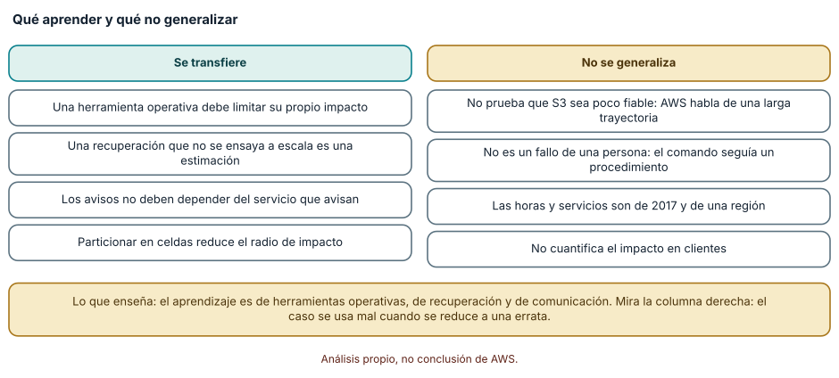

**Cómo leer la figura.** Verde: lo que se transfiere; dorado: lo que no. Mira la columna derecha: el caso se usa mal cuando se reduce a una errata. **Dónde deja de valer:** es una lectura propia del resumen.

**No generalizar.**

- No prueba que S3 sea poco fiable: AWS habla de una larga trayectoria de disponibilidad y el incidente es uno concreto.
- No es el fallo de una persona: el comando seguía un procedimiento establecido y la herramienta aceptó la entrada.
- La fuente principal es el resumen de la propia AWS, una fuente de parte; no se contrastó con una segunda fuente independiente.
- Las horas y los servicios son de 2017 y de una región.
- Lo ocurrido después, incluido el cumplimiento de las acciones anunciadas, queda fuera de este caso porque no se verificó en esta sesión.

### Casos comparables y diferencias

| Caso | Parecido | Diferencia |
| --- | --- | --- |
| [GitLab (2017)](gitlab-2017.md) | Un comando ejecutado con una entrada equivocada tiene un efecto mucho mayor del previsto | Allí se borraron datos y los respaldos no servían; aquí se retiró capacidad y el servicio se recuperó |
| [Cloudflare 2019](cloudflare-2019.md) | Una acción operativa rutinaria provoca una caída amplia y las herramientas de respuesta dependen de lo caído | Allí la causa fue una regla con retroceso; aquí, una retirada de capacidad |
| [Caída global de Meta (2021)](meta-2021.md) | Las herramientas de aviso y de acceso dependían de lo que había caído | Allí fue un cambio de red; aquí, un comando sobre servidores |

## Fuentes públicas verificadas

Todas consultadas el 23 de noviembre de 2026. Las páginas se abrieron y se extrajo su texto.

1. Amazon Web Services, *Summary of the Amazon S3 Service Disruption in the Northern Virginia (US-EAST-1) Region*. [https://aws.amazon.com/message/41926/](https://aws.amazon.com/message/41926/) (respalda toda la secuencia, los subsistemas, las causas de la lentitud y las acciones anunciadas).
2. Amazon Web Services, *AWS Post-Event Summaries*. [https://aws.amazon.com/premiumsupport/technology/pes/](https://aws.amazon.com/premiumsupport/technology/pes/) (respalda que el resumen está publicado con la fecha del 28 de febrero de 2017).
3. Amazon Web Services, *Amazon S3 Service Level Agreement*. [https://aws.amazon.com/s3/sla/](https://aws.amazon.com/s3/sla/) (respalda los créditos de servicio escalonados en la versión vigente en la consulta).
4. Amazon Web Services, *Workload isolation using shuffle-sharding*, Amazon Builders' Library. [https://aws.amazon.com/builders-library/workload-isolation-using-shuffle-sharding/](https://aws.amazon.com/builders-library/workload-isolation-using-shuffle-sharding/) (respalda que AWS describe técnicas de aislamiento de cargas para limitar el radio de impacto).
5. Amazon Web Services, *Amazon S3*. [https://aws.amazon.com/s3/](https://aws.amazon.com/s3/) (respalda que S3 es un servicio de almacenamiento de objetos de AWS).

---

[↑ Casos de fallo](README.md) · [← Cloudflare 2019](cloudflare-2019.md) · [Southwest Airlines 2022 →](southwest-2022.md)
