# Boeing 737 MAX y MCAS

[↑ Casos de fallo](README.md) · [← Ariane 5, vuelo 501](ariane-5-vuelo-501.md) · [Post Office Horizon →](post-office-horizon.md)

> **Qué es esta página.** Un caso de estudio de fallo: la realidad frente a la teoría del curso. No es una clase ni un rol. Separa lo que las fuentes **documentan**, lo que este análisis **infiere** y lo que **no se sabe**. Habla de decisiones, procesos y sistemas, no de personas. Dos accidentes costaron la vida a 346 personas; este caso las recuerda con respeto, no usa sus muertes como recurso retórico y no emite juicios sobre individuos. Fecha de consulta de todas las fuentes: 23 de noviembre de 2026.

**Resumen.** El 29 de octubre de 2018 un Boeing 737-8 (MAX) de Lion Air se estrelló en el mar de Java con 189 personas a bordo; el 10 de marzo de 2019 otro, de Ethiopian Airlines, se estrelló cerca de Addis Abeba con 157. En ambos, una función nueva del ordenador de control de vuelo, el MCAS (*Maneuvering Characteristics Augmentation System*), empujó repetidamente el morro hacia abajo a partir del valor erróneo de un único sensor de ángulo de ataque. Los informes públicos coinciden en lo esencial y discrepan en detalles: el informe indonesio atribuye el accidente a una cadena de factores que incluye supuestos de diseño y certificación sobre la respuesta de los pilotos que resultaron incorrectos, un MCAS que dependía de un solo sensor, la ausencia de MCAS en manuales y formación y un aviso de desacuerdo de sensores que no estaba habilitado; el informe etíope señala como causa probable las órdenes repetidas e irrecuperables de MCAS por un ángulo de ataque erróneo; el regulador estadounidense mantuvo el avión en tierra unos veinte meses. Este caso recorre el sistema en varios niveles de zoom, usa cinco fuentes públicas de naturaleza distinta (investigadores de accidentes, el regulador, una revisión técnica conjunta de autoridades, el NTSB y un informe del personal de la mayoría de un comité del Congreso), muestra dónde esas fuentes coinciden y dónde no, y propone, rotulado como análisis propio, qué controles habrían cortado cada eslabón. Declaración de alcance: no se tratan los procesos judiciales ni las indemnizaciones, que siguen evolucionando y que las fuentes verificadas en esta sesión no cubren; tampoco se cuantifican los costes económicos de Boeing ni de las aerolíneas por la misma razón.

**Cómo leer esta página.** Cada afirmación factual lleva entre paréntesis su fuente: «KNKT» es el informe final del accidente de Lion Air; «EAIB», el informe final del accidente de Ethiopian Airlines; «NTSB», el informe de recomendaciones de seguridad de septiembre de 2019; «JATR», la revisión técnica conjunta de autoridades; «FAA», su cronología del 737 MAX; «Comité», el informe del personal de la mayoría del Comité de Transporte e Infraestructura de la Cámara de Representantes de EE. UU. de septiembre de 2020, que es el documento de una de las partes del Comité y se cita como tal. Lo que no lleva fuente es análisis propio y está rotulado. Las figuras son dibujos propios; ninguna repite una tabla y todas dicen dónde dejan de valer.

## Ficha histórica

| Dato | Detalle | Fuente |
| --- | --- | --- |
| Organizaciones | Boeing (fabricante), la Administración Federal de Aviación de EE. UU. (FAA, autoridad certificadora), Lion Air y Ethiopian Airlines (operadores) | KNKT; EAIB; JATR |
| Producto | Boeing 737-8 (MAX): cuarta generación del 737, derivado del 737 Next Generation; la certificación se solicitó el 30 de junio de 2012 y la FAA la concedió el 8 de marzo de 2017; el 737-9 se aprobó en febrero de 2018 | JATR |
| Primer servicio | Mayo de 2017, con Malindo Air | Comité |
| Accidente 1 | 29 de octubre de 2018, vuelo JT610 de Lion Air, de Yakarta a Pangkal Pinang; impacto en el mar de Java; las 189 personas a bordo fallecieron | KNKT |
| Accidente 2 | 10 de marzo de 2019, vuelo ET302 de Ethiopian Airlines, de Addis Abeba a Nairobi; impacto a unas 28 millas náuticas al sureste del aeropuerto; las 157 personas a bordo fallecieron | EAIB |
| Medida regulatoria | El 13 de marzo de 2019 la FAA emitió una orden de emergencia que prohibía operar el 737 MAX en EE. UU.; el 18 de noviembre de 2020 firmó su anulación | FAA |
| Magnitud del daño | 346 personas fallecidas; flota en tierra unos veinte meses en EE. UU. Los costes económicos no se cuantifican aquí | Comité; FAA |
| Estado | Los informes finales son el del KNKT (25 de octubre de 2019) y el de la EAIB (diciembre de 2022); el segundo fue objeto de comentarios discrepantes del NTSB y del BEA francés | KNKT; EAIB; NTSB |

Las fuentes citadas no nombran fundadores ni dan una historia corporativa de Boeing; este caso no la inventa. Sobre la dimensión de la organización: el Comité cita la orden de noviembre de 2011 de Lion Air a Boeing por 230 aviones 737, 201 de ellos MAX, descrita en un comunicado de Boeing como la mayor de su historia con un solo cliente (Comité, apartado 2).

### Sedes, centros y lugares

| Lugar | Qué consta | Fuente |
| --- | --- | --- |
| Renton, estado de Washington | Planta de producción del 737 | Comité |
| Yakarta y Pangkal Pinang, Indonesia | Origen y destino previsto del vuelo JT610; el impacto fue en Tanjung Karawang, Java Occidental | KNKT |
| Denpasar, Indonesia | Aquí se sustituyó el sensor de ángulo de ataque izquierdo el 28 de octubre de 2018 | KNKT |
| Miramar, Florida | Taller de reparación en el que se había reacondicionado en 2017 el sensor instalado, según el Comité; la FAA revocó su certificado en octubre de 2019 según el mismo documento | Comité |
| Addis Abeba, Etiopía | Aeropuerto de Bole; el avión cayó cerca de la localidad de Ejere | EAIB |
| Washington, D. C. | Sede de la FAA, del NTSB y del Comité de la Cámara | NTSB; Comité |

**No se sabe** a partir de las fuentes verificadas: la sede de la dirección de Boeing en cada momento, el número de empleados del programa y la lista completa de proveedores del sistema de control de vuelo.

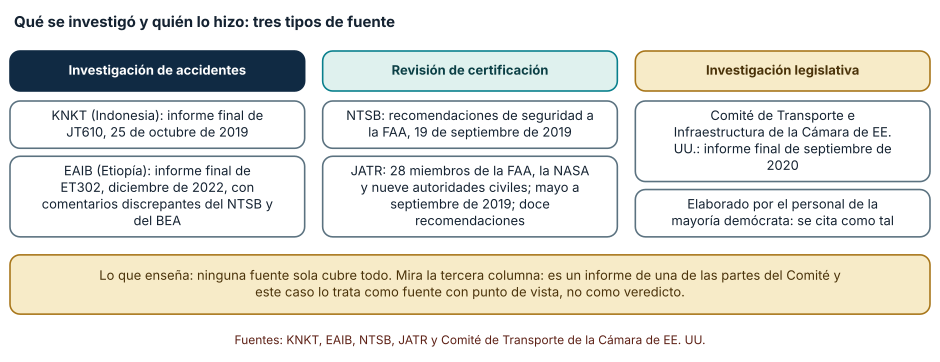

**Cómo leer la figura.** Tres columnas: quién investigó los accidentes, quién revisó la certificación y quién investigó en el Congreso. Mira la tercera: es el informe de una parte del Comité, y este caso lo trata como fuente con punto de vista, no como veredicto. **Dónde deja de valer:** no ordena las fuentes por fiabilidad; cada una responde a una pregunta distinta.

### Organización

La organización que importa para este caso es la cadena de responsabilidades de la certificación, que muestra la figura de «Mejoras». Los hechos documentados: Boeing recibió de la FAA, por el programa de designación de organizaciones autorizadas, facultades delegadas sobre partes del proyecto, y la supervisión de la FAA se hizo a través de su oficina de supervisión de Boeing (JATR, recomendación 5). El JATR lo formó la FAA con 28 miembros de la propia FAA, la NASA y nueve autoridades de aviación civil, y lo presidió Christopher Hart, expresidente del NTSB; los miembros de la FAA no habían participado en la certificación del 737 MAX (JATR, resumen ejecutivo). **No se sabe:** la estructura interna de los equipos de Boeing y de la FAA que trabajaron en el 737 MAX más allá de lo que citan los informes.

### Visión y misión

Las fuentes consultadas no contienen una declaración de visión o misión de Boeing. Lo que sí documenta el Comité es la estrategia de producto: ante el anuncio de Airbus del A320neo en diciembre de 2010, Boeing anunció en agosto de 2011 el 737 MAX, con compromisos de cinco clientes por 496 aviones (Comité, apartado 3). El análisis propio es que un derivado con motores nuevos para competir en coste de combustible y plazo es una estrategia razonable de negocio; su implicación técnica es que cada cambio del derivado se mide también contra el coste de que el avión deje de ser tratado como «el mismo» desde el punto de vista de la formación.

## Contexto y problema

El 737 fue certificado por primera vez en 1967; el 737 MAX es el decimosegundo derivado (Comité, apartado 2). Boeing eligió dotarlo de motores nuevos, más grandes y de mayor eficiencia, para competir con el A320neo, que Airbus había lanzado en diciembre de 2010 y que el Comité describe como una ventaja competitiva de hasta un 15 % de ahorro de combustible (Comité, apartado 3). Los cambios de diseño del 737 MAX respecto del 737 NG incluían, entre otros, los motores CFM LEAP-1B, cambios estructurales para alojarlos, winglets de tecnología avanzada, spoilers con mando electrónico y la función MCAS (JATR, resumen).

**El problema que MCAS resolvía.** Los motores nuevos, mayores y más adelantados respecto del ala, cambiaban las características de pitch del avión a ángulos de ataque altos con los flaps arriba. El KNKT describe a MCAS como una función dentro del sistema de compensación por velocidad que, en maniobras no normales de ángulo de ataque elevado, mueve el estabilizador para dar un aumento deseable del gradiente de fuerza en la palanca y una menor tendencia a encabritar (KNKT, apartado 1.6.5.4). El objetivo era que el avión se comportara, para el piloto, como el 737 NG.

**La apuesta (documentado).** El Comité cita la intención de que el 737 MAX evitase formación nueva en simulador para los pilotos del 737 NG; la descripción de MCAS como una ampliación del sistema de compensación por velocidad existente se discutió internamente en 2013 en esos términos, y el informe cita las actas (Comité, apartado 5). La certificación se hizo como cambio de un producto existente, con una base de certificación que combina enmiendas vigentes en 1967 y posteriores (JATR, recomendación 1).

**El problema oculto (análisis propio).** Una función que mueve una superficie de control sin orden del piloto es, por su autoridad, una función crítica de seguridad. Su peligrosidad depende de tres cosas que los informes examinan: de dónde saca su dato (un único sensor por vuelo), de cuánto puede mover (de 0,6 a 2,5 grados por activación según el Comité) y de si el piloto sabe que existe y puede cortarla.

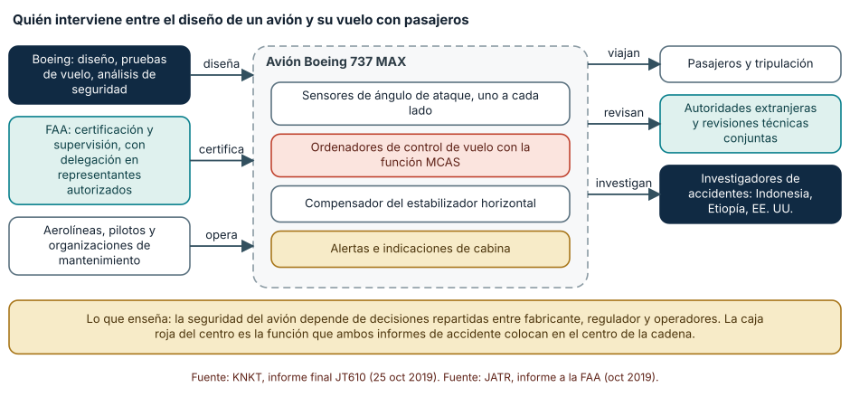

**Cómo leer la figura.** Izquierda: quienes diseñan, certifican y operan; centro: el avión con cuatro elementos relevantes; derecha: quienes viajan, revisan e investigan. Mira la caja roja: es la que los informes de accidente colocan en el centro. **Dónde deja de valer:** no muestra a los fabricantes de sensores ni a los proveedores del ordenador; los informes consultados no los detallan.

## Mercado, usuarios y casos de uso

- **Pasajeros y tripulaciones:** son quienes fallecieron. El avión vuela con dos pilotos; en JT610 viajaban 181 pasajeros, seis tripulantes de cabina y dos pilotos (KNKT, apartado 1.1); en ET302, 149 pasajeros, cinco tripulantes de cabina, un oficial de seguridad en vuelo y dos pilotos (EAIB, apartado 1.1).
- **Aerolíneas:** el 737 es el avión de pasillo único de referencia de muchas flotas; Lion Air basaba su modelo en el 737 (Comité, apartado 2). La aerolínea valora que el piloto formado en una versión pueda volar la siguiente con formación de diferencias, y esa expectativa es uno de los datos de diseño.
- **Pilotos:** usuarios de un sistema que se les presentó como un 737 más. El EAIB señala que la formación de diferencias que ofrecía Boeing se encontró inadecuada y que el curso de diferencias en ordenador no cubría MCAS (EAIB, apartado 3.3).
- **Mantenimiento:** técnicos que dependen del libro de registro de la aeronave y de los avisos de a bordo para diagnosticar. En JT610, la información que habría ayudado al mantenimiento, como el agitador continuo o el uso del corte del compensador, no quedó anotada en el registro (KNKT, apartado 3.2, factor 8).
- **Reguladores:** la FAA como autoridad del Estado de diseño y las autoridades de cada país operador; el JATR incluyó a las de Australia, Brasil, Canadá, China, la UE, Indonesia, Japón, Singapur y los Emiratos Árabes Unidos (JATR).
- **Investigadores:** el KNKT, la EAIB, el NTSB (como representante acreditado del Estado de diseño) y la oficina BEA de Francia en el caso etíope.

**Casos de uso del sistema de control de vuelo.** (1) Volar con piloto automático o manual; (2) mantener el avión estable cerca de pérdida; (3) avisar al piloto de fallos; (4) permitir que el piloto retome el control manual y corte las ayudas. Los casos (2) y (3) son los que se discuten en los informes.

## Funcionalidad de principio a fin

1. **Medida.** Dos sensores de ángulo de ataque, uno a cada lado, con dos resolvers cada uno; cada unidad de datos aéreos usa el sensor de su lado (KNKT, apartado 1.6.5.4).
2. **Cálculo.** MCAS es una ley de control contenida en cada uno de los dos ordenadores de control de vuelo, pero solo está activa en el principal de ese vuelo; el principal alterna entre izquierdo y derecho en cada vuelo. Usa como entradas el estado aire/tierra, la posición de flaps, el ángulo de ataque, la velocidad de cabeceo, la velocidad verdadera y el Mach (KNKT, apartado 1.6.5.4).
3. **Activación.** Tal como se entregó, MCAS se activaba en vuelo manual con flaps arriba (sin piloto automático) cuando el ángulo de ataque recibido por el ordenador principal superaba un umbral dependiente del Mach; entonces ordenaba un movimiento rápido del estabilizador con el morro hacia abajo, de magnitud dependiente del ángulo y del Mach (KNKT).
4. **Reinicio.** Cuando el ángulo caía bajo un umbral de reinicio, MCAS devolvía el estabilizador a su posición original. Los pilotos podían detener o invertir los mandos del estabilizador con los interruptores de la palanca, que además reiniciaban el sistema tras cinco segundos; si la condición de ángulo elevado persistía más de cinco segundos tras ese reinicio, MCAS ordenaba otro movimiento (KNKT).
5. **Corte.** En todos los 737, los interruptores de corte de columna interrumpen los mandos del estabilizador contrarios al mando del elevador; para dar cabida a MCAS, el del primer oficial se modificó para inhibir el corte hacia atrás mientras MCAS actúa. Los pilotos podían cortar toda la energía del compensador con los interruptores de corte (KNKT).

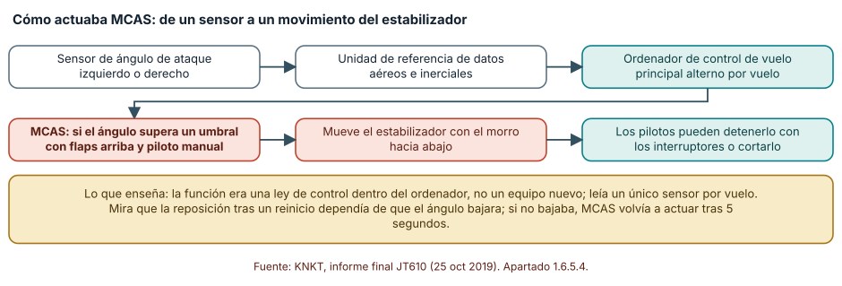

**Cómo leer la figura.** Seis cajas, de izquierda a derecha y de arriba abajo; las rojas son las que actúan sobre el control. Mira la cuarta: la condición de activación depende de un solo ángulo y de cómo se alterna el ordenador principal. **Dónde deja de valer:** es un esquema funcional de la descripción del KNKT, no el diseño real del software.

### El día a día de un cambio de diseño en el 737 MAX

El proceso real de cambios de Boeing no es público más allá de lo que citan los informes. Lo documentado es lo siguiente. El diseño original de MCAS tenía una autoridad máxima de 0,6 grados por activación y actuaba solo a velocidades altas; en marzo de 2016, un año antes de la certificación, pilotos de prueba de Boeing encontraron un manejo deficiente cerca de pérdidas a baja velocidad y MCAS se rediseñó para actuar a menos velocidad y con una autoridad máxima de 2,5 grados (Comité, apartado 5). El JATR señala que, en el rediseño de MCAS, los entregables de certificación no se actualizaron durante el programa para reflejar los cambios de la función, que los supuestos de diseño no se revisaron ni validaron adecuadamente, que no se evaluaron los posibles efectos en la cabina, que el análisis de seguridad del sistema y la evaluación funcional de peligros no se actualizaron de forma consistente y que no se identificaron los efectos de carga de trabajo de los pilotos por los cambios de MCAS (JATR, recomendación 4). **No se sabe:** cómo se comunicó cada cambio entre equipos y con la FAA más allá de lo que citan el JATR y el Comité.

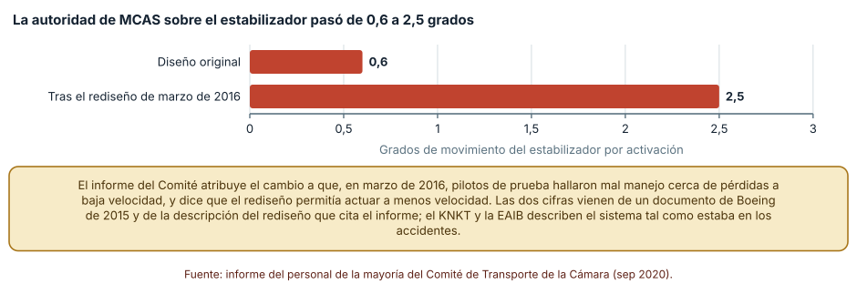

**Cómo leer la figura.** Cada barra es la autoridad máxima de movimiento del estabilizador por activación, en grados; el eje parte de cero. Mira la proporción: algo más de cuatro veces. **Dónde deja de valer:** la figura no muestra qué velocidades cubría cada versión ni cuántas activaciones eran posibles; solo la razón de autoridad que cita el informe del Comité.

## Negocio y economía

El modelo de negocio es el de un fabricante de aviones comerciales: desarrollar un modelo, venderlo a aerolíneas y a arrendadores, y mantener el flujo de entregas. El 737 es la línea de mayor volumen de la empresa (Comité, apartado 3). Lo que consta en las fuentes verificadas:

- **Competencia.** Airbus lanzó el A320neo en diciembre de 2010; Boeing respondió en agosto de 2011 con el 737 MAX y compromisos iniciales de cinco clientes por 496 aviones (Comité, apartado 3).
- **Clientes ancla.** En noviembre de 2011, Lion Air firmó con Boeing la orden de 230 aviones 737, 201 de ellos MAX, descrita como la mayor de la historia de la empresa con un solo cliente (Comité, apartado 2).
- **Presión de coste y plazo.** El informe del Comité cita que Boeing redujo en 2012 horas de pruebas de regresión de aviónica en 2 000, y examinó reducir horas de apoyo a pruebas de vuelo en 3 000 y del simulador de ingeniería de cabina en 8 000, y que la dirección del programa mantenía una cuenta atrás visible para los hitos de encendido y de primer vuelo (Comité, apartado 2). Es un documento de una de las partes del Comité y no se contrasta aquí con la versión de Boeing; el KNKT y la EAIB no tratan este punto.
- **Formación.** El Comité recoge que una propuesta de 2013 de añadir un indicador de velocidad sintético, como el del 787, fue rechazada por la dirección por coste y porque podía poner en peligro la directriz de evitar formación en simulador (Comité, apartado 2).

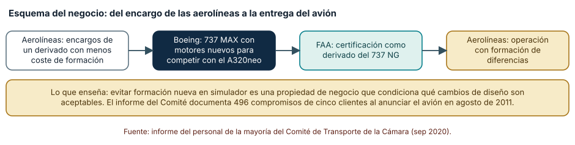

**Cómo leer la figura.** Cuatro etapas, de izquierda a derecha; no es un flujo de dinero. Mira la tercera: la certificación como derivado del 737 NG es lo que habilita la cuarta, la formación de diferencias. **Dónde deja de valer:** las fuentes verificadas no dan márgenes, precios ni costes de desarrollo.

### Costos operativos y costo del incidente

| Rubro | Cifra | Fuente |
| --- | --- | --- |
| Vidas | 346 (189 en JT610 y 157 en ET302) | KNKT; EAIB; Comité |
| Tiempo de la flota en tierra en EE. UU. | Del 13 de marzo de 2019 al 18 de noviembre de 2020, unos veinte meses | FAA |
| Horas de regresión de aviónica recortadas en 2012 | 2 000 (según el Comité) | Comité |
| Pérdida económica de Boeing, aerolíneas e indemnizaciones | No se sabe a partir de estas fuentes | No consta |
| Coste de las investigaciones | No se sabe | No consta |

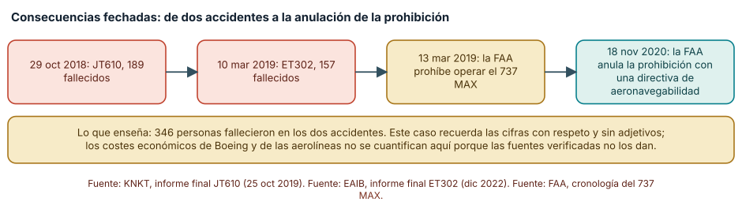

**Cómo leer la figura.** Cuatro hitos fechados, de izquierda a derecha; los dos primeros son los accidentes. Mira que 346 personas fallecieron y que este caso no pone cifras al coste económico por falta de fuente. **Dónde deja de valer:** que cada hito sea consecuencia del anterior no consta como relación causal; es una ordenación de hechos.

No se inventa ninguna cifra para las filas sin fuente. Las sanciones y acuerdos judiciales posteriores a 2020 se dejan fuera porque no se pudieron verificar en esta sesión con una fuente primaria accesible.

### Competidores y contexto de mercado

El competidor documentado es Airbus con el A320neo (Comité, apartado 3). El Comité describe cómo Boeing, que al principio minimizó la amenaza, decidió después motorizar de nuevo el 737 por la presión de los clientes. Qué pasó con cuotas de mercado después de los accidentes no consta en las fuentes consultadas y este caso no lo inventa.

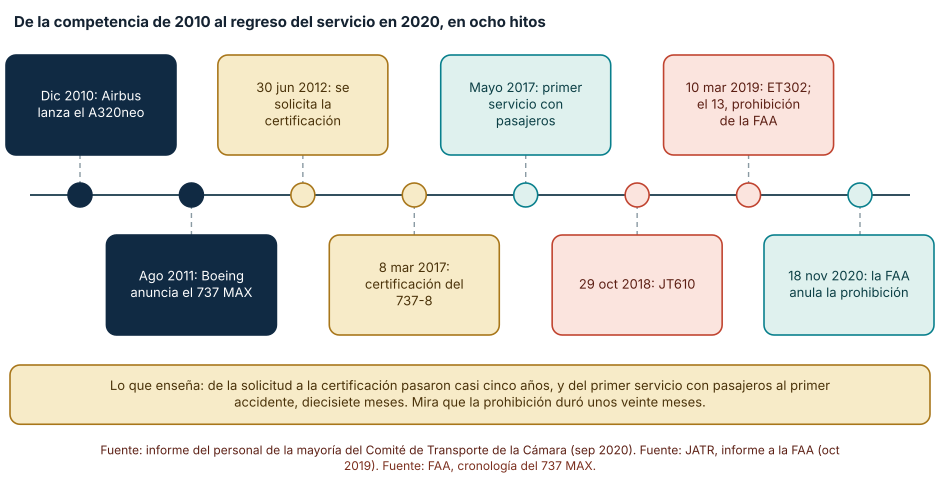

**Cómo leer la figura.** Los hitos están espaciados de forma uniforme, no a escala de años; los años de las cajas son los reales. Los colores distinguen decisiones de negocio, de certificación, accidentes y regreso al servicio. Mira la distancia entre el primer servicio y el primer accidente: diecisiete meses. **Dónde deja de valer:** no es una escala temporal; la duración de los tramos no se puede leer de la distancia dibujada.

## Arquitectura y esquemas

Los hechos de esta sección vienen de los informes del KNKT, la EAIB, el NTSB y el JATR. Los dibujos de componentes son un modelo funcional hecho con lo que describen; los informes no publican el diseño interno del software.

### Nivel 1 · Contexto

La figura de contexto está en «Contexto y problema». Resumen: un fabricante, un regulador que delega parte de la revisión, aerolíneas con pilotos y mantenimiento, y un avión cuyo sistema de control de vuelo contiene una función con autoridad sobre una superficie de control.

### Nivel 2 · La cadena de certificación

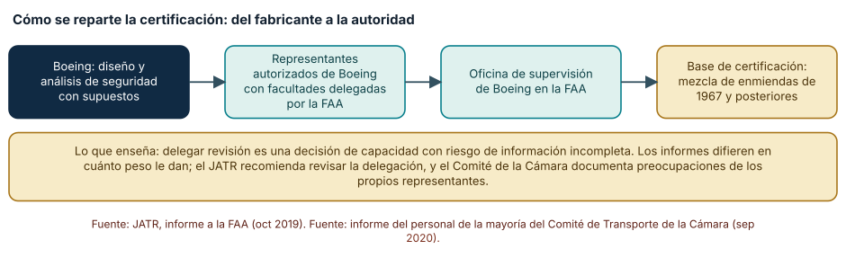

**Cómo leer la figura.** De izquierda a derecha: quién propone, quién revisa por delegación, quién supervisa y qué norma se aplica. Mira la cuarta caja: la base de certificación combina enmiendas de varias fechas. **Dónde deja de valer:** no cuantifica cuánto de la revisión se delegó; los informes discrepan en la valoración de esa delegación.

El JATR resume los problemas en doce recomendaciones: la regla de producto modificado; requisitos y prácticas actualizados; interpretación y aplicación consistentes; cambios durante la certificación; delegación de autoridad; enfoque holístico a nivel de avión; factores humanos; garantía del desarrollo; impacto de los cambios de diseño en las operaciones; en la formación de pilotos y en la de mantenimiento; y acciones correctivas posteriores y compartición de datos (JATR, resumen ejecutivo). Dos matices de método que el JATR declara: su encargo no era revisar toda la certificación ni informar la decisión de volver al servicio, y las recomendaciones son un compendio de las de los miembros, no un consenso (JATR, resumen ejecutivo).

### Nivel 3 · Componentes del flujo crítico

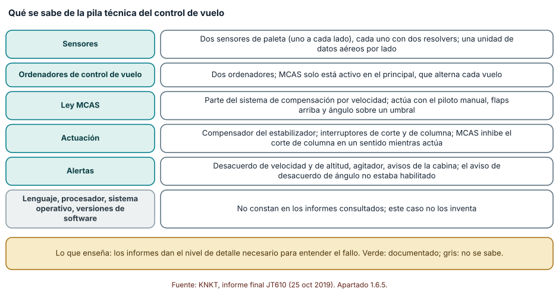

**Cómo leer la figura.** Cada fila es una capa; verde, documentada; gris, no se sabe. Mira que lo documentado coincide con lo necesario para entender el accidente. **Dónde deja de valer:** no pretende describir la pila real, solo el límite de lo público.

### Nivel 4 · Secuencia del flujo que falló en JT610

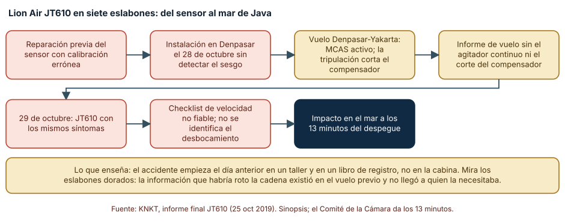

**Cómo leer la figura.** Cada caja es un eslabón; las rojas son defectos, las doradas, información que no llegó, la azul oscura, el resultado. Mira que los tres primeros ocurren antes de que la tripulación del accidente suba al avión. **Dónde deja de valer:** el orden fino de las acciones de la tripulación lo da el KNKT con las grabaciones; aquí solo se resume.

En palabras. (1) El 26 de octubre de 2018, en el vuelo de Tianjin a Manado, aparecieron en la pantalla del capitán las indicaciones de velocidad y de altitud; tras repetirse, se sustituyó el sensor de ángulo de ataque izquierdo en Denpasar el 28 de octubre. (2) El sensor instalado tenía un sesgo de 21° que no se detectó en la prueba de instalación; el sensor había sido reparado antes con una calibración errónea, y el KNKT no pudo determinar que la prueba de instalación se hiciera correctamente. (3) En el vuelo de Denpasar a Yakarta se presentaron desacuerdos de velocidad y altitud, la luz FEEL DIFF PRESS, activaciones de MCAS y el agitador de palanca izquierdo; la tripulación detuvo la repetición de MCAS cortando el compensador. (4) Tras aterrizar, la tripulación informó de algunos fallos, pero no del agitador ni del corte del compensador; la alerta de desacuerdo de ángulo de ataque no estaba disponible, así que no se pudo informar de ella. (5) Al día siguiente, el vuelo JT610 tuvo los mismos problemas, según las grabaciones. (6) La tripulación inició la lista de comprobación de velocidad no fiable pero no identificó el compensador desbocado; las alertas múltiples, las activaciones repetidas de MCAS y las distracciones por las comunicaciones con el control de tráfico contribuyeron a las dificultades. (7) El avión cayó al mar (KNKT, sinopsis).

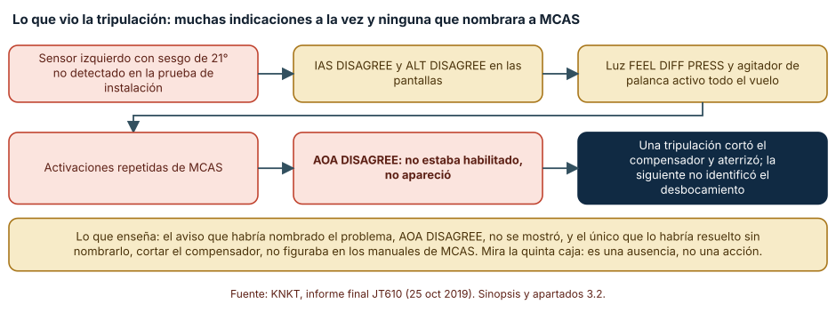

**Cómo leer la figura.** Cada caja es una indicación o un hecho de la cabina; dorado, indicaciones que existieron; rojo, la que no apareció. Mira la quinta caja: es una ausencia, no una acción. **Dónde deja de valer:** no refleja el orden temporal exacto de las alertas; el KNKT lo detalla con las grabaciones.

### Nivel 5 · El segundo accidente, ET302

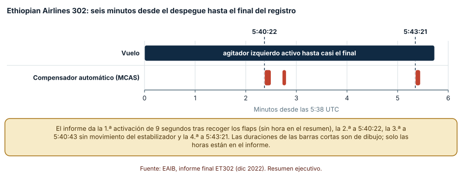

**Cómo leer la figura.** Eje horizontal: minutos desde las 5:38 UTC; la barra azul es el vuelo; las marcas rojas, las activaciones automáticas de morro abajo cuyas horas da el informe. Mira que hay menos de seis minutos entre el despegue y el final del registro. **Dónde deja de valer:** el informe da la primera activación de nueve segundos tras recoger los flaps pero no su hora en el resumen; la duración de cada marca es de dibujo.

Documentado. El despegue, a las 5:38 UTC, fue normal, incluidos los valores normales de ángulo de ataque; poco después del despegue el valor registrado del sensor izquierdo pasó a ser erróneo, el agitador izquierdo se activó y permaneció activo casi hasta el final de la grabación, y las velocidades y altitudes del lado izquierdo se desviaron de las del derecho. El ángulo izquierdo llegó a 74,5° mientras el derecho alcanzó un máximo de 15,3°. Tras recoger los flaps se produjo la primera activación automática de morro abajo, de nueve segundos, que dejó el compensador en 2,1 unidades; el piloto que volaba tiró de la columna con una fuerza de más de 90 libras y aplicó compensación eléctrica hacia arriba; cinco segundos después de terminar, se activó una segunda. A las 5:40:22 hubo una segunda activación, a las 5:40:43 una tercera sin movimiento del estabilizador y a las 5:43:21 una cuarta que movió el estabilizador de 2,3 a 1 unidad. En los últimos instantes, la velocidad calculada llegó a 500 nudos, el cabeceo a más de 40° de morro abajo y el régimen de descenso a más de 33 000 pies por minuto; los registradores se detuvieron hacia las 5:43:44 y el impacto fue a las 5:44 (EAIB, resumen ejecutivo).

### Nivel 6 · Lo que se discute del informe final etíope

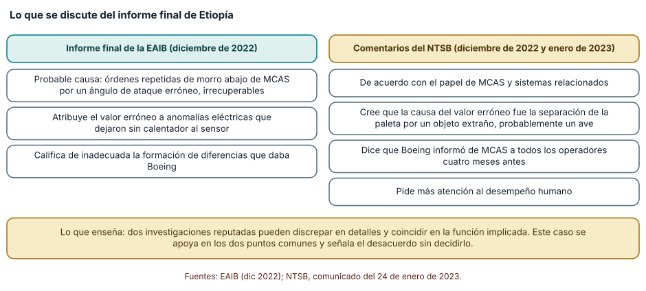

**Cómo leer la figura.** Izquierda, el informe final de Etiopía; derecha, los comentarios del NTSB. Mira que hay un acuerdo central, el papel de MCAS, y un desacuerdo sobre qué produjo el dato erróneo. **Dónde deja de valer:** el caso no decide quién tiene razón en el punto discutido; el NTSB reclama que su evidencia no se incluyó en el informe final y la EAIB no ha sido contrastada aquí.

El informe de la EAIB señala como causa probable las entradas repetidas y no ordenadas de morro abajo de MCAS debidas a una entrada errónea del ángulo de ataque, y la activación de un sistema irrecuperable que hizo que el avión se precipitara con un régimen de −33 000 pies por minuto cerca del suelo (EAIB, apartado 3.2). Entre sus factores contribuyentes están: que MCAS dependía de un solo sensor; que durante el diseño Boeing no consideró la posibilidad de una activación no ordenada de MCAS y supuso que los pilotos la reconocerían y resolverían con el uso normal de la columna, el compensador eléctrico y la lista de desbocamiento; que no se evaluaron todas las indicaciones y alertas que podían acompañar a la falla; que no existía aviso de desacuerdo del ángulo de ataque en las pantallas; que la formación en ordenador sobre diferencias no cubría MCAS; y que no se respondieron preguntas de seguridad que la aerolínea había hecho a Boeing sobre MCAS después del accidente de Lion Air (EAIB, apartado 3.3). Hasta aquí, hay una coincidencia sustancial con el KNKT. El NTSB dice estar de acuerdo con el hallazgo general sobre el papel de MCAS y sistemas relacionados, pero considera sin respaldo de la evidencia que anomalías eléctricas causaran la salida errónea del sensor: sostiene que el valor erróneo se debió a la separación de la paleta del sensor por impacto con un objeto extraño, probablemente un ave, y añade que Boeing había dado información de MCAS a todos los operadores cuatro meses antes del accidente de Ethiopian, por lo que considera engañoso el hallazgo sobre la falta de documentación (NTSB, comunicado del 24 de enero de 2023). **No se sabe** aquí cuál de las dos explicaciones del origen del dato erróneo es la correcta; es una discrepancia entre autoridades de investigación.

### Nivel 7 · Dependencias y puntos únicos de fallo

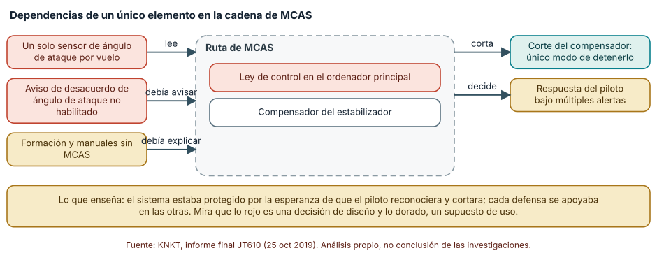

**Cómo leer la figura.** Las cajas rojas son decisiones de diseño con efecto directo; las doradas, supuestos de uso; la verde, el mecanismo de corte. Mira que lo único que cortaba la acción era el piloto. **Dónde deja de valer:** es un análisis propio de la estructura que los informes describen; pueden existir otras dependencias que no figuran.

### Nivel 8 · Defensa en profundidad: ocho barreras

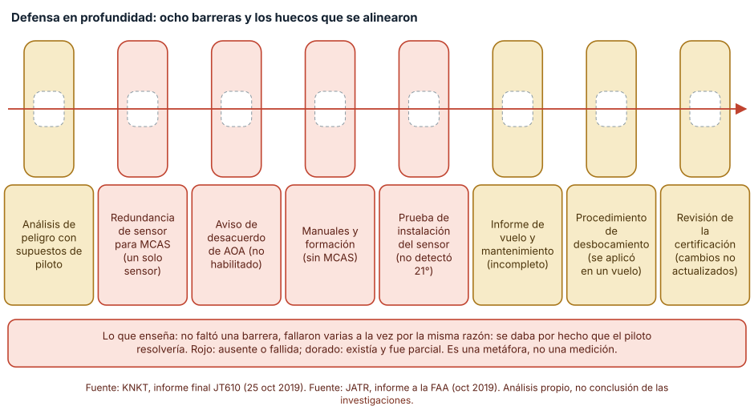

**Cómo leer la figura.** Cada lámina es una barrera; el hueco es el punto por el que el defecto pasó. Las rojas faltaron o fallaron; las doradas existieron con eficacia parcial. Mira que los huecos se alinean: la mayoría descansaba en que el piloto reconocería y resolvería el problema. **Dónde deja de valer:** el modelo de láminas es una metáfora, no una medición; la lista sale de los informes y la agrupación en ocho es propia.

### Hardware utilizado

Los informes documentan: sensores de ángulo de ataque de paleta con dos resolvers cada uno (modelo con número de parte 0861FL1 el instalado en JT610); una unidad de datos aéreos e inerciales por lado; dos ordenadores de control de vuelo; un compensador de estabilizador horizontal con interruptores de corte; y un agitador de palanca (KNKT, apartados 1.6.4 y 1.6.5). **No se sabe:** fabricante y arquitectura interna de los ordenadores de control de vuelo, procesador y memoria.

### Software utilizado

Documentado: MCAS como ley de control dentro del software de cada ordenador de control de vuelo, con alternancia del principal por vuelo, y una versión de software vigente en los accidentes en la que la reactivación tras cinco segundos era posible (KNKT, apartado 1.6.5.4). **No se sabe:** lenguaje de programación, sistema operativo, norma de desarrollo aplicada (por ejemplo, el nivel de garantía de desarrollo) y tamaño del código. El JATR trata la «garantía del desarrollo» como un tema de recomendación pero no detalla la de MCAS en lo que este caso consulta.

### Infraestructura

La infraestructura documentada es la de la certificación y la del mantenimiento: la oficina de supervisión de la FAA, los representantes autorizados, los talleres de reparación y las organizaciones de mantenimiento de las aerolíneas (JATR; KNKT, apartado 1.17). **No se sabe:** la infraestructura de pruebas de Boeing más allá del simulador de ingeniería, el número de sensores reparados por el taller de Florida y las redes de intercambio de datos de mantenimiento.

### A prueba de fallos: qué existía, qué falló y qué debió existir

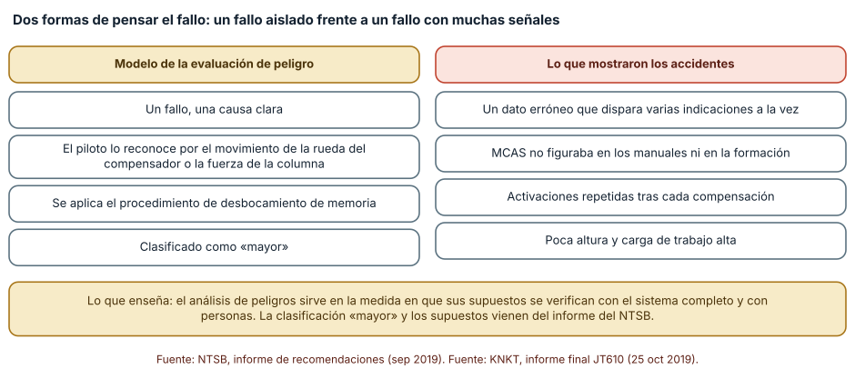

**Cómo leer la figura.** Esta figura contrasta el modelo con el que se evaluó el peligro y la situación observada en los accidentes. Mira que el modelo de la izquierda es de un fallo con una causa clara; la situación de la derecha es de un dato erróneo que dispara varias indicaciones. **Dónde deja de valer:** la clasificación «mayor» y los supuestos vienen del NTSB; no es una evaluación independiente de la de Boeing.

| Mecanismo | Estado | Fuente |
| --- | --- | --- |
| Corte del compensador con interruptores | Existía y funcionó en el vuelo previo de JT610 | KNKT |
| Procedimiento de desbocamiento de compensador | Existía; no se aplicó en JT610 | KNKT |
| Aviso de desacuerdo de ángulo de ataque | Existía en el diseño y no estaba habilitado | KNKT, factor 5; Comité |
| Redundancia de sensor para MCAS | No existía: un solo sensor | KNKT, factor 3 |
| MCAS en manuales y formación | No existía | KNKT, factor 4; EAIB |
| Evaluación del efecto combinado de alertas | No existía | EAIB; NTSB |
| Sistema de crew alerting como EICAS | Excepción concedida por la FAA para el 737 MAX, según el Comité | Comité |
| Prueba de instalación del sensor | Existía; no detectó el sesgo de 21° | KNKT, factor 7 |

## Casos especiales y cómo fallan

- **Un dato erróneo que no es un fallo.** MCAS no recibía un fallo declarado, sino un valor plausible pero falso; el sistema no tenía comparación con otra fuente (KNKT, factor 3). Los fallos silenciosos son los difíciles de manejar con procedimientos que esperan un aviso.
- **La reactivación.** Tras un movimiento de MCAS el piloto podía devolver el estabilizador con compensación eléctrica; si el ángulo erróneo persistía, MCAS actuaba de nuevo tras cinco segundos (KNKT, apartado 1.6.5.4). El diseño daba por hecho que el piloto devolvería el compensador a neutro y que el problema desaparecería.
- **El interruptor de corte de columna modificado.** En todos los 737, tirar de la columna opuesta al compensador interrumpe el compensador; para MCAS, el del primer oficial se modificó para inhibir ese corte en un sentido mientras actúa (KNKT, apartado 1.6.5.4). Un recurso tradicional del piloto dejó de funcionar para esa función.
- **El aviso que no aparecía.** El aviso de desacuerdo de ángulo de ataque no se habilitó correctamente durante el desarrollo, y por eso no apareció en JT610 ni pudo documentarse para el mantenimiento (KNKT, factor 5). El Comité añade que el aviso no estaba operativo en aviones entregados y que un representante autorizado lo sabía (Comité, apartado 2); es una afirmación del informe del Comité.
- **Mantenimiento con información incompleta.** Cuando el mantenimiento recibe un informe sin el agitador continuo ni el uso del corte de compensador, el diagnóstico se queda en la lista de procedimientos de velocidad no fiable (KNKT, factores 5 y 8).
- **Alertas múltiples.** La cabina mostró a la vez desacuerdos de velocidad y altitud, la luz de presión diferencial y el agitador; la NTSB concluye que los supuestos de la evaluación no consideraron adecuadamente el efecto de esas indicaciones múltiples en la respuesta de los pilotos (NTSB).
- **Formación de diferencias.** El EAIB considera inadecuada la formación de diferencias; el Comité vincula la decisión de no exigir formación en simulador con el objetivo comercial del programa (EAIB, apartado 3.3; Comité, apartado 2).
- **Respuesta posterior al primer accidente.** La FAA emitió el 7 de noviembre de 2018 una directiva de aeronavegabilidad de emergencia que obligaba a incluir en el manual de vuelo los procedimientos de compensador desbocado; el EAIB dice que esa y el boletín de Boeing no tuvieron el efecto buscado de prevenir otro accidente (JATR, resumen; EAIB, apartado 3.3).

## Línea de tiempo

Escala de años (cómo se formó el diseño), de días (los dos accidentes) y de meses (la prohibición y las revisiones).

### Antecedentes, accidentes y regreso al servicio

| Cuándo | Hecho | Fuente |
| --- | --- | --- |
| Diciembre de 2010 | Airbus lanza el A320neo | Comité |
| Agosto de 2011 | Boeing anuncia el 737 MAX; compromisos de cinco clientes por 496 aviones | Comité |
| 30 de junio de 2012 | Boeing solicita la certificación del 737-8 | JATR |
| Julio de 2015 | Hoja de coordinación de Boeing con requisitos de MCAS y autoridad de 0,6° | Comité |
| Marzo de 2016 | Rediseño de MCAS: actúa a menor velocidad y con autoridad de 2,5° | Comité |
| 8 de marzo de 2017 | La FAA certifica el 737-8 | JATR |
| Mayo de 2017 | Primer servicio con pasajeros | Comité |
| 26 al 28 de octubre de 2018 | Indicaciones en el vuelo previo; sustitución del sensor en Denpasar | KNKT |
| 29 de octubre de 2018 | Accidente de JT610 | KNKT |
| 7 de noviembre de 2018 | Directiva de aeronavegabilidad de emergencia sobre compensador desbocado | JATR |
| 10 de marzo de 2019 | Accidente de ET302 | EAIB |
| 13 de marzo de 2019 | Orden de emergencia de la FAA que prohíbe operar el 737 MAX | FAA |
| Mayo a septiembre de 2019 | Trabajo del JATR | JATR |
| 19 de septiembre de 2019 | Recomendaciones del NTSB a la FAA | NTSB |
| 25 de octubre de 2019 | Informe final del KNKT | KNKT |
| Septiembre de 2020 | Informe del personal de la mayoría del Comité de la Cámara | Comité |
| 17 y 18 de noviembre de 2020 | Aprobación de diseño y boletín; directiva de aeronavegabilidad; la FAA anula la orden de prohibición | FAA |
| Diciembre de 2022 | Informe final de la EAIB | EAIB |
| 24 de enero de 2023 | Comentarios adicionales del NTSB | NTSB |

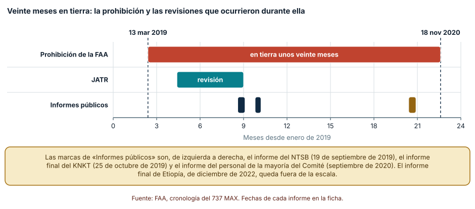

**Cómo leer la figura.** Eje horizontal: meses desde enero de 2019; la barra roja es la prohibición; la azul verdosa, el JATR; las marcas de la última fila, los informes públicos. Mira que la mayor parte de las revisiones ocurrieron durante la prohibición. **Dónde deja de valer:** el informe de la EAIB, de diciembre de 2022, queda fuera de la escala.

## Qué falló en cada instancia

| Instancia | Qué se esperaba | Qué ocurrió | Fuente |
| --- | --- | --- | --- |
| Sensor de ángulo de ataque | Entregar un valor correcto y calibrado | En JT610, sesgo de 21° tras una reparación; en ET302, valores erróneos de causa discutida | KNKT; EAIB; NTSB |
| MCAS | Mejorar el comportamiento en maniobras no normales | Actuó con datos erróneos de un solo sensor y de forma repetida | KNKT; EAIB |
| Aviso de desacuerdo de AOA | Avisar al piloto y al mantenimiento | No estaba habilitado en JT610 | KNKT |
| Análisis de peligro | Prever la respuesta de los pilotos | Los supuestos sobre su respuesta resultaron incorrectos; no consideró el efecto de alertas múltiples | KNKT; NTSB |
| Certificación | Verificar el diseño y sus cambios | El JATR señala entregables no actualizados y supuestos no revalidados | JATR |
| Manuales y formación | Describir la función y su manejo | No incluían MCAS | KNKT; EAIB |
| Prueba de instalación | Detectar un sensor mal calibrado | No lo detectó | KNKT |
| Registro de mantenimiento | Dar al técnico el cuadro completo | Faltaban el agitador continuo y el uso del corte | KNKT |
| Tripulación | Aplicar el procedimiento de desbocamiento | En JT610, no se identificó el desbocamiento; en ET302, las activaciones continuaron | KNKT; EAIB |
| Respuesta tras el primer accidente | Evitar otro accidente | La directiva y el boletín no tuvieron el efecto buscado, según la EAIB | EAIB |

## Causa raíz y factores

**Detonante (documentado).** En cada accidente, un valor erróneo del sensor de ángulo de ataque izquierdo llevó a MCAS a ordenar movimientos repetidos del estabilizador con el morro hacia abajo (KNKT; EAIB).

**Condiciones latentes (documentado).** Los supuestos de diseño y certificación sobre la respuesta de los pilotos a fallos, coherentes con las guías de la industria y que resultaron incorrectos; una evaluación incompleta de los múltiples efectos en cabina; la dependencia de MCAS de un solo sensor; la ausencia de MCAS en manuales y formación; un aviso de desacuerdo no habilitado; certificación con cambios de diseño que no se reflejaron en los análisis; y, en JT610, un sensor reparado con calibración errónea que no se detectó (KNKT, factores 1 a 9; JATR, recomendación 4; NTSB).

**Factores de contexto (documentado, según el Comité).** Una competencia de mercado con fechas fijas, la intención de evitar formación en simulador, una certificación como derivado con base normativa mezclada y una delegación de revisión en la propia empresa que el Comité considera excesiva; la FAA y Boeing discrepan en cómo valorar ese conjunto y el Comité lo presenta desde la posición de su mayoría (Comité, apartados 2 a 4).

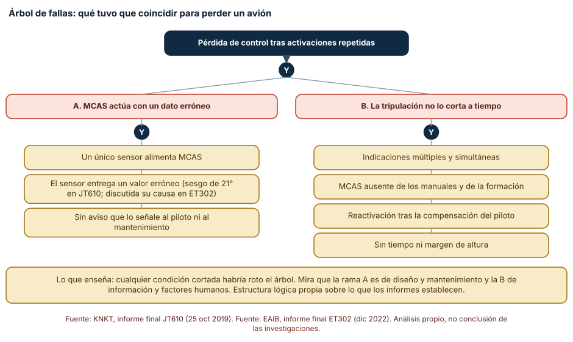

**Cómo leer la figura.** Arriba, el evento final; los círculos con «Y» exigen que todas las ramas ocurran. Las cajas doradas son las condiciones. Mira que la rama A es de diseño y mantenimiento y la B de información y factores humanos: cortar cualquiera de las condiciones rompe el árbol. **Dónde deja de valer:** la estructura es análisis propio; en la realidad las condiciones no son independientes. Por ejemplo, la ausencia de MCAS en los manuales empeora la respuesta ante las indicaciones múltiples.

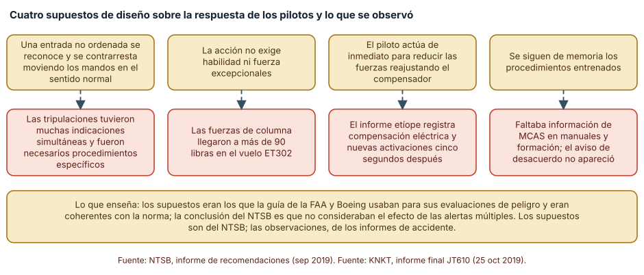

**Cómo leer la figura.** Arriba, el supuesto que el NTSB recoge de la evaluación de peligro; debajo, lo que muestran los informes de los accidentes. Mira que los supuestos eran los de la guía de la FAA y de Boeing para todos sus modelos y eran coherentes con la norma. **Dónde deja de valer:** los supuestos y su conclusión son del NTSB; las observaciones de la fila inferior son de los informes de accidente y no comparan una a una.

**Cadena causal ordenada (análisis propio, apoyado en los informes).**

1. Un derivado con motores nuevos exige corregir el comportamiento a ángulos altos (contexto).
2. La corrección se implementa como ley de control con autoridad sobre el compensador, apoyada en un solo sensor (condición de diseño).
3. Un cambio de 2016 aumenta su autoridad y la hace actuar a menor velocidad, y los análisis no se actualizan según el JATR (condición de proceso).
4. Los supuestos sobre la respuesta del piloto no consideran las alertas múltiples (condición de análisis).
5. MCAS no aparece en manuales y formación y el aviso de desacuerdo no está habilitado (condiciones de información).
6. Un dato erróneo del sensor activa MCAS de forma repetida (detonante).
7. La respuesta de la tripulación, bajo carga de trabajo alta, no corta a tiempo el sistema (consecuencia).

### Documentado, inferido y no se sabe

| Categoría | Contenido |
| --- | --- |
| Documentado | La descripción de MCAS; los hechos de cada vuelo según las grabaciones; los 9 factores del KNKT y los 10 de la EAIB; los cuatro supuestos de la evaluación de peligro y la conclusión del NTSB; las 12 recomendaciones del JATR; las fechas de certificación, prohibición y anulación |
| Inferido (análisis propio) | Que los supuestos de respuesta del piloto y el modelo de fallo único son la forma general del problema; la estructura del árbol y de las ocho barreras; el efecto de unas barreras sobre otras |
| No se sabe | El origen del dato erróneo en ET302 (hay dos versiones); el código de MCAS; cuánta revisión se delegó realmente; los costes económicos; el resultado de los procesos judiciales posteriores a 2020 |

## Mejoras que debieron hacerse

Los informes señalan lo que faltó; la elección de qué controles habrían cortado cada eslabón es análisis nuestro. Todo lo de esta sección, incluidos costes y trade-offs, es **análisis propio apoyado en la fuente**: no son conclusiones de ninguna investigación ni descripciones del rediseño que la FAA aprobó el 17 de noviembre de 2020. Lo que sí documenta la FAA es que el rediseño se sometió a evaluaciones de condiciones de fallo, pruebas de vuelo y revisión de formación antes de anular la orden (FAA).

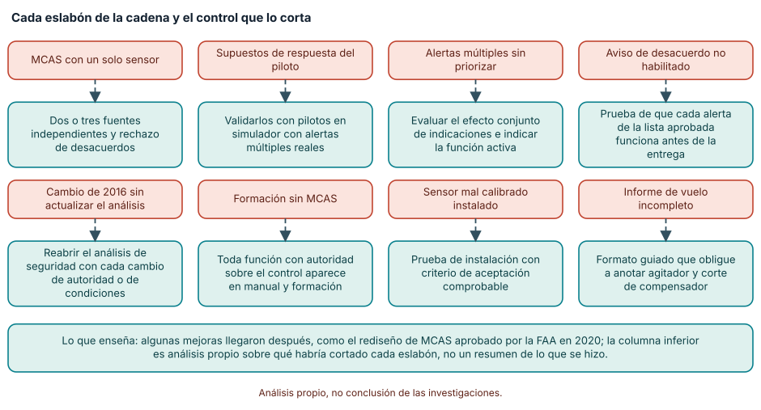

**Cómo leer la figura.** Arriba el eslabón de la cadena, debajo el control que lo corta. Mira que algunos controles son de diseño, otros de proceso y otros de información. **Dónde deja de valer:** los controles son propuestas educativas, no prescripciones; cada uno tiene coste y falsos positivos.

### La arquitectura «después»

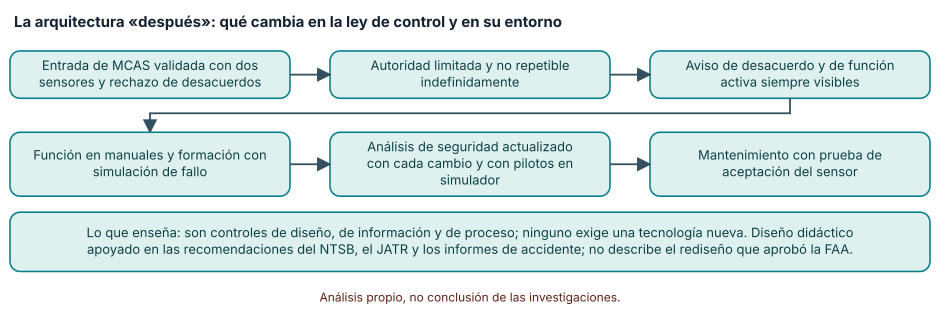

**Cómo leer la figura.** Cada caja es un cambio de la ley de control o de su entorno. Mira que ninguna exige una tecnología nueva. **Dónde deja de valer:** es un diseño didáctico apoyado en las recomendaciones; no describe el rediseño que aprobó la FAA.

### Para cada factor: control técnico, de proceso y de gobierno

| Factor causal | Control técnico | Control de proceso | Control de gobierno | Costo y trade-off | Clases |
| --- | --- | --- | --- | --- | --- |
| Un solo sensor para una función con autoridad | Comparar dos o más fuentes y rechazar la función si discrepan | Análisis de fallo único en toda entrada a una ley de control | Toda función con autoridad sobre una superficie se clasifica por su peor efecto | Más sensores y más lógica; menos disponibilidad si se desconecta por desacuerdo | [SE-445 · Riesgo, peligro y seguridad funcional: HARA, FMEA, FTA y STPA](../../classes/part-37-sistemas-criticos-tiempo-real-y-normas-de-seguridad/se-445-riesgo-peligro-y-seguridad-funcional-hara-fmea-fta-y-stpa/README.md), [SE-439 · Circuit breakers, bulkheads y degradación](../../classes/part-36-calidad-rendimiento-y-resiliencia/se-439-circuit-breakers-bulkheads-y-degradacion/README.md), [SE-440 · Disponibilidad, durabilidad y recuperación](../../classes/part-36-calidad-rendimiento-y-resiliencia/se-440-disponibilidad-durabilidad-y-recuperacion/README.md) |
| Supuestos sobre la respuesta del piloto | Validarlos con pilotos en simulador con alertas múltiples | Guía de evaluación que exija considerar todas las indicaciones | Revisión independiente de los supuestos | Tiempo de simulador y de pilotos | [SE-448 · Aviación: DO-178C, DO-254 y ARP4754](../../classes/part-37-sistemas-criticos-tiempo-real-y-normas-de-seguridad/se-448-aviacion-do-178c-do-254-y-arp4754/README.md), [SE-450 · Casos de seguridad y trazabilidad](../../classes/part-37-sistemas-criticos-tiempo-real-y-normas-de-seguridad/se-450-casos-de-seguridad-y-trazabilidad/README.md), [SE-427 · Dobles, virtualización y entornos de prueba](../../classes/part-35-estrategia-y-tecnicas-de-prueba/se-427-dobles-virtualizacion-y-entornos-de-prueba/README.md) |
| Alertas múltiples | Priorizar y señalar la función activa | Pruebas de cabina con combinaciones de fallo | Criterio de aceptación de interfaz | Riesgo de saturar de otro modo | [SE-498 · Alertas accionables y fatiga](../../classes/part-41-observabilidad-sre-e-incidentes/se-498-alertas-accionables-y-fatiga/README.md), [SE-499 · Runbooks, on-call y escalamiento](../../classes/part-41-observabilidad-sre-e-incidentes/se-499-runbooks-on-call-y-escalamiento/README.md), [SE-445 · Riesgo, peligro y seguridad funcional: HARA, FMEA, FTA y STPA](../../classes/part-37-sistemas-criticos-tiempo-real-y-normas-de-seguridad/se-445-riesgo-peligro-y-seguridad-funcional-hara-fmea-fta-y-stpa/README.md) |
| Aviso no habilitado | Prueba automática de que cada alerta aprobada funciona | Lista de verificación de entrega con evidencia | Inventario firmado de alertas por modelo | Poco coste; evita el fallo silencioso | [SE-454 · Verificación y cobertura: MC/DC, HIL y SIL](../../classes/part-37-sistemas-criticos-tiempo-real-y-normas-de-seguridad/se-454-verificacion-y-cobertura-mc-dc-hil-y-sil/README.md), [SE-466 · Cumplimiento, evidencia y límites legales](../../classes/part-38-seguridad-privacidad-y-cumplimiento/se-466-cumplimiento-evidencia-y-limites-legales/README.md), [SE-153 · Gestión de cambios y líneas base](../../classes/part-12-ingenieria-de-requisitos/se-153-gestion-de-cambios-y-lineas-base/README.md) |
| Cambio de diseño sin actualizar análisis | Trazabilidad de requisitos a análisis | Reabrir el análisis de seguridad en cada cambio de autoridad | Gestión de configuración con aprobaciones | Plazo del programa | [SE-151 · Trazabilidad desde necesidad hasta evidencia](../../classes/part-12-ingenieria-de-requisitos/se-151-trazabilidad-desde-necesidad-hasta-evidencia/README.md), [SE-153 · Gestión de cambios y líneas base](../../classes/part-12-ingenieria-de-requisitos/se-153-gestion-de-cambios-y-lineas-base/README.md), [SE-450 · Casos de seguridad y trazabilidad](../../classes/part-37-sistemas-criticos-tiempo-real-y-normas-de-seguridad/se-450-casos-de-seguridad-y-trazabilidad/README.md) |
| Función no documentada | Toda función con autoridad figura en manual y formación | Revisión de documentación de operación como entregable | Documentación como condición de entrega | Coste de formación | [SE-147 · Atributos de calidad y restricciones](../../classes/part-12-ingenieria-de-requisitos/se-147-atributos-de-calidad-y-restricciones/README.md), [SE-159 · Contratos, invariantes y diseño por contrato](../../classes/part-13-especificaciones-contratos-y-modelos/se-159-contratos-invariantes-y-diseno-por-contrato/README.md), [SE-500 · Gestión de incidentes y comunicación](../../classes/part-41-observabilidad-sre-e-incidentes/se-500-gestion-de-incidentes-y-comunicacion/README.md) |
| Sensor mal calibrado | Prueba de aceptación con criterio comprobable | Registro de calibración trazable | Control de talleres y de piezas reparadas | Coste de pruebas y de trazabilidad | [SE-421 · Calidad por riesgo y propósito de las pruebas](../../classes/part-35-estrategia-y-tecnicas-de-prueba/se-421-calidad-por-riesgo-y-proposito-de-las-pruebas/README.md), [SE-535 · Compras, proveedores y evaluación técnica](../../classes/part-44-gestion-liderazgo-y-practica-profesional/se-535-compras-proveedores-y-evaluacion-tecnica/README.md), [SE-466 · Cumplimiento, evidencia y límites legales](../../classes/part-38-seguridad-privacidad-y-cumplimiento/se-466-cumplimiento-evidencia-y-limites-legales/README.md) |
| Aprender de un accidente | Revisar con rapidez la hipótesis tras el primero | Postmortem sin culpa con todos los actores | Plan de acción con dueño y fecha | Exige apertura entre organizaciones | [SE-501 · Postmortems sin culpa y aprendizaje](../../classes/part-41-observabilidad-sre-e-incidentes/se-501-postmortems-sin-culpa-y-aprendizaje/README.md), [SE-500 · Gestión de incidentes y comunicación](../../classes/part-41-observabilidad-sre-e-incidentes/se-500-gestion-de-incidentes-y-comunicacion/README.md), [SE-534 · Gestión de riesgos y decisiones ejecutivas](../../classes/part-44-gestion-liderazgo-y-practica-profesional/se-534-gestion-de-riesgos-y-decisiones-ejecutivas/README.md) |

### Cómo lo habría evitado lo que enseña el curso

Cada línea es análisis propio. (1) El análisis de peligros, FMEA y árboles de fallas de [SE-445 · Riesgo, peligro y seguridad funcional: HARA, FMEA, FTA y STPA](../../classes/part-37-sistemas-criticos-tiempo-real-y-normas-de-seguridad/se-445-riesgo-peligro-y-seguridad-funcional-hara-fmea-fta-y-stpa/README.md) obliga a preguntar por el fallo único de un dato de entrada y por su efecto en cascada. (2) Los niveles de integridad y la certificación aeronáutica de [SE-448 · Aviación: DO-178C, DO-254 y ARP4754](../../classes/part-37-sistemas-criticos-tiempo-real-y-normas-de-seguridad/se-448-aviacion-do-178c-do-254-y-arp4754/README.md) muestran por qué una función con autoridad se trata con mayor rigor. (3) Los casos de seguridad y la trazabilidad de [SE-450 · Casos de seguridad y trazabilidad](../../classes/part-37-sistemas-criticos-tiempo-real-y-normas-de-seguridad/se-450-casos-de-seguridad-y-trazabilidad/README.md) exigen que cada supuesto tenga evidencia; el supuesto sobre el piloto es un candidato obvio. (4) La verificación con simuladores y en el lazo de [SE-454 · Verificación y cobertura: MC/DC, HIL y SIL](../../classes/part-37-sistemas-criticos-tiempo-real-y-normas-de-seguridad/se-454-verificacion-y-cobertura-mc-dc-hil-y-sil/README.md) y los dobles de [SE-427 · Dobles, virtualización y entornos de prueba](../../classes/part-35-estrategia-y-tecnicas-de-prueba/se-427-dobles-virtualizacion-y-entornos-de-prueba/README.md) enseñan a probar la combinación de alertas, no cada una por separado. (5) Las alertas accionables de [SE-498 · Alertas accionables y fatiga](../../classes/part-41-observabilidad-sre-e-incidentes/se-498-alertas-accionables-y-fatiga/README.md) explican por qué una cascada de avisos sin prioridad no es información. (6) La degradación de [SE-439 · Circuit breakers, bulkheads y degradación](../../classes/part-36-calidad-rendimiento-y-resiliencia/se-439-circuit-breakers-bulkheads-y-degradacion/README.md) y los fallos parciales de [SE-389 · Fallos parciales y modelos de red](../../classes/part-32-concurrencia-y-sistemas-distribuidos/se-389-fallos-parciales-y-modelos-de-red/README.md) formulan qué debe hacer una función cuando sus entradas discrepan. (7) La ingeniería del caos, [SE-505 · Principios de la ingeniería del caos: estado estable e hipótesis](../../classes/part-42-ingenieria-del-caos/se-505-principios-de-la-ingenieria-del-caos-estado-estable-e-hipotesis/README.md) y [SE-506 · Diseñar experimentos de fallo: alcance y radio de impacto](../../classes/part-42-ingenieria-del-caos/se-506-disenar-experimentos-de-fallo-alcance-y-radio-de-impacto/README.md), practica el fallo inyectado con una hipótesis de estado estable: aquí, «el avión sigue controlable si un sensor da un valor falso». (8) La gestión de cambios de [SE-153 · Gestión de cambios y líneas base](../../classes/part-12-ingenieria-de-requisitos/se-153-gestion-de-cambios-y-lineas-base/README.md) pide actualizar el análisis cuando cambia una autoridad.

## Vínculo con el curso

Cada enlace es una clase real; el texto dice qué mecanismo del caso ilustra. Las partes de sistemas críticos, de observabilidad e incidentes y de ingeniería del caos son las que más aportan.

| Concepto | Clase | Cómo lo ilustra el caso |
| --- | --- | --- |
| Peligro, FMEA y árbol de fallas | [SE-445 · Riesgo, peligro y seguridad funcional: HARA, FMEA, FTA y STPA](../../classes/part-37-sistemas-criticos-tiempo-real-y-normas-de-seguridad/se-445-riesgo-peligro-y-seguridad-funcional-hara-fmea-fta-y-stpa/README.md) | Un dato erróneo de un solo sensor con autoridad sobre el compensador es el fallo único que el análisis debe encontrar |
| Normas de aviación | [SE-448 · Aviación: DO-178C, DO-254 y ARP4754](../../classes/part-37-sistemas-criticos-tiempo-real-y-normas-de-seguridad/se-448-aviacion-do-178c-do-254-y-arp4754/README.md) | Certificación por clases de gravedad y garantía del desarrollo |
| Casos de seguridad y trazabilidad | [SE-450 · Casos de seguridad y trazabilidad](../../classes/part-37-sistemas-criticos-tiempo-real-y-normas-de-seguridad/se-450-casos-de-seguridad-y-trazabilidad/README.md) | Los supuestos sobre el piloto como afirmaciones sin evidencia |
| Verificación y cobertura (HIL y SIL) | [SE-454 · Verificación y cobertura: MC/DC, HIL y SIL](../../classes/part-37-sistemas-criticos-tiempo-real-y-normas-de-seguridad/se-454-verificacion-y-cobertura-mc-dc-hil-y-sil/README.md) | Probar el sistema completo con el hardware y las alertas reales |
| Taller de un fallo real frente a las normas | [SE-455 · Taller: analizar un fallo real frente a las normas](../../classes/part-37-sistemas-criticos-tiempo-real-y-normas-de-seguridad/se-455-taller-analizar-un-fallo-real-frente-a-las-normas/README.md) | Este caso es un ejercicio de ese tipo |
| Atributos de calidad | [SE-147 · Atributos de calidad y restricciones](../../classes/part-12-ingenieria-de-requisitos/se-147-atributos-de-calidad-y-restricciones/README.md) | La controlabilidad como atributo medible |
| Contratos e invariantes | [SE-159 · Contratos, invariantes y diseño por contrato](../../classes/part-13-especificaciones-contratos-y-modelos/se-159-contratos-invariantes-y-diseno-por-contrato/README.md) | Un invariante «si los sensores discrepan, la función no actúa» |
| Gestión de cambios y líneas base | [SE-153 · Gestión de cambios y líneas base](../../classes/part-12-ingenieria-de-requisitos/se-153-gestion-de-cambios-y-lineas-base/README.md) | El cambio de 2016 y los análisis sin actualizar |
| Trazabilidad | [SE-151 · Trazabilidad desde necesidad hasta evidencia](../../classes/part-12-ingenieria-de-requisitos/se-151-trazabilidad-desde-necesidad-hasta-evidencia/README.md) | De la necesidad al requisito y al análisis de seguridad |
| Doble y virtualización | [SE-427 · Dobles, virtualización y entornos de prueba](../../classes/part-35-estrategia-y-tecnicas-de-prueba/se-427-dobles-virtualizacion-y-entornos-de-prueba/README.md) | El simulador de ingeniería y lo que se supuso que mostraba |
| Calidad por riesgo | [SE-421 · Calidad por riesgo y propósito de las pruebas](../../classes/part-35-estrategia-y-tecnicas-de-prueba/se-421-calidad-por-riesgo-y-proposito-de-las-pruebas/README.md) | A qué dedicar más pruebas cuando el efecto es catastrófico |
| Degradación | [SE-439 · Circuit breakers, bulkheads y degradación](../../classes/part-36-calidad-rendimiento-y-resiliencia/se-439-circuit-breakers-bulkheads-y-degradacion/README.md) | Qué hace una función cuando duda de su entrada |
| Fallos parciales | [SE-389 · Fallos parciales y modelos de red](../../classes/part-32-concurrencia-y-sistemas-distribuidos/se-389-fallos-parciales-y-modelos-de-red/README.md) | Un sensor que miente es un fallo parcial, no una caída |
| Alertas accionables | [SE-498 · Alertas accionables y fatiga](../../classes/part-41-observabilidad-sre-e-incidentes/se-498-alertas-accionables-y-fatiga/README.md) | Alertas múltiples sin prioridad y un aviso que no aparece |
| Runbooks y listas de comprobación | [SE-499 · Runbooks, on-call y escalamiento](../../classes/part-41-observabilidad-sre-e-incidentes/se-499-runbooks-on-call-y-escalamiento/README.md) | El procedimiento de desbocamiento y su prioridad frente a otros |
| Postmortems sin culpa | [SE-501 · Postmortems sin culpa y aprendizaje](../../classes/part-41-observabilidad-sre-e-incidentes/se-501-postmortems-sin-culpa-y-aprendizaje/README.md) | Los informes finales como ejercicio de aprendizaje con discrepancias |
| Principios de la ingeniería del caos | [SE-505 · Principios de la ingeniería del caos: estado estable e hipótesis](../../classes/part-42-ingenieria-del-caos/se-505-principios-de-la-ingenieria-del-caos-estado-estable-e-hipotesis/README.md) | Estado estable e hipótesis para el sistema con un sensor falso |
| Diseño de experimentos de fallo | [SE-506 · Diseñar experimentos de fallo: alcance y radio de impacto](../../classes/part-42-ingenieria-del-caos/se-506-disenar-experimentos-de-fallo-alcance-y-radio-de-impacto/README.md) | Alcance y radio de impacto de una inyección de fallos |
| Ética y contratos | [SE-536 · Propiedad intelectual, contratos y ética](../../classes/part-44-gestion-liderazgo-y-practica-profesional/se-536-propiedad-intelectual-contratos-y-etica/README.md) | Quién responde de la información que no llega al usuario final |

### Preguntas de discusión

1. ¿Qué cambia si una función con autoridad sobre una superficie de control exige dos sensores y se desactiva con desacuerdo? ¿Qué se pierde en disponibilidad?
2. Un supuesto como «el piloto reconocerá y actuará de inmediato» está en una guía y es coherente con la norma. ¿Cómo se valida un supuesto sobre personas?
3. El EAIB y el NTSB discrepan sobre el origen del dato erróneo y coinciden en el papel de MCAS. ¿Qué decisiones de diseño valen en ambos escenarios?
4. Si un aviso del sistema no se habilita, ¿quién debe enterarse y cómo se garantiza que se enteran?
5. Un cambio de autoridad de 0,6 a 2,5 grados se hizo por mejorar el manejo. ¿Cómo debería disparar la revisión del análisis de seguridad?

### Mini-ejercicios

1. **Fallo único.** Dibuja un servicio que decide por un único sensor o señal; añade una segunda fuente y una regla de desacuerdo; define qué hace cuando discrepan.
2. **Supuestos de usuario.** Lista cinco supuestos sobre lo que hará un operador ante un aviso y diseña una prueba con personas que los verifique.
3. **Alertas.** Elige un sistema con diez avisos; ordénalos por prioridad y define qué se muestra cuando saltan tres a la vez.
4. **Inventario de funciones con autoridad.** En un producto propio, lista las funciones que cambian el estado sin orden del usuario y comprueba que todas figuran en la documentación y en la formación.

## Qué no generalizar

**Aprender.**

1. Una función con autoridad sobre el control no debe depender de una única fuente de datos sin una regla de desacuerdo.
2. Los supuestos sobre personas se validan con personas y con alertas múltiples, no una por una.
3. Un cambio de autoridad o de condiciones reabre el análisis de seguridad.
4. Lo que el sistema hace debe estar en la documentación y la formación de quien lo opera.
5. Un aviso que no se habilita es un control que no existe, y su ausencia debe poder detectarse.
6. Los informes de accidente pueden discrepar en detalles; el aprendizaje está en lo que coinciden y en lo que cada uno aporta.

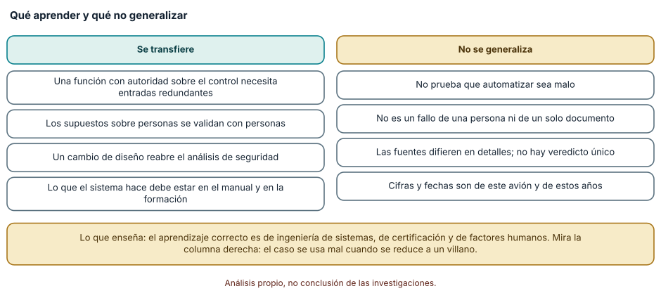

**Cómo leer la figura.** Verde: lo que se transfiere; dorado: lo que no. Mira la columna derecha: el caso se usa mal cuando se reduce a un villano. **Dónde deja de valer:** es una lectura propia de los informes.

**No generalizar.**

- No prueba que la automatización o el software en aviación sean peligrosos: la aviación comercial tiene un historial de seguridad construido con esos mismos mecanismos. Los informes señalan decisiones concretas de diseño, de análisis y de información.
- No es el fallo de una persona ni de un solo documento: los informes describen supuestos compartidos entre fabricante, regulador y operadores, y las investigaciones difieren en cómo repartir el peso.
- El informe del Comité es el documento del personal de la mayoría de un comité legislativo; cita documentos internos de Boeing y de la FAA, pero no incluye respuesta de las empresas, que este caso no ha podido contrastar.
- Las cifras (13 minutos, 21°, 2,5°, cinco segundos) son de estos aviones y estas versiones de software.
- Lo ocurrido con las aeronaves tras la anulación de la prohibición, los procesos judiciales y la situación posterior de Boeing quedan fuera de este caso porque no se verificaron en esta sesión.

### Casos comparables y diferencias

| Caso | Parecido | Diferencia |
| --- | --- | --- |
| [Therac-25 (1985)](therac-25.md) | Una función de software con autoridad sobre un actuador peligroso, supuestos sobre el operador y una cultura de que el fallo era improbable | Allí se había retirado un enclavamiento de hardware; aquí el sistema tenía el compensador y el corte manual |
| [Ariane 5, vuelo 501 (1996)](ariane-5-vuelo-501.md) | Software heredado con supuestos que dejan de cumplirse al cambiar de contexto y redundancia de dos copias iguales | Allí no había piloto en el bucle; aquí la tripulación era el último control |
| [Knight Capital (2012)](knight-capital.md) | Un cambio con consecuencias que los controles previos no frenaron | Allí el daño fue financiero y el control faltante era de capital; aquí el daño fue de vidas humanas |

## Fuentes públicas verificadas

Todas consultadas el 23 de noviembre de 2026. Los PDF se descargaron y se extrajo su texto; las páginas web se abrieron con herramienta de lectura.

1. Komite Nasional Keselamatan Transportasi (KNKT), *Aircraft Accident Investigation Report, PT. Lion Mentari Airlines, Boeing 737-8 (MAX), PK-LQP, Tanjung Karawang, West Java, 29 October 2018*, informe final KNKT.18.10.35.04, 25 de octubre de 2019. [https://knkt.go.id/Repo/Files/Laporan/Penerbangan/2018/PK-LQP%20Final%20Report.pdf](https://knkt.go.id/Repo/Files/Laporan/Penerbangan/2018/PK-LQP%20Final%20Report.pdf) (respalda la sinopsis de JT610, la descripción funcional de MCAS, el sesgo de 21°, los nueve factores contribuyentes y las acciones de seguridad).
2. Aircraft Accident Investigation Bureau de Etiopía (EAIB), *Aircraft Accident Investigation Report B737-MAX 8, ET-AVJ*, diciembre de 2022, copia alojada por el BEA de Francia. [https://bea.aero:443/fileadmin/user_upload/ET_302__B737-8MAX_ACCIDENT_FINAL_REPORT.pdf](https://bea.aero:443/fileadmin/user_upload/ET_302__B737-8MAX_ACCIDENT_FINAL_REPORT.pdf) (respalda los hechos de ET302, la causa probable y los factores contribuyentes del apartado 3).
3. National Transportation Safety Board (NTSB), *Assumptions Used in the Safety Assessment Process and the Effects of Multiple Alerts and Indications on Pilot Performance*, Safety Recommendation Report, 19 de septiembre de 2019. [https://www.ntsb.gov/investigations/AccidentReports/Reports/ASR1901.pdf](https://www.ntsb.gov/investigations/AccidentReports/Reports/ASR1901.pdf) (respalda los supuestos de la evaluación de peligro y las recomendaciones a la FAA).
4. NTSB, comunicado «NTSB Publishes Additional Comments on Ethiopia's Final Report on 737 MAX 8 Accident», 24 de enero de 2023. [https://www.ntsb.gov/news/press-releases/pages/nr20230124.aspx](https://www.ntsb.gov/news/press-releases/pages/nr20230124.aspx) (respalda los comentarios discrepantes sobre el origen del dato erróneo y la documentación de MCAS).
5. Joint Authorities Technical Review (JATR), *Observations, Findings, and Recommendations*, presentado a la FAA en octubre de 2019. [https://www.faa.gov/sites/faa.gov/files/2022-08/Final_JATR_Submittal_to_FAA_Oct_2019.pdf](https://www.faa.gov/sites/faa.gov/files/2022-08/Final_JATR_Submittal_to_FAA_Oct_2019.pdf) (respalda la composición del JATR, su alcance y las doce recomendaciones).
6. Federal Aviation Administration, *Boeing 737 MAX Timeline*. [https://www.faa.gov/sites/faa.gov/files/2022-08/737_MAX_Timeline.pdf](https://www.faa.gov/sites/faa.gov/files/2022-08/737_MAX_Timeline.pdf) (respalda la orden de prohibición del 13 de marzo de 2019, la anulación del 18 de noviembre de 2020 y las actividades de regreso al servicio).
7. Comité de Transporte e Infraestructura de la Cámara de Representantes de EE. UU., personal de la mayoría, *Final Committee Report: The Design, Development & Certification of the Boeing 737 MAX*, septiembre de 2020. [https://democrats-transportation.house.gov/imo/media/doc/2020.09.15%20FINAL%20737%20MAX%20Report%20for%20Public%20Release.pdf](https://democrats-transportation.house.gov/imo/media/doc/2020.09.15%20FINAL%20737%20MAX%20Report%20for%20Public%20Release.pdf) (respalda las cifras de pedidos, los cambios de MCAS de 0,6° a 2,5°, las citas de decisiones de producto y las preocupaciones sobre la delegación; documento de una de las partes del Comité).

---

[↑ Casos de fallo](README.md) · [← Ariane 5, vuelo 501](ariane-5-vuelo-501.md) · [Post Office Horizon →](post-office-horizon.md)
