# Cloudflare 2019

[↑ Casos de fallo](README.md) · [← SolarWinds 2020](solarwinds-2020.md)

> **Qué es esta página.** Un caso de estudio de fallo: la realidad frente a la teoría del curso. No es una clase ni un rol. Separa lo que las fuentes **documentan**, lo que este análisis **infiere** y lo que **no se sabe**. Habla de decisiones, procesos y sistemas, no de personas. Fecha de consulta de todas las fuentes: 23 de noviembre de 2026.

**Resumen.** El 2 de julio de 2019 Cloudflare desplegó una regla nueva en su cortafuegos de aplicaciones web (WAF). La regla contenía una expresión regular que retrocedía enormemente, agotó la CPU de todos los núcleos que atienden tráfico HTTP y HTTPS en la red global y durante 27 minutos los dominios de Cloudflare devolvieron errores 502. Según el post mortem oficial de la propia empresa, el incidente no fue «una expresión regular que salió mal»: fue la convergencia de once condiciones, entre ellas una protección contra el consumo excesivo de CPU eliminada por error semanas antes, un motor de expresiones sin garantías de complejidad, una batería de pruebas que no medía CPU, un procedimiento que permitía el despliegue global inmediato de un cambio de reglas no urgente, una reversión lenta y herramientas internas que dependían del servicio caído. Este caso es el más corto en fuentes y el más rico en detalle técnico de la serie: una sola fuente primaria, el post mortem, con cronología al minuto y un apéndice que mide el retroceso. Este caso recorre el sistema en varios niveles de zoom, separa lo documentado de lo inferido y propone, rotulado como análisis propio, los controles que habrían cortado cada eslabón. Declaración de alcance: se apoya en el post mortem de Cloudflare, que es una fuente de parte; no se verificó con una segunda fuente independiente ni se cuantifican los clientes afectados o las pérdidas, que el post mortem no da.

**Cómo leer esta página.** Cada afirmación factual lleva entre paréntesis su fuente: «Post mortem» es la entrada de blog de Cloudflare *Details of the Cloudflare outage on July 2, 2019*. Todas las horas son UTC. Lo que no lleva fuente es análisis propio y está rotulado. Las figuras son dibujos propios; ninguna repite una tabla y todas dicen dónde dejan de valer.

## Ficha histórica

| Dato | Detalle | Fuente |
| --- | --- | --- |
| Organización | Cloudflare, proveedor de red de entrega de contenido, proxy y servicios de seguridad web | Post mortem |
| Incidente | 2 de julio de 2019: una regla nueva del WAF agota la CPU en todos los núcleos que atienden HTTP y HTTPS en la red global | Post mortem |
| Duración del impacto | 27 minutos (del despliegue a las 13:42 a la recuperación del tráfico a las 14:09) | Post mortem |
| Síntoma | Los clientes y sus visitantes ven una página de error 502 al visitar cualquier dominio de Cloudflare; el tráfico cayó un 80 % según un aviso interno | Post mortem |
| Contexto | Primera caída global en seis años, según la propia empresa | Post mortem |
| Red | Más de 180 ciudades; el almacén Quicksilver distribuye unos 350 cambios por segundo con un p99 de 2,29 segundos | Post mortem |
| Reglas | 3 868 reglas en WAF Managed Rules; 476 solicitudes de cambio en 60 días | Post mortem |
| Magnitud del daño | Cifra de clientes y de pérdidas: no se sabe a partir de la fuente | No consta |

Las fuentes consultadas no nombran fundadores ni dan una historia corporativa de Cloudflare más allá de una anécdota de 2010; este caso no la inventa.

### Sedes, centros y lugares

| Lugar | Qué consta | Fuente |
| --- | --- | --- |
| Más de 180 ciudades | Puntos de presencia con el almacén Quicksilver replicado | Post mortem |
| Londres | El equipo de ingeniería de Londres estaba en un evento interno cuando empezó el incidente y se reunió en una sala | Post mortem |
| Equipo de SRE | Distribuido por el mundo con cobertura continua | Post mortem |
| Sedes y oficinas | No constan | No consta |

**No se sabe** a partir de la fuente: la lista de oficinas, el número de centros de datos propios frente a alquilados y la distribución de plantilla por ciudad.

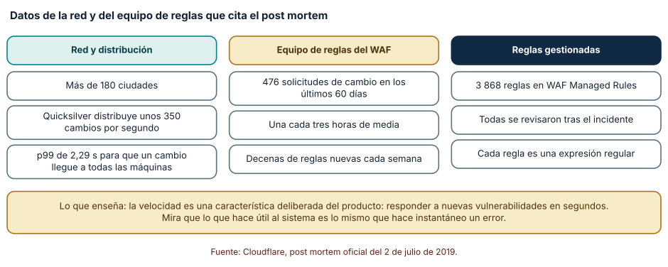

**Cómo leer la figura.** Tres columnas: la red, el equipo y las reglas. Mira la primera: un p99 de 2,29 segundos para que un cambio llegue a todas las máquinas del mundo. **Dónde deja de valer:** son cifras de 2019 y del propio post mortem; no dicen cuántos clientes o dominios había.

### Organización

El post mortem describe tres equipos: el de reglas del WAF, que trabaja constantemente en mejorar la detección, reducir falsos positivos y responder a amenazas nuevas; el de SRE, distribuido por el mundo y con cobertura continua; y los equipos de ingeniería, como el de rendimiento, que extrajo datos de CPU en vivo de una máquina que mostraba el WAF como responsable (Post mortem). El incidente se declaró de máxima prioridad (P0) y se escaló a la dirección de ingeniería y de ingeniería de sistemas (Post mortem). **No se sabe:** el organigrama, el tamaño de cada equipo y la distribución de responsabilidades.

### Visión y misión

Las fuentes consultadas no contienen una declaración formal de misión. El post mortem sí describe un valor del producto: poder desplegar reglas de forma rápida y global es una característica crítica del WAF, porque las pruebas de concepto de nuevas vulnerabilidades se publican rápidamente y los clientes necesitan protección antes de poder parchear (Post mortem). El análisis propio es que esa promesa de velocidad es la que justifica un camino de despliegue más rápido que el del resto del software, y por tanto es la que concentra el riesgo.

## Contexto y problema

Un cortafuegos de aplicaciones web inspecciona las peticiones HTTP que llegan a un sitio y bloquea las que parecen ataques, como el *cross-site scripting* (XSS). Cloudflare lo ejecuta en cada uno de sus puntos de presencia, en el camino de todo el tráfico que atiende como proxy y red de entrega de contenido (Post mortem). Las reglas son, en esencia, expresiones regulares que reconocen patrones de ataque en las peticiones.

**El problema que el sistema resolvía.** Cuando aparece una vulnerabilidad en una aplicación muy usada, suele publicarse pronto una prueba de concepto; los equipos que mantienen aplicaciones necesitan una protección temporal mientras aplican el parche. Cloudflare escribe reglas que mitigan esos ataques en nombre de sus clientes y necesita desplegarlas lo más rápido posible. El post mortem pone como ejemplo una regla contra una vulnerabilidad de SharePoint desplegada en mayo de 2019 (Post mortem).

**La apuesta (documentado).** Por esa necesidad de rapidez, el WAF no sigue el proceso de despliegue gradual del resto del software: el procedimiento operativo para un cambio de reglas permite expresamente empujarlo de forma global (Post mortem). Las reglas se distribuyen con Quicksilver, un almacén de claves y valores propio, replicado en más de 180 ciudades, que lleva un cambio a todas las máquinas en un p99 de 2,29 segundos (Post mortem).

**El problema oculto (análisis propio).** Un camino que lleva un cambio a todo el mundo en segundos tiene un radio de impacto global. La seguridad de ese camino ya no puede descansar en la revisión humana ni en pruebas funcionales: necesita pruebas de comportamiento, como el consumo de recursos, porque un cambio puede ser correcto en lo que hace y ruinoso en lo que cuesta.

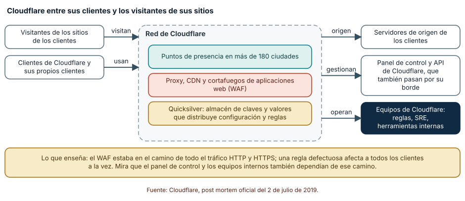

**Cómo leer la figura.** Izquierda: visitantes y clientes; centro: la red con tres elementos; derecha: orígenes, panel y equipos. Mira la caja roja: el WAF estaba en el camino de todo el tráfico HTTP. **Dónde deja de valer:** el post mortem no describe la arquitectura de red con más detalle; es un modelo funcional.

## Mercado, usuarios y casos de uso

- **Clientes de Cloudflare.** Quienes delegan el proxy, la red de entrega de contenido y el WAF; el post mortem dice que ellos y sus propios clientes vieron un 502 (Post mortem).
- **Visitantes de los sitios.** Usuarios finales; no consta su número.
- **Equipos internos.** Reglas, SRE, rendimiento, ingeniería de sistemas y dirección (Post mortem).
- **Casos de uso del WAF.** (1) Bloquear ataques conocidos; (2) mitigar vulnerabilidades nuevas mientras el cliente parchea; (3) probar una regla en modo de simulación, donde el tráfico real la atraviesa pero nada se bloquea, para medir falsos positivos y negativos (Post mortem).

El caso (3) es el de la regla del incidente: se desplegó en modo de simulación, pero «incluso en modo de simulación las reglas tienen que ejecutarse» y esta contenía una expresión que consumió una cantidad excesiva de CPU (Post mortem).

## Funcionalidad de principio a fin

1. **Redacción.** Un ingeniero del equipo del cortafuegos escribe un cambio en las reglas de detección de XSS (Post mortem).
2. **Revisión.** Se abre una *pull request*, se aprueba y se fusiona a las 13:31 (Post mortem).
3. **Integración continua.** A las 13:37 TeamCity compila las reglas y ejecuta la batería de pruebas, que pasa; consiste en pruebas unitarias de funciones de coincidencia y en miles de peticiones HTTP que deben o no ser bloqueadas (Post mortem).
4. **Despliegue.** A las 13:42, TeamCity despliega automáticamente el cambio; se genera una solicitud de cambio en Jira con un plan de despliegue, uno de reversión y un enlace al procedimiento operativo (Post mortem).
5. **Distribución.** Quicksilver lleva la regla a todas las máquinas en segundos (Post mortem).
6. **Ejecución.** Cada servidor ejecuta la regla sobre el tráfico real; la expresión retrocede enormemente y agota la CPU de los procesos que atienden HTTP y HTTPS (Post mortem).

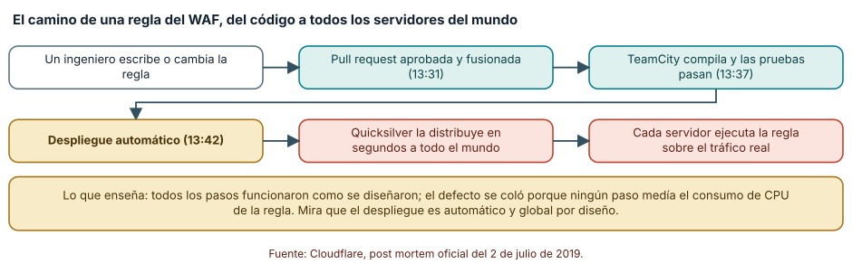

**Cómo leer la figura.** De izquierda a derecha y de arriba abajo, desde la redacción hasta la ejecución; las doradas y rojas son las que concentran el riesgo. Mira la cuarta: el despliegue es automático y global. **Dónde deja de valer:** es el flujo que describe el post mortem; no muestra los pasos de aprobación del procedimiento.

### El día a día de un cambio de reglas

Documentado. En los 60 días anteriores se habían tramitado 476 solicitudes de cambio para las reglas gestionadas del WAF, una cada tres horas de media; cada una lleva un plan de despliegue, un plan de reversión y un enlace al procedimiento operativo (Post mortem). Todo lo ocurrido hasta el despliegue se hizo «correctamente» según el propio post mortem: hubo pull request, aprobación, CI con pruebas, solicitud de cambio con procedimiento y despliegue ejecutado (Post mortem). Para el resto del software, el procedimiento es otro: se empuja primero a un punto de presencia interno (DOG), después a otro con una pequeña parte del tráfico de clientes sin pago (PIG), después a tres puntos canarios con tráfico de clientes con y sin pago, y por último al mundo; el proceso puede tardar horas o días (Post mortem).

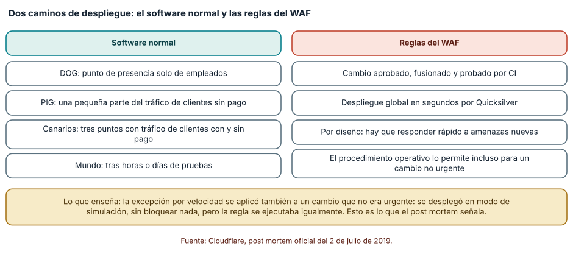

**Cómo leer la figura.** Cada columna es un camino de despliegue; la izquierda es gradual, la derecha global. Mira la última línea de la derecha: el procedimiento permitía el despliegue global incluso de un cambio que no era urgente. **Dónde deja de valer:** el post mortem no dice cuántas veces se usó la vía rápida para cambios no urgentes antes de este incidente.

## Negocio y economía

El post mortem no da datos económicos: no cita ingresos, número de clientes ni pérdidas. Lo que sí documenta es la economía del producto:

- **La velocidad como propuesta de valor.** Los clientes «han llegado a querer» la configurabilidad rápida, y con Workers esperan despliegue de software casi instantáneo y global (Post mortem). Un p99 de 2,29 segundos es un diferenciador comercial.
- **El coste de un error.** Cuando una regla defectuosa llega a todos, todos los clientes lo notan a la vez. El post mortem califica el incidente de «muy molesto» para clientes y equipo y señala que su propio panel y su API también quedaron inaccesibles, porque pasan por el borde de Cloudflare (Post mortem).
- **Cifras económicas.** No se sabe a partir de la fuente.

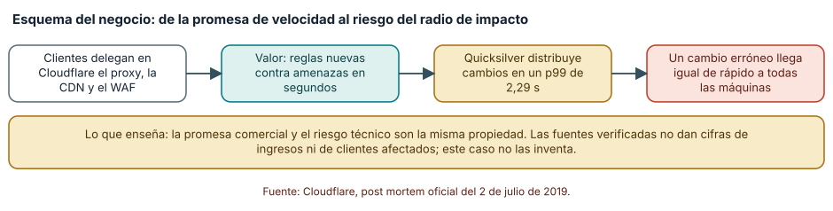

**Cómo leer la figura.** Cuatro etapas de izquierda a derecha; la última nombra el riesgo. Mira que la tercera es la propiedad que da valor y la cuarta es su reverso. **Dónde deja de valer:** no es un flujo de dinero; el post mortem no da cifras.

### Costos operativos y costo del incidente

| Rubro | Cifra | Fuente |
| --- | --- | --- |
| Duración del impacto | 27 minutos | Post mortem |
| Pérdida de tráfico en el pico | 80 % según un aviso interno | Post mortem |
| Tiempo hasta identificar el WAF | 15 minutos desde el primer aviso (13:45 a 14:00) | Post mortem |
| Tiempo hasta restaurar el WAF | 70 minutos desde el despliegue (13:42 a 14:52) | Post mortem |
| Clientes afectados y pérdidas | No se sabe | No consta |

No se inventa ninguna cifra para las filas sin fuente.

### Competidores y contexto de mercado

El post mortem no nombra competidores. Describe un contexto de amenazas: un aumento notable de vulnerabilidades publicadas en aplicaciones habituales, por la mayor disponibilidad de herramientas de prueba como el *fuzzing*, y la publicación rápida de pruebas de concepto en GitHub (Post mortem). Qué ocurrió con el mercado después no consta y este caso no lo inventa.

## Arquitectura y esquemas

Los hechos de esta sección vienen del post mortem. Los dibujos de componentes son un modelo funcional hecho con lo que describe.

### Nivel 1 · Contexto

La figura de contexto está en «Contexto y problema». Resumen: un WAF en el camino de todo el tráfico, un almacén de distribución casi instantáneo y herramientas internas que usan el mismo borde.

### Nivel 2 · Contenedores: el camino de la regla

El flujo está en «Funcionalidad de principio a fin». Resumen: CI aprueba y prueba, el despliegue es automático, Quicksilver distribuye y cada servidor ejecuta.

### Nivel 3 · Componentes: la expresión regular

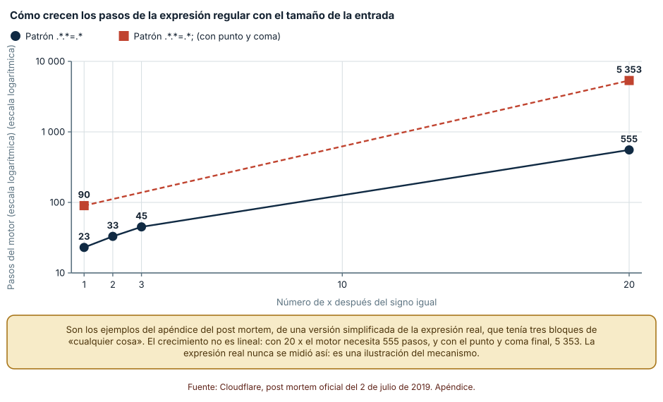

**Cómo leer la figura.** Eje horizontal: cuántas «x» hay después del signo igual; eje vertical, pasos del motor en escala logarítmica. La línea azul es el patrón simplificado; la coral, el mismo con un punto y coma final. Mira que con 20 caracteres el coste se multiplica por más de veinte frente a una sola «x». **Dónde deja de valer:** son los ejemplos del apéndice del post mortem, de una versión simplificada de la expresión real; no son mediciones de la regla que causó el incidente.

La expresión real era larga; el post mortem la reproduce y explica que el núcleo del problema es el fragmento «cualquier cosa, cualquier cosa, un igual y cualquier cosa» (`.*.*=.*`). Con la cadena `x=x` el motor necesita 23 pasos; con `x=xx`, 33; con `x=xxx`, 45; con veinte «x» después del igual, 555; y si falta el «x=», con veinte «x» tarda 4 067 pasos en concluir que no hay coincidencia. Un patrón parecido con un punto y coma final (`.*.*=.*;`) necesita 90 pasos para `x=x` y 5 353 con veinte «x» (Post mortem, apéndice). La solución parcial de usar cuantificadores perezosos reduce los pasos en un caso (11 en lugar de 23) pero no cambia el coste del patrón con punto y coma; la solución real, dice el post mortem, es dejar de usar un motor con retroceso o reescribir el patrón de forma más específica (Post mortem, apéndice).

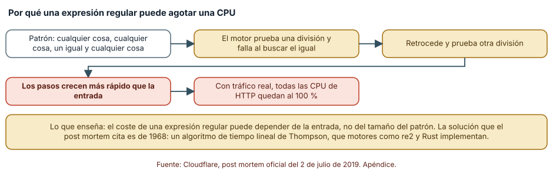

**Cómo leer la figura.** Cada caja es un paso del mecanismo. Mira la cuarta: el coste crece más rápido que la entrada. **Dónde deja de valer:** explica el mecanismo del retroceso en general; la expresión real era más compleja.

### Nivel 4 · La secuencia, minuto a minuto

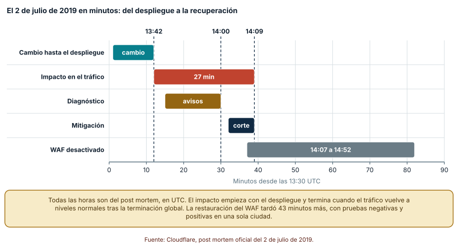

**Cómo leer la figura.** Eje horizontal: minutos desde las 13:30 UTC; cada fila es una fase. Mira que la barra roja, los 27 minutos de impacto, termina cuando se ejecuta la terminación global, y que el WAF sigue apagado 43 minutos más. **Dónde deja de valer:** las horas son las del post mortem; la duración de cada tramo se deduce de ellas.

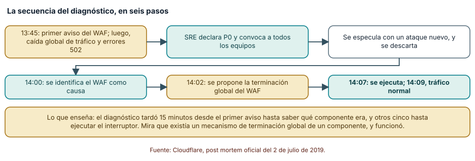

**Cómo leer la figura.** Seis pasos de izquierda a derecha. Mira la tercera caja: en los primeros minutos se especuló con un ataque de un tipo nunca visto, hipótesis que se descartó a las 14:00. **Dónde deja de valer:** el post mortem no detalla todos los intentos de diagnóstico.

Documentado. A las 13:45 llegó el primer aviso de un sistema de pruebas sintéticas del WAF, seguido de otros avisos de pruebas de extremo a extremo, una alerta de caída global de tráfico, errores 502 generalizados e informes desde los puntos de presencia sobre agotamiento de CPU; SRE declaró un incidente de máxima prioridad. A las 14:00 se identificó el WAF como causa y se descartó un ataque: el equipo de rendimiento extrajo datos de CPU en vivo de una máquina y otro miembro usó `strace` para confirmarlo; a las 14:02 se propuso la terminación global del WAF, un mecanismo incorporado para desactivar un componente en todo el mundo; a las 14:07 se ejecutó y a las 14:09 el tráfico y la CPU volvieron a niveles normales en todo el mundo (Post mortem). Para restaurar el WAF, el equipo hizo pruebas negativas y positivas en una sola ciudad con una parte del tráfico, tras quitar de ese lugar el tráfico de clientes de pago, y a las 14:52 se reactivó globalmente (Post mortem).

### Nivel 5 · Las herramientas que dependían del servicio caído

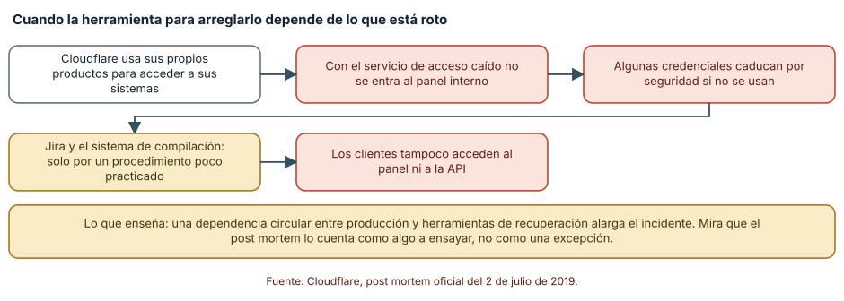

**Cómo leer la figura.** Cada caja es una dependencia que alargó la respuesta; las rojas impidieron el acceso. Mira que el servicio de acceso de Cloudflare también estaba caído. **Dónde deja de valer:** el post mortem no dice cuánto tiempo costó cada obstáculo.

Documentado. Cloudflare usa sus propios productos: con el servicio de acceso caído no se podía autenticar en el panel de control interno, y algunos miembros del equipo habían perdido el acceso por una función de seguridad que desactiva credenciales si no se usan con frecuencia. Tampoco se podía llegar a otros servicios internos como Jira o el sistema de compilación; para alcanzarlos hubo que usar un mecanismo de excepción poco utilizado, que el post mortem señala como algo a ensayar (Post mortem). Además, los clientes no podían acceder al panel ni a la API, porque pasan por el borde de Cloudflare (Post mortem).

### Nivel 6 · Dependencias y puntos únicos de fallo

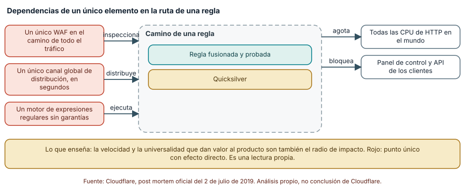

**Cómo leer la figura.** Izquierda: tres dependencias; centro: el camino de una regla; derecha: lo que se agotó. Mira que todo lo rojo es una propiedad deliberada del diseño. **Dónde deja de valer:** es un análisis propio; el post mortem no enumera dependencias.

### Nivel 7 · Defensa en profundidad: ocho barreras

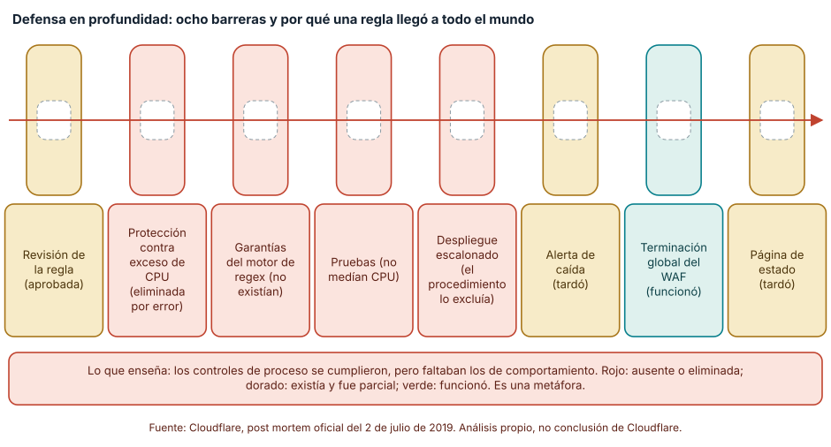

**Cómo leer la figura.** Cada lámina es una barrera; el hueco es el punto por el que la regla pasó. Las rojas faltaban o se habían eliminado; las doradas existían con eficacia parcial; la verde funcionó. Mira que los controles de proceso se cumplieron, y que falló la comprobación del comportamiento. **Dónde deja de valer:** el modelo de láminas es una metáfora; la lista sale de las once condiciones del post mortem y la agrupación en ocho es propia.

### Hardware utilizado

El post mortem no describe el hardware; menciona CPU, núcleos y puntos de presencia, y que cada ciudad tiene servidores que atienden HTTP y HTTPS (Post mortem). **No se sabe:** fabricantes, modelos, capacidad y redes.

### Software utilizado

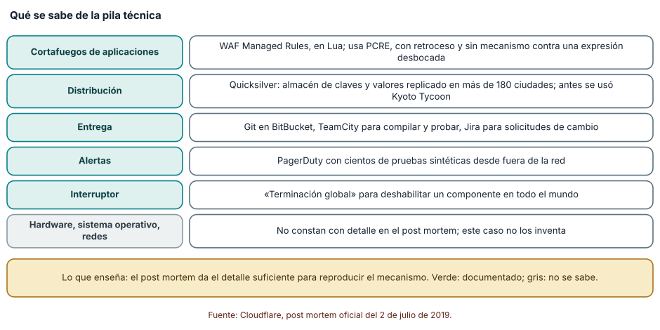

**Cómo leer la figura.** Cada fila es una capa; verde, documentada; gris, no se sabe. Mira que el post mortem da el detalle suficiente para reproducir el mecanismo. **Dónde deja de valer:** no pretende describir la pila completa de Cloudflare.

Documentado: el WAF está escrito en Lua y usa PCRE como motor de expresiones regulares, que utiliza retroceso y no tiene mecanismo contra una expresión desbocada; Quicksilver sustituyó a Kyoto Tycoon; Git en BitBucket, TeamCity y Jira para la entrega; PagerDuty para las alertas (Post mortem). **No se sabe:** el sistema operativo, el hardware y el resto de la pila.

### Infraestructura

La infraestructura documentada es una red de más de 180 ciudades con puntos de presencia, incluidos puntos con uso especial (DOG, PIG, canarios) para el despliegue gradual (Post mortem). **No se sabe:** propiedad, capacidad y dependencias de terceros.

### A prueba de fallos: qué existía, qué falló y qué debió existir

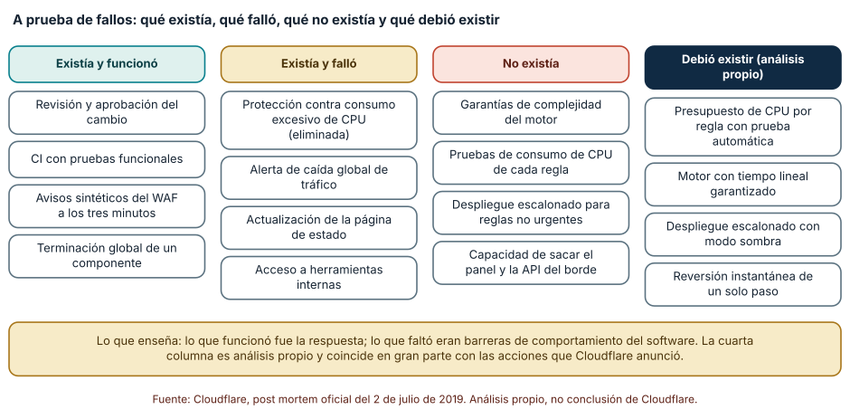

**Cómo leer la figura.** Verde: lo que había y funcionó; dorado: lo que había y falló; coral: lo que no existía; azul oscuro: análisis propio de lo que debió existir. Mira que lo que funcionó fue la respuesta y que lo que faltó eran barreras sobre el comportamiento. **Dónde deja de valer:** no mide eficacia; la cuarta columna es análisis propio.

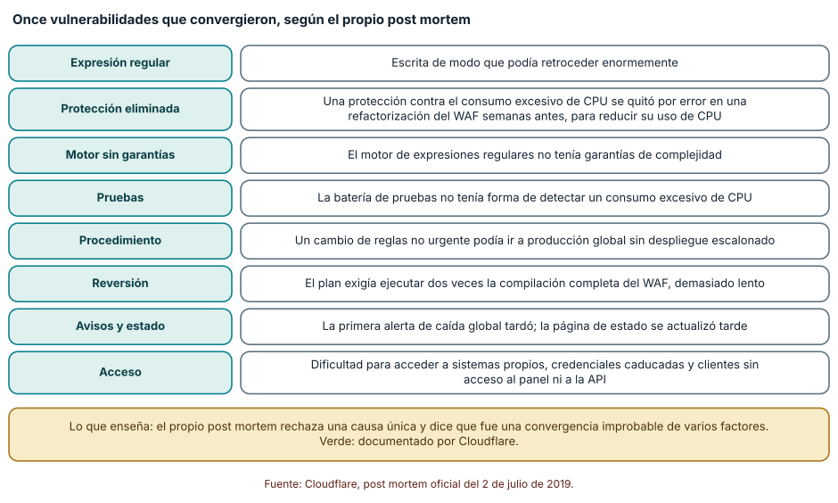

**Cómo leer la figura.** Cada fila es una condición o grupo de condiciones que el post mortem enumera, todas documentadas. Mira que la expresión regular es solo la primera. **Dónde deja de valer:** el post mortem lista once puntos; esta figura los agrupa en ocho filas.

## Casos especiales y cómo fallan

- **Una regla en modo de simulación que consume CPU.** El modo de simulación evita bloquear tráfico, no evita ejecutar la regla; el coste de ejecutar la expresión era el problema (Post mortem).
- **Una protección eliminada por buena razón.** Semanas antes, durante una refactorización cuyo objetivo era reducir el uso de CPU del WAF, se eliminó por error una protección que habría ayudado a evitar el uso excesivo de CPU por una expresión regular (Post mortem). Un cambio que busca eficiencia puede quitar una barrera.
- **Un motor sin garantías.** El motor de expresiones regulares no tenía garantías de complejidad; PCRE retrocede y no ofrece protección contra una expresión desbocada (Post mortem).
- **Pruebas que prueban lo equivocado.** La batería comprobaba que el WAF bloqueara lo que debía y dejara pasar el resto, no cuánta CPU consumía (Post mortem).
- **Un procedimiento que permite la excepción.** El procedimiento para cambios de reglas permitía el despliegue global; no distinguía entre una regla urgente por un ataque activo y una que no lo era (Post mortem).
- **Una reversión lenta.** El plan de reversión exigía ejecutar dos veces la compilación completa del WAF, demasiado tiempo (Post mortem). Lo que resolvió el incidente fue otra vía, la terminación global.
- **Una alerta que tarda.** La primera alerta de caída global de tráfico tardó en saltar, y la página de estado de Cloudflare se actualizó tarde (Post mortem).
- **Clientes sin su panel.** Los clientes no pudieron acceder al panel ni a la API durante el incidente (Post mortem).
- **Una especulación inicial.** En los primeros minutos se pensó en un ataque de un tipo nunca visto antes de identificar el WAF (Post mortem). La hipótesis de ataque es natural cuando todo cae a la vez.

## Línea de tiempo

Escala de semanas (cómo se formó el defecto), de minutos (el incidente) y de semanas otra vez (las acciones).

### Antecedentes y respuesta

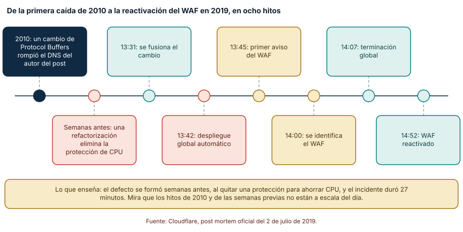

**Cómo leer la figura.** Los hitos están espaciados de manera uniforme, no a escala; las horas son las reales. Mira que el defecto se formó semanas antes. **Dónde deja de valer:** «semanas antes» es una expresión del post mortem sin fecha exacta.

| Cuándo (UTC) | Hecho | Fuente |
| --- | --- | --- |
| Semanas antes del 2 de julio | Una refactorización del WAF elimina por error una protección contra el uso excesivo de CPU | Post mortem |
| 13:31 | Se fusiona la pull request con el cambio | Post mortem |
| 13:37 | TeamCity compila y las pruebas pasan | Post mortem |
| 13:42 | Despliegue automático; empieza el impacto | Post mortem |
| 13:45 | Primer aviso de PagerDuty por una prueba sintética del WAF | Post mortem |
| 14:00 | Se identifica el WAF como causa y se descarta un ataque | Post mortem |
| 14:02 | Se propone la terminación global del WAF | Post mortem |
| 14:07 | Se ejecuta la terminación global | Post mortem |
| 14:09 | Tráfico y CPU vuelven a niveles normales | Post mortem |
| 14:52 | Se reactiva el WAF en todo el mundo tras pruebas en una ciudad | Post mortem |
| 19 de julio de 2019 (prevista) | Perfil de rendimiento de todas las reglas en las pruebas | Post mortem |
| 31 de julio de 2019 (prevista) | Cambio al motor re2 o al de Rust, con garantías de ejecución | Post mortem |

## Qué falló en cada instancia

| Instancia | Qué se esperaba | Qué ocurrió | Fuente |
| --- | --- | --- | --- |
| Regla del WAF | Detectar un ataque XSS | Contenía una expresión con retroceso enorme | Post mortem |
| Refactorización previa | Reducir el uso de CPU | Eliminó una protección contra el consumo excesivo | Post mortem |
| Motor de expresiones | Tiempo acotado | Sin garantías de complejidad | Post mortem |
| Batería de pruebas | Detectar un mal rendimiento | No medía consumo de CPU | Post mortem |
| Procedimiento operativo | Escalonar el despliegue | Permitía el despliegue global de un cambio no urgente | Post mortem |
| Plan de reversión | Volver atrás rápido | Exigía dos compilaciones completas | Post mortem |
| Alertas y estado | Avisar rápido a SRE y a los clientes | Alerta de tráfico y página de estado tardaron | Post mortem |
| Herramientas internas | Permitir la recuperación | Dependían del servicio caído; credenciales caducadas | Post mortem |

## Causa raíz y factores

**Detonante (documentado).** El despliegue, a las 13:42 del 2 de julio de 2019, de una regla del WAF con una expresión regular que retrocedía enormemente (Post mortem).

**Condiciones latentes (documentado).** Las once vulnerabilidades que convergieron según el propio post mortem: expresión con retroceso; protección eliminada; motor sin garantías; pruebas sin medida de CPU; procedimiento que permite el despliegue global; reversión lenta; alerta tardía; página de estado tardía; acceso difícil a sistemas propios; credenciales caducadas; clientes sin acceso al panel ni a la API (Post mortem).

**Factores de contexto (documentado).** La necesidad de responder rápido a amenazas nuevas, que justificaba una vía rápida; un equipo que gestiona unas 476 solicitudes de cambio cada 60 días y que, por tanto, había normalizado un camino rápido (Post mortem).

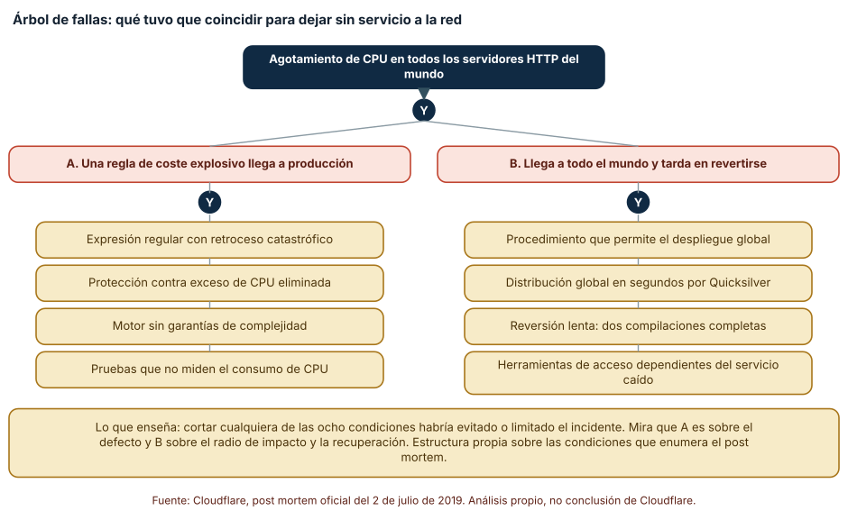

**Cómo leer la figura.** Arriba, el evento final; los círculos con «Y» exigen que todas las ramas ocurran. Las cajas doradas son las condiciones. Mira que la rama A trata del defecto y la B del radio de impacto y de la recuperación. **Dónde deja de valer:** la estructura es análisis propio; el post mortem advierte que «un único origen puede ocultar la realidad».

**Cadena causal ordenada (análisis propio, apoyado en el post mortem).**

1. Se quiere reducir el uso de CPU del WAF y una refactorización elimina una protección (contexto, semanas antes).
2. El procedimiento para reglas permite el despliegue global por la necesidad de rapidez (condición de proceso).
3. Un ingeniero escribe una expresión que puede retroceder enormemente (detonante técnico).
4. Las pruebas no miden CPU y pasan (condición de verificación).
5. Quicksilver distribuye el cambio a todo el mundo en segundos (condición de despliegue).
6. La CPU se agota, el tráfico cae un 80 %, y la reversión y el acceso son lentos (resultado y condiciones de recuperación).
7. La terminación global del WAF restablece el servicio a las 14:09 (resolución).

### Documentado, inferido y no se sabe

| Categoría | Contenido |
| --- | --- |
| Documentado | La cronología al minuto; la regla y el mecanismo del retroceso; las once condiciones; las acciones anunciadas; los datos de red |
| Inferido (análisis propio) | Que la combinación de velocidad y alcance global es la causa de fondo; la estructura del árbol y de las ocho barreras; que cada decisión era razonable aislada |
| No se sabe | Clientes afectados y pérdidas; cuántas veces se usó antes la vía global para reglas no urgentes; si las acciones se cumplieron en las fechas anunciadas; el estado posterior de Cloudflare |

## Mejoras que debieron hacerse

El post mortem lista las acciones que Cloudflare anunció; la elección de qué otros controles habrían cortado cada eslabón es análisis nuestro. Todo lo de esta sección, incluidos costes y trade-offs, es **análisis propio apoyado en la fuente**: no son conclusiones de Cloudflare, salvo donde se cita lo que la empresa anunció.

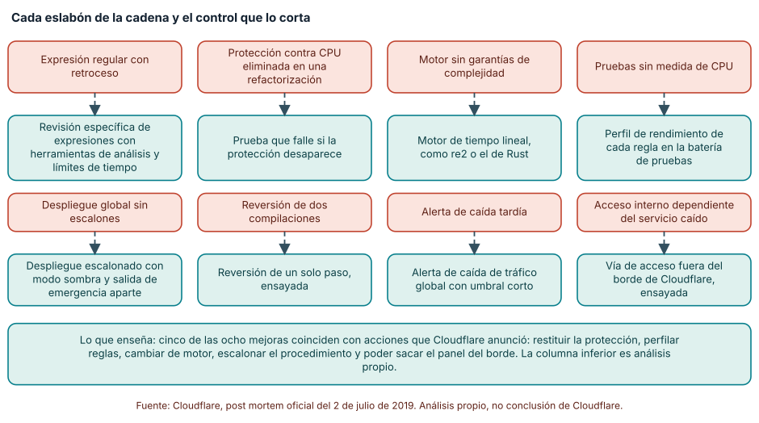

**Cómo leer la figura.** Arriba el eslabón de la cadena, debajo el control que lo corta. Mira que cinco coinciden con acciones que Cloudflare anunció. **Dónde deja de valer:** son propuestas educativas, no prescripciones; cada una tiene coste y falsos positivos.

### Las acciones que Cloudflare anunció

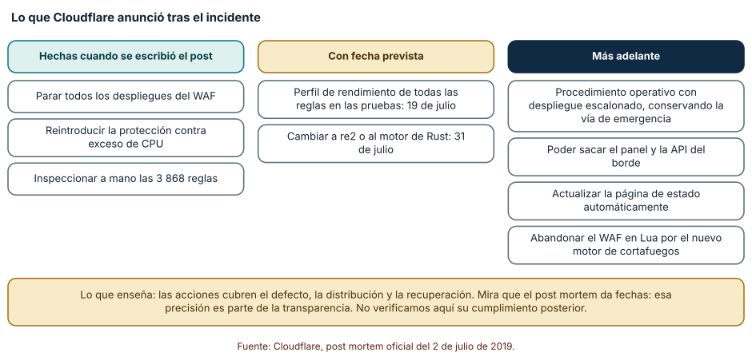

**Cómo leer la figura.** Cada columna es un horizonte de tiempo. Mira la segunda: dos acciones con fecha. **Dónde deja de valer:** son compromisos del post mortem; no se verificó su cumplimiento.

### La arquitectura «después»

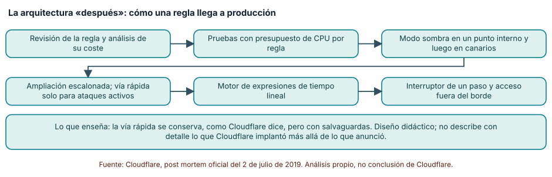

**Cómo leer la figura.** Cada caja es un cambio del camino de una regla. Mira que la vía rápida se conserva con salvaguardas. **Dónde deja de valer:** es un diseño didáctico; no describe lo que Cloudflare implantó con detalle.

### Para cada factor: control técnico, de proceso y de gobierno

| Factor causal | Control técnico | Control de proceso | Control de gobierno | Costo y trade-off | Clases |
| --- | --- | --- | --- | --- | --- |
| Expresión con retroceso | Motor de tiempo lineal y límite de tiempo por regla | Revisión específica de expresiones con análisis | Estándar de que toda regla declara su coste | Menos expresividad con motores lineales | [SE-426 · Mutación, fuzzing y generación de casos](../../classes/part-35-estrategia-y-tecnicas-de-prueba/se-426-mutacion-fuzzing-y-generacion-de-casos/README.md), [SE-437 · Perfiles, benchmarks y errores de medición](../../classes/part-36-calidad-rendimiento-y-resiliencia/se-437-perfiles-benchmarks-y-errores-de-medicion/README.md), [SE-434 · Revisión, análisis estático y quality gates](../../classes/part-36-calidad-rendimiento-y-resiliencia/se-434-revision-analisis-estatico-y-quality-gates/README.md) |
| Protección eliminada en una refactorización | Prueba que falle si la protección desaparece | Lista de protecciones al refactorizar | Revisión de cambios de rendimiento con dueño | Más pruebas de comportamiento | [SE-422 · Pruebas unitarias y diseño testable](../../classes/part-35-estrategia-y-tecnicas-de-prueba/se-422-pruebas-unitarias-y-diseno-testable/README.md), [SE-436 · Latencia, throughput, saturación y capacidad](../../classes/part-36-calidad-rendimiento-y-resiliencia/se-436-latencia-throughput-saturacion-y-capacidad/README.md), [SE-434 · Revisión, análisis estático y quality gates](../../classes/part-36-calidad-rendimiento-y-resiliencia/se-434-revision-analisis-estatico-y-quality-gates/README.md) |
| Pruebas sin medida de CPU | Perfil de CPU por regla en la batería | Presupuesto de CPU por regla | Puerta de calidad con umbral | Tiempo de CI | [SE-435 · Carga, estrés, picos y endurance](../../classes/part-36-calidad-rendimiento-y-resiliencia/se-435-carga-estres-picos-y-endurance/README.md), [SE-437 · Perfiles, benchmarks y errores de medición](../../classes/part-36-calidad-rendimiento-y-resiliencia/se-437-perfiles-benchmarks-y-errores-de-medicion/README.md), [SE-483 · Tests, seguridad y políticas como gates](../../classes/part-40-ci-cd-iac-y-platform-engineering/se-483-tests-seguridad-y-politicas-como-gates/README.md) |
| Despliegue global inmediato | Modo sombra y despliegue escalonado | Procedimiento que distingue ataque activo de cambio rutinario | Aprobación explícita para la vía rápida | Menos velocidad en el caso normal | [SE-475 · Feature flags y entrega progresiva](../../classes/part-39-build-release-y-cadena-de-suministro/se-475-feature-flags-y-entrega-progresiva/README.md), [SE-476 · Canary, blue-green y rollback](../../classes/part-39-build-release-y-cadena-de-suministro/se-476-canary-blue-green-y-rollback/README.md), [SE-485 · Entrega y despliegue continuos](../../classes/part-40-ci-cd-iac-y-platform-engineering/se-485-entrega-y-despliegue-continuos/README.md) |
| Reversión lenta | Reversión de un solo paso | Ensayo periódico de reversión | Tiempo de reversión como indicador | Coste de mantener la reversión lista | [SE-476 · Canary, blue-green y rollback](../../classes/part-39-build-release-y-cadena-de-suministro/se-476-canary-blue-green-y-rollback/README.md), [SE-492 · Proyecto: camino a producción con rollback](../../classes/part-40-ci-cd-iac-y-platform-engineering/se-492-proyecto-camino-a-produccion-con-rollback/README.md), [SE-499 · Runbooks, on-call y escalamiento](../../classes/part-41-observabilidad-sre-e-incidentes/se-499-runbooks-on-call-y-escalamiento/README.md) |
| Alerta y estado tardíos | Alerta de caída de tráfico con umbral corto | Actualización automática de la página de estado | SLO con presupuesto de error | Más alertas | [SE-497 · SLI, SLO, SLA y presupuestos de error](../../classes/part-41-observabilidad-sre-e-incidentes/se-497-sli-slo-sla-y-presupuestos-de-error/README.md), [SE-498 · Alertas accionables y fatiga](../../classes/part-41-observabilidad-sre-e-incidentes/se-498-alertas-accionables-y-fatiga/README.md), [SE-500 · Gestión de incidentes y comunicación](../../classes/part-41-observabilidad-sre-e-incidentes/se-500-gestion-de-incidentes-y-comunicacion/README.md) |
| Herramientas dependientes del servicio caído | Acceso fuera del borde | Ensayo de acceso de emergencia | Credenciales de emergencia con control | Superficie de ataque adicional | [SE-458 · Identidad, autenticación y sesiones](../../classes/part-38-seguridad-privacidad-y-cumplimiento/se-458-identidad-autenticacion-y-sesiones/README.md), [SE-484 · Credenciales efímeras y OIDC](../../classes/part-40-ci-cd-iac-y-platform-engineering/se-484-credenciales-efimeras-y-oidc/README.md), [SE-502 · Continuidad, disaster recovery y ejercicios](../../classes/part-41-observabilidad-sre-e-incidentes/se-502-continuidad-disaster-recovery-y-ejercicios/README.md) |
| Radio de impacto global | Interruptor por componente y celdas | Ejercicios de caos con aborto | Límite de radio por tipo de cambio | Complejidad operativa | [SE-439 · Circuit breakers, bulkheads y degradación](../../classes/part-36-calidad-rendimiento-y-resiliencia/se-439-circuit-breakers-bulkheads-y-degradacion/README.md), [SE-506 · Diseñar experimentos de fallo: alcance y radio de impacto](../../classes/part-42-ingenieria-del-caos/se-506-disenar-experimentos-de-fallo-alcance-y-radio-de-impacto/README.md), [SE-512 · Caos continuo: automatización en CI/CD y en producción](../../classes/part-42-ingenieria-del-caos/se-512-caos-continuo-automatizacion-en-ci-cd-y-en-produccion/README.md) |

### Cómo lo habría evitado lo que enseña el curso

Cada línea es análisis propio. (1) La generación de casos, el *fuzzing* y la mutación de [SE-426 · Mutación, fuzzing y generación de casos](../../classes/part-35-estrategia-y-tecnicas-de-prueba/se-426-mutacion-fuzzing-y-generacion-de-casos/README.md) habrían probado la expresión con entradas largas y la habrían señalado; las pruebas de rendimiento y los perfiles de [SE-437 · Perfiles, benchmarks y errores de medición](../../classes/part-36-calidad-rendimiento-y-resiliencia/se-437-perfiles-benchmarks-y-errores-de-medicion/README.md) y la carga y estrés de [SE-435 · Carga, estrés, picos y endurance](../../classes/part-36-calidad-rendimiento-y-resiliencia/se-435-carga-estres-picos-y-endurance/README.md) enseñan a medir el coste además de la corrección. (2) La entrega progresiva y los flags de [SE-475 · Feature flags y entrega progresiva](../../classes/part-39-build-release-y-cadena-de-suministro/se-475-feature-flags-y-entrega-progresiva/README.md) y el canary, el blue-green y el rollback de [SE-476 · Canary, blue-green y rollback](../../classes/part-39-build-release-y-cadena-de-suministro/se-476-canary-blue-green-y-rollback/README.md) son el camino que el WAF no seguía. (3) Los quality gates de [SE-434 · Revisión, análisis estático y quality gates](../../classes/part-36-calidad-rendimiento-y-resiliencia/se-434-revision-analisis-estatico-y-quality-gates/README.md) y las políticas como puertas de [SE-483 · Tests, seguridad y políticas como gates](../../classes/part-40-ci-cd-iac-y-platform-engineering/se-483-tests-seguridad-y-politicas-como-gates/README.md) describen la puerta que habría exigido un presupuesto de CPU. (4) Los SLO y las alertas de [SE-497 · SLI, SLO, SLA y presupuestos de error](../../classes/part-41-observabilidad-sre-e-incidentes/se-497-sli-slo-sla-y-presupuestos-de-error/README.md) y [SE-498 · Alertas accionables y fatiga](../../classes/part-41-observabilidad-sre-e-incidentes/se-498-alertas-accionables-y-fatiga/README.md) explican por qué la primera alerta de caída global debe saltar en segundos. (5) La ingeniería del caos, en particular [SE-505 · Principios de la ingeniería del caos: estado estable e hipótesis](../../classes/part-42-ingenieria-del-caos/se-505-principios-de-la-ingenieria-del-caos-estado-estable-e-hipotesis/README.md), [SE-506 · Diseñar experimentos de fallo: alcance y radio de impacto](../../classes/part-42-ingenieria-del-caos/se-506-disenar-experimentos-de-fallo-alcance-y-radio-de-impacto/README.md), [SE-508 · Fallos de recursos e infraestructura: CPU, memoria, disco y nodos](../../classes/part-42-ingenieria-del-caos/se-508-fallos-de-recursos-e-infraestructura-cpu-memoria-disco-y-nodos/README.md) (fallos de recursos, como la CPU) y [SE-511 · Game days y ejercicios de respuesta a incidentes](../../classes/part-42-ingenieria-del-caos/se-511-game-days-y-ejercicios-de-respuesta-a-incidentes/README.md) (ejercicios de respuesta a incidentes), ensaya la hipótesis «la red sigue sirviendo si un componente agota la CPU» y la dependencia circular de las herramientas de acceso. (6) Los circuit breakers y la degradación de [SE-439 · Circuit breakers, bulkheads y degradación](../../classes/part-36-calidad-rendimiento-y-resiliencia/se-439-circuit-breakers-bulkheads-y-degradacion/README.md) y los timeouts de [SE-438 · Timeouts, retries, backoff y jitter](../../classes/part-36-calidad-rendimiento-y-resiliencia/se-438-timeouts-retries-backoff-y-jitter/README.md) tratan de limitar el consumo de un componente defectuoso.

## Vínculo con el curso

Cada enlace es una clase real; el texto dice qué mecanismo del caso ilustra. Las partes de pruebas, calidad y resiliencia, de build y entrega, de observabilidad e incidentes y de ingeniería del caos son las que más aportan.

| Concepto | Clase | Cómo lo ilustra el caso |
| --- | --- | --- |
| Pruebas unitarias y diseño testable | [SE-422 · Pruebas unitarias y diseño testable](../../classes/part-35-estrategia-y-tecnicas-de-prueba/se-422-pruebas-unitarias-y-diseno-testable/README.md) | Una batería que prueba lo que hace, no lo que cuesta |
| Mutación, fuzzing y generación de casos | [SE-426 · Mutación, fuzzing y generación de casos](../../classes/part-35-estrategia-y-tecnicas-de-prueba/se-426-mutacion-fuzzing-y-generacion-de-casos/README.md) | Probar la expresión con entradas largas |
| Carga, estrés, picos | [SE-435 · Carga, estrés, picos y endurance](../../classes/part-36-calidad-rendimiento-y-resiliencia/se-435-carga-estres-picos-y-endurance/README.md) | Medir CPU bajo tráfico real |
| Latencia, saturación y capacidad | [SE-436 · Latencia, throughput, saturación y capacidad](../../classes/part-36-calidad-rendimiento-y-resiliencia/se-436-latencia-throughput-saturacion-y-capacidad/README.md) | Saturación de CPU por una regla |
| Perfiles y benchmarks | [SE-437 · Perfiles, benchmarks y errores de medición](../../classes/part-36-calidad-rendimiento-y-resiliencia/se-437-perfiles-benchmarks-y-errores-de-medicion/README.md) | Perfil de rendimiento de cada regla |
| Timeouts, retries y backoff | [SE-438 · Timeouts, retries, backoff y jitter](../../classes/part-36-calidad-rendimiento-y-resiliencia/se-438-timeouts-retries-backoff-y-jitter/README.md) | Límite de tiempo por regla |
| Circuit breakers y degradación | [SE-439 · Circuit breakers, bulkheads y degradación](../../classes/part-36-calidad-rendimiento-y-resiliencia/se-439-circuit-breakers-bulkheads-y-degradacion/README.md) | Desactivar un componente sin tumbar el resto |
| Revisión y quality gates | [SE-434 · Revisión, análisis estático y quality gates](../../classes/part-36-calidad-rendimiento-y-resiliencia/se-434-revision-analisis-estatico-y-quality-gates/README.md) | Puerta con presupuesto de CPU |
| Feature flags y entrega progresiva | [SE-475 · Feature flags y entrega progresiva](../../classes/part-39-build-release-y-cadena-de-suministro/se-475-feature-flags-y-entrega-progresiva/README.md) | Modo sombra y despliegue escalonado |
| Canary, blue-green y rollback | [SE-476 · Canary, blue-green y rollback](../../classes/part-39-build-release-y-cadena-de-suministro/se-476-canary-blue-green-y-rollback/README.md) | DOG, PIG y canarios frente al WAF |
| CI/CD | [SE-485 · Entrega y despliegue continuos](../../classes/part-40-ci-cd-iac-y-platform-engineering/se-485-entrega-y-despliegue-continuos/README.md) | Despliegue automático tras pruebas |
| Camino a producción con rollback | [SE-492 · Proyecto: camino a producción con rollback](../../classes/part-40-ci-cd-iac-y-platform-engineering/se-492-proyecto-camino-a-produccion-con-rollback/README.md) | Reversión de un solo paso |
| Alertas accionables | [SE-498 · Alertas accionables y fatiga](../../classes/part-41-observabilidad-sre-e-incidentes/se-498-alertas-accionables-y-fatiga/README.md) | Alerta de tráfico y página de estado tardías |
| SLI, SLO y presupuestos | [SE-497 · SLI, SLO, SLA y presupuestos de error](../../classes/part-41-observabilidad-sre-e-incidentes/se-497-sli-slo-sla-y-presupuestos-de-error/README.md) | Un indicador de caída global con umbral corto |
| Runbooks y escalamiento | [SE-499 · Runbooks, on-call y escalamiento](../../classes/part-41-observabilidad-sre-e-incidentes/se-499-runbooks-on-call-y-escalamiento/README.md) | La terminación global como paso de un runbook |
| Gestión de incidentes | [SE-500 · Gestión de incidentes y comunicación](../../classes/part-41-observabilidad-sre-e-incidentes/se-500-gestion-de-incidentes-y-comunicacion/README.md) | P0, reunión de equipos y comunicación |
| Postmortems sin culpa | [SE-501 · Postmortems sin culpa y aprendizaje](../../classes/part-41-observabilidad-sre-e-incidentes/se-501-postmortems-sin-culpa-y-aprendizaje/README.md) | Un post mortem con once condiciones |
| Principios de la ingeniería del caos | [SE-505 · Principios de la ingeniería del caos: estado estable e hipótesis](../../classes/part-42-ingenieria-del-caos/se-505-principios-de-la-ingenieria-del-caos-estado-estable-e-hipotesis/README.md) | Estado estable e hipótesis para un componente que agota CPU |
| Fallos de recursos | [SE-508 · Fallos de recursos e infraestructura: CPU, memoria, disco y nodos](../../classes/part-42-ingenieria-del-caos/se-508-fallos-de-recursos-e-infraestructura-cpu-memoria-disco-y-nodos/README.md) | Inyectar consumo de CPU |
| Game days | [SE-511 · Game days y ejercicios de respuesta a incidentes](../../classes/part-42-ingenieria-del-caos/se-511-game-days-y-ejercicios-de-respuesta-a-incidentes/README.md) | Ensayar el acceso de emergencia |

### Preguntas de discusión

1. Si una regla debe desplegarse en segundos, ¿qué pruebas puede pasar antes y cuáles sustituye una vía de reversión instantánea?
2. ¿Qué diferencia hay entre «el modo de simulación no bloquea nada» y «no cuesta nada»?
3. Una refactorización quitó una protección para ahorrar CPU. ¿Cómo se diseña un cambio de rendimiento que no quite barreras?
4. Tus herramientas de recuperación usan el mismo servicio que falla. ¿Qué haces?
5. El post mortem enumera once condiciones. ¿Cuál corta más barato y cuál cambia más el radio de impacto?

### Mini-ejercicios

1. **Retroceso.** Escribe una expresión con retroceso catastrófico, mide sus pasos con entradas crecientes y compara con un motor de tiempo lineal.
2. **Presupuesto de CPU.** Añade a una batería de pruebas un límite de tiempo por regla y haz que falle si se supera.
3. **Vía rápida con salvaguardas.** Diseña un procedimiento con una vía rápida para ataques activos que exija una segunda aprobación y un modo sombra.
4. **Acceso de emergencia.** Describe cómo accederías a tus herramientas si tu proveedor de identidad estuviera caído y cómo lo ensayarías.

## Qué no generalizar

**Aprender.**

1. Un cambio rápido necesita una red de seguridad que mida comportamiento, no solo funcionalidad.
2. Un motor sin garantías de complejidad convierte una expresión en un riesgo de disponibilidad.
3. Un modo de simulación sigue ejecutando el código: mide su coste.
4. Las herramientas de recuperación no deben depender del servicio que se recupera.
5. Un cambio que busca eficiencia puede quitar una barrera: protege las barreras con pruebas.
6. Un post mortem con varias condiciones enseña más que una causa única.

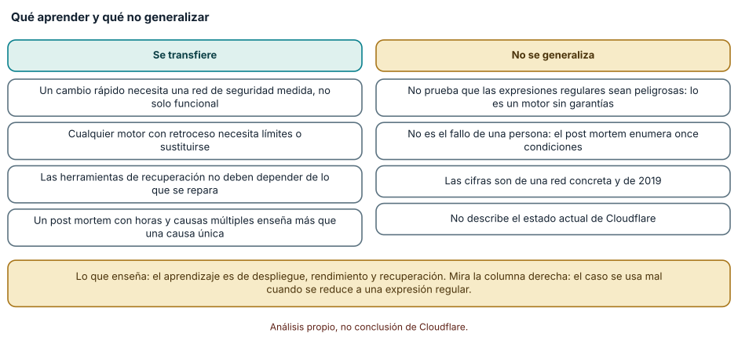

**Cómo leer la figura.** Verde: lo que se transfiere; dorado: lo que no. Mira la columna derecha: el caso se usa mal cuando se reduce a una expresión regular. **Dónde deja de valer:** es una lectura propia del post mortem.

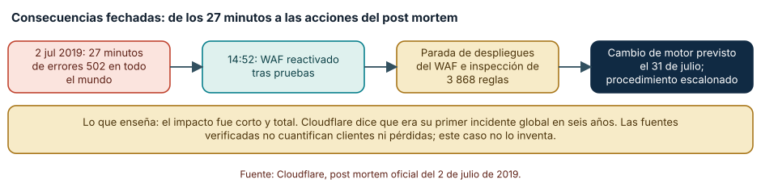

**Cómo leer la figura.** Cuatro hitos de izquierda a derecha. Mira que el impacto fue corto y total. **Dónde deja de valer:** las fuentes no cuantifican clientes ni pérdidas.

**No generalizar.**

- No prueba que las expresiones regulares o los WAF sean peligrosos: lo es un camino de despliegue global sin barreras de comportamiento.
- No es el fallo de una persona: el post mortem enumera once condiciones y no atribuye la causa al autor de la regla.
- La fuente es el post mortem de la propia empresa, una fuente de parte; no se contrastó con una segunda fuente independiente.
- Las cifras (27 minutos, 80 %, 3 868 reglas) son de este incidente y de 2019.
- Lo ocurrido después de 2019, incluidas las acciones anunciadas, queda fuera de este caso porque no se verificó en esta sesión.

### Casos comparables y diferencias

| Caso | Parecido | Diferencia |
| --- | --- | --- |
| [CrowdStrike (2024)](crowdstrike.md) | Un cambio de contenido llega a todos sin barrera gradual y deja sin servicio | Allí se bloquearon millones de equipos de clientes; aquí, la red del propio proveedor |
| [Caída global de Meta (2021)](meta-2021.md) | Las herramientas de respuesta dependían de lo que había caído | Allí fue un cambio de red y de acceso físico; aquí, una regla de software |
| AWS S3 (2017) | Una acción operativa con un parámetro mal acotado causa una caída amplia | Allí fue un comando que retiraba capacidad; aquí, una regla que agotó la CPU |

## Fuentes públicas verificadas

Todas consultadas el 23 de noviembre de 2026. Las páginas se abrieron y se extrajo su texto. El algoritmo de tiempo lineal de 1968 que cita el post mortem (Ken Thompson, *Communications of the ACM*) no se pudo abrir en esta sesión y no se usa como fuente.

1. Cloudflare, *Details of the Cloudflare outage on July 2, 2019*, entrada del blog de Cloudflare, julio de 2019. [https://blog.cloudflare.com/details-of-the-cloudflare-outage-on-july-2-2019/](https://blog.cloudflare.com/details-of-the-cloudflare-outage-on-july-2-2019/) (respalda la cronología, las once condiciones, las cifras de red, el apéndice del retroceso y las acciones anunciadas).
2. Cloudflare, *Introducing Quicksilver: Configuration Distribution at Internet Scale*, entrada del blog de Cloudflare. [https://blog.cloudflare.com/introducing-quicksilver-configuration-distribution-at-internet-scale/](https://blog.cloudflare.com/introducing-quicksilver-configuration-distribution-at-internet-scale/) (respalda que Quicksilver nació para sustituir a Kyoto Tycoon como sistema de distribución de configuración a todas las máquinas).
3. Rust, documentación del crate `regex`. [https://docs.rs/regex/latest/regex/](https://docs.rs/regex/latest/regex/) (respalda que el motor de expresiones regulares de Rust no usa retroceso sin límite y busca en tiempo lineal respecto del tamaño de la entrada).
4. Google, wiki del proyecto RE2, «Why RE2». [https://github.com/google/re2/wiki/WhyRE2](https://github.com/google/re2/wiki/WhyRE2) (respalda la existencia de RE2 como alternativa a los motores con retroceso, a la que se refiere el post mortem).
5. PCRE, sitio del proyecto. [https://www.pcre.org/](https://www.pcre.org/) (respalda la existencia de la biblioteca PCRE usada por el WAF según el post mortem).

---

[↑ Casos de fallo](README.md) · [← SolarWinds 2020](solarwinds-2020.md)
