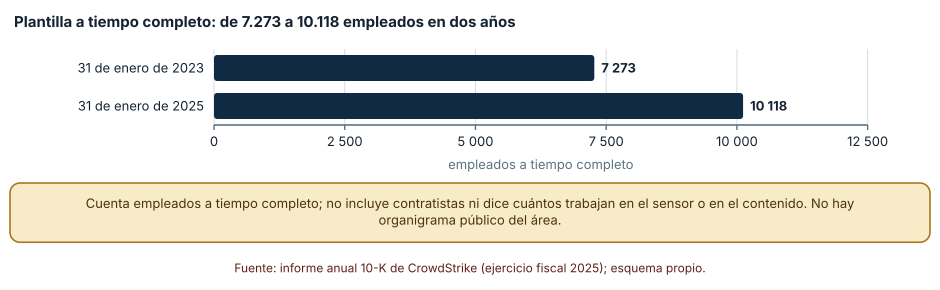
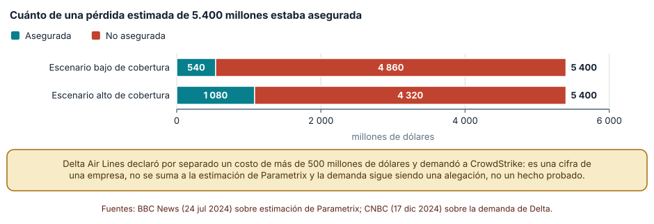
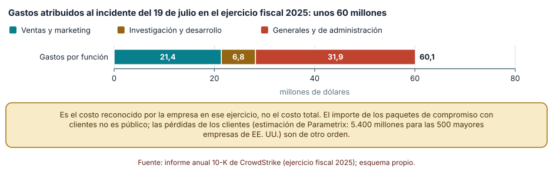
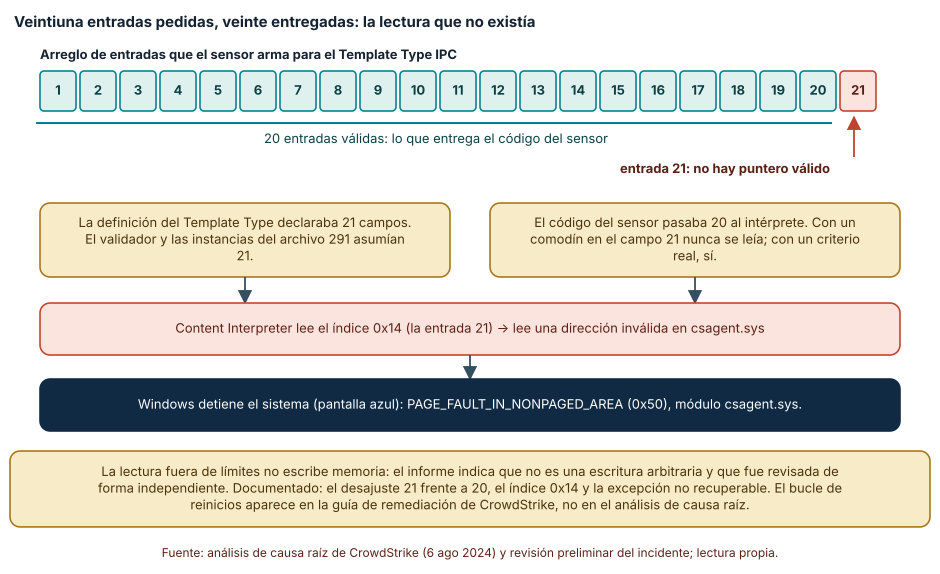
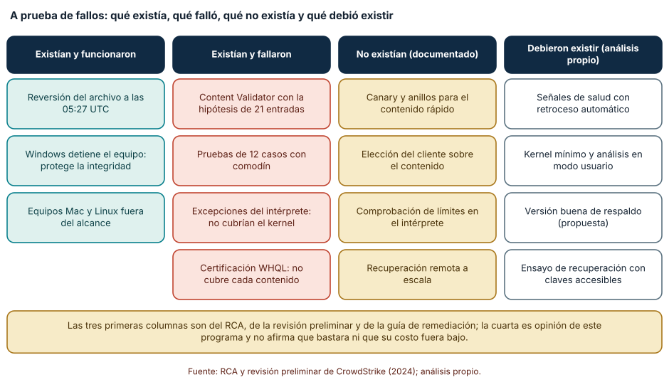

# CrowdStrike

[↑ Casos de fallo](README.md) · [← Caída global de Meta](meta-2021.md) · [Therac-25 →](therac-25.md)

El viernes 19 de julio de 2024, durante 78 minutos, CrowdStrike distribuyó un archivo de configuración que su agente de seguridad leyó dentro del núcleo de Windows. Millones de equipos se detuvieron con una pantalla azul en aerolíneas, bancos y hospitales. No hubo un atacante ni un fallo de hardware: hubo una entrada que faltaba, una comprobación que no existía y un reparto a toda la flota sin etapas intermedias. Este caso reconstruye el mecanismo con el análisis de causa raíz que publicó la propia empresa y separa lo que está documentado de lo que es lectura de este programa.

## Ficha histórica

| Dato | Contenido |
| --- | --- |
| Organización | CrowdStrike Holdings, Inc., empresa de ciberseguridad que ofrece la plataforma Falcon |
| Fundación y responsables | Fundada en 2011 por George Kurtz (director ejecutivo), Dmitri Alperovitch y Gregg Marston, según la enciclopedia Wikipedia; Kurtz sigue como director ejecutivo |
| Sede | Austin, Texas (EE. UU.) |
| Incidente | Viernes 19 de julio de 2024. Publicación a las 04:09 UTC y reversión a las 05:27 UTC |
| Alcance técnico | Equipos Windows con sensor 7.11 o superior que estaban en línea en esa ventana; los equipos Mac y Linux no se vieron afectados |
| Magnitud | Unos 8,5 millones de equipos Windows, menos del 1 % de todos los Windows, según Microsoft (20 de julio de 2024) |
| Daño económico | Unos 5.400 millones de dólares de pérdida directa estimada para las 500 mayores empresas de EE. UU. sin contar a Microsoft (Parametrix, citado por la BBC, 2024); Delta Air Lines declaró más de 500 millones de dólares y demandó a CrowdStrike |
| Documento oficial | Análisis de causa raíz externo del archivo de canal 291, 6 de agosto de 2024 |
| Estado posterior | El 29 de julio de 2024 cerca del 99 % de los sensores Windows estaban en línea. La empresa comprometió mejoras de proceso y el litigio con Delta seguía abierto en las fuentes consultadas |

La tabla resume datos y se sustenta en las fuentes del último apartado; la fecha de consulta de todas es el 16 de noviembre de 2026.

### Sedes, centros de datos y oficinas

El informe anual de CrowdStrike para el ejercicio fiscal 2025 (cerrado el 31 de enero de 2025, presentado ante la SEC) permite fijar dónde está la empresa. **Documentado:** la sede ejecutiva está en el 206 de East 9th Street, oficina 1400, Austin (Texas), una oficina de unos 47.618 pies cuadrados con contrato hasta 2030; el liderazgo de investigación y desarrollo está en Seattle (Washington) y Sunnyvale (California); hay otros centros de I+D en Irvine (California), Minneapolis (Minnesota), Bucarest (Rumanía), Israel e India; y la plataforma Falcon se aloja en una mezcla de centros de datos de terceros, principalmente Amazon Web Services, y centros propios en instalaciones de colocación en EE. UU. y Europa. La enciclopedia que usa la ficha anterior ubica la mudanza de la sede desde Sunnyvale en 2021; ese dato es de fuente secundaria.

**No se sabe:** el número de oficinas comerciales, la dirección de los centros de datos, el desglose de la plantilla por país y la ubicación del equipo que publicó el contenido del 19 de julio. El informe no lo dice y este caso no lo infiere. La clase [SE-349 · IaaS, PaaS, SaaS y responsabilidad compartida](../../classes/part-29-cloud-plataforma-e-infraestructura/se-349-iaas-paas-saas-y-responsabilidad-compartida/README.md) trata la responsabilidad compartida entre quien aloja y quien opera, relevante aquí porque la infraestructura de entrega de contenido combina un proveedor de nube y centros propios.

**Cómo leer la figura.** El nodo central es la sede; las cajas de arriba son los centros de I+D que cita el informe y las de abajo, dónde corre la plataforma. Mira primero que ninguna caja es un centro de operaciones públicamente descrito para el contenido rápido. **Dónde deja de valer:** es un diagrama de relaciones y no un mapa geográfico a escala; no incluye oficinas comerciales porque el informe no las lista.

### Organización y plantilla

El informe declara 10.118 empleados a tiempo completo al 31 de enero de 2025, frente a 7.273 al 31 de enero de 2023: un 39 % más en dos años (cálculo propio). **No es público** un organigrama detallado del área que mantiene el sensor, el sistema de contenido y el validador, de modo que este caso no dibuja una pirámide de cargos: sería inventar. Lo que sí se sabe por el análisis de causa raíz es la división funcional que importa para el incidente: ingenieros de desarrollo del sensor (código y *Template Types*), ingenieros de detección (instancias de plantilla), ingeniería de calidad y pruebas, y servicios gestionados como Falcon Adversary OverWatch y Falcon Complete, que el informe menciona como fuente de inteligencia. La figura muestra solo la cifra pública de plantilla.

**Cómo leer la figura.** Cada barra es una fecha de cierre fiscal. Mira primero el cambio entre ambas: la empresa creció en plantilla en el período del incidente. **Dónde deja de valer:** cuenta empleados a tiempo completo, no contratistas ni socios, y no dice cuántos trabajan en el sensor ni en el contenido.

### Visión y misión

**Documentado:** el informe anual no contiene una declaración de misión formal; describe la plataforma como «construida a propósito para detener las brechas» (traducción propia). Cualquier lema de la web comercial es cambiante y no se cita aquí. Lo relevante para el curso es la tensión entre esa promesa (detener brechas, es decir, velocidad de detección) y la disciplina de entrega: la misión de un producto de seguridad refuerza la presión a publicar rápido, un factor de contexto **inferido** que ya aparece en el análisis causal.

## Contexto y problema

Un agente de seguridad de punto final (*endpoint*) observa lo que hace un equipo —procesos que nacen, archivos que se escriben, conexiones que se abren— y decide si bloquear algo. Para ver todo eso y para que un atacante con permisos de administrador no lo apague, la mayoría de los productos de este tipo, incluidos los de Microsoft, instalan un controlador que corre en el núcleo (modo *kernel*). Microsoft lo explica en su blog de seguridad: el núcleo da visibilidad de todo el sistema, carga en el arranque temprano y resiste la manipulación, pero a costa de resiliencia, porque un fallo allí no puede reiniciarse como el de una aplicación normal y detiene el sistema entero.

El problema que CrowdStrike resolvía era de ritmo. Los atacantes cambian de técnica en horas. Si cada nueva detección exigiera publicar una versión del sensor, certificarla con Microsoft y esperar a que los clientes la instalaran, la defensa llegaría tarde. La apuesta fue separar dos tipos de actualización: el **Sensor Content**, que viaja con el sensor, y el **Rapid Response Content**, datos de configuración que se entregan desde la nube «a velocidad operativa» y que, según la empresa, no son código ni un controlador. Esa separación es razonable y común; el fallo no estuvo en la idea sino en que la entrega rápida heredó menos controles que la lenta.

### Por qué un agente de seguridad vive dentro del núcleo

Windows separa la ejecución en dos anillos de privilegio. En **modo usuario** corren las aplicaciones: si una se cae, el sistema operativo la cierra y el resto sigue. En **modo kernel** corren el núcleo y los controladores (*drivers*): comparten un único espacio de memoria con privilegios totales, de modo que un puntero inválido no se puede aislar y la regla del sistema es detener todo antes que seguir con datos dudosos. El propio volcado de memoria del análisis de causa raíz lo dice con la descripción del código de error `PAGE_FAULT_IN_NONPAGED_AREA`: se hizo referencia a memoria del sistema inválida y eso no puede protegerse con un bloque `try-except`. La clase [SE-025 · Windows, Linux, macOS y sus modelos operativos](../../classes/part-02-sistemas-operativos-terminal-y-automatizacion-base/se-025-windows-linux-macos-y-sus-modelos-operativos/README.md) presenta esta frontera como parte del modelo operativo; el caso muestra su consecuencia práctica.

¿Por qué aceptar ese riesgo? Microsoft enumera las razones en su blog de seguridad de julio de 2024: visibilidad de todo el sistema (creación de procesos e hilos, escritura de archivos), carga temprana en el arranque para ver el malware que se lanza antes que cualquier proceso de usuario, resistencia a la manipulación incluso por parte de un atacante con permisos de administrador y, en algunos escenarios, rendimiento. Windows ofrece un mecanismo específico, el *Early Launch Antimalware* (ELAM), para que un controlador de seguridad cargue pronto, y Microsoft indica que CrowdStrike firma su controlador de arranque como ELAM. El mismo texto declara el costo: los controladores de kernel entregan esas propiedades «al costo de la resiliencia», porque no pueden fallar y reiniciarse como una aplicación normal. Es una decisión de arquitectura con precio conocido, no un descuido de un proveedor concreto.

Hay además una tensión estructural que ningún actor resuelve solo. Un producto de seguridad debe ser difícil de apagar (si no, el malware lo desactiva) y, por la misma razón, difícil de retirar cuando es él quien falla. Microsoft propone reducir la parte que corre en el kernel a un sensor mínimo de recolección y aplicación, y mover al modo usuario la gestión de actualizaciones y el análisis de contenido, donde «la recuperabilidad es posible». El análisis de causa raíz de CrowdStrike reconoce que aún queda trabajo en el ecosistema de Windows para sostener un producto robusto que no dependa de un controlador de kernel al menos para parte de su función. Esa es la dirección que el caso retoma en la sección de mejoras.

### Dos canales de contenido con garantías distintas

La empresa distingue dos formas de actualizar su sensor y conviene verlas como dos canales con garantías opuestas, porque de esa asimetría nace el incidente.

- **Sensor Content** viaja con la versión del sensor. Incluye los modelos de aprendizaje automático del sensor y los *Template Types*, que son código compilado. Según la revisión preliminar, pasa por pruebas automáticas (unitarias, de integración, de rendimiento y de esfuerzo) antes y después de integrarse, y por un despliegue por etapas que empieza con el uso interno (*dogfooding*), sigue con adoptantes tempranos y llega después a disponibilidad general. El cliente decide qué parte de su flota instala la última versión (N), una anterior (N-1) o dos anteriores (N-2) mediante políticas de actualización del sensor. Es un canal lento, con puertas y con control del cliente.
- **Rapid Response Content** se entrega desde la nube como *Template Instances* dentro de archivos de canal. La empresa lo describe como configuración, «no código ni un controlador», que permite añadir visibilidad y detecciones «sin cambios de código del sensor». Es un canal rápido. En julio de 2024 su ruta pasaba por el Content Validator pero, según el propio análisis de causa raíz, no por un despliegue por etapas ni por una elección del cliente: esas dos puertas se añadieron después.

Una tercera cosa no cambia entre canales: ambos terminan leídos por código que corre en el kernel. Que un archivo sea «datos» no lo vuelve inocuo si el intérprete que lo lee es privilegiado. El curso trata esa idea en [SE-403 · Feature flags y entrega progresiva](../../classes/part-33-build-release-y-cadena-de-suministro/se-403-feature-flags-y-entrega-progresiva/README.md), donde la configuración que altera el comportamiento de producción se considera una forma de entrega, y en [SE-388 · Validación, codificación y clases de inyección](../../classes/part-32-seguridad-privacidad-y-cumplimiento/se-388-validacion-codificacion-y-clases-de-inyeccion/README.md), donde todo lo que cruza una frontera de confianza se valida antes de usarse.

**Cómo leer la figura.** Cada columna es un actor con su responsabilidad: el proveedor de seguridad, la plataforma que aloja el controlador y la organización cliente. Las flechas sólidas son flujos documentados (contenido, certificación, política de actualización); las punteadas marcan la relación que el incidente dejó al descubierto, la de la plataforma como último punto donde un fallo del controlador se convierte en una parada. Mira primero qué actor **no** tenía una puerta entre el archivo y el kernel. **Dónde deja de valer:** es un mapa de responsabilidades, no un organigrama contractual; los contratos entre proveedor y cliente varían y el de Delta es objeto de litigio.

## Mercado, usuarios y casos de uso

CrowdStrike vende a empresas y gobiernos. Su cliente típico administra miles o decenas de miles de equipos y quiere tres cosas: bloquear amenazas sin intervención, ver qué ocurrió en cada equipo y no ser el titular de mañana. De ahí el perfil de los afectados: según la BBC, bancos, hospitales y aerolíneas, es decir, organizaciones con muchos equipos Windows en tareas de cara al público —terminales de registro, cajeros, estaciones de trabajo clínicas—.

Hay tres tipos de usuario que conviene distinguir porque sufrieron el fallo de forma distinta:

- **Equipo de seguridad del cliente**: elige políticas, versiones del sensor (N, N-1 o N-2) y recibe alertas. Controlaba cuándo actualizar el sensor; el análisis de causa raíz indica que el control sobre dónde y cuándo llegaba el contenido rápido se añadió después del incidente.
- **Equipo de operaciones o de TI**: repara equipos uno a uno cuando algo se rompe y gestiona las claves de recuperación del cifrado de disco.
- **Usuario final y paciente o pasajero**: no sabe que existe el sensor y percibe solo el efecto, un mostrador que no responde.

### Cadena de dependencias: del archivo a la puerta de embarque

El efecto visible del incidente (mostradores, cajeros, estaciones clínicas) se explica por una cadena de dependencias que casi nadie dibuja antes de que falle. Separar lo documentado de lo inferido ayuda a no atribuir al caso más de lo que prueba.

- **Documentado.** Un controlador de CrowdStrike corría en equipos Windows de clientes; la caída detenía el sistema operativo completo; la BBC y Microsoft sitúan el efecto en bancos, hospitales y aerolíneas y Microsoft cuantifica 8,5 millones de equipos.
- **Inferido por este programa.** Un equipo detenido no solo pierde la aplicación de negocio: pierde también las herramientas con que se administra a distancia, de modo que la reparación pasa de una acción central a una acción por máquina. El análisis de causa raíz no cuantifica esto; la guía de remediación sí describe pasos manuales por equipo.
- **No se sabe.** Cuántos de los equipos afectados eran puestos de trabajo y cuántos servidores, y qué fracción de cada cliente tenía el sensor. La empresa publica el porcentaje de sensores en línea al 29 de julio, no un desglose por tipo de equipo.

La lección de producto es incómoda: el valor que el cliente contrata (menos riesgo de intrusión) y el riesgo que asume (un proveedor con acceso al núcleo de toda su flota) están en el mismo componente. [SE-451 · Compras, proveedores y evaluación técnica](../../classes/part-37-gestion-liderazgo-y-practica-profesional/se-451-compras-proveedores-y-evaluacion-tecnica/README.md) trata cómo se evalúa técnicamente a un proveedor cuando su software tiene ese nivel de privilegio.

## Funcionalidad de principio a fin

Esta sección sigue el recorrido de un archivo de canal desde su creación hasta la pantalla azul, instancia por instancia, y después el de la recuperación.

**1. Un ingeniero de detección crea una instancia de plantilla.** El sensor 7.11, disponible desde el 28 de febrero de 2024, introdujo un tipo de plantilla (*Template Type*) para detectar técnicas nuevas que abusan de las tuberías con nombre y otros mecanismos de comunicación entre procesos de Windows (IPC). Un tipo de plantilla es código compilado en el sensor que define campos de entrada. Una instancia de plantilla (*Template Instance*) es un conjunto de criterios, escritos con expresiones regulares, que dicen qué buscar en esos campos. Las instancias se crean desde una interfaz que se genera a partir del archivo de definiciones del tipo.

**2. Un validador comprueba la instancia.** El *Content Validator* revisa que el contenido sea válido contra la definición del tipo de plantilla. Las instancias aprobadas se agrupan en archivos de canal; las del tipo IPC viajan en el archivo de canal 291.

**3. El archivo llega al equipo.** El sensor guarda el archivo en disco, en la carpeta de CrowdStrike dentro de los controladores de Windows. Cuando Windows notifica que se creó una tubería con nombre, el controlador `csagent.sys` reúne el contexto del evento, arma el arreglo de entradas del tipo IPC y llama al intérprete de contenido (*Content Interpreter*), que compara esas entradas con los criterios del archivo.

**4. El intérprete lee la entrada que no existe.** El tipo de plantilla definía 21 campos, pero el código del sensor entregaba 20. Mientras las instancias usaran un comodín en el campo 21, nadie leía esa entrada. El 19 de julio se desplegaron dos instancias nuevas y una de ellas, por primera vez, exigía un valor concreto en el campo 21. El intérprete pidió la entrada 21, leyó una dirección inválida y Windows detuvo el sistema (`PAGE_FAULT_IN_NONPAGED_AREA`).

**5. La recuperación.** CrowdStrike revirtió el archivo en la nube a las 05:27 UTC. Un equipo que se conectaba después recibía la versión buena. Los equipos que ya habían caído solo se recuperaban si, al reiniciar, lograban descargar el archivo corregido antes de volver a fallar; la guía de remediación de la empresa recomendaba conectar el equipo por cable para ganar esa carrera. Cuando eso no bastaba, la guía describía dos rutas manuales —medios de recuperación arrancables y un proceso manual por equipo— y avisaba de que los equipos con cifrado BitLocker podían necesitar su clave de recuperación. El 22 de julio apareció una técnica automatizada. El 29 de julio, cerca del 99 % de los sensores estaba de vuelta.

### La recuperación vista por tipo de equipo

La guía de remediación de CrowdStrike distingue rutas según el estado del equipo y el tipo de disco. Lo que sigue resume esas rutas como un árbol de decisión; los pasos exactos cambian con el entorno (físico, virtual, nube) y deben leerse en la guía vigente.

1. **El equipo aún no cayó o puede volver a arrancar.** Si al reiniciar logra conectarse a la red y descargar el archivo corregido antes de que el controlador lo lea de nuevo, se recupera solo. La guía recomendaba reiniciar el equipo dándole la oportunidad de descargar el archivo revertido y conectarlo por cable en lugar de Wi-Fi, porque así adquiere conectividad bastante más rápido.
2. **El equipo cae en bucle.** La guía ofrece, entre otras, la opción de construir ISO de recuperación automatizados con controladores y la de generar unidades USB de arranque (el *Falcon Windows Host Recovery*); en el fondo, hay que arrancar en un entorno de recuperación, eliminar el archivo de canal defectuoso de la carpeta de controladores de CrowdStrike y reiniciar. El archivo vive en `%WINDIR%\System32\drivers\CrowdStrike` y el patrón de nombre es `C-00000291*.sys`.
3. **El disco está cifrado con BitLocker.** El entorno de recuperación pide la clave de recuperación del volumen. Quien no la tenía a mano (por ejemplo, porque estaba custodiada en un servidor que también dependía de equipos caídos) no podía avanzar. La guía lo avisa como nota en cada ruta. Que cada organización tuviera o no sus claves accesibles en ese momento no es público; es la parte del problema que depende de la preparación de cada cliente.
4. **Escala.** El 22 de julio la empresa introdujo técnicas automatizadas para acelerar la remediación. El 29 de julio cerca del 99 % de los sensores Windows estaba en línea según la semana anterior. Ese 99 % es una proporción de sensores que reportan, no una medida de tiempo de reparación por organización.

**Cómo leer la figura.** El recorrido empieza en el equipo que cae y se ramifica según tres preguntas en el orden en que las plantea la guía: ¿se recupera al reiniciar?, ¿está cifrado?, ¿hay acceso físico o remoto? Las cajas coral son los pasos que no escalan porque exigen una persona frente a una máquina. Mira primero cuántas ramas terminan en trabajo manual. **Dónde deja de valer:** es una síntesis didáctica de la guía de la empresa a julio de 2024; no mide tiempos ni es un procedimiento operativo, y Microsoft publicó además medios de recuperación propios cuyo detalle no se reproduce aquí.

### Qué cambió después en la recuperación: la propuesta de Microsoft

En noviembre de 2024 Microsoft anunció la *Windows Resiliency Initiative*, en la que el primer paso nace, dice, de las lecciones de julio: **Quick Machine Recovery**, una función para que los administradores apliquen correcciones específicas desde Windows Update en equipos que no logran arrancar, sin acceso físico; la disponibilidad prevista para participantes del programa Insider era principios de 2025. Es una respuesta de plataforma a un problema que, el 19 de julio, cada cliente resolvió con sus propios medios. [SE-430 · Continuidad, disaster recovery y ejercicios](../../classes/part-35-observabilidad-sre-e-incidentes/se-430-continuidad-disaster-recovery-y-ejercicios/README.md) enseña por qué la recuperación del peor caso se diseña y se ensaya antes, no se improvisa durante el incidente.

## Negocio y economía

CrowdStrike se financia con suscripciones por equipo protegido. Su valor no es un producto estático sino la confianza de que el contenido de detección llegue rápido; por eso el reparto veloz de contenido era una ventaja competitiva y no un descuido. Cada hora que una amenaza nueva tarda en ser detectada es un riesgo para el cliente, y cada hora que se tarda en publicar es un argumento de venta que se pierde.

Esa economía explica la tensión de fondo, sin necesidad de suponer descuido:

- **Velocidad frente a puertas de control.** Un despliegue por anillos con tiempo de observación retrasa el contenido; el costo es detección más lenta en los equipos del último anillo. La decisión razonable depende del tipo de contenido: una firma de un malware activo justifica más prisa que un criterio nuevo de telemetría. El hecho de que la actualización del 19 de julio fuese, según la empresa, para recopilar telemetría sobre técnicas posibles pero no urgente apunta a que había margen para ir por etapas. Es una lectura propia: la fuente no dice qué urgencia tenía ese contenido.
- **Quién asume el costo de la falla.** La estimación de Parametrix atribuye 5.400 millones de dólares de pérdida directa a las 500 mayores empresas de EE. UU. y calcula que solo entre 540 millones y 1.080 millones estaban asegurados. El contrato entre CrowdStrike y Delta incluye, según la empresa, una cláusula que limita su responsabilidad; esa disputa se resolverá en los tribunales y este caso no toma partido.

**Cómo leer la figura.** Cada barra horizontal es la misma pérdida total, 5.400 millones de dólares, dividida en una parte asegurada (verde azulado) y otra no asegurada (coral). Las dos barras son los extremos del rango que dio Parametrix. Mira primero la proporción: aun en el caso favorable, más de cuatro quintos de la pérdida no estaban cubiertos. **Dónde deja de valer:** es una estimación de una aseguradora especializada para un conjunto concreto de empresas y solo para pérdida directa; no mide el daño total en el mundo ni la responsabilidad de nadie. La cifra declarada por Delta no se suma.

### Impacto en cifras, con fuente y límite de cada una

Las cifras del incidente miden cosas distintas y no se suman. La tabla fija qué mide cada una, quién la dio y qué no dice.

| Dimensión | Cifra | Fuente y fecha | Qué mide y qué no |
| --- | --- | --- | --- |
| Equipos | Unos 8,5 millones de equipos Windows, menos del 1 % de todos los Windows | Microsoft, 20 de julio de 2024 | Estimación de equipos afectados; no distingue puestos de trabajo y servidores ni días fuera de servicio |
| Sensores recuperados | Cerca del 99 % de los sensores Windows en línea frente a antes de la actualización | CrowdStrike, 29 de julio de 2024 | Comparación semana contra semana de sensores que reportan; la empresa indica una variación habitual de 1 % |
| Ventana de exposición | 78 minutos de publicación del archivo (04:09 a 05:27 UTC) | CrowdStrike, revisión preliminar | Tiempo en que el archivo defectuoso estaba disponible para descarga, no el tiempo de caída de cada equipo |
| Pérdida directa estimada | 5.400 millones de dólares para las 500 mayores empresas de EE. UU. sin contar a Microsoft | Parametrix, citado por la BBC, 24 de julio de 2024 | Pérdida directa de un conjunto acotado de empresas; no incluye al resto del mundo ni daños indirectos |
| Parte asegurada | Entre 540 millones y 1.080 millones de dólares | Parametrix, citado por la BBC, 24 de julio de 2024 | Rango de cobertura asegurada de esa pérdida; implica que la mayor parte no estaba cubierta |
| Costo declarado por una empresa | Más de 500 millones de dólares (Delta Air Lines) | CNBC, 17 de diciembre de 2024 | Cifra declarada por la empresa y base de una demanda aún no resuelta en la fuente; no es un hecho juzgado |
| Gesto reputacional | Cupón de 10 dólares de una plataforma de comida a socios y personal que ayudó | BBC, 24 de julio de 2024 | Hecho informado por la prensa; la empresa y los críticos lo valoraron de forma distinta |

Cuatro observaciones de análisis propio. Primera: ninguna de estas cifras es el «costo total» y por eso el caso no lo ofrece; quien lo ofrezca debe declarar su método. Segunda: la proporción asegurada (de 10 % a 20 % del total estimado por Parametrix) revela que el riesgo de un proveedor común no estaba repartido como se repartiría un riesgo asegurable. Tercera: el 99 % de sensores en línea indica una recuperación rápida en términos agregados que convive con meses de trabajo manual en algunas organizaciones; el agregado oculta la cola. Cuarta: 78 minutos de exposición frente a 8,5 millones de equipos es una razón de aproximadamente 109.000 equipos por minuto si se promedia, un número de orden de magnitud y no una medida (los equipos caen cuando se conectan y reciben el archivo, no uniformemente).

### Reacción de la empresa, de Microsoft y del mercado

- **CrowdStrike.** El 19 de julio publicó una nota técnica de reversión y una guía de remediación; el 24 de julio, una revisión preliminar del incidente con sus compromisos; el 6 de agosto, el análisis de causa raíz con seis hallazgos y sus mitigaciones. Se comprometió a revisiones independientes de código y de calidad de extremo a extremo, a un despliegue escalonado con *canary* y a control del cliente sobre dónde y cuándo se entrega el contenido rápido. Esa secuencia de publicaciones (reversión, preliminar, causa raíz) es un modelo de comunicación de incidentes que [SE-428 · Gestión de incidentes y comunicación](../../classes/part-35-observabilidad-sre-e-incidentes/se-428-gestion-de-incidentes-y-comunicacion/README.md) y [SE-429 · Postmortems sin culpa y aprendizaje](../../classes/part-35-observabilidad-sre-e-incidentes/se-429-postmortems-sin-culpa-y-aprendizaje/README.md) describen.
- **Microsoft.** Estimó el alcance (8,5 millones de equipos), publicó un análisis técnico de volcados de memoria y mejores prácticas para integrar y administrar herramientas de seguridad en Windows (27 de julio de 2024) y, el 19 de noviembre de 2024, anunció la *Windows Resiliency Initiative* con tres líneas visibles: recuperación rápida de máquinas, prácticas de despliegue seguro obligatorias para los socios del *Microsoft Virus Initiative* (actualizaciones graduales, anillos y monitoreo) y capacidades para construir productos de seguridad fuera del modo kernel, con vista previa privada prevista para julio de 2025.
- **Clientes y litigio.** Delta Air Lines demandó a CrowdStrike; la empresa pidió desestimar la demanda en diciembre de 2024 citando una cláusula contractual que limita su responsabilidad, el límite de daños y el derecho de Georgia sobre pérdidas económicas, y argumentó que la recuperación de Delta fue más lenta que la de otras aerolíneas. CNBC informa también de una investigación del Departamento de Transporte de EE. UU. sobre Delta. Este caso no toma partido: las posiciones son alegaciones de partes.
- **Mercado.** Las fuentes consultadas no permiten afirmar una cifra verificada de pérdida de clientes ni de valor de mercado atribuible al incidente. Se deja como **no se sabe**: citar una cotización exige fecha, bolsa y comparación, y ninguna de las fuentes de este caso la ofrece.

La economía del caso queda así: un proveedor cuyo valor es la velocidad del contenido; un cliente que asume casi todo el costo de la falla; una cadena contractual que limita la responsabilidad del proveedor, y una plataforma que, tras el incidente, empieza a exigir lo que antes dependía de la disciplina de cada proveedor. [SE-453 · Economía del software y costo total](../../classes/part-37-gestion-liderazgo-y-practica-profesional/se-453-economia-del-software-y-costo-total/README.md) da el marco para pensar el costo total de un componente de ese tipo y [SE-450 · Gestión de riesgos y decisiones ejecutivas](../../classes/part-37-gestion-liderazgo-y-practica-profesional/se-450-gestion-de-riesgos-y-decisiones-ejecutivas/README.md) el de las decisiones ejecutivas de riesgo.

### Esquema del negocio: actores, valor y flujos

El negocio se entiende como un conjunto de flujos entre actores. El cliente paga una suscripción por equipo protegido y recibe detección y prevención continuas; la empresa depende de Microsoft para que su controlador cargue y se certifique en Windows, del proveedor de nube y de centros propios para alojar la plataforma, y de ingenieros y servicios gestionados para producir contenido; las aseguradoras y los tribunales aparecen cuando el servicio falla. Las cifras del ejercicio fiscal 2025 (informe anual): ingresos de 3.953,6 millones de dólares (un 29 % más), de los que 3.761,5 millones (95 %) son suscripciones; ingresos anuales recurrentes de 4.200 millones; 806,7 millones de nuevos ingresos recurrentes netos; el 32 % de los ingresos son internacionales; una pérdida neta de 19,3 millones; una cartera comprometida de unos 2.800 millones; y 750 millones de deuda a fin de año.

**Cómo leer la figura.** Las cajas son actores y las etiquetas, lo que fluye. Mira primero la caja central: concentra el valor (detección rápida) y el riesgo (acceso al núcleo). **Dónde deja de valer:** los flujos se infieren de las secciones de negocio del informe anual y del RCA; no hay detalles contractuales públicos más allá de la cláusula de responsabilidad que cita la prensa en el litigio con Delta.

### Costos operativos y costo del incidente

**Documentado en el informe anual:** el ejercicio fiscal 2025 incluye gastos atribuidos al incidente del 19 de julio de 21,4 millones en ventas y marketing, 6,8 millones en investigación y desarrollo y 31,9 millones en gastos generales y de administración, unos 60,1 millones en total (suma propia). Los paquetes de compromiso con clientes (descuentos, módulos adicionales, servicios profesionales y condiciones de pago flexibles) **no tienen importe público** en el informe; este dice que aumentaron la contracción y redujeron el valor de las ventas adicionales. También dice que los litigios abarcan demandas de valores, demandas derivadas y acciones colectivas de consumidores, y que el seguro no cubrirá todos los costos. La demanda de Delta, con más de 500 millones declarados por esa aerolínea, es un dato de prensa (CNBC) y no figura en las partes del informe leídas para este caso.

**Cómo leer la figura.** Cada tramo es una función de la empresa. Mira primero el tamaño relativo de los gastos generales: es donde caen los costos legales y de respuesta, según la categorización contable (lectura propia). **Dónde deja de valer:** es el costo reconocido por la empresa en un ejercicio, no el costo total del incidente para ella ni para sus clientes, y no incluye el efecto sobre ingresos futuros.

El contraste con las cifras de la sección anterior es instructivo: 60,1 millones frente a ingresos de 3.953,6 millones es un 1,5 % (cálculo propio) para la empresa; las pérdidas de sus clientes, estimadas por Parametrix en 5.400 millones solo para las 500 mayores empresas de EE. UU., son de otro orden. **Inferido:** el costo del incidente recayó sobre todo en terceros. [SE-453 · Economía del software y costo total](../../classes/part-37-gestion-liderazgo-y-practica-profesional/se-453-economia-del-software-y-costo-total/README.md) trata la economía del software y el costo total, y [SE-134 · Costos de construcción, operación y oportunidad](../../classes/part-11-economia-metricas-y-decisiones-de-producto/se-134-costos-de-construccion-operacion-y-oportunidad/README.md) los costos de operación y de oportunidad.

### Competidores y contexto de mercado

**Documentado:** el informe anual no nombra competidores; los agrupa en categorías (proveedores de antivirus tradicional, de seguridad de identidad y de seguridad en la nube). **No se sabe**, con fuente pública verificada para este caso, la cuota de mercado de CrowdStrike ni su variación tras el incidente. Lo que sí se puede afirmar con la fuente de Microsoft es el alcance de la plataforma afectada: 8,5 millones de equipos Windows, menos del 1 % del total. Y que Microsoft, el propietario del sistema operativo, ofrece sus propios productos de seguridad y participa en el programa de socios con el que ahora exige prácticas de despliegue seguro (19 de noviembre de 2024): un competidor y un regulador de facto a la vez.

## Arquitectura y esquemas

### Contexto: dos zonas y dos rutas

El diagrama siguiente muestra los componentes que nombra el análisis de causa raíz y por dónde viajaba cada tipo de contenido.

**Cómo leer la figura.** Las zonas punteadas separan la nube de CrowdStrike del equipo del cliente. Los recuadros siguen el orden de la creación del contenido (arriba a abajo en la nube) y de su uso (de la notificación de Windows al intérprete). Abajo se contrastan las dos rutas de entrega: el contenido del sensor, que el cliente controla por versión, y el contenido rápido, que llegaba a todos. **Dónde deja de valer:** el diagrama simplifica los nombres internos, como hace el propio informe, y no dibuja otros componentes del sensor ni los canales de otros tipos de plantilla.

El riesgo se concentra en un punto: un archivo de datos, escrito por humanos y validado por una herramienta, se interpretaba dentro de un controlador de kernel. Un error de datos se convirtió en un error de memoria en el nivel más privilegiado del sistema operativo.

### Flujo crítico: el arreglo de entradas

**Cómo leer la figura.** Cada casilla es una entrada que el sensor arma para el intérprete: veinte punteros válidos y una casilla coral, la 21, que no existe. Debajo, los dos cuadros amarillos muestran la discrepancia entre lo que declara la definición del tipo y lo que entrega el código. Mira primero la casilla coral: es la lectura que no se hizo durante cuatro despliegues y sí en el quinto. **Dónde deja de valer:** el esquema describe un fallo concreto de lectura fuera de límites; no representa cómo se organiza la memoria del sensor ni otros fallos posibles, y el informe aclara que no es una escritura arbitraria.

### Datos y escala

La escala del daño no la determinó el tamaño del error —una lectura de un puntero— sino el alcance del despliegue: todos los equipos en línea con sensor 7.11 o superior en la ventana de 78 minutos. Por eso las figuras de la sección de línea de tiempo importan: muestran que el defecto estuvo latente desde febrero y que se activó con un solo archivo.

### Cómo recorrer esta sección: seis niveles de zoom

La arquitectura se estudia aquí como un mapa de niveles, de lo más amplio a lo más fino. Cada nivel responde una pregunta distinta y tiene su propia figura, porque un dibujo único que intente contestarlas todas solo repite lo que ya dice el texto.

| Nivel | Pregunta que responde | Figura |
| --- | --- | --- |
| 1. Contexto | ¿Quién interviene y de qué depende cada uno? | Ecosistema de actores (en «Contexto y problema») y camino del contenido (arriba) |
| 2. Contenedores | ¿Qué servicios y procesos hay en la nube y en el equipo? | Contenedores de la nube y del sensor |
| 3. Componentes | ¿Qué piezas del flujo crítico tocan el archivo y en qué orden? | Componentes del flujo crítico |
| 4. Secuencia | ¿Qué ocurrió, paso a paso, el 19 de julio? | Secuencia del 19 de julio |
| 5. Datos | ¿Qué estructuras de datos se desalinearon? | Modelo de datos y arreglo de entradas |
| 6. Despliegue y riesgo | ¿Por qué rutas llega el contenido y dónde está el punto único de fallo? | Despliegue por rutas, puntos únicos de fallo, defensa en profundidad y arquitectura posterior |

Los nombres de componentes son los del propio análisis de causa raíz, que declara haber usado «terminología generalizada»; los nombres internos reales pueden ser más específicos y no son públicos.

### Nivel 2: contenedores de la nube y del sensor

En la nube hay, según la revisión preliminar, tres sistemas principales para el contenido rápido: el **Content Configuration System**, que sirve para crear *Template Instances* y las valida y despliega mediante archivos de canal; y, del lado del sensor, el **Content Interpreter** y el **Sensor Detection Engine**. El Content Validator forma parte del sistema de configuración. En el equipo hay además el **controlador de arranque temprano** y el **controlador `csagent.sys`**, que es el controlador de filtro del sistema de archivos que se registra para recibir notificaciones de eventos de seguridad, incluida la creación de tuberías con nombre.

**Cómo leer la figura.** Cada caja es un proceso o servicio con su propio ciclo de vida. Las cajas de la izquierda viven en la nube de CrowdStrike; las de la derecha, dentro del equipo y más hacia abajo cuanto más privilegio tienen. Las flechas siguen el dato: del sistema de configuración al archivo de canal en disco y del archivo al intérprete. Mira primero la caja coral: es el único contenedor cuyo fallo detiene el sistema operativo entero. **Dónde deja de valer:** la figura omite los servicios de telemetría de vuelta a la nube, la consola del cliente y otros canales de contenido, que el informe no detalla.

Un matiz arquitectónico importante: el intérprete y el motor de detección forman parte del código C++ del sensor, que corre en el controlador. El informe lo dice así al describir el intérprete como «parte del código C++ del sensor». Eso significa que el *parser* de datos externos comparte dominio de fallo con el núcleo. La clase [SE-289 · Cohesión, acoplamiento y encapsulación](../../classes/part-24-diseno-patrones-y-refactorizacion/se-289-cohesion-acoplamiento-y-encapsulacion/README.md) usa la idea de acoplamiento y encapsulación para analizar este tipo de fronteras; la clase [SE-536 · Arquitectura celular y radio de impacto](../../classes/part-44-estilos-arquitectonicos/se-536-arquitectura-celular-y-radio-de-impacto/README.md), la de radio de impacto.

### Nivel 3: componentes del flujo crítico

El flujo que importa para el incidente atraviesa siete componentes. El diagrama los ordena por la cadena de responsabilidad sobre un mismo dato: el número de entradas.

**Cómo leer la figura.** Cada fila es un componente y la columna derecha indica qué creía ese componente sobre el número de entradas. Las filas con 21 y las filas con 20 muestran dónde el sistema tenía dos verdades. Los símbolos a la derecha señalan si el componente tenía una comprobación de esa cuenta el 19 de julio. Mira primero el cambio de 21 a 20 entre «definición» e «integración»: ahí nace el desajuste. **Dónde deja de valer:** el diagrama modela una sola propiedad del sistema (la cuenta de entradas) y no incluye la lógica de expresiones regulares ni la correlación con el grafo local.

El patrón de fondo es el de una **fuente de verdad duplicada**: la cuenta de entradas se escribió en un archivo de definiciones, se reescribió en el código de integración y se volvió a leer en el validador, sin una comprobación mecánica de que las tres coincidían. [SE-162 · Esquemas de datos y validación](../../classes/part-13-especificaciones-contratos-y-modelos/se-162-esquemas-de-datos-y-validacion/README.md) y [SE-159 · Contratos, invariantes y diseño por contrato](../../classes/part-13-especificaciones-contratos-y-modelos/se-159-contratos-invariantes-y-diseno-por-contrato/README.md) tratan por qué un contrato debe comprobarse donde se declara; [SE-487 · Diseño por contrato y pruebas de contrato como oráculo](../../classes/part-40-metodologias-de-desarrollo-de-tdd-a-odd/se-487-diseno-por-contrato-y-pruebas-de-contrato-como-oraculo/README.md) lo conecta con las pruebas de contrato.

### Secuencia paso a paso del 19 de julio

La secuencia muestra el orden temporal de mensajes entre actores, algo que los diagramas anteriores no pueden mostrar. Las fechas y horas son las del informe; los intervalos intermedios no están documentados.

**Cómo leer la figura.** Cada columna vertical es un actor y el tiempo corre hacia abajo. Las flechas horizontales son mensajes. La zona coral marca lo que el informe documenta como fallo; los bloques punteados son pasos que ocurrieron pero cuya duración no se publica. Mira primero la flecha que cruza de Windows al sensor: el fallo no se activa al llegar el archivo, sino en la **siguiente notificación** de tubería con nombre, un evento corriente del sistema operativo. **Dónde deja de valer:** el momento exacto en que cada equipo cayó depende de cuándo recibió el archivo y de cuándo ocurrió esa notificación; el diagrama no es una cronología por equipo.

Esa propiedad (el defecto se activa en el uso, no en la entrega) explica por qué el reparto a toda la flota fue tan dañino: el archivo se instalaba sin problema y la caída llegaba después, en un evento que sucede miles de veces al día en un sistema Windows en uso. Es una lectura propia a partir del informe, que dice que en el siguiente aviso de IPC del sistema operativo se evaluaron las nuevas instancias.

### Modelo de datos y flujo de los datos

Tres estructuras intervienen y conviene no confundirlas.

- **Template Type.** Definición de capacidad: qué campos hay y de qué tipo. Se declara en el archivo de definiciones y existe también como código compilado en el sensor. Cambiarlo exige una versión nueva del sensor.
- **Template Instance.** Criterios de coincidencia (expresiones regulares) sobre esos campos. Es contenido, no código. Un archivo de canal agrupa varias instancias de un mismo tipo.
- **Arreglo de entradas.** Estructura en memoria creada en cada evento: un arreglo de punteros, cada uno a una estructura con dirección de búfer y tamaño. En el volcado que muestra el informe hay veinte punteros válidos y un valor posterior que no apunta a memoria válida.

**Cómo leer la figura.** Tres bloques de izquierda a derecha (definición, contenido, evento en ejecución) con sus cardinalidades. El borde coral es la única relación donde una cuenta no coincide. Mira primero la columna del arreglo: veinte casillas llenas y la siguiente vacía. **Dónde deja de valer:** representa estructuras conceptuales; el formato binario real del archivo de canal es propietario y no se describe en las fuentes públicas.

El flujo de datos tiene una propiedad que sirve de lección general: **el índice 21 vino del contenido, no del código**. El índice 0x14 no se calculó dentro del sensor; lo indicaba el archivo de canal. Cualquier índice que venga de datos externos se trata como no confiable ([SE-388 · Validación, codificación y clases de inyección](../../classes/part-32-seguridad-privacidad-y-cumplimiento/se-388-validacion-codificacion-y-clases-de-inyeccion/README.md), [SE-065 · Errores, excepciones y resultados explícitos](../../classes/part-05-fundamentos-de-programacion/se-065-errores-excepciones-y-resultados-explicitos/README.md)), incluso cuando esos datos los produce la propia empresa.

### Despliegue: dos rutas con garantías opuestas

El despliegue merece su propio nivel porque ahí se decidió el tamaño del daño. La revisión preliminar describe la ruta del sensor (pruebas, uso interno, adoptantes tempranos, disponibilidad general; el cliente elige N, N-1 o N-2) y el análisis de causa raíz reconoce que el contenido rápido no tenía despliegue por etapas ni control del cliente.

**Cómo leer la figura.** Dos columnas, una por ruta. Cada caja es una puerta o etapa; la altura de cada columna es una lectura cualitativa del número de puertas. Las cajas punteadas son puertas que el informe dice haber añadido después. Mira primero cuántas puertas separan la creación del contenido de su llegada a todos los clientes. **Dónde deja de valer:** no mide el tiempo de cada etapa ni el esfuerzo; que la ruta rápida tuviera menos etapas es un hecho documentado, pero que ese fuera su diseño óptimo es una valoración que el caso no hace.

El curso enseña esta distinción como entrega progresiva: [SE-404 · Canary, blue-green y rollback](../../classes/part-33-build-release-y-cadena-de-suministro/se-404-canary-blue-green-y-rollback/README.md) para *canary* y reversión, [SE-403 · Feature flags y entrega progresiva](../../classes/part-33-build-release-y-cadena-de-suministro/se-403-feature-flags-y-entrega-progresiva/README.md) para *feature flags* y [SE-413 · Entrega y despliegue continuos](../../classes/part-34-ci-cd-iac-y-platform-engineering/se-413-entrega-y-despliegue-continuos/README.md) para el criterio de que cada cambio llegue a producción por un camino con puertas, sea código o configuración.

### Dependencias y puntos únicos de fallo

Un punto único de fallo (SPOF) no es solo un servidor sin réplica. Es cualquier componente cuya caída detiene a todos los consumidores y para el que no hay una alternativa en línea. Mapear las dependencias del equipo del cliente muestra cuatro.

1. **El controlador `csagent.sys` en el kernel.** Si falla, cae el sistema. No hay réplica ni degradación posible dentro del mismo equipo.
2. **El archivo de canal que el controlador lee.** Un solo archivo defectuoso, sin versión anterior activa que usar en vez de él, era suficiente. Que el sensor pudiera conservar y volver a una versión buena anterior es una propuesta de análisis propio (ver «Arquitectura posterior»); el informe no dice que existiera.
3. **El canal de distribución.** La misma nube servía a todos los clientes: un único archivo, una sola ruta.
4. **La recuperación dependiente de la red.** El camino rápido de recuperación (descargar el archivo corregido al reiniciar) dependía de que el equipo arrancara lo suficiente para conectarse antes de leer el archivo malo.

**Cómo leer la figura.** Las flechas indican «depende de». Los nodos coral son puntos únicos de fallo: su caída propaga hacia todo lo que cuelga de ellos. Mira primero el nodo del núcleo de Windows: el único del que depende toda la capa de negocio. **Dónde deja de valer:** el grafo no pondera la probabilidad de cada fallo; un SPOF improbable puede ser aceptable, y la figura solo muestra estructura, no riesgo esperado.

[SE-379 · Circuit breakers, bulkheads y degradación](../../classes/part-31-calidad-rendimiento-y-resiliencia/se-379-circuit-breakers-bulkheads-y-degradacion/README.md) y [SE-536 · Arquitectura celular y radio de impacto](../../classes/part-44-estilos-arquitectonicos/se-536-arquitectura-celular-y-radio-de-impacto/README.md) enseñan a limitar el radio de impacto con compartimentos y degradación; el caso muestra qué ocurre cuando el compartimento más grande (el kernel) contiene el parser de datos externos.

### Mecanismos de control existentes y dónde fallaron (defensa en profundidad)

Las capas de control del flujo son al menos diez. El análisis de causa raíz permite saber cuáles existían, cuáles se saltaron el defecto y cuáles se añadieron después. La figura las ordena como filtros sucesivos por los que el defecto debía pasar; en cada uno, el informe documenta si lo detuvo.

**Cómo leer la figura.** Cada columna es una capa; en cada una, el recuadro superior dice qué debía detener y el inferior, qué ocurrió el 19 de julio según el informe. Los marcos coral indican que el defecto atravesó esa capa; los teal, controles que se añadieron después. Mira primero cuántas capas dejaron pasar el defecto por razones distintas: ninguna falló por la misma causa. **Dónde deja de valer:** la figura no afirma que cada capa fuese pensada para este tipo de defecto, ni que más capas siempre sean mejores; solo lista dónde el informe indica que el defecto no fue detenido.

La lectura que hace este programa es que los controles eran **parcialmente independientes en el papel y correlacionados en la práctica**: varios compartían una misma suposición (21 entradas) o una misma fuente de prueba (comodín en el campo 21). Dos capas que dependen del mismo supuesto no suman protección: la repiten. Es una inferencia, no una afirmación del informe.

### Arquitectura posterior: el flujo con las mejoras

Con las mitigaciones documentadas y las propuestas de este programa, la arquitectura resultante añade cinco cosas: comprobación de cuentas en la compilación, comprobación de límites en el intérprete, validación del contenido contra el intérprete real, anillos con señales de salud y control del cliente. Una sexta, **volver a la última versión buena** cuando una nueva falla, es propuesta propia.

**Cómo leer la figura.** Las cajas teal son compromisos que CrowdStrike dice haber implantado o anunciado; las doradas son propuestas de este programa que el informe no menciona. Las flechas muestran un nuevo bucle de retroalimentación: las señales de salud de cada anillo vuelven a decidir si se promueve o se retrocede. Mira primero ese bucle: es lo que convierte una lista de pruebas en un control que detiene. **Dónde deja de valer:** no afirma que cada elemento esté vigente hoy ni que sea suficiente; es un objetivo de diseño, no una auditoría.

### Hardware utilizado

**Documentado:** el incidente ocurrió en equipos Windows de arquitectura x64 (el volcado de memoria del RCA muestra registros y direcciones de 64 bits) con el sensor 7.11 o posterior; los equipos Mac y Linux no se vieron afectados. Los clientes eran organizaciones con parques de equipos de escritorio, portátiles, terminales de punto de venta, cajeros y estaciones clínicas, según Microsoft y la BBC. **No es público** el modelo de cada equipo, la memoria ni los procesadores; el hardware de los servidores de CrowdStrike (en AWS y colocación) tampoco lo es. **Inferido:** como el fallo se produjo por una lectura de memoria en un controlador, es independiente del fabricante del equipo; lo único que importa del hardware es que arrancaba Windows con el controlador cargado.

### Software utilizado

**Documentado (RCA y revisión preliminar):** el sensor está escrito en C++ y el intérprete de contenido es «parte del código C++ del sensor»; los *Template Types* son código compilado; el contenido (*Template Instances*) se expresa con expresiones regulares; los archivos de canal son binarios propietarios; el controlador `csagent.sys` es un controlador de filtro del sistema de archivos del núcleo de Windows y hay un controlador de arranque temprano firmado como ELAM; cada versión del sensor pasa la certificación WHQL con el *Windows Hardware Lab Kit*; el sistema de configuración de contenido incluye una interfaz generada a partir del archivo de definiciones y el *Content Validator*; y hay un compilador de contenido del sensor al que se añadió la comprobación de cuenta. Microsoft usó el depurador del núcleo WinDbg para analizar los volcados. **No se sabe:** el lenguaje y la tecnología de los servicios de nube, de las bases de datos y de las herramientas de despliegue de contenido; el informe anual solo dice que la plataforma corre en AWS y centros propios.

**Cómo leer la figura.** Cada fila es una capa de la pila de un equipo, de la más baja a la más alta de arriba abajo en dependencia (el hardware sostiene todo lo demás). Las notas de la derecha dicen quién gobierna cada capa. Mira primero la capa coral: es la única donde el defecto fue datos que un intérprete privilegiado leyó mal. **Dónde deja de valer:** el nombre de cada componente es el que usa el RCA; la pila no incluye otros controladores ni componentes de usuario del sensor.

### Infraestructura

**Documentado:** Falcon corre en una mezcla de proveedores de nube, principalmente AWS, y de centros de datos propios en colocación en EE. UU. y Europa; existe una opción de despliegue en AWS GovCloud para clientes que la necesiten; el contenido rápido se distribuye desde la nube a los sensores en línea; y hay un entorno de pruebas con varios sistemas operativos y cargas. **No se sabe:** la capacidad, el número de regiones, la topología de red, la red de entrega y las dependencias de terceros más allá de las citadas. **Inferido:** una red de distribución que llega a millones de equipos en menos de 78 minutos implica que la capa de entrega es global y de alta capacidad; el RCA no la describe.

**Cómo leer la figura.** El flujo va de izquierda a derecha, de la producción de contenido a los equipos. Mira primero el tramo punteado: entre «publicar» y «flota» no había etapas ni elección del cliente en julio de 2024. **Dónde deja de valer:** no es un diagrama de la red real, que no es pública.

### A prueba de fallos: qué existía, qué falló y qué debió existir

El incidente es una prueba de estrés de los mecanismos de tolerancia a fallos de todo el ecosistema. La figura los clasifica en cuatro columnas según el estado documentado (con la columna «debió existir» rotulada como análisis propio).

**Cómo leer la figura.** Cada caja es un mecanismo; el color indica la columna. Mira primero la columna de «existían y fallaron»: son los controles que daban sensación de protección. **Dónde deja de valer:** los tres primeros estados son los del RCA y de la revisión preliminar; la última columna es opinión de este programa, sin sugerir que fuera suficiente ni que el costo fuera bajo.

La lección general es que **la tolerancia a fallos depende del radio de impacto más que de la calidad de cada control**: con anillos y señales de salud, un defecto que pasó todas las pruebas habría afectado a pocos equipos; con un kernel mínimo y recuperación remota, uno que afectó a muchos habría sido corto. [SE-380 · Disponibilidad, durabilidad y recuperación](../../classes/part-31-calidad-rendimiento-y-resiliencia/se-380-disponibilidad-durabilidad-y-recuperacion/README.md) trata disponibilidad y recuperación, [SE-379 · Circuit breakers, bulkheads y degradación](../../classes/part-31-calidad-rendimiento-y-resiliencia/se-379-circuit-breakers-bulkheads-y-degradacion/README.md) compartimentos y degradación, y [SE-536 · Arquitectura celular y radio de impacto](../../classes/part-44-estilos-arquitectonicos/se-536-arquitectura-celular-y-radio-de-impacto/README.md) el radio de impacto.

## Casos especiales y cómo fallan

Estos son los bordes que el incidente puso a prueba. Cada uno se separa en lo documentado y en lo que es lectura propia.

**El comodín que ocultaba el desajuste.** Documentado: las pruebas automáticas usaban un conjunto fijo de 12 casos y el archivo de canal de prueba incluía un comodín en el campo 21 para todas las instancias, así que ni las pruebas del desarrollo ni las de la versión del sensor leyeron esa entrada. Las primeras instancias en producción tampoco. Lectura propia: una prueba que siempre usa el mismo valor en un campo no puede detectar que el campo no existe.

**Un validador y un intérprete que no estaban de acuerdo.** Documentado: el validador evaluó el contenido esperando 21 entradas, mientras el intérprete recibía 20. Los dos componentes habían heredado la misma definición de la plantilla, pero solo el validador la usó para decidir qué era válido; el intérprete trabajaba con lo que le daba el código. Hay aquí una lección general de contratos: quien valida y quien ejecuta deben compartir la fuente de verdad, o la validación solo prueba que el archivo cumple una definición que el ejecutor no cumple.

**Una excepción que el intérprete no podía absorber.** Documentado: la empresa describe al intérprete como diseñado para manejar con elegancia las excepciones de contenido problemático, y reconoce que esta excepción, una lectura inválida en el kernel, no pudo manejarse. Windows protege el kernel con una regla simple: ante una excepción de memoria no recuperable en una zona crítica, detiene el sistema para no continuar con datos dudosos.

**El arranque que repite el fallo.** Documentado en la guía de remediación: el equipo podía quedar en un bucle de arranque y había que intervenir de forma manual, con claves de recuperación cuando el disco estaba cifrado. Ese costo humano, multiplicado por millones de equipos, es lo que convirtió un defecto de 78 minutos en una recuperación de días.

**Seguridad y recuperación en conflicto.** Un agente que arranca antes que casi todo lo demás, para que el malware no lo adelante, es también el que no se puede desactivar con facilidad cuando falla. Es una tensión de diseño que Microsoft reconoce en su blog y que explica por qué la solución a largo plazo que propone es mover funciones al modo usuario cuando sea posible.

### Bordes que el incidente no tocó, y por qué importan

Un caso también enseña por lo que no ocurrió. El alcance documentado fija bordes que ayudan a no sobregeneralizar.

- **Equipos Mac y Linux.** La revisión preliminar dice que no se vieron afectados. La explicación documentada es de alcance (el contenido era para el sensor de Windows), no de superioridad de otro sistema. Cualquier agente con un intérprete de contenido en el kernel de otro sistema tendría una versión propia del mismo riesgo; el caso no prueba nada sobre la calidad de esos sistemas.
- **Equipos fuera de línea en la ventana.** Los equipos que no se conectaron entre las 04:09 y las 05:27 UTC, o lo hicieron después, no recibieron el archivo. Es un caso donde la **desconexión protegió**: un efecto accidental del que no puede depender un diseño.
- **Sensores con versión anterior a 7.11.** Sin el tipo de plantilla IPC, el archivo 291 no tenía nada que interpretar. El control N-1 o N-2 que protege contra un sensor nuevo defectuoso **no protegía contra un contenido rápido**, que no pasaba por esa política. El hecho se desprende de que el informe sitúe el alcance en versiones 7.11 y superiores y de que el control del cliente sobre el contenido rápido se añadiera después.
- **Reparación sobre equipos que ya habían recibido la versión buena.** El archivo defectuoso podía permanecer en el directorio aunque el activo fuera el nuevo: la guía indica que es normal ver varios archivos `C-00000291*.sys` y que el activo es el de marca de tiempo 05:27 UTC o posterior. Un cuidado de operación que importa: el criterio para reparar es la versión activa, no la presencia de un archivo.

### Por qué el fallo no se sintió antes: el valor latente

Un defecto latente es el que existe sin manifestarse hasta que cambia una entrada. El comodín del campo 21 hizo que durante 142 días (de la disponibilidad del sensor al 19 de julio) el sistema pareciera correcto en cada prueba y en cada despliegue. Hay una analogía útil con una cerradura que se prueba siempre con la misma llave: si la llave siempre abre, la prueba no distingue una cerradura sana de una que abre con cualquier llave. La enseñanza de las clases [SE-366 · Mutación, fuzzing y generación de casos](../../classes/part-30-estrategia-y-tecnicas-de-prueba/se-366-mutacion-fuzzing-y-generacion-de-casos/README.md) y [SE-365 · Pruebas basadas en propiedades y modelos](../../classes/part-30-estrategia-y-tecnicas-de-prueba/se-365-pruebas-basadas-en-propiedades-y-modelos/README.md) es que las pruebas deben **variar las entradas** (propiedades, generación, *fuzzing*) para sondear lo que un conjunto fijo nunca toca.

## Línea de tiempo

Los hechos de la tabla vienen de la revisión preliminar del incidente y del análisis de causa raíz de CrowdStrike; las diferencias de días son cálculo propio.

| Fecha (UTC) | Hecho | Fuente |
| --- | --- | --- |
| 28 de febrero de 2024 | El sensor 7.11 está disponible para los clientes con el nuevo tipo de plantilla IPC | Revisión preliminar |
| 5 de marzo de 2024 | Prueba de esfuerzo del tipo IPC en un entorno de preproducción y primera instancia en producción | Revisión preliminar |
| 8 al 24 de abril de 2024 | Tres instancias más, sin incidentes | Revisión preliminar |
| 19 de julio de 2024, 04:09 | Se publican dos instancias; una incluye un criterio no comodín en el campo 21 | Revisión preliminar; análisis de causa raíz |
| 19 de julio de 2024, 05:27 | Se revierte el archivo; los equipos que se conectan después no se ven afectados | Revisión preliminar |
| 20 de julio de 2024 | Microsoft estima unos 8,5 millones de equipos Windows afectados | Microsoft |
| 22 de julio de 2024 | Aparecen técnicas automatizadas de remediación | Guía de preguntas de CrowdStrike |
| 25 y 27 de julio de 2024 | Se añade una comprobación de límites del arreglo y una validación en tiempo de compilación | Análisis de causa raíz |
| 29 de julio de 2024 | Cerca del 99 % de los sensores Windows están en línea | Análisis de causa raíz |
| 6 de agosto de 2024 | Se publica el análisis de causa raíz | CrowdStrike |

**Cómo leer la figura.** El eje horizontal cuenta días desde el 28 de febrero de 2024. Cada carril es una cosa distinta: la disponibilidad del sensor, los despliegues de instancias IPC y el resultado. Las líneas punteadas fijan las cinco fechas del informe. Mira primero la distancia entre el último despliegue sin incidentes y el que falló: más de tres meses de normalidad aparente. **Dónde deja de valer:** que cuatro despliegues salieran bien no es una prueba estadística; los anteriores no leían la entrada 21. El informe no dice si hubo otros despliegues entre abril y julio.

**Cómo leer la figura.** Esta vez el eje son los minutos del 19 de julio. La barra coral es la ventana en que el archivo estuvo disponible; la barra verde azulada, los equipos que se conectaron después y por tanto recibieron la versión buena. Mira primero lo corto de la ventana frente a lo largo de la recuperación. **Dónde deja de valer:** la figura no dice cuántos equipos recibieron el archivo ni cuándo cayó cada uno; la cifra de 8,5 millones es una estimación de Microsoft sobre equipos afectados y no sobre los que estaban en línea.

### Antecedentes: decisiones y condiciones latentes, con año

La línea de tiempo del día del incidente es corta; el sistema que la hizo posible se construyó antes. La tabla separa decisiones de diseño y condiciones latentes con el año en que consta cada una. Las fechas son las que dan las fuentes; la columna de lectura es análisis de este programa.

| Año | Decisión o condición | Fuente | Lectura de este programa |
| --- | --- | --- | --- |
| 2011 | Fundación de CrowdStrike | Wikipedia (dato de ficha) | Es contexto; no explica el defecto |
| Antes de 2024 | Arquitectura con dos canales: Sensor Content, con pruebas y despliegue por etapas, y Rapid Response Content, entregado «a velocidad operativa» | Revisión preliminar; análisis de causa raíz | Decisión razonable de producto; el costo fue que el canal rápido heredó menos puertas |
| Antes de 2024 | Intérprete de contenido en el controlador de kernel, diseñado para tolerar excepciones de contenido problemático | Revisión preliminar | Decisión de arquitectura con costo de resiliencia conocido; la tolerancia no alcanzó a una lectura inválida en el kernel |
| Antes de 2024 | Definición de tipos de plantilla en un archivo aparte, sin comprobación mecánica de la cuenta de campos en compilación | Análisis de causa raíz, hallazgo 1 | Fuente de verdad duplicada: condición latente central |
| Febrero de 2024 | Sensor 7.11 con el tipo de plantilla IPC (21 declarados, 20 entregados) | Revisión preliminar; análisis de causa raíz | El defecto entra en producción sin activarse |
| Marzo de 2024 | Prueba de esfuerzo del tipo IPC con una instancia de prueba y primera instancia en producción | Revisión preliminar | La prueba pasa porque el campo 21 era comodín |
| Abril de 2024 | Tres instancias más sin incidentes | Revisión preliminar | Confianza acumulada sin cobertura nueva del campo 21 |
| 2024 (antes de julio) | Certificación WHQL de las versiones del sensor con la última versión de archivos de canal al momento | Análisis de causa raíz | La certificación cubre una versión del sensor, no cada contenido posterior |
| 19 de julio de 2024 | Detonante: instancia con criterio no comodín en el campo 21 | Revisión preliminar; análisis de causa raíz | El defecto se activa |
| Julio de 2024 | Mitigaciones de código: compilador (patch del 19, producción el 27), comprobación de límites (25) | Análisis de causa raíz | Cierre del defecto concreto |
| Noviembre de 2024 | *Windows Resiliency Initiative* de Microsoft | Microsoft, 19 de noviembre de 2024 | La plataforma convierte la práctica de los proveedores en requisito para el programa de socios |

La tabla no pretende una cadena de culpas. Muestra que cada condición latente era razonable aislada (dos canales, un intérprete rápido, un archivo de definiciones) y que el daño apareció cuando se combinaron. Esa es la idea de «accidente normal» que trata [SE-008 · Restricciones, riesgos y compromisos entre atributos](../../classes/part-00-ingenieria-de-software-como-profesion/se-008-restricciones-riesgos-y-compromisos-entre-atributos/README.md) al estudiar restricciones, riesgos y compromisos entre atributos.

### Del archivo defectuoso a la recuperación: horas y semanas

Después del 19 de julio la cronología cambia de escala: de minutos a semanas. Los hitos documentados son pocos y conviene distinguir los de contención (ventana de 78 minutos), recuperación (guía y automatización), explicación (revisión preliminar el 24 de julio y análisis de causa raíz el 6 de agosto) y reforma (compromisos y requisitos de plataforma).

**Cómo leer la figura.** Cada carril es un tipo de trabajo y la escala es de días desde el 19 de julio. Las marcas son hitos documentados; las barras de recuperación son un rango de días entre dos fechas informadas. Mira primero lo temprano de la reversión y lo tardío de la reforma: el daño se detuvo antes de que se entendiera. **Dónde deja de valer:** no cuenta equipos recuperados por día (la empresa no lo publica) y el 99 % es una comparación semanal de sensores en línea, no de operaciones normalizadas en cada cliente.

Dato aritmético propio para comprobar la figura: del 19 de julio al 29 de julio hay 10 días, al 6 de agosto 18, y al 19 de noviembre de 2024 hay 123.

## Qué falló en cada instancia

Siguiendo el recorrido de la funcionalidad, instancia por instancia, qué se esperaba y qué ocurrió.

1. **Definición y código del tipo de plantilla.** Se esperaba que el número de campos de la definición (21) coincidiera con el de entradas que entrega el sensor (20). No coincidían y la compilación no lo comprobaba. Este es el primer hallazgo del análisis de causa raíz.
2. **Pruebas del tipo de plantilla.** Se esperaba que las pruebas funcionales y de estrés ejercitaran todos los campos. Ejercitaron el flujo de datos con 12 casos estáticos, y el archivo de prueba usó comodín en el campo 21 en todas las instancias. No había una prueba con un criterio real en cada campo.
3. **Intérprete de contenido.** Se esperaba una comprobación de límites sobre el índice solicitado. No existía: leyó la entrada 21 de un arreglo de 20. Además, no verificaba que el tamaño del arreglo coincidiera con el número de entradas que el contenido esperaba.
4. **Validador de contenido.** Se esperaba que rechazara contenido que usara más campos de los provistos. Evaluó con la hipótesis de 21 entradas y aprobó la instancia.
5. **Pruebas de la instancia.** El tipo de plantilla pasó una prueba de esfuerzo con una instancia de prueba; las instancias posteriores se aprobaron por la confianza en el validador y en los despliegues previos. No se las probaba contra el intérprete real.
6. **Despliegue.** Se esperaba un reparto por etapas para limitar el daño de una instancia defectuosa. El informe indica que cada instancia debería tener despliegue escalonado y que ese control se añadió después; llegó a todos los equipos en línea.
7. **Control del cliente.** Los clientes controlaban la versión del sensor, no el contenido rápido. El informe reconoce que la plataforma se actualizó para darles ese control.

## Causa raíz y factores

El análisis de causa raíz de CrowdStrike resume que el bloqueo fue la **confluencia** de tres cosas: el desajuste entre las 21 entradas que validó el validador y las 20 que recibía el intérprete, una lectura fuera de límites latente en el intérprete y la ausencia de una prueba específica con criterios no comodín en el campo 21. Es una formulación sin culpables: describe condiciones de sistema.

**Detonante (documentado).** La publicación, a las 04:09 UTC del 19 de julio, de una instancia que por primera vez usaba el campo 21 con un criterio real.

**Condiciones latentes (documentado).** Número de campos sin validar en compilación; sin comprobación de límites en tiempo de ejecución; pruebas con comodín; validador con la hipótesis equivocada; pruebas de instancia insuficientes; despliegue sin etapas; sin control del cliente.

**Factores de contexto (documentado e inferido).** Documentado: la decisión de desplegar se apoyó en la prueba de esfuerzo de marzo, en la confianza en el validador y en las instancias anteriores. Inferido por este programa a partir del informe: el sistema premiaba la velocidad de publicación y las comprobaciones eran independientes entre sí, de modo que cada una confiaba en que otra capturara el error.

**No se sabe.** El informe público no dice cuánto tiempo de ingeniería o cuántos ciclos de revisión tenía el contenido del 19 de julio, qué urgencia tenía su publicación, ni cómo se tomó la decisión de ir a todos los equipos a la vez. Tampoco detalla los resultados de las revisiones independientes que la empresa anunció.

### Cadena causal estructurada

La causa raíz que publica CrowdStrike es una confluencia de tres condiciones. Para estudiarla conviene ordenar los eslabones en una cadena, sin atribuir intención: cada eslabón es una decisión o una omisión del sistema, no de una persona.

1. **Hay dos declaraciones de la misma cuenta.** Los tipos de plantilla se definen en un archivo de definiciones (21 campos) y en código de integración (20 entradas). *Documentado.*
2. **Nada comprueba que coincidan.** Ni la compilación ni las pruebas lo hacían. *Documentado (hallazgo 1).*
3. **Las pruebas no ejercitan el campo huérfano.** Doce casos estáticos y un archivo de canal con comodín en el campo 21. *Documentado (hallazgo 3).*
4. **El intérprete no protege su acceso por índice.** Sin comprobación de límites ni de que el tamaño del arreglo coincida con lo que el contenido espera. *Documentado (hallazgo 2).*
5. **El validador comparte la hipótesis equivocada.** Evalúa suponiendo 21 entradas. *Documentado (hallazgo 4).*
6. **Las instancias nuevas no se prueban contra el intérprete real.** Solo la primera instancia del tipo pasó la prueba de esfuerzo. *Documentado (hallazgo 5).*
7. **El contenido llega a todos de golpe.** Sin despliegue por etapas ni control del cliente. *Documentado (hallazgo 6).*
8. **El fallo se produce en el kernel.** Una lectura inválida allí detiene el sistema. *Documentado.*
9. **La recuperación es manual por equipo.** Sobre todo con cifrado de disco. *Documentado en la guía de remediación.*

Los eslabones 1 a 6 explican **por qué el defecto existió y llegó a producción**; el 7 explica **cuántos equipos alcanzó**; el 8 y el 9, **cuánto costó cada uno**. Es útil separar esos tres ejes porque cada uno se corrige con un control distinto: calidad del dato, radio de impacto y capacidad de recuperación.

### Factores contribuyentes y barreras

| Factor | Tipo | Barrera que faltó o no funcionó | Estado en la fuente |
| --- | --- | --- | --- |
| Cuenta de campos duplicada | Diseño | Comprobación en compilación | Documentado; añadida el 27 de julio |
| Lectura por índice sin límites | Código | Comprobación de límites en el intérprete | Documentado; añadida el 25 de julio |
| Pruebas con comodín | Prueba | Casos con criterios reales en cada campo | Documentado; añadidas pruebas por campo |
| Validador con la hipótesis de 21 | Herramienta | Validación contra el contrato real del intérprete | Documentado; nuevas comprobaciones comprometidas para el 19 de agosto |
| Prueba solo de la primera instancia | Proceso | Prueba de cada instancia antes de publicar | Documentado; procedimiento actualizado |
| Publicación a todos a la vez | Despliegue | Canary, anillos y tiempo de observación | Documentado; añadidos |
| Sin control del cliente | Gobierno | Elegir dónde y cuándo | Documentado; añadido y en ampliación |
| Intérprete en el kernel | Arquitectura | Aislamiento por modo usuario | Compromiso de ecosistema con Microsoft; en desarrollo según Microsoft |
| Recuperación manual | Operación | Recuperación remota a escala | Respuesta parcial: automatización de CrowdStrike y *Quick Machine Recovery* de Microsoft |

### Árbol de fallas

Un árbol de fallas parte del evento superior (caída masiva) y baja con compuertas lógicas. Una compuerta **Y** exige que se cumplan todas las condiciones de abajo; una **O**, alguna. El resultado ayuda a ver qué una sola barrera extra habría podido cortar.

**Cómo leer la figura.** Cada compuerta Y indica que se necesitan todas las condiciones hijas a la vez; basta con eliminar una para evitar el evento de arriba. Las hojas coral son hechos documentados; las doradas, condiciones inferidas. Mira primero las dos grandes ramas: una gobierna *si* el defecto existe y la otra *cuántos* alcanza. **Dónde deja de valer:** es un modelo lógico simplificado, sin probabilidades; el informe no permite asignar frecuencias y el árbol no cubre fallos distintos del 291.

### Documentado, inferido y no se sabe

| Afirmación | Estado | Base |
| --- | --- | --- |
| 21 campos declarados frente a 20 entregados | Documentado | Análisis de causa raíz |
| El campo 21 era comodín en pruebas e instancias previas | Documentado | Análisis de causa raíz |
| El validador asumió 21 entradas | Documentado | Análisis de causa raíz |
| La lectura fuera de límites no es una escritura arbitraria ni explotable | Documentado (por la empresa y revisión independiente que ella cita) | Análisis de causa raíz; hub de CrowdStrike |
| Que los controles compartieran una misma suposición | Inferido | Lectura de este programa sobre los hallazgos 1, 3 y 4 |
| La urgencia del contenido del 19 de julio | No se sabe | La empresa dice que era para recopilar telemetría sobre técnicas posibles; no dice qué urgencia tenía |
| La decisión de ir a todos los equipos a la vez | No se sabe | El informe dice que debía haberse escalonado, no cómo se decidió |
| Resultados de las revisiones independientes | No se sabe | Anunciadas; el informe no los detalla |
| Cumplimiento posterior de los compromisos | No se sabe | El caso no verifica más allá de agosto de 2024 salvo lo que publica Microsoft |

## Mejoras que debieron hacerse

> **Esta sección es análisis propio de este programa**, apoyado en los hallazgos y mitigaciones del análisis de causa raíz. No es una afirmación de CrowdStrike ni una evaluación de su proceso interno, que no es público.

Cada mejora se liga a la causa que corta y a la clase que la enseña. Las que CrowdStrike dice haber implantado o comprometido están marcadas.

**Cómo leer la figura.** La fila superior es lo que ocurrió; la inferior, lo que el análisis de causa raíz promete. Las cajas siguen el orden del recorrido del contenido. Mira primero el cambio de «publicación a todos» a «canary y anillos»: es el control que limita el tamaño del daño aunque el error persista. **Dónde deja de valer:** las fechas son las que informa CrowdStrike al 6 de agosto de 2024; la figura no puede afirmar que cada compromiso se cumpliera ni que fuera suficiente.

1. **Validar en compilación que el número de entradas coincide con la definición.** Corta la causa 1. CrowdStrike lo implantó el 27 de julio de 2024. Un contrato entre dos piezas de código debe comprobarse donde se declara, no donde se usa. Se estudia en [SE-162](../../classes/part-13-especificaciones-contratos-y-modelos/se-162-esquemas-de-datos-y-validacion/README.md) y en [SE-159](../../classes/part-13-especificaciones-contratos-y-modelos/se-159-contratos-invariantes-y-diseno-por-contrato/README.md).
2. **Comprobación de límites en el intérprete.** Corta la causa 3. Se añadió el 25 de julio. Un índice que viene de datos externos debe tratarse como no confiable. Se estudia en [SE-388](../../classes/part-32-seguridad-privacidad-y-cumplimiento/se-388-validacion-codificacion-y-clases-de-inyeccion/README.md) y en [SE-065](../../classes/part-05-fundamentos-de-programacion/se-065-errores-excepciones-y-resultados-explicitos/README.md).
3. **Pruebas con valores reales por campo, fuzzing y pruebas de interfaz.** Corta la causa 2. El informe habla de pruebas automáticas con criterios no comodín para cada campo y de *fuzzing* ya terminado para el tipo 291. Un conjunto fijo de casos que siempre usa el mismo valor no mide el contrato. Se estudia en [SE-366](../../classes/part-30-estrategia-y-tecnicas-de-prueba/se-366-mutacion-fuzzing-y-generacion-de-casos/README.md) y en [SE-365](../../classes/part-30-estrategia-y-tecnicas-de-prueba/se-365-pruebas-basadas-en-propiedades-y-modelos/README.md).
4. **Probar cada instancia contra el intérprete real, no solo el tipo.** Corta la causa 5. Anunciado en el informe. Un cambio de datos que el ejecutor interpreta es un cambio de comportamiento y merece la misma puerta que un cambio de código. Se estudia en [SE-363](../../classes/part-30-estrategia-y-tecnicas-de-prueba/se-363-integracion-componentes-y-contratos/README.md) y en [SE-374](../../classes/part-31-calidad-rendimiento-y-resiliencia/se-374-revision-analisis-estatico-y-quality-gates/README.md).
5. **Despliegue escalonado con canary, anillos y tiempo de observación.** Corta la causa 6, la que determinó el tamaño del daño. Es la mejora de mayor efecto: aunque el defecto pasara las pruebas, habría afectado a un grupo pequeño. Se estudia en [SE-404](../../classes/part-33-build-release-y-cadena-de-suministro/se-404-canary-blue-green-y-rollback/README.md) y en [SE-403](../../classes/part-33-build-release-y-cadena-de-suministro/se-403-feature-flags-y-entrega-progresiva/README.md).
6. **Control del cliente sobre dónde y cuándo.** Corta la causa 7. Anunciado y, según el informe, ya implantado en parte. Quien asume el riesgo debe poder decidir el ritmo en sus entornos críticos. Se estudia en [SE-451](../../classes/part-37-gestion-liderazgo-y-practica-profesional/se-451-compras-proveedores-y-evaluacion-tecnica/README.md) y en [SE-405](../../classes/part-33-build-release-y-cadena-de-suministro/se-405-instaladores-paquetes-y-actualizaciones/README.md).
7. **Detener el contagio con señales de salud.** Propuesta propia, derivada del patrón: un despliegue por anillos solo protege si algo decide parar. Los anillos necesitan una señal automática —por ejemplo, que los equipos del anillo dejen de reportar tras recibir el archivo— y una regla de retroceso. Se estudia en [SE-425](../../classes/part-35-observabilidad-sre-e-incidentes/se-425-sli-slo-sla-y-presupuestos-de-error/README.md) y en [SE-428](../../classes/part-35-observabilidad-sre-e-incidentes/se-428-gestion-de-incidentes-y-comunicacion/README.md).
8. **Que el componente más privilegiado tenga el menor código posible.** Dirección de arquitectura que proponen Microsoft y la propia CrowdStrike: mover a modo usuario lo que no necesita el kernel. Reduce el costo del peor error posible. Se estudia en [SE-025](../../classes/part-02-sistemas-operativos-terminal-y-automatizacion-base/se-025-windows-linux-macos-y-sus-modelos-operativos/README.md) y en [SE-379](../../classes/part-31-calidad-rendimiento-y-resiliencia/se-379-circuit-breakers-bulkheads-y-degradacion/README.md).
9. **Planificar la recuperación del peor caso.** Producir de antemano medios de recuperación, instrucciones y acceso a claves de cifrado, y practicar su uso. Se estudia en [SE-430](../../classes/part-35-observabilidad-sre-e-incidentes/se-430-continuidad-disaster-recovery-y-ejercicios/README.md).

Un efecto de lo que enseña el curso: ninguna de estas mejoras exige adivinar el defecto. La ausencia de un campo era un defecto concreto, pero un despliegue por anillos y una señal de salud habrían contenido cualquier otro.

### Mejora a fondo, factor por factor

> **Análisis propio de este programa, apoyado en el análisis de causa raíz.** No es una evaluación del proceso interno de CrowdStrike, que no es público. Los costos son órdenes de magnitud cualitativos y no están cuantificados porque la fuente no los publica.

Para cada factor se enumeran tres tipos de control, porque un control puramente técnico sin proceso y sin gobierno decae con el tiempo.

**Factor 1: cuenta de campos duplicada.**
- *Técnico:* una sola fuente de verdad generada (el archivo de definiciones produce el código de integración, o una aserción de compilación compara ambos). CrowdStrike implantó la comprobación en compilación el 27 de julio.
- *Proceso:* toda revisión de un tipo de plantilla incluye la lista de campos esperada frente a entregada.
- *Gobierno:* un criterio de aceptación explícito: ningún tipo de plantilla se libera sin esa comprobación verde.
- *Costo y trade-off:* bajo en esfuerzo (una aserción) y casi nulo en velocidad; el límite es que cubre la cuenta pero no el significado de cada campo. [SE-162 · Esquemas de datos y validación](../../classes/part-13-especificaciones-contratos-y-modelos/se-162-esquemas-de-datos-y-validacion/README.md), [SE-159 · Contratos, invariantes y diseño por contrato](../../classes/part-13-especificaciones-contratos-y-modelos/se-159-contratos-invariantes-y-diseno-por-contrato/README.md).

**Factor 2: lectura por índice sin límites.**
- *Técnico:* comprobación de límites del arreglo y del tamaño esperado (añadidas el 25 de julio); lenguajes o abstracciones que hacen la comprobación por defecto.
- *Proceso:* análisis estático y *fuzzing* sobre los manejadores de contenido, ya iniciado para el tipo 291.
- *Gobierno:* política de que el código de kernel que interpreta datos externos exige revisión de seguridad de memoria.
- *Costo y trade-off:* un coste de ejecución pequeño por acceso; el riesgo de moverse hacia lenguajes seguros es la inversión de migración, que Microsoft ya menciona al anunciar el uso de Rust en Windows. [SE-388 · Validación, codificación y clases de inyección](../../classes/part-32-seguridad-privacidad-y-cumplimiento/se-388-validacion-codificacion-y-clases-de-inyeccion/README.md), [SE-065 · Errores, excepciones y resultados explícitos](../../classes/part-05-fundamentos-de-programacion/se-065-errores-excepciones-y-resultados-explicitos/README.md), [SE-374 · Revisión, análisis estático y quality gates](../../classes/part-31-calidad-rendimiento-y-resiliencia/se-374-revision-analisis-estatico-y-quality-gates/README.md).

**Factor 3: pruebas con comodín.**
- *Técnico:* casos generados que recorran cada campo con valores no comodín; pruebas basadas en propiedades.
- *Proceso:* revisión de cobertura **de entradas**, no solo de líneas.
- *Gobierno:* requisito de que toda definición de plantilla nueva incluya pruebas de cada campo (CrowdStrike lo declara como requerido para futuros tipos).
- *Costo y trade-off:* tiempo de pruebas mayor y mantenimiento de generadores; compensa con detección de defectos latentes. [SE-366 · Mutación, fuzzing y generación de casos](../../classes/part-30-estrategia-y-tecnicas-de-prueba/se-366-mutacion-fuzzing-y-generacion-de-casos/README.md), [SE-365 · Pruebas basadas en propiedades y modelos](../../classes/part-30-estrategia-y-tecnicas-de-prueba/se-365-pruebas-basadas-en-propiedades-y-modelos/README.md).

**Factor 4: validador y ejecutor con hipótesis distintas.**
- *Técnico:* que el validador use **el mismo componente** (o la misma definición compilada) que el ejecutor, o que se pruebe cada archivo de canal con el intérprete real.
- *Proceso:* el validador tiene sus propias pruebas con contenido adversarial.
- *Gobierno:* quien produce el contenido no es quien aprueba la herramienta que lo valida.
- *Costo y trade-off:* acoplar validador y ejecutor mejora la concordancia a costa de dependencia entre releases. [SE-363 · Integración, componentes y contratos](../../classes/part-30-estrategia-y-tecnicas-de-prueba/se-363-integracion-componentes-y-contratos/README.md), [SE-487 · Diseño por contrato y pruebas de contrato como oráculo](../../classes/part-40-metodologias-de-desarrollo-de-tdd-a-odd/se-487-diseno-por-contrato-y-pruebas-de-contrato-como-oraculo/README.md).

**Factor 5: instancias que no se prueban contra el intérprete.**
- *Técnico:* un entorno de prueba que carga cada instancia nueva en el intérprete real (CrowdStrike actualizó los procedimientos del sistema de configuración).
- *Proceso:* puerta de «ninguna instancia sale sin haberse ejecutado».
- *Gobierno:* el contenido de configuración tiene el mismo nivel de rigor que el código.
- *Costo y trade-off:* añade minutos u horas por instancia; en un canal de respuesta rápida, es el costo de la velocidad segura. [SE-403 · Feature flags y entrega progresiva](../../classes/part-33-build-release-y-cadena-de-suministro/se-403-feature-flags-y-entrega-progresiva/README.md), [SE-413 · Entrega y despliegue continuos](../../classes/part-34-ci-cd-iac-y-platform-engineering/se-413-entrega-y-despliegue-continuos/README.md).

**Factor 6: despliegue a toda la flota.**
- *Técnico:* anillos con tiempo de observación, retroceso automático y señales de salud.
- *Proceso:* un ejercicio periódico de retroceso para comprobar que funciona.
- *Gobierno:* qué contenido puede saltar anillos (una amenaza activa) y quién aprueba esa excepción. Debe quedar escrito, medido y revisado.
- *Costo y trade-off:* retrasa las detecciones en los anillos finales; el valor esperado de una puerta es la pérdida evitada multiplicada por su probabilidad, y la asimetría del 19 de julio (daño enorme a probabilidad baja) justifica puertas incluso costosas para contenido no urgente. [SE-404 · Canary, blue-green y rollback](../../classes/part-33-build-release-y-cadena-de-suministro/se-404-canary-blue-green-y-rollback/README.md), [SE-425 · SLI, SLO, SLA y presupuestos de error](../../classes/part-35-observabilidad-sre-e-incidentes/se-425-sli-slo-sla-y-presupuestos-de-error/README.md).

**Factor 7: sin control del cliente.**
- *Técnico:* políticas por grupo de equipos y notas de versión suscribibles (anunciadas por CrowdStrike).
- *Proceso:* los clientes clasifican sus equipos por criticidad.
- *Gobierno:* cláusulas contractuales y de compra que fijen el derecho a elegir el ritmo de actualización en entornos críticos.
- *Costo y trade-off:* un cliente que retrasa contenido de seguridad asume un riesgo distinto (amenaza sin detectar); el control debe venir con un tiempo máximo razonable. [SE-451 · Compras, proveedores y evaluación técnica](../../classes/part-37-gestion-liderazgo-y-practica-profesional/se-451-compras-proveedores-y-evaluacion-tecnica/README.md), [SE-405 · Instaladores, paquetes y actualizaciones](../../classes/part-33-build-release-y-cadena-de-suministro/se-405-instaladores-paquetes-y-actualizaciones/README.md).

**Factor 8: el intérprete en el kernel.**
- *Técnico:* mover el análisis de contenido y la gestión de actualizaciones al modo usuario, dejando un sensor mínimo en el kernel.
- *Proceso:* revisión de arquitectura periódica de qué debe estar en el kernel.
- *Gobierno:* un compromiso de plataforma (Microsoft con su programa de socios) más que una decisión de cada proveedor.
- *Costo y trade-off:* el más caro y lento de todos; pierde algo de rendimiento y de resistencia a manipulación hasta que existan equivalentes en modo usuario. [SE-025 · Windows, Linux, macOS y sus modelos operativos](../../classes/part-02-sistemas-operativos-terminal-y-automatizacion-base/se-025-windows-linux-macos-y-sus-modelos-operativos/README.md), [SE-536 · Arquitectura celular y radio de impacto](../../classes/part-44-estilos-arquitectonicos/se-536-arquitectura-celular-y-radio-de-impacto/README.md).

**Factor 9: recuperación manual.**
- *Técnico:* recuperación remota sin acceso físico (*Quick Machine Recovery*, anunciada) y medios de arranque preparados.
- *Proceso:* ensayo de recuperación del peor caso con claves de cifrado accesibles fuera de la flota afectada.
- *Gobierno:* un plan de continuidad con tiempos objetivo, aprobado por la dirección y probado.
- *Costo y trade-off:* inversión continua en ensayos que casi nunca se usan; su valor es igual a la reducción de la cola de recuperación. [SE-430 · Continuidad, disaster recovery y ejercicios](../../classes/part-35-observabilidad-sre-e-incidentes/se-430-continuidad-disaster-recovery-y-ejercicios/README.md), [SE-428 · Gestión de incidentes y comunicación](../../classes/part-35-observabilidad-sre-e-incidentes/se-428-gestion-de-incidentes-y-comunicacion/README.md).

El orden de efecto por costo es instructivo: los factores 1, 2 y 3 se corrigen con muy poco esfuerzo, el 6 es el de mayor efecto sobre el tamaño del daño y el 8 es el de mayor costo. La disciplina es tener los **tres tipos de control** en el mismo flujo, no elegir el barato.

## Vínculo con el curso

El caso muestra de forma encadenada mecanismos que el programa trata por separado. Cada clase explica el mecanismo; el caso muestra qué ocurre cuando falta.

- [SE-404 · Canary, blue-green y rollback](../../classes/part-33-build-release-y-cadena-de-suministro/se-404-canary-blue-green-y-rollback/README.md): el control cuya ausencia determinó el alcance del daño.
- [SE-403 · Feature flags y entrega progresiva](../../classes/part-33-build-release-y-cadena-de-suministro/se-403-feature-flags-y-entrega-progresiva/README.md): la configuración que cambia el comportamiento de producción es entrega y no un archivo inocuo.
- [SE-366 · Mutación, fuzzing y generación de casos](../../classes/part-30-estrategia-y-tecnicas-de-prueba/se-366-mutacion-fuzzing-y-generacion-de-casos/README.md): por qué un conjunto fijo de casos con comodines no detecta un campo ausente.
- [SE-162 · Esquemas de datos y validación](../../classes/part-13-especificaciones-contratos-y-modelos/se-162-esquemas-de-datos-y-validacion/README.md): el desajuste entre la definición y el código es un fallo de contrato.
- [SE-388 · Validación, codificación y clases de inyección](../../classes/part-32-seguridad-privacidad-y-cumplimiento/se-388-validacion-codificacion-y-clases-de-inyeccion/README.md): un índice que viene de datos se valida antes de usarse.
- [SE-065 · Errores, excepciones y resultados explícitos](../../classes/part-05-fundamentos-de-programacion/se-065-errores-excepciones-y-resultados-explicitos/README.md): una excepción en el kernel no se puede capturar; el diseño debe evitarla.
- [SE-025 · Windows, Linux, macOS y sus modelos operativos](../../classes/part-02-sistemas-operativos-terminal-y-automatizacion-base/se-025-windows-linux-macos-y-sus-modelos-operativos/README.md): qué significa ejecutar en modo kernel y por qué un fallo ahí detiene el sistema.
- [SE-451 · Compras, proveedores y evaluación técnica](../../classes/part-37-gestion-liderazgo-y-practica-profesional/se-451-compras-proveedores-y-evaluacion-tecnica/README.md): el riesgo de un proveedor con acceso al núcleo de la flota.
- [SE-428 · Gestión de incidentes y comunicación](../../classes/part-35-observabilidad-sre-e-incidentes/se-428-gestion-de-incidentes-y-comunicacion/README.md): cómo se comunica y se coordina una recuperación a escala.
- [SE-429 · Postmortems sin culpa y aprendizaje](../../classes/part-35-observabilidad-sre-e-incidentes/se-429-postmortems-sin-culpa-y-aprendizaje/README.md): el análisis de causa raíz de CrowdStrike es un ejemplo de formato público.

### Concepto, clase y cómo lo ilustra el caso

| Concepto | Clase | Cómo lo ilustra el caso |
| --- | --- | --- |
| Frontera kernel y usuario | [SE-025 · Windows, Linux, macOS y sus modelos operativos](../../classes/part-02-sistemas-operativos-terminal-y-automatizacion-base/se-025-windows-linux-macos-y-sus-modelos-operativos/README.md) | El volcado confirma que la lectura inválida en el kernel no puede protegerse con `try-except` y detiene el sistema |
| Contratos e invariantes | [SE-159 · Contratos, invariantes y diseño por contrato](../../classes/part-13-especificaciones-contratos-y-modelos/se-159-contratos-invariantes-y-diseno-por-contrato/README.md) | «El número de campos del tipo coincide con las entradas entregadas» es un invariante que nadie comprobaba |
| Validación de esquemas | [SE-162 · Esquemas de datos y validación](../../classes/part-13-especificaciones-contratos-y-modelos/se-162-esquemas-de-datos-y-validacion/README.md) | El validador y el ejecutor usaron una definición del contrato distinta |
| Modelos de datos | [SE-160 · Modelos estructurales, conductuales y de información](../../classes/part-13-especificaciones-contratos-y-modelos/se-160-modelos-estructurales-conductuales-y-de-informacion/README.md) | Tres estructuras (tipo, instancia, arreglo de entradas) deben mantener cardinalidades coherentes |
| Pruebas basadas en propiedades | [SE-365 · Pruebas basadas en propiedades y modelos](../../classes/part-30-estrategia-y-tecnicas-de-prueba/se-365-pruebas-basadas-en-propiedades-y-modelos/README.md) | Una propiedad «para todo campo, una instancia con criterio no comodín no rompe» habría ejercitado el campo 21 |
| Fuzzing y generación de casos | [SE-366 · Mutación, fuzzing y generación de casos](../../classes/part-30-estrategia-y-tecnicas-de-prueba/se-366-mutacion-fuzzing-y-generacion-de-casos/README.md) | Doce casos estáticos con comodín no varían la entrada |
| Pruebas de integración y de contrato | [SE-363 · Integración, componentes y contratos](../../classes/part-30-estrategia-y-tecnicas-de-prueba/se-363-integracion-componentes-y-contratos/README.md) | Probar la instancia contra el intérprete real es una prueba de integración |
| Revisión y puertas de calidad | [SE-374 · Revisión, análisis estático y quality gates](../../classes/part-31-calidad-rendimiento-y-resiliencia/se-374-revision-analisis-estatico-y-quality-gates/README.md) | Un *quality gate* que verifica cuentas y límites es automatizable |
| Seguridad de memoria y validación | [SE-388 · Validación, codificación y clases de inyección](../../classes/part-32-seguridad-privacidad-y-cumplimiento/se-388-validacion-codificacion-y-clases-de-inyeccion/README.md) | El índice 0x14 vino de datos externos y se usó sin límites |
| Manejo de errores | [SE-065 · Errores, excepciones y resultados explícitos](../../classes/part-05-fundamentos-de-programacion/se-065-errores-excepciones-y-resultados-explicitos/README.md) | Una excepción que no se puede capturar obliga a evitarla por diseño |
| Entrega progresiva | [SE-403 · Feature flags y entrega progresiva](../../classes/part-33-build-release-y-cadena-de-suministro/se-403-feature-flags-y-entrega-progresiva/README.md) y [SE-404 · Canary, blue-green y rollback](../../classes/part-33-build-release-y-cadena-de-suministro/se-404-canary-blue-green-y-rollback/README.md) | Canary, anillos y retroceso habrían acotado el daño |
| Pipelines y puertas | [SE-411 · Tests, seguridad y políticas como gates](../../classes/part-34-ci-cd-iac-y-platform-engineering/se-411-tests-seguridad-y-politicas-como-gates/README.md) | Las políticas como gates cubren contenido y no solo código |
| Resiliencia y radio de impacto | [SE-379 · Circuit breakers, bulkheads y degradación](../../classes/part-31-calidad-rendimiento-y-resiliencia/se-379-circuit-breakers-bulkheads-y-degradacion/README.md), [SE-536 · Arquitectura celular y radio de impacto](../../classes/part-44-estilos-arquitectonicos/se-536-arquitectura-celular-y-radio-de-impacto/README.md) | El kernel como compartimento único |
| Observabilidad y señales de salud | [SE-425 · SLI, SLO, SLA y presupuestos de error](../../classes/part-35-observabilidad-sre-e-incidentes/se-425-sli-slo-sla-y-presupuestos-de-error/README.md), [SE-426 · Alertas accionables y fatiga](../../classes/part-35-observabilidad-sre-e-incidentes/se-426-alertas-accionables-y-fatiga/README.md) | Un anillo solo protege si una señal decide parar |
| Incidentes y comunicación | [SE-428 · Gestión de incidentes y comunicación](../../classes/part-35-observabilidad-sre-e-incidentes/se-428-gestion-de-incidentes-y-comunicacion/README.md) | Publicación de reversión, revisión preliminar y análisis de causa raíz |
| Postmortems sin culpa | [SE-429 · Postmortems sin culpa y aprendizaje](../../classes/part-35-observabilidad-sre-e-incidentes/se-429-postmortems-sin-culpa-y-aprendizaje/README.md) | El formato del análisis de causa raíz |
| Continuidad y recuperación | [SE-430 · Continuidad, disaster recovery y ejercicios](../../classes/part-35-observabilidad-sre-e-incidentes/se-430-continuidad-disaster-recovery-y-ejercicios/README.md) | La recuperación manual a escala y las claves de cifrado |
| Compras y proveedores | [SE-451 · Compras, proveedores y evaluación técnica](../../classes/part-37-gestion-liderazgo-y-practica-profesional/se-451-compras-proveedores-y-evaluacion-tecnica/README.md) | Evaluar proveedores con acceso al núcleo |
| Decisiones y riesgos | [SE-142 · Decisiones reversibles e irreversibles](../../classes/part-11-economia-metricas-y-decisiones-de-producto/se-142-decisiones-reversibles-e-irreversibles/README.md), [SE-450 · Gestión de riesgos y decisiones ejecutivas](../../classes/part-37-gestion-liderazgo-y-practica-profesional/se-450-gestion-de-riesgos-y-decisiones-ejecutivas/README.md) | Decisiones de baja reversibilidad con alto impacto |

### Preguntas de discusión

1. El análisis de causa raíz dice que el defecto estaba latente desde febrero. ¿Qué evidencia habría hecho visible el defecto antes del 19 de julio sin conocerlo? ¿Cuánto cuesta producirla?
2. Dos controles distintos comparten una suposición (21 entradas). ¿Cómo comprobarías que **no** se están repitiendo? Piensa en pruebas de independencia, no solo de cobertura.
3. Un anillo *canary* detecta un fallo cuando los equipos del anillo dejan de reportar. ¿Qué pasa si el defecto hace que los equipos no solo caigan sino que además dejen de poder informar su caída? Diseña la señal de salud.
4. Una cláusula contractual limita la responsabilidad del proveedor. ¿Qué cambia en la decisión de compra de un cliente hospitalario? ¿Y en la de una aerolínea? Fundamenta con riesgo, no con opinión.
5. El 99 % de sensores en línea al día 10 es una buena noticia en agregado. ¿Qué otras métricas necesitarías para saber si una organización concreta se recuperó?
6. Microsoft propone obligar a sus socios a prácticas de despliegue seguro. ¿Qué incentivos favorece un requisito de plataforma frente a una buena práctica voluntaria?

### Mini-ejercicios

- **Ejercicio 1: diseña la barrera.** Escribe, en diez líneas o menos, una **aserción de compilación** (en el lenguaje que prefieras) que compare el número de campos declarado en un archivo de definiciones con el número de entradas que entrega el código de integración y falle el *build* si difieren. Indica en qué carpeta la pondrías y quién debe aprobar cambiarla.
- **Ejercicio 2: el límite del arreglo.** Dado un arreglo de 20 punteros y un índice que viene de un archivo, escribe la función `obtener(i)` que devuelve un resultado explícito (valor o error) en lugar de leer sin comprobar. Explica qué hace el sistema con el error: ¿ignora la regla?, ¿la desactiva?, ¿degrada? Justifica con [SE-065 · Errores, excepciones y resultados explícitos](../../classes/part-05-fundamentos-de-programacion/se-065-errores-excepciones-y-resultados-explicitos/README.md).
- **Ejercicio 3: tu anillo.** Define cuatro anillos para un producto que conozcas (tamaño, tipo de equipos, tiempo de observación y señal de promoción). Calcula cuánto tarda en llegar un cambio a todos y qué fracción se ve afectada si el defecto se detecta en cada anillo. Compáralo con los 78 minutos del caso.
- **Ejercicio 4: el plan de recuperación.** Haz una lista de cinco cosas que necesitarías para recuperar 100 equipos que no arrancan, incluyendo dónde se guardan las claves de cifrado y cómo se accede a ellas si el servidor que las guarda también depende de esos equipos.
- **Ejercicio 5: documentado, inferido, no se sabe.** Elige tres afirmaciones de este caso y clasifícalas con la tabla anterior; después redacta qué pregunta haría falta responder para cambiar una de «no se sabe» a «documentado».

## Qué no generalizar

- **No es un caso contra el contenido dinámico.** Separar código y configuración es una buena práctica; lo que falló fue que la ruta rápida careciera de etapas y de pruebas contra el ejecutor real.
- **No es un caso contra los agentes de seguridad.** Los controladores de núcleo existen por razones de visibilidad y resistencia a manipulación; el caso muestra su costo en resiliencia, no que sean evitables en todos los casos.
- **No prueba que las pruebas fueran descuidadas.** El informe describe pruebas funcionales, de esfuerzo y certificación WHQL; falló la cobertura de un caso concreto. La lección es sobre qué mide cada prueba, no sobre la diligencia de un equipo.
- **No sirve para estimar la probabilidad de otro incidente.** Un solo evento, con una configuración concreta de proveedor, sistema operativo y clientes, no da una tasa.
- **Las cifras de daño no son comparables entre sí.** Microsoft cuenta equipos, Parametrix pérdida directa de un conjunto de empresas y Delta su propio costo; cada una responde a una pregunta distinta.
- **Las mejoras son compromisos de la empresa a agosto de 2024.** Este caso no verifica su cumplimiento posterior.

### Casos comparables y diferencias

Dos incidentes públicos con documentación abierta permiten ver el patrón sin asumir que sea idéntico.

- **Cloudflare, 2 de julio de 2019.** Un cambio en las reglas del cortafuegos web con una expresión regular que retrocedía en exceso agotó la CPU en todos los servidores que procesan tráfico HTTP/HTTPS de la red; el servicio estuvo caído 27 minutos según la propia empresa. Similitudes: contenido de configuración que se ejecuta en producción, una expresión regular, un procedimiento operativo que permitía el reparto global inmediato. Diferencias: el efecto fue agotamiento de CPU y no una lectura inválida; la caída era de un servicio en la nube de la empresa, no de equipos de clientes; la recuperación se hizo con un «terminar globalmente» del componente y no con intervención manual por máquina. El *post mortem* de Cloudflare también destaca que el procedimiento habitual de código pasa por un PoP interno, canarios y despliegue gradual, y que las reglas del cortafuegos web quedaban fuera de ese camino por la necesidad de responder rápido.
- **Google Cloud, 12 de junio de 2025.** Un cambio de política con campos en blanco, replicado globalmente en segundos, ejerció una ruta de código sin gestión de error (un puntero nulo) y provocó bucles de caída en el servicio de control de APIs. Similitudes: datos de configuración con una ruta de código nunca ejercitada y replicación global casi inmediata. Diferencias: la caída fue en el plano de control de un proveedor de nube, no en equipos de clientes; la falla se recuperó con un «botón rojo» en cerca de 40 minutos según la empresa. Su informe prescribe, entre otras, propagar los datos globales de forma incremental y proteger con *feature flags* los cambios críticos.
- **Knight Capital y Meta 2021** (casos de este programa) comparten la lección de que el cambio de configuración y el despliegue sin etapas son la forma habitual de un incidente masivo; la diferencia es el dominio y el mecanismo exacto.

El patrón común (contenido que cambia el comportamiento + ruta de entrega rápida y global + ejecutor que no valida) es una **lectura de este programa** sobre tres informes y no una ley. Lo que no se transfiere: ni el kernel, ni la cuenta de campos, ni el número de equipos.

## Fuentes públicas verificadas

Todas las URL se abrieron el 16 de noviembre de 2026.

- [CrowdStrike, External Technical Root Cause Analysis — Channel File 291 (6 de agosto de 2024)](https://www.crowdstrike.com/wp-content/uploads/2024/08/Channel-File-291-Incident-Root-Cause-Analysis-08.06.2024.pdf): fuente primaria del mecanismo (21 frente a 20 entradas), los seis hallazgos, las mitigaciones y sus fechas, el volcado de memoria, los 12 casos de prueba, la certificación WHQL y el detalle del despliegue por anillos.
- [CrowdStrike, Falcon Content Update Remediation and Guidance Hub](https://www.crowdstrike.com/falcon-content-update-remediation-and-guidance-hub/): revisión preliminar del incidente con las horas de publicación y reversión, la cronología del tipo IPC, la distinción entre Sensor Content y Rapid Response Content, la política N, N-1 y N-2, pasos de remediación y compromisos.
- [Microsoft, Helping our customers through the CrowdStrike outage (20 de julio de 2024)](https://blogs.microsoft.com/blog/2024/07/20/helping-our-customers-through-the-crowdstrike-outage/): estimación de 8,5 millones de equipos Windows afectados, menos del 1 % del total.
- [Microsoft Security Blog, Windows security best practices for integrating and managing security tools (27 de julio de 2024)](https://www.microsoft.com/en-us/security/blog/2024/07/27/windows-security-best-practices-for-integrating-and-managing-security-tools/): análisis de volcados, razones del uso de kernel (ELAM, visibilidad, resistencia), costo en resiliencia, alternativa de modo usuario y compromiso con Rust.
- [Microsoft Windows Experience Blog, Windows security and resiliency: Protecting your business (19 de noviembre de 2024)](https://blogs.windows.com/windowsexperience/2024/11/19/windows-security-and-resiliency-protecting-your-business/): Windows Resiliency Initiative, Quick Machine Recovery, prácticas de despliegue seguro para socios y seguridad fuera del kernel.
- [BBC News, CrowdStrike backlash over $10 apology voucher for IT chaos (24 de julio de 2024)](https://www.bbc.co.uk/news/articles/ce58p0048r0o): estimación de Parametrix de 5.400 millones de dólares de pérdida y de la parte asegurada; sectores afectados; el cupón de disculpa.
- [CNBC, CrowdStrike moves to dismiss Delta suit citing contract terms (17 de diciembre de 2024)](https://www.cnbc.com/2024/12/17/crowdstrike-moves-to-dismiss-delta-suit-citing-contract-terms.html): la cifra de más de 500 millones de dólares declarada por Delta, la demanda, la cláusula de limitación y la investigación del Departamento de Transporte.
- [Cloudflare, Details of the Cloudflare outage on July 2, 2019](https://blog.cloudflare.com/details-of-the-cloudflare-outage-on-july-2-2019/): caso comparable; expresión regular, procedimiento de reparto global, 27 minutos y despliegue habitual con dogfooding y canarios.
- [Google Cloud, Incident report: Service Control, 12 de junio de 2025](https://status.cloud.google.com/incidents/ow5i3PPK96RduMcb1SsW): caso comparable; política con campos en blanco, puntero nulo, replicación global, recuperación con botón rojo y acciones correctivas.
- [Wikipedia, CrowdStrike](https://en.wikipedia.org/wiki/CrowdStrike): fundadores, año de fundación y sede; fuente secundaria que se usa solo para esos datos de ficha.
- [CrowdStrike Holdings, Form 10-K del ejercicio fiscal 2025 (31 de enero de 2025), en la SEC](https://www.sec.gov/Archives/edgar/data/1535527/000153552725000009/crwd-20250131.htm): sedes y centros de I+D, plantilla (10.118 y 7.273), alojamiento en AWS y centros propios, gastos atribuidos al incidente, paquetes de compromiso, litigios, ingresos, ingresos recurrentes, cartera comprometida y deuda; leído a través de una herramienta de lectura porque la SEC bloquea descargas automáticas anónimas.

---

[↑ Casos de fallo](README.md) · [← Caída global de Meta](meta-2021.md) · [Therac-25 →](therac-25.md)

