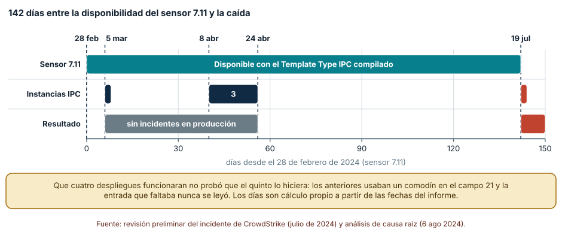
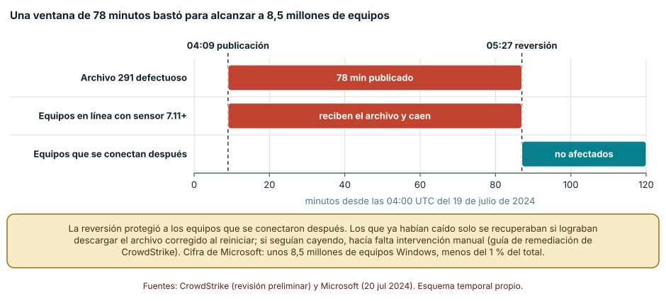
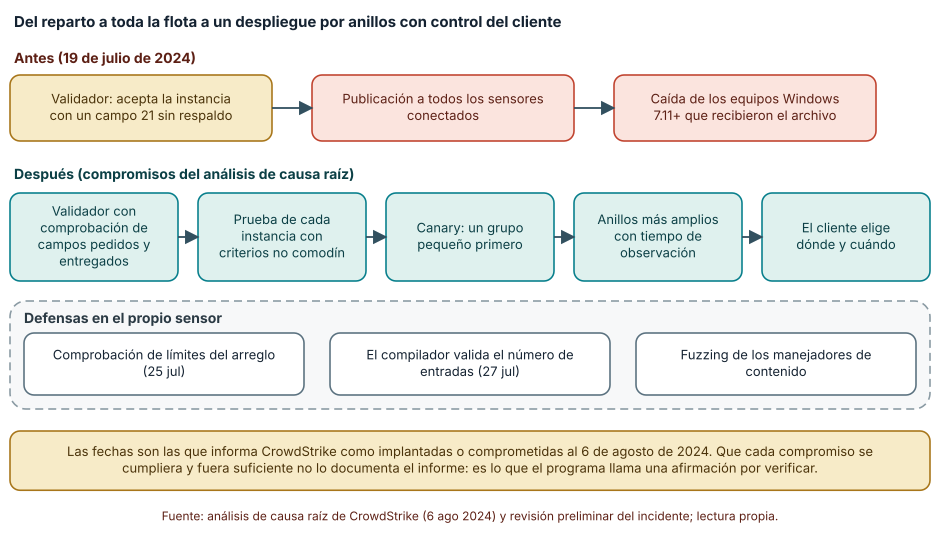

# CrowdStrike

[↑ Casos de fallo](README.md) · [← Caída global de Meta](meta-2021.md) · [Therac-25 →](therac-25.md)

El viernes 19 de julio de 2024, durante 78 minutos, CrowdStrike distribuyó un archivo de configuración que su agente de seguridad leyó dentro del núcleo de Windows. Millones de equipos se detuvieron con una pantalla azul en aerolíneas, bancos y hospitales. No hubo un atacante ni un fallo de hardware: hubo una entrada que faltaba, una comprobación que no existía y un reparto a toda la flota sin etapas intermedias. Este caso reconstruye el mecanismo con el análisis de causa raíz que publicó la propia empresa y separa lo que está documentado de lo que es lectura de este programa.

## Ficha histórica

| Dato | Contenido |
| --- | --- |
| Organización | CrowdStrike Holdings, Inc., empresa de ciberseguridad que ofrece la plataforma Falcon |
| Fundación y responsables | Fundada en 2011 por George Kurtz (director ejecutivo), Dmitri Alperovitch y Gregg Marston, según la enciclopedia Wikipedia; Kurtz sigue como director ejecutivo |
| Sede | Austin, Texas (EE. UU.) |
| Incidente | Viernes 19 de julio de 2024. Publicación a las 04:09 UTC y reversión a las 05:27 UTC |
| Alcance técnico | Equipos Windows con sensor 7.11 o superior que estaban en línea en esa ventana; los equipos Mac y Linux no se vieron afectados |
| Magnitud | Unos 8,5 millones de equipos Windows, menos del 1 % de todos los Windows, según Microsoft (20 de julio de 2024) |
| Daño económico | Unos 5.400 millones de dólares de pérdida directa estimada para las 500 mayores empresas de EE. UU. sin contar a Microsoft (Parametrix, citado por la BBC, 2024); Delta Air Lines declaró más de 500 millones de dólares y demandó a CrowdStrike |
| Documento oficial | Análisis de causa raíz externo del archivo de canal 291, 6 de agosto de 2024 |
| Estado posterior | El 29 de julio de 2024 cerca del 99 % de los sensores Windows estaban en línea. La empresa comprometió mejoras de proceso y el litigio con Delta seguía abierto en las fuentes consultadas |

La tabla resume datos y se sustenta en las fuentes del último apartado; la fecha de consulta de todas es el 16 de noviembre de 2026.

## Contexto y problema

Un agente de seguridad de punto final (*endpoint*) observa lo que hace un equipo —procesos que nacen, archivos que se escriben, conexiones que se abren— y decide si bloquear algo. Para ver todo eso y para que un atacante con permisos de administrador no lo apague, la mayoría de los productos de este tipo, incluidos los de Microsoft, instalan un controlador que corre en el núcleo (modo *kernel*). Microsoft lo explica en su blog de seguridad: el núcleo da visibilidad de todo el sistema, carga en el arranque temprano y resiste la manipulación, pero a costa de resiliencia, porque un fallo allí no puede reiniciarse como el de una aplicación normal y detiene el sistema entero.

El problema que CrowdStrike resolvía era de ritmo. Los atacantes cambian de técnica en horas. Si cada nueva detección exigiera publicar una versión del sensor, certificarla con Microsoft y esperar a que los clientes la instalaran, la defensa llegaría tarde. La apuesta fue separar dos tipos de actualización: el **Sensor Content**, que viaja con el sensor, y el **Rapid Response Content**, datos de configuración que se entregan desde la nube «a velocidad operativa» y que, según la empresa, no son código ni un controlador. Esa separación es razonable y común; el fallo no estuvo en la idea sino en que la entrega rápida heredó menos controles que la lenta.

## Mercado, usuarios y casos de uso

CrowdStrike vende a empresas y gobiernos. Su cliente típico administra miles o decenas de miles de equipos y quiere tres cosas: bloquear amenazas sin intervención, ver qué ocurrió en cada equipo y no ser el titular de mañana. De ahí el perfil de los afectados: según la BBC, bancos, hospitales y aerolíneas, es decir, organizaciones con muchos equipos Windows en tareas de cara al público —terminales de registro, cajeros, estaciones de trabajo clínicas—.

Hay tres tipos de usuario que conviene distinguir porque sufrieron el fallo de forma distinta:

- **Equipo de seguridad del cliente**: elige políticas, versiones del sensor (N, N-1 o N-2) y recibe alertas. Controlaba cuándo actualizar el sensor; el análisis de causa raíz indica que el control sobre dónde y cuándo llegaba el contenido rápido se añadió después del incidente.
- **Equipo de operaciones o de TI**: repara equipos uno a uno cuando algo se rompe y gestiona las claves de recuperación del cifrado de disco.
- **Usuario final y paciente o pasajero**: no sabe que existe el sensor y percibe solo el efecto, un mostrador que no responde.

## Funcionalidad de principio a fin

Esta sección sigue el recorrido de un archivo de canal desde su creación hasta la pantalla azul, instancia por instancia, y después el de la recuperación.

**1. Un ingeniero de detección crea una instancia de plantilla.** El sensor 7.11, disponible desde el 28 de febrero de 2024, introdujo un tipo de plantilla (*Template Type*) para detectar técnicas nuevas que abusan de las tuberías con nombre y otros mecanismos de comunicación entre procesos de Windows (IPC). Un tipo de plantilla es código compilado en el sensor que define campos de entrada. Una instancia de plantilla (*Template Instance*) es un conjunto de criterios, escritos con expresiones regulares, que dicen qué buscar en esos campos. Las instancias se crean desde una interfaz que se genera a partir del archivo de definiciones del tipo.

**2. Un validador comprueba la instancia.** El *Content Validator* revisa que el contenido sea válido contra la definición del tipo de plantilla. Las instancias aprobadas se agrupan en archivos de canal; las del tipo IPC viajan en el archivo de canal 291.

**3. El archivo llega al equipo.** El sensor guarda el archivo en disco, en la carpeta de CrowdStrike dentro de los controladores de Windows. Cuando Windows notifica que se creó una tubería con nombre, el controlador `csagent.sys` reúne el contexto del evento, arma el arreglo de entradas del tipo IPC y llama al intérprete de contenido (*Content Interpreter*), que compara esas entradas con los criterios del archivo.

**4. El intérprete lee la entrada que no existe.** El tipo de plantilla definía 21 campos, pero el código del sensor entregaba 20. Mientras las instancias usaran un comodín en el campo 21, nadie leía esa entrada. El 19 de julio se desplegaron dos instancias nuevas y una de ellas, por primera vez, exigía un valor concreto en el campo 21. El intérprete pidió la entrada 21, leyó una dirección inválida y Windows detuvo el sistema (`PAGE_FAULT_IN_NONPAGED_AREA`).

**5. La recuperación.** CrowdStrike revirtió el archivo en la nube a las 05:27 UTC. Un equipo que se conectaba después recibía la versión buena. Los equipos que ya habían caído solo se recuperaban si, al reiniciar, lograban descargar el archivo corregido antes de volver a fallar; la guía de remediación de la empresa recomendaba conectar el equipo por cable para ganar esa carrera. Cuando eso no bastaba, la guía describía dos rutas manuales —medios de recuperación arrancables y un proceso manual por equipo— y avisaba de que los equipos con cifrado BitLocker podían necesitar su clave de recuperación. El 22 de julio apareció una técnica automatizada. El 29 de julio, cerca del 99 % de los sensores estaba de vuelta.

## Negocio y economía

CrowdStrike se financia con suscripciones por equipo protegido. Su valor no es un producto estático sino la confianza de que el contenido de detección llegue rápido; por eso el reparto veloz de contenido era una ventaja competitiva y no un descuido. Cada hora que una amenaza nueva tarda en ser detectada es un riesgo para el cliente, y cada hora que se tarda en publicar es un argumento de venta que se pierde.

Esa economía explica la tensión de fondo, sin necesidad de suponer descuido:

- **Velocidad frente a puertas de control.** Un despliegue por anillos con tiempo de observación retrasa el contenido; el costo es detección más lenta en los equipos del último anillo. La decisión razonable depende del tipo de contenido: una firma de un malware activo justifica más prisa que un criterio nuevo de telemetría. El hecho de que la actualización del 19 de julio fuese, según la empresa, para recopilar telemetría sobre técnicas posibles pero no urgente apunta a que había margen para ir por etapas. Es una lectura propia: la fuente no dice qué urgencia tenía ese contenido.
- **Quién asume el costo de la falla.** La estimación de Parametrix atribuye 5.400 millones de dólares de pérdida directa a las 500 mayores empresas de EE. UU. y calcula que solo entre 540 millones y 1.080 millones estaban asegurados. El contrato entre CrowdStrike y Delta incluye, según la empresa, una cláusula que limita su responsabilidad; esa disputa se resolverá en los tribunales y este caso no toma partido.

**Cómo leer la figura.** Cada barra horizontal es la misma pérdida total, 5.400 millones de dólares, dividida en una parte asegurada (verde azulado) y otra no asegurada (coral). Las dos barras son los extremos del rango que dio Parametrix. Mira primero la proporción: aun en el caso favorable, más de cuatro quintos de la pérdida no estaban cubiertos. **Dónde deja de valer:** es una estimación de una aseguradora especializada para un conjunto concreto de empresas y solo para pérdida directa; no mide el daño total en el mundo ni la responsabilidad de nadie. La cifra declarada por Delta no se suma.

## Arquitectura y esquemas

### Contexto: dos zonas y dos rutas

El diagrama siguiente muestra los componentes que nombra el análisis de causa raíz y por dónde viajaba cada tipo de contenido.

**Cómo leer la figura.** Las zonas punteadas separan la nube de CrowdStrike del equipo del cliente. Los recuadros siguen el orden de la creación del contenido (arriba a abajo en la nube) y de su uso (de la notificación de Windows al intérprete). Abajo se contrastan las dos rutas de entrega: el contenido del sensor, que el cliente controla por versión, y el contenido rápido, que llegaba a todos. **Dónde deja de valer:** el diagrama simplifica los nombres internos, como hace el propio informe, y no dibuja otros componentes del sensor ni los canales de otros tipos de plantilla.

El riesgo se concentra en un punto: un archivo de datos, escrito por humanos y validado por una herramienta, se interpretaba dentro de un controlador de kernel. Un error de datos se convirtió en un error de memoria en el nivel más privilegiado del sistema operativo.

### Flujo crítico: el arreglo de entradas

**Cómo leer la figura.** Cada casilla es una entrada que el sensor arma para el intérprete: veinte punteros válidos y una casilla coral, la 21, que no existe. Debajo, los dos cuadros amarillos muestran la discrepancia entre lo que declara la definición del tipo y lo que entrega el código. Mira primero la casilla coral: es la lectura que no se hizo durante cuatro despliegues y sí en el quinto. **Dónde deja de valer:** el esquema describe un fallo concreto de lectura fuera de límites; no representa cómo se organiza la memoria del sensor ni otros fallos posibles, y el informe aclara que no es una escritura arbitraria.

### Datos y escala

La escala del daño no la determinó el tamaño del error —una lectura de un puntero— sino el alcance del despliegue: todos los equipos en línea con sensor 7.11 o superior en la ventana de 78 minutos. Por eso las figuras de la sección de línea de tiempo importan: muestran que el defecto estuvo latente desde febrero y que se activó con un solo archivo.

## Casos especiales y cómo fallan

Estos son los bordes que el incidente puso a prueba. Cada uno se separa en lo documentado y en lo que es lectura propia.

**El comodín que ocultaba el desajuste.** Documentado: las pruebas automáticas usaban un conjunto fijo de 12 casos y el archivo de canal de prueba incluía un comodín en el campo 21 para todas las instancias, así que ni las pruebas del desarrollo ni las de la versión del sensor leyeron esa entrada. Las primeras instancias en producción tampoco. Lectura propia: una prueba que siempre usa el mismo valor en un campo no puede detectar que el campo no existe.

**Un validador y un intérprete que no estaban de acuerdo.** Documentado: el validador evaluó el contenido esperando 21 entradas, mientras el intérprete recibía 20. Los dos componentes habían heredado la misma definición de la plantilla, pero solo el validador la usó para decidir qué era válido; el intérprete trabajaba con lo que le daba el código. Hay aquí una lección general de contratos: quien valida y quien ejecuta deben compartir la fuente de verdad, o la validación solo prueba que el archivo cumple una definición que el ejecutor no cumple.

**Una excepción que el intérprete no podía absorber.** Documentado: la empresa describe al intérprete como diseñado para manejar con elegancia las excepciones de contenido problemático, y reconoce que esta excepción, una lectura inválida en el kernel, no pudo manejarse. Windows protege el kernel con una regla simple: ante una excepción de memoria no recuperable en una zona crítica, detiene el sistema para no continuar con datos dudosos.

**El arranque que repite el fallo.** Documentado en la guía de remediación: el equipo podía quedar en un bucle de arranque y había que intervenir de forma manual, con claves de recuperación cuando el disco estaba cifrado. Ese costo humano, multiplicado por millones de equipos, es lo que convirtió un defecto de 78 minutos en una recuperación de días.

**Seguridad y recuperación en conflicto.** Un agente que arranca antes que casi todo lo demás, para que el malware no lo adelante, es también el que no se puede desactivar con facilidad cuando falla. Es una tensión de diseño que Microsoft reconoce en su blog y que explica por qué la solución a largo plazo que propone es mover funciones al modo usuario cuando sea posible.

## Línea de tiempo

Los hechos de la tabla vienen de la revisión preliminar del incidente y del análisis de causa raíz de CrowdStrike; las diferencias de días son cálculo propio.

| Fecha (UTC) | Hecho | Fuente |
| --- | --- | --- |
| 28 de febrero de 2024 | El sensor 7.11 está disponible para los clientes con el nuevo tipo de plantilla IPC | Revisión preliminar |
| 5 de marzo de 2024 | Prueba de esfuerzo del tipo IPC en un entorno de preproducción y primera instancia en producción | Revisión preliminar |
| 8 al 24 de abril de 2024 | Tres instancias más, sin incidentes | Revisión preliminar |
| 19 de julio de 2024, 04:09 | Se publican dos instancias; una incluye un criterio no comodín en el campo 21 | Revisión preliminar; análisis de causa raíz |
| 19 de julio de 2024, 05:27 | Se revierte el archivo; los equipos que se conectan después no se ven afectados | Revisión preliminar |
| 20 de julio de 2024 | Microsoft estima unos 8,5 millones de equipos Windows afectados | Microsoft |
| 22 de julio de 2024 | Aparecen técnicas automatizadas de remediación | Guía de preguntas de CrowdStrike |
| 25 y 27 de julio de 2024 | Se añade una comprobación de límites del arreglo y una validación en tiempo de compilación | Análisis de causa raíz |
| 29 de julio de 2024 | Cerca del 99 % de los sensores Windows están en línea | Análisis de causa raíz |
| 6 de agosto de 2024 | Se publica el análisis de causa raíz | CrowdStrike |

**Cómo leer la figura.** El eje horizontal cuenta días desde el 28 de febrero de 2024. Cada carril es una cosa distinta: la disponibilidad del sensor, los despliegues de instancias IPC y el resultado. Las líneas punteadas fijan las cinco fechas del informe. Mira primero la distancia entre el último despliegue sin incidentes y el que falló: más de tres meses de normalidad aparente. **Dónde deja de valer:** que cuatro despliegues salieran bien no es una prueba estadística; los anteriores no leían la entrada 21. El informe no dice si hubo otros despliegues entre abril y julio.

**Cómo leer la figura.** Esta vez el eje son los minutos del 19 de julio. La barra coral es la ventana en que el archivo estuvo disponible; la barra verde azulada, los equipos que se conectaron después y por tanto recibieron la versión buena. Mira primero lo corto de la ventana frente a lo largo de la recuperación. **Dónde deja de valer:** la figura no dice cuántos equipos recibieron el archivo ni cuándo cayó cada uno; la cifra de 8,5 millones es una estimación de Microsoft sobre equipos afectados y no sobre los que estaban en línea.

## Qué falló en cada instancia

Siguiendo el recorrido de la funcionalidad, instancia por instancia, qué se esperaba y qué ocurrió.

1. **Definición y código del tipo de plantilla.** Se esperaba que el número de campos de la definición (21) coincidiera con el de entradas que entrega el sensor (20). No coincidían y la compilación no lo comprobaba. Este es el primer hallazgo del análisis de causa raíz.
2. **Pruebas del tipo de plantilla.** Se esperaba que las pruebas funcionales y de estrés ejercitaran todos los campos. Ejercitaron el flujo de datos con 12 casos estáticos, y el archivo de prueba usó comodín en el campo 21 en todas las instancias. No había una prueba con un criterio real en cada campo.
3. **Intérprete de contenido.** Se esperaba una comprobación de límites sobre el índice solicitado. No existía: leyó la entrada 21 de un arreglo de 20. Además, no verificaba que el tamaño del arreglo coincidiera con el número de entradas que el contenido esperaba.
4. **Validador de contenido.** Se esperaba que rechazara contenido que usara más campos de los provistos. Evaluó con la hipótesis de 21 entradas y aprobó la instancia.
5. **Pruebas de la instancia.** El tipo de plantilla pasó una prueba de esfuerzo con una instancia de prueba; las instancias posteriores se aprobaron por la confianza en el validador y en los despliegues previos. No se las probaba contra el intérprete real.
6. **Despliegue.** Se esperaba un reparto por etapas para limitar el daño de una instancia defectuosa. El informe indica que cada instancia debería tener despliegue escalonado y que ese control se añadió después; llegó a todos los equipos en línea.
7. **Control del cliente.** Los clientes controlaban la versión del sensor, no el contenido rápido. El informe reconoce que la plataforma se actualizó para darles ese control.

## Causa raíz y factores

El análisis de causa raíz de CrowdStrike resume que el bloqueo fue la **confluencia** de tres cosas: el desajuste entre las 21 entradas que validó el validador y las 20 que recibía el intérprete, una lectura fuera de límites latente en el intérprete y la ausencia de una prueba específica con criterios no comodín en el campo 21. Es una formulación sin culpables: describe condiciones de sistema.

**Detonante (documentado).** La publicación, a las 04:09 UTC del 19 de julio, de una instancia que por primera vez usaba el campo 21 con un criterio real.

**Condiciones latentes (documentado).** Número de campos sin validar en compilación; sin comprobación de límites en tiempo de ejecución; pruebas con comodín; validador con la hipótesis equivocada; pruebas de instancia insuficientes; despliegue sin etapas; sin control del cliente.

**Factores de contexto (documentado e inferido).** Documentado: la decisión de desplegar se apoyó en la prueba de esfuerzo de marzo, en la confianza en el validador y en las instancias anteriores. Inferido por este programa a partir del informe: el sistema premiaba la velocidad de publicación y las comprobaciones eran independientes entre sí, de modo que cada una confiaba en que otra capturara el error.

**No se sabe.** El informe público no dice cuánto tiempo de ingeniería o cuántos ciclos de revisión tenía el contenido del 19 de julio, qué urgencia tenía su publicación, ni cómo se tomó la decisión de ir a todos los equipos a la vez. Tampoco detalla los resultados de las revisiones independientes que la empresa anunció.

## Mejoras que debieron hacerse

> **Esta sección es análisis propio de este programa**, apoyado en los hallazgos y mitigaciones del análisis de causa raíz. No es una afirmación de CrowdStrike ni una evaluación de su proceso interno, que no es público.

Cada mejora se liga a la causa que corta y a la clase que la enseña. Las que CrowdStrike dice haber implantado o comprometido están marcadas.

**Cómo leer la figura.** La fila superior es lo que ocurrió; la inferior, lo que el análisis de causa raíz promete. Las cajas siguen el orden del recorrido del contenido. Mira primero el cambio de «publicación a todos» a «canary y anillos»: es el control que limita el tamaño del daño aunque el error persista. **Dónde deja de valer:** las fechas son las que informa CrowdStrike al 6 de agosto de 2024; la figura no puede afirmar que cada compromiso se cumpliera ni que fuera suficiente.

1. **Validar en compilación que el número de entradas coincide con la definición.** Corta la causa 1. CrowdStrike lo implantó el 27 de julio de 2024. Un contrato entre dos piezas de código debe comprobarse donde se declara, no donde se usa. Se estudia en [SE-162](../../classes/part-13-especificaciones-contratos-y-modelos/se-162-esquemas-de-datos-y-validacion/README.md) y en [SE-159](../../classes/part-13-especificaciones-contratos-y-modelos/se-159-contratos-invariantes-y-diseno-por-contrato/README.md).
2. **Comprobación de límites en el intérprete.** Corta la causa 3. Se añadió el 25 de julio. Un índice que viene de datos externos debe tratarse como no confiable. Se estudia en [SE-388](../../classes/part-32-seguridad-privacidad-y-cumplimiento/se-388-validacion-codificacion-y-clases-de-inyeccion/README.md) y en [SE-065](../../classes/part-05-fundamentos-de-programacion/se-065-errores-excepciones-y-resultados-explicitos/README.md).
3. **Pruebas con valores reales por campo, fuzzing y pruebas de interfaz.** Corta la causa 2. El informe habla de pruebas automáticas con criterios no comodín para cada campo y de *fuzzing* ya terminado para el tipo 291. Un conjunto fijo de casos que siempre usa el mismo valor no mide el contrato. Se estudia en [SE-366](../../classes/part-30-estrategia-y-tecnicas-de-prueba/se-366-mutacion-fuzzing-y-generacion-de-casos/README.md) y en [SE-365](../../classes/part-30-estrategia-y-tecnicas-de-prueba/se-365-pruebas-basadas-en-propiedades-y-modelos/README.md).
4. **Probar cada instancia contra el intérprete real, no solo el tipo.** Corta la causa 5. Anunciado en el informe. Un cambio de datos que el ejecutor interpreta es un cambio de comportamiento y merece la misma puerta que un cambio de código. Se estudia en [SE-363](../../classes/part-30-estrategia-y-tecnicas-de-prueba/se-363-integracion-componentes-y-contratos/README.md) y en [SE-374](../../classes/part-31-calidad-rendimiento-y-resiliencia/se-374-revision-analisis-estatico-y-quality-gates/README.md).
5. **Despliegue escalonado con canary, anillos y tiempo de observación.** Corta la causa 6, la que determinó el tamaño del daño. Es la mejora de mayor efecto: aunque el defecto pasara las pruebas, habría afectado a un grupo pequeño. Se estudia en [SE-404](../../classes/part-33-build-release-y-cadena-de-suministro/se-404-canary-blue-green-y-rollback/README.md) y en [SE-403](../../classes/part-33-build-release-y-cadena-de-suministro/se-403-feature-flags-y-entrega-progresiva/README.md).
6. **Control del cliente sobre dónde y cuándo.** Corta la causa 7. Anunciado y, según el informe, ya implantado en parte. Quien asume el riesgo debe poder decidir el ritmo en sus entornos críticos. Se estudia en [SE-451](../../classes/part-37-gestion-liderazgo-y-practica-profesional/se-451-compras-proveedores-y-evaluacion-tecnica/README.md) y en [SE-405](../../classes/part-33-build-release-y-cadena-de-suministro/se-405-instaladores-paquetes-y-actualizaciones/README.md).
7. **Detener el contagio con señales de salud.** Propuesta propia, derivada del patrón: un despliegue por anillos solo protege si algo decide parar. Los anillos necesitan una señal automática —por ejemplo, que los equipos del anillo dejen de reportar tras recibir el archivo— y una regla de retroceso. Se estudia en [SE-425](../../classes/part-35-observabilidad-sre-e-incidentes/se-425-sli-slo-sla-y-presupuestos-de-error/README.md) y en [SE-428](../../classes/part-35-observabilidad-sre-e-incidentes/se-428-gestion-de-incidentes-y-comunicacion/README.md).
8. **Que el componente más privilegiado tenga el menor código posible.** Dirección de arquitectura que proponen Microsoft y la propia CrowdStrike: mover a modo usuario lo que no necesita el kernel. Reduce el costo del peor error posible. Se estudia en [SE-025](../../classes/part-02-sistemas-operativos-terminal-y-automatizacion-base/se-025-windows-linux-macos-y-sus-modelos-operativos/README.md) y en [SE-379](../../classes/part-31-calidad-rendimiento-y-resiliencia/se-379-circuit-breakers-bulkheads-y-degradacion/README.md).
9. **Planificar la recuperación del peor caso.** Producir de antemano medios de recuperación, instrucciones y acceso a claves de cifrado, y practicar su uso. Se estudia en [SE-430](../../classes/part-35-observabilidad-sre-e-incidentes/se-430-continuidad-disaster-recovery-y-ejercicios/README.md).

Un efecto de lo que enseña el curso: ninguna de estas mejoras exige adivinar el defecto. La ausencia de un campo era un defecto concreto, pero un despliegue por anillos y una señal de salud habrían contenido cualquier otro.

## Vínculo con el curso

El caso muestra de forma encadenada mecanismos que el programa trata por separado. Cada clase explica el mecanismo; el caso muestra qué ocurre cuando falta.

- [SE-404 · Canary, blue-green y rollback](../../classes/part-33-build-release-y-cadena-de-suministro/se-404-canary-blue-green-y-rollback/README.md): el control cuya ausencia determinó el alcance del daño.
- [SE-403 · Feature flags y entrega progresiva](../../classes/part-33-build-release-y-cadena-de-suministro/se-403-feature-flags-y-entrega-progresiva/README.md): la configuración que cambia el comportamiento de producción es entrega y no un archivo inocuo.
- [SE-366 · Mutación, fuzzing y generación de casos](../../classes/part-30-estrategia-y-tecnicas-de-prueba/se-366-mutacion-fuzzing-y-generacion-de-casos/README.md): por qué un conjunto fijo de casos con comodines no detecta un campo ausente.
- [SE-162 · Esquemas de datos y validación](../../classes/part-13-especificaciones-contratos-y-modelos/se-162-esquemas-de-datos-y-validacion/README.md): el desajuste entre la definición y el código es un fallo de contrato.
- [SE-388 · Validación, codificación y clases de inyección](../../classes/part-32-seguridad-privacidad-y-cumplimiento/se-388-validacion-codificacion-y-clases-de-inyeccion/README.md): un índice que viene de datos se valida antes de usarse.
- [SE-065 · Errores, excepciones y resultados explícitos](../../classes/part-05-fundamentos-de-programacion/se-065-errores-excepciones-y-resultados-explicitos/README.md): una excepción en el kernel no se puede capturar; el diseño debe evitarla.
- [SE-025 · Windows, Linux, macOS y sus modelos operativos](../../classes/part-02-sistemas-operativos-terminal-y-automatizacion-base/se-025-windows-linux-macos-y-sus-modelos-operativos/README.md): qué significa ejecutar en modo kernel y por qué un fallo ahí detiene el sistema.
- [SE-451 · Compras, proveedores y evaluación técnica](../../classes/part-37-gestion-liderazgo-y-practica-profesional/se-451-compras-proveedores-y-evaluacion-tecnica/README.md): el riesgo de un proveedor con acceso al núcleo de la flota.
- [SE-428 · Gestión de incidentes y comunicación](../../classes/part-35-observabilidad-sre-e-incidentes/se-428-gestion-de-incidentes-y-comunicacion/README.md): cómo se comunica y se coordina una recuperación a escala.
- [SE-429 · Postmortems sin culpa y aprendizaje](../../classes/part-35-observabilidad-sre-e-incidentes/se-429-postmortems-sin-culpa-y-aprendizaje/README.md): el análisis de causa raíz de CrowdStrike es un ejemplo de formato público.

## Qué no generalizar

- **No es un caso contra el contenido dinámico.** Separar código y configuración es una buena práctica; lo que falló fue que la ruta rápida careciera de etapas y de pruebas contra el ejecutor real.
- **No es un caso contra los agentes de seguridad.** Los controladores de núcleo existen por razones de visibilidad y resistencia a manipulación; el caso muestra su costo en resiliencia, no que sean evitables en todos los casos.
- **No prueba que las pruebas fueran descuidadas.** El informe describe pruebas funcionales, de esfuerzo y certificación WHQL; falló la cobertura de un caso concreto. La lección es sobre qué mide cada prueba, no sobre la diligencia de un equipo.
- **No sirve para estimar la probabilidad de otro incidente.** Un solo evento, con una configuración concreta de proveedor, sistema operativo y clientes, no da una tasa.
- **Las cifras de daño no son comparables entre sí.** Microsoft cuenta equipos, Parametrix pérdida directa de un conjunto de empresas y Delta su propio costo; cada una responde a una pregunta distinta.
- **Las mejoras son compromisos de la empresa a agosto de 2024.** Este caso no verifica su cumplimiento posterior.

## Fuentes públicas verificadas

Todas las URL se abrieron el 16 de noviembre de 2026.

- [CrowdStrike, External Technical Root Cause Analysis — Channel File 291 (6 de agosto de 2024)](https://www.crowdstrike.com/wp-content/uploads/2024/08/Channel-File-291-Incident-Root-Cause-Analysis-08.06.2024.pdf): fuente primaria del mecanismo (21 frente a 20 entradas), los seis hallazgos, las mitigaciones y sus fechas, el volcado de memoria y la certificación WHQL.
- [CrowdStrike, Falcon Content Update Remediation and Guidance Hub](https://www.crowdstrike.com/falcon-content-update-remediation-and-guidance-hub/): revisión preliminar del incidente con las horas de publicación y reversión, la cronología del tipo IPC, la distinción entre Sensor Content y Rapid Response Content, preguntas frecuentes y pasos de remediación.
- [Microsoft, Helping our customers through the CrowdStrike outage (20 de julio de 2024)](https://blogs.microsoft.com/blog/2024/07/20/helping-our-customers-through-the-crowdstrike-outage/): estimación de 8,5 millones de equipos Windows afectados, menos del 1 % del total.
- [Microsoft Security Blog, Windows security best practices for integrating and managing security tools (27 de julio de 2024)](https://www.microsoft.com/en-us/security/blog/2024/07/27/windows-security-best-practices-for-integrating-and-managing-security-tools/): por qué los productos de seguridad usan controladores de kernel, el costo en resiliencia y la alternativa de modo usuario.
- [BBC News, CrowdStrike backlash over $10 apology voucher for IT chaos (24 de julio de 2024)](https://www.bbc.co.uk/news/articles/ce58p0048r0o): estimación de Parametrix de 5.400 millones de dólares de pérdida y de la parte asegurada; sectores afectados.
- [CNBC, CrowdStrike moves to dismiss Delta suit citing contract terms (17 de diciembre de 2024)](https://www.cnbc.com/2024/12/17/crowdstrike-moves-to-dismiss-delta-suit-citing-contract-terms.html): la cifra de más de 500 millones de dólares declarada por Delta, la demanda y la posición de CrowdStrike sobre la limitación contractual de responsabilidad.
- [Wikipedia, CrowdStrike](https://en.wikipedia.org/wiki/CrowdStrike): fundadores, año de fundación y sede; fuente secundaria que se usa solo para esos datos de ficha.

---

[↑ Casos de fallo](README.md) · [← Caída global de Meta](meta-2021.md) · [Therac-25 →](therac-25.md)
