# Equifax 2017

[↑ Casos de fallo](README.md) · [← Post Office Horizon](post-office-horizon.md)

> **Qué es esta página.** Un caso de estudio de fallo: la realidad frente a la teoría del curso. No es una clase ni un rol. Separa lo que las fuentes **documentan**, lo que este análisis **infiere** y lo que **no se sabe**. Habla de decisiones, procesos y sistemas, no de personas: los testimonios del informe se citan por su rol y sin nombres. Fecha de consulta de todas las fuentes: 23 de noviembre de 2026.

**Resumen.** Entre el 13 de mayo y el 30 de julio de 2017, durante 76 días, unos atacantes accedieron a bases de datos de Equifax, uno de los tres grandes burós de crédito de EE. UU., y sacaron datos personales de unos 148 millones de personas. La entrada fue una vulnerabilidad conocida de Apache Struts, un marco de código abierto, en un portal de disputas de consumidores llamado ACIS: el proveedor había publicado el parche el 7 de marzo de 2017 y la política de Equifax exigía aplicarlo en 48 horas, pero ACIS no se parcheó hasta que se descubrió el incidente. El informe del personal de la mayoría del Comité de Supervisión de la Cámara de Representantes (diciembre de 2018) describe, además, un escaneo que no detectó la vulnerabilidad, un aviso por correo a unas 430 personas sin dueño asignado, un dispositivo de monitoreo del tráfico de ACIS que llevaba 19 meses inactivo por un certificado vencido, credenciales sin cifrar en un archivo que abrieron 48 bases de datos, datos personales sin cifrar y un entorno heredado del que la empresa no tenía un inventario fiable del software. Este caso recorre el sistema en varios niveles de zoom, separa lo documentado de lo inferido y propone, rotulado como análisis propio, los controles que habrían cortado cada eslabón. Declaración de alcance: las fuentes verificadas son el informe del Comité y la página de la GAO; no se pudieron verificar en esta sesión los acuerdos económicos posteriores (por ejemplo, el de 2019 con organismos federales y estados), así que el caso no los cuantifica.

**Cómo leer esta página.** Cada afirmación factual lleva entre paréntesis su fuente: «Informe» es el informe del personal de la mayoría del Comité de Supervisión y Reforma del Gobierno de la Cámara de Representantes (*The Equifax Data Breach*, diciembre de 2018), un documento de una de las partes del Comité que cita documentos y testimonios de Equifax; «GAO» es el informe GAO-18-559. Lo que no lleva fuente es análisis propio y está rotulado. Las figuras son dibujos propios; ninguna repite una tabla y todas dicen dónde dejan de valer.

## Ficha histórica

| Dato | Detalle | Fuente |
| --- | --- | --- |
| Organización | Equifax, buró de crédito fundado en 1899 en Atlanta (Georgia), cotizada desde 1965 en la bolsa de Nueva York (símbolo EFX) y miembro del S&P 500 | Informe, apartado I |
| Escala | 10 300 empleados; 24 países; información de unos 820 millones de consumidores y más de 91 millones de empresas | Informe, apartado I |
| Incidente | Del 13 de mayo al 30 de julio de 2017 (76 días): acceso no autorizado a bases de datos por una vulnerabilidad de Apache Struts en el portal ACIS; detección el 29 de julio al renovar un certificado vencido | Informe, cronología |
| Aviso público | 7 de septiembre de 2017, con 143 millones de consumidores de EE. UU. | Informe, cronología |
| Magnitud del daño | 143 millones, más 2,5 millones el 2 de octubre de 2017 y 2,4 millones el 1 de marzo de 2018: 148 millones en total según el Comité; «al menos 145,5 millones» según la GAO | Informe; GAO |
| Datos expuestos | Nombres, números de la Seguridad Social, fechas de nacimiento, direcciones, números de carné de conducir, números de tarjetas de crédito y documentos de disputas | Informe, cronología (aviso del 7 de septiembre) |
| Respuesta regulatoria | Orden de consentimiento con agencias de ocho estados el 25 de junio de 2018; informe de la GAO el 30 de agosto de 2018 | Informe, apartado VI; GAO |
| Estado | Equifax dijo haber implantado las once recomendaciones de remediación de Mandiant | Informe, apartado VI.A |

Las fuentes consultadas dan los hechos de la empresa a la fecha de 2017 y 2018; este caso no los actualiza. Como parte del contexto de negocio, el Comité cita un contrato de 7,25 millones de dólares del IRS con Equifax para verificar la identidad de contribuyentes (Informe, apartado I).

### Sedes, centros de datos y oficinas

| Lugar | Qué consta | Fuente |
| --- | --- | --- |
| Atlanta, Georgia | Fundación de la empresa en 1899; el informe habla de equipos de IT «en Atlanta» | Informe, apartados I y V |
| 24 países | Operaciones en Norteamérica, Centro y Sudamérica, Europa y Asia-Pacífico | Informe, apartado I |
| Centros de datos | No se describen su número, ubicación ni propiedad | No consta |

**No se sabe** a partir de las fuentes consultadas: la lista de oficinas por país, el número de centros de datos y su arquitectura de red.

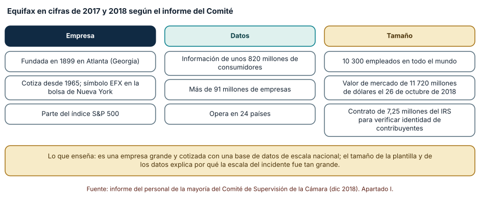

**Cómo leer la figura.** Tres columnas: quién es la empresa, cuántos datos tiene y qué tamaño tiene. Mira la segunda: 820 millones de consumidores es una cifra mucho mayor que los 148 millones de afectados; la fuga alcanzó a una parte de lo que la empresa guarda. **Dónde deja de valer:** son cifras de 2017 y 2018 del informe; no dicen cuántos de esos registros estaban en las bases comprometidas.

### Organización: Seguridad e IT

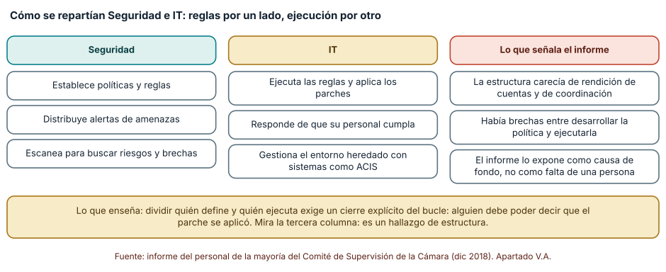

**Cómo leer la figura.** La primera columna es quien definía reglas; la segunda, quien las ejecutaba; la tercera, el hallazgo. Mira que el bucle entre definir y ejecutar no tiene un cierre que diga «el parche se aplicó». **Dónde deja de valer:** el informe no publica el organigrama completo; es la división de funciones que describen los testimonios.

Documentado. Hasta 2005 el responsable de seguridad dependía del director de sistemas (CIO); tras una reorganización, el responsable de seguridad pasó a depender del director jurídico, y en 2005 se contrató a un nuevo responsable de seguridad para establecer los primeros estándares corporativos de seguridad con un plan de tres años y 15 millones de dólares (Informe, apartado V.A.1). Los testimonios coinciden en que Seguridad establecía las reglas y trabajaba con IT para implantarlas, que IT era responsable de que su personal las cumpliera y que Seguridad también hacía escaneos proactivos para detectar brechas (Informe, apartado V.A.2). El Comité concluye que la estructura permitió una coordinación ineficaz entre IT y Seguridad (Informe, apartado V.A.3). **No se sabe:** el tamaño de cada equipo, las decisiones de reorganización posteriores a 2013 y cómo se medía el cumplimiento.

### Visión y misión

Las fuentes consultadas no contienen una declaración de visión o misión de Equifax. El análisis propio es que un negocio cuyo activo principal es el dato de terceros tiene la seguridad de ese dato como parte del producto, aunque quien pierde por un fallo sea una persona que no es cliente de la empresa.

## Contexto y problema

Un buró de crédito reúne información de consumidores aportada por entidades que otorgan crédito y por otras fuentes, la analiza para crear informes y puntuaciones y la vende a terceros (Informe, apartado I.A). Los consumidores no aportan sus datos voluntariamente ni pueden «optar por salirse» de ese proceso. Prestamistas, aseguradoras, empleadores, proveedores de servicios públicos y agencias federales usan esos informes para gestionar riesgo y verificar identidad (Informe, apartado I.A). En EE. UU. hay tres grandes burós nacionales, Equifax, Experian y TransUnion, y unos 400 regionales y especializados (Informe, apartado I.A).

**El problema que el sistema resolvía.** Equifax necesitaba ofrecer a los consumidores una vía para disputar la información de sus informes. Esa función, obligada por la regulación de informes de crédito, se atendía con un portal web de disputas, ACIS (*Automated Consumer Interview System*): una aplicación a medida, expuesta a Internet y desarrollada en los años setenta, que corría una versión de Apache Struts con una vulnerabilidad (Informe, resumen ejecutivo).

**La apuesta (documentado).** Equifax había crecido con muchas adquisiciones y mantenía un entorno heredado complejo; el Comité señala que ejecutaba sistemas críticos de negocio sobre tecnología heredada con riesgos de seguridad documentados y que la modernización estaba en curso cuando ocurrió el incidente (Informe, apartado V.C). Un entorno heredado funciona mientras nadie lo toca; el costo de mantenerlo seguro es continuo.

**El problema oculto (análisis propio).** Un portal que conecta a Internet con bases de datos de consumidores es un puente. La seguridad de ese puente depende de tres cosas que el informe examina: saber qué componentes lo forman, parchearlos a tiempo y vigilar lo que cruza.

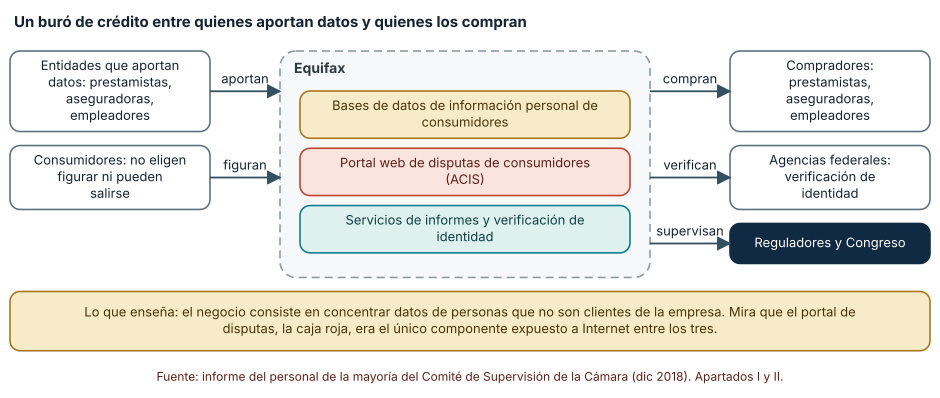

**Cómo leer la figura.** Izquierda: de dónde vienen los datos; centro: Equifax con tres elementos; derecha: quién los compra o supervisa. Mira la caja roja del centro: el portal de disputas era el elemento expuesto a Internet. **Dónde deja de valer:** no muestra todos los productos ni los otros portales de la empresa; son los que el informe describe.

## Mercado, usuarios y casos de uso

- **Consumidores.** Las personas cuyos datos se guardan; no son clientes. Usan el portal de disputas cuando quieren corregir su informe (Informe, resumen).
- **Entidades que aportan datos.** Prestamistas, aseguradoras y otras que informan al buró (Informe, apartado I.A).
- **Compradores.** Prestamistas, aseguradoras, empleadores, proveedores de servicios públicos y agencias federales como el IRS (Informe, apartado I.A).
- **Equipos internos.** Seguridad, IT, gestión de amenazas y vulnerabilidades (GTVM), el equipo jurídico y la dirección.
- **Afectados.** Unos 148 millones de personas de EE. UU. cuyos datos se exfiltraron (Informe). La GAO habla de «al menos 145,5 millones» y de casi 150 millones en su resumen (GAO).
- **Reguladores y Congreso.** La FTC, la CFPB, la SEC y agencias estatales; dos comités de la Cámara abrieron una investigación el 14 de septiembre de 2017 (Informe, cronología).

**Casos de uso del sistema afectado.** (1) El consumidor abre una disputa y sube documentos que la respaldan; (2) el personal de Equifax procesa la disputa; (3) las bases de datos se consultan para generar informes. Los casos (1) y (2) usaban ACIS; el (3), otros sistemas a los que ACIS no debía llegar.

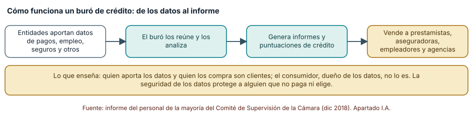

**Cómo leer la figura.** De izquierda a derecha: quién aporta, quién analiza, qué se produce y quién compra. Mira la última: el consumidor no aparece como cliente. **Dónde deja de valer:** es el modelo general que describe el informe, no los productos concretos de Equifax.

## Funcionalidad de principio a fin

1. **Aviso del proveedor.** El 7 de marzo de 2017 el proyecto Apache Struts anuncia la vulnerabilidad CVE-2017-5638 y publica el parche (Informe, cronología).
2. **Aviso a Equifax.** El 8 de marzo US-CERT envía a Equifax una alerta de parchear; el 9 de marzo el equipo de gestión de amenazas y vulnerabilidades distribuye el aviso por correo pidiendo aplicar el parche crítico en 48 horas (Informe, cronología).
3. **Escaneo.** El 15 de marzo, el equipo de seguridad ejecuta escaneos para identificar sistemas con la vulnerabilidad; no la detectan en ningún sistema externo (Informe, cronología).
4. **Intrusión.** El 13 de mayo los atacantes entran por la vulnerabilidad de Struts en ACIS y colocan puertas traseras web (Informe, cronología).
5. **Movimiento.** Encuentran un archivo con credenciales sin cifrar que les da acceso a 48 bases de datos ajenas a ACIS; ejecutan unas 9 000 consultas y localizan datos personales sin cifrar 265 veces; los sacan del entorno (Informe, resumen).
6. **Detección.** El 29 de julio Equifax renueva el certificado vencido del dispositivo que vigilaba el tráfico de ACIS, ve tráfico sospechoso y lo bloquea; el 30 de julio saca ACIS de línea (Informe, cronología).

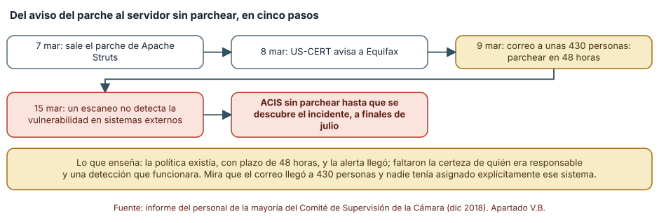

**Cómo leer la figura.** Cinco cajas de izquierda a derecha, de la publicación del parche a la situación de ACIS. Mira la cuarta: el escaneo no detectó la vulnerabilidad. **Dónde deja de valer:** el informe no explica técnicamente por qué el escaneo no la detectó; solo consta que no lo hizo.

### El día a día de un parche en Equifax

Documentado. La política de gestión de parches de 2016 clasifica cada parche por criticidad según el proveedor, y normalmente Equifax adoptaba esa clasificación; el parche de Struts era crítico, y la política exigía aplicarlo en 48 horas desde su difusión el 9 de marzo (Informe, apartado V.B.1). El proceso dependía de que el responsable de cada aplicación supiera qué software y qué versión corrían en ella para iniciar el parcheo manualmente; el aviso se distribuía por correo a una lista, y a unas 430 personas llegó el del 9 de marzo (Informe, apartados V.B.1 y V.C). Un directivo con responsabilidad sobre el entorno de ACIS declaró no haber sabido, antes del anuncio, que Struts corría en ese entorno, y que no creía que hubiese una designación explícita de propietarios de la aplicación (Informe, apartado V.B.1.a). **No se sabe:** el volumen típico de parches por mes, el porcentaje que se aplicaba en plazo y cómo se verificaba su aplicación.

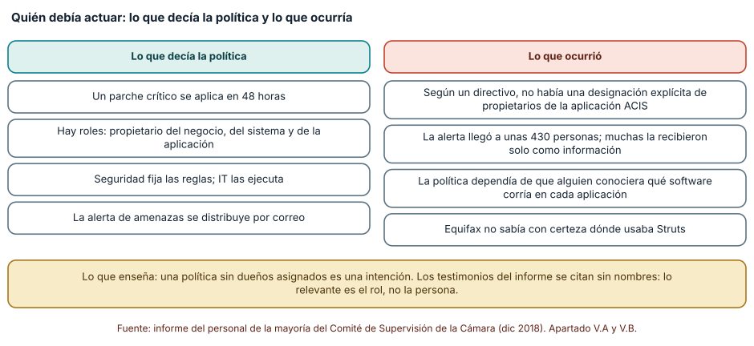

**Cómo leer la figura.** A la izquierda, lo que la política prescribía; a la derecha, lo que ocurrió. Mira la primera línea de la derecha: sin propietarios designados, nadie tenía asignada la acción. **Dónde deja de valer:** son testimonios recogidos por el Comité en entrevistas con personas de Equifax; el informe es de una de las partes del Comité y este caso los cita sin nombres.

## Negocio y economía

Equifax gana dinero vendiendo información y análisis sobre consumidores a empresas y agencias. Los hechos económicos que constan en las fuentes verificadas:

- **Escala.** 10 300 empleados, 24 países, 820 millones de consumidores y más de 91 millones de empresas en sus bases (Informe, apartado I).
- **Valor de mercado.** 11 720 millones de dólares el 26 de octubre de 2018 (Informe, apartado I).
- **Ingresos con el Estado.** Un contrato del IRS de 7,25 millones de dólares para verificar la identidad de contribuyentes; la GAO añade que el IRS, la Administración de la Seguridad Social y el Servicio Postal eran grandes clientes federales de verificación de identidad, evaluaron los controles de Equifax y que el IRS terminó uno de sus contratos (GAO).
- **Coste de la remediación.** El informe del Comité y la GAO no dan una cifra total de lo que costó el incidente a Equifax. **No se sabe** a partir de las fuentes verificadas.

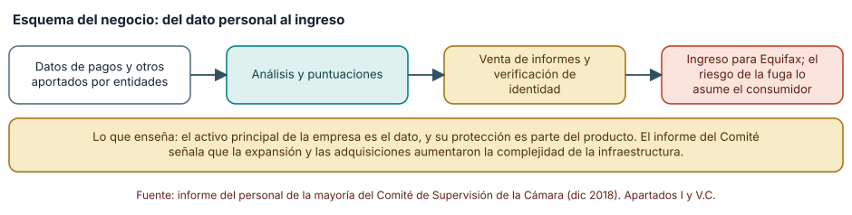

**Cómo leer la figura.** Cuatro etapas de izquierda a derecha; la última distingue quién gana y quién soporta el riesgo. Mira que el consumidor aparece solo al final. **Dónde deja de valer:** no es un flujo de dinero; las fuentes no dan márgenes ni ingresos por producto.

### Costos operativos y costo del incidente

| Rubro | Cifra | Fuente |
| --- | --- | --- |
| Consumidores afectados | 143 millones (7 de septiembre de 2017), 145,5 millones (GAO), 148 millones (informe del Comité, 1 de marzo de 2018) | Informe; GAO |
| Duración de la intrusión | 76 días | Informe |
| Bases de datos accedidas | 48 | Informe |
| Consultas de los atacantes | Unas 9 000; datos personales sin cifrar localizados 265 veces | Informe |
| Plazo entre la detección y el aviso público | 39 días (del 30 de julio al 7 de septiembre) | Informe, cronología |
| Coste total para Equifax | No se sabe | No consta |
| Sanciones y acuerdos posteriores a 2018 | No se verificaron en esta sesión | No consta |

No se inventa ninguna cifra para las filas sin fuente.

### Competidores y contexto de mercado

Los otros dos grandes burós nacionales son Experian y TransUnion, además de unos 400 regionales y especializados (Informe, apartado I.A). Qué ocurrió con cuotas de mercado después del incidente no consta en las fuentes consultadas y este caso no lo inventa. El contexto regulatorio sí consta: la actividad está sujeta a la ley de informes de crédito y a la Gramm-Leach-Bliley, y a la supervisión de la FTC y la CFPB (Informe, acrónimos y apartado VI).

## Arquitectura y esquemas

Los hechos de esta sección vienen del informe del Comité y de la GAO. Los dibujos de componentes son un modelo funcional hecho con lo que describen, porque ninguna fuente publica el diseño interno de ACIS.

### Nivel 1 · Contexto

La figura de contexto está en «Contexto y problema». Resumen: un buró con bases de datos de datos personales, un portal de disputas expuesto a Internet y un dispositivo de monitoreo de su tráfico.

### Nivel 2 · Contenedores: el portal y lo que había detrás

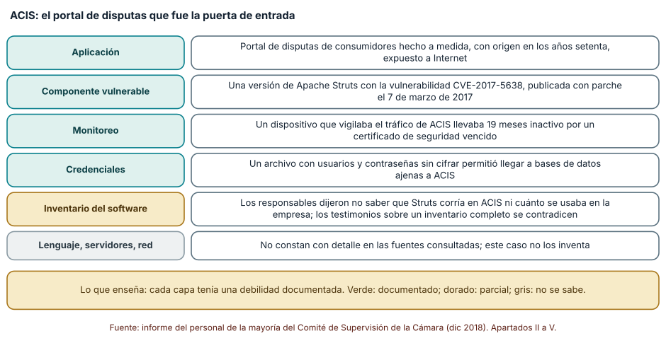

**Cómo leer la figura.** Cada fila es una capa; verde, documentada; dorado, parcial; gris, no se sabe. Mira que cada capa documentada es una debilidad. **Dónde deja de valer:** no pretende describir la arquitectura real, solo lo que consta.

### Nivel 3 · La secuencia del ataque

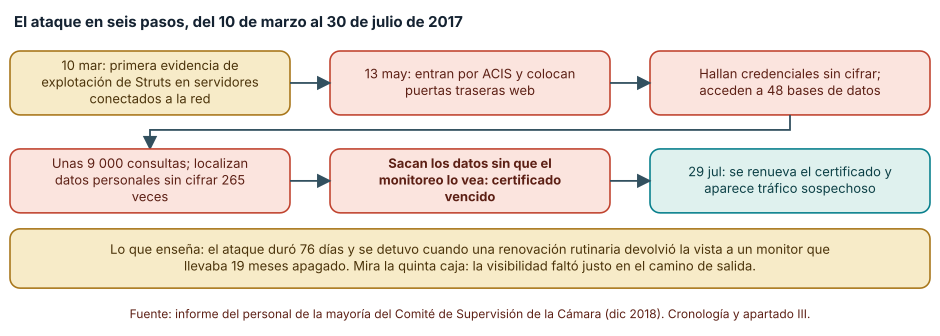

**Cómo leer la figura.** Cada caja es un paso; las rojas son acciones de los atacantes, la azul verdosa es la detección. Mira la quinta: la salida de datos no se veía porque el monitor estaba ciego. **Dónde deja de valer:** el informe no detalla todas las técnicas; la figura resume su cronología y el resumen ejecutivo.

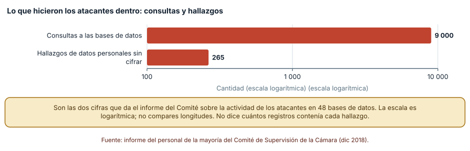

**Cómo leer la figura.** Cada barra es una cantidad; la escala es logarítmica, así que cada marca vale diez veces la anterior. Mira que el cociente es de unas 34 consultas por hallazgo. **Dónde deja de valer:** no dice cuántos registros tenía cada hallazgo ni cuántas consultas fueron de reconocimiento.

### Nivel 4 · El monitor ciego

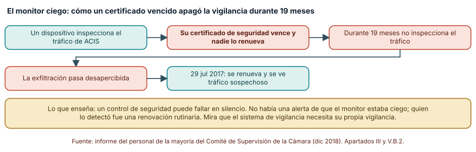

**Cómo leer la figura.** De izquierda a derecha: el dispositivo funciona, su certificado vence, deja de inspeccionar, la salida pasa desapercibida y una renovación devuelve la vista. Mira la segunda caja: nadie renovó el certificado. **Dónde deja de valer:** el informe no describe el proceso de gestión de certificados salvo que existían debilidades documentadas (apartado V.B.2).

Documentado. El dispositivo usado para vigilar el tráfico de red de ACIS llevaba 19 meses inactivo por un certificado de seguridad vencido; los atacantes sacaron datos sin que Equifax lo viera. El 29 de julio de 2017 se actualizó el certificado y se advirtió de inmediato tráfico web sospechoso; tras actualizarlo, empleados identificaron tráfico sospechoso desde una dirección IP originada en China, con salida de la aplicación que podía contener imágenes de documentos de investigaciones de crédito (Informe, resumen ejecutivo). El Comité añade que Equifax había permitido que vencieran más de 300 certificados de seguridad, entre ellos 79 de monitoreo de dominios críticos para el negocio (Informe, resumen ejecutivo): el caso del monitor de ACIS no era un hecho aislado. Mandiant concluyó después que los atacantes tuvieron acceso del 13 de mayo al 30 de julio, comprometieron dos sistemas de apoyo a ACIS y varias tablas de bases de datos, y usaron treinta puertas traseras web distintas (Informe, apartado VI.A).

### Nivel 5 · Datos

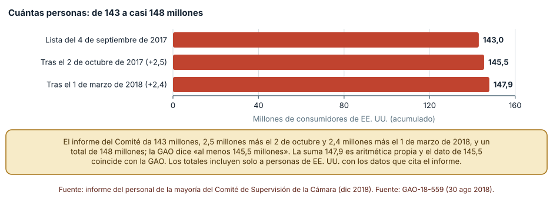

**Cómo leer la figura.** Cada barra es el total acumulado de consumidores de EE. UU. afectados en tres momentos. Mira que la cifra inicial era el 97 % de la final: el aviso del 7 de septiembre fue incompleto, no equivocado. **Dónde deja de valer:** las dos sumas son aritmética propia sobre las cifras del informe; la GAO cuenta «al menos 145,5 millones».

El informe aclara además que los datos robados estaban en varias tablas con esquemas distintos y elementos «no etiquetados de forma coherente», por lo que Equifax tardó en confirmar cuántas personas y qué datos se vieron afectados; un análisis posterior permitió confirmar cifras aproximadas para 12 elementos de datos estándar (Informe, apartado IV.D). Es una lección de modelado de datos: sin esquema coherente, la respuesta a un incidente se vuelve una arqueología.

### Nivel 6 · Despliegue y entorno heredado

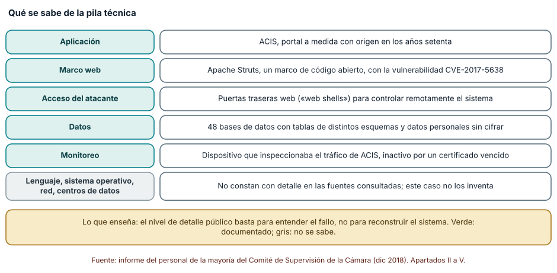

**Cómo leer la figura.** Cada fila es una capa; verde, documentada; gris, no se sabe. Mira que todo lo documentado es lo necesario para entender el incidente. **Dónde deja de valer:** no pretende describir la pila real, solo el límite de lo público.

### Nivel 7 · Dependencias y puntos únicos de fallo

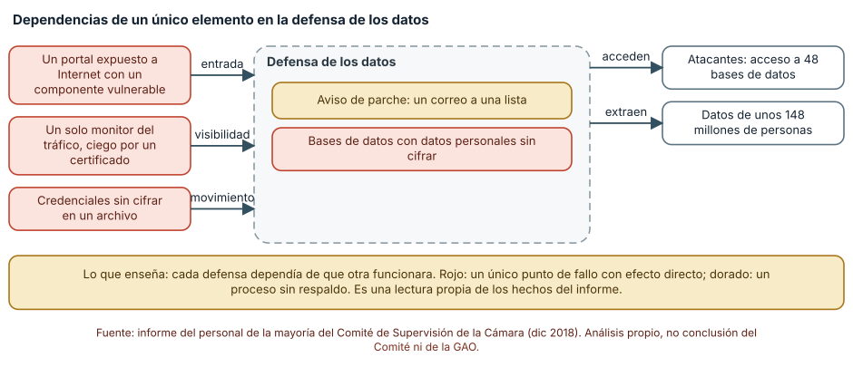

**Cómo leer la figura.** Izquierda: tres puntos de fallo de entrada, visibilidad y movimiento; centro: defensa de los datos; derecha: lo que ocurrió. Mira que casi todo lo rojo es una condición de configuración o de proceso. **Dónde deja de valer:** es un análisis propio; el informe no enumera dependencias.

### Nivel 8 · Defensa en profundidad: ocho barreras

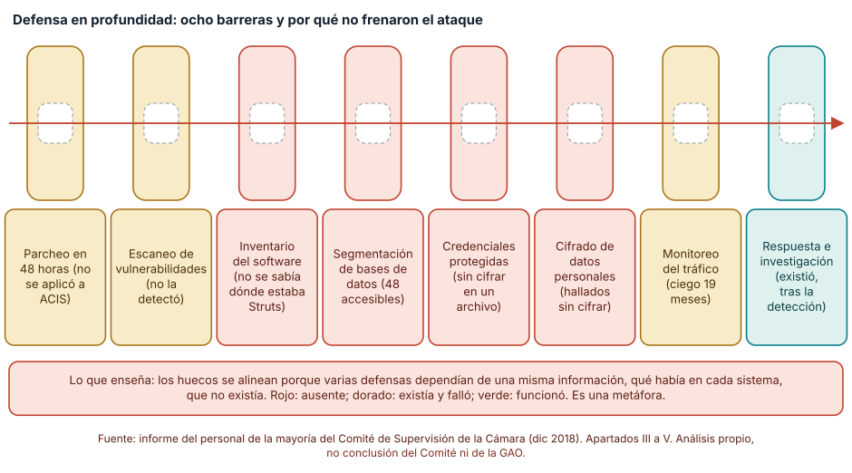

**Cómo leer la figura.** Cada lámina es una barrera; el hueco es el punto por el que el ataque pasó. Las rojas no existían; las doradas existían y fallaron; la verde funcionó. Mira que los huecos se alinean por una causa común: nadie sabía con precisión qué había en cada sistema. **Dónde deja de valer:** el modelo de láminas es una metáfora, no una medición.

### Hardware utilizado

Las fuentes consultadas no describen el hardware de Equifax más allá de que el dispositivo de monitoreo de ACIS existía, que había servidores web y de aplicaciones comprometidos y que las bases de datos estaban en entornos heredados. **No se sabe:** fabricantes, modelos, centros de datos y redes.

### Software utilizado

Documentado: ACIS (a medida, de los años setenta), Apache Struts con la vulnerabilidad CVE-2017-5638, puertas traseras web instaladas por los atacantes (30 distintas según Mandiant) y bases de datos con datos personales (Informe). **No se sabe:** lenguaje de ACIS, versiones exactas, sistemas operativos y gestores de bases de datos.

### Infraestructura

Equifax ejecutaba infraestructura propia, con un entorno heredado resultado de adquisiciones; el informe describe una expansión que creó una infraestructura muy compleja y la presencia de ACIS dentro de un entorno heredado con riesgos de seguridad documentados (Informe, apartado V.C). **No se sabe:** la capacidad, la ubicación y las dependencias de terceros.

### A prueba de fallos: qué existía, qué falló y qué debió existir

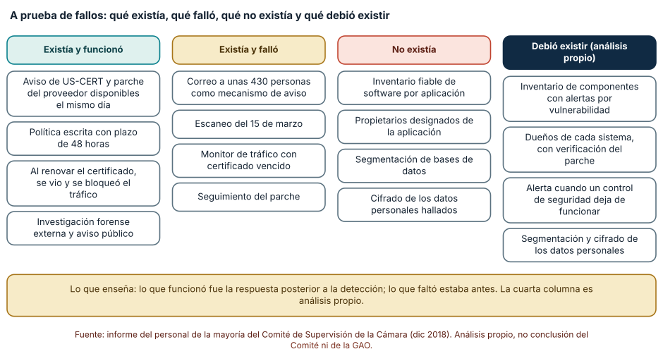

**Cómo leer la figura.** Verde: lo que había y funcionó; dorado: lo que había y falló; coral: lo que no existía; azul oscuro: análisis propio de lo que debió existir. Las filas no se corresponden una a una. Mira que lo que funcionó actuó después de la entrada. **Dónde deja de valer:** no mide eficacia; la cuarta columna es análisis propio.

## Casos especiales y cómo fallan

- **Un control que falla en silencio.** El monitor del tráfico de ACIS llevaba 19 meses inactivo y nada lo señalaba; solo la renovación del certificado lo reveló (Informe, resumen ejecutivo). Un sensor de seguridad sin alerta de «he dejado de informar» es un punto ciego.
- **Un aviso sin dueño.** El 9 de marzo el aviso del parche se envió a una lista; un directivo recibió el correo solo a título informativo y no tenía rol en la política para actuar (Informe, apartado V.B.1.a). Los avisos funcionan cuando hay una persona obligada a responder.
- **Una política que depende de saber qué hay.** La política de parches exigía que los empleados conocieran el origen y la versión de todo el software de cada aplicación; la empresa no tenía una visión completa del software de ACIS, y los testimonios sobre si existía un inventario de Struts se contradicen (Informe, apartado V.C.3).
- **Un escaneo que no ve.** El escaneo del 15 de marzo no detectó la vulnerabilidad en ningún sistema externo (Informe, cronología). La causa técnica no consta.
- **Credenciales en un archivo.** Un archivo con usuarios y contraseñas sin cifrar permitió llegar a 48 bases de datos ajenas a ACIS (Informe, resumen).
- **Un aviso público incompleto.** El 7 de septiembre se anunciaron 143 millones; el 2 de octubre se añadieron 2,5 millones y el 1 de marzo de 2018, 2,4 millones; la cifra total fue de 148 millones (Informe, cronología).
- **El sitio de ayuda desbordado.** El sitio web y los centros de llamadas se vieron desbordados tras el aviso (Informe, apartado IV.B). La respuesta al incidente es otro sistema que se prueba con carga.
- **Un despido discutido.** Una persona fue despedida por no reenviar el aviso del 9 de marzo, una acción que, según el informe, nadie le había indicado; el Comité califica la medida de gratuita (Informe, apartado IV.C). Este caso la menciona porque ilustra el problema de atribuir a una persona lo que fue una falta de diseño de responsabilidades; no formula un juicio propio.

## Línea de tiempo

Tres escalas: días (del parche al aviso), meses (la respuesta) y años (el entorno heredado).

### Antecedentes y respuesta

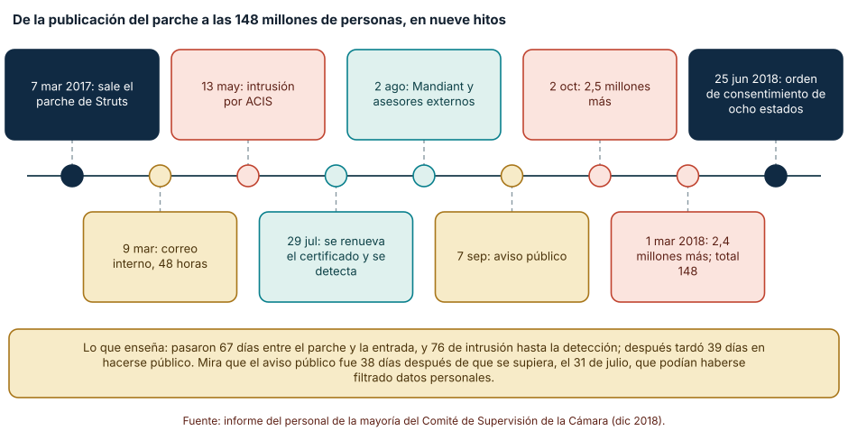

**Cómo leer la figura.** Los hitos están espaciados de manera uniforme, no a escala de días. Mira la distancia entre el parche y la intrusión: 67 días. **Dónde deja de valer:** no es una escala temporal; las fechas de las cajas son las reales.

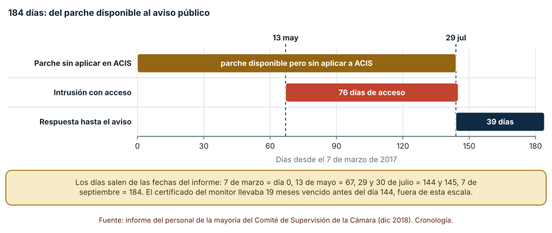

**Cómo leer la figura.** Eje horizontal: días desde el 7 de marzo; tres filas. Mira que la barra dorada y la roja se solapan casi por completo. **Dónde deja de valer:** el certificado vencido, 19 meses antes, queda fuera de la escala.

| Cuándo | Hecho | Fuente |
| --- | --- | --- |
| 7 de marzo de 2017 | Apache Struts anuncia CVE-2017-5638 y publica el parche | Informe, cronología |
| 8 de marzo | US-CERT alerta a Equifax | Informe, cronología |
| 9 de marzo | El equipo de gestión de vulnerabilidades distribuye el aviso: parchear en 48 horas | Informe, cronología |
| 10 de marzo | Primera evidencia de explotación en servidores conectados a la red de Equifax | Informe, cronología |
| 15 de marzo | Escaneo que no detecta la vulnerabilidad en sistemas externos | Informe, cronología |
| 13 de mayo | Los atacantes entran por ACIS y colocan puertas traseras web | Informe, cronología |
| 29 de julio | Se renueva el certificado y se detecta tráfico sospechoso | Informe, cronología |
| 30 de julio | Se saca ACIS de línea; se informa al director de sistemas | Informe, cronología |
| 31 de julio | Se determina que pudieron salir datos personales; se informa al consejero delegado | Informe, cronología |
| 2 de agosto | Se contrata a una firma jurídica y a Mandiant; se informa al FBI | Informe, cronología |
| 24 y 25 de agosto | Se informa a todo el consejo | Informe, cronología |
| 4 de septiembre | Lista de 143 millones de consumidores de EE. UU. | Informe, cronología |
| 7 de septiembre | Aviso público | Informe, cronología |
| 14 de septiembre | Dos comités de la Cámara abren una investigación | Informe, cronología |
| 19 de septiembre | Informe de Mandiant con once recomendaciones | Informe, apartado VI.A |
| 2 de octubre | 2,5 millones más | Informe, cronología |
| 1 de marzo de 2018 | 2,4 millones más; total 148 millones | Informe, cronología |
| 25 de junio de 2018 | Orden de consentimiento con ocho estados | Informe, apartado VI.B |
| 30 de agosto de 2018 | Informe de la GAO (publicado el 7 de septiembre) | GAO |
| Diciembre de 2018 | Informe del personal de la mayoría del Comité | Informe |

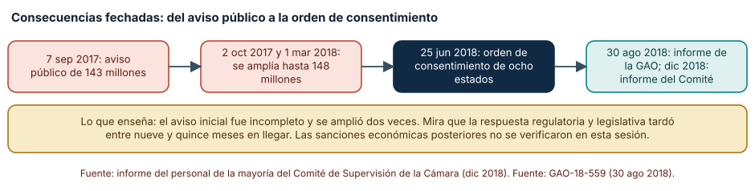

**Cómo leer la figura.** Cuatro hitos de izquierda a derecha, con las fechas reales. Mira que la respuesta regulatoria y legislativa llegó entre nueve y quince meses después del aviso. **Dónde deja de valer:** que cada hito sea consecuencia del anterior no consta como relación causal; las sanciones económicas posteriores no se verificaron.

## Qué falló en cada instancia

| Instancia | Qué se esperaba | Qué ocurrió | Fuente |
| --- | --- | --- | --- |
| Gestión de parches | Aplicar un parche crítico en 48 horas | ACIS no se parcheó hasta el descubrimiento del incidente | Informe, apartado V.B.1 |
| Aviso interno | Que llegara a quien debía actuar | Correo a unas 430 personas; sin propietarios designados | Informe, apartado V.B.1.a |
| Escaneo de vulnerabilidades | Detectar los sistemas con la vulnerabilidad | No la detectó en sistemas externos el 15 de marzo | Informe, cronología |
| Inventario de software | Saber qué componentes corrían en cada aplicación | La empresa no tenía una visión completa del software de ACIS | Informe, apartado V.C.3 |
| Monitoreo del tráfico | Inspeccionar lo que sale de ACIS | Inactivo 19 meses por un certificado vencido | Informe, resumen |
| Control de credenciales | Proteger secretos | Archivo con credenciales sin cifrar | Informe, resumen |
| Segmentación y cifrado | Limitar el alcance de una entrada y proteger los datos | 48 bases accesibles; datos personales sin cifrar localizados 265 veces | Informe, resumen |
| Comunicación pública | Aviso completo y atención al consumidor | Cifra ampliada dos veces; sitio y centros de llamadas desbordados | Informe, apartado IV |
| Estructura organizativa | Coordinación y rendición de cuentas | Estructura que permitió una coordinación ineficaz | Informe, apartado V.A |

## Causa raíz y factores

**Detonante (documentado).** La explotación de CVE-2017-5638 en la versión de Apache Struts de ACIS, no parcheada pese a un aviso y un plazo de 48 horas (Informe, apartados III y V.B).

**Condiciones latentes (documentado).** Una aplicación heredada expuesta a Internet; una política que dependía de que alguien supiera qué software corría en cada aplicación; propietarios de aplicación no designados explícitamente; un aviso por lista de correo; un escaneo que no detectó la vulnerabilidad; un monitor inactivo 19 meses por un certificado vencido; credenciales sin cifrar; bases de datos con datos personales sin cifrar y accesibles desde ACIS; una estructura entre Seguridad e IT sin rendición de cuentas clara (Informe, apartados III y V).

**Factores de contexto (documentado).** Un crecimiento por adquisiciones que creó una infraestructura compleja con sistemas heredados; la modernización en curso; la ausencia de un cierre que verificara la aplicación de parches (Informe, apartado V.C).

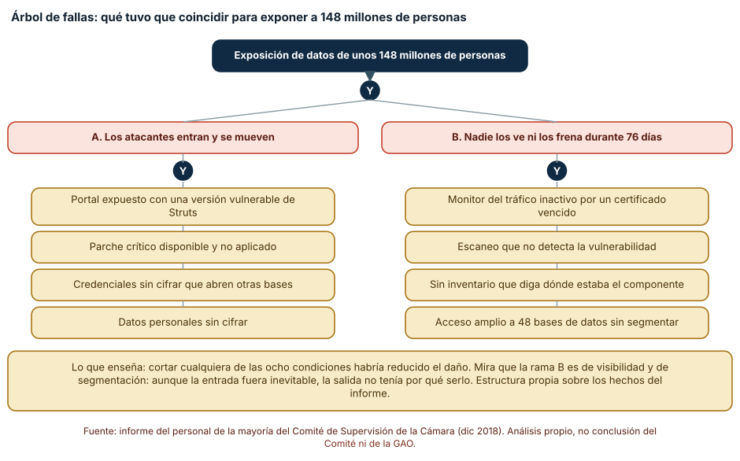

**Cómo leer la figura.** Arriba, el evento final; los círculos con «Y» exigen que todas las ramas ocurran. Las cajas doradas son las condiciones. Mira que la rama B es de visibilidad y contención: aunque la entrada fuera inevitable, el daño no tenía por qué serlo. **Dónde deja de valer:** la estructura es análisis propio; en la realidad las condiciones no son independientes, por ejemplo, la falta de inventario agrava la ineficacia del escaneo.

**Cadena causal ordenada (análisis propio, apoyado en el informe).**

1. Un entorno heredado crece por adquisiciones sin inventario fiable de software (contexto).
2. Un portal expuesto usa un componente de código abierto sin dueño explícito (condición de gobierno).
3. Sale un parche crítico; el aviso llega por correo a una lista y no se confirma su aplicación (condición de proceso).
4. Un escaneo no detecta la vulnerabilidad y se cree que no hay exposición (condición de detección).
5. Los atacantes entran, encuentran credenciales sin cifrar y acceden a 48 bases (detonante y condiciones de diseño).
6. El monitor del tráfico está ciego por un certificado vencido y la salida de datos no se ve (condición de visibilidad).
7. Una renovación rutinaria revela el incidente 76 días después (resultado).

### Documentado, inferido y no se sabe

| Categoría | Contenido |
| --- | --- |
| Documentado | La cronología; las cifras de afectados; la política de 48 horas; el aviso a unas 430 personas; la ausencia de propietarios explícitos según un directivo; el monitor inactivo 19 meses; las credenciales sin cifrar; las 48 bases y las 9 000 consultas; las once recomendaciones de Mandiant; la orden de consentimiento; los hallazgos de la GAO |
| Inferido (análisis propio) | Que la falta de inventario es la causa común de varias barreras; la estructura del árbol y de las ocho barreras; que cada decisión era razonable aislada |
| No se sabe | El motivo técnico por el que el escaneo no detectó la vulnerabilidad; los costes totales; quién tomó cada decisión; los detalles del entorno; el resultado de los procesos posteriores a 2018 |

## Mejoras que debieron hacerse

El informe y la GAO describen lo que se hizo después y lo que falló; la elección de qué controles habrían cortado cada eslabón es análisis nuestro. Todo lo de esta sección, incluidos costes y trade-offs, es **análisis propio apoyado en la fuente**: no son conclusiones del Comité ni de la GAO ni descripciones de lo que Equifax implantó, salvo donde se cita.

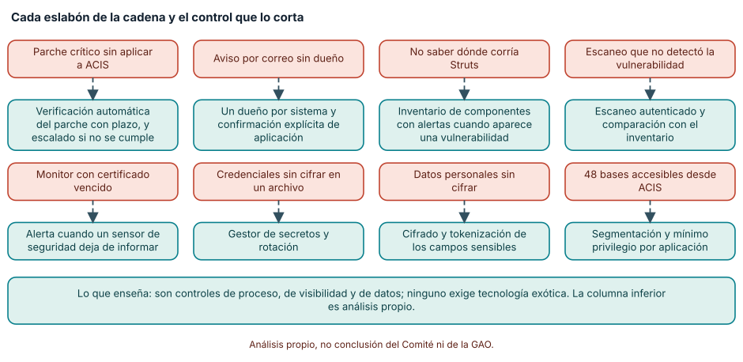

**Cómo leer la figura.** Arriba el eslabón de la cadena, debajo el control que lo corta. Mira que son controles de proceso, de visibilidad y de datos. **Dónde deja de valer:** son propuestas educativas, no prescripciones; cada una tiene coste y falsos positivos.

### Lo que se hizo después, según las fuentes

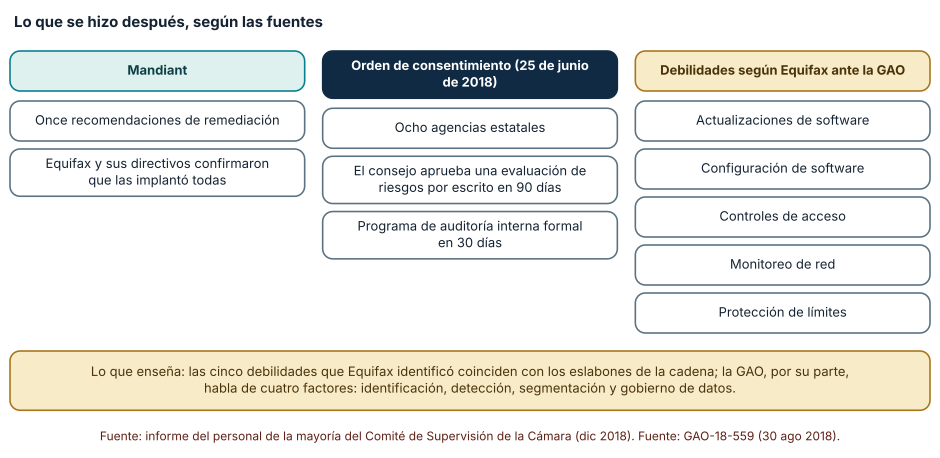

**Cómo leer la figura.** Cada columna es una respuesta documentada. Mira la tercera: las debilidades que la propia empresa identificó coinciden con los eslabones de la cadena. **Dónde deja de valer:** son cosas que Equifax dijo haber hecho; este caso no verifica su eficacia.

Mandiant emitió once recomendaciones de remediación el 19 de septiembre de 2017: mejorar el escaneo de vulnerabilidades y la gestión de parches; reducir la cantidad de datos sensibles retenidos en las bases; aumentar las restricciones de acceso a los datos de las bases críticas; mejorar la segmentación de red para restringir el acceso desde sistemas expuestos a Internet a las bases de datos; desplegar cortafuegos de aplicaciones web; acelerar el despliegue de monitoreo de integridad de archivos; reforzar los registros a nivel de red, aplicación, base de datos y sistema; acelerar una solución de gestión de cuentas privilegiadas; mejorar la visibilidad del tráfico cifrado; y desplegar más herramientas en los equipos finales; Equifax y sus directivos confirmaron que las implantó todas (Informe, apartado VI.A). La orden de consentimiento de junio de 2018 exigió que el consejo aprobase por escrito una evaluación de riesgos en 90 días y que se estableciera en 30 días un programa de auditoría interna formal capaz de evaluar controles de tecnología (Informe, apartado VI.B). La GAO añade que Equifax identificó cuatro factores principales (identificación, detección, segmentación del acceso a bases de datos y gobierno de datos) y que tomó medidas para mitigarlos (GAO).

### La arquitectura «después»

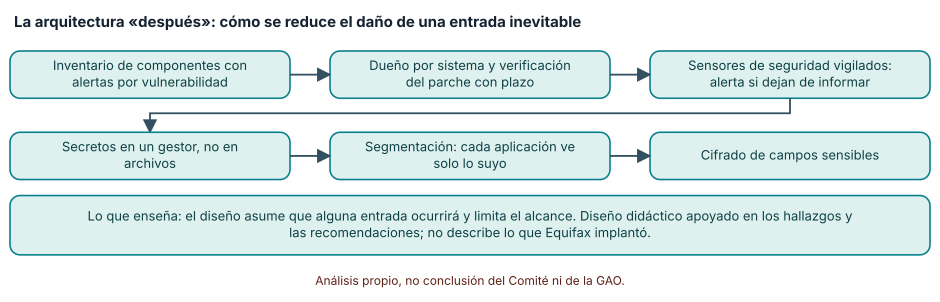

**Cómo leer la figura.** Cada caja es un cambio. Mira que el diseño asume que alguna entrada ocurrirá. **Dónde deja de valer:** es un diseño didáctico; no describe lo que Equifax implantó.

### Para cada factor: control técnico, de proceso y de gobierno

| Factor causal | Control técnico | Control de proceso | Control de gobierno | Costo y trade-off | Clases |
| --- | --- | --- | --- | --- | --- |
| Parche crítico sin aplicar | Verificación automática del parche con plazo | Escalado si el plazo vence | Indicador de parches críticos pendientes al comité de riesgo | Menos agilidad en entornos heredados frágiles | [SE-478 · Riesgos de CI y dependencias comprometidas](../../classes/part-39-build-release-y-cadena-de-suministro/se-478-riesgos-de-ci-y-dependencias-comprometidas/README.md), [SE-465 · Vulnerabilidades, divulgación y respuesta](../../classes/part-38-seguridad-privacidad-y-cumplimiento/se-465-vulnerabilidades-divulgacion-y-respuesta/README.md), [SE-483 · Tests, seguridad y políticas como gates](../../classes/part-40-ci-cd-iac-y-platform-engineering/se-483-tests-seguridad-y-politicas-como-gates/README.md) |
| Aviso por correo sin dueño | Alertas que crean tickets con dueño | Dueño por sistema; confirmación obligatoria | Revisión trimestral de dueños | Mantener el registro de dueños | [SE-499 · Runbooks, on-call y escalamiento](../../classes/part-41-observabilidad-sre-e-incidentes/se-499-runbooks-on-call-y-escalamiento/README.md), [SE-530 · Diseño de equipos y ownership](../../classes/part-44-gestion-liderazgo-y-practica-profesional/se-530-diseno-de-equipos-y-ownership/README.md), [SE-498 · Alertas accionables y fatiga](../../classes/part-41-observabilidad-sre-e-incidentes/se-498-alertas-accionables-y-fatiga/README.md) |
| Sin inventario de componentes | Lista de componentes con alertas por vulnerabilidad | Inventario como requisito de cada despliegue | Informe de cobertura del inventario | Coste inicial alto en entornos heredados | [SE-472 · SBOM, procedencia y atestaciones](../../classes/part-39-build-release-y-cadena-de-suministro/se-472-sbom-procedencia-y-atestaciones/README.md), [SE-471 · Dependencias directas, transitivas y vendorización](../../classes/part-39-build-release-y-cadena-de-suministro/se-471-dependencias-directas-transitivas-y-vendorizacion/README.md), [SE-520 · Dependencias obsoletas y riesgo acumulado](../../classes/part-43-mantenimiento-y-modernizacion-legacy/se-520-dependencias-obsoletas-y-riesgo-acumulado/README.md) |
| Escaneo que no detecta | Escaneo autenticado y comparación con el inventario | Prueba periódica del propio escaneo | Cobertura del escaneo como métrica | Falsos positivos | [SE-464 · Secure SDLC, abuso y pruebas negativas](../../classes/part-38-seguridad-privacidad-y-cumplimiento/se-464-secure-sdlc-abuso-y-pruebas-negativas/README.md), [SE-434 · Revisión, análisis estático y quality gates](../../classes/part-36-calidad-rendimiento-y-resiliencia/se-434-revision-analisis-estatico-y-quality-gates/README.md), [SE-445 · Riesgo, peligro y seguridad funcional: HARA, FMEA, FTA y STPA](../../classes/part-37-sistemas-criticos-tiempo-real-y-normas-de-seguridad/se-445-riesgo-peligro-y-seguridad-funcional-hara-fmea-fta-y-stpa/README.md) |
| Monitor con certificado vencido | Alerta cuando un sensor deja de informar | Gestión de certificados con vencimientos visibles | Cada control de seguridad con un responsable | Más alertas que gestionar | [SE-493 · Señales, eventos y observabilidad útil](../../classes/part-41-observabilidad-sre-e-incidentes/se-493-senales-eventos-y-observabilidad-util/README.md), [SE-497 · SLI, SLO, SLA y presupuestos de error](../../classes/part-41-observabilidad-sre-e-incidentes/se-497-sli-slo-sla-y-presupuestos-de-error/README.md), [SE-498 · Alertas accionables y fatiga](../../classes/part-41-observabilidad-sre-e-incidentes/se-498-alertas-accionables-y-fatiga/README.md) |
| Credenciales sin cifrar | Gestor de secretos y rotación | Revisión de código y de archivos | Política de cero secretos en archivos | Migración de aplicaciones heredadas | [SE-462 · Secretos, configuración y separación de ambientes](../../classes/part-38-seguridad-privacidad-y-cumplimiento/se-462-secretos-configuracion-y-separacion-de-ambientes/README.md), [SE-461 · Criptografía aplicada y gestión de claves](../../classes/part-38-seguridad-privacidad-y-cumplimiento/se-461-criptografia-aplicada-y-gestion-de-claves/README.md), [SE-484 · Credenciales efímeras y OIDC](../../classes/part-40-ci-cd-iac-y-platform-engineering/se-484-credenciales-efimeras-y-oidc/README.md) |
| Datos personales sin cifrar | Cifrado y tokenización de campos sensibles | Minimizar los datos retenidos | Revisión de privacidad por diseño | Coste de reingeniería de bases | [SE-463 · Privacidad por diseño y minimización](../../classes/part-38-seguridad-privacidad-y-cumplimiento/se-463-privacidad-por-diseno-y-minimizacion/README.md), [SE-461 · Criptografía aplicada y gestión de claves](../../classes/part-38-seguridad-privacidad-y-cumplimiento/se-461-criptografia-aplicada-y-gestion-de-claves/README.md), [SE-466 · Cumplimiento, evidencia y límites legales](../../classes/part-38-seguridad-privacidad-y-cumplimiento/se-466-cumplimiento-evidencia-y-limites-legales/README.md) |
| Acceso amplio a 48 bases | Segmentación y mínimo privilegio | Revisión de accesos por aplicación | Aprobación de cada acceso | Complejidad de redes y permisos | [SE-459 · Autorización, recursos y mínimo privilegio](../../classes/part-38-seguridad-privacidad-y-cumplimiento/se-459-autorizacion-recursos-y-minimo-privilegio/README.md), [SE-401 · Redes, identidad y secretos en cloud](../../classes/part-33-cloud-plataforma-e-infraestructura/se-401-redes-identidad-y-secretos-en-cloud/README.md), [SE-457 · Principios de seguridad y modelos de amenaza](../../classes/part-38-seguridad-privacidad-y-cumplimiento/se-457-principios-de-seguridad-y-modelos-de-amenaza/README.md) |
| Respuesta con aviso incompleto | Esquema coherente de datos para contar afectados | Ejercicios de respuesta con carga | Plan de comunicación aprobado | Coste de ejercicios | [SE-500 · Gestión de incidentes y comunicación](../../classes/part-41-observabilidad-sre-e-incidentes/se-500-gestion-de-incidentes-y-comunicacion/README.md), [SE-502 · Continuidad, disaster recovery y ejercicios](../../classes/part-41-observabilidad-sre-e-incidentes/se-502-continuidad-disaster-recovery-y-ejercicios/README.md), [SE-511 · Game days y ejercicios de respuesta a incidentes](../../classes/part-42-ingenieria-del-caos/se-511-game-days-y-ejercicios-de-respuesta-a-incidentes/README.md) |

### Cómo lo habría evitado lo que enseña el curso

Cada línea es análisis propio. (1) La lista de materiales de software y la procedencia de [SE-472 · SBOM, procedencia y atestaciones](../../classes/part-39-build-release-y-cadena-de-suministro/se-472-sbom-procedencia-y-atestaciones/README.md) habrían respondido «¿dónde corre Struts?» con una consulta; la gestión de dependencias de [SE-471 · Dependencias directas, transitivas y vendorización](../../classes/part-39-build-release-y-cadena-de-suministro/se-471-dependencias-directas-transitivas-y-vendorizacion/README.md) y las dependencias obsoletas de [SE-520 · Dependencias obsoletas y riesgo acumulado](../../classes/part-43-mantenimiento-y-modernizacion-legacy/se-520-dependencias-obsoletas-y-riesgo-acumulado/README.md) explican el riesgo acumulado de un entorno heredado. (2) Los secretos y la separación de ambientes de [SE-462 · Secretos, configuración y separación de ambientes](../../classes/part-38-seguridad-privacidad-y-cumplimiento/se-462-secretos-configuracion-y-separacion-de-ambientes/README.md) y la criptografía de [SE-461 · Criptografía aplicada y gestión de claves](../../classes/part-38-seguridad-privacidad-y-cumplimiento/se-461-criptografia-aplicada-y-gestion-de-claves/README.md) tratan de las credenciales sin cifrar y de los datos sin cifrar. (3) El mínimo privilegio de [SE-459 · Autorización, recursos y mínimo privilegio](../../classes/part-38-seguridad-privacidad-y-cumplimiento/se-459-autorizacion-recursos-y-minimo-privilegio/README.md) y las redes de [SE-401 · Redes, identidad y secretos en cloud](../../classes/part-33-cloud-plataforma-e-infraestructura/se-401-redes-identidad-y-secretos-en-cloud/README.md) describen la segmentación que habría limitado una entrada. (4) La observabilidad útil de [SE-493 · Señales, eventos y observabilidad útil](../../classes/part-41-observabilidad-sre-e-incidentes/se-493-senales-eventos-y-observabilidad-util/README.md), los SLO de [SE-497 · SLI, SLO, SLA y presupuestos de error](../../classes/part-41-observabilidad-sre-e-incidentes/se-497-sli-slo-sla-y-presupuestos-de-error/README.md) y las alertas de [SE-498 · Alertas accionables y fatiga](../../classes/part-41-observabilidad-sre-e-incidentes/se-498-alertas-accionables-y-fatiga/README.md) enseñan que un sensor sin alerta de silencio es un punto ciego. (5) La divulgación y respuesta a vulnerabilidades de [SE-465 · Vulnerabilidades, divulgación y respuesta](../../classes/part-38-seguridad-privacidad-y-cumplimiento/se-465-vulnerabilidades-divulgacion-y-respuesta/README.md) y el riesgo de dependencias de [SE-478 · Riesgos de CI y dependencias comprometidas](../../classes/part-39-build-release-y-cadena-de-suministro/se-478-riesgos-de-ci-y-dependencias-comprometidas/README.md) tratan del aviso y del parche. (6) La ingeniería del caos, [SE-505 · Principios de la ingeniería del caos: estado estable e hipótesis](../../classes/part-42-ingenieria-del-caos/se-505-principios-de-la-ingenieria-del-caos-estado-estable-e-hipotesis/README.md) y [SE-511 · Game days y ejercicios de respuesta a incidentes](../../classes/part-42-ingenieria-del-caos/se-511-game-days-y-ejercicios-de-respuesta-a-incidentes/README.md), con ejercicios de respuesta a incidentes, habría puesto a prueba el aviso y el centro de llamadas antes del día real. (7) La gestión de riesgos ejecutiva de [SE-534 · Gestión de riesgos y decisiones ejecutivas](../../classes/part-44-gestion-liderazgo-y-practica-profesional/se-534-gestion-de-riesgos-y-decisiones-ejecutivas/README.md) y el ownership de [SE-530 · Diseño de equipos y ownership](../../classes/part-44-gestion-liderazgo-y-practica-profesional/se-530-diseno-de-equipos-y-ownership/README.md) tratan de quién responde por cada sistema.

## Vínculo con el curso

Cada enlace es una clase real; el texto dice qué mecanismo del caso ilustra. Las partes de seguridad y cumplimiento, de build y cadena de suministro, de observabilidad e incidentes y de ingeniería del caos son las que más aportan.

| Concepto | Clase | Cómo lo ilustra el caso |
| --- | --- | --- |
| Modelos de amenaza | [SE-457 · Principios de seguridad y modelos de amenaza](../../classes/part-38-seguridad-privacidad-y-cumplimiento/se-457-principios-de-seguridad-y-modelos-de-amenaza/README.md) | Un portal expuesto que conecta a Internet con datos personales |
| Mínimo privilegio | [SE-459 · Autorización, recursos y mínimo privilegio](../../classes/part-38-seguridad-privacidad-y-cumplimiento/se-459-autorizacion-recursos-y-minimo-privilegio/README.md) | Un portal con acceso a 48 bases de datos ajenas |
| Criptografía y claves | [SE-461 · Criptografía aplicada y gestión de claves](../../classes/part-38-seguridad-privacidad-y-cumplimiento/se-461-criptografia-aplicada-y-gestion-de-claves/README.md) | Datos personales y credenciales sin cifrar |
| Secretos y configuración | [SE-462 · Secretos, configuración y separación de ambientes](../../classes/part-38-seguridad-privacidad-y-cumplimiento/se-462-secretos-configuracion-y-separacion-de-ambientes/README.md) | Un archivo con usuarios y contraseñas |
| Privacidad por diseño | [SE-463 · Privacidad por diseño y minimización](../../classes/part-38-seguridad-privacidad-y-cumplimiento/se-463-privacidad-por-diseno-y-minimizacion/README.md) | Minimizar los datos retenidos en las bases |
| Secure SDLC | [SE-464 · Secure SDLC, abuso y pruebas negativas](../../classes/part-38-seguridad-privacidad-y-cumplimiento/se-464-secure-sdlc-abuso-y-pruebas-negativas/README.md) | Un escaneo que no detecta lo que debía detectar |
| Vulnerabilidades, divulgación y respuesta | [SE-465 · Vulnerabilidades, divulgación y respuesta](../../classes/part-38-seguridad-privacidad-y-cumplimiento/se-465-vulnerabilidades-divulgacion-y-respuesta/README.md) | Un parche crítico publicado el mismo día que la alerta |
| Cumplimiento y evidencia | [SE-466 · Cumplimiento, evidencia y límites legales](../../classes/part-38-seguridad-privacidad-y-cumplimiento/se-466-cumplimiento-evidencia-y-limites-legales/README.md) | Una política escrita sin evidencia de cumplimiento |
| SBOM y procedencia | [SE-472 · SBOM, procedencia y atestaciones](../../classes/part-39-build-release-y-cadena-de-suministro/se-472-sbom-procedencia-y-atestaciones/README.md) | No saber dónde corre un componente |
| Dependencias directas y transitivas | [SE-471 · Dependencias directas, transitivas y vendorización](../../classes/part-39-build-release-y-cadena-de-suministro/se-471-dependencias-directas-transitivas-y-vendorizacion/README.md) | Struts como componente dentro de una aplicación heredada |
| Riesgos de dependencias comprometidas | [SE-478 · Riesgos de CI y dependencias comprometidas](../../classes/part-39-build-release-y-cadena-de-suministro/se-478-riesgos-de-ci-y-dependencias-comprometidas/README.md) | Un componente vulnerable sin parchear |
| Señales y observabilidad útil | [SE-493 · Señales, eventos y observabilidad útil](../../classes/part-41-observabilidad-sre-e-incidentes/se-493-senales-eventos-y-observabilidad-util/README.md) | Un monitor que no informa de que está apagado |
| SLI, SLO y presupuestos | [SE-497 · SLI, SLO, SLA y presupuestos de error](../../classes/part-41-observabilidad-sre-e-incidentes/se-497-sli-slo-sla-y-presupuestos-de-error/README.md) | Medir la salud de los controles de seguridad |
| Alertas accionables | [SE-498 · Alertas accionables y fatiga](../../classes/part-41-observabilidad-sre-e-incidentes/se-498-alertas-accionables-y-fatiga/README.md) | Un aviso a una lista sin dueño |
| Gestión de incidentes | [SE-500 · Gestión de incidentes y comunicación](../../classes/part-41-observabilidad-sre-e-incidentes/se-500-gestion-de-incidentes-y-comunicacion/README.md) | Aviso público incompleto y centros de llamadas desbordados |
| Continuidad y ejercicios | [SE-502 · Continuidad, disaster recovery y ejercicios](../../classes/part-41-observabilidad-sre-e-incidentes/se-502-continuidad-disaster-recovery-y-ejercicios/README.md) | Ensayar la respuesta antes del incidente |
| Dependencias obsoletas | [SE-520 · Dependencias obsoletas y riesgo acumulado](../../classes/part-43-mantenimiento-y-modernizacion-legacy/se-520-dependencias-obsoletas-y-riesgo-acumulado/README.md) | Un entorno heredado con riesgos documentados |
| Ownership | [SE-530 · Diseño de equipos y ownership](../../classes/part-44-gestion-liderazgo-y-practica-profesional/se-530-diseno-de-equipos-y-ownership/README.md) | Propietarios de aplicación no designados |
| Gestión de riesgos | [SE-534 · Gestión de riesgos y decisiones ejecutivas](../../classes/part-44-gestion-liderazgo-y-practica-profesional/se-534-gestion-de-riesgos-y-decisiones-ejecutivas/README.md) | La seguridad como riesgo ejecutivo |
| Principios de la ingeniería del caos | [SE-505 · Principios de la ingeniería del caos: estado estable e hipótesis](../../classes/part-42-ingenieria-del-caos/se-505-principios-de-la-ingenieria-del-caos-estado-estable-e-hipotesis/README.md) | Hipótesis de estado estable para la seguridad |
| Game days | [SE-511 · Game days y ejercicios de respuesta a incidentes](../../classes/part-42-ingenieria-del-caos/se-511-game-days-y-ejercicios-de-respuesta-a-incidentes/README.md) | Ejercicios de respuesta a incidentes |

### Preguntas de discusión

1. ¿Cómo diseñarías un registro de dueños de sistemas que se mantenga actualizado sin depender de la memoria de las personas?
2. Si el escaneo dice «no hay vulnerabilidad» y un inventario dice «sí hay Struts», ¿a cuál crees y qué haces?
3. ¿Qué alerta habría avisado de que el monitor estaba apagado? ¿Quién la recibe?
4. Los datos sin cifrar fueron localizados 265 veces. ¿Qué parte de ese riesgo se resuelve con cifrado y qué parte con no guardar el dato?
5. Un despido por no reenviar un correo plantea un problema de atribución. ¿Cómo se diseña una responsabilidad que no dependa de reenviar un correo?

### Mini-ejercicios

1. **Inventario de componentes.** Genera una lista de materiales de software de un proyecto propio y comprueba cuántos componentes con vulnerabilidades conocidas contiene.
2. **Alerta de silencio.** Para tres sensores o controles de tu entorno, define una alerta que salte si dejan de informar durante un periodo.
3. **Dueños.** Lista tus sistemas expuestos a Internet y asigna un dueño por sistema; marca los que no lo tienen.
4. **Segmentación.** Dibuja a qué bases de datos puede llegar una aplicación pública de tu sistema y reduce ese alcance al mínimo.

## Qué no generalizar

**Aprender.**

1. No puedes parchear lo que no sabes que tienes: mantén un inventario de componentes por sistema.
2. Una política sin dueños asignados es una intención: cada sistema necesita un responsable verificable.
3. Un sensor de seguridad necesita su propia alerta de silencio.
4. Asume que alguna entrada ocurrirá: segmenta, minimiza y cifra los datos.
5. La respuesta al incidente es un sistema: ensáyala con carga.
6. Un aviso público incompleto se corrige después, pero la confianza no: diseña los datos para poder contar.

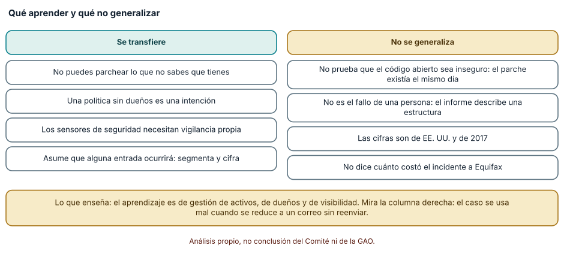

**Cómo leer la figura.** Verde: lo que se transfiere; dorado: lo que no. Mira la columna derecha: el caso se usa mal cuando se reduce a un correo sin reenviar. **Dónde deja de valer:** es una lectura propia del informe.

**No generalizar.**

- No prueba que el código abierto sea inseguro: el parche existía el mismo día en que se anunció la vulnerabilidad.
- No es el fallo de una persona: el informe describe una estructura, una política y un entorno heredado.
- El informe del Comité es el documento del personal de la mayoría de un comité legislativo; cita testimonios y documentos de Equifax, pero no incluye una respuesta de la empresa que este caso haya podido contrastar.
- Las cifras (76 días, 48 bases, 148 millones) son de este incidente y de EE. UU.; la GAO da cifras distintas por método.
- Lo ocurrido después de 2018, incluidos acuerdos económicos y cambios de la empresa, queda fuera de este caso porque no se verificó en esta sesión.

### Casos comparables y diferencias

| Caso | Parecido | Diferencia |
| --- | --- | --- |
| SolarWinds (2020) | Un compromiso de seguridad detectado mucho después de la entrada | Allí el atacante comprometió el proceso de construcción de un proveedor; aquí explotó un parche no aplicado |
| [GitLab (2017)](gitlab-2017.md) | Controles que existían y no funcionaban cuando hicieron falta | Allí el daño fue de disponibilidad y datos propios; aquí, de datos de terceros |
| [Meta (2021)](meta-2021.md) | Un fallo de visibilidad agrava el incidente | Allí fue una caída propia; aquí, una intrusión externa |

## Fuentes públicas verificadas

Todas consultadas el 23 de noviembre de 2026. El PDF del Comité se descargó y se extrajo su texto; la página de la GAO se leyó con una herramienta de lectura web porque la descarga directa se bloqueaba.

1. Comité de Supervisión y Reforma del Gobierno de la Cámara de Representantes de EE. UU., personal de la mayoría, *The Equifax Data Breach*, informe, diciembre de 2018. [https://oversight.house.gov/wp-content/uploads/2018/12/Equifax-Report.pdf](https://oversight.house.gov/wp-content/uploads/2018/12/Equifax-Report.pdf) (respalda la cronología, las cifras de ACIS, las 48 bases, las 9 000 consultas, el certificado vencido, la política de parches, las once recomendaciones de Mandiant y la orden de consentimiento; documento de una de las partes del Comité).
2. U.S. Government Accountability Office, *Data Protection: Actions Taken by Equifax and Federal Agencies in Response to the 2017 Breach*, GAO-18-559, publicado el 30 de agosto de 2018. [https://www.gao.gov/products/gao-18-559](https://www.gao.gov/products/gao-18-559) (respalda «al menos 145,5 millones», los factores que Equifax identificó y las acciones de las agencias federales).
3. Apache Software Foundation, aviso de seguridad S2-045. [https://cwiki.apache.org/confluence/display/WW/S2-045](https://cwiki.apache.org/confluence/display/WW/S2-045) (respalda la existencia pública de la vulnerabilidad y su corrección en Struts).
4. NIST, National Vulnerability Database, CVE-2017-5638. [https://nvd.nist.gov/vuln/detail/CVE-2017-5638](https://nvd.nist.gov/vuln/detail/CVE-2017-5638) (respalda el identificador de la vulnerabilidad).
5. Equifax, comunicado del 7 de septiembre de 2017 citado por el informe del Comité. [https://investor.equifax.com/news-and-events/news/2017/09-07-2017-213000628.htm](https://investor.equifax.com/news-and-events/news/2017/09-07-2017-213000628.htm) (respalda el aviso público del 7 de septiembre y los tipos de datos).

---

[↑ Casos de fallo](README.md) · [← Post Office Horizon](post-office-horizon.md)
