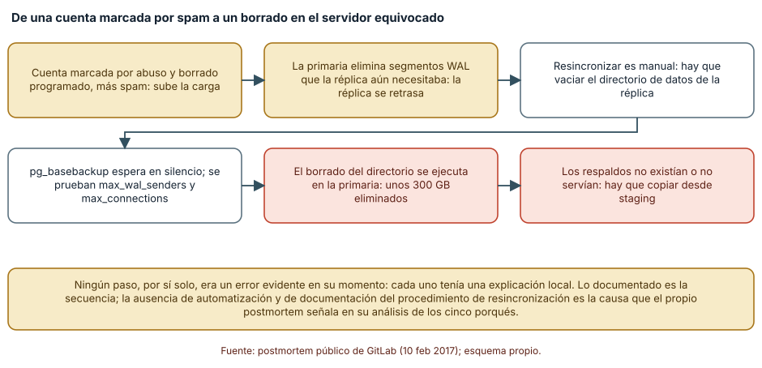
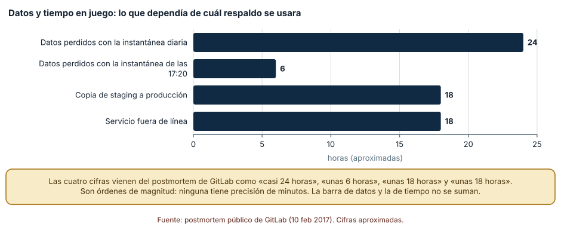

# Incidente de base de datos de GitLab

[↑ Casos de fallo](README.md) · [← Therac-25](therac-25.md) · [Quibi →](quibi.md)

El 31 de enero de 2017, un ingeniero de GitLab.com ejecutó un borrado del directorio de datos en el servidor equivocado y eliminó unos 300 GB de la base de datos de producción. Cuando el equipo fue a buscar sus respaldos, descubrió que de los cuatro mecanismos de recuperación que creía tener, solo uno —pensado para otro fin— permitía recuperar parte de los datos. GitLab lo contó con una transparencia poco habitual —un postmortem público, un documento compartido y una transmisión en vivo—, y por eso es el ejemplo clásico para el curso: no solo muestra el fallo, muestra el razonamiento de quienes lo vivieron.

## Ficha histórica

| Dato | Contenido |
| --- | --- |
| Organización | GitLab Inc., que ofrece la plataforma de ciclo de vida de software GitLab y el servicio alojado GitLab.com |
| Fundadores | Dmytro Zaporozhets (creó GitLab como proyecto en 2011) y Sytse «Sid» Sijbrandij; la empresa se constituyó en 2014 y participó en Y Combinator en 2015 |
| Sede | Área de San Francisco, California (EE. UU.); empresa totalmente remota |
| Incidente | 31 de enero de 2017, desde las 17:20 UTC hasta el 1 de febrero a las 18:00 UTC |
| Qué ocurrió | Borrado accidental del directorio de datos de la base de datos primaria de GitLab.com; el servicio estuvo unas 18 horas sin disponibilidad |
| Daño documentado | Pérdida de datos de la base entre las 17:20 y las 23:30 UTC (el texto da 00:00 en un lugar): al menos unos 5.000 proyectos, 5.000 comentarios y unas 700 cuentas nuevas. Los repositorios Git y las wikis no se perdieron |
| No afectados | Clientes de GitLab Enterprise, de GitHost y usuarios de GitLab CE autoalojado |
| Documento oficial | Postmortem del 10 de febrero de 2017 |
| Estado posterior | Lista pública de mejoras de recuperación, monitoreo de respaldos y asignación de un responsable; GitLab salió a bolsa en el Nasdaq el 14 de octubre de 2021 |

La fecha de consulta de las fuentes citadas al final es el 16 de noviembre de 2026.

## Contexto y problema

GitLab.com era en 2017 el servicio alojado donde miles de equipos guardaban código, incidencias y solicitudes de fusión. Su base de datos, PostgreSQL, se había diseñado con un servidor primario (`db1`) que atendía toda la carga y un secundario (`db2`) en espera activa (*hot standby*) para conmutación por falla. El propio postmortem reconoce que ese diseño convertía a `db1` en un punto único de falla y recuerda incidentes anteriores, como el de noviembre de 2016 por hinchazón de una tabla.

El problema de fondo no era un servidor, sino la confianza. Las empresas confían en que los datos que guardan en un servicio alojado sobrevivan a cualquier error de un operador. Esa confianza se sostiene sobre un supuesto que casi nadie comprueba: que existe una copia utilizable y que alguien sabe restaurarla. El caso muestra qué ocurre cuando el supuesto nunca se probó.

## Mercado, usuarios y casos de uso

GitLab ofrece su producto de dos maneras: el servicio GitLab.com, administrado por la empresa, y la instalación en servidores del cliente, en ediciones comunitaria y empresarial. Ese reparto es clave para entender el alcance del incidente: solo GitLab.com tenía esta base de datos y por eso solo sus usuarios sufrieron la pérdida.

Los usuarios del servicio hacen cuatro cosas cuyo valor depende de la base de datos:

- **Desarrolladores**: empujan commits, abren solicitudes de fusión y comentan. Los commits y repositorios viven en otro almacenamiento (servidores NFS), por eso no se perdieron.
- **Equipos de producto**: usan incidencias, tableros y proyectos, almacenados en la base de datos.
- **Canalizaciones de integración continua**: leen y escriben el estado de cada ejecución en la base, de modo que tras la restauración había ejecuciones que la base no conocía.
- **El propio equipo de GitLab**: usa GitLab.com para desarrollar GitLab. Durante la caída, la mayoría pudo trabajar con copias locales de Git, pero no crear incidencias, y publicó el aviso del incidente desde una instancia privada que normalmente usa para trabajo sensible.

## Funcionalidad de principio a fin

La plataforma, vista desde la base de datos, funciona así.

**1. Una petición entra.** Un usuario carga una página o empuja código. La aplicación Rails consulta o escribe en PostgreSQL en `db1`, que guarda proyectos, usuarios, incidencias, comentarios y el estado de las canalizaciones.

**2. La base se copia hacia una réplica.** `db2` recibe, por replicación en streaming, los cambios que `db1` escribe en su registro de escritura anticipada (WAL). Su función documentada era la conmutación por falla, no la recuperación ante desastres.

**3. Los respaldos corren por su cuenta.** Cuatro mecanismos existían, con la descripción del propio postmortem: una copia lógica con `pg_dump` cada 24 horas hacia Amazon S3; una instantánea LVM del disco de producción cada 24 horas, que se carga en staging para pruebas; instantáneas de disco de Azure cada 24 horas para algunos servidores, como los NFS; y la replicación mencionada.

**4. Algo se tuerce.** El 31 de enero, un ingeniero preparaba pruebas de `pgpool-II` en staging para repartir la carga entre varios servidores. Antes de empezar, hacia las 17:20 UTC, tomó a mano una instantánea LVM de producción para tener datos actuales en staging.

**5. La carga sube y la réplica se retrasa.** Desde las 19:00 la base soportó más carga por spam y por un trabajo en segundo plano que intentaba borrar la cuenta y los datos de un empleado marcado por abuso. Hacia las 23:00 la réplica se atrasó y falló, porque la primaria ya había retirado segmentos de WAL que la réplica necesitaba; GitLab.com no archivaba WAL.

**6. La resincronización manual.** Había que vaciar el directorio de datos de la réplica y ejecutar `pg_basebackup`. La herramienta se quedó esperando sin mensajes útiles. Se aumentó `max_wal_senders` de 3 a 32 y PostgreSQL se negó a reiniciar por exceso de semáforos, porque `max_connections` estaba en 8.000; se redujo a 2.000. El equipo probó `strace` sin hallar nada.

**7. El borrado en el servidor equivocado.** Hacia las 23:30, tras pensar que `pg_basebackup` había dejado archivos en el directorio, un ingeniero vació el directorio de datos creyendo que estaba en la réplica; estaba en la primaria. Interrumpió el comando uno o dos segundos después, pero ya se habían eliminado unos 300 GB.

**8. La búsqueda de respaldos.** Los pasos de recuperación descritos abajo fallaron uno tras otro.

**9. La restauración.** Se usó la instantánea LVM de las 17:20, la única fuente utilizable, copiándola desde staging hacia producción. Tomó unas 18 horas. A las 17:00 UTC del 1 de febrero estaba restaurada la base sin los *webhooks*, que se reconstruyeron aparte, y hacia las 18:00 se completaron los últimos pasos.

## Negocio y economía

GitLab vive de suscripciones de las ediciones de pago y de GitLab.com; la confianza en que el servicio no pierde datos forma parte del producto. En el incidente, la economía aparece en tres lugares, todos con cifras o hechos del postmortem:

- **Un ahorro que se volvió cuello de botella.** El entorno de staging usaba discos de Azure «clásicos» sin almacenamiento premium, «para ahorrar costos», porque el premium es caro. Al restaurar desde staging, esos discos de red, estrangulados a unos 60 Mbps, fueron el cuello de botella y la copia tardó unas 18 horas. El postmortem lo dice explícitamente: no había red ni procesador limitantes, solo las unidades.
- **Una supuesta suficiencia.** Las instantáneas de disco de Azure no estaban habilitadas para las bases de datos «porque asumimos que los otros procedimientos eran suficientes» y porque restaurarlas puede tardar días: en un caso, más de una semana. Ahorrar la complejidad de un mecanismo lento dejó sin un respaldo que, aun lento, habría existido.
- **El costo de la transparencia.** GitLab publicó el postmortem, un documento público con el progreso y una transmisión en vivo que alcanzó unos 5.000 espectadores simultáneos. Eso tiene un costo reputacional corto, que el caso no cuantifica, y un efecto de confianza que tampoco puede medirse con los datos públicos.

## Arquitectura y esquemas

### Contexto y componentes: cuatro caminos de recuperación

**Cómo leer la figura.** La caja oscura de arriba es la base primaria. De ella salen cuatro flechas, una por camino de recuperación; el recuadro de abajo dice qué estado tenía cada uno. Mira primero el color: tres coral y uno dorado. **Dónde deja de valer:** muestra el estado del 31 de enero según el postmortem; no incluye otros servidores de GitLab, y que la instantánea LVM no estuviera pensada para desastres es lo que el texto dice, no una norma general.

### Flujo crítico: cómo se encadenó el borrado

**Cómo leer la figura.** Se lee de izquierda a derecha y de arriba abajo. Cada caja es un hecho del postmortem; los colores dorados son las condiciones que subieron la carga, los blancos son decisiones razonables en su contexto y los coral, los dos pasos que convirtieron el incidente en pérdida de datos. **Dónde deja de valer:** el postmortem describe cada paso con la información de ese momento; la figura no reproduce los intentos intermedios ni quién decidió qué.

### Por qué el respaldo lógico no existía

El mecanismo es un fallo en cadena de tres decisiones locales que juntas generaron un respaldo vacío:

1. El respaldo se ejecutaba con `pg_dump` en un servidor de aplicación, no en el de base de datos.
2. El paquete de instalación (Omnibus) elige la versión de PostgreSQL leyendo el directorio de datos; como en el servidor de aplicación no hay directorio de datos, usa por omisión la 9.2, no la 9.6 que corre la base. Una diferencia mayor de versión hace que `pg_dump` termine con error.
3. Los avisos de error de las tareas programadas se enviaban por correo, pero los correos eran rechazados por el servidor receptor porque no estaban firmados con DMARC. No había otra vía para que el proceso automático se quejara. Nadie lo supo hasta que fue tarde.

## Casos especiales y cómo fallan

**El respaldo que falla en silencio.** Un mecanismo cuyo único canal de error es un correo rechazado equivale a un mecanismo sin vigilancia. El postmortem lo dice con otras palabras: el proceso era «un proceso automático sin otro medio para reportar errores».

**La réplica que no es un respaldo.** Una réplica copia también los errores: si se borra o se corrompe algo en la primaria, el cambio viaja. Su propósito documentado era conmutar por falla. Aquí además se vació, porque resincronizarla exigía vaciar su directorio.

**La resincronización manual de alto riesgo.** El procedimiento «vaciar el directorio, correr `pg_basebackup`» no estaba automatizado ni bien documentado, y la herramienta espera en silencio hasta que la primaria empieza a enviar datos, comportamiento normal que, según el postmortem, no figuraba en las guías de operación ni en la documentación oficial. Un ingeniero que no sabía esto pensó que algo andaba mal y repitió el vaciado.

**Dos servidores difíciles de distinguir.** El borrado se ejecutó en el servidor equivocado. La respuesta de GitLab no fue impedir comandos peligrosos —el postmortem argumenta que proteger a un ingeniero de `rm -rf` no protege contra la corrupción de disco ni contra las demás maneras de perder datos— sino distinguir mejor los servidores (mensaje del intérprete) y mejorar la recuperación.

**Una restauración que desordena el sistema.** Restaurar desde una instantánea anterior deja identificadores reutilizables y *webhooks* que podrían dispararse. El procedimiento de GitLab elimina los webhooks de la copia de staging para que no se disparen, los restaura aparte y suma 100.000 a todas las secuencias de la base para no reutilizar identificadores que se pudieron haber usado antes del incidente.

**Datos que solo se pueden reconstruir a medias.** Los proyectos creados tras las 17:20 se restauraron a partir de sus repositorios Git, que estaban en NFS, pero solo en su forma más básica, sin incidencias ni solicitudes de fusión.

**La infraestructura de transparencia también se saturó.** El sitio de monitoreo público no soportó la carga de los usuarios durante la caída; el sistema interno, del que depende, no se afectó.

## Línea de tiempo

Todas las horas son UTC y vienen del postmortem de GitLab.

| Fecha y hora | Hecho |
| --- | --- |
| 28 de noviembre de 2016 | Caída previa de la base por hinchazón de una tabla (antecedente que menciona el postmortem) |
| 31 de enero, ≈17:20 | Un ingeniero toma una instantánea LVM manual de producción para staging |
| 31 de enero, ≈19:00 | Sube la carga de la base por spam y un trabajo de borrado de una cuenta |
| 31 de enero, ≈23:00 | La réplica se retrasa y falla; comienza la resincronización manual |
| 31 de enero, ≈23:30 | Se vacía el directorio de datos de la primaria por error; ≈300 GB eliminados |
| 31 de enero, noche | Se descubre que los respaldos no existen o no sirven; se decide restaurar desde la instantánea de las 17:20 |
| 1 de febrero, 17:00 | La base está restaurada, sin webhooks |
| 1 de febrero, ≈18:00 | Se terminan los últimos pasos y se confirma la operación |
| 10 de febrero de 2017 | GitLab publica el postmortem |

**Cómo leer la figura.** El eje cuenta horas desde las 17:00 UTC del 31 de enero. Los cuatro carriles son la carga, la réplica, la disponibilidad del servicio y los datos que se pierden. Las líneas punteadas fijan la instantánea, el borrado y la restauración. Mira primero la barra coral: es el tiempo sin servicio, el que más pesa para el usuario. **Dónde deja de valer:** la barra de resincronización es aproximada, porque el postmortem no da su inicio exacto, y el cierre de la ventana de datos perdidos aparece como 23:30 y como 00:00 en dos lugares del mismo documento.

**Cómo leer la figura.** Cada barra es un número de horas con un significado distinto: las dos de arriba son datos que se habrían perdido según el punto de restauración; las dos de abajo, tiempo de recuperación. Mira primero la diferencia entre las dos barras de datos: haber tomado la instantánea manual redujo la pérdida de unas 24 horas a unas 6. **Dónde deja de valer:** son órdenes de magnitud con la redacción del postmortem («casi», «unas»), y las barras de datos y de tiempo no se suman.

## Qué falló en cada instancia

Cada instancia es un mecanismo con una expectativa y un resultado.

1. **Replicación.** Se esperaba una réplica siempre al día. Falló cuando la carga subió y la primaria eliminó WAL que la réplica no había leído, porque no se archivaba WAL. La instancia terminó vaciada.
2. **Respaldo lógico con `pg_dump`.** Se esperaba una copia diaria en S3. El depósito estaba vacío: la herramienta, de la versión 9.2, falló contra la base 9.6 sin que nadie lo notara por el correo rechazado.
3. **Instantáneas de Azure.** Se esperaba un respaldo de disco. No estaban habilitadas para las bases de datos, porque se asumió que los otros respaldos bastaban.
4. **Instantánea LVM.** Se esperaba su uso para probar cambios en staging. Fue la única fuente de recuperación, con la limitación de estar casi seis horas atrás y de contar con discos lentos.
5. **Resincronización manual.** Se esperaba un procedimiento conocido. La herramienta esperaba en silencio, la documentación no lo explicaba y el comando destructivo no distinguía el entorno.
6. **Detección de abuso.** Se esperaba retirar cuentas de spam. El sistema permitió que una cuenta legítima, marcada por un tercero, se programara para eliminación; ese trabajo sumó carga.
7. **Monitoreo público.** Se esperaba mostrar el estado a los usuarios. El sitio no soportó la carga.

## Causa raíz y factores

El postmortem aplica la técnica de los cinco porqués a dos problemas: por qué GitLab.com estuvo caído unas 18 horas y por qué restaurar tomó más de 18 horas.

**Detonante (documentado).** El vaciado del directorio de datos en la primaria en lugar de en la réplica, hacia las 23:30.

**Condiciones latentes (documentado por GitLab).**

- La replicación se detuvo por un pico de carga, porque la primaria eliminaba WAL antes de que la réplica lo leyera.
- Resincronizar era manual, sin automatizar ni documentar bien.
- Un respaldo `pg_dump` fallaba por diferencia de versión y sus avisos se perdían por DMARC.
- Las instantáneas de Azure no estaban habilitadas para las bases de datos.
- La instantánea de staging era lenta de restaurar por discos baratos y regionales.
- **No había un dueño**: el procedimiento de respaldo no se probaba regularmente «porque no había propiedad» y nadie era responsable de comprobarlo.

**Factores de contexto (documentado e inferido).** Documentado: horas de trabajo sobre un servicio muy cargado desde las 19:00, un sistema de abuso que hacía fácil pasar por alto los detalles de las cuentas marcadas y una base que ya era, según el propio postmortem, un punto único de falla con incidentes previos. Inferido por este programa: la presión de esas horas pudo influir en las decisiones; el documento no lo afirma.

**No se sabe.** El postmortem no detalla el tiempo de trabajo acumulado de cada persona ni el historial de decisiones sobre respaldos anteriores a 2017, y no informa de la compensación a usuarios.

## Mejoras que debieron hacerse

> **Esta sección es análisis propio de este programa**, apoyado en la propia lista de mejoras de GitLab y en lo que enseña el curso. GitLab las enumeró como incidencias abiertas; el postmortem no dice si se completaron.

**Cómo leer la figura.** A la izquierda, debilidades que documenta el postmortem; a la derecha, el compromiso con el que GitLab respondió. Cada flecha empareja una con otra. Mira primero que los compromisos son sobre recuperación y vigilancia, no sobre prohibir comandos. **Dónde deja de valer:** son compromisos publicados en febrero de 2017; la figura no afirma que se cumplieran.

1. **Probar la restauración de forma automática y periódica.** Corta la causa «respaldo nunca probado»: un respaldo solo existe si se restauró y se verificó. GitLab lo listó como incidencia propia (#1102). Clase: [SE-321](../../classes/part-26-datos-persistencia-y-recuperacion/se-321-backups-restauracion-y-pruebas-de-recuperacion/README.md).
2. **Monitorear el resultado de cada respaldo con una señal fiable.** Corta el silencio: no confiar en el correo como único canal. Una alerta que no llega no es una alerta. GitLab lo listó (#1095, panel público de respaldos). Clases: [SE-426](../../classes/part-35-observabilidad-sre-e-incidentes/se-426-alertas-accionables-y-fatiga/README.md) y [SE-421](../../classes/part-35-observabilidad-sre-e-incidentes/se-421-senales-eventos-y-observabilidad-util/README.md).
3. **Más de un mecanismo de recuperación independiente, con objetivos de pérdida y tiempo explícitos.** Corta la dependencia de un único respaldo. Instantáneas más frecuentes (#1098: cada hora), instantáneas de disco (#1099), archivado continuo de WAL y recuperación a un punto en el tiempo (#1097 y #494). Clases: [SE-380](../../classes/part-31-calidad-rendimiento-y-resiliencia/se-380-disponibilidad-durabilidad-y-recuperacion/README.md) y [SE-430](../../classes/part-35-observabilidad-sre-e-incidentes/se-430-continuidad-disaster-recovery-y-ejercicios/README.md).
4. **Un dueño de la durabilidad de los datos.** Corta la causa «no había propiedad». Es la mejora de gobierno de mayor efecto: sin un responsable, ninguna prueba se mantiene. GitLab listó asignar un dueño. Clases: [SE-446](../../classes/part-37-gestion-liderazgo-y-practica-profesional/se-446-diseno-de-equipos-y-ownership/README.md) y [SE-427](../../classes/part-35-observabilidad-sre-e-incidentes/se-427-runbooks-on-call-y-escalamiento/README.md).
5. **Procedimientos de resincronización automatizados y documentados.** Corta la operación manual de riesgo: lo que se hace pocas veces y bajo presión debe estar escrito, ensayado y, mejor, automatizado. Listado como #1103 y como restauración en streaming. Clase: [SE-427](../../classes/part-35-observabilidad-sre-e-incidentes/se-427-runbooks-on-call-y-escalamiento/README.md) y [SE-354](../../classes/part-29-cloud-plataforma-e-infraestructura/se-354-infraestructura-como-codigo-y-estado/README.md).
6. **Distinguir producción de las demás cosas en cada comando destructivo.** Un mensaje del intérprete que muestre el servidor y el entorno (#1094) y, propuesta propia, una confirmación que exija escribir el nombre del host antes de vaciar un directorio de datos. Clases: [SE-355](../../classes/part-29-cloud-plataforma-e-infraestructura/se-355-entornos-cuentas-y-separacion-de-responsabilidades/README.md) y [SE-030](../../classes/part-02-sistemas-operativos-terminal-y-automatizacion-base/se-030-powershell-bash-y-portabilidad-de-scripts/README.md).
7. **Réplicas múltiples y equilibrio de carga.** Eliminan el punto único de falla (#259, #1101). Clase: [SE-319](../../classes/part-26-datos-persistencia-y-recuperacion/se-319-replicacion-particion-y-distribucion/README.md).
8. **Que el entorno de restauración no sea más lento que el de producción.** Propuesta propia derivada del dato de las 18 horas: el tiempo de recuperación depende del hardware del lugar desde el que se restaura. Mover staging a un almacenamiento más rápido (#1100). Clase: [SE-134](../../classes/part-11-economia-metricas-y-decisiones-de-producto/se-134-costos-de-construccion-operacion-y-oportunidad/README.md).
9. **Comunicar con transparencia y proteger a las personas.** Lo que GitLab hizo bien: publicar, transmitir, y anunciar que en el futuro redactarán los nombres. Clase: [SE-429](../../classes/part-35-observabilidad-sre-e-incidentes/se-429-postmortems-sin-culpa-y-aprendizaje/README.md).

Una observación del propio postmortem merece repetirse: un entorno ideal es uno donde se puede cometer un error y recuperarse rápido y con poco impacto; impedir los errores es una meta más débil que hacerlos baratos.

## Vínculo con el curso

- [SE-321 · Backups, restauración y pruebas de recuperación](../../classes/part-26-datos-persistencia-y-recuperacion/se-321-backups-restauracion-y-pruebas-de-recuperacion/README.md): un respaldo no probado es una hipótesis; el caso es la versión real de la tesis de la clase.
- [SE-319 · Replicación, partición y distribución](../../classes/part-26-datos-persistencia-y-recuperacion/se-319-replicacion-particion-y-distribucion/README.md): por qué una réplica no es un respaldo y qué ocurre cuando se retrasa.
- [SE-380 · Disponibilidad, durabilidad y recuperación](../../classes/part-31-calidad-rendimiento-y-resiliencia/se-380-disponibilidad-durabilidad-y-recuperacion/README.md): los objetivos de pérdida y de tiempo que aquí no se habían fijado.
- [SE-430 · Continuidad, disaster recovery y ejercicios](../../classes/part-35-observabilidad-sre-e-incidentes/se-430-continuidad-disaster-recovery-y-ejercicios/README.md): practicar la recuperación antes de necesitarla.
- [SE-426 · Alertas accionables y fatiga](../../classes/part-35-observabilidad-sre-e-incidentes/se-426-alertas-accionables-y-fatiga/README.md): el aviso que el servidor receptor rechazó.
- [SE-427 · Runbooks, on-call y escalamiento](../../classes/part-35-observabilidad-sre-e-incidentes/se-427-runbooks-on-call-y-escalamiento/README.md): el procedimiento no documentado y la herramienta que espera en silencio.
- [SE-429 · Postmortems sin culpa y aprendizaje](../../classes/part-35-observabilidad-sre-e-incidentes/se-429-postmortems-sin-culpa-y-aprendizaje/README.md): el documento de GitLab es un ejemplo de postmortem público, con cinco porqués y lista de acciones.
- [SE-446 · Diseño de equipos y ownership](../../classes/part-37-gestion-liderazgo-y-practica-profesional/se-446-diseno-de-equipos-y-ownership/README.md): «no había propiedad» como causa raíz.
- [SE-355 · Entornos, cuentas y separación de responsabilidades](../../classes/part-29-cloud-plataforma-e-infraestructura/se-355-entornos-cuentas-y-separacion-de-responsabilidades/README.md): producción y staging, y qué se puede hacer desde dónde.
- [SE-134 · Costos de construcción, operación y oportunidad](../../classes/part-11-economia-metricas-y-decisiones-de-producto/se-134-costos-de-construccion-operacion-y-oportunidad/README.md): el ahorro de discos baratos que costó 18 horas.

## Qué no generalizar

- **No es un caso de «error humano».** El borrado fue el detonante, pero el postmortem muestra que cualquier persona cansada pudo equivocarse y que el sistema no tenía cómo corregirlo.
- **No prueba que los respaldos en la nube o PostgreSQL sean poco fiables.** Falló la configuración de este entorno: un cliente de versión equivocada y un aviso por correo sin firmar.
- **Las cifras de pérdida son estimaciones de GitLab.** «Al menos» 5.000 proyectos, 5.000 comentarios y unas 700 cuentas, sin desglose por tamaño ni por impacto en usuarios.
- **La arquitectura de 2017 no es la actual.** GitLab ha cambiado su infraestructura desde entonces; este caso describe una fotografía de enero de 2017.
- **La transparencia de GitLab no es una norma.** Es una elección de cultura de esa empresa; otras organizaciones tienen razones legales o contractuales para publicar menos.
- **Las mejoras son compromisos de febrero de 2017.** El caso no verifica su cumplimiento.

## Fuentes públicas verificadas

Todas las URL se abrieron el 16 de noviembre de 2026.

- [GitLab, Postmortem of database outage of January 31 (10 de febrero de 2017)](https://about.gitlab.com/blog/2017/02/10/postmortem-of-database-outage-of-january-31/): fuente primaria de la secuencia, las horas, las cifras de pérdida, el estado de cada mecanismo de recuperación, el análisis de los cinco porqués y la lista de mejoras.
- [GitLab, Historia de la empresa](https://about.gitlab.com/company/history/): inicio del proyecto en 2011, constitución en 2014, paso por Y Combinator en 2015, modelo totalmente remoto y salida a bolsa del 14 de octubre de 2021.
- [Wikipedia, GitLab Inc.](https://en.wikipedia.org/wiki/GitLab_Inc.): fuente secundaria para los fundadores y la sede.
- [Wikipedia, GitLab](https://en.wikipedia.org/wiki/GitLab): fuente secundaria del origen del proyecto por Dmytro Zaporozhets en 2011 y de sus componentes.
- [GitLab, Home](https://about.gitlab.com/): sitio oficial de la compañía, para identificar las ediciones y el servicio alojado.

---

[↑ Casos de fallo](README.md) · [← Therac-25](therac-25.md) · [Quibi →](quibi.md)
