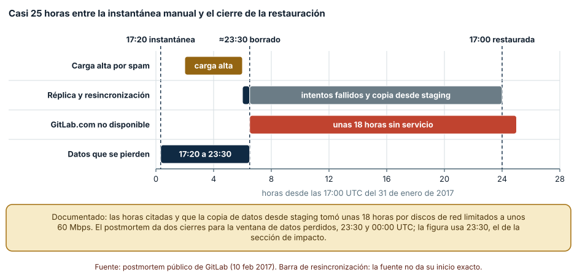
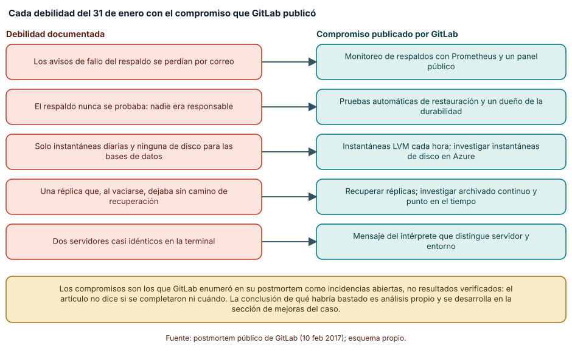
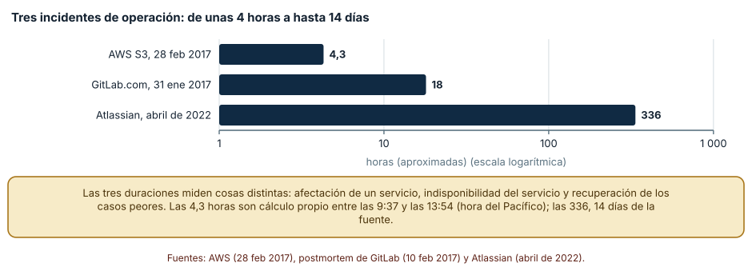

# Incidente de base de datos de GitLab

[↑ Casos de fallo](README.md) · [← Therac-25](therac-25.md) · [Quibi →](quibi.md)

El 31 de enero de 2017, un ingeniero de GitLab.com ejecutó un borrado del directorio de datos en el servidor equivocado y eliminó unos 300 GB de la base de datos de producción. Cuando el equipo fue a buscar sus respaldos, descubrió que de los cuatro mecanismos de recuperación que creía tener, solo uno —pensado para otro fin— permitía recuperar parte de los datos. GitLab lo contó con una transparencia poco habitual —un postmortem público, un documento compartido y una transmisión en vivo—, y por eso es el ejemplo clásico para el curso: no solo muestra el fallo, muestra el razonamiento de quienes lo vivieron.

## Ficha histórica

| Dato | Contenido |
| --- | --- |
| Organización | GitLab Inc., que ofrece la plataforma de ciclo de vida de software GitLab y el servicio alojado GitLab.com |
| Fundadores | Dmytro Zaporozhets (creó GitLab como proyecto en 2011) y Sytse «Sid» Sijbrandij; la empresa se constituyó en 2014 y participó en Y Combinator en 2015 |
| Sede | Área de San Francisco, California (EE. UU.); empresa totalmente remota |
| Incidente | 31 de enero de 2017, desde las 17:20 UTC hasta el 1 de febrero a las 18:00 UTC |
| Qué ocurrió | Borrado accidental del directorio de datos de la base de datos primaria de GitLab.com; el servicio estuvo unas 18 horas sin disponibilidad |
| Daño documentado | Pérdida de datos de la base entre las 17:20 y las 23:30 UTC (el texto da 00:00 en un lugar): al menos unos 5.000 proyectos, 5.000 comentarios y unas 700 cuentas nuevas. Los repositorios Git y las wikis no se perdieron |
| No afectados | Clientes de GitLab Enterprise, de GitHost y usuarios de GitLab CE autoalojado |
| Documento oficial | Postmortem del 10 de febrero de 2017 |
| Estado posterior | Lista pública de mejoras de recuperación, monitoreo de respaldos y asignación de un responsable; GitLab salió a bolsa en el Nasdaq el 14 de octubre de 2021 |

La fecha de consulta de las fuentes citadas al final es el 16 de noviembre de 2026.

## Contexto y problema

GitLab.com era en 2017 el servicio alojado donde miles de equipos guardaban código, incidencias y solicitudes de fusión. Su base de datos, PostgreSQL, se había diseñado con un servidor primario (`db1`) que atendía toda la carga y un secundario (`db2`) en espera activa (*hot standby*) para conmutación por falla. El propio postmortem reconoce que ese diseño convertía a `db1` en un punto único de falla y recuerda incidentes anteriores, como el de noviembre de 2016 por hinchazón de una tabla.

El problema de fondo no era un servidor, sino la confianza. Las empresas confían en que los datos que guardan en un servicio alojado sobrevivan a cualquier error de un operador. Esa confianza se sostiene sobre un supuesto que casi nadie comprueba: que existe una copia utilizable y que alguien sabe restaurarla. El caso muestra qué ocurre cuando el supuesto nunca se probó.

### Tres palabras que se confunden: réplica, respaldo e instantánea

El caso gira en torno a una confusión frecuente que conviene aclarar antes de seguirlo. Tres mecanismos protegen datos y ninguno sustituye a los otros.

- **Réplica.** Una segunda copia de la base que se mantiene al día copiando cada cambio de la primaria. Sirve para **conmutar por falla** (si la primaria cae, la réplica toma el relevo) y para repartir lecturas. Como copia cada cambio, también copia los errores: si alguien borra una tabla en la primaria, el borrado viaja a la réplica. El postmortem de GitLab es explícito: su réplica se usaba para conmutación por falla y no para recuperación ante desastres.
- **Respaldo.** Una copia **separada en el tiempo** y por lo general en otro lugar, que representa el estado de la base en un instante pasado. Sirve para recuperarse de un error o de una corrupción, a costa de perder lo ocurrido después del respaldo. Solo es un respaldo si alguien comprobó que se puede restaurar.
- **Instantánea (*snapshot*).** Una fotografía de un disco o volumen en un instante. Es rápida de tomar; restaurarla puede ser lenta o rápida según dónde se haga. El postmortem advierte que restaurar una instantánea de disco de Azure en un host de otra cuenta de almacenamiento puede tardar horas o días, y que en un caso tardó más de una semana.

Dos números ordenan la conversación sobre estas tres cosas. El **objetivo de punto de recuperación** (RPO) responde cuánto dato se acepta perder, medido en tiempo; el **objetivo de tiempo de recuperación** (RTO) responde cuánto se acepta tardar en volver. GitLab no declara objetivos de este tipo en su postmortem; los números del caso (hasta 24 horas de datos y unas 18 horas de restauración si no hubiera existido la instantánea manual) se pueden leer como el RPO y el RTO **reales** que el sistema ofrecía sin que nadie los hubiera elegido. Las clases [SE-321 · Backups, restauración y pruebas de recuperación](../../classes/part-26-datos-persistencia-y-recuperacion/se-321-backups-restauracion-y-pruebas-de-recuperacion/README.md) y [SE-380 · Disponibilidad, durabilidad y recuperación](../../classes/part-31-calidad-rendimiento-y-resiliencia/se-380-disponibilidad-durabilidad-y-recuperacion/README.md) tratan por qué esos objetivos se fijan antes del incidente.

### PostgreSQL y el registro de escritura anticipada

PostgreSQL escribe cada cambio primero en un registro secuencial, el *write-ahead log* (WAL), dividido en segmentos. La réplica por *streaming* lee esos segmentos desde la primaria. Si la réplica se retrasa y la primaria ya **reciclaba** los segmentos que la réplica necesita, la réplica no puede alcanzar a la primaria y debe reconstruirse desde cero. La salida es el archivado de WAL, que guarda los segmentos en otro lugar mientras alguien los necesite; GitLab.com no lo usaba. Es una decisión de operación razonable cuando la carga es baja y costosa cuando sube: el sistema funcionó mientras la réplica se mantuvo al día.

## Mercado, usuarios y casos de uso

GitLab ofrece su producto de dos maneras: el servicio GitLab.com, administrado por la empresa, y la instalación en servidores del cliente, en ediciones comunitaria y empresarial. Ese reparto es clave para entender el alcance del incidente: solo GitLab.com tenía esta base de datos y por eso solo sus usuarios sufrieron la pérdida.

Los usuarios del servicio hacen cuatro cosas cuyo valor depende de la base de datos:

- **Desarrolladores**: empujan commits, abren solicitudes de fusión y comentan. Los commits y repositorios viven en otro almacenamiento (servidores NFS), por eso no se perdieron.
- **Equipos de producto**: usan incidencias, tableros y proyectos, almacenados en la base de datos.
- **Canalizaciones de integración continua**: leen y escriben el estado de cada ejecución en la base, de modo que tras la restauración había ejecuciones que la base no conocía.
- **El propio equipo de GitLab**: usa GitLab.com para desarrollar GitLab. Durante la caída, la mayoría pudo trabajar con copias locales de Git, pero no crear incidencias, y publicó el aviso del incidente desde una instancia privada que normalmente usa para trabajo sensible.

### Quién perdió qué, según dónde vivía el dato

La separación entre almacenes decidió quién resultó afectado, y el postmortem la usa para acotar el daño. Dos almacenes distintos guardaban dos tipos de dato:

- **Base de datos PostgreSQL**: proyectos, usuarios, incidencias, comentarios, fragmentos de código, el estado de las canalizaciones y los *webhooks*. Fue lo que se borró.
- **Servidores NFS** con los repositorios Git y las wikis: no se afectaron. Por eso los desarrolladores, que trabajan sobre copias locales, pudieron seguir con su código aunque no pudieran crear incidencias.

Esa partición explica por qué el daño real fue de **metadatos de colaboración** (quién comentó qué, qué incidencia existía, qué cuenta se había creado) y no de código. Es una lectura propia, pero consistente con el texto: el código sobrevivió, la conversación sobre el código no.

**Cómo leer la figura.** El recuadro grande es el servicio GitLab.com; fuera quedan las ediciones que el incidente no tocó. Las cajas coral son los almacenes que se vieron afectados, las teal las que no, y las doradas el entorno de pruebas que acabó siendo la fuente de recuperación. Mira primero la frontera: la partición entre base y repositorios acotó el daño. **Dónde deja de valer:** es el panorama de enero de 2017 según el postmortem; no muestra otros servicios de la plataforma, y el postmortem no dice cuántos usuarios activos tenía GitLab.com.

## Funcionalidad de principio a fin

La plataforma, vista desde la base de datos, funciona así.

**1. Una petición entra.** Un usuario carga una página o empuja código. La aplicación Rails consulta o escribe en PostgreSQL en `db1`, que guarda proyectos, usuarios, incidencias, comentarios y el estado de las canalizaciones.

**2. La base se copia hacia una réplica.** `db2` recibe, por replicación en streaming, los cambios que `db1` escribe en su registro de escritura anticipada (WAL). Su función documentada era la conmutación por falla, no la recuperación ante desastres.

**3. Los respaldos corren por su cuenta.** Cuatro mecanismos existían, con la descripción del propio postmortem: una copia lógica con `pg_dump` cada 24 horas hacia Amazon S3; una instantánea LVM del disco de producción cada 24 horas, que se carga en staging para pruebas; instantáneas de disco de Azure cada 24 horas para algunos servidores, como los NFS; y la replicación mencionada.

**4. Algo se tuerce.** El 31 de enero, un ingeniero preparaba pruebas de `pgpool-II` en staging para repartir la carga entre varios servidores. Antes de empezar, hacia las 17:20 UTC, tomó a mano una instantánea LVM de producción para tener datos actuales en staging.

**5. La carga sube y la réplica se retrasa.** Desde las 19:00 la base soportó más carga por spam y por un trabajo en segundo plano que intentaba borrar la cuenta y los datos de un empleado marcado por abuso. Hacia las 23:00 la réplica se atrasó y falló, porque la primaria ya había retirado segmentos de WAL que la réplica necesitaba; GitLab.com no archivaba WAL.

**6. La resincronización manual.** Había que vaciar el directorio de datos de la réplica y ejecutar `pg_basebackup`. La herramienta se quedó esperando sin mensajes útiles. Se aumentó `max_wal_senders` de 3 a 32 y PostgreSQL se negó a reiniciar por exceso de semáforos, porque `max_connections` estaba en 8.000; se redujo a 2.000. El equipo probó `strace` sin hallar nada.

**7. El borrado en el servidor equivocado.** Hacia las 23:30, tras pensar que `pg_basebackup` había dejado archivos en el directorio, un ingeniero vació el directorio de datos creyendo que estaba en la réplica; estaba en la primaria. Interrumpió el comando uno o dos segundos después, pero ya se habían eliminado unos 300 GB.

**8. La búsqueda de respaldos.** Los pasos de recuperación descritos abajo fallaron uno tras otro.

**9. La restauración.** Se usó la instantánea LVM de las 17:20, la única fuente utilizable, copiándola desde staging hacia producción. Tomó unas 18 horas. A las 17:00 UTC del 1 de febrero estaba restaurada la base sin los *webhooks*, que se reconstruyeron aparte, y hacia las 18:00 se completaron los últimos pasos.

### La restauración, medida: por qué 18 horas

El postmortem da dos números que permiten un cálculo de orden de magnitud: los discos de staging estaban estrangulados a unos 60 Mbps y la copia tardó unas 18 horas. A 60 Mbps, en 18 horas pasan unos 3,9 billones de bits, es decir, del orden de 490 GB. Esa cifra es de este programa (cálculo propio) y es consistente con una base de cientos de gigabytes en que la capacidad del disco, y no la red ni el procesador, era el factor limitante, como dice el texto. El postmortem no da el tamaño total de la base ni de la copia, de modo que no se puede validar más.

La conclusión práctica es de proporciones. Una restauración depende de la capacidad de lectura del origen y de escritura del destino; el diseño del caso eligió almacenamiento barato en el entorno desde el que se restauraba. Mientras ese entorno servía solo para pruebas, su lentitud era irrelevante; cuando pasó a ser **la** fuente de recuperación, su lentitud pasó a ser el RTO del servicio entero. Este tipo de acoplamiento oculto (un componente que cambia de papel sin que se revise su dimensionamiento) es el centro de la clase [SE-356 · Escalado, capacidad y costos](../../classes/part-29-cloud-plataforma-e-infraestructura/se-356-escalado-capacidad-y-costos/README.md) sobre capacidad y de la [SE-134 · Costos de construcción, operación y oportunidad](../../classes/part-11-economia-metricas-y-decisiones-de-producto/se-134-costos-de-construccion-operacion-y-oportunidad/README.md) sobre costo de oportunidad.

**Cómo leer la figura.** Cada caja es un paso del procedimiento de restauración que describe el postmortem, en orden. La caja coral es el cuello de botella; las doradas son pasos que existen solo porque la restauración vino de una copia anterior. Mira primero la caja coral: concentra casi todo el tiempo. **Dónde deja de valer:** el postmortem no desglosa el tiempo de los pasos que no son la copia; la figura no los dimensiona.

## Negocio y economía

GitLab vive de suscripciones de las ediciones de pago y de GitLab.com; la confianza en que el servicio no pierde datos forma parte del producto. En el incidente, la economía aparece en tres lugares, todos con cifras o hechos del postmortem:

- **Un ahorro que se volvió cuello de botella.** El entorno de staging usaba discos de Azure «clásicos» sin almacenamiento premium, «para ahorrar costos», porque el premium es caro. Al restaurar desde staging, esos discos de red, estrangulados a unos 60 Mbps, fueron el cuello de botella y la copia tardó unas 18 horas. El postmortem lo dice explícitamente: no había red ni procesador limitantes, solo las unidades.
- **Una supuesta suficiencia.** Las instantáneas de disco de Azure no estaban habilitadas para las bases de datos «porque asumimos que los otros procedimientos eran suficientes» y porque restaurarlas puede tardar días: en un caso, más de una semana. Ahorrar la complejidad de un mecanismo lento dejó sin un respaldo que, aun lento, habría existido.
- **El costo de la transparencia.** GitLab publicó el postmortem, un documento público con el progreso y una transmisión en vivo que alcanzó unos 5.000 espectadores simultáneos. Eso tiene un costo reputacional corto, que el caso no cuantifica, y un efecto de confianza que tampoco puede medirse con los datos públicos.

### Impacto en cifras, con fuente y límite

| Dimensión | Cifra | Fuente | Qué mide y qué no |
| --- | --- | --- | --- |
| Datos borrados | Unos 300 GB del directorio de datos de la primaria | Postmortem de GitLab, 10 de febrero de 2017 | Lo eliminado antes de interrumpir el comando; no es el tamaño de la base |
| Indisponibilidad | Unas 18 horas, del 31 de enero (≈23:30 UTC) al 1 de febrero (≈18:00 UTC) | Postmortem | Aproximación del texto; el servicio tuvo además períodos degradados antes del borrado |
| Ventana de datos perdidos | De las 17:20 a las 23:30 UTC (el texto da 00:00 en la introducción) | Postmortem | Dos horas de cierre distintas en el mismo documento; se muestran ambas |
| Proyectos, comentarios y cuentas | Al menos unos 5.000 proyectos, 5.000 comentarios y unas 700 cuentas nuevas | Postmortem | Estimación mínima de la empresa; sin desglose de impacto |
| Código y wikis | Sin pérdida | Postmortem | Los repositorios están en otro almacenamiento |
| Alcance de clientes | Solo GitLab.com; no afectó a Enterprise, GitHost ni autoalojados | Postmortem | No dice el número de cuentas de GitLab.com |
| Transmisión pública | Pico de unos 5.000 espectadores simultáneos, en la posición n.º 2 de las transmisiones en vivo durante varias horas | Postmortem | Dato declarado por la empresa; no mide la audiencia de otros canales |
| Copia desde staging | Unas 18 horas a unos 60 Mbps | Postmortem | Cálculo propio: del orden de 490 GB; no es el tamaño de la base |

Tres lecturas de análisis propio. Primera: las dos cifras que más pesan (las 18 horas y los 5.000 proyectos) dependen de decisiones de diseño previas y no del error en sí; con una restauración de una hora y una pérdida de unos minutos, el mismo error habría sido un incidente menor. Segunda: la pérdida es de datos de colaboración, y su costo para cada usuario no está cuantificado. Tercera: GitLab no publica costos económicos del incidente (compensaciones, clientes perdidos); se deja como **no se sabe**.

### Reacción de la empresa y de la comunidad

- **Comunicación en tiempo real.** Mantuvo un documento público con el progreso, transmitió la recuperación por vídeo y usó la cuenta de estado en redes; el sitio de monitoreo público se saturó pero el sistema interno no se vio afectado.
- **Postmortem a los diez días.** Publicó el análisis el 10 de febrero con los cinco porqués, la lista de acciones con enlaces a incidencias y una disculpa de su director ejecutivo «a nivel personal y de toda la empresa».
- **Decisión sobre la privacidad de las personas.** El documento inicial contenía el nombre del ingeniero que ejecutó el comando; la empresa declaró que, aunque esa persona no tenía inconveniente, se redactarán los nombres en casos futuros porque otros pueden no sentirse cómodos.
- **Qué no hizo.** Su respuesta no fue prohibir el comando peligroso: argumenta que un alias de `rm` protege solo contra un caso entre muchos y prioriza distinguir los servidores y mejorar la recuperación.
- **Comunidad.** El postmortem pidió sugerencias en los comentarios; las fuentes consultadas no permiten resumir esas respuestas.

## Arquitectura y esquemas

### Contexto y componentes: cuatro caminos de recuperación

**Cómo leer la figura.** La caja oscura de arriba es la base primaria. De ella salen cuatro flechas, una por camino de recuperación; el recuadro de abajo dice qué estado tenía cada uno. Mira primero el color: tres coral y uno dorado. **Dónde deja de valer:** muestra el estado del 31 de enero según el postmortem; no incluye otros servidores de GitLab, y que la instantánea LVM no estuviera pensada para desastres es lo que el texto dice, no una norma general.

### Flujo crítico: cómo se encadenó el borrado

**Cómo leer la figura.** Se lee de izquierda a derecha y de arriba abajo. Cada caja es un hecho del postmortem; los colores dorados son las condiciones que subieron la carga, los blancos son decisiones razonables en su contexto y los coral, los dos pasos que convirtieron el incidente en pérdida de datos. **Dónde deja de valer:** el postmortem describe cada paso con la información de ese momento; la figura no reproduce los intentos intermedios ni quién decidió qué.

### Por qué el respaldo lógico no existía

El mecanismo es un fallo en cadena de tres decisiones locales que juntas generaron un respaldo vacío:

1. El respaldo se ejecutaba con `pg_dump` en un servidor de aplicación, no en el de base de datos.
2. El paquete de instalación (Omnibus) elige la versión de PostgreSQL leyendo el directorio de datos; como en el servidor de aplicación no hay directorio de datos, usa por omisión la 9.2, no la 9.6 que corre la base. Una diferencia mayor de versión hace que `pg_dump` termine con error.
3. Los avisos de error de las tareas programadas se enviaban por correo, pero los correos eran rechazados por el servidor receptor porque no estaban firmados con DMARC. No había otra vía para que el proceso automático se quejara. Nadie lo supo hasta que fue tarde.

### Cómo recorrer esta sección: siete niveles de zoom

| Nivel | Pregunta | Figura |
| --- | --- | --- |
| 1. Contexto | ¿Qué almacenes y qué actores hay? | Ecosistema (arriba) |
| 2. Contenedores | ¿Qué servidores, qué datos y qué copias? | Arquitectura de datos y respaldos |
| 3. Componentes | ¿Cómo funciona la replicación y qué la rompe? | Replicación y WAL |
| 4. Secuencia | ¿Qué ocurrió minuto a minuto de 23:00 a 23:30? | Secuencia de la noche |
| 5. Datos | ¿Qué se perdió y qué se conservó, y por qué? | Datos perdidos y conservados |
| 6. Controles | ¿Qué mecanismos de control existían y qué hicieron? | Cadena del respaldo vacío y defensa en profundidad |
| 7. Después | ¿Cómo queda la arquitectura con las mejoras? | Arquitectura posterior |

### Nivel 2: arquitectura de datos y respaldos

GitLab.com se ejecutaba sobre infraestructura en la nube de Azure, con respaldos lógicos en Amazon S3. La base de datos tenía un primario (`db1`) y un secundario en espera activa (`db2`). Los repositorios Git y las wikis residían en servidores NFS con instantáneas de disco de Azure cada 24 horas. El entorno de staging recibía cada 24 horas (a las 01:00 UTC) una copia de la base de producción basada en una instantánea LVM y usaba discos de Azure «clásicos» sin almacenamiento premium. El respaldo `pg_dump` se ejecutaba cada 24 horas desde un servidor de aplicación (no desde el de base de datos) y subía su resultado a S3.

**Cómo leer la figura.** Cada caja es un servidor o almacén; las flechas continuas son flujos de datos y las punteadas son respaldos. Las etiquetas coral marcan el estado que el postmortem informa para cada camino. Mira primero cuántas flechas salen de la primaria y a dónde llegan: cuatro caminos y solo uno terminó siendo útil. **Dónde deja de valer:** el postmortem no describe otros componentes (balanceadores, cachés, Sidekiq); la figura se limita a los que tocan los datos.

### Nivel 3: la replicación y por qué se rompió

La réplica `db2` recibía los cambios de `db1` por *streaming*. Cuando el spam y el trabajo de borrado subieron la carga, `db2` empezó a atrasarse. `db1` fue reciclando segmentos de WAL; al no haber archivado de WAL, los que `db2` necesitaba ya no existían. La única salida era reconstruir `db2` con `pg_basebackup`, que exige que el directorio de datos esté vacío.

**Cómo leer la figura.** El camino superior es el funcionamiento normal; el inferior, el que tomó la noche del 31 de enero. Las cajas coral son puntos donde el sistema perdió la capacidad de recuperarse sin intervención. Mira primero la caja «sin archivado de WAL»: es la que convierte un atraso en una reconstrucción. **Dónde deja de valer:** esquema conceptual; PostgreSQL ofrece otras opciones para retener WAL hasta que la réplica lo lea (como las ranuras de replicación), que el postmortem no menciona y cuya viabilidad en esa configuración no se puede juzgar desde el texto.

### Nivel 4: secuencia de la noche del 31 de enero

La secuencia que sigue es la del postmortem entre las 23:00 y las 23:30 UTC. Los intervalos no son exactos: el texto da las 23:00 y las 23:30 como marcas y describe sucesos entre ambas sin hora.

**Cómo leer la figura.** Cada columna es un actor; el tiempo corre hacia abajo. Las flechas coral son las acciones destructivas. Mira primero la distancia entre la primera vaciada (correcta, en `db2`) y la segunda (en `db1`): entre ellas hay intentos de diagnóstico que no explicaban el silencio de la herramienta. **Dónde deja de valer:** el postmortem no da la duración de cada intento; los espacios entre flechas no son escalas de tiempo.

El postmortem agrega un dato que cambia la lectura: la herramienta no estaba rota. `pg_basebackup` espera en silencio a que la primaria empiece a enviar datos, algo normal que no figuraba en los *runbooks* ni en la documentación oficial. La persona que decidió vaciar de nuevo el directorio estaba actuando con una creencia razonable (que algo había fallado) construida sobre una documentación incompleta. [SE-427 · Runbooks, on-call y escalamiento](../../classes/part-35-observabilidad-sre-e-incidentes/se-427-runbooks-on-call-y-escalamiento/README.md) trata por qué un procedimiento de riesgo necesita decir qué se espera ver en cada paso, incluidos los silencios.

### Nivel 5: modelo de datos: qué se perdió y qué se conservó

Para entender el daño hay que mirar dos líneas de tiempo a la vez: lo que existía en la base antes de las 17:20 (recuperable de la instantánea) y lo que se creó entre las 17:20 y el borrado (no recuperable de ella). Los repositorios Git de los proyectos creados en esa ventana existían en NFS y permitieron reconstruir los proyectos en su forma básica, sin incidencias ni solicitudes de fusión.

**Cómo leer la figura.** Cada fila es un tipo de dato y el eje horizontal es el tiempo, con la ventana de pérdida sombreada. Las barras teal sobrevivieron; las coral se perdieron; las doradas se reconstruyeron de forma parcial. Mira primero la fila de repositorios: es la única que no depende de la base. **Dónde deja de valer:** no dimensiona los datos (el postmortem solo estima cantidades mínimas) ni cubre otros metadatos.

Un detalle de diseño de la restauración merece atención porque ilustra un efecto secundario de volver a un estado anterior: tras restaurar, GitLab sumó 100.000 a todas las secuencias de la base. Si no, los identificadores generados después de las 17:20 en el mundo real (por ejemplo, en integraciones externas) podrían volver a asignarse a objetos nuevos y colisionar. Es un patrón general de las restauraciones parciales: el estado de un sistema incluye referencias que viven fuera de él. [SE-318 · Migraciones compatibles y evolución de esquema](../../classes/part-26-datos-persistencia-y-recuperacion/se-318-migraciones-compatibles-y-evolucion-de-esquema/README.md) y [SE-330 · CDC, ETL, ELT y sincronización](../../classes/part-27-integracion-eventos-y-mensajeria/se-330-cdc-etl-elt-y-sincronizacion/README.md) tratan la sincronización de esos estados.

### Nivel 6: mecanismos de control y cómo fallaron

El respaldo lógico es el caso mejor documentado de un control que falla sin hacer ruido. El postmortem describe tres decisiones locales, cada una razonable, que juntas produjeron un depósito vacío.

**Cómo leer la figura.** Una sola fila de pasos, de izquierda a derecha. Las cajas teal son decisiones locales razonables; las coral son los puntos donde el sistema pudo haberse quejado y no lo hizo. Mira primero las dos cajas coral al final: el error existía y no llegaba a nadie. **Dónde deja de valer:** describe el mecanismo del respaldo lógico; las otras tres rutas de recuperación fallaron por razones propias.

Visto en conjunto, las capas de control que debían impedir que el error se convirtiera en pérdida de datos son doce, de la detección de abuso a la propiedad de la durabilidad. La figura las ordena a lo largo del incidente.

**Cómo leer la figura.** Cada celda es un control con un recuadro inferior que dice qué hizo el 31 de enero. Coral: no cumplió su función; dorado: cumplió de forma parcial; teal: sirvió. Mira primero cuántas celdas son coral: lo documentado es que 10 de 12 no cumplieron su función. **Dónde deja de valer:** cuenta controles según el postmortem; no pondera su importancia relativa y que una capa estuviera ausente no dice que habría sido suficiente.

La lectura propia es que las capas **no eran independientes**: la réplica, el respaldo lógico y las instantáneas de Azure dependían de la misma suposición («otro mecanismo respaldará») y de la misma falta de pruebas. El postmortem lo dice al explicar por qué no se habilitaron las instantáneas de Azure en las bases de datos: se asumió que los otros procedimientos bastaban.

### Nivel 7: arquitectura posterior

Con la lista de mejoras del postmortem y las propuestas de este programa, la arquitectura de datos tiene tres cambios: **más caminos de recuperación independientes** (instantáneas cada hora, instantáneas de Azure en bases de datos, archivado de WAL con recuperación a un punto en el tiempo), **vigilancia de cada camino** (monitoreo de respaldos y pruebas automáticas de restauración) y **una persona responsable** de la durabilidad.

**Cómo leer la figura.** Las cajas teal son compromisos de la lista de GitLab; las doradas son propuestas de este programa que el postmortem no menciona. El bucle de pruebas de restauración que alimenta un panel es lo que convierte un respaldo en una afirmación verificable. Mira primero ese bucle. **Dónde deja de valer:** es un objetivo de diseño según compromisos de febrero de 2017; no afirma qué se implantó ni cuándo.

## Casos especiales y cómo fallan

**El respaldo que falla en silencio.** Un mecanismo cuyo único canal de error es un correo rechazado equivale a un mecanismo sin vigilancia. El postmortem lo dice con otras palabras: el proceso era «un proceso automático sin otro medio para reportar errores».

**La réplica que no es un respaldo.** Una réplica copia también los errores: si se borra o se corrompe algo en la primaria, el cambio viaja. Su propósito documentado era conmutar por falla. Aquí además se vació, porque resincronizarla exigía vaciar su directorio.

**La resincronización manual de alto riesgo.** El procedimiento «vaciar el directorio, correr `pg_basebackup`» no estaba automatizado ni bien documentado, y la herramienta espera en silencio hasta que la primaria empieza a enviar datos, comportamiento normal que, según el postmortem, no figuraba en las guías de operación ni en la documentación oficial. Un ingeniero que no sabía esto pensó que algo andaba mal y repitió el vaciado.

**Dos servidores difíciles de distinguir.** El borrado se ejecutó en el servidor equivocado. La respuesta de GitLab no fue impedir comandos peligrosos —el postmortem argumenta que proteger a un ingeniero de `rm -rf` no protege contra la corrupción de disco ni contra las demás maneras de perder datos— sino distinguir mejor los servidores (mensaje del intérprete) y mejorar la recuperación.

**Una restauración que desordena el sistema.** Restaurar desde una instantánea anterior deja identificadores reutilizables y *webhooks* que podrían dispararse. El procedimiento de GitLab elimina los webhooks de la copia de staging para que no se disparen, los restaura aparte y suma 100.000 a todas las secuencias de la base para no reutilizar identificadores que se pudieron haber usado antes del incidente.

**Datos que solo se pueden reconstruir a medias.** Los proyectos creados tras las 17:20 se restauraron a partir de sus repositorios Git, que estaban en NFS, pero solo en su forma más básica, sin incidencias ni solicitudes de fusión.

**La infraestructura de transparencia también se saturó.** El sitio de monitoreo público no soportó la carga de los usuarios durante la caída; el sistema interno, del que depende, no se afectó.

### El silencio como modo de falla

Tres de los mecanismos que fallaron en el caso comparten un rasgo: **fallaron sin emitir una señal que alguien recibiera**. El respaldo lógico terminó con error y su aviso fue rechazado; `pg_basebackup` esperó sin mensajes aunque se pidió salida detallada; y la ausencia de instantáneas de Azure en las bases no producía ninguna alarma porque «no existir» no genera eventos. Un sistema operable distingue entre «no ocurrió nada» y «no hay ninguna señal de que ocurriera algo». La clase [SE-426 · Alertas accionables y fatiga](../../classes/part-35-observabilidad-sre-e-incidentes/se-426-alertas-accionables-y-fatiga/README.md) trata las alertas por ausencia (el latido que debe llegar) y la [SE-421 · Señales, eventos y observabilidad útil](../../classes/part-35-observabilidad-sre-e-incidentes/se-421-senales-eventos-y-observabilidad-util/README.md) el principio de que cada proceso importante emite una señal verificable de que terminó bien.

### El cansancio y el entorno: lo que el documento afirma y lo que no

El postmortem no dice cuántas horas llevaban despiertos los ingenieros, y este caso no lo supone. Sí documenta un contexto: unas cuatro horas y media de carga alta desde las 19:00, problemas de replicación desde las 23:00 y un diagnóstico que no avanzaba. Lo que enseña la ingeniería de seguridad es que los entornos de alta presión **aumentan la probabilidad de un error de acción**, y que por eso se diseñan controles que no dependen de la atención: distinguir los servidores en el intérprete de órdenes, exigir que el comando destructivo nombre el entorno y ensayar los procedimientos antes de necesitarlos. Es una lectura propia que apoya la propia conclusión del postmortem de privilegiar la recuperación sobre la prohibición de comandos.

### Cuando restaurar desordena el mundo exterior

Dos efectos de la restauración desde una copia anterior no se anticipan con facilidad. Los *webhooks* de la copia de staging se eliminaron para que no se dispararan por accidente durante las pruebas, así que la base restaurada no los tenía y hubo que reconstruirlos desde una base de apoyo. Y los identificadores creados después de las 17:20 podían estar ya referenciados por integraciones externas, de ahí la suma de 100.000 a las secuencias. Ambos ejemplos muestran que el procedimiento de restauración **también es software** que debe diseñarse y probarse; improvisarlo bajo presión es una fuente adicional de riesgo.

## Línea de tiempo

Todas las horas son UTC y vienen del postmortem de GitLab.

| Fecha y hora | Hecho |
| --- | --- |
| 28 de noviembre de 2016 | Caída previa de la base por hinchazón de una tabla (antecedente que menciona el postmortem) |
| 31 de enero, ≈17:20 | Un ingeniero toma una instantánea LVM manual de producción para staging |
| 31 de enero, ≈19:00 | Sube la carga de la base por spam y un trabajo de borrado de una cuenta |
| 31 de enero, ≈23:00 | La réplica se retrasa y falla; comienza la resincronización manual |
| 31 de enero, ≈23:30 | Se vacía el directorio de datos de la primaria por error; ≈300 GB eliminados |
| 31 de enero, noche | Se descubre que los respaldos no existen o no sirven; se decide restaurar desde la instantánea de las 17:20 |
| 1 de febrero, 17:00 | La base está restaurada, sin webhooks |
| 1 de febrero, ≈18:00 | Se terminan los últimos pasos y se confirma la operación |
| 10 de febrero de 2017 | GitLab publica el postmortem |

**Cómo leer la figura.** El eje cuenta horas desde las 17:00 UTC del 31 de enero. Los cuatro carriles son la carga, la réplica, la disponibilidad del servicio y los datos que se pierden. Las líneas punteadas fijan la instantánea, el borrado y la restauración. Mira primero la barra coral: es el tiempo sin servicio, el que más pesa para el usuario. **Dónde deja de valer:** la barra de resincronización es aproximada, porque el postmortem no da su inicio exacto, y el cierre de la ventana de datos perdidos aparece como 23:30 y como 00:00 en dos lugares del mismo documento.

**Cómo leer la figura.** Cada barra es un número de horas con un significado distinto: las dos de arriba son datos que se habrían perdido según el punto de restauración; las dos de abajo, tiempo de recuperación. Mira primero la diferencia entre las dos barras de datos: haber tomado la instantánea manual redujo la pérdida de unas 24 horas a unas 6. **Dónde deja de valer:** son órdenes de magnitud con la redacción del postmortem («casi», «unas»), y las barras de datos y de tiempo no se suman.

### Antecedentes: decisiones y condiciones latentes, con año

| Año | Decisión o condición | Fuente | Lectura de este programa |
| --- | --- | --- | --- |
| 2011 | Se crea GitLab como proyecto de código abierto | Historia de GitLab | Es contexto; no explica el incidente |
| 2014 | La empresa se constituye | Historia de GitLab | El servicio alojado crece sobre una base que evolucionó con la demanda |
| 2015 | Participación en Y Combinator | Historia de GitLab | Crecimiento rápido con pocos recursos de operación (lectura propia, sin cifras) |
| 2016 (hacia principios) | `max_connections` se fija en 8.000, un valor «demasiado alto» según el postmortem, que funcionó hasta enero de 2017 | Postmortem | Una configuración extrema que no falla hasta que hay que reiniciar |
| Antes de 2017 | `pg_dump` se ejecuta desde un servidor de aplicación; las bases de datos no tienen instantáneas de Azure; la réplica no es un respaldo; no hay archivado de WAL | Postmortem | Condiciones latentes de la recuperación |
| 28 de noviembre de 2016 | Caída de la base por hinchazón de una tabla | Postmortem | Un antecedente que ya mostraba a `db1` como punto único de fallo |
| Semana previa al 31 de enero de 2017 | Problemas similares de carga por spam, menos graves | Postmortem | La señal estaba presente |
| 31 de enero de 2017 | Incidente | Postmortem | La combinación de las condiciones anteriores |

La tabla muestra que **ninguna** de las condiciones que determinaron el daño nació el 31 de enero. El postmortem no fecha el diseño del respaldo ni la decisión de no habilitar las instantáneas de Azure; la fecha de «principios de 2016» para la configuración de conexiones se desprende del texto «hace casi un año».

### Lo que la línea de tiempo no dice a primera vista

Las horas del incidente son pocas y están en el postmortem; la figura de horas de más arriba las ubica en una escala continua. Dos cosas se ven mejor con ellas: que la carga alta (19:00) y el borrado (23:30) están separados por más de cuatro horas, de modo que el sistema dio señales durante todo ese tiempo, y que la restauración ocupa más tiempo que todo lo anterior junto. Es una lectura propia: el postmortem no compara fases.

## Qué falló en cada instancia

Cada instancia es un mecanismo con una expectativa y un resultado.

1. **Replicación.** Se esperaba una réplica siempre al día. Falló cuando la carga subió y la primaria eliminó WAL que la réplica no había leído, porque no se archivaba WAL. La instancia terminó vaciada.
2. **Respaldo lógico con `pg_dump`.** Se esperaba una copia diaria en S3. El depósito estaba vacío: la herramienta, de la versión 9.2, falló contra la base 9.6 sin que nadie lo notara por el correo rechazado.
3. **Instantáneas de Azure.** Se esperaba un respaldo de disco. No estaban habilitadas para las bases de datos, porque se asumió que los otros respaldos bastaban.
4. **Instantánea LVM.** Se esperaba su uso para probar cambios en staging. Fue la única fuente de recuperación, con la limitación de estar casi seis horas atrás y de contar con discos lentos.
5. **Resincronización manual.** Se esperaba un procedimiento conocido. La herramienta esperaba en silencio, la documentación no lo explicaba y el comando destructivo no distinguía el entorno.
6. **Detección de abuso.** Se esperaba retirar cuentas de spam. El sistema permitió que una cuenta legítima, marcada por un tercero, se programara para eliminación; ese trabajo sumó carga.
7. **Monitoreo público.** Se esperaba mostrar el estado a los usuarios. El sitio no soportó la carga.

## Causa raíz y factores

El postmortem aplica la técnica de los cinco porqués a dos problemas: por qué GitLab.com estuvo caído unas 18 horas y por qué restaurar tomó más de 18 horas.

**Detonante (documentado).** El vaciado del directorio de datos en la primaria en lugar de en la réplica, hacia las 23:30.

**Condiciones latentes (documentado por GitLab).**

- La replicación se detuvo por un pico de carga, porque la primaria eliminaba WAL antes de que la réplica lo leyera.
- Resincronizar era manual, sin automatizar ni documentar bien.
- Un respaldo `pg_dump` fallaba por diferencia de versión y sus avisos se perdían por DMARC.
- Las instantáneas de Azure no estaban habilitadas para las bases de datos.
- La instantánea de staging era lenta de restaurar por discos baratos y regionales.
- **No había un dueño**: el procedimiento de respaldo no se probaba regularmente «porque no había propiedad» y nadie era responsable de comprobarlo.

**Factores de contexto (documentado e inferido).** Documentado: horas de trabajo sobre un servicio muy cargado desde las 19:00, un sistema de abuso que hacía fácil pasar por alto los detalles de las cuentas marcadas y una base que ya era, según el propio postmortem, un punto único de falla con incidentes previos. Inferido por este programa: la presión de esas horas pudo influir en las decisiones; el documento no lo afirma.

**No se sabe.** El postmortem no detalla el tiempo de trabajo acumulado de cada persona ni el historial de decisiones sobre respaldos anteriores a 2017, y no informa de la compensación a usuarios.

### Cadena causal estructurada

El postmortem aplica los cinco porqués a dos problemas. Reunidos en una sola cadena, y separando tres ejes, el incidente queda así.

**Eje 1: por qué se borró la primaria (el detonante).**
1. Un troll reportó por abuso a un empleado; el sistema de reportes hace fácil pasar por alto los detalles y la cuenta quedó programada para eliminación. *Documentado.*
2. El trabajo de borrado, sumado a un aumento de spam, subió la carga de la base. *Documentado.*
3. La réplica se atrasó y falló porque la primaria reciclaba WAL y no había archivado. *Documentado.*
4. Reconstruir la réplica exigía vaciar su directorio, un procedimiento manual y mal documentado. *Documentado.*
5. Un comando de vaciado se ejecutó en el servidor equivocado. *Documentado.*

**Eje 2: por qué la pérdida fue de datos y no solo de tiempo.**
6. La réplica ya estaba vacía y no servía de respaldo. *Documentado.*
7. El respaldo lógico no existía por tres causas encadenadas. *Documentado.*
8. Las instantáneas de Azure no estaban habilitadas para las bases. *Documentado.*
9. La instantánea más reciente era la manual de las 17:20. *Documentado.*

**Eje 3: por qué tardó 18 horas.**
10. La única fuente utilizable estaba en un entorno de discos lentos. *Documentado.*
11. No había una restauración automatizada ni probada. *Documentado.*
12. Nadie era responsable de probarla («no había propiedad»). *Documentado.*

La separación en tres ejes importa porque el detonante (eje 1) **no es el que determinó el daño**: los ejes 2 y 3 sí. Si se evita el error humano pero se mantienen los ejes 2 y 3, el siguiente evento (un disco que falla, una migración mal hecha) produce el mismo daño. Es el argumento del propio postmortem y la razón de que su plan priorice la recuperación.

### Barreras que no existieron o no funcionaron

| Barrera | Estado | Evidencia |
| --- | --- | --- |
| Sistema de abuso que no hard-delete | Insuficiente: una cuenta reportada se programó para eliminación | Postmortem, porqué 5 |
| Archivado de WAL | No existía | Postmortem |
| Réplica como respaldo | No era su propósito; además quedó vacía | Postmortem |
| Procedimiento de resincronización | Manual, sin automatizar ni documentar bien | Postmortem |
| Distinción de servidores en el intérprete | No existía; se propuso | Postmortem, incidencia sobre el prompt |
| Respaldo lógico | Falló en silencio | Postmortem |
| Avisos por correo | Rechazados por falta de DMARC | Postmortem |
| Instantáneas de Azure en bases | No habilitadas | Postmortem |
| Pruebas de restauración | No se hacían | Postmortem |
| Propiedad de la durabilidad | No existía | Postmortem |

### Árbol de fallas

**Cómo leer la figura.** Las compuertas Y exigen todas las condiciones de abajo; quitar una evita el evento superior. Las hojas coral son hechos documentados; las doradas, interpretación de este programa. Mira primero las tres ramas: una gobierna el detonante, otra el respaldo y otra el tiempo. **Dónde deja de valer:** es un modelo lógico sin probabilidades; el postmortem no las da, y el árbol no cubre otros accidentes posibles (corrupción de disco, por ejemplo).

### Los cinco porqués, dibujados

**Cómo leer la figura.** Cada cadena es una columna; cada caja responde «¿por qué?» a la de arriba. Los colores marcan el eje: dorado, condiciones que subieron la carga; coral, controles ausentes; teal, la raíz organizativa. Mira primero la última caja de cada cadena: una es técnica (un reporte de abuso) y la otra organizativa (nadie era responsable). **Dónde deja de valer:** respeta el texto del postmortem; los cinco porqués simplifican una red de causas y es una técnica, no una prueba.

### Documentado, inferido y no se sabe

| Afirmación | Estado | Base |
| --- | --- | --- |
| Que la réplica falló por reciclaje de WAL y ausencia de archivado | Documentado | Postmortem |
| Que `pg_basebackup` espera en silencio y no estaba documentado | Documentado | Postmortem |
| Que el respaldo lógico falló por versión y por DMARC | Documentado | Postmortem |
| Que se asumió que otros procedimientos eran suficientes | Documentado | Postmortem |
| Que no había propiedad de las pruebas | Documentado | Postmortem |
| Que la presión de la noche influyó en la decisión | Inferido | El postmortem no lo afirma |
| Que las capas de recuperación compartían una suposición | Inferido | Lectura de este programa |
| Cuántas horas llevaba despierto cada persona | No se sabe | No consta |
| Costos de compensación o clientes perdidos | No se sabe | No consta |
| Cumplimiento de las mejoras después de febrero de 2017 | No se sabe | No consta en el postmortem |

## Mejoras que debieron hacerse

> **Esta sección es análisis propio de este programa**, apoyado en la propia lista de mejoras de GitLab y en lo que enseña el curso. GitLab las enumeró como incidencias abiertas; el postmortem no dice si se completaron.

**Cómo leer la figura.** A la izquierda, debilidades que documenta el postmortem; a la derecha, el compromiso con el que GitLab respondió. Cada flecha empareja una con otra. Mira primero que los compromisos son sobre recuperación y vigilancia, no sobre prohibir comandos. **Dónde deja de valer:** son compromisos publicados en febrero de 2017; la figura no afirma que se cumplieran.

1. **Probar la restauración de forma automática y periódica.** Corta la causa «respaldo nunca probado»: un respaldo solo existe si se restauró y se verificó. GitLab lo listó como incidencia propia (#1102). Clase: [SE-321](../../classes/part-26-datos-persistencia-y-recuperacion/se-321-backups-restauracion-y-pruebas-de-recuperacion/README.md).
2. **Monitorear el resultado de cada respaldo con una señal fiable.** Corta el silencio: no confiar en el correo como único canal. Una alerta que no llega no es una alerta. GitLab lo listó (#1095, panel público de respaldos). Clases: [SE-426](../../classes/part-35-observabilidad-sre-e-incidentes/se-426-alertas-accionables-y-fatiga/README.md) y [SE-421](../../classes/part-35-observabilidad-sre-e-incidentes/se-421-senales-eventos-y-observabilidad-util/README.md).
3. **Más de un mecanismo de recuperación independiente, con objetivos de pérdida y tiempo explícitos.** Corta la dependencia de un único respaldo. Instantáneas más frecuentes (#1098: cada hora), instantáneas de disco (#1099), archivado continuo de WAL y recuperación a un punto en el tiempo (#1097 y #494). Clases: [SE-380](../../classes/part-31-calidad-rendimiento-y-resiliencia/se-380-disponibilidad-durabilidad-y-recuperacion/README.md) y [SE-430](../../classes/part-35-observabilidad-sre-e-incidentes/se-430-continuidad-disaster-recovery-y-ejercicios/README.md).
4. **Un dueño de la durabilidad de los datos.** Corta la causa «no había propiedad». Es la mejora de gobierno de mayor efecto: sin un responsable, ninguna prueba se mantiene. GitLab listó asignar un dueño. Clases: [SE-446](../../classes/part-37-gestion-liderazgo-y-practica-profesional/se-446-diseno-de-equipos-y-ownership/README.md) y [SE-427](../../classes/part-35-observabilidad-sre-e-incidentes/se-427-runbooks-on-call-y-escalamiento/README.md).
5. **Procedimientos de resincronización automatizados y documentados.** Corta la operación manual de riesgo: lo que se hace pocas veces y bajo presión debe estar escrito, ensayado y, mejor, automatizado. Listado como #1103 y como restauración en streaming. Clase: [SE-427](../../classes/part-35-observabilidad-sre-e-incidentes/se-427-runbooks-on-call-y-escalamiento/README.md) y [SE-354](../../classes/part-29-cloud-plataforma-e-infraestructura/se-354-infraestructura-como-codigo-y-estado/README.md).
6. **Distinguir producción de las demás cosas en cada comando destructivo.** Un mensaje del intérprete que muestre el servidor y el entorno (#1094) y, propuesta propia, una confirmación que exija escribir el nombre del host antes de vaciar un directorio de datos. Clases: [SE-355](../../classes/part-29-cloud-plataforma-e-infraestructura/se-355-entornos-cuentas-y-separacion-de-responsabilidades/README.md) y [SE-030](../../classes/part-02-sistemas-operativos-terminal-y-automatizacion-base/se-030-powershell-bash-y-portabilidad-de-scripts/README.md).
7. **Réplicas múltiples y equilibrio de carga.** Eliminan el punto único de falla (#259, #1101). Clase: [SE-319](../../classes/part-26-datos-persistencia-y-recuperacion/se-319-replicacion-particion-y-distribucion/README.md).
8. **Que el entorno de restauración no sea más lento que el de producción.** Propuesta propia derivada del dato de las 18 horas: el tiempo de recuperación depende del hardware del lugar desde el que se restaura. Mover staging a un almacenamiento más rápido (#1100). Clase: [SE-134](../../classes/part-11-economia-metricas-y-decisiones-de-producto/se-134-costos-de-construccion-operacion-y-oportunidad/README.md).
9. **Comunicar con transparencia y proteger a las personas.** Lo que GitLab hizo bien: publicar, transmitir, y anunciar que en el futuro redactarán los nombres. Clase: [SE-429](../../classes/part-35-observabilidad-sre-e-incidentes/se-429-postmortems-sin-culpa-y-aprendizaje/README.md).

Una observación del propio postmortem merece repetirse: un entorno ideal es uno donde se puede cometer un error y recuperarse rápido y con poco impacto; impedir los errores es una meta más débil que hacerlos baratos.

### Mejora a fondo, factor por factor

> **Análisis propio de este programa**, apoyado en el postmortem y su lista de acciones. El postmortem no dice si se completaron; los costos son cualitativos porque la empresa no los publica.

Cada factor se aborda con un control técnico, uno de proceso y uno de gobierno.

**Factor 1: respaldo lógico que fallaba en silencio.**
- *Técnico:* ejecutar el respaldo con el cliente de la misma versión mayor que la base, preferiblemente desde un servidor con acceso al directorio de datos o en un contenedor con la versión fijada; verificar que el archivo resultante tenga tamaño plausible.
- *Proceso:* una alerta **por ausencia**: si no llegó la señal «respaldo terminado bien» en 24 horas, se avisa.
- *Gobierno:* ningún procedimiento de respaldo se considera operativo hasta que su alerta de fallo se probó provocando un fallo.
- *Costo y trade-off:* bajo; el costo mayor es de disciplina, porque exige un canal de alerta que no dependa del mismo correo. [SE-426 · Alertas accionables y fatiga](../../classes/part-35-observabilidad-sre-e-incidentes/se-426-alertas-accionables-y-fatiga/README.md), [SE-421 · Señales, eventos y observabilidad útil](../../classes/part-35-observabilidad-sre-e-incidentes/se-421-senales-eventos-y-observabilidad-util/README.md), [SE-321 · Backups, restauración y pruebas de recuperación](../../classes/part-26-datos-persistencia-y-recuperacion/se-321-backups-restauracion-y-pruebas-de-recuperacion/README.md).

**Factor 2: ausencia de instantáneas en las bases de datos.**
- *Técnico:* instantáneas de disco de las bases, aunque su restauración sea lenta, más instantáneas LVM horarias (#1098) y archivado de WAL con recuperación a un punto en el tiempo (#1097, #494).
- *Proceso:* decidir el RPO y el RTO por escrito y verificar que la combinación de mecanismos los cumple.
- *Gobierno:* la decisión «este mecanismo no es necesario porque otro lo cubre» se registra y se revisa.
- *Costo y trade-off:* almacenamiento y operación adicionales; un mecanismo lento puede ser peor que ninguno si se usa por defecto, pero mejor que ninguno si es el único que queda. [SE-380 · Disponibilidad, durabilidad y recuperación](../../classes/part-31-calidad-rendimiento-y-resiliencia/se-380-disponibilidad-durabilidad-y-recuperacion/README.md), [SE-430 · Continuidad, disaster recovery y ejercicios](../../classes/part-35-observabilidad-sre-e-incidentes/se-430-continuidad-disaster-recovery-y-ejercicios/README.md), [SE-208 · ADRs, RFCs y registro de decisiones](../../classes/part-17-documentacion-y-conocimiento-tecnico/se-208-adrs-rfcs-y-registro-de-decisiones/README.md).

**Factor 3: la réplica atrasada se reconstruía a mano.**
- *Técnico:* archivado de WAL o ranuras de replicación que retengan segmentos, reconstrucción automatizada de la réplica y una restauración en *streaming* (compromiso de GitLab).
- *Proceso:* un *runbook* que describa qué se espera ver en cada paso, incluidos los silencios de la herramienta (#1103).
- *Gobierno:* los procedimientos destructivos se ensayan en un entorno de práctica antes de usarse en producción.
- *Costo y trade-off:* tiempo de ingeniería; la ganancia es que una de las operaciones más arriesgadas deja de ser manual. [SE-427 · Runbooks, on-call y escalamiento](../../classes/part-35-observabilidad-sre-e-incidentes/se-427-runbooks-on-call-y-escalamiento/README.md), [SE-224 · Automatización idempotente y reanudable](../../classes/part-18-cli-tui-servicios-y-automatizacion/se-224-automatizacion-idempotente-y-reanudable/README.md), [SE-114 · Scripting repetible y tareas idempotentes](../../classes/part-09-bibliotecas-paquetes-sdk-y-automatizacion/se-114-scripting-repetible-y-tareas-idempotentes/README.md).

**Factor 4: no se distinguía producción de réplica al ejecutar un comando destructivo.**
- *Técnico:* un *prompt* que muestre servidor y entorno (#1094); una confirmación que exija escribir el nombre del host antes de vaciar un directorio de datos; permisos que impidan borrar el directorio de datos de la primaria desde una sesión de mantenimiento de la réplica (propuestas propias, salvo el primer punto).
- *Proceso:* revisión por pares de las operaciones destructivas planificadas, con un segundo par de ojos.
- *Gobierno:* una lista de operaciones que requieren aprobación explícita en producción.
- *Costo y trade-off:* fricción en la operación; el postmortem advierte que un alias de `rm` solo protege contra un caso entre muchos, y por eso la protección principal debe ser la recuperación. [SE-355 · Entornos, cuentas y separación de responsabilidades](../../classes/part-29-cloud-plataforma-e-infraestructura/se-355-entornos-cuentas-y-separacion-de-responsabilidades/README.md), [SE-030 · PowerShell, Bash y portabilidad de scripts](../../classes/part-02-sistemas-operativos-terminal-y-automatizacion-base/se-030-powershell-bash-y-portabilidad-de-scripts/README.md).

**Factor 5: staging de almacenamiento lento como única fuente de recuperación.**
- *Técnico:* mover staging a almacenamiento más rápido (#1100) o restaurar desde una fuente dimensionada para ese uso.
- *Proceso:* medir el tiempo de restauración extremo a extremo en un ensayo y compararlo con el RTO.
- *Gobierno:* cuando un entorno asume un papel crítico (aquí, ser fuente de recuperación) se revisa su dimensionamiento.
- *Costo y trade-off:* el almacenamiento rápido es caro, el motivo por el que se eligió el lento; la decisión informada compara ese costo con el de las horas de indisponibilidad. [SE-134 · Costos de construcción, operación y oportunidad](../../classes/part-11-economia-metricas-y-decisiones-de-producto/se-134-costos-de-construccion-operacion-y-oportunidad/README.md), [SE-356 · Escalado, capacidad y costos](../../classes/part-29-cloud-plataforma-e-infraestructura/se-356-escalado-capacidad-y-costos/README.md).

**Factor 6: respaldos nunca probados.**
- *Técnico:* pruebas automáticas de restauración (#1102) que restauran el último respaldo en un entorno aislado y ejecutan comprobaciones de integridad.
- *Proceso:* un ejercicio periódico de recuperación del peor caso con cronómetro.
- *Gobierno:* un panel público o interno con el estado y la edad de cada respaldo (#1095).
- *Costo y trade-off:* costo de cómputo y de mantenimiento de la prueba; es el control que convierte una creencia en evidencia. [SE-321 · Backups, restauración y pruebas de recuperación](../../classes/part-26-datos-persistencia-y-recuperacion/se-321-backups-restauracion-y-pruebas-de-recuperacion/README.md), [SE-430 · Continuidad, disaster recovery y ejercicios](../../classes/part-35-observabilidad-sre-e-incidentes/se-430-continuidad-disaster-recovery-y-ejercicios/README.md).

**Factor 7: sin propiedad de la durabilidad.**
- *Técnico:* ninguno por sí solo; las pruebas y alertas anteriores necesitan a alguien que las mantenga.
- *Proceso:* un responsable nominal de la durabilidad de los datos (compromiso de GitLab) con una revisión trimestral del estado de los respaldos.
- *Gobierno:* la propiedad se documenta y se enlaza con el *on-call*.
- *Costo y trade-off:* tiempo de una persona y una lista de verificación; es la mejora de mayor efecto sobre la sostenibilidad de todas las demás. [SE-446 · Diseño de equipos y ownership](../../classes/part-37-gestion-liderazgo-y-practica-profesional/se-446-diseno-de-equipos-y-ownership/README.md), [SE-427 · Runbooks, on-call y escalamiento](../../classes/part-35-observabilidad-sre-e-incidentes/se-427-runbooks-on-call-y-escalamiento/README.md).

**Factor 8: punto único de falla en la primaria.**
- *Técnico:* varias réplicas y balanceo de carga (#259, #1101), con *pgpool-II* como una de las opciones evaluadas.
- *Proceso:* pruebas de conmutación por falla periódicas.
- *Gobierno:* una regla de arquitectura que exige que cada componente crítico tenga una alternativa verificada.
- *Costo y trade-off:* complejidad de operación y riesgo de sincronización entre réplicas. [SE-319 · Replicación, partición y distribución](../../classes/part-26-datos-persistencia-y-recuperacion/se-319-replicacion-particion-y-distribucion/README.md), [SE-345 · Replicación, sharding y balanceo](../../classes/part-28-concurrencia-y-sistemas-distribuidos/se-345-replicacion-sharding-y-balanceo/README.md).

**Factor 9: abuso que se convierte en borrado.**
- *Técnico:* que el sistema de reportes no borre cuentas de forma definitiva sin una revisión (incidencia sobre «hard delete»).
- *Proceso:* un periodo de gracia y una cola de revisión.
- *Gobierno:* qué acciones destructivas automáticas se permiten y quién las aprueba.
- *Costo y trade-off:* más lento contra el spam; menos riesgo para cuentas legítimas. [SE-187 · Riesgos, supuestos, issues y decisiones](../../classes/part-15-procesos-planificacion-y-estimacion/se-187-riesgos-supuestos-issues-y-decisiones/README.md).

**Factor 10: aprender y comunicar.**
- *Técnico:* un historial del incidente en un documento compartido y una transmisión.
- *Proceso:* un postmortem sin culpa con cinco porqués y lista de acciones con enlaces.
- *Gobierno:* proteger a las personas (redactar nombres) y decidir qué se publica y cuándo.
- *Costo y trade-off:* costo reputacional de corto plazo frente al valor de la confianza y del aprendizaje externo. [SE-429 · Postmortems sin culpa y aprendizaje](../../classes/part-35-observabilidad-sre-e-incidentes/se-429-postmortems-sin-culpa-y-aprendizaje/README.md), [SE-428 · Gestión de incidentes y comunicación](../../classes/part-35-observabilidad-sre-e-incidentes/se-428-gestion-de-incidentes-y-comunicacion/README.md).

El orden de efecto sobre el daño es instructivo: los factores 1 y 6 son baratos y eran los que habrían descubierto el problema **antes** del incidente; el 7 sostiene a todos los demás; el 4, el que más atrae la atención, es el que menos cambia el daño.

## Vínculo con el curso

- [SE-321 · Backups, restauración y pruebas de recuperación](../../classes/part-26-datos-persistencia-y-recuperacion/se-321-backups-restauracion-y-pruebas-de-recuperacion/README.md): un respaldo no probado es una hipótesis; el caso es la versión real de la tesis de la clase.
- [SE-319 · Replicación, partición y distribución](../../classes/part-26-datos-persistencia-y-recuperacion/se-319-replicacion-particion-y-distribucion/README.md): por qué una réplica no es un respaldo y qué ocurre cuando se retrasa.
- [SE-380 · Disponibilidad, durabilidad y recuperación](../../classes/part-31-calidad-rendimiento-y-resiliencia/se-380-disponibilidad-durabilidad-y-recuperacion/README.md): los objetivos de pérdida y de tiempo que aquí no se habían fijado.
- [SE-430 · Continuidad, disaster recovery y ejercicios](../../classes/part-35-observabilidad-sre-e-incidentes/se-430-continuidad-disaster-recovery-y-ejercicios/README.md): practicar la recuperación antes de necesitarla.
- [SE-426 · Alertas accionables y fatiga](../../classes/part-35-observabilidad-sre-e-incidentes/se-426-alertas-accionables-y-fatiga/README.md): el aviso que el servidor receptor rechazó.
- [SE-427 · Runbooks, on-call y escalamiento](../../classes/part-35-observabilidad-sre-e-incidentes/se-427-runbooks-on-call-y-escalamiento/README.md): el procedimiento no documentado y la herramienta que espera en silencio.
- [SE-429 · Postmortems sin culpa y aprendizaje](../../classes/part-35-observabilidad-sre-e-incidentes/se-429-postmortems-sin-culpa-y-aprendizaje/README.md): el documento de GitLab es un ejemplo de postmortem público, con cinco porqués y lista de acciones.
- [SE-446 · Diseño de equipos y ownership](../../classes/part-37-gestion-liderazgo-y-practica-profesional/se-446-diseno-de-equipos-y-ownership/README.md): «no había propiedad» como causa raíz.
- [SE-355 · Entornos, cuentas y separación de responsabilidades](../../classes/part-29-cloud-plataforma-e-infraestructura/se-355-entornos-cuentas-y-separacion-de-responsabilidades/README.md): producción y staging, y qué se puede hacer desde dónde.
- [SE-134 · Costos de construcción, operación y oportunidad](../../classes/part-11-economia-metricas-y-decisiones-de-producto/se-134-costos-de-construccion-operacion-y-oportunidad/README.md): el ahorro de discos baratos que costó 18 horas.

### Concepto, clase y cómo lo ilustra el caso

| Concepto | Clase | Cómo lo ilustra el caso |
| --- | --- | --- |
| Backups y pruebas de restauración | [SE-321 · Backups, restauración y pruebas de recuperación](../../classes/part-26-datos-persistencia-y-recuperacion/se-321-backups-restauracion-y-pruebas-de-recuperacion/README.md) | Un respaldo no probado es una hipótesis; aquí, tres fallaron |
| Replicación | [SE-319 · Replicación, partición y distribución](../../classes/part-26-datos-persistencia-y-recuperacion/se-319-replicacion-particion-y-distribucion/README.md) | Una réplica copia errores y no sustituye a un respaldo |
| Distribución y consistencia entre copias | [SE-345 · Replicación, sharding y balanceo](../../classes/part-28-concurrencia-y-sistemas-distribuidos/se-345-replicacion-sharding-y-balanceo/README.md) | Réplicas múltiples y balanceo como compromiso |
| Transacciones y recuperación de la base | [SE-315 · Transacciones, aislamiento y concurrencia](../../classes/part-26-datos-persistencia-y-recuperacion/se-315-transacciones-aislamiento-y-concurrencia/README.md) | El WAL como mecanismo de durabilidad y reproducción |
| Migraciones y estado | [SE-318 · Migraciones compatibles y evolución de esquema](../../classes/part-26-datos-persistencia-y-recuperacion/se-318-migraciones-compatibles-y-evolucion-de-esquema/README.md) | Efectos secundarios de volver a un estado anterior |
| Sincronización de datos | [SE-330 · CDC, ETL, ELT y sincronización](../../classes/part-27-integracion-eventos-y-mensajeria/se-330-cdc-etl-elt-y-sincronizacion/README.md) | Reconstruir proyectos a partir de repositorios |
| Disponibilidad, durabilidad y recuperación | [SE-380 · Disponibilidad, durabilidad y recuperación](../../classes/part-31-calidad-rendimiento-y-resiliencia/se-380-disponibilidad-durabilidad-y-recuperacion/README.md) | RPO y RTO implícitos nunca elegidos |
| Continuidad y ejercicios | [SE-430 · Continuidad, disaster recovery y ejercicios](../../classes/part-35-observabilidad-sre-e-incidentes/se-430-continuidad-disaster-recovery-y-ejercicios/README.md) | Practicar la recuperación antes de necesitarla |
| Alertas | [SE-426 · Alertas accionables y fatiga](../../classes/part-35-observabilidad-sre-e-incidentes/se-426-alertas-accionables-y-fatiga/README.md) | El aviso rechazado por DMARC |
| Señales y observabilidad | [SE-421 · Señales, eventos y observabilidad útil](../../classes/part-35-observabilidad-sre-e-incidentes/se-421-senales-eventos-y-observabilidad-util/README.md) | Silencio frente a señal verificable |
| Runbooks y on-call | [SE-427 · Runbooks, on-call y escalamiento](../../classes/part-35-observabilidad-sre-e-incidentes/se-427-runbooks-on-call-y-escalamiento/README.md) | La herramienta que espera en silencio |
| Postmortems | [SE-429 · Postmortems sin culpa y aprendizaje](../../classes/part-35-observabilidad-sre-e-incidentes/se-429-postmortems-sin-culpa-y-aprendizaje/README.md) | Formato público con cinco porqués y acciones |
| Gestión de incidentes | [SE-428 · Gestión de incidentes y comunicación](../../classes/part-35-observabilidad-sre-e-incidentes/se-428-gestion-de-incidentes-y-comunicacion/README.md) | Documento, transmisión y cuenta de estado |
| Ownership | [SE-446 · Diseño de equipos y ownership](../../classes/part-37-gestion-liderazgo-y-practica-profesional/se-446-diseno-de-equipos-y-ownership/README.md) | «No había propiedad» como causa raíz |
| Entornos y separación | [SE-355 · Entornos, cuentas y separación de responsabilidades](../../classes/part-29-cloud-plataforma-e-infraestructura/se-355-entornos-cuentas-y-separacion-de-responsabilidades/README.md) | Producción, réplica y staging |
| Automatización idempotente | [SE-224 · Automatización idempotente y reanudable](../../classes/part-18-cli-tui-servicios-y-automatizacion/se-224-automatizacion-idempotente-y-reanudable/README.md) | Resincronizar sin intervención manual |
| Scripts repetibles | [SE-114 · Scripting repetible y tareas idempotentes](../../classes/part-09-bibliotecas-paquetes-sdk-y-automatizacion/se-114-scripting-repetible-y-tareas-idempotentes/README.md) | Procedimientos como código |
| Costos de operación | [SE-134 · Costos de construcción, operación y oportunidad](../../classes/part-11-economia-metricas-y-decisiones-de-producto/se-134-costos-de-construccion-operacion-y-oportunidad/README.md) | El ahorro de discos que costó 18 horas |
| Capacidad | [SE-356 · Escalado, capacidad y costos](../../classes/part-29-cloud-plataforma-e-infraestructura/se-356-escalado-capacidad-y-costos/README.md) | Dimensionar el entorno de restauración |
| Riesgos y decisiones | [SE-187 · Riesgos, supuestos, issues y decisiones](../../classes/part-15-procesos-planificacion-y-estimacion/se-187-riesgos-supuestos-issues-y-decisiones/README.md) | Aceptar un riesgo sin registrarlo |

### Preguntas de discusión

1. El postmortem dice que impedir que los ingenieros ejecuten comandos peligrosos protege solo contra un caso entre muchos. ¿Estás de acuerdo? ¿Qué otros controles sobre acciones destructivas serían razonables sin entorpecer la operación?
2. ¿Qué diferencia hay entre «tener un respaldo» y «saber restaurar»? ¿Cómo lo demostrarías en una auditoría?
3. Si una réplica es parte de la arquitectura de disponibilidad, ¿qué debe cambiar para que además sirva a la recuperación ante desastres? ¿Qué se pierde?
4. El entorno de pruebas se convirtió en la fuente de recuperación. ¿Qué otros componentes cambian de papel sin que nadie revise su dimensionamiento?
5. ¿Qué principio guía la decisión de redactar nombres en el postmortem? ¿Qué se pierde y qué se gana?
6. Calcula el RPO y el RTO **reales** del sistema de 2017 y compáralos con los que elegirías para un servicio como ese hoy.

### Mini-ejercicios

- **Ejercicio 1: diseña la barrera.** Escribe un script de pocas líneas que, antes de vaciar un directorio de datos de PostgreSQL, compruebe que el servidor está en modo réplica (por ejemplo, que existe la señal de recuperación) y que el nombre del host coincide con uno escrito por el operador. ¿Qué ocurre si la comprobación no se puede ejecutar?
- **Ejercicio 2: la alerta por ausencia.** Diseña la alerta que habría avisado de que el respaldo lógico no produjo un archivo en las últimas 24 horas sin depender del correo.
- **Ejercicio 3: el cronómetro.** Dado un respaldo de 500 GB y un disco de destino a 60 Mbps, calcula cuánto tarda copiarlo y qué velocidad necesitarías para un RTO de dos horas.
- **Ejercicio 4: prueba de restauración.** Define los cinco chequeos de integridad que ejecutarías tras restaurar cada noche el último respaldo en un entorno aislado.
- **Ejercicio 5: documentado, inferido, no se sabe.** Clasifica cinco afirmaciones de este caso y redacta qué documento haría falta para pasar una de «no se sabe» a «documentado».

## Qué no generalizar

- **No es un caso de «error humano».** El borrado fue el detonante, pero el postmortem muestra que cualquier persona cansada pudo equivocarse y que el sistema no tenía cómo corregirlo.
- **No prueba que los respaldos en la nube o PostgreSQL sean poco fiables.** Falló la configuración de este entorno: un cliente de versión equivocada y un aviso por correo sin firmar.
- **Las cifras de pérdida son estimaciones de GitLab.** «Al menos» 5.000 proyectos, 5.000 comentarios y unas 700 cuentas, sin desglose por tamaño ni por impacto en usuarios.
- **La arquitectura de 2017 no es la actual.** GitLab ha cambiado su infraestructura desde entonces; este caso describe una fotografía de enero de 2017.
- **La transparencia de GitLab no es una norma.** Es una elección de cultura de esa empresa; otras organizaciones tienen razones legales o contractuales para publicar menos.
- **Las mejoras son compromisos de febrero de 2017.** El caso no verifica su cumplimiento.

### Casos comparables y diferencias

- **AWS S3, 28 de febrero de 2017.** Una persona autorizada, usando un procedimiento establecido, ejecutó un comando con una entrada incorrecta y se retiraron más servidores de los previstos, incluidos los de dos subsistemas críticos; fue necesario reiniciarlos y el servicio estuvo afectado desde las 9:37 hasta las 13:54 (hora del Pacífico) según AWS. Similitud: un comando operativo con un argumento equivocado y un sistema que no había ejercitado la recuperación a esa escala durante años. Diferencia: el resumen de AWS no informa de pérdida de datos, y su respuesta fue añadir salvaguardas a la herramienta para que no retire capacidad por debajo de un mínimo, algo que el postmortem de GitLab descarta como estrategia principal.
- **Atlassian, abril de 2022.** Un script con identificadores de sitio en lugar de identificadores de la aplicación eliminó 883 sitios (775 clientes) en 23 minutos; algunos clientes tardaron hasta 14 días en recuperarse, aunque según la empresa ningún cliente perdió más de cinco minutos de datos. Similitud: una acción destructiva con una entrada equivocada y una restauración que no estaba definida a esa escala. Diferencia: había respaldos válidos; el problema fue la **restauración multisitio y multiproducto**, que no estaba automatizada.

Los tres casos difieren en pérdida de datos (sí; no informada; mínima según la empresa) y en duración (18 horas, unas 4 y hasta 14 días). Lo que comparten, y es lectura de este programa, es que el error de entrada fue el detonante y la **capacidad de recuperación a la escala del incidente** fue lo que determinó el daño.

**Cómo leer la figura.** Cada fila es un incidente y el eje horizontal es logarítmico: cada marca principal multiplica por diez. Mira primero la distancia entre las dos primeras filas y la tercera. **Dónde deja de valer:** las duraciones miden cosas distintas (afectación de un servicio, indisponibilidad del servicio, recuperación de los casos peores); la figura compara órdenes de magnitud, no gravedad, y las 4,3 horas son cálculo propio entre las 9:37 y las 13:54.

## Fuentes públicas verificadas

Todas las URL se abrieron el 16 de noviembre de 2026.

- [GitLab, Postmortem of database outage of January 31 (10 de febrero de 2017)](https://about.gitlab.com/blog/2017/02/10/postmortem-of-database-outage-of-january-31/): fuente primaria de la secuencia, las horas, las cifras de pérdida, el estado de cada mecanismo de recuperación, el análisis de los cinco porqués y la lista de mejoras.
- [Amazon Web Services, Summary of the Amazon S3 Service Disruption in the Northern Virginia (US-EAST-1) Region (28 de febrero de 2017)](https://aws.amazon.com/message/41926/): caso comparable; comando con entrada incorrecta, subsistemas de índice y de ubicación, horas de recuperación y salvaguardas añadidas.
- [Atlassian, Post-incident review: April 2022 outage](https://www.atlassian.com/engineering/post-incident-review-april-2022-outage): caso comparable; script con identificadores de sitio, 883 sitios y 775 clientes, hasta 14 días de restauración y acciones sobre recuperación multisitio.
- [GitLab, Historia de la empresa](https://about.gitlab.com/company/history/): inicio del proyecto en 2011, constitución en 2014, paso por Y Combinator en 2015, modelo totalmente remoto y salida a bolsa del 14 de octubre de 2021.
- [Wikipedia, GitLab Inc.](https://en.wikipedia.org/wiki/GitLab_Inc.): fuente secundaria para los fundadores y la sede.
- [Wikipedia, GitLab](https://en.wikipedia.org/wiki/GitLab): fuente secundaria del origen del proyecto por Dmytro Zaporozhets en 2011 y de sus componentes.
- [GitLab, Home](https://about.gitlab.com/): sitio oficial de la compañía, para identificar las ediciones y el servicio alojado.

---

[↑ Casos de fallo](README.md) · [← Therac-25](therac-25.md) · [Quibi →](quibi.md)

