# HealthCare.gov

[↑ Casos de fallo](README.md) · [← Knight Capital](knight-capital.md) · [TSB Bank →](tsb.md)

> **Qué es esta página.** Un caso de estudio de fallo: la realidad frente a la teoría del curso. No es una clase ni un rol. Separa lo que las fuentes **documentan**, lo que este análisis **infiere** y lo que **no se sabe**. Habla de decisiones, procesos y sistemas, no de personas. Fecha de consulta de todas las fuentes: 16 de noviembre de 2026.

**Cómo leer esta página.** Cada afirmación factual lleva su fuente entre paréntesis (GAO-14-694, GAO-15-238, GAO-13-601, OEI-06-14-00350 o CMS, 1 de diciembre de 2013). Lo que no lleva fuente es análisis propio y está rotulado. Las figuras son dibujos propios, ninguna repite una tabla y todas dicen dónde dejan de valer. El caso se recorre en ocho niveles de zoom de la arquitectura, tres escalas de tiempo y un análisis causal que separa lo documentado de lo inferido. se abrió la inscripción en el mercado federal de seguros de salud de EE. UU., a través de Healthcare.gov. Muchos usuarios no pudieron crear cuentas, entrar o inscribirse. Las auditorías posteriores señalan una combinación: requisitos cambiantes con plazo fijo, pruebas y revisiones de preparación comprimidas, capacidad subestimada, supervisión de contratos inconsistente y una cultura que no reconocía las malas noticias. En dos meses el sitio se recuperó para un uso alto, y la primera inscripción terminó con 5,4 millones de personas que eligieron un plan en el mercado federal. Es, además, uno de los pocos casos en los que el mismo sistema, con la misma tecnología de base, pasa del colapso a la estabilidad en poco tiempo, por lo que permite separar con claridad lo que fue un problema de ingeniería de lo que fue un problema de gestión.

## Ficha histórica

| Dato | Detalle | Fuente |
| --- | --- | --- |
| Organización responsable | Centers for Medicare & Medicaid Services (CMS), dentro del Department of Health and Human Services (HHS) | GAO-14-694 |
| Responsable institucional | Marilyn Tavenner, administradora de CMS (su declaración consta en las notas del informe de la OIG) | OEI-06-14-00350, notas |
| Mandato | La ley de 2010 (PPACA) exigía mercados de seguros en cada estado antes del 1 de enero de 2014; para los estados que no crearan el suyo, CMS debía construir el federal | GAO-14-694 |
| Contratistas principales | CGI Federal (mercado federal, FFM) y QSSI (centro de servicios de datos federal), con órdenes de trabajo de septiembre de 2011; Accenture Federal Services (contrato de enero de 2014 para completar el FFM) | GAO-14-694 |
| Lanzamiento | 1 de octubre de 2013 (inicio de la inscripción, fijado por HHS en una propuesta de 2011 y una norma final de marzo de 2012) | GAO-14-694 |
| Estados atendidos | 36 estados terminaron usando el mercado federal en la primera inscripción | OEI-06-14-00350 |
| Daño | Fallos, errores y lentitud de acceso; el sitio estuvo caído, en estimación de CMS, un 60 % del tiempo durante algunas semanas de octubre; el FFM pasó de 56 a más de 209 millones de dólares obligados | CMS, 1 de diciembre de 2013; GAO-14-694 |
| Estado posterior | Recuperado para un uso alto en dos meses; 5,4 millones de planes elegidos en el mercado federal al cierre de la primera inscripción (31 de marzo de 2014) | OEI-06-14-00350 |

### Sedes, agencias y contratistas

HealthCare.gov no es una empresa con oficinas por países, sino un programa de varias agencias y contratistas de EE. UU. Lo que consta: HHS creó una oficina nueva para los mercados en marzo de 2010 y trasladó el proyecto a CMS en enero de 2011, una decisión que, según los entrevistados por la OIG, se debió en gran parte a que la financiación y la infraestructura de CMS podían apoyarlo; algunos funcionarios de HHS se oponían (OEI-06-14-00350). Los contratistas principales fueron CGI Federal (mercado federal), QSSI (centro de datos y, desde octubre de 2013, integrador), Terremark (infraestructura y capacidad de cómputo) y Accenture (desde 2014) (GAO-14-694; OEI-06-14-00350). QSSI trabajaba desde una sede en Columbia (OEI-06-14-00350). **No se sabe:** la ubicación de los centros de datos, los países o ciudades de cada contratista y la plantilla de cada organización.

### Organización y responsabilidades

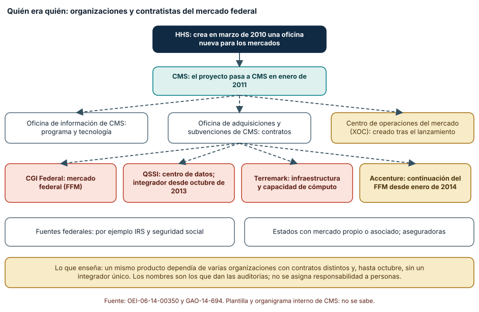

**Cómo leer la figura.** De arriba abajo: la agencia, las oficinas de CMS, los contratistas y, abajo, las organizaciones externas de las que dependía el flujo. Las flechas discontinuas son relaciones de contrato o de coordinación. Mira que hasta octubre no había una caja de integración. **Dónde deja de valer:** no es un organigrama: las fuentes consultadas no publican la estructura interna ni la plantilla.

La OIG documenta que HHS asignó primero el proyecto a una oficina nueva, que logró avances pero tenía recursos limitados y expectativas contrapuestas, y que la integración en CMS trajo desafíos por una dirección poco clara; el estudio identifica como factor la falta de un liderazgo claro del proyecto (OEI-06-14-00350). El análisis se hace sobre funciones y decisiones, no sobre personas.

### Visión y misión

La misión legal del programa es la que fija la ley de 2010: que cada estado tenga un mercado donde la persona compare y elija planes privados con subsidios según ingresos, y que el gobierno federal opere uno donde el estado no lo haga (GAO-14-694). Este caso no cita un texto de misión o visión de CMS o de HHS porque no se pudo verificar una versión consultable el 16 de noviembre de 2026; no se inventa una cita.

## Contexto y problema

La ley creó los «mercados»: sitios donde una persona compara y elige planes de seguro privados, con subsidios según sus ingresos. Para los estados que no montaron el suyo, el gobierno federal tenía que ofrecer uno. Era, en palabras de CMS recogidas por GAO, un mercado federal **sin precedente**, con plazos comprimidos (GAO-14-694). El objetivo de Healthcare.gov era permitir que cualquier residente de esos estados creara una cuenta, verificara su identidad e ingresos, viera los planes para los que era elegible, eligiera uno y se inscribiera.

### Por qué era difícil (documentado)

El diseño de la ley dejaba tres opciones a cada estado: montar su propio mercado, delegar en CMS la operación del federal o participar en un acuerdo de «asociación» donde el estado ayuda con algunas funciones (GAO-14-694). En junio de 2013, GAO describió que CMS operaría un mercado federal en 34 estados, 15 de ellos con asistencia de sus estados, y advirtió que las actividades de CMS en cada tipo de mercado «habían evolucionado y podían seguir cambiando» (GAO-13-601). Esa frase importa más de lo que parece: un alcance que cambia mientras se construye es la primera condición latente del caso.

La OIG añade una capa organizativa que el análisis técnico no ve: la ley asignó el proyecto a una oficina nueva dentro de HHS que logró avances pero tenía recursos limitados y expectativas contrapuestas; luego pasó a CMS, una organización grande, y esa transición, según la OIG, causó ineficiencias, rupturas de comunicación y una implementación «innecesariamente compleja» (OEI-06-14-00350). También señala que el proyecto careció de un liderazgo claro, con unidad de propósito y una visión integral del avance.

### Qué se decidió y con qué información (análisis propio)

En septiembre de 2011, CMS emitió las órdenes de trabajo con requisitos clave desconocidos: el número y composición de los estados y, sobre todo, el número de inscritos posibles (GAO-14-694). Con esos datos abiertos no se puede dimensionar capacidad, ni estimar costos con confianza. El análisis propio es que, en un plazo legal que no se puede mover, esa decisión tenía sentido: esperar a tener requisitos cerrados equivalía a no llegar. Su coste es que traslada toda la incertidumbre a las fases tardías, donde corregir sale más caro y el tiempo restante es menor.

## Mercado, usuarios y casos de uso

- **Usuarios:** residentes de los estados que usaban el mercado federal (34 se conocían en enero de 2013, 36 al final), además de pequeñas empresas (el mercado para pequeñas empresas se aplazó, primero a noviembre de 2013 y luego a 2015: GAO-14-694).
- **Casos de uso críticos:** crear cuenta, iniciar sesión, verificar elegibilidad contra fuentes federales (por ejemplo IRS y la administración de seguridad social), elegir plan, inscribirse y que la aseguradora recibiera la inscripción.
- **Otros actores:** las aseguradoras, que debían enviar sus planes y recibir inscripciones; los estados que operaban sus propios mercados; los centros de llamadas y «navegantes» que ayudaban a los consumidores.
- **Plazos con efecto real:** la cobertura debía empezar el 1 de enero de 2014; CMS amplió el plazo para elegir plan de ese inicio, del 15 al 24 de diciembre de 2013 (OEI-06-14-00350).

### Tipos de usuario y lo que necesitaba cada uno

| Usuario | Qué necesitaba del sistema | Dónde falló o dependía |
| --- | --- | --- |
| Consumidor individual | Crear cuenta, verificar identidad y datos, ver planes, elegir e inscribirse | La gestión de identidad quedó desbordada: casi medio millón de cuentas en las primeras dos semanas y media (GAO-15-238) |
| Aseguradora | Cargar planes y tarifas, recibir inscripciones correctas | Las pruebas de integración con las aseguradoras estaban sin terminar dos meses antes del lanzamiento (GAO-15-238) |
| Estado con mercado propio o asociado | Orientación y plazos de CMS; datos federales | CMS tuvo dificultades para dar orientación a tiempo a los estados (OEI-06-14-00350) |
| Navegante y personal de centros de llamadas | Ayudar a personas a inscribirse | Los fondos de los navegantes se retrasaron unos dos meses, lo que retrasó su formación (GAO-13-601) |
| Pequeña empresa | Mercado para empleados | Aplazado a noviembre de 2013 y luego a 2015 (GAO-14-694) |
| Otras agencias federales | Responder consultas de verificación | Se convierten en dependencias síncronas del flujo crítico |

La fila de los navegantes es un buen ejemplo de un efecto secundario: la causa de ese retraso es financiera, pero su efecto se nota en la capacidad humana de ayudar a la persona que se queda atascada en el sitio.

## Funcionalidad de principio a fin

1. La persona entra en **Healthcare.gov** y crea una cuenta.
2. El **FFM** (mercado federal facilitado) gestiona cuentas, elegibilidad e inscripción.
3. Para verificar datos como ingresos, ciudadanía o número de seguridad social, el FFM consulta el **centro de servicios de datos federal** (el *data hub*), que a su vez se conecta con fuentes federales.
4. La persona ve los planes cargados por las aseguradoras (módulo de **gestión de planes**), elige y se inscribe.
5. Un módulo **financiero** gestiona los pagos y la conciliación con las aseguradoras; no se necesitaba antes de la inscripción y CMS lo aplazó (GAO-14-694).

Dos rasgos importan para entender el fallo: se trataba de **varios sistemas de varias organizaciones** que debían operar juntos desde el primer día, y la verificación de cada solicitante dependía de consultas síncronas a otras agencias.

**Cómo leer la figura.** Las flechas siguen la ruta de un solicitante de izquierda a derecha; la franja inferior muestra quién construyó cada pieza según los contratos. Mira cuántos traspasos hay entre el consumidor y la respuesta final. **Dónde deja de valer:** es un esquema funcional; no muestra servidores, redes ni la topología real, que las fuentes consultadas no detallan.

### El mismo sistema visto por cada actor

1. **Consumidor.** Crea la cuenta y verifica su identidad (EIDM). Presenta la solicitud con datos del hogar. Recibe una respuesta de elegibilidad y un subsidio calculado. Elige un plan. Cada paso es una ocasión de fallo distinta: identidad (capacidad), verificación (dependencia externa), selección (datos de la aseguradora).
2. **Aseguradora.** Envía su catálogo de planes al módulo de gestión de planes mediante el centro de datos (GAO-15-238) y, tras la inscripción, recibe la información del nuevo asegurado. El módulo de gestión de planes fue el único de los tres componentes principales del FFM que estaba completo al final de la orden de trabajo (GAO-14-694).
3. **Operador del sistema.** Debe saber en tiempo real si el sitio funciona. CMS reconoció después que los mecanismos de monitoreo y respuesta eran insuficientes para identificar errores y responder en tiempo real, y que la falta de coordinación entre equipos técnicos impidió decidir con rapidez (CMS, 1 de diciembre de 2013).
4. **Segunda inscripción.** Para la segunda temporada, CMS puso en marcha una versión re-ingeniada de la gestión de identidad, dedicada a creación de cuentas y verificación (OEI-06-14-00350). Es un dato útil: el elemento que más sufrió en el primer día fue el primero que se rediseñó.

### Antes de abrir: lo que se sabía en junio de 2013

GAO resumió en junio de 2013 que CMS había completado muchas actividades necesarias pero «muchas faltaban y algunas iban con retraso»; que el centro de datos se estaba desarrollando con cumplimiento de cronogramas pero con tareas críticas pendientes, como las pruebas finales con socios federales y estatales; y que el plazo era corto (GAO-13-601). Un lector con información de entonces podía saber que el calendario era ajustado; lo que el informe no podía saber es cuánto se comprimirían las pruebas en los meses siguientes.

## Negocio y economía

En juego estaba el programa de política pública más grande de la década: que millones de personas pudieran contratar cobertura antes del 1 de enero de 2014. La parte económica del caso está bien documentada: GAO midió que la obligación del FFM creció de 55,7 millones de dólares (septiembre de 2011) a 209,6 (febrero de 2014) y la del centro de datos de 29,9 a 84,5. CMS usó contratos de **costos reimbolsables** (paga los costos permitidos aunque el sistema no se complete), lo que traslada riesgo al comprador. En enero de 2014 adjudicó otro contrato de 91 millones de dólares para continuar el desarrollo; a junio de 2014 ya superaba los 175 millones y capacidades clave seguían sin disponibilidad (GAO-14-694).

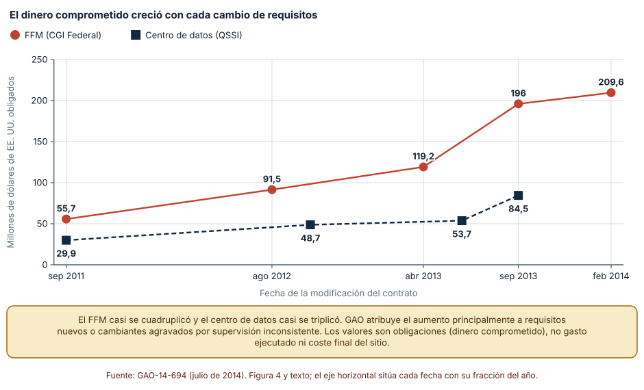

**Cómo leer la figura.** El eje vertical son millones de dólares obligados; cada punto es una modificación del contrato. Mira el salto del FFM entre abril y septiembre de 2013, justo antes del lanzamiento. **Dónde deja de valer:** son obligaciones (dinero comprometido), no gasto ni costo final del sitio, y no cubren otros contratos del programa; GAO analizó los dos contratos y uno más que sumaban más del 40 % de lo obligado.

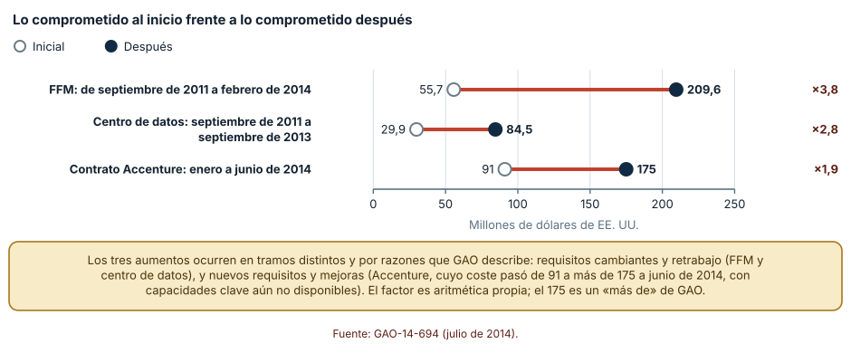

**Cómo leer la figura.** Cada fila es un contrato: el punto hueco es el valor inicial, el relleno el posterior y el texto del extremo el factor. Mira cuánto se alarga cada segmento y que los tres contratos crecieron por razones distintas. **Dónde deja de valer:** los tramos de tiempo no son comparables entre filas, y el 175 de Accenture es un «más de» de GAO, no una cifra exacta.

### Impacto en cifras, con fuente

| Dimensión | Cifra | Fuente |
| --- | --- | --- |
| Obligaciones del FFM | De 56 millones (septiembre de 2011) a más de 209 millones (febrero de 2014) | GAO-14-694 |
| Obligaciones del centro de datos | De 30 millones a casi 85 millones | GAO-14-694 |
| Contrato de continuación | 91 millones en enero de 2014; más de 175 millones a junio de 2014, con capacidades clave aún sin disponibilidad | GAO-14-694 |
| Honorarios del contratista FFM | 12,5 millones pagados; CMS no pagó unos 267 000 dólares (≈ 2 %) | GAO-14-694 |
| Autorizaciones indebidas de gasto | Unas 40 ocasiones por más de 30 millones; el contrato se modificó en abril de 2013 para cubrir casi 28 millones | GAO-14-694 |
| Disponibilidad del sistema | De 42,9 % a algo más del 93 % durante noviembre de 2013 | GAO-15-238 (informe de HHS de diciembre de 2013) |
| Tiempo de respuesta del FFM | De 8 s a finales de octubre a menos de 1 s en diciembre de 2013 | GAO-15-238 |
| Visitas diarias soportadas | Más de 1,8 millones al día en diciembre de 2013 | GAO-15-238 |
| Capacidad | 50 a 400 TB (GAO-14-694) o 25 a 400 TB mensuales (GAO-15-238); una obligación de 1,5 millones para el aumento | GAO-14-694, GAO-15-238 |
| Inscripción | 5,4 millones de planes elegidos en el mercado federal al 31 de marzo de 2014; unos 9,6 millones al 1 de febrero de 2016 | OEI-06-14-00350 |
| Segunda inscripción | Unos 9,9 millones de consumidores inscritos y con prima pagada en Healthcare.gov o en mercados estatales, según un análisis de junio de 2015; la proyección revisada del Departamento era de 9 millones y la del CBO, de 13 millones | OEI-06-14-00350 |

La cifra de 91 a 175 millones del contrato de continuación se explica en parte porque se añadieron «nuevos requisitos y otras mejoras» (GAO-14-694), de modo que no es sobrecoste puro. El análisis propio de la columna de arriba es que el dinero se movió con los cambios de requisitos: el costo del cambio tardío es el verdadero hilo económico del caso.

### Reacción de la organización y de los organismos de control

- **CMS y HHS.** Evaluaron el sitio a mediados de octubre de 2013 con expertos de dentro y fuera del gobierno y concluyeron que era arreglable con otra gestión; nombraron a QSSI contratista general e integrador, con una sala de crisis dos veces al día (CMS, 1 de diciembre de 2013).
- **GAO.** En julio de 2014 recomendó actuar de inmediato para evaluar los aumentos de costo y asegurarse de que se completen las estrategias de adquisición y se usen las herramientas de supervisión; CMS estuvo de acuerdo con cuatro recomendaciones y parcialmente con una (GAO-14-694). En marzo de 2015 señaló que CMS había dado pasos para resolver los problemas, pero necesitaba aplicar mejor las prácticas de desarrollo de sistemas (GAO-15-238).
- **OIG.** Su estudio de caso ordena los factores del colapso y de la recuperación por fases, con una cronología hasta la segunda temporada (OEI-06-14-00350).
- **Reputacional.** Las fuentes consultadas no miden el efecto reputacional; este caso no lo cuantifica.

### Esquema de la operación: servicio público, actores y flujos

La «operación» no genera ingresos sino un servicio: elegibilidad, comparación e inscripción. El valor está en conectar a consumidores, aseguradoras y programas públicos; el flujo de datos va del solicitante a las fuentes federales para verificar, del consumidor al plan elegido y del mercado a la aseguradora (GAO-14-694; GAO-15-238). El flujo de dinero entre el gobierno, los consumidores subsidiados y las aseguradoras correspondía al módulo financiero, aplazado antes del lanzamiento (GAO-14-694); los detalles de esos pagos no se desarrollan en las fuentes consultadas.

### Costos operativos y costo del incidente

| Rubro | Cifra | Fuente |
| --- | --- | --- |
| Obligaciones del FFM | De 56 a más de 209 millones (septiembre de 2011 a febrero de 2014) | GAO-14-694 |
| Obligaciones del centro de datos | De 30 a casi 85 millones | GAO-14-694 |
| Contrato de continuación | 91 millones en enero de 2014; más de 175 millones a junio de 2014 | GAO-14-694 |
| Ampliación de capacidad | 1,5 millones de obligación para pasar de 50 a 400 TB | GAO-14-694 |
| Honorarios no pagados al contratista | Unos 267 000 dólares (≈ 2 % de 12,5 millones) | GAO-14-694 |
| Autorizaciones de gasto indebidas | Unas 40 ocasiones, más de 30 millones | GAO-14-694 |
| Costo total del programa y de la recuperación | No se sabe en las fuentes consultadas | — |

El análisis de GAO cubre dos órdenes de trabajo y un contrato que sumaban más del 40 % de lo obligado para el desarrollo hasta marzo de 2014 (GAO-14-694). Las cifras son obligaciones, no gasto ejecutado; el costo total del programa, el del primer día y el efecto sobre los usuarios no se publican con una fuente verificada en este caso.

### Competidores y contexto de mercado

No hay competidores: es un servicio público. El contexto comparable son los mercados estatales, que cada estado podía elegir operar: 34 estados dejaron el federal a CMS en la planificación de 2013, 15 de ellos con colaboración estatal (GAO-13-601), y 36 lo usaron en la primera inscripción (OEI-06-14-00350). La alternativa del consumidor eran otros canales de inscripción, como centros de llamadas y navegantes (GAO-14-694; OEI-06-14-00350). Qué ocurrió con los mercados estatales después del fallo no consta en las fuentes consultadas.

## Arquitectura y esquemas

La arquitectura fue **incremental**: CMS adoptó un enfoque de desarrollo iterativo (llamado Ágil en el informe) que era nuevo para su programa, y diseñó un marco de ciclo de vida con cuatro revisiones de gobierno que debía aprobar una junta. Los funcionarios de CMS dijeron a GAO que ese marco no siempre se siguió porque no encajaba con el enfoque modificado que adoptaron (GAO-14-694).

**Cómo leer la figura.** Los cuatro pasos son el flujo crítico; la fila inferior dice qué había al final del plazo. Mira los dos primeros pasos: son los que todo usuario atraviesa. **Dónde deja de valer:** el estado de los módulos es el de febrero de 2014 (fin de la orden de trabajo), no el de octubre de 2013, y no mide la calidad dentro de cada módulo.

La arquitectura se recorre en ocho niveles de zoom. El nivel 1, el contexto, es la primera figura del caso (sección «Funcionalidad de principio a fin»); aquí siguen los demás, cada uno con su figura.

### Nivel 2 · Contenedores

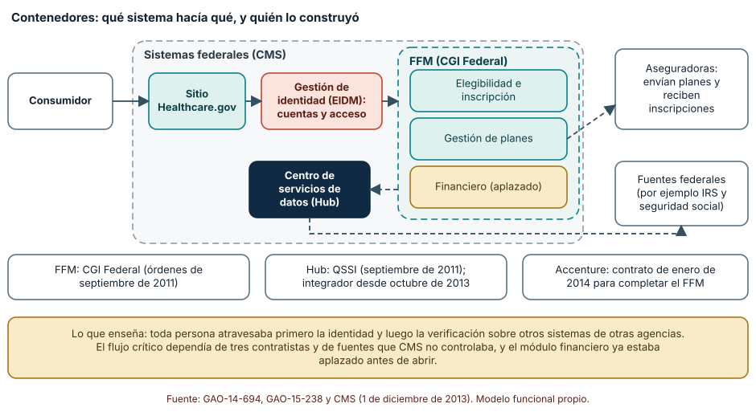

**Cómo leer la figura.** Las cajas son sistemas; la línea punteada es la frontera de los sistemas federales de CMS, y el recuadro verde es el FFM; las flechas llenas son el camino del consumidor y las discontinuas, consultas y envíos de datos. Mira el rojo: la identidad es el primer elemento de la ruta. **Dónde deja de valer:** no muestra servidores ni redes; las fuentes no publican la topología. El orden de llamadas internas entre FFM y centro de datos es un modelo.

La identidad merece una nota propia. GAO explica que, antes de que alguien pueda solicitar cobertura, CMS debe verificar su identidad para evitar la divulgación no autorizada de datos personales, y que ese proceso y el alta de cuenta los gestionaba el sistema de gestión de identidad (GAO-15-238). Es un requisito de seguridad legítimo que a la vez crea un cuello de botella: toda persona, sin excepción, empieza ahí.

### Nivel 3 · Componentes y recorrido

El recorrido de cuatro pasos y el estado de cada módulo se muestran en la figura de arriba. En el nivel de componentes, la observación nueva es que el FFM no era un bloque: eran tres módulos con estados de completitud distintos. Al final de la orden de trabajo, en febrero de 2014, solo uno de los tres componentes clave estaba completo (gestión de planes); elegibilidad e inscripción tenían solo algunos elementos y la gestión financiera quedó sin terminar (GAO-14-694).

### Nivel 4 · Secuencia del flujo que falló

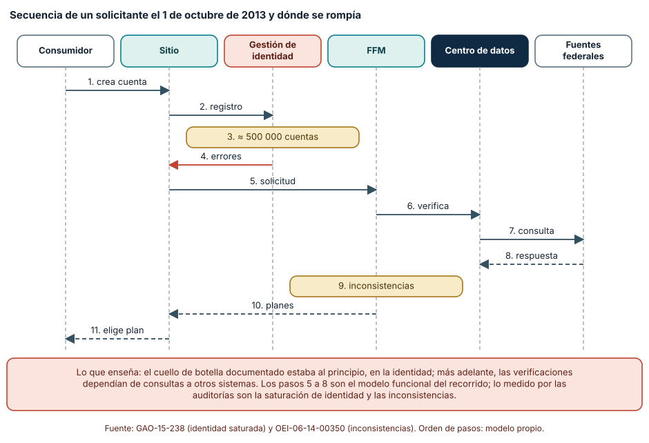

**Cómo leer la figura.** Cada columna es un sistema; el tiempo avanza hacia abajo; las flechas discontinuas son respuestas; la flecha roja es el síntoma que vio el consumidor. Mira la caja del paso 3: es el único dato medido por las auditorías dentro del flujo. **Dónde deja de valer:** el orden fino de llamadas entre FFM, centro de datos y fuentes es un modelo funcional. Las auditorías no publican registros de tráfico del 1 de octubre.

### Nivel 5 · Modelo de datos y flujo de datos

**Cómo leer la figura.** El camino superior es el éxito de la verificación, el inferior la inconsistencia; las cajas laterales son los datos de las aseguradoras y los pagos. Mira la rama roja: crea trabajo humano. **Dónde deja de valer:** el diagrama no describe campos ni formatos; las auditorías no los publican. Las cifras de inconsistencias son de febrero de 2014.

Dos datos de cifras importan para el modelo: a febrero de 2014 el mercado federal no había podido resolver unos 2,6 millones de 2,9 millones de inconsistencias (OEI-06-14-00350), y el módulo financiero, que gestiona pagos y conciliación con aseguradoras, se aplazó por no ser necesario antes de la inscripción (GAO-14-694). La decisión de aplazar el módulo financiero es un buen ejemplo de priorización con alcance mínimo: recortó trabajo sin tocar el camino crítico del consumidor.

### Nivel 6 · Despliegue y capacidad

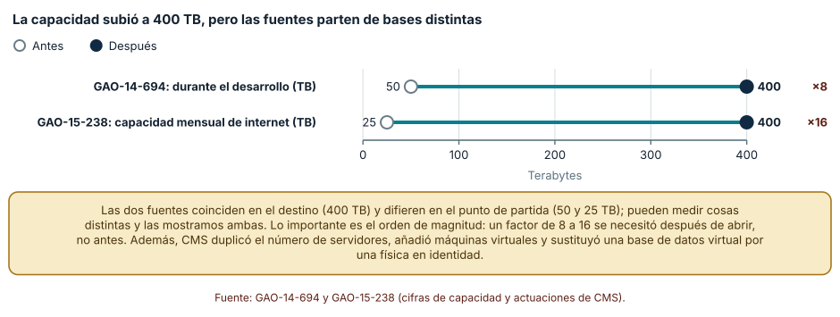

**Cómo leer la figura.** Cada fila es una fuente; el punto hueco es el valor antes, el relleno el posterior, y el factor está a la derecha. Mira que las dos filas terminan en 400. **Dónde deja de valer:** las dos fuentes miden la capacidad de maneras que no coinciden exactamente (una habla del periodo de desarrollo, la otra de capacidad mensual de internet) y no dicen qué fracción se usó.

Más allá del número, GAO cuenta cómo era la capacidad: los requisitos de capacidad del hardware del FFM no se habían desarrollado, no había un plan de capacidad para el entorno de nube, y la capacidad existente en la nube no tenía suficientes máquinas virtuales y procesadores (GAO-15-238, a partir de evaluaciones independientes de diciembre de 2012 y junio de 2013). Tras el lanzamiento, CMS duplicó el número de servidores, añadió máquinas virtuales para la identidad y el FFM, y sustituyó una base de datos virtual por una física de alta capacidad para identidad (GAO-15-238). El Administrador de CMS reconoció ante el Congreso que se subestimó la demanda (testimonio de noviembre de 2013, citado en GAO-15-238).

### Nivel 7 · Dependencias y puntos únicos de fallo

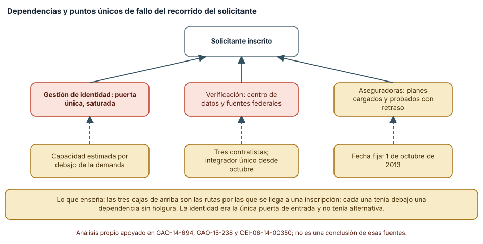

**Cómo leer la figura.** Arriba, lo que necesita una inscripción; abajo, de qué depende cada ruta. Mira la caja de identidad: una sola puerta. **Dónde deja de valer:** es un análisis propio; no consta qué otras dependencias (redes, proveedores de nube, bases de datos) intervinieron.

### Nivel 8 · Defensa en profundidad

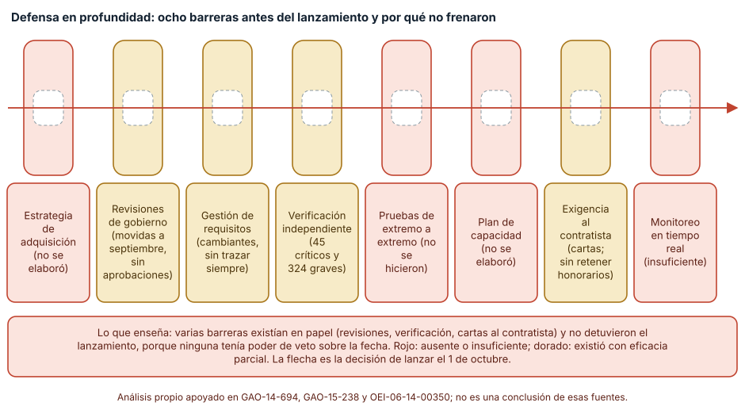

**Cómo leer la figura.** Cada lámina es una barrera; el hueco, la manera en que fue sorteada; la flecha roja, la decisión de lanzar en la fecha fijada. **Dónde deja de valer:** metáfora, no medición; la lista de barreras sale de las deficiencias que describen GAO y la OIG, y la agrupación en ocho es nuestra.

Detalle de las barreras. **Estrategia de adquisición:** HHS exige una por cada inversión mayor de TI; CMS no la elaboró (GAO-14-694). **Revisiones de gobierno:** la de preparación se movió de marzo a septiembre de 2013 y no consta la aprobación (GAO-14-694). **Requisitos:** no siempre aprobados ni vinculados a requisitos superiores e inferiores (GAO-15-238). **Verificación independiente (IV&V):** existió; en septiembre de 2013 encontró 45 errores críticos y 324 graves y reportó que no había evidencia de que se estuvieran corrigiendo (GAO-15-238). **Pruebas:** las de integración y de extremo a extremo requeridas no se hicieron antes del lanzamiento; la documentación de pruebas carecía de criterios de aprobación (GAO-15-238). **Capacidad:** sin plan. **Contratista:** CMS expresó preocupaciones por escrito en abril y noviembre de 2013, trasladó operaciones a las oficinas del contratista en septiembre, pero optó por no retener honorarios (GAO-14-694). **Monitoreo:** insuficiente, según CMS (1 de diciembre de 2013).

### Hardware utilizado

Lo documentado es la capacidad: el mercado se alojaba en un entorno de computación en la nube a cargo de Terremark, el contratista principal de la capacidad y la infraestructura (OEI-06-14-00350). A cuatro días y medio del lanzamiento, CMS pidió a Terremark duplicar la capacidad ya comprada; el contratista afirmó haber reunido equipos de varios lugares, y hacia el 29 de septiembre los probadores indicaron que el límite de usuarios simultáneos había subido de forma sustancial (OEI-06-14-00350). Tras el lanzamiento, CMS duplicó los servidores, añadió máquinas virtuales para identidad y el FFM y sustituyó una base de datos virtual por una física de alta capacidad en identidad (GAO-15-238). **No se sabe:** marcas y modelos de servidores, red y ubicación de los centros de datos.

### Software utilizado

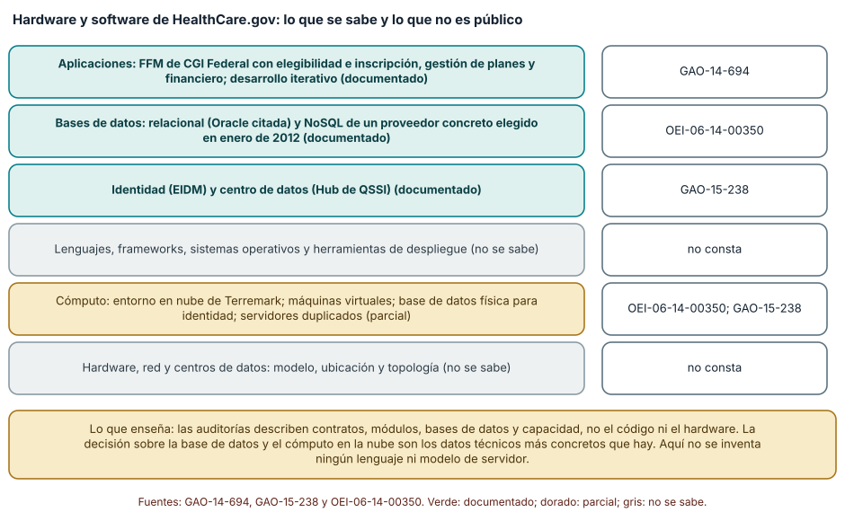

**Cómo leer la figura.** Cada fila es una capa; verde: documentada; dorado: parcial; gris: no se sabe. Mira que lo desconocido está donde las auditorías no miraron: el código y la máquina. **Dónde deja de valer:** es el límite de lo público, no la pila real.

Documentado: el FFM de CGI Federal con tres módulos (elegibilidad e inscripción, gestión de planes y financiero); el centro de servicios de datos de QSSI; el sistema de gestión de identidad; un enfoque de desarrollo iterativo nuevo para CMS con un marco de revisiones secuenciales (GAO-14-694; GAO-15-238). La propuesta del contratista incluía bases relacional (se cita Oracle) y no relacional; CMS dirigió en enero de 2012 el uso de una plataforma NoSQL concreta pese a las reservas del contratista (OEI-06-14-00350). En la segunda temporada se rediseñó la parte de identidad. **No se sabe:** lenguajes, frameworks, sistemas operativos, middleware y herramientas de despliegue.

### Infraestructura

Era una infraestructura de nube contratada, con un entorno de producción y entornos de prueba cuya coordinación fue una barrera en 2013 (OEI-06-14-00350). La escala está documentada por el uso: más de 1,8 millones de visitas al día en diciembre de 2013 y 250 000 usuarios simultáneos de capacidad en la segunda inscripción (GAO-15-238; OEI-06-14-00350). Dependencias: fuentes federales como IRS y seguridad social, aseguradoras que cargan planes y estados (OEI-06-14-00350; GAO-15-238). **No se sabe:** regiones, número de centros de datos y la capacidad real el primer día.

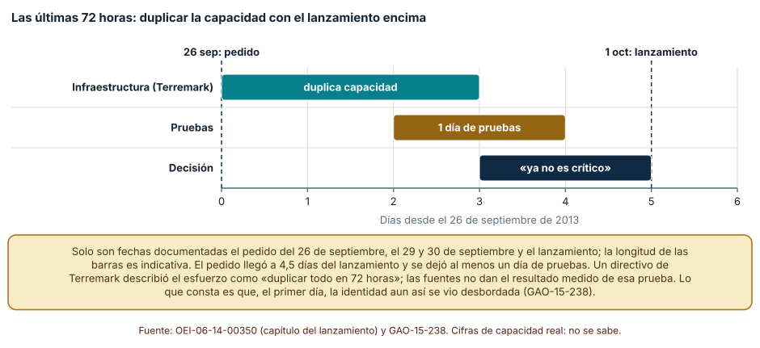

**Cómo leer la figura.** Cada fila es un hilo de las últimas jornadas; las líneas discontinuas marcan el pedido y el lanzamiento. Mira lo corta que es la ventana. **Dónde deja de valer:** solo el pedido, el 29 y 30 de septiembre y el lanzamiento son fechas documentadas; la longitud de las barras es indicativa.

### A prueba de fallos: qué existía, qué falló y qué debió existir

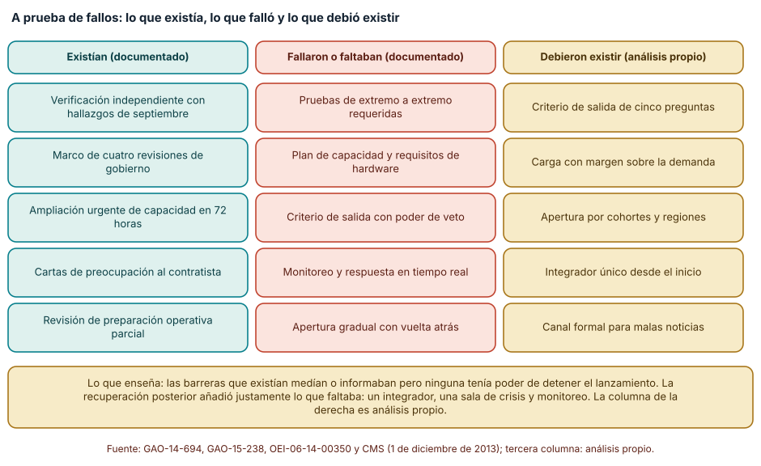

**Cómo leer la figura.** Verde azulado: lo que existía; coral: lo que falló o faltaba; dorado: análisis propio. Las filas no se corresponden una a una. **Dónde deja de valer:** no mide eficacia.

Redundancia y capacidad: se amplió la capacidad al doble en 72 horas, pero no existía un plan de capacidad (GAO-15-238). Conmutación y degradación: no consta que hubiera una cola de espera o una apertura por cohortes; el módulo financiero y el mercado de pequeñas empresas se aplazaron como reducción de alcance (GAO-14-694). Pruebas: las de extremo a extremo requeridas no se hicieron y la verificación independiente detectó 45 críticos y 324 graves (GAO-15-238). Límites: ninguno sobre el tráfico de entrada se menciona en las fuentes. Recuperación: tras el lanzamiento, un integrador, sala de crisis dos veces al día, monitoreo instrumentado y sistemas de respaldo (CMS, 1 de diciembre de 2013; OEI-06-14-00350). Qué debió existir: criterio de salida, carga con margen y apertura gradual (análisis propio).

## Casos especiales y cómo fallan

- **Módulos aplazados.** CMS priorizó para el lanzamiento el módulo de elegibilidad e inscripción y aplazó el financiero; el mercado para pequeñas empresas se retrasó primero a noviembre de 2013 y luego a 2015 (GAO-14-694).
- **Inconsistencias de solicitudes.** A febrero de 2014 el mercado federal no había podido resolver unos 2,6 millones de 2,9 millones de inconsistencias (casos en que no se pueden verificar los datos del solicitante con las fuentes federales) (OEI-06-14-00350).
- **Plazos legales.** La cobertura debía empezar el 1 de enero de 2014; CMS amplió del 15 al 24 de diciembre de 2013 el plazo para elegir plan con ese inicio, y el último día el sitio atendió 49 156 usuarios simultáneos (OEI-06-14-00350).
- **Contrato y honorarios.** CMS expresó dudas por escrito en abril y noviembre de 2013, pero decidió no retener honorarios para centrarse en la fecha; finalmente no pagó unos 267 000 dólares, cerca del 2 % de los 12,5 millones de honorarios (GAO-14-694).
- **Recuperación.** Una evaluación a mediados de octubre concluyó que el sitio era arreglable con otra gestión: un integrador general (QSSI), una sala de crisis dos veces al día, monitoreo instrumentado y cientos de correcciones (CMS, 1 de diciembre de 2013). La OIG destaca la cultura «sin credenciales» y la priorización despiadada. CMS aumentó la capacidad de 50 a 400 terabytes (GAO-14-694).

- **La elección de la base de datos.** La OIG documenta que el contratista del FFM propuso usar tanto una base relacional como una NoSQL; en enero de 2012 CMS le comunicó por una carta de dirección técnica que usara una plataforma NoSQL concreta, pese a las reservas del contratista por falta de experiencia propia y de CMS con ella y su recomendación de preparar un plan de contingencia (OEI-06-14-00350). La OIG cuenta «decisiones tecnológicas problemáticas» entre los factores de la mala gestión del contrato clave; no cuantifica cuánto del colapso se debió a esa elección, y este caso tampoco. El análisis propio es que no se juzga la tecnología, sino que una decisión de arquitectura se impuso sin evidencia de que el equipo pudiera sostenerla.
- **Contratación rápida.** De 60 contratos del mercado federal, 55 se adjudicaron bajo contratos previamente establecidos, lo que acelera la compra pero limita las ofertas y evita ciertos requisitos de planificación de la adquisición (OEI-06-14-00350).
- **Pruebas con terceros.** Las pruebas de integración con las aseguradoras no estaban terminadas dos meses antes del lanzamiento y quedaban defectos sin resolver en el módulo de elegibilidad e inscripción (GAO-15-238).
- **Falta de criterio de aprobación.** La documentación de pruebas carecía de criterios para determinar si un sistema pasaba una prueba (GAO-15-238): sin criterio de aprobación no hay forma de decir «no pasa».
- **Un calendario no fiable.** La supervisión se vio limitada por un cronograma poco fiable, la falta de estimaciones del trabajo pendiente y documentación de proyecto desordenada y desactualizada (GAO-15-238).
- **Segunda temporada.** CMS fijó una fecha firme de congelación de código el 7 de octubre de 2014 y amplió la infraestructura de pruebas; pese a ello, siguió corrigiendo problemas de código que no se habían resuelto tras la primera inscripción (OEI-06-14-00350). La capacidad llegó a soportar un máximo de 250 000 usuarios simultáneos sin caída (OEI-06-14-00350).

## Línea de tiempo

| Fecha | Hecho documentado |
| --- | --- |
| Marzo de 2010 | Ley PPACA: mercados antes del 1 de enero de 2014 |
| Julio de 2011 y marzo de 2012 | HHS propone y fija el 1 de octubre de 2013 como inicio de la inscripción |
| Septiembre de 2011 | Órdenes de trabajo a CGI Federal (FFM) y QSSI (centro de datos), con requisitos técnicos clave aún desconocidos, como el número de estados y de inscritos |
| Diciembre de 2012 y junio de 2013 | Evaluaciones independientes señalan debilidades de planificación de capacidad |
| Marzo de 2013 | CMS reconoce que solo el 65 % del FFM y el 75 % del centro de datos estarán listos en septiembre |
| Abril de 2013 | CMS extiende la fase de requisitos y diseño; se comprimen las revisiones de pruebas e implementación |
| Septiembre de 2013 | Una evaluación independiente de verificación y validación detecta 45 errores críticos y 324 graves en el FFM; revisión de preparación operativa parcial; el desarrollo y las pruebas continúan |
| 1 de octubre de 2013 | Lanzamiento; muchos usuarios no pueden acceder |
| Mediados de octubre de 2013 | La administración evalúa el sitio con expertos del gobierno y del sector privado: «arreglable» pero con cambios de gestión; QSSI pasa a ser contratista general e integrador |
| 30 de noviembre de 2013 | Objetivo de estabilización; el informe de CMS dice que el error baja del 1 % y que el sitio admite 50 000 usuarios simultáneos |
| 24 de diciembre de 2013 | Último día del plazo ampliado; ese día hubo 49 156 usuarios simultáneos (OIG) y alrededor de 1,2 millones de personas habían elegido plan al 28 de diciembre |
| Enero de 2014 | Contrato de 91 millones de dólares a Accenture para continuar el desarrollo del FFM |
| 31 de marzo de 2014 | Fin de la primera inscripción: 5,4 millones de planes elegidos |

**Cómo leer la figura.** El eje son meses desde enero de 2013; las líneas discontinuas son hitos y las barras fases. Mira que todo el desarrollo ocurre bajo requisitos todavía cambiantes y que la fase de crisis dura unos dos meses. **Dónde deja de valer:** los límites de las fases son aproximados y la «crisis» no tiene una fecha de fin oficial.

### Antecedentes: tres años de decisiones

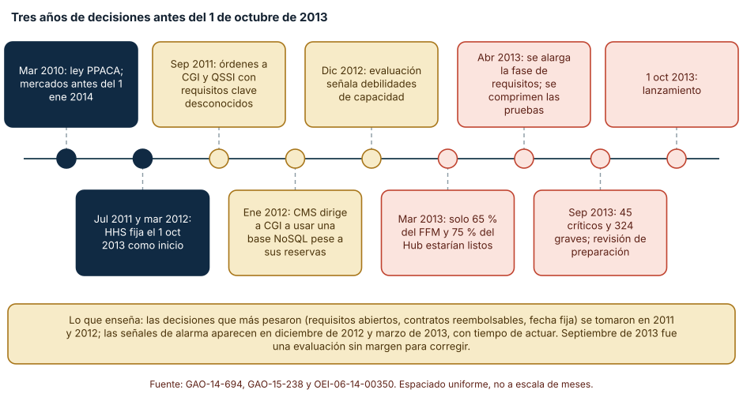

**Cómo leer la figura.** Los hitos están espaciados uniformemente, sin escala; los colores distinguen decisiones de arranque (azul oscuro), condiciones latentes (dorado) y señales de alarma (coral). Mira la distancia entre la advertencia de diciembre de 2012 y el lanzamiento. **Dónde deja de valer:** no representa la duración de los tramos; el día exacto de cada hito no consta en las fuentes para todos.

| Fecha | Hecho documentado | Fuente |
| --- | --- | --- |
| Enero de 2012 | CMS dirige al contratista a usar una plataforma de base de datos NoSQL concreta, pese a sus reservas | OEI-06-14-00350 |
| 2012 | Contratos del FFM y del Hub adjudicados en 2011 y de la identidad en 2012 bajo contratos preexistentes | OEI-06-14-00350 |
| Abril de 2013 | El contrato del FFM se modifica para añadir casi 28 millones por costos autorizados indebidamente en 2012 | GAO-14-694 |
| Junio de 2013 | GAO publica que quedan tareas críticas pendientes, como las pruebas finales con socios | GAO-13-601 |
| Septiembre de 2013 | CMS amplía el plazo del FFM y el Hub: 58 y 31 millones adicionales, sobre todo por tiempo y no por requisitos nuevos | GAO-14-694 |
| Septiembre de 2013 | CMS traslada sus operaciones a las oficinas del contratista del FFM | GAO-14-694 |
| 7 de octubre de 2014 | Fecha de congelación del código de la segunda inscripción | OEI-06-14-00350 |

### Octubre a diciembre de 2013, día a día

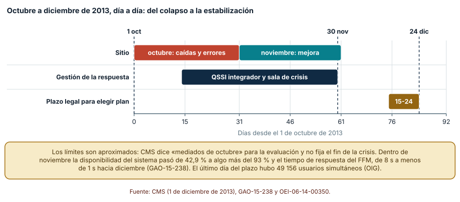

**Cómo leer la figura.** El eje son días desde el 1 de octubre; cada fila es un hilo; las líneas discontinuas son fechas fijas. Mira cómo la respuesta empieza a mediados de octubre y el hilo del sitio cambia de color a lo largo de noviembre. **Dónde deja de valer:** los tramos son aproximados; las fuentes dan «mediados de octubre» y «algunas semanas» sin fechas exactas.

| Fecha | Hecho documentado | Fuente |
| --- | --- | --- |
| Octubre de 2013 | En algunas semanas el sitio estuvo caído, según una estimación, el 60 % del tiempo | CMS, 1 de diciembre de 2013 |
| Primeras 2,5 semanas | Casi medio millón de cuentas intentadas sobre la gestión de identidad | GAO-15-238 |
| Finales de octubre | Respuesta del FFM de unos 8 segundos | GAO-15-238 |
| Noviembre | Disponibilidad de 42,9 % a más de 93 % | GAO-15-238 |
| 30 de noviembre | Objetivo de estabilización; errores por debajo del 1 % y 50 000 usuarios simultáneos | CMS, 1 de diciembre de 2013 |
| Diciembre | Más de 1,8 millones de visitas diarias; respuesta del FFM menor de 1 segundo | GAO-15-238 |
| 24 de diciembre | 49 156 usuarios simultáneos el último día del plazo ampliado | OEI-06-14-00350 |

**No consta:** el número de usuarios el primer día, la hora exacta de las caídas, la fecha de fin de la crisis y cuánta parte de la mejora se debió a la capacidad y cuánta a las correcciones de software.

## Qué falló en cada instancia

Instancia por instancia, qué se esperaba y qué ocurrió, según las fuentes.

- **Planificación y contratación.** Se emitieron las órdenes con requisitos clave desconocidos; se usaron contratos de costos reimbolsables; no se elaboró la estrategia de adquisición requerida que habría identificado riesgos (GAO-14-694).
- **Requisitos.** Nuevos requisitos y decisiones cambiantes provocaron aumentos de costo y retraso, agravados por supervisión inconsistente: unas 40 ocasiones en que el personal autorizó gastos que no le correspondía por más de 30 millones de dólares (GAO-14-694).
- **Gobierno.** Se retrasó la revisión de preparación de marzo a septiembre de 2013 y no consta la aprobación de la junta de gobierno; se lanzó sin verificar el cumplimiento de requisitos de rendimiento (GAO-14-694).
- **Capacidad.** CMS subestimó la demanda; no se desarrollaron requisitos de capacidad del hardware del FFM ni un plan de capacidad de la nube (GAO-15-238).
- **Calidad.** 45 errores críticos y 324 graves un mes antes; las pruebas de integración con aseguradoras sin terminar dos meses antes; no hubo pruebas de extremo a extremo aunque eran obligatorias; la propia contratista dijo en noviembre que no había tiempo para corregir y volver a probar cada versión (GAO-15-238).
- **Cultura y liderazgo.** Ausencia de liderazgo claro, resistencia a las malas noticias y dependencia de la trayectoria («path dependency»): se mantuvo plan y plazo pese a las señales (OEI-06-14-00350).
- **Gestión del contratista.** CMS expresó dudas por escrito en abril y noviembre de 2013 y mudó su operación a las oficinas del contratista en septiembre, pero eligió no retener honorarios para centrarse en la fecha; finalmente no pagó unos 267 000 dólares (GAO-14-694).

- **Gestión de identidad.** Se esperaba que el alta de cuenta soportara el pico de apertura; ocurrió que se desbordó con casi medio millón de intentos en dos semanas y media, porque CMS estimó mal la demanda (GAO-15-238).
- **Pruebas.** Se esperaba una verificación de extremo a extremo; no se hizo. Había pruebas de integración con aseguradoras sin terminar y defectos sin cerrar (GAO-15-238).
- **Verificación independiente.** Se esperaba que sus hallazgos movieran la decisión; los 45 críticos y 324 graves de septiembre no cambiaron la fecha (GAO-15-238).
- **Contratación.** Una estrategia de adquisición no elaborada, ofertas limitadas por el uso de contratos preexistentes (55 de 60), costos reembolsables, órdenes con requisitos desconocidos (GAO-14-694, OEI-06-14-00350).
- **Dirección técnica.** Decisiones tomadas sin comprobar capacidad de ejecución: la plataforma de base de datos, el enfoque iterativo nuevo para CMS con un marco de revisiones secuenciales (GAO-14-694, OEI-06-14-00350). GAO ya había observado en 2012 que introducir métodos iterativos en el entorno federal tiene dificultades, y que las nuevas herramientas y la formación podían ser necesarias (GAO-14-694).
- **Cultura.** Resistencia a las malas noticias, dependencia de la trayectoria y correcciones tardías: fallas de comunicación vertical, más que técnicas (OEI-06-14-00350).
- **Gestión del contratista.** Las dudas por escrito de abril y noviembre se tradujeron en traslado de operaciones, pero no en consecuencias económicas, porque la fecha tenía prioridad (GAO-14-694).

## Causa raíz y factores

**Detonante (documentado).** Lanzar el 1 de octubre de 2013 sin haber verificado el cumplimiento de los requisitos de rendimiento: la revisión de preparación fue parcial, en septiembre, con el desarrollo y las pruebas sin terminar (GAO-14-694); no se hicieron las pruebas de extremo a extremo requeridas y se subestimó la demanda (GAO-15-238).

**Condiciones latentes (documentado).** Órdenes de trabajo emitidas con requisitos técnicos clave desconocidos; contratos de costos reimbolsables; estrategia de adquisición requerida no elaborada; requisitos cambiantes; revisiones de gobierno retrasadas o sin aprobación; supervisión inconsistente y autorizaciones de gasto indebidas; planificación de capacidad inexistente; pruebas incompletas con 45 errores críticos y 324 graves un mes antes (GAO-14-694, GAO-15-238).

**Factores de contexto (documentado).** Un mercado federal sin precedente con plazo legal; falta de liderazgo claro, resistencia a las malas noticias, dependencia de la trayectoria y demasiado tiempo dedicado a la política frente al desarrollo del sitio (OEI-06-14-00350).

**Inferido (análisis propio).** El hilo común es que la fecha de lanzamiento era la única variable fija: alcance, calidad y control de costo se ajustaron para cumplirla. Cuando el tiempo no se puede mover, el sistema de pruebas pasa a ser el lugar donde se absorbe el recorte. Esto es consistente con lo que GAO y la OIG describen, pero ninguno lo formula así.

**No se sabe (por las fuentes públicas consultadas).** El número exacto de usuarios en el primer día; la proporción de fallos atribuible a cada componente en octubre; el costo total de todo el programa en 2013.

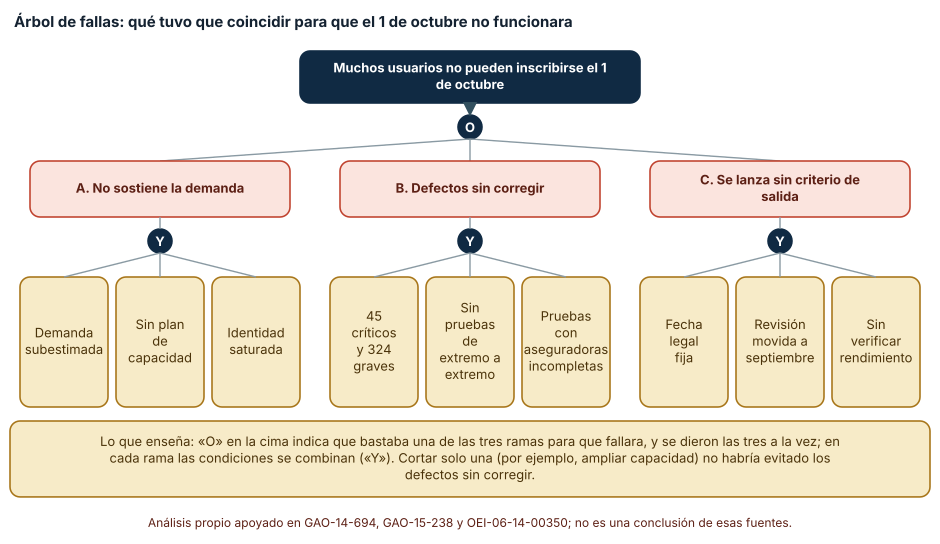

**Cómo leer la figura.** Arriba, el evento final; la puerta «O» indica que bastaba una rama; cada rama exige sus tres condiciones («Y»). Mira que las tres ramas se dieron a la vez. **Dónde deja de valer:** la estructura lógica es análisis propio; en la realidad las condiciones no eran independientes (la fecha fija agravaba las pruebas comprimidas).

**Cadena causal ordenada (análisis propio, apoyado en las fuentes).**

1. Un plazo legal fijo y un alcance que aún evoluciona (contexto).
2. Órdenes de trabajo con requisitos clave desconocidos, contratos reembolsables y adjudicación rápida (condición latente de contratación).
3. Requisitos cambiantes que comprimen el tiempo de construcción y de pruebas (condición latente de proceso).
4. Gobierno con revisiones movidas y sin veto sobre la fecha (condición latente de gobierno).
5. Capacidad subestimada y sin plan (condición latente técnica).
6. Defectos conocidos y pruebas de extremo a extremo omitidas (condición latente de calidad).
7. Cultura que no sube las malas noticias y mantiene el plan (factor de contexto).
8. Lanzamiento el 1 de octubre de 2013: identidad saturada, errores y lentitud (detonante).

### Documentado, inferido y no se sabe

| Categoría | Contenido |
| --- | --- |
| Documentado | Los cambios de requisitos y el aumento de obligaciones; la estrategia de adquisición no elaborada; la revisión de preparación movida a septiembre; los 45 críticos y 324 graves; la falta de pruebas de extremo a extremo; la capacidad subestimada y la identidad saturada; la recuperación con integrador, sala de crisis y monitoreo |
| Inferido (análisis propio) | Que la fecha fue la única variable fija y que el recorte se absorbió en pruebas; que la identidad era un punto único de fallo; que la estructura en tres ramas era suficiente para fallar; que las barreras sin veto sobre la fecha eran ornamentales |
| No se sabe | El número de usuarios del primer día; qué fracción del fallo se debió a capacidad y cuál a defectos; el costo total del programa; el efecto reputacional; por qué la OIG y GAO recomendaron lo que recomendaron más allá de lo que publicaron |

## Mejoras que debieron hacerse

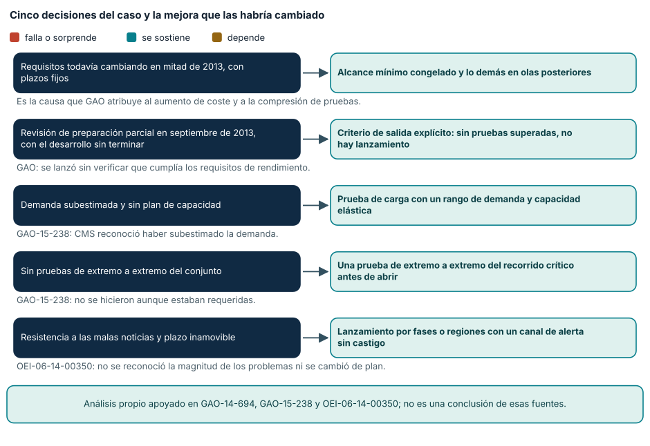

**Cómo leer la figura.** Cada tarjeta enlaza una situación del caso con la mejora que habría cambiado la decisión, y debajo está la fuente de la situación. Mira que todas las mejoras son de proceso y de verificación, no de tecnología nueva. **Dónde deja de valer:** son recomendaciones didácticas; un lanzamiento por fases tenía costo político y legal en 2013 que no se evalúa aquí.

| Área | Mejora | Qué enseña el curso |
| --- | --- | --- |
| Alcance | Fijar un conjunto mínimo y reglas de cambio; el resto en olas posteriores | SE-150, SE-153, SE-192 |
| Contratación | Contratos con hitos verificables y propiedad clara de la autorización de gasto | SE-535, SE-537 |
| Preparación | Criterios de salida de la revisión de preparación: sin pruebas pasadas, no hay lanzamiento | SE-188, SE-434 |
| Capacidad | Pruebas de carga con rango de demanda y capacidad elástica | SE-435, SE-436, SE-404 |
| Pruebas | Pruebas de extremo a extremo del recorrido crítico y de integración con terceros | SE-423, SE-424 |
| Despliegue | Apertura gradual por regiones o por cohortes con vuelta atrás | SE-475, SE-476 |
| Operación | Observabilidad y sala de crisis única con métricas; canal para malas noticias | SE-493, SE-497, SE-500 |
| Gobierno | Registro de riesgos con supuestos explícitos y decisiones reversibles o no | SE-187, SE-142, SE-534 |

La recuperación documentada muestra la mejora aplicada: la OIG cita una cultura «sin credenciales» (todos trabajan como un equipo), la «priorización despiadada», la calidad sobre la puntualidad y los sistemas de respaldo; CMS menciona una sala de crisis dos veces al día y monitoreo instrumentado.

Todo lo que sigue, incluidos costos y trade-offs, es **análisis propio apoyado en las fuentes**: no son conclusiones de GAO, de la OIG ni de CMS.

### Para cada factor: control técnico, de proceso y de gobierno

| Factor causal | Control técnico | Control de proceso | Control de gobierno | Costo y trade-off | Clases |
| --- | --- | --- | --- | --- | --- |
| Requisitos abiertos y cambiantes | Alcance mínimo viable con interfaces estables; módulos aplazados con contrato explícito | Línea base de requisitos con control de cambios y coste visible de cada cambio | Autoridad única para aprobar cambios y gasto | Menos funciones el primer día; fricción política | [SE-150 · Priorización, dependencias y negociación](../../classes/part-12-ingenieria-de-requisitos/se-150-priorizacion-dependencias-y-negociacion/README.md), [SE-153 · Gestión de cambios y líneas base](../../classes/part-12-ingenieria-de-requisitos/se-153-gestion-de-cambios-y-lineas-base/README.md), [SE-192 · Proyecto: plan adaptativo con evidencia y guardrails](../../classes/part-15-procesos-planificacion-y-estimacion/se-192-proyecto-plan-adaptativo-con-evidencia-y-guardrails/README.md) |
| Contratación sin riesgo compartido | Contrato por hitos con entregables verificables | Estrategia de adquisición escrita, con riesgos y mitigaciones | Propiedad clara de la autorización de gasto | Más tiempo de compra; menos oferentes disponibles | [SE-535 · Compras, proveedores y evaluación técnica](../../classes/part-44-gestion-liderazgo-y-practica-profesional/se-535-compras-proveedores-y-evaluacion-tecnica/README.md), [SE-537 · Economía del software y costo total](../../classes/part-44-gestion-liderazgo-y-practica-profesional/se-537-economia-del-software-y-costo-total/README.md), [SE-187 · Riesgos, supuestos, issues y decisiones](../../classes/part-15-procesos-planificacion-y-estimacion/se-187-riesgos-supuestos-issues-y-decisiones/README.md) |
| Capacidad subestimada | Pruebas de carga con rango de demanda y capacidad elástica | Plan de capacidad con supuestos explícitos; revisión por un tercero | Criterio de salida: sin prueba de carga, no hay lanzamiento | Coste de nube y de pruebas; supuestos difíciles de acertar | [SE-435 · Carga, estrés, picos y endurance](../../classes/part-36-calidad-rendimiento-y-resiliencia/se-435-carga-estres-picos-y-endurance/README.md), [SE-436 · Latencia, throughput, saturación y capacidad](../../classes/part-36-calidad-rendimiento-y-resiliencia/se-436-latencia-throughput-saturacion-y-capacidad/README.md), [SE-404 · Escalado, capacidad y costos](../../classes/part-33-cloud-plataforma-e-infraestructura/se-404-escalado-capacidad-y-costos/README.md) |
| Pruebas sin extremo a extremo | Pruebas de recorrido crítico y de integración con terceros en un entorno realista | Criterios de aprobación escritos para cada prueba | Informe de pruebas visible a la dirección | Entornos caros y coordinación con terceros | [SE-423 · Integración, componentes y contratos](../../classes/part-35-estrategia-y-tecnicas-de-prueba/se-423-integracion-componentes-y-contratos/README.md), [SE-424 · End-to-end, aceptación y recorridos críticos](../../classes/part-35-estrategia-y-tecnicas-de-prueba/se-424-end-to-end-aceptacion-y-recorridos-criticos/README.md), [SE-421 · Calidad por riesgo y propósito de las pruebas](../../classes/part-35-estrategia-y-tecnicas-de-prueba/se-421-calidad-por-riesgo-y-proposito-de-las-pruebas/README.md) |
| Defectos conocidos al lanzar | Cierre de críticos con política de cero abiertos en el camino crítico | Triage con severidades y dueños | La verificación independiente tiene voz y voto en la decisión | Puede obligar a recortar alcance | [SE-434 · Revisión, análisis estático y quality gates](../../classes/part-36-calidad-rendimiento-y-resiliencia/se-434-revision-analisis-estatico-y-quality-gates/README.md), [SE-188 · Definition of Ready, Done y aceptación](../../classes/part-15-procesos-planificacion-y-estimacion/se-188-definition-of-ready-done-y-aceptacion/README.md), [SE-483 · Tests, seguridad y políticas como gates](../../classes/part-40-ci-cd-iac-y-platform-engineering/se-483-tests-seguridad-y-politicas-como-gates/README.md) |
| Gobierno sin veto | Puertas automáticas de calidad | Revisión de preparación con criterios de salida y fecha fija antes del lanzamiento | Decisión de ir o no ir firmada por quien responde | El veto tiene un coste político alto | [SE-188 · Definition of Ready, Done y aceptación](../../classes/part-15-procesos-planificacion-y-estimacion/se-188-definition-of-ready-done-y-aceptacion/README.md), [SE-187 · Riesgos, supuestos, issues y decisiones](../../classes/part-15-procesos-planificacion-y-estimacion/se-187-riesgos-supuestos-issues-y-decisiones/README.md), [SE-534 · Gestión de riesgos y decisiones ejecutivas](../../classes/part-44-gestion-liderazgo-y-practica-profesional/se-534-gestion-de-riesgos-y-decisiones-ejecutivas/README.md) |
| Lanzamiento todo a la vez | Apertura gradual por regiones o cohortes con vuelta atrás | Plan de apertura con métricas de parada | Autoridad para detener el despliegue | La ley y la expectativa pública pedían apertura nacional | [SE-475 · Feature flags y entrega progresiva](../../classes/part-39-build-release-y-cadena-de-suministro/se-475-feature-flags-y-entrega-progresiva/README.md), [SE-476 · Canary, blue-green y rollback](../../classes/part-39-build-release-y-cadena-de-suministro/se-476-canary-blue-green-y-rollback/README.md), [SE-142 · Decisiones reversibles e irreversibles](../../classes/part-11-economia-metricas-y-decisiones-de-producto/se-142-decisiones-reversibles-e-irreversibles/README.md) |
| Malas noticias que no suben | Tableros con estado real y alertas | Canal de escalamiento y sala de crisis desde antes | Premiar el aviso temprano; auditoría independiente periódica | Cultural y lento de cambiar | [SE-493 · Señales, eventos y observabilidad útil](../../classes/part-41-observabilidad-sre-e-incidentes/se-493-senales-eventos-y-observabilidad-util/README.md), [SE-497 · SLI, SLO, SLA y presupuestos de error](../../classes/part-41-observabilidad-sre-e-incidentes/se-497-sli-slo-sla-y-presupuestos-de-error/README.md), [SE-500 · Gestión de incidentes y comunicación](../../classes/part-41-observabilidad-sre-e-incidentes/se-500-gestion-de-incidentes-y-comunicacion/README.md) |

### La arquitectura de gobierno «después»

**Cómo leer la figura.** Tres franjas: lo que se aplicó (verde azulado), lo aplicado en la segunda inscripción (dorado) y lo que habría cambiado la decisión (coral, análisis propio). Mira que ninguna franja trata de tecnología nueva. **Dónde deja de valer:** las dos primeras franjas son hechos de CMS y la OIG; la tercera es propuesta nuestra. No pretende que con esas barreras el lanzamiento habría sido perfecto.

### Diseñar la barrera de lanzamiento

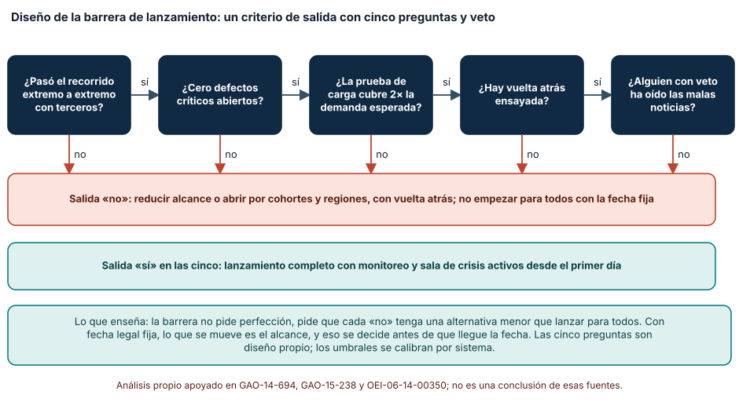

**Cómo leer la figura.** Cada caja azul es una pregunta de sí o no; cada «no» baja a la alternativa menor; solo cinco «sí» seguidos llevan al lanzamiento completo. **Dónde deja de valer:** son preguntas didácticas con umbrales por calibrar (2× la demanda esperada es un ejemplo, no una norma); en 2013 la apertura gradual tenía costos legales y políticos que no se evalúan aquí.

Decisiones de diseño de la barrera, como ejercicio. (a) **Quién decide:** una persona con veto y evidencia visible. (b) **Qué evidencia:** informes de pruebas de extremo a extremo y de carga, y lista de defectos críticos. (c) **Qué hace un «no»:** reducir alcance (por ejemplo, aplazar el módulo de pequeñas empresas, algo que de hecho se hizo) o abrir por cohortes. (d) **Cómo se prueba:** un simulacro de lanzamiento con tráfico sintético y fallo inyectado en identidad. (e) **Cómo se evita que se convierta en trámite:** que haya al menos una vez en que dijo «no».

## Vínculo con el curso

- [SE-150 · Priorización, dependencias y negociación](../../classes/part-12-ingenieria-de-requisitos/se-150-priorizacion-dependencias-y-negociacion/README.md) y [SE-153 · Gestión de cambios y líneas base](../../classes/part-12-ingenieria-de-requisitos/se-153-gestion-de-cambios-y-lineas-base/README.md).
- [SE-187 · Riesgos, supuestos, issues y decisiones](../../classes/part-15-procesos-planificacion-y-estimacion/se-187-riesgos-supuestos-issues-y-decisiones/README.md), [SE-188 · Definition of Ready, Done y aceptación](../../classes/part-15-procesos-planificacion-y-estimacion/se-188-definition-of-ready-done-y-aceptacion/README.md) y [SE-192 · Plan adaptativo con evidencia y guardrails](../../classes/part-15-procesos-planificacion-y-estimacion/se-192-proyecto-plan-adaptativo-con-evidencia-y-guardrails/README.md).
- [SE-142 · Decisiones reversibles e irreversibles](../../classes/part-11-economia-metricas-y-decisiones-de-producto/se-142-decisiones-reversibles-e-irreversibles/README.md).
- [SE-423 · Integración, componentes y contratos](../../classes/part-35-estrategia-y-tecnicas-de-prueba/se-423-integracion-componentes-y-contratos/README.md) y [SE-424 · End-to-end, aceptación y recorridos críticos](../../classes/part-35-estrategia-y-tecnicas-de-prueba/se-424-end-to-end-aceptacion-y-recorridos-criticos/README.md).
- [SE-435 · Carga, estrés, picos y endurance](../../classes/part-36-calidad-rendimiento-y-resiliencia/se-435-carga-estres-picos-y-endurance/README.md) y [SE-436 · Latencia, throughput, saturación y capacidad](../../classes/part-36-calidad-rendimiento-y-resiliencia/se-436-latencia-throughput-saturacion-y-capacidad/README.md).
- [SE-476 · Canary, blue-green y rollback](../../classes/part-39-build-release-y-cadena-de-suministro/se-476-canary-blue-green-y-rollback/README.md).
- [SE-500 · Gestión de incidentes y comunicación](../../classes/part-41-observabilidad-sre-e-incidentes/se-500-gestion-de-incidentes-y-comunicacion/README.md).
- [SE-535 · Compras, proveedores y evaluación técnica](../../classes/part-44-gestion-liderazgo-y-practica-profesional/se-535-compras-proveedores-y-evaluacion-tecnica/README.md).

Cada fila de la tabla es una clase real; el texto dice qué mecanismo del caso ilustra.

| Concepto | Clase | Cómo lo ilustra el caso |
| --- | --- | --- |
| Alcance y priorización | [SE-150 · Priorización, dependencias y negociación](../../classes/part-12-ingenieria-de-requisitos/se-150-priorizacion-dependencias-y-negociacion/README.md) | El módulo financiero y las pequeñas empresas se aplazaron para proteger el camino crítico |
| Gestión de cambios y líneas base | [SE-153 · Gestión de cambios y líneas base](../../classes/part-12-ingenieria-de-requisitos/se-153-gestion-de-cambios-y-lineas-base/README.md) | Los requisitos cambiantes explican gran parte del aumento de obligaciones |
| Riesgos, supuestos y decisiones | [SE-187 · Riesgos, supuestos, issues y decisiones](../../classes/part-15-procesos-planificacion-y-estimacion/se-187-riesgos-supuestos-issues-y-decisiones/README.md) | El supuesto de demanda no se registró ni se probó |
| Definition of Ready, Done y aceptación | [SE-188 · Definition of Ready, Done y aceptación](../../classes/part-15-procesos-planificacion-y-estimacion/se-188-definition-of-ready-done-y-aceptacion/README.md) | Sin criterios de aprobación de pruebas, «terminado» no tenía definición |
| Plan adaptativo con guardrails | [SE-192 · Proyecto: plan adaptativo con evidencia y guardrails](../../classes/part-15-procesos-planificacion-y-estimacion/se-192-proyecto-plan-adaptativo-con-evidencia-y-guardrails/README.md) | El enfoque iterativo sin gobierno adaptado fue una adaptación sin guardrails |
| Decisiones reversibles | [SE-142 · Decisiones reversibles e irreversibles](../../classes/part-11-economia-metricas-y-decisiones-de-producto/se-142-decisiones-reversibles-e-irreversibles/README.md) | Lanzar para todos es una decisión difícil de revertir; la apertura gradual la vuelve reversible |
| Integración y contratos | [SE-423 · Integración, componentes y contratos](../../classes/part-35-estrategia-y-tecnicas-de-prueba/se-423-integracion-componentes-y-contratos/README.md) | Las pruebas con aseguradoras sin terminar |
| End-to-end y recorridos críticos | [SE-424 · End-to-end, aceptación y recorridos críticos](../../classes/part-35-estrategia-y-tecnicas-de-prueba/se-424-end-to-end-aceptacion-y-recorridos-criticos/README.md) | La prueba de extremo a extremo requerida y omitida |
| Carga, estrés y picos | [SE-435 · Carga, estrés, picos y endurance](../../classes/part-36-calidad-rendimiento-y-resiliencia/se-435-carga-estres-picos-y-endurance/README.md) | La demanda del primer día no se probó |
| Capacidad y saturación | [SE-436 · Latencia, throughput, saturación y capacidad](../../classes/part-36-calidad-rendimiento-y-resiliencia/se-436-latencia-throughput-saturacion-y-capacidad/README.md) | La identidad saturada y la capacidad añadida después |
| Escalado y costos | [SE-404 · Escalado, capacidad y costos](../../classes/part-33-cloud-plataforma-e-infraestructura/se-404-escalado-capacidad-y-costos/README.md) | Capacidad elástica frente a capacidad fija |
| Quality gates | [SE-434 · Revisión, análisis estático y quality gates](../../classes/part-36-calidad-rendimiento-y-resiliencia/se-434-revision-analisis-estatico-y-quality-gates/README.md) | Puertas con criterios de salida |
| Canary y rollback | [SE-476 · Canary, blue-green y rollback](../../classes/part-39-build-release-y-cadena-de-suministro/se-476-canary-blue-green-y-rollback/README.md) | Apertura gradual con vuelta atrás |
| Feature flags y entrega progresiva | [SE-475 · Feature flags y entrega progresiva](../../classes/part-39-build-release-y-cadena-de-suministro/se-475-feature-flags-y-entrega-progresiva/README.md) | Habilitar por cohortes |
| Observabilidad y SLO | [SE-497 · SLI, SLO, SLA y presupuestos de error](../../classes/part-41-observabilidad-sre-e-incidentes/se-497-sli-slo-sla-y-presupuestos-de-error/README.md) | Disponibilidad de 42,9 % a 93 %: sin un objetivo, no hay presupuesto de error |
| Gestión de incidentes | [SE-500 · Gestión de incidentes y comunicación](../../classes/part-41-observabilidad-sre-e-incidentes/se-500-gestion-de-incidentes-y-comunicacion/README.md) | La sala de crisis dos veces al día |
| Compras y proveedores | [SE-535 · Compras, proveedores y evaluación técnica](../../classes/part-44-gestion-liderazgo-y-practica-profesional/se-535-compras-proveedores-y-evaluacion-tecnica/README.md) | Estrategia de adquisición, contratos reembolsables |
| Economía del software | [SE-537 · Economía del software y costo total](../../classes/part-44-gestion-liderazgo-y-practica-profesional/se-537-economia-del-software-y-costo-total/README.md) | El costo del cambio tardío |

### Preguntas de discusión

1. ¿Qué parte del fracaso era evitable con un plazo igual de fijo? ¿Qué habría tenido que ser distinto en 2011 para que el lanzamiento fuese gradual?
2. La verificación independiente encontró 45 críticos y 324 graves y no movió la fecha. ¿Qué diseño de gobierno haría que su informe tuviera efecto?
3. Un criterio de salida con veto tiene un coste político alto. ¿Cómo se decide quién lo asume y cuándo?
4. ¿Por qué la gestión de identidad fue el cuello de botella? ¿Qué alternativas de diseño (colas, apertura por cohortes, creación diferida) habrían reducido el pico?
5. ¿Qué diferencia hay entre «cultura que no escucha malas noticias» como causa y como síntoma? ¿Qué señales objetivas lo harían visible antes?

### Mini-ejercicios

1. **Criterio de salida.** Escribe una lista de cinco criterios medibles para el lanzamiento de un sistema con fecha legal fija, con el umbral y el responsable de cada uno.
2. **Plan de capacidad.** Dada una demanda esperada con rango de 1 a 5 veces, define qué pruebas de carga harías y qué haces si la prueba al doble falla a tres semanas de la fecha.
3. **Cohortes.** Diseña un esquema de apertura por cohortes (por estado, por día de la semana o por apellido) que suavice el pico del primer día, y explica qué se pierde.
4. **Canal de malas noticias.** Diseña un mecanismo (reunión, tablero, regla) que garantice que un hallazgo crítico de un auditor independiente llega a quien decide, con plazo de respuesta.

## Qué no generalizar

**Aprender.**

1. Cuando la fecha es fija, lo que se ajusta es el alcance, no la verificación; decide qué se recorta antes de empezar, no durante.
2. Los requisitos sin cerrar y un plazo fijo se pagan en pruebas comprimidas.
3. Un sistema compuesto necesita una prueba del recorrido completo, no solo de cada módulo.
4. La demanda se estima con un rango y se prueba; subestimarla es el caso común.
5. Una revisión de preparación sin criterio de salida es un trámite.
6. Un buen canal para las malas noticias es parte de la arquitectura de un proyecto.

**No generalizar.**

- No prueba que los contratos con terceros fracasen ni que el enfoque ágil sea el problema: GAO describe una adaptación parcial y sin gobierno, no el método en sí.
- No prueba que el sector público no pueda entregar software: la recuperación posterior del mismo sistema es parte del caso.
- Los 5,4 millones de la primera inscripción no miden el costo del fallo inicial.
- Las cifras de 2013 y 2014 no se actualizan aquí.

### Casos comparables y diferencias

| Caso | Parecido | Diferencia |
| --- | --- | --- |
| [Knight Capital](knight-capital.md) | Un cambio con fecha externa fija y controles de despliegue ausentes | Allí el daño fue instantáneo y financiero, y el fallo, de un solo servidor |
| [TSB Bank](tsb.md) | Una migración grande con fecha comprometida y pruebas insuficientes | Allí había un sistema en producción que se perdió; aquí se construía uno nuevo desde cero |
| [CrowdStrike](crowdstrike.md) | Falta de apertura gradual de un cambio con alcance enorme | Allí el cambio era una actualización; aquí, un sistema entero |
| [Quibi](quibi.md) | Producto lanzado con una fecha y una apuesta sin validación suficiente | Un fallo de mercado, no de capacidad técnica |

**Reacción institucional.** Las dos revisiones de GAO y el estudio de la OIG convergen en pedir mejor gestión de contratos, adherencia a un proceso de gobierno estructurado, pruebas completas y planificación de capacidad; ninguna reduce el fallo a la elección de una tecnología. La recuperación posterior se documenta en las mismas fuentes como un cambio de gestión.

## Fuentes públicas verificadas

Todas consultadas el 16 de noviembre de 2026 y comprobadas con descarga directa (HTTP 200).

1. U. S. Government Accountability Office, *Healthcare.gov: Ineffective Planning and Oversight Practices Underscore the Need for Improved Contract Management*, GAO-14-694, julio de 2014. [https://www.gao.gov/assets/gao-14-694.pdf](https://www.gao.gov/assets/gao-14-694.pdf). Respalda: contratos, cifras de obligaciones, gobierno, requisitos y supervisión.
2. U. S. Government Accountability Office, *Healthcare.gov: CMS Has Taken Steps to Address Problems, but Needs to Further Implement Systems Development Best Practices*, GAO-15-238, marzo de 2015. [https://www.gao.gov/assets/gao-15-238.pdf](https://www.gao.gov/assets/gao-15-238.pdf). Respalda: capacidad, errores de código, pruebas.
3. HHS Office of Inspector General, *HealthCare.gov: Case Study of CMS Management of the Federal Marketplace*, OEI-06-14-00350. [https://www.oversight.gov/sites/default/files/documents/reports/2017-09/oei-06-14-00350.pdf](https://www.oversight.gov/sites/default/files/documents/reports/2017-09/oei-06-14-00350.pdf). Respalda: factores contribuyentes, recuperación, cifras de inscripción.
4. Centers for Medicare & Medicaid Services, *HealthCare.gov Progress and Performance Report*, 1 de diciembre de 2013. [https://www.cms.gov/newsroom/press-releases/healthcaregov-progress-and-performance-report](https://www.cms.gov/newsroom/press-releases/healthcaregov-progress-and-performance-report). Respalda: caída estimada del 60 % en algunas semanas de octubre, QSSI como integrador, error por debajo del 1 % y 50 000 usuarios simultáneos.
5. U. S. Government Accountability Office, *Status of CMS Efforts to Establish Federally Facilitated Health Insurance Exchanges*, GAO-13-601, junio de 2013. [https://www.gao.gov/assets/gao-13-601.pdf](https://www.gao.gov/assets/gao-13-601.pdf). Respalda: el estado previo al lanzamiento, tal como lo evaluó GAO meses antes (contexto de los riesgos de 2013).

---

[↑ Casos de fallo](README.md) · [← Knight Capital](knight-capital.md) · [TSB Bank →](tsb.md)
