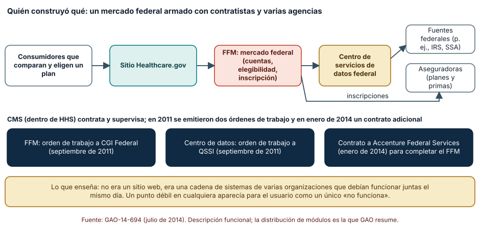
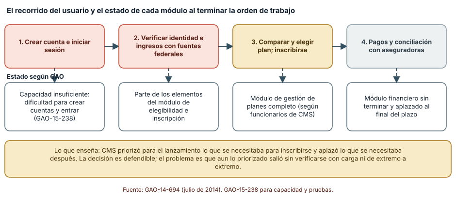
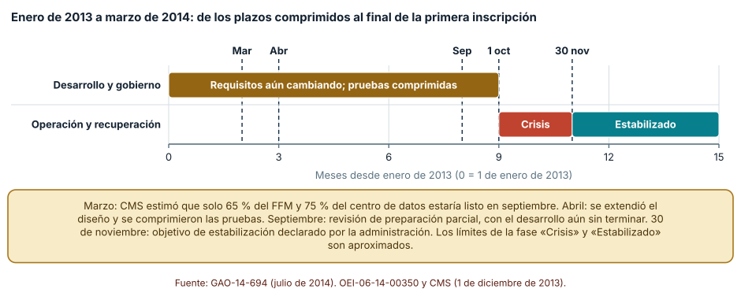

# HealthCare.gov (2013): un lanzamiento con fecha fija y requisitos que seguían cambiando

> **Qué es esta página.** Un caso de estudio de fallo: la realidad frente a la teoría del curso. No es una clase ni un rol. Separa lo que las fuentes **documentan**, lo que este análisis **infiere** y lo que **no se sabe**. Habla de decisiones, procesos y sistemas, no de personas. Fecha de consulta de todas las fuentes: 16 de noviembre de 2026.

**Resumen.** El 1 de octubre de 2013 se abrió la inscripción en el mercado federal de seguros de salud de EE. UU., a través de Healthcare.gov. Muchos usuarios no pudieron crear cuentas, entrar o inscribirse. Las auditorías posteriores señalan una combinación: requisitos cambiantes con plazo fijo, pruebas y revisiones de preparación comprimidas, capacidad subestimada, supervisión de contratos inconsistente y una cultura que no reconocía las malas noticias. En dos meses el sitio se recuperó para un uso alto, y la primera inscripción terminó con 5,4 millones de personas que eligieron un plan en el mercado federal.

## 1. Ficha histórica

| Dato | Detalle | Fuente |
| --- | --- | --- |
| Organización responsable | Centers for Medicare & Medicaid Services (CMS), dentro del Department of Health and Human Services (HHS) | GAO-14-694 |
| Responsable institucional | Marilyn Tavenner, administradora de CMS (su declaración consta en las notas del informe de la OIG) | OEI-06-14-00350, notas |
| Mandato | La ley de 2010 (PPACA) exigía mercados de seguros en cada estado antes del 1 de enero de 2014; para los estados que no crearan el suyo, CMS debía construir el federal | GAO-14-694 |
| Contratistas principales | CGI Federal (mercado federal, FFM) y QSSI (centro de servicios de datos federal), con órdenes de trabajo de septiembre de 2011; Accenture Federal Services (contrato de enero de 2014 para completar el FFM) | GAO-14-694 |
| Lanzamiento | 1 de octubre de 2013 (inicio de la inscripción, fijado por HHS en una propuesta de 2011 y una norma final de marzo de 2012) | GAO-14-694 |
| Estados atendidos | 36 estados terminaron usando el mercado federal en la primera inscripción | OEI-06-14-00350 |
| Daño | Fallos, errores y lentitud de acceso; el sitio estuvo caído, en estimación de CMS, un 60 % del tiempo durante algunas semanas de octubre; el FFM pasó de 56 a más de 209 millones de dólares obligados | CMS, 1 de diciembre de 2013; GAO-14-694 |
| Estado posterior | Recuperado para un uso alto en dos meses; 5,4 millones de planes elegidos en el mercado federal al cierre de la primera inscripción (31 de marzo de 2014) | OEI-06-14-00350 |

## 2. Contexto y objetivo del sistema

La ley creó los «mercados»: sitios donde una persona compara y elige planes de seguro privados, con subsidios según sus ingresos. Para los estados que no montaron el suyo, el gobierno federal tenía que ofrecer uno. Era, en palabras de CMS recogidas por GAO, un mercado federal **sin precedente**, con plazos comprimidos (GAO-14-694). El objetivo de Healthcare.gov era permitir que cualquier residente de esos estados creara una cuenta, verificara su identidad e ingresos, viera los planes para los que era elegible, eligiera uno y se inscribiera.

## 3. Mercado, usuarios afectados y casos de uso

- **Usuarios:** residentes de los estados que usaban el mercado federal (34 se conocían en enero de 2013, 36 al final), además de pequeñas empresas (el mercado para pequeñas empresas se aplazó, primero a noviembre de 2013 y luego a 2015: GAO-14-694).
- **Casos de uso críticos:** crear cuenta, iniciar sesión, verificar elegibilidad contra fuentes federales (por ejemplo IRS y la administración de seguridad social), elegir plan, inscribirse y que la aseguradora recibiera la inscripción.
- **Otros actores:** las aseguradoras, que debían enviar sus planes y recibir inscripciones; los estados que operaban sus propios mercados; los centros de llamadas y «navegantes» que ayudaban a los consumidores.
- **Plazos con efecto real:** la cobertura debía empezar el 1 de enero de 2014; CMS amplió el plazo para elegir plan de ese inicio, del 15 al 24 de diciembre de 2013 (OEI-06-14-00350).

## 4. Cómo funcionaba el sistema, de principio a fin

1. La persona entra en **Healthcare.gov** y crea una cuenta.
2. El **FFM** (mercado federal facilitado) gestiona cuentas, elegibilidad e inscripción.
3. Para verificar datos como ingresos, ciudadanía o número de seguridad social, el FFM consulta el **centro de servicios de datos federal** (el *data hub*), que a su vez se conecta con fuentes federales.
4. La persona ve los planes cargados por las aseguradoras (módulo de **gestión de planes**), elige y se inscribe.
5. Un módulo **financiero** gestiona los pagos y la conciliación con las aseguradoras; no se necesitaba antes de la inscripción y CMS lo aplazó (GAO-14-694).

Dos rasgos importan para entender el fallo: se trataba de **varios sistemas de varias organizaciones** que debían operar juntos desde el primer día, y la verificación de cada solicitante dependía de consultas síncronas a otras agencias.

**Cómo leer la figura.** Las flechas siguen la ruta de un solicitante de izquierda a derecha; la franja inferior muestra quién construyó cada pieza según los contratos. Mira cuántos traspasos hay entre el consumidor y la respuesta final. **Dónde deja de valer:** es un esquema funcional; no muestra servidores, redes ni la topología real, que las fuentes consultadas no detallan.

## 5. Negocio y economía: qué estaba en juego

En juego estaba el programa de política pública más grande de la década: que millones de personas pudieran contratar cobertura antes del 1 de enero de 2014. La parte económica del caso está bien documentada: GAO midió que la obligación del FFM creció de 55,7 millones de dólares (septiembre de 2011) a 209,6 (febrero de 2014) y la del centro de datos de 29,9 a 84,5. CMS usó contratos de **costos reimbolsables** (paga los costos permitidos aunque el sistema no se complete), lo que traslada riesgo al comprador. En enero de 2014 adjudicó otro contrato de 91 millones de dólares para continuar el desarrollo; a junio de 2014 ya superaba los 175 millones y capacidades clave seguían sin disponibilidad (GAO-14-694).

**Cómo leer la figura.** El eje vertical son millones de dólares obligados; cada punto es una modificación del contrato. Mira el salto del FFM entre abril y septiembre de 2013, justo antes del lanzamiento. **Dónde deja de valer:** son obligaciones (dinero comprometido), no gasto ni costo final del sitio, y no cubren otros contratos del programa; GAO analizó los dos contratos y uno más que sumaban más del 40 % de lo obligado.

**Cómo leer la figura.** Cada fila es un contrato: el punto hueco es el valor inicial, el relleno el posterior y el texto del extremo el factor. Mira cuánto se alarga cada segmento y que los tres contratos crecieron por razones distintas. **Dónde deja de valer:** los tramos de tiempo no son comparables entre filas, y el 175 de Accenture es un «más de» de GAO, no una cifra exacta.

## 6. Arquitectura y esquemas

La arquitectura fue **incremental**: CMS adoptó un enfoque de desarrollo iterativo (llamado Ágil en el informe) que era nuevo para su programa, y diseñó un marco de ciclo de vida con cuatro revisiones de gobierno que debía aprobar una junta. Los funcionarios de CMS dijeron a GAO que ese marco no siempre se siguió porque no encajaba con el enfoque modificado que adoptaron (GAO-14-694).

**Cómo leer la figura.** Los cuatro pasos son el flujo crítico; la fila inferior dice qué había al final del plazo. Mira los dos primeros pasos: son los que todo usuario atraviesa. **Dónde deja de valer:** el estado de los módulos es el de febrero de 2014 (fin de la orden de trabajo), no el de octubre de 2013, y no mide la calidad dentro de cada módulo.

## 7. Línea de tiempo del incidente

| Fecha | Hecho documentado |
| --- | --- |
| Marzo de 2010 | Ley PPACA: mercados antes del 1 de enero de 2014 |
| Julio de 2011 y marzo de 2012 | HHS propone y fija el 1 de octubre de 2013 como inicio de la inscripción |
| Septiembre de 2011 | Órdenes de trabajo a CGI Federal (FFM) y QSSI (centro de datos), con requisitos técnicos clave aún desconocidos, como el número de estados y de inscritos |
| Diciembre de 2012 y junio de 2013 | Evaluaciones independientes señalan debilidades de planificación de capacidad |
| Marzo de 2013 | CMS reconoce que solo el 65 % del FFM y el 75 % del centro de datos estarán listos en septiembre |
| Abril de 2013 | CMS extiende la fase de requisitos y diseño; se comprimen las revisiones de pruebas e implementación |
| Septiembre de 2013 | Una evaluación independiente de verificación y validación detecta 45 errores críticos y 324 graves en el FFM; revisión de preparación operativa parcial; el desarrollo y las pruebas continúan |
| 1 de octubre de 2013 | Lanzamiento; muchos usuarios no pueden acceder |
| Mediados de octubre de 2013 | La administración evalúa el sitio con expertos del gobierno y del sector privado: «arreglable» pero con cambios de gestión; QSSI pasa a ser contratista general e integrador |
| 30 de noviembre de 2013 | Objetivo de estabilización; el informe de CMS dice que el error baja del 1 % y que el sitio admite 50 000 usuarios simultáneos |
| 24 de diciembre de 2013 | Último día del plazo ampliado; ese día hubo 49 156 usuarios simultáneos (OIG) y alrededor de 1,2 millones de personas habían elegido plan al 28 de diciembre |
| Enero de 2014 | Contrato de 91 millones de dólares a Accenture para continuar el desarrollo del FFM |
| 31 de marzo de 2014 | Fin de la primera inscripción: 5,4 millones de planes elegidos |

**Cómo leer la figura.** El eje son meses desde enero de 2013; las líneas discontinuas son hitos y las barras fases. Mira que todo el desarrollo ocurre bajo requisitos todavía cambiantes y que la fase de crisis dura unos dos meses. **Dónde deja de valer:** los límites de las fases son aproximados y la «crisis» no tiene una fecha de fin oficial.

## 8. Qué falló en cada instancia

**Documentado.**

- **Planificación y contratación.** Se emitieron las órdenes con requisitos clave desconocidos; se usaron contratos de costos reimbolsables; no se elaboró la estrategia de adquisición requerida que habría identificado riesgos (GAO-14-694).
- **Requisitos.** Nuevos requisitos y decisiones cambiantes provocaron aumentos de costo y retraso, agravados por supervisión inconsistente: unas 40 ocasiones en que el personal autorizó gastos que no le correspondía por más de 30 millones de dólares (GAO-14-694).
- **Gobierno.** Se retrasó la revisión de preparación de marzo a septiembre de 2013 y no consta la aprobación de la junta de gobierno; se lanzó sin verificar el cumplimiento de requisitos de rendimiento (GAO-14-694).
- **Capacidad.** CMS subestimó la demanda; no se desarrollaron requisitos de capacidad del hardware del FFM ni un plan de capacidad de la nube (GAO-15-238).
- **Calidad.** 45 errores críticos y 324 graves un mes antes; las pruebas de integración con aseguradoras sin terminar dos meses antes; no hubo pruebas de extremo a extremo aunque eran obligatorias; la propia contratista dijo en noviembre que no había tiempo para corregir y volver a probar cada versión (GAO-15-238).
- **Cultura y liderazgo.** Ausencia de liderazgo claro, resistencia a las malas noticias y dependencia de la trayectoria («path dependency»): se mantuvo plan y plazo pese a las señales (OEI-06-14-00350).
- **Gestión del contratista.** CMS expresó dudas por escrito en abril y noviembre de 2013 y mudó su operación a las oficinas del contratista en septiembre, pero eligió no retener honorarios para centrarse en la fecha; finalmente no pagó unos 267 000 dólares (GAO-14-694).

**Inferido (análisis propio).** El hilo común es que la fecha de lanzamiento era la única variable fija: alcance, calidad y control de costo se ajustaron para cumplirla. Cuando el tiempo no se puede mover, el sistema de pruebas pasa a ser el lugar donde se absorbe el recorte. Esto es consistente con lo que GAO y la OIG describen, pero ninguno lo formula así.

**No se sabe (por las fuentes públicas consultadas).** El número exacto de usuarios en el primer día; la proporción de fallos atribuible a cada componente en octubre; el costo total de todo el programa en 2013.

## 9. Las mejoras que debieron hacerse (análisis propio apoyado en la fuente)

**Cómo leer la figura.** Cada tarjeta enlaza una situación del caso con la mejora que habría cambiado la decisión, y debajo está la fuente de la situación. Mira que todas las mejoras son de proceso y de verificación, no de tecnología nueva. **Dónde deja de valer:** son recomendaciones didácticas; un lanzamiento por fases tenía costo político y legal en 2013 que no se evalúa aquí.

| Área | Mejora | Qué enseña el curso |
| --- | --- | --- |
| Alcance | Fijar un conjunto mínimo y reglas de cambio; el resto en olas posteriores | SE-150, SE-153, SE-192 |
| Contratación | Contratos con hitos verificables y propiedad clara de la autorización de gasto | SE-451, SE-453 |
| Preparación | Criterios de salida de la revisión de preparación: sin pruebas pasadas, no hay lanzamiento | SE-188, SE-374 |
| Capacidad | Pruebas de carga con rango de demanda y capacidad elástica | SE-375, SE-376, SE-356 |
| Pruebas | Pruebas de extremo a extremo del recorrido crítico y de integración con terceros | SE-363, SE-364 |
| Despliegue | Apertura gradual por regiones o por cohortes con vuelta atrás | SE-403, SE-404 |
| Operación | Observabilidad y sala de crisis única con métricas; canal para malas noticias | SE-421, SE-425, SE-428 |
| Gobierno | Registro de riesgos con supuestos explícitos y decisiones reversibles o no | SE-187, SE-142, SE-450 |

La recuperación documentada muestra la mejora aplicada: la OIG cita una cultura «sin credenciales» (todos trabajan como un equipo), la «priorización despiadada», la calidad sobre la puntualidad y los sistemas de respaldo; CMS menciona una sala de crisis dos veces al día y monitoreo instrumentado.

## 10. Vínculo con el curso

- [SE-150 · Priorización, dependencias y negociación](../../classes/part-12-ingenieria-de-requisitos/se-150-priorizacion-dependencias-y-negociacion/) y [SE-153 · Gestión de cambios y líneas base](../../classes/part-12-ingenieria-de-requisitos/se-153-gestion-de-cambios-y-lineas-base/).
- [SE-187 · Riesgos, supuestos, issues y decisiones](../../classes/part-15-procesos-planificacion-y-estimacion/se-187-riesgos-supuestos-issues-y-decisiones/), [SE-188 · Definition of Ready, Done y aceptación](../../classes/part-15-procesos-planificacion-y-estimacion/se-188-definition-of-ready-done-y-aceptacion/) y [SE-192 · Plan adaptativo con evidencia y guardrails](../../classes/part-15-procesos-planificacion-y-estimacion/se-192-proyecto-plan-adaptativo-con-evidencia-y-guardrails/).
- [SE-142 · Decisiones reversibles e irreversibles](../../classes/part-11-economia-metricas-y-decisiones-de-producto/se-142-decisiones-reversibles-e-irreversibles/).
- [SE-363 · Integración, componentes y contratos](../../classes/part-30-estrategia-y-tecnicas-de-prueba/se-363-integracion-componentes-y-contratos/) y [SE-364 · End-to-end, aceptación y recorridos críticos](../../classes/part-30-estrategia-y-tecnicas-de-prueba/se-364-end-to-end-aceptacion-y-recorridos-criticos/).
- [SE-375 · Carga, estrés, picos y endurance](../../classes/part-31-calidad-rendimiento-y-resiliencia/se-375-carga-estres-picos-y-endurance/) y [SE-376 · Latencia, throughput, saturación y capacidad](../../classes/part-31-calidad-rendimiento-y-resiliencia/se-376-latencia-throughput-saturacion-y-capacidad/).
- [SE-404 · Canary, blue-green y rollback](../../classes/part-33-build-release-y-cadena-de-suministro/se-404-canary-blue-green-y-rollback/).
- [SE-428 · Gestión de incidentes y comunicación](../../classes/part-35-observabilidad-sre-e-incidentes/se-428-gestion-de-incidentes-y-comunicacion/).
- [SE-451 · Compras, proveedores y evaluación técnica](../../classes/part-37-gestion-liderazgo-y-practica-profesional/se-451-compras-proveedores-y-evaluacion-tecnica/).

## 11. Qué aprender y qué no generalizar

**Aprender.**

1. Cuando la fecha es fija, lo que se ajusta es el alcance, no la verificación; decide qué se recorta antes de empezar, no durante.
2. Los requisitos sin cerrar y un plazo fijo se pagan en pruebas comprimidas.
3. Un sistema compuesto necesita una prueba del recorrido completo, no solo de cada módulo.
4. La demanda se estima con un rango y se prueba; subestimarla es el caso común.
5. Una revisión de preparación sin criterio de salida es un trámite.
6. Un buen canal para las malas noticias es parte de la arquitectura de un proyecto.

**No generalizar.**

- No prueba que los contratos con terceros fracasen ni que el enfoque ágil sea el problema: GAO describe una adaptación parcial y sin gobierno, no el método en sí.
- No prueba que el sector público no pueda entregar software: la recuperación posterior del mismo sistema es parte del caso.
- Los 5,4 millones de la primera inscripción no miden el costo del fallo inicial.
- Las cifras de 2013 y 2014 no se actualizan aquí.

## 12. Fuentes

Todas consultadas el 16 de noviembre de 2026 y comprobadas con descarga directa (HTTP 200).

1. U. S. Government Accountability Office, *Healthcare.gov: Ineffective Planning and Oversight Practices Underscore the Need for Improved Contract Management*, GAO-14-694, julio de 2014. <https://www.gao.gov/assets/gao-14-694.pdf>. Respalda: contratos, cifras de obligaciones, gobierno, requisitos y supervisión.
2. U. S. Government Accountability Office, *Healthcare.gov: CMS Has Taken Steps to Address Problems, but Needs to Further Implement Systems Development Best Practices*, GAO-15-238, marzo de 2015. <https://www.gao.gov/assets/gao-15-238.pdf>. Respalda: capacidad, errores de código, pruebas.
3. HHS Office of Inspector General, *HealthCare.gov: Case Study of CMS Management of the Federal Marketplace*, OEI-06-14-00350. <https://www.oversight.gov/sites/default/files/documents/reports/2017-09/oei-06-14-00350.pdf>. Respalda: factores contribuyentes, recuperación, cifras de inscripción.
4. Centers for Medicare & Medicaid Services, *HealthCare.gov Progress and Performance Report*, 1 de diciembre de 2013. <https://www.cms.gov/newsroom/press-releases/healthcaregov-progress-and-performance-report>. Respalda: caída estimada del 60 % en algunas semanas de octubre, QSSI como integrador, error por debajo del 1 % y 50 000 usuarios simultáneos.
