# Knight Capital

[↑ Casos de fallo](README.md) · [HealthCare.gov →](healthcare-gov.md)

> **Qué es esta página.** Un caso de estudio de fallo: la realidad frente a la teoría del curso. No es una clase ni un rol. Separa lo que las fuentes **documentan**, lo que este análisis **infiere** y lo que **no se sabe**. Habla de decisiones, procesos y sistemas, no de personas. Fecha de consulta de todas las fuentes: 16 de noviembre de 2026.

**Resumen.** El 1 de agosto de 2012, durante unos 45 minutos, el router de órdenes de Knight Capital envió millones de órdenes que nadie había pedido. La causa técnica directa fue un despliegue incompleto: el código nuevo no llegó a uno de ocho servidores, y en ese servidor un indicador reutilizado despertó código de 2003 que ya no sabía parar. La causa de fondo, según la SEC, fue la ausencia de controles de despliegue, de límites automáticos de capital, de controles sobre la salida del router y de procedimientos de incidente. La pérdida fue de más de 460 millones de dólares. Este caso recorre el sistema en seis niveles de zoom, reconstruye los doce años de condiciones latentes que lo precedieron, ordena las causas en un árbol de fallas y propone, rotulado como análisis propio, la arquitectura y los controles que habrían cambiado el resultado.

**Cómo leer esta página.** Cada afirmación factual lleva entre paréntesis su fuente; «SEC, párr. n» remite a los párrafos numerados de la orden de la SEC del 16 de octubre de 2013. Todo lo que no lleva fuente es análisis propio y está rotulado. Las figuras son dibujos propios; ninguna repite una tabla de la página y todas dicen dónde dejan de valer.

## Ficha histórica

| Dato | Detalle | Fuente |
| --- | --- | --- |
| Organización | Knight Capital Americas LLC, bróker-dealer de EE. UU., filial de Knight Capital Group, Inc. | SEC, párr. 11 |
| Sede | Jersey City, Nueva Jersey | SEC, párr. 11 |
| Responsable institucional en 2012 | Tom Joyce, presidente del consejo y consejero delegado de Knight Capital Group | Knight, comunicado del 6 de agosto de 2012 |
| Incidente | 1 de agosto de 2012, durante unos 45 minutos; el mercado abrió a las 9:30, hora de Nueva York | SEC, párr. 1, 19 |
| Daño | Más de 460 millones de dólares de pérdida realizada; 4 millones de ejecuciones, 154 acciones, más de 397 millones de acciones | SEC, párr. 1 |
| Sanción | 12 millones de dólares de multa civil, censura y orden de cese y desistimiento; Knight aceptó el acuerdo sin admitir ni negar los hallazgos | SEC, orden, sanciones |
| Estado posterior | El 6 de agosto de 2012 anunció 400 millones de dólares de financiación de capital; el 1 de julio de 2013 se fusionó con GETCO para formar KCG Holdings | Comunicado de Knight; SEC, párr. 11 |

Las fuentes consultadas no nombran fundadores de la firma; este caso no los inventa. El caso trata de una organización de mercado con un peso grande: en 2011 y 2012 su negociación agregada, propia y de clientes, rondaba el 10 % de toda la de acciones cotizadas en EE. UU., y el router SMARS, por sí solo, el 1 % o más (SEC, párr. 11).

### Sedes, centros de datos y oficinas

| Lugar | Qué consta | Fuente |
| --- | --- | --- |
| Jersey City, Nueva Jersey | Sede y principales operaciones; unos 266 000 pies cuadrados alquilados en 545 Washington Boulevard, con contrato hasta octubre de 2021 | 10-K de 2012, Item 2 |
| Otras oficinas de EE. UU. y Europa | Unos 290 000 pies cuadrados alquilados en conjunto | 10-K de 2012, Item 2 |
| Londres | Principal lugar de empleados fuera de EE. UU. (163 de 1 524) | 10-K de 2012, Item 1 |
| Centros de datos | Se mencionan «instalaciones alternativas de negociación y de datos» para las operaciones principales; número, ubicación y propiedad: no se sabe | 10-K de 2012, Item 1 |

**No se sabe:** la lista completa de oficinas por país, el número de centros de datos y si había colocación en los centros de las bolsas; el 10-K consultado no declara centros de datos como propiedad.

### Organización y plantilla

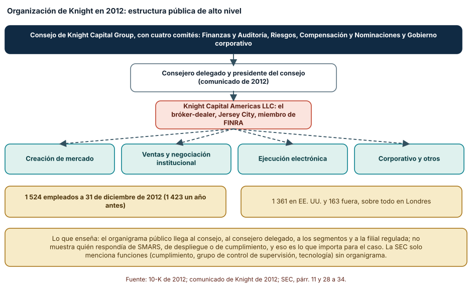

**Cómo leer la figura.** De arriba abajo: gobierno, dirección, entidad regulada y segmentos de negocio; abajo, la plantilla. Mira lo que falta: ninguna caja dice quién respondía de SMARS. **Dónde deja de valer:** es el nivel público de detalle; no es un organigrama interno.

Datos documentados. A 31 de diciembre de 2012 Knight tenía 1 524 empleados a tiempo completo (1 423 un año antes): 1 361 en EE. UU. y 163 fuera, sobre todo en Londres. El consejo tenía comités de Finanzas y Auditoría, de Riesgos, de Compensación y de Nominaciones y Gobierno corporativo; el consejero delegado era además presidente del consejo (10-K de 2012; comunicado de Knight del 6 de agosto de 2012). La SEC menciona, sin organigrama, un departamento de cumplimiento, un grupo de control de supervisión (SCG), un grupo de negociación electrónica propia (ETG), una mesa de creación de mercado líder (LMM) y un equipo de tecnología (SEC, párr. 28 a 34). **No se sabe:** quién respondía de qué dentro de tecnología, la línea de mando de SMARS y el tamaño de cada equipo.

### Visión y misión

El 10-K de 2012 describe a Knight como una firma global de servicios financieros que da acceso a los mercados de capitales en varias clases de activos a una amplia red de clientes, y su estrategia en creación de mercado como diferenciarse con una ejecución competitiva y de calidad y un servicio superior; no incluye una declaración formal de misión. Dice también que busca aplicar de manera continua su experiencia e innovación a la creación de mercado y a la negociación (10-K de 2012, Item 1 y Item 7). El análisis propio es que una estrategia basada en velocidad y en volumen presiona los pasos de control que no generan ingresos.

## Contexto y problema

Un bróker-dealer con acceso directo a las bolsas es un guardián (*gatekeeper*) del mercado: lo que él envía llega a las bolsas con su identificador. Desde 2010 la regla 15c3-5 de la SEC («regla de acceso al mercado») exige a esos brókeres controles de riesgo que impidan órdenes erróneas y que superen umbrales de capital, y una revisión periódica con certificación del consejero delegado (SEC, párr. 5 a 8). La fecha de cumplimiento inicial fue el 14 de julio de 2011, aunque la SEC amplió hasta el 30 de noviembre de 2011 el plazo de algunos requisitos (SEC, nota 2).

El objetivo del sistema en el centro de este caso, **SMARS**, era técnico y de negocio a la vez: recibir órdenes «madre» de otros componentes de la plataforma de Knight y, según la liquidez disponible, enviar una o varias órdenes «hijas» a centros de negociación externos hasta completar la madre (SEC, párr. 12). Es un router automatizado, de alta velocidad y algorítmico (SEC, párr. 12). Era uno de los sistemas principales por los que Knight enviaba órdenes al mercado (SEC, párr. 10 y 12).

**El problema que el sistema resolvía.** Un cliente que quiere comprar 10 000 acciones no encuentra 10 000 acciones al mejor precio en un solo lugar: están repartidas entre bolsas y otros centros. Trocear una orden y repartirla en el momento, a la velocidad de las máquinas, es lo que hace un router. Ese valor es real: mejores precios y menor coste de ejecución para clientes. La SEC lo reconoce al decir que la tecnología automatizada trae velocidad de ejecución y menores costes, pero que «amplifica» ciertos riesgos: sin controles, la velocidad puede convertir un error manejable en un evento extremo con impacto amplio (SEC, párr. 3).

**La apuesta (análisis propio).** Knight había optado por un router propio y por cambios frecuentes y ajustados a calendarios externos del mercado. Esa apuesta explica por qué el 1 de agosto de 2012 había código nuevo que desplegar: la NYSE iniciaba el programa RLP, y un intermediario que no lo soportara perdía ese flujo de órdenes. El análisis propio es que un calendario externo fijo comprime el tiempo de preparación y de verificación; la fecha no se puede negociar y la presión recae sobre los pasos de control que más cuesta defender: la segunda revisión, el ensayo de reversión, el retiro del código viejo.

## Mercado, usuarios y casos de uso

- **Clientes de Knight:** otros brókeres y clientes institucionales cuyas órdenes llegaban a Knight. Las 212 órdenes que dispararon el incidente eran pequeñas órdenes minoristas recibidas de clientes (SEC, párr. 1).
- **Caso de uso del día:** el 1 de agosto de 2012 la NYSE iniciaba su Retail Liquidity Program (RLP), un programa para órdenes minoristas aprobado por la SEC con carácter piloto de 12 meses (SEC, nota 5). Knight modificó su software para que sus clientes pudieran participar (SEC, párr. 12).
- **Usuarios internos:** los técnicos que desplegaban, los operadores que miraban posiciones y el personal de cumplimiento que revisaba controles. Cada uno aparece en el caso con un papel distinto, y ninguno tenía a la vez los datos y la autoridad para parar el router.
- **Afectados externos:** el resto del mercado. En 75 de las acciones las ejecuciones de Knight fueron más del 20 % del volumen y contribuyeron a movimientos de precio superiores al 5 %; en 37 de ellas el precio se movió más del 10 % y Knight fue más del 50 % del volumen. Algunos participantes recibieron peores precios y otros mejores (SEC, párr. 18).
- **Regulador:** la SEC y la FINRA, de la que Knight era miembro (SEC, párr. 11). La regla de acceso al mercado existe porque el riesgo de un intermediario es un riesgo para terceros.

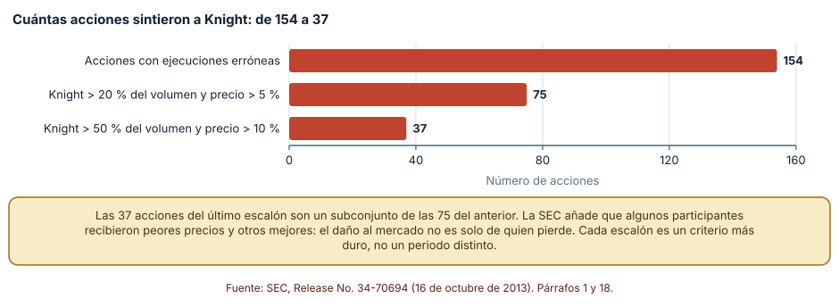

**Cómo leer la figura.** Cada barra es un conjunto de acciones definido por un criterio más duro que el anterior; el valor es el número de acciones. Mira cómo se estrecha el embudo: en la mayoría de las acciones Knight fue una presencia grande pero no dominante, y en 37 fue la mitad del volumen. **Dónde deja de valer:** no dice cuánto perdió o ganó cada contraparte ni cuánto duró el efecto en cada precio; la SEC solo da esos tres cortes.

## Funcionalidad de principio a fin

1. Un cliente envía una orden a Knight. Antes de SMARS, la interfaz de cliente, el sistema interno de gestión de órdenes y el de ejecución interna tenían controles contra órdenes erróneas (SEC, párr. 20).
2. La orden madre pasa a SMARS. Este decide cuántas órdenes hijas enviar y a qué centros, según la liquidez disponible (SEC, párr. 12).
3. Cada vez que un centro ejecuta una hija, una función de **cantidad acumulada** cuenta cuánto de la madre ya se ha completado; al completarse, SMARS deja de enviar hijas (SEC, párr. 14).
4. Las ejecuciones que no se pueden casar con una orden madre quedan en una cuenta temporal, la «cuenta 33», con un límite bruto de 2 millones de dólares, no vinculado a ningún control automático de la exposición total de la firma (SEC, párr. 23).
5. El monitor de posiciones **PMON** muestra posiciones después de ejecutarse. Depende de que una persona lo mire, no emite alertas automáticas, no muestra los límites y se retrasa con alto volumen (SEC, párr. 25).

Dos detalles de diseño importan para entender el fallo: el criterio de parada de SMARS **no era un invariante del router**, sino una función dentro de un módulo concreto; y el único control de precio (un tope del 9,5 % respecto al mejor precio nacional en el momento de recibir la orden madre) no se aplicaba a las órdenes recibidas antes de la apertura para participar en la subasta de apertura (SEC, párr. 21).

### El día a día de un cambio de software en SMARS

La orden no describe el proceso de entrega de SMARS más allá de lo que faltaba: no había procedimientos escritos de desarrollo y despliegue para SMARS (aunque otros grupos de Knight sí los tenían), no se exigía a una segunda persona revisar un despliegue, y no existía un protocolo para acceder a código sin uso en servidores de producción (SEC, párr. 26). De ahí se puede reconstruir, como análisis propio, cómo era una operación normal de cambio: un técnico preparaba el artefacto, lo copiaba servidor a servidor y confiaba en su propia memoria para saber cuáles había actualizado. Mientras los cambios eran pequeños y los servidores pocos, ese proceso funcionaba por la competencia de las personas, y por eso nunca falló visiblemente; la primera vez que no funcionó coincidió con un cambio que tocaba el único indicador reutilizado.

## Negocio y economía

Knight era un intermediario cuyo negocio dependía de ejecutar muchas órdenes con márgenes pequeños; su capital era su capacidad de asumir riesgo. Una exposición no deseada de miles de millones consumió ese capital: la SEC habla de «problemas significativos de capital neto» (párr. 35). La pérdida de más de 460 millones de dólares y la necesidad de 400 millones de dólares de nueva financiación en cinco días muestran que, en este negocio, un fallo de software es un fallo de balance. La orden también registra consecuencias regulatorias colaterales: muchas de las órdenes eran ventas en corto no marcadas como tales y sin localizar el préstamo de los valores, lo que viola las reglas 200(g) y 203(b) de la Regulación SHO (SEC, párr. 35, 46 a 48).

**La financiación del 6 de agosto.** El comunicado de Knight describe un capital de 400 millones de dólares en acciones preferentes con un dividendo del 2 %, convertibles en acciones comunes de la clase A a 1,50 dólares por título, aportado por un grupo de inversores entre los que figuraban Jefferies, Blackstone, GETCO, Stephens, Stifel y TD Ameritrade, con el compromiso de añadir tres miembros al consejo (comunicado de Knight del 6 de agosto de 2012). El consejero delegado afirmó que el capital restablecido superaba la pérdida de la semana anterior y que el software del problema se había retirado de los sistemas. El análisis propio es que una financiación así, en términos de dilución y de gobierno, es otra forma de pérdida: el coste del fallo no se mide solo en dólares perdidos, sino en propiedad cedida.

**Lo que cuesta un control frente a lo que cuesta no tenerlo.** La multa de la SEC fue de 12 millones de dólares, un orden de magnitud menor que la pérdida. Un segundo técnico que revisara el despliegue costaba minutos; un procedimiento escrito, horas; un límite de capital que bloqueara el envío, semanas de ingeniería y de calibración con el negocio. Ninguna de esas partidas se acercaba a 460 millones de dólares. El análisis es propio: los controles de este tipo se subfinancian porque su beneficio es un evento que no ocurrió.

**Cómo leer la figura.** Cada barra es una cantidad en millones de dólares de EE. UU. con escala lineal desde cero. Mira primero la diferencia de longitud entre las dos posiciones brutas y la pérdida: el riesgo asumido por error fue de un orden de magnitud mayor que lo que finalmente costó. **Dónde deja de valer:** las posiciones son cifras aproximadas de la SEC en el momento más alto, no una serie temporal, y la figura no explica cómo se liquidaron ni a qué precios; la pérdida realizada no descompone qué parte fue de compras y qué parte de ventas.

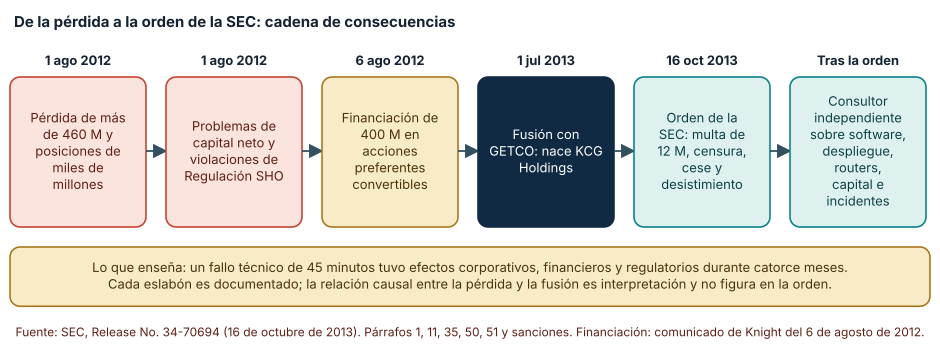

**Cómo leer la figura.** Cada caja es una consecuencia fechada, de izquierda a derecha en el tiempo; el color distingue daño (coral), respuesta financiera (dorado), cambio corporativo (azul oscuro) y sanción o remedio (verde azulado). Mira la distancia entre el primer y el último eslabón: catorce meses. **Dónde deja de valer:** que cada eslabón sea consecuencia del anterior no consta; la figura ordena en el tiempo hechos documentados, no prueba causalidad entre la pérdida y la fusión.

### Esquema del negocio: actores, valor y flujos

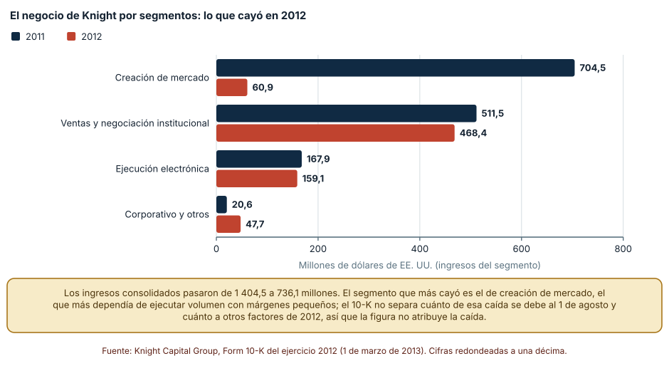

**Cómo leer la figura.** Cada pareja de barras es un segmento; azul oscuro es 2011 y coral 2012; el eje parte de cero. Mira la primera pareja: un segmento casi desaparece. **Dónde deja de valer:** el 10-K no atribuye esa caída al 1 de agosto; hubo otros factores en 2012 y la figura no los separa.

Knight ganaba por ejecutar órdenes de otros (como intermediario) y por mantener un inventario propio como creador de mercado, con márgenes mínimos por operación: el 10-K da una captura de ingreso por dólar negociado en acciones de EE. UU. de 1,06 puntos básicos en 2011 y 0,06 en 2012 (1,03 sin el efecto de la salida a bolsa de Facebook y del 1 de agosto). Los flujos de dinero son: clientes pagan por la ejecución; Knight asume riesgo de inventario; las bolsas cobran comisiones de ejecución (200,4 millones de gasto de ejecución y liquidación en 2012). El análisis propio es que, con márgenes de centésimas de punto básico, un error que acumula exposición no deseada se mide contra el capital, no contra los ingresos.

### Costos operativos y costo del incidente

| Rubro | 2012 | 2011 | Fuente |
| --- | --- | --- | --- |
| Gastos totales | 1 272,8 millones | 1 217,4 millones | 10-K de 2012 |
| Compensación y beneficios | 525,2 millones | 583,8 millones | 10-K de 2012 |
| Comunicaciones y procesamiento de datos | 97,7 millones | 87,1 millones | 10-K de 2012 |
| Honorarios profesionales | 32,4 millones | 21,3 millones | 10-K de 2012 |
| Ejecución y liquidación | 200,4 millones | 229,2 millones | 10-K de 2012 |
| Reducción de activos y provisión por contratos | 143,0 millones | 3,0 millones | 10-K de 2012 |

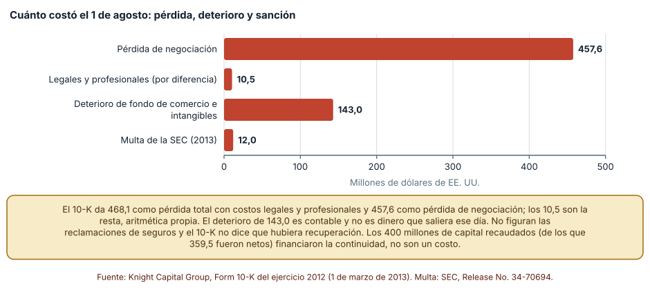

**Cómo leer la figura.** Cada barra es un rubro en millones de dólares; los 10,5 son una resta mía. Mira que el deterioro contable es la segunda barra: parte del costo no es dinero perdido en el mercado sino valor que se reconoce como perdido. **Dónde deja de valer:** no incluye costos indirectos (clientes perdidos, tiempo de dirección); el 10-K no los cuantifica.

Documentado: la pérdida de negociación fue de 457,6 millones, y con costos legales y profesionales relacionados la «pérdida del 1 de agosto» fue de 468,1 millones (10-K de 2012). Hubo además un deterioro de 143,0 millones de fondo de comercio (126,4) e intangibles (16,7). La captación del 6 de agosto fue de 400 millones, con 359,5 netos. En el plano legal el 10-K registra dos demandas colectivas (una desistida a favor de la otra), una demanda derivativa y una orden formal de investigación de la SEC del 29 de agosto de 2012. **No se sabe:** si hubo recuperación de seguros (el 10-K consultado no la menciona) y el costo de las medidas correctivas posteriores.

### Competidores y contexto de mercado

El 10-K no nombra competidores concretos; los define por categorías: brókeres-dealers globales, nacionales y regionales, bolsas, sistemas alternativos de negociación, redes de cruce, ECN, mercados de liquidez oscura, bancos de inversión tradicionales y otras plataformas electrónicas (10-K de 2012, Item 1 y factores de riesgo). La SEC sitúa a Knight en torno al 10 % de la negociación de acciones cotizadas de EE. UU. (SEC, párr. 11). El 10-K da volúmenes y no cuotas porcentuales: valor diario negociado en creación de mercado en acciones de EE. UU. de 20,1 mil millones de dólares en 2012 frente a 25,3 en 2011. Tras el incidente, el hecho documentado es la fusión con GETCO, que formó KCG Holdings el 1 de julio de 2013 (SEC, párr. 11); GETCO fue uno de los inversores de la captación de agosto de 2012 (comunicado de Knight). Qué ocurrió con los competidores después del fallo no consta en las fuentes consultadas y este caso no lo inventa.

## Arquitectura y esquemas

La arquitectura se explica de lo general a lo particular, con una figura por nivel de zoom. Los hechos vienen de la orden de la SEC; los dibujos de componentes son un modelo funcional construido con lo que la orden describe, porque la orden no publica el diseño interno de SMARS.

### Nivel 1 · Contexto: Knight entre clientes y mercado

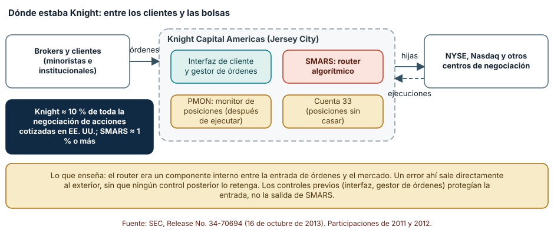

**Cómo leer la figura.** Cada caja es un componente; las flechas llenas son órdenes y la discontinua son ejecuciones que vuelven. Mira que PMON y la cuenta 33 están fuera de la ruta de salida: observan, no bloquean. **Dónde deja de valer:** es un esquema funcional construido con lo que la SEC describe; la orden no publica la arquitectura interna, ni el número de componentes entre SMARS y la bolsa.

### Nivel 2 · Contenedores: la cadena de la orden y sus controles

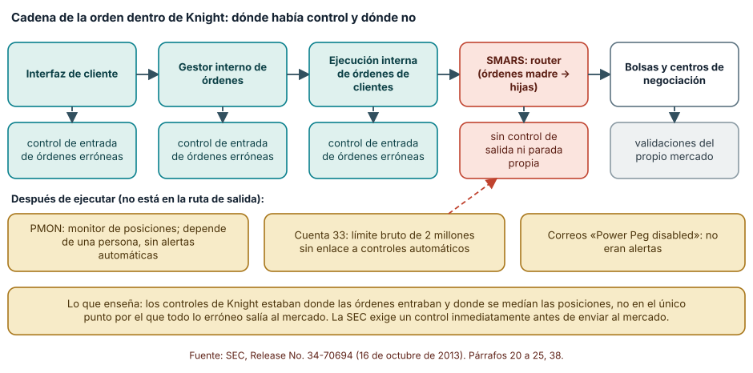

**Cómo leer la figura.** La fila superior son las etapas por orden; la fila de debajo es el control que cada una tenía; abajo, las herramientas que miraban después. Mira la etapa roja: es la única en la que un error puede salir al mercado sin pasar por un control propio. **Dónde deja de valer:** la orden dice que las tres primeras etapas tenían controles contra órdenes erróneas, pero no los describe; no sabemos su cobertura ni sus umbrales.

La SEC es explícita en el diagnóstico: Knight no tenía controles adecuados en SMARS, como una comparación entre las órdenes que salían y las que entraban, ni procedimientos para detener SMARS ante su propia actividad aberrante (SEC, párr. 21). La exigencia de la regla es un control «inmediatamente antes» del envío al mercado (SEC, párr. 9 y 38).

### Nivel 3 · Componentes del flujo crítico dentro de SMARS

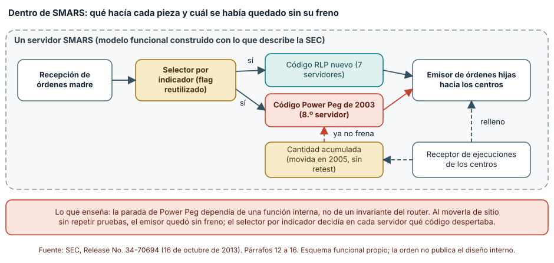

**Cómo leer la figura.** Cada caja es una responsabilidad; el selector decide qué rama despierta el indicador; la flecha roja discontinua marca el freno que dejó de funcionar. Mira dónde está la cantidad acumulada: fuera del camino de decisión del emisor. **Dónde deja de valer:** la orden no describe el módulo selector ni cómo se materializaba el indicador (si era un campo de la orden, un parámetro o otro mecanismo); la figura asume solo lo que la SEC afirma: que el indicador activaba Power Peg y que el código nuevo lo había reutilizado.

El flujo crítico es el siguiente. En 2003 Knight dejó de usar la función **Power Peg**, pero el código quedó presente y ejecutable. En 2005 se movió la función de cantidad acumulada a un punto anterior de la secuencia de código y no se volvió a probar Power Peg para ver si seguía funcionando si se llamaba (SEC, párr. 14). En 2012 el código nuevo del RLP debía sustituir al código inactivo y **reutilizó el indicador** que antes activaba Power Peg; la intención era borrar Power Peg (párr. 13).

### Nivel 4 · Secuencia del flujo que falló

**Cómo leer la figura.** Cada columna es un participante y el tiempo avanza hacia abajo; las flechas rojas son las que empeoran el sistema; las cajas doradas son estados internos. Mira que ninguna flecha parte de un control automático hacia SMARS: la única orden hacia SMARS (paso 8) la dio una persona y era un cambio de software. **Dónde deja de valer:** la orden no fija horas ni el orden exacto de los pasos 5 a 8; es una reconstrucción coherente con los párrafos 16, 24, 25 y 27.

Pasos, en palabras. (1) Brokers cuyos clientes eran elegibles para el RLP envían órdenes. (2) El gestor las pasa a SMARS, y las que llevan el indicador y caen en el octavo servidor activan Power Peg (SEC, párr. 16). (3) SMARS emite órdenes hijas «en rápida sucesión» por cada madre, sin considerar las ejecuciones ya recibidas. (4) Los centros ejecutan y devuelven. (5) Otra parte del sistema reconoce que las madres están completas, pero no se lo comunica a SMARS. (6) Las ejecuciones que no casan se acumulan en la cuenta 33, sin enlace a umbrales de capital. (7) Al abrir, el personal ve acumularse posiciones. (8) En uno de los intentos de arreglo, se desinstala el código nuevo de los siete servidores correctos, lo que activa Power Peg también allí (SEC, párr. 27). (9) Se emiten más hijas. (10) El envío se detiene tras unos 45 minutos (SEC, párr. 1).

### Nivel 5 · Modelo de datos y flujo de datos

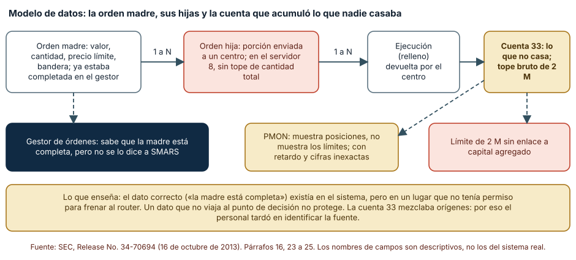

**Cómo leer la figura.** Las cajas son entidades de datos; «1 a N» marca cardinalidad; las flechas discontinuas son flujos de lectura que no actúan. Mira el dato «madre completa»: existía, pero en una caja sin flecha hacia el router. **Dónde deja de valer:** los nombres de las entidades son descriptivos; la orden no publica el esquema real, ni los tipos, ni cómo se imputaban las ejecuciones.

La lección de datos es que **el estado correcto existía y no llegaba a quien debía decidir**. «Aunque una parte del sistema de gestión de órdenes reconocía que las madres estaban completas, esta información no se comunicaba a SMARS» (SEC, párr. 16, en paráfrasis). La cuenta 33 retiene, además, «múltiples tipos» de posiciones: las que resultan de ejecuciones que no se pueden casar con la cantidad pendiente de una madre, entre otras (SEC, párr. 23). Mezclar orígenes en una cuenta hace que, ante una anomalía, el personal no pueda determinar rápido de dónde viene (SEC, párr. 24).

### Nivel 6 · Despliegue

**Cómo leer la figura.** Cada caja es un servidor; el verde tiene el código correcto y el rojo mantiene Power Peg. Mira que el mismo indicador activa funciones distintas según el servidor al que llegue la orden. **Dónde deja de valer:** que la orden llegue o no a un servidor concreto es un detalle del balanceo que la SEC no describe; basta saber que el octavo servidor recibió órdenes con el indicador reutilizado.

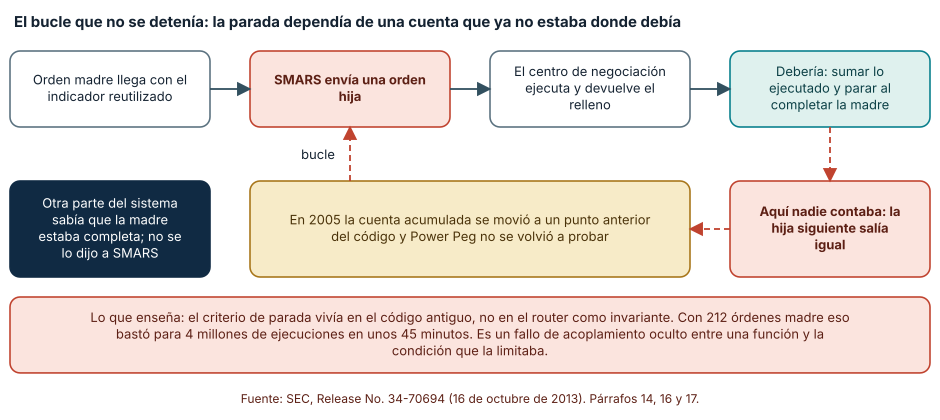

**Cómo leer la figura.** El camino superior es el flujo normal con la parada correcta; el camino rojo discontinuo es el bucle. Mira el recuadro dorado: la causa que la SEC documenta del bucle es el cambio de lugar de la cuenta acumulada. **Dónde deja de valer:** el esquema simplifica; la SEC dice que otra parte del sistema reconocía que las madres estaban completas pero no se lo comunicó a SMARS (párr. 16), y no detalla el mecanismo interno del bucle más allá de eso.

### Nivel 7 · Dependencias y puntos únicos de fallo

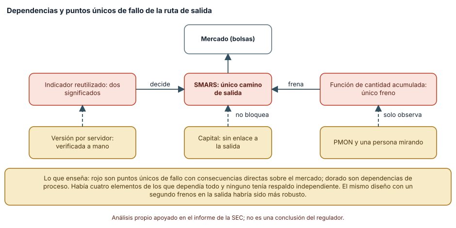

**Cómo leer la figura.** Las cajas rojas son puntos únicos de fallo con efecto directo sobre el mercado; las doradas son dependencias de proceso que debían compensarlos. Las flechas llenas son decisiones o frenos; las discontinuas, observación sin poder de bloqueo. Mira que cada punto rojo tiene debajo una dependencia dorada que solo observa. **Dónde deja de valer:** es un análisis propio de la estructura descrita por la SEC; la orden no enumera dependencias, y puede haber otras (redes, bases de datos, reloj) que no figuran.

### Nivel 8 · Defensa en profundidad: ocho barreras y dónde fallaron

**Cómo leer la figura.** Cada lámina es una barrera; el hueco es el punto por el que el defecto pasó; las rojas no existían y las doradas existían sin eficacia suficiente. La flecha es el defecto activo. Mira que no hay una sola lámina sin hueco alineado. **Dónde deja de valer:** el modelo de láminas es una metáfora, no una medición; el tamaño y la posición de cada hueco no son datos. La lista de barreras sale de las deficiencias que la SEC enumera, y es nuestra la agrupación en ocho.

Detalle de cada barrera según la orden. **Revisión de segunda persona:** inexistente y sin procedimiento escrito (párr. 15, 26). **Retest o retirada de código muerto:** sin protocolo de pruebas tras acceder a código sin uso (párr. 26, 41). **Alerta:** 97 correos automáticos no diseñados como alertas y que nadie revisó (párr. 19). **Control de salida en SMARS:** ausente (párr. 21). **Tope de precio del 9,5 %:** existente, pero no cubría órdenes de preapertura ni movimientos menores del 9,5 % (párr. 21). **Capital:** sin umbrales agregados enlazados al envío; la cuenta 33, con límite bruto de 2 millones, sin enlace (párr. 22 a 24). **PMON:** posterior, humano, sin alertas ni límites visibles, con retardos (párr. 25). **Incidente:** sin procedimientos de respuesta (párr. 27, 42).

### Hardware utilizado

La documentación pública no describe el hardware de SMARS más allá de lo siguiente: el router corría en ocho servidores y el despliegue se hacía copiando el código a cada uno (SEC, párr. 15). El 10-K habla de tecnología propia y licenciada de terceros y de «instalaciones alternativas de negociación y de datos» (10-K de 2012, Item 1). **No se sabe:** el fabricante y modelo de los servidores, su capacidad, la red de conexión a las bolsas, los centros de datos y su ubicación, ni si había colocación. Este caso no inventa ninguno de esos datos.

### Software utilizado

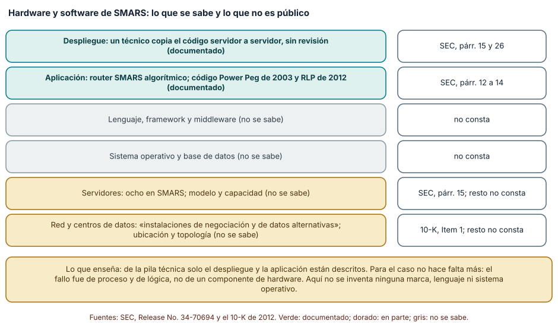

**Cómo leer la figura.** Cada fila es una capa técnica; verde, documentada; dorado, parcial; gris, no se sabe; la columna de la derecha dice la fuente. Mira que lo documentado está arriba (proceso y código) y lo desconocido, abajo (plataforma). **Dónde deja de valer:** no pretende describir la pila real, solo el límite de lo público.

Documentado: SMARS es un router automatizado y algorítmico; contenía código Power Peg de 2003, mantenido y llamable en producción; una función de cantidad acumulada movida en 2005; código nuevo del RLP de 2012 que reutilizaba un indicador; PMON como monitor de posiciones; una cuenta 33; un sistema interno de correos BNET de rechazo (SEC, párr. 12 a 25). El 10-K menciona una plataforma propia de compensación (10-K, Item 1). **No se sabe:** lenguaje de programación, sistema operativo, base de datos, middleware, herramientas de construcción y de despliegue (el despliegue era un procedimiento manual de copia, sin procedimientos escritos para SMARS: SEC, párr. 15 y 26).

### Infraestructura

Knight operaba una infraestructura propia, con sistemas propios y licenciados, conectada a las bolsas y otros centros de negociación (10-K de 2012, Item 1; SEC, párr. 12). La escala está documentada solo por la actividad: Knight representaba cerca del 10 % de la negociación de acciones cotizadas de EE. UU. y SMARS, un 1 % o más (SEC, párr. 11). **No se sabe:** si la infraestructura era propia, alquilada o híbrida, el número de regiones, la capacidad de cada servidor, la red de acceso y las dependencias de terceros (proveedores de conectividad o de datos de mercado).

### A prueba de fallos: qué existía, qué falló y qué debió existir

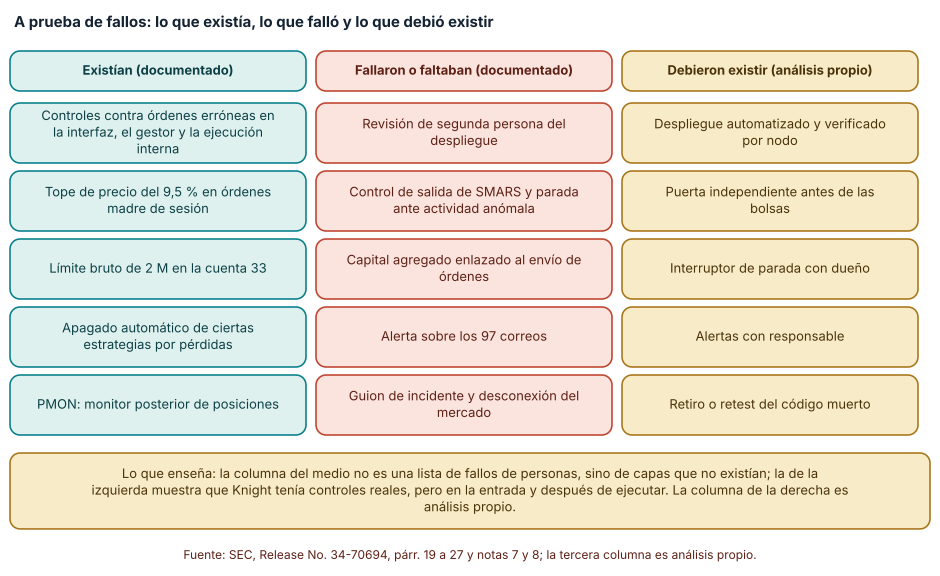

**Cómo leer la figura.** Verde azulado: lo que había; coral: lo que falló o faltaba; dorado: análisis propio de lo que debió haber. Las filas no se corresponden una a una. **Dónde deja de valer:** no mide eficacia; un control que existía puede haber fallado por diseño y no por ausencia.

Redundancia y conmutación: no consta que SMARS tuviera conmutación a otro router; sí había ocho servidores, pero la versión mezclada convertía la redundancia en un riesgo. Interruptor de parada: no existía uno sobre SMARS; sí había apagado automático de ciertas estrategias de un grupo por límites de pérdidas (SEC, nota 7). Límites: tope de precio del 9,5 %, límite bruto de 2 millones en la cuenta 33 sin enlace automático. Pruebas: no se volvió a probar Power Peg tras 2005; en 2011 una prueba de recuperación con datos de prueba generó una pérdida de unos 7,5 millones. Despliegue gradual: se hizo por días y por servidores, sin verificación de versión. Recuperación: sin guion, y la reversión empeoró. Qué debió existir: despliegue verificado por nodo, puerta previa al mercado, interruptor con dueño y alertas con responsable (análisis propio, ver «Mejoras»).

## Casos especiales y cómo fallan

Los bordes del sistema explican por qué el daño fue tan grande y por qué fue también un problema regulatorio, no solo técnico.

- **Órdenes de preapertura.** El único control de precio que existía (un tope del 9,5 % respecto al mejor precio nacional en el momento de recibir la orden madre) no se aplicaba a las órdenes recibidas antes de la apertura para participar en la subasta de apertura, que es justo el tipo de las 212 órdenes (SEC, párr. 21). Un control que deja fuera el caso límite más frecuente de la mañana no protege el momento de mayor riesgo.
- **Pico de volumen y monitoreo.** PMON, el monitor de posiciones, sufrió retrasos con el alto volumen del evento y produjo informes inexactos; además la cuenta 33 mezclaba posiciones de varios orígenes y el personal no pudo determinar rápido de dónde venían (SEC, párr. 24 y 25).
- **Regulación.** Muchas órdenes eran ventas en corto no marcadas como tales y sin localizar el préstamo de los valores (reglas 200(g) y 203(b) de la Regulación SHO), y la firma tuvo problemas de capital neto (SEC, párr. 35). El error técnico se convirtió en varias infracciones a la vez.
- **Reversión.** Desinstalar el código nuevo de los siete servidores correctos activó Power Peg también en ellos y empeoró el problema (SEC, párr. 27): el caso límite de «volver atrás» no estaba pensado ni ensayado.
- **Correos que no son alertas.** Los 97 mensajes «Power Peg disabled» se generaron en tiempo real, por la propia falla de despliegue, y eran una oportunidad documentada de detectar y arreglar el problema antes de la apertura (SEC, párr. 19). Pero no estaban diseñados para eso y el personal «generalmente no los revisaba». En ingeniería de confiabilidad, el fallo es de integración: la señal existía, el canal no tenía dueño.
- **Órdenes distintas de las 212.** Las órdenes elegibles para el RLP pero designadas para negociación previa a la apertura, causantes de los correos, eran distintas de las 212 madres que provocaron las ejecuciones (SEC, nota 6). El mismo defecto se manifestó de dos maneras: una visible como rechazo y otra invisible como envío masivo. El análisis propio es que el primer síntoma era el aviso de que el segundo sería posible.
- **Parada parcial en otros mecanismos.** Knight sí tenía parada automática para ciertas estrategias de uno de sus grupos de negociación cuando sus pérdidas superaban límites (SEC, nota 7). El control existía, pero no cubría el router ni este caso.
- **Recuperación del negocio.** Cinco días después Knight anunció 400 millones de dólares de financiación (comunicado del 6 de agosto de 2012). En la sanción, la SEC consideró las medidas correctivas de Knight y su cooperación, y exigió contratar un consultor independiente para revisar el ciclo de desarrollo de software, el despliegue, los enrutadores de órdenes, los umbrales de capital vinculados a la entrada de órdenes y los protocolos de incidentes (SEC, párr. 50 y 51).

## Línea de tiempo

El caso tiene tres escalas: años (cómo se formó el defecto), días (el despliegue) y minutos (el incidente). Cada una tiene su figura.

### Antecedentes: decisiones y condiciones latentes, con año

**Cómo leer la figura.** Los hitos están espaciados de manera uniforme (no a escala de años) para poder leerlos; los años de las cajas son los reales. Los colores distinguen decisiones técnicas (azul oscuro y coral), eventos de control y gobierno (dorado) y consecuencias (verde azulado). Mira la distancia entre 2005 y 2012: el defecto esperó siete años. **Dónde deja de valer:** no es una escala temporal; la duración de los tramos no se puede leer de la distancia dibujada. Las fechas de cada hito son las de la SEC.

| Año o fecha | Hecho documentado | Fuente |
| --- | --- | --- |
| 2003 | Knight deja de usar Power Peg; el código se queda en los servidores | SEC, párr. 13, 14 |
| 2005 | Se mueve la función de cantidad acumulada; Power Peg no se vuelve a probar | SEC, párr. 14 |
| 14 de julio de 2011 | Fecha en que, según la SEC, los controles de Knight dejaron de estar razonablemente diseñados; inicio del periodo de la violación | SEC, párr. 9 |
| Agosto de 2011 | Knight adopta procedimientos de supervisión escritos para la regla 15c3-5 | SEC, párr. 30 |
| Septiembre de 2011 | Narrativa de controles incompleta e inexacta; omitía el grupo de negociación propia ETG | SEC, párr. 29 |
| Octubre de 2011 | Prueba de recuperación ante desastres con datos de prueba; pérdida de unos 7,5 millones el lunes siguiente | SEC, párr. 33 |
| Enero de 2012 | Borrador revisado de la descripción de controles, aún sin la mesa LMM | SEC, párr. 29 |
| Marzo de 2012 | Certificación del consejero delegado que habla de «procesos» y no de cumplimiento; error de redacción no intencionado | SEC, párr. 34 |
| Julio de 2012 | La mesa LMM entra en la descripción de controles, casi un año después de la fecha de cumplimiento | SEC, párr. 29 |

### Del 27 de julio al 1 de agosto: el despliegue

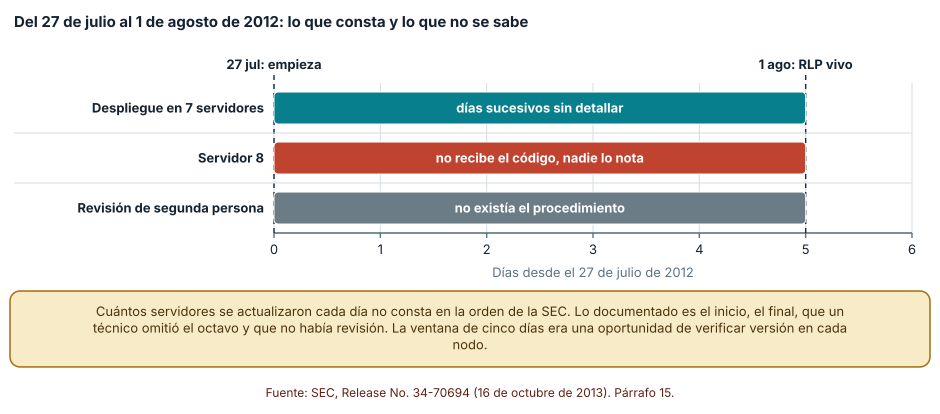

**Cómo leer la figura.** Las tres barras ocupan la misma ventana de cinco días; la etiqueta de cada una dice qué consta. Mira lo que no está dibujado: no hay hitos intermedios porque la SEC no los da. **Dónde deja de valer:** no muestra qué servidores se actualizaron cada día ni cuándo se omitió el octavo; solo la ventana. El orden de los servidores es desconocido.

### El 1 de agosto de 2012, hora a hora

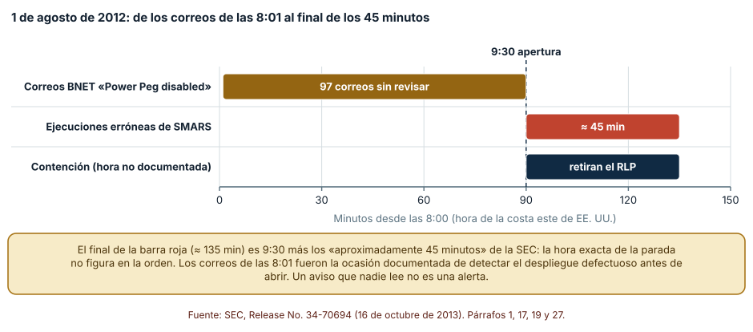

**Cómo leer la figura.** El eje horizontal son minutos desde las 8:00; la línea discontinua es la apertura. Cada fila es un hilo: los correos, las ejecuciones y los intentos de contención. Mira cuánto antes de la apertura estaban los correos, y que su aviso ya describía el problema. **Dónde deja de valer:** la hora exacta de parada no consta en la orden y el segmento de contención es solo indicativo: la SEC no da horas para cada acción de los técnicos.

| Hora (Nueva York) | Hecho documentado | Fuente |
| --- | --- | --- |
| 27 de julio de 2012 | Empieza el despliegue escalonado del RLP, servidor a servidor | SEC, párr. 15 |
| 1 de agosto, ≈ 8:01 | Empiezan los correos automáticos «Power Peg disabled»; antes de las 9:30 son 97 | SEC, párr. 19 |
| 1 de agosto, 9:30 | Abre el mercado; la cuenta 33 empieza a acumular posiciones a la apertura | SEC, párr. 24 |
| 1 de agosto, durante ≈ 45 min | 4 millones de ejecuciones; Knight desinstala el código nuevo de los siete servidores correctos y empeora el problema | SEC, párr. 1, 27 |
| 6 de agosto de 2012 | Anuncio de 400 millones de dólares de capital | Comunicado de Knight |
| 1 de julio de 2013 | Fusión con GETCO para formar KCG Holdings | SEC, párr. 11 |
| 16 de octubre de 2013 | Orden de la SEC y multa de 12 millones de dólares | SEC, orden y comunicado 2013-222 |

**No consta:** la hora en que terminó el envío, la hora de la decisión de desinstalar el código, la hora de la desconexión del mercado ni el orden entre estos tres hechos.

## Qué falló en cada instancia

Instancia por instancia, qué se esperaba y qué ocurrió, según las fuentes.

- **Despliegue.** Un técnico no copió el código nuevo a un servidor; no hubo segunda revisión; no había procedimientos escritos de despliegue para SMARS ni protocolo para el código no utilizado en producción (párr. 15 y 26). Se esperaba que ocho servidores quedaran iguales; ocurrió que siete eran de una versión y uno de otra, sin forma de saberlo.
- **Código muerto.** Power Peg siguió «presente y llamable» desde 2003 sin pruebas desde 2005 (párr. 13 y 14). Se esperaba que el código sin uso no se ejecutara; ocurrió que un indicador reutilizado lo ejecutó.
- **Alertas.** 97 correos automáticos describían el error antes de la apertura; no estaban diseñados como alertas y nadie los revisó (párr. 19). Se esperaba que la plataforma avisara de una rotura de despliegue; ocurrió que el aviso fue ruido.
- **Controles de salida.** Sin control que comparase las órdenes que salían de SMARS con las que entraban, sin parada ante actividad anómala, y con un tope de precio que no se aplicaba a órdenes de preapertura (párr. 21).
- **Capital.** Sin umbrales de capital agregados vinculados a controles automáticos de entrada de órdenes; la cuenta 33 no estaba vinculada a nada; PMON dependía de una persona (párr. 22 a 25).
- **Incidente.** Sin procedimientos de respuesta; la reversión empeoró el problema (párr. 27).
- **Gobierno.** Revisión inicial de cumplimiento centrada en inventariar controles, no en riesgos de SMARS; descripción escrita incompleta durante casi un año; certificación del consejero delegado de 2012 sin afirmar el cumplimiento, un error de redacción no intencionado según la SEC (párr. 28 a 34). Ocho empleados sénior firmaron sub-certificaciones con un error de redacción similar, y todos creían que Knight cumplía la regla (SEC, nota 8).
- **Aprendizaje posterior al 2011.** Tras la pérdida de octubre de 2011 Knight limitó el sistema a horas de mercado, hizo que dejara de cotizar tras recibir una ejecución y añadió un punto a la lista de recuperación; no consideró de forma amplia si tenía controles suficientes contra órdenes erróneas, fuese cual fuese el sistema o el motivo, ni tenía un mecanismo para comprobar si los sistemas usaban datos obsoletos (SEC, párr. 33, 44). La SEC lo resume: Knight reaccionó de forma estrecha, con cambios para impedir el problema exacto que acababa de ocurrir.

## Causa raíz y factores

**Detonante (documentado).** Un despliegue incompleto del código del Retail Liquidity Program dejó un servidor con Power Peg, y el indicador reutilizado lo activó con órdenes reales (SEC, párr. 13 a 16).

**Condiciones latentes (documentado).** Código sin uso desde 2003 que seguía siendo ejecutable y no se había vuelto a probar tras moverse la función de cantidad acumulada en 2005; ausencia de procedimientos escritos de despliegue y de segunda revisión; sin control sobre la salida de SMARS ni parada automática; sin umbrales de capital agregados vinculados al envío de órdenes; monitoreo que dependía de una persona; sin procedimientos de respuesta a incidentes; una revisión de cumplimiento centrada en inventariar controles y no en los riesgos del router (SEC, párr. 21 a 32).

**Factores de contexto (documentado).** Una fecha externa fija, el inicio del programa de la NYSE el 1 de agosto de 2012, con cambios de software preparados para esa fecha; un episodio previo (octubre de 2011) que ya había mostrado el mismo patrón de estado heredado sin revisión de conjunto (SEC, párr. 12 y 33).

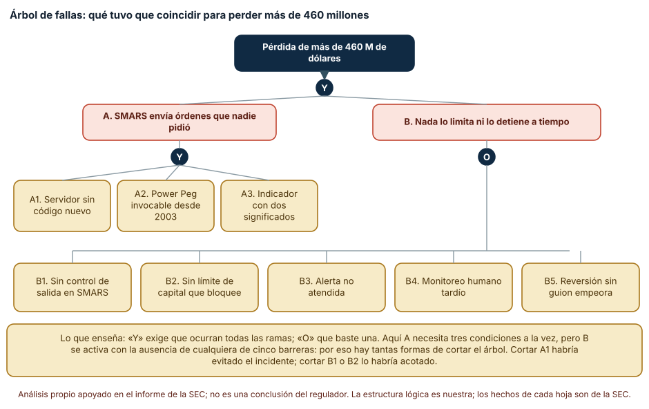

**Cómo leer la figura.** Arriba, el evento final; los círculos con «Y» exigen que todas las ramas ocurran, el «O» que baste una. Las cajas doradas son las condiciones. Mira que A necesita las tres condiciones a la vez, pero B tiene cinco vías: es más fácil cortar el árbol por B que por A. **Dónde deja de valer:** la estructura lógica y la división en A y B son análisis propio; en la realidad las condiciones no eran independientes (por ejemplo, la falta de un guion de incidente agravaba la falta de control de salida).

**Cadena causal ordenada (análisis propio, apoyado en la orden).**

1. Un calendario externo fijo exige cambiar el router (contexto).
2. El proceso de cambio no tiene segunda revisión ni verificación de versión (condición latente de gobierno).
3. Un técnico omite un servidor (detonante humano de un proceso frágil, no una falta personal: cualquier proceso manual falla alguna vez).
4. El indicador reutilizado hace que el servidor viejo despierte código de 2003 (condición latente técnica, 2003 y 2012).
5. La parada de ese código ya no funciona por el cambio de 2005 (condición latente técnica).
6. No hay control en la salida ni umbral de capital que bloquee el envío (condiciones latentes de control).
7. Las señales (97 correos, posiciones en PMON) no se convierten en acciones y la reversión empeora el sistema (condiciones latentes de operación).
8. El resultado es una pérdida de más de 460 millones de dólares (consecuencia).

### Documentado, inferido y no se sabe

| Categoría | Contenido |
| --- | --- |
| Documentado | El despliegue incompleto, el indicador reutilizado, el código de 2003, el movimiento de 2005 sin retest, los 97 correos, la ausencia de control de salida y de umbrales de capital, la reversión que empeoró, las cifras de posiciones, pérdida y multa, y la financiación posterior |
| Inferido (análisis propio) | Que el patrón de 2011 y el de 2012 son del mismo tipo (estado heredado sin revisión de conjunto); que un calendario externo comprimió el tiempo de control; que el diseño con un solo freno dentro del router no podía limitarse a sí mismo; la estructura del árbol de fallas; la relación entre la pérdida y la fusión |
| No se sabe | Qué hizo cada persona minuto a minuto; qué ruta exacta tomó cada orden; cuánto de la pérdida fue por compras y cuánto por ventas; por qué otros mecanismos no pararon el router en ese servidor; si los controles de las etapas previas eran adecuados; cuánto costó cada medida correctiva posterior |

El patrón de 2011 y el de 2012 se apoyan en la SEC cuando dice que Knight no consideró ampliamente si tenía controles suficientes frente a órdenes erróneas, sea cual fuese el sistema (párr. 33). La afirmación de que el diseño de un freno único interno no podía limitarse a sí mismo es consistente con lo que describe la SEC (párr. 14, 16, 21), pero la SEC no lo formula en esos términos.

## Mejoras que debieron hacerse

La SEC señala la ausencia de controles; la elección concreta de cuáles y cómo implementarlos es análisis nuestro. Todo lo de esta sección, incluidos los costes y los trade-offs, es **análisis propio apoyado en la fuente**: no son conclusiones de la SEC ni descripciones de lo que Knight adoptó.

**Cómo leer la figura.** La fila superior es la cadena causal documentada y la inferior el control que corta cada eslabón; las flechas discontinuas dicen dónde actúa. Mira que los dos últimos eslabones se pueden proteger aunque los primeros fallen. **Dónde deja de valer:** son propuestas educativas, no prescripciones; cada una tiene costo y falsos positivos, y los límites de capital deben calibrarse a la operación.

### La arquitectura «después»

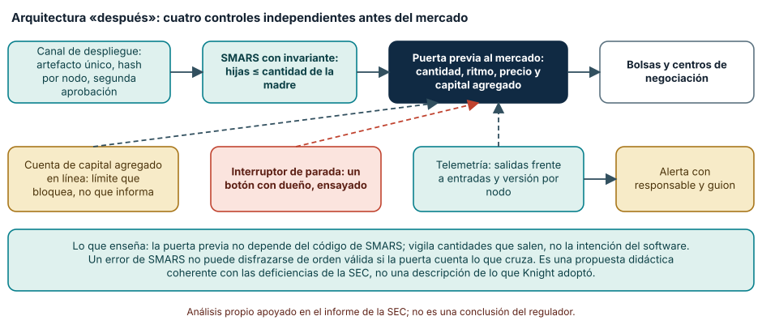

**Cómo leer la figura.** La fila superior es la ruta de la orden con los dos controles nuevos en el camino; la inferior son los apoyos que alimentan la puerta (capital, interruptor, telemetría, alerta). Las flechas discontinuas son señales que gobiernan la puerta. Mira que la puerta está después de SMARS y es independiente de su código. **Dónde deja de valer:** es un diseño didáctico, no una especificación; no considera la latencia que una puerta añade al camino de una orden, que en este mercado importa y debe medirse.

### Para cada factor: control técnico, de proceso y de gobierno

| Factor causal | Control técnico | Control de proceso | Control de gobierno | Costo y trade-off | Clases |
| --- | --- | --- | --- | --- | --- |
| Despliegue manual sin verificación | Despliegue automatizado de un único artefacto, con verificación de versión o hash en cada nodo antes de aceptar tráfico | Lista de verificación con segunda persona para cambios en rutas de salida al mercado | Política de que ningún cambio en componentes de acceso al mercado se despliega sin revisión registrada | Horas de ingeniería; un poco más de latencia de entrega. El riesgo de no hacerlo es de varios órdenes mayor | [SE-404 · Canary, blue-green y rollback](../../classes/part-33-build-release-y-cadena-de-suministro/se-404-canary-blue-green-y-rollback/README.md), [SE-408 · Proyecto: release firmado y recuperable](../../classes/part-33-build-release-y-cadena-de-suministro/se-408-proyecto-release-firmado-y-recuperable/README.md), [SE-420 · Proyecto: camino a producción con rollback](../../classes/part-34-ci-cd-iac-y-platform-engineering/se-420-proyecto-camino-a-produccion-con-rollback/README.md) |
| Código muerto invocable | Borrar el código y sus rutas; si no se puede, compilarlo fuera o protegerlo | Protocolo de retest tras tocar código antiguo; revisión de código sin uso en cada release | Inventario periódico de «código sin dueño» firmado por quien responde del sistema | El borrado exige pruebas de que nada lo usa; coste de arqueología | [SE-436 · Dependencias obsoletas y riesgo acumulado](../../classes/part-36-mantenimiento-y-modernizacion-legacy/se-436-dependencias-obsoletas-y-riesgo-acumulado/README.md), [SE-441 · Retiro, archivado y disposición de sistemas](../../classes/part-36-mantenimiento-y-modernizacion-legacy/se-441-retiro-archivado-y-disposicion-de-sistemas/README.md), [SE-435 · Pruebas de caracterización y seams](../../classes/part-36-mantenimiento-y-modernizacion-legacy/se-435-pruebas-de-caracterizacion-y-seams/README.md) |
| Indicador con dos significados | Un indicador nuevo para el RLP; los indicadores antiguos se retiran con fecha, no se reciclan | Registro de indicadores con dueño y estado | Regla de arquitectura: un indicador, un significado | Más indicadores que mantener, a cambio de claridad | [SE-403 · Feature flags y entrega progresiva](../../classes/part-33-build-release-y-cadena-de-suministro/se-403-feature-flags-y-entrega-progresiva/README.md), [SE-402 · Versionado, compatibilidad y changelog](../../classes/part-33-build-release-y-cadena-de-suministro/se-402-versionado-compatibilidad-y-changelog/README.md) |
| Cambio de 2005 sin pruebas | Pruebas de caracterización antes de tocar código heredado | Cada cambio en un módulo heredado ejecuta la batería del módulo | Medir cobertura del código crítico y exigir un mínimo | Escribir pruebas de caracterización tiene un coste inicial elevado | [SE-435 · Pruebas de caracterización y seams](../../classes/part-36-mantenimiento-y-modernizacion-legacy/se-435-pruebas-de-caracterizacion-y-seams/README.md), [SE-433 · Mantenimiento correctivo, adaptativo y perfectivo](../../classes/part-36-mantenimiento-y-modernizacion-legacy/se-433-mantenimiento-correctivo-adaptativo-y-perfectivo/README.md), [SE-362 · Pruebas unitarias y diseño testable](../../classes/part-30-estrategia-y-tecnicas-de-prueba/se-362-pruebas-unitarias-y-diseno-testable/README.md) |
| Bucle sin parada | Invariante en el router: la suma de hijas enviadas no puede superar la cantidad de la madre; límites de salida frente a entrada | Prueba de carga y de caos del router antes de cada lanzamiento | Aprobación formal de los límites por quien responde del riesgo | Falsos positivos que paran el flujo legítimo; calibración | [SE-379 · Circuit breakers, bulkheads y degradación](../../classes/part-31-calidad-rendimiento-y-resiliencia/se-379-circuit-breakers-bulkheads-y-degradacion/README.md), [SE-374 · Revisión, análisis estático y quality gates](../../classes/part-31-calidad-rendimiento-y-resiliencia/se-374-revision-analisis-estatico-y-quality-gates/README.md), [SE-346 · Caos controlado y pruebas de distribución](../../classes/part-28-concurrencia-y-sistemas-distribuidos/se-346-caos-controlado-y-pruebas-de-distribucion/README.md) |
| Capital sin enlace | Umbrales agregados que bloquean la entrada de nuevas órdenes (control previo), no una vista posterior | Revisión trimestral de los umbrales con el negocio | Informe al comité de riesgo de cuándo se acercaron al límite | Puede detener negocio legítimo en volatilidad; hay que decidir quién puede subir el límite | [SE-411 · Tests, seguridad y políticas como gates](../../classes/part-34-ci-cd-iac-y-platform-engineering/se-411-tests-seguridad-y-politicas-como-gates/README.md), [SE-450 · Gestión de riesgos y decisiones ejecutivas](../../classes/part-37-gestion-liderazgo-y-practica-profesional/se-450-gestion-de-riesgos-y-decisiones-ejecutivas/README.md), [SE-373 · Modelos de calidad y atributos medibles](../../classes/part-31-calidad-rendimiento-y-resiliencia/se-373-modelos-de-calidad-y-atributos-medibles/README.md) |
| Alerta que nadie recibe | Convertir señales de error en alertas con umbral, prioridad y destino | Alertas con responsable y guion; revisión de las que se ignoran | Métrica de alertas no atendidas visible a la dirección | Fatiga de alertas si se activan todas | [SE-426 · Alertas accionables y fatiga](../../classes/part-35-observabilidad-sre-e-incidentes/se-426-alertas-accionables-y-fatiga/README.md), [SE-427 · Runbooks, on-call y escalamiento](../../classes/part-35-observabilidad-sre-e-incidentes/se-427-runbooks-on-call-y-escalamiento/README.md), [SE-421 · Señales, eventos y observabilidad útil](../../classes/part-35-observabilidad-sre-e-incidentes/se-421-senales-eventos-y-observabilidad-util/README.md) |
| Incidente sin guion | Interruptor de parada accesible y ensayado, que desconecta el router del mercado | Guion con regla de no revertir parcialmente sin comprobar y roles de mando | Facultad explícita para desconectar sin pedir permiso | Parar tiene coste de negocio; la decisión debe estar pre-aprobada | [SE-428 · Gestión de incidentes y comunicación](../../classes/part-35-observabilidad-sre-e-incidentes/se-428-gestion-de-incidentes-y-comunicacion/README.md), [SE-429 · Postmortems sin culpa y aprendizaje](../../classes/part-35-observabilidad-sre-e-incidentes/se-429-postmortems-sin-culpa-y-aprendizaje/README.md), [SE-430 · Continuidad, disaster recovery y ejercicios](../../classes/part-35-observabilidad-sre-e-incidentes/se-430-continuidad-disaster-recovery-y-ejercicios/README.md) |
| Revisión de cumplimiento que inventaría | Pruebas periódicas de los controles (que el control bloquee de verdad) | Revisión orientada a riesgos del sistema, no a la lista de controles | Certificación del consejero delegado con evidencia de pruebas | El coste de pruebas reales frente a inventarios | [SE-394 · Cumplimiento, evidencia y límites legales](../../classes/part-32-seguridad-privacidad-y-cumplimiento/se-394-cumplimiento-evidencia-y-limites-legales/README.md), [SE-309 · Trade-offs, ADR y evaluación de alternativas](../../classes/part-25-arquitectura-de-software-y-dominio/se-309-trade-offs-adr-y-evaluacion-de-alternativas/README.md), [SE-308 · Fitness functions y arquitectura evolutiva](../../classes/part-25-arquitectura-de-software-y-dominio/se-308-fitness-functions-y-arquitectura-evolutiva/README.md) |

La mejora más barata y más general es un interruptor automático en el último punto antes del mercado, independiente del código del router. Un control solo protege si está **donde puede detener el daño**: Knight tenía controles, pero estaban en la entrada y en el monitoreo posterior.

### Diseñar la barrera que habría detenido el incidente

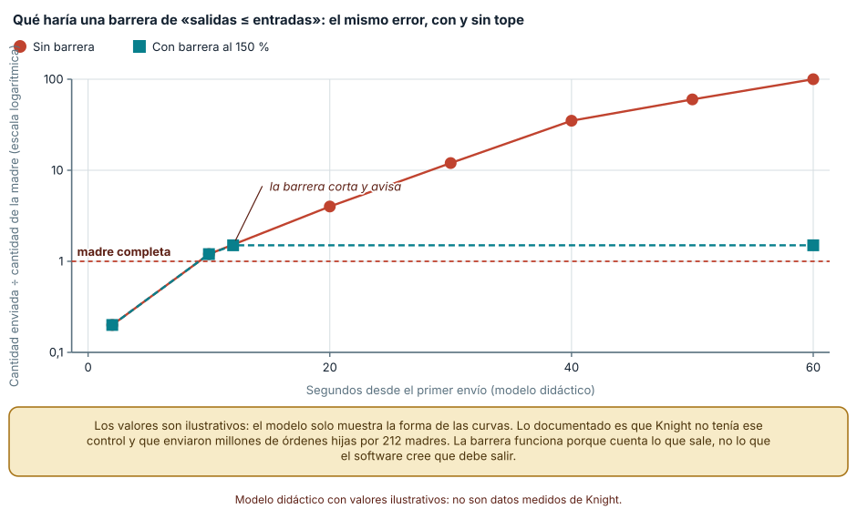

**Cómo leer la figura.** El eje horizontal son segundos; el vertical, la cantidad enviada dividida por la de la madre en escala logarítmica. La línea roja es el comportamiento sin barrera; la verde, con una barrera que corta a 1,5 veces la madre. Mira dónde se separan: en cuanto el router supera la cantidad de la madre. **Dónde deja de valer:** los valores son ilustrativos y no son datos medidos de Knight; es un modelo didáctico que solo muestra la forma de las curvas. La SEC no publica la cantidad de ninguna de las 212 órdenes.

Diseño de la barrera como ejercicio, con sus decisiones. (a) **Qué cuenta:** órdenes hijas enviadas por madre, medidas en la puerta, no por el software del router. (b) **Cuándo dispara:** al superar una tolerancia sobre la cantidad de la madre (la tolerancia absorbe reintentos legítimos) y, como segunda barrera, un ritmo máximo de salida por segundo. (c) **Qué hace:** rechaza las siguientes hijas de esa madre, y si el rechazo se repite en varias madres, corta toda la salida del servidor y avisa. (d) **Quién puede reabrir:** un rol con nombre. (e) **Cómo se prueba:** inyectando un router defectuoso en un entorno de ensayo; la barrera debe cortar antes que el defecto cause exposición apreciable.

## Vínculo con el curso

Cada enlace es una clase real; el texto dice qué mecanismo del caso ilustra.

| Concepto | Clase | Cómo lo ilustra el caso |
| --- | --- | --- |
| Reutilizar un indicador | [SE-403 · Feature flags y entrega progresiva](../../classes/part-33-build-release-y-cadena-de-suministro/se-403-feature-flags-y-entrega-progresiva/README.md) | Un flag con dos significados activó el código de 2003 en un servidor y el nuevo en siete |
| Despliegue escalonado con verificación | [SE-404 · Canary, blue-green y rollback](../../classes/part-33-build-release-y-cadena-de-suministro/se-404-canary-blue-green-y-rollback/README.md) | El despliegue por etapas del 27 de julio no verificó la versión de cada nodo |
| Camino a producción con rollback | [SE-420 · Proyecto: camino a producción con rollback](../../classes/part-34-ci-cd-iac-y-platform-engineering/se-420-proyecto-camino-a-produccion-con-rollback/README.md) | La reversión parcial del 1 de agosto empeoró el problema |
| Release firmado y recuperable | [SE-408 · Proyecto: release firmado y recuperable](../../classes/part-33-build-release-y-cadena-de-suministro/se-408-proyecto-release-firmado-y-recuperable/README.md) | Un artefacto único y verificable habría hecho visible el servidor sin actualizar |
| Código muerto y deuda | [SE-436 · Dependencias obsoletas y riesgo acumulado](../../classes/part-36-mantenimiento-y-modernizacion-legacy/se-436-dependencias-obsoletas-y-riesgo-acumulado/README.md) y [SE-441 · Retiro, archivado y disposición de sistemas](../../classes/part-36-mantenimiento-y-modernizacion-legacy/se-441-retiro-archivado-y-disposicion-de-sistemas/README.md) | Power Peg siguió llamable nueve años después de dejar de usarse |
| Pruebas de caracterización y seams | [SE-435 · Pruebas de caracterización y seams](../../classes/part-36-mantenimiento-y-modernizacion-legacy/se-435-pruebas-de-caracterizacion-y-seams/README.md) | El movimiento de 2005 sin retest rompió una función de parada sin que nadie lo supiera |
| Circuit breakers y degradación | [SE-379 · Circuit breakers, bulkheads y degradación](../../classes/part-31-calidad-rendimiento-y-resiliencia/se-379-circuit-breakers-bulkheads-y-degradacion/README.md) | Una parada automática en el router es un cortacircuitos de salida |
| Calidad por atributos medibles | [SE-373 · Modelos de calidad y atributos medibles](../../classes/part-31-calidad-rendimiento-y-resiliencia/se-373-modelos-de-calidad-y-atributos-medibles/README.md) | Un invariante como «salidas ≤ entradas» es un atributo comprobable |
| Quality gates | [SE-374 · Revisión, análisis estático y quality gates](../../classes/part-31-calidad-rendimiento-y-resiliencia/se-374-revision-analisis-estatico-y-quality-gates/README.md) | Los controles de cumplimiento como puertas, no como inventario |
| Políticas como gates | [SE-411 · Tests, seguridad y políticas como gates](../../classes/part-34-ci-cd-iac-y-platform-engineering/se-411-tests-seguridad-y-politicas-como-gates/README.md) | Un límite de capital que bloquea es una política ejecutable |
| Alertas accionables y fatiga | [SE-426 · Alertas accionables y fatiga](../../classes/part-35-observabilidad-sre-e-incidentes/se-426-alertas-accionables-y-fatiga/README.md) | 97 correos sin responsable son ruido, no alerta |
| Runbooks y escalamiento | [SE-427 · Runbooks, on-call y escalamiento](../../classes/part-35-observabilidad-sre-e-incidentes/se-427-runbooks-on-call-y-escalamiento/README.md) | No había guion de qué hacer cuando crecen las posiciones |
| Gestión de incidentes | [SE-428 · Gestión de incidentes y comunicación](../../classes/part-35-observabilidad-sre-e-incidentes/se-428-gestion-de-incidentes-y-comunicacion/README.md) | Sin roles ni regla de desconexión, la respuesta fue improvisada |
| Postmortems sin culpa | [SE-429 · Postmortems sin culpa y aprendizaje](../../classes/part-35-observabilidad-sre-e-incidentes/se-429-postmortems-sin-culpa-y-aprendizaje/README.md) | La SEC señala que el aprendizaje de 2011 fue estrecho |
| Continuidad y ejercicios | [SE-430 · Continuidad, disaster recovery y ejercicios](../../classes/part-35-observabilidad-sre-e-incidentes/se-430-continuidad-disaster-recovery-y-ejercicios/README.md) | La prueba de octubre de 2011 fue el ensayo que no se aprovechó |
| Gestión de riesgos y decisiones | [SE-450 · Gestión de riesgos y decisiones ejecutivas](../../classes/part-37-gestion-liderazgo-y-practica-profesional/se-450-gestion-de-riesgos-y-decisiones-ejecutivas/README.md) | El capital agregado como decisión de riesgo ejecutiva |
| Observabilidad útil | [SE-421 · Señales, eventos y observabilidad útil](../../classes/part-35-observabilidad-sre-e-incidentes/se-421-senales-eventos-y-observabilidad-util/README.md) | Las señales existían y nadie las convertía en información |
| Fitness functions | [SE-308 · Fitness functions y arquitectura evolutiva](../../classes/part-25-arquitectura-de-software-y-dominio/se-308-fitness-functions-y-arquitectura-evolutiva/README.md) | Una función de aptitud automática que compruebe que cada salida tiene entrada |

### Preguntas de discusión

1. Si el indicador reutilizado hubiera sido un campo nuevo, ¿habría ocurrido el incidente? ¿Qué otro mecanismo habría activado el código antiguo?
2. ¿En qué punto de la cadena corta más barato el riesgo: despliegue, código, router, capital o respuesta? Justifica con coste y probabilidad.
3. La SEC dice que un procedimiento de doble verificación habría evitado el evento. ¿Qué lo hace tan difícil de adoptar cuando nunca ha fallado?
4. ¿Por qué un control posterior (PMON) puede dar falsa seguridad? ¿Qué diferencia hay entre «ver» y «poder detener»?
5. ¿Qué cambia si el consejero delegado certifica «controles que cumplen» frente a «procesos»? ¿Qué evidencia debería respaldar la certificación?

### Mini-ejercicios

1. **Interruptor de parada.** Define en una página los umbrales (cantidad, ritmo, capital) de una puerta previa al mercado para un router ficticio, quién puede reabrirla y cómo se ensaya. Estima el coste de un falso positivo por hora frente al de un falso negativo.
2. **Inventario de indicadores.** Revisa un repositorio propio: lista los indicadores o flags y detecta los que tienen más de un significado o ya no se usan.
3. **Verificador de versión.** Escribe un guion que, dado un conjunto de servidores simulados, compare el hash del artefacto desplegado con el esperado y falle si alguno difiere.
4. **Alerta con dueño.** Elige tres mensajes automáticos de tu entorno que nadie lee y conviértelos en alertas con umbral, destino y guion, o bórralos.

## Qué no generalizar

**Aprender.**

1. Un sistema con versiones mezcladas en producción es un sistema distinto en cada nodo: verifica la versión desplegada, no la intención de desplegar.
2. El código que «ya no se usa» sigue siendo código. Si puede ejecutarse, debe probarse o borrarse.
3. Un indicador con dos significados es un riesgo de despliegue; crea uno nuevo.
4. Un control que solo mide después de ejecutar no limita el daño; debe haber uno que bloquee antes.
5. Un aviso que nadie recibe como alerta no es una alerta.
6. Una reversión parcial es un cambio nuevo y puede empeorar el sistema.

**No generalizar.**

- No es un argumento contra el trading automatizado ni contra el despliegue frecuente: la SEC lo describe como una falla de controles y gobierno en un sistema concreto.
- No prueba que todo código heredado sea peligroso; prueba que el heredado sin pruebas ni retiro explícito lo es.
- Los hechos son los que Knight aceptó en un acuerdo sin admitir ni negar; no son una sentencia judicial. La SEC califica la violación como «deliberada» en el sentido jurídico de que la persona sabe lo que hace, sin exigir conocer que infringe la norma; no equivale a intención de dañar (SEC, nota 12).
- Las cifras (45 minutos, 460 millones) son específicas de 2012 y de ese mercado.
- La estructura de un mercado regulado de acciones de EE. UU. no es la de cualquier sistema; el control de capital en línea tiene sentido donde hay capital en juego a la velocidad de las máquinas.

### Casos comparables y diferencias

| Caso | Parecido | Diferencia |
| --- | --- | --- |
| [CrowdStrike (2024)](crowdstrike.md) | Un cambio propio llega a muchos sistemas a la vez y no había barrera gradual | Allí la distribución fue global y simultánea; en Knight el defecto estaba en un solo servidor de ocho |
| [GitLab (2017)](gitlab-2017.md) | Copias de respaldo y procedimientos que no se habían ensayado; operación manual bajo estrés | El daño fue de datos, no de órdenes en el mercado; el coste fue reputacional y operativo |
| [Therac-25](therac-25.md) | Código antiguo reutilizado sin la verificación que lo protegía | Hardware y seguridad física; aquí el daño es financiero |
| Salida a bolsa de Facebook en Nasdaq (2012) | Fallos de sistemas de mercado el mismo año; la propia SEC cita pérdidas de participantes (UBS 356 millones; Knight y Citadel de 30 a 35 millones) | El fallo estaba en la bolsa, no en un intermediario; la fuente es la nota de pie de la regla Reg SCI, no un análisis propio |

**Reacción regulatoria posterior.** La SEC adoptó el 19 de noviembre de 2014 la Regulación SCI (sistemas, cumplimiento e integridad), aplicable a ciertas entidades como bolsas y otros sistemas, con políticas escritas de capacidad, integridad y seguridad de los sistemas, notificación a la SEC de ciertos eventos y aviso previo de cambios materiales. En los comentarios al borrador, algunos pidieron incluir a los operadores directos como Knight, citando el evento de agosto de 2012; la SEC dijo que no ampliaba entonces el alcance a otros broker-dealers (Regulación SCI, nota 1333 y nota 1332). La regla 15c3-5, en cambio, siguió siendo el instrumento aplicable a brókeres.

## Fuentes públicas verificadas

Todas consultadas el 16 de noviembre de 2026; las del sitio de la SEC se abrieron con herramienta de lectura web y se extrajo el texto de los PDF descargados.

1. U. S. Securities and Exchange Commission, *In the Matter of Knight Capital Americas LLC*, Exchange Act Release No. 70694, 16 de octubre de 2013. [https://www.sec.gov/files/litigation/admin/2013/34-70694.pdf](https://www.sec.gov/files/litigation/admin/2013/34-70694.pdf) (respalda todos los hechos marcados «SEC, párr. n», las notas 2, 5 a 8 y 12, la multa de 12 millones de dólares y los compromisos de consultor independiente).
2. Knight Capital Group, comunicado del 6 de agosto de 2012 (Formulario 8-K, anexo 99.1). [https://www.sec.gov/Archives/edgar/data/0001060749/000119312512338098/d392396dex991.htm](https://www.sec.gov/Archives/edgar/data/0001060749/000119312512338098/d392396dex991.htm) (respalda los 400 millones de financiación, los términos de las acciones preferentes, los inversores y el cargo del consejero delegado).
3. SEC, comunicado 2013-222, «SEC Charges Knight Capital With Violations of Market Access Rule», 16 de octubre de 2013. [https://www.sec.gov/newsroom/press-releases/2013-222](https://www.sec.gov/newsroom/press-releases/2013-222). Respalda: los 12 millones de dólares, el consultor independiente y el resumen de las deficiencias.
4. SEC, *Risk Management Controls for Brokers or Dealers with Market Access*, Release No. 34-63241. [https://www.sec.gov/files/rules/final/2010/34-63241.pdf](https://www.sec.gov/files/rules/final/2010/34-63241.pdf). Respalda: el contenido de la regla 15c3-5 que Knight incumplió.
5. SEC, Release No. 34-67347, aprobación del Retail Liquidity Program de la NYSE, 3 de julio de 2012. [https://www.sec.gov/files/rules/sro/nyse/2012/34-67347.pdf](https://www.sec.gov/files/rules/sro/nyse/2012/34-67347.pdf). Respalda: el programa piloto de un año cuyo inicio motivó los cambios de software.
6. SEC, *Regulation Systems Compliance and Integrity*, Release No. 34-73639, 19 de noviembre de 2014. [https://www.sec.gov/files/rules/final/2014/34-73639.pdf](https://www.sec.gov/files/rules/final/2014/34-73639.pdf). Respalda: la fecha de adopción, las notas 1332 y 1333 sobre el evento de Knight en los comentarios, que la SEC no amplió entonces el alcance a otros broker-dealers y las pérdidas citadas por el caso de Facebook en Nasdaq.

7. Knight Capital Group, Inc., Form 10-K del ejercicio terminado el 31 de diciembre de 2012, presentado el 1 de marzo de 2013. [https://www.sec.gov/Archives/edgar/data/1060749/000119312513087636/d449921d10k.htm](https://www.sec.gov/Archives/edgar/data/1060749/000119312513087636/d449921d10k.htm). Respalda: ingresos y gastos por segmento, plantilla de 1 524 empleados, sede y oficinas, descripción del negocio y la estrategia, competidores por categorías y la pérdida de 457,6 y 468,1 millones. Leído con la herramienta de lectura web porque la descarga directa de sec.gov se bloqueaba por límite de tasa.

---

[↑ Casos de fallo](README.md) · [HealthCare.gov →](healthcare-gov.md)
