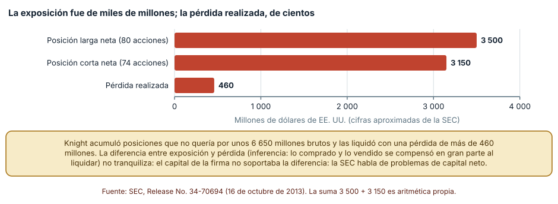
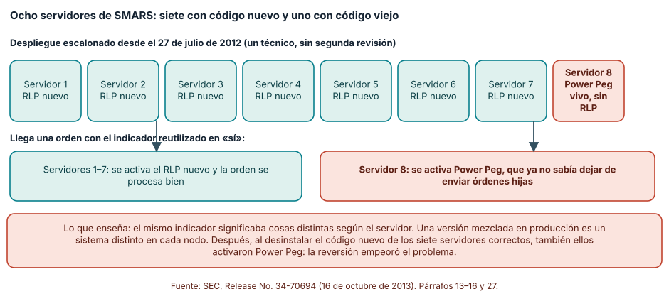
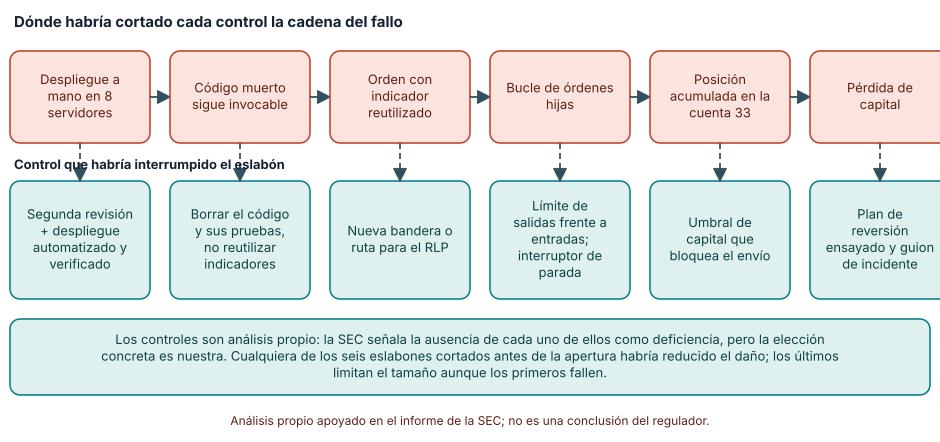

# Knight Capital

[↑ Casos de fallo](README.md) · [HealthCare.gov →](healthcare-gov.md)

> **Qué es esta página.** Un caso de estudio de fallo: la realidad frente a la teoría del curso. No es una clase ni un rol. Separa lo que las fuentes **documentan**, lo que este análisis **infiere** y lo que **no se sabe**. Habla de decisiones, procesos y sistemas, no de personas. Fecha de consulta de todas las fuentes: 16 de noviembre de 2026.

**Resumen.** El 1 de agosto de 2012, durante unos 45 minutos, el router de órdenes de Knight Capital envió millones de órdenes que nadie había pedido. La causa técnica directa fue un despliegue incompleto: el código nuevo no llegó a uno de ocho servidores, y en ese servidor un indicador reutilizado despertó código de 2003 que ya no sabía parar. La causa de fondo, según la SEC, fue la ausencia de controles de despliegue, de límites automáticos de capital, de controles sobre la salida del router y de procedimientos de incidente. La pérdida fue de más de 460 millones de dólares.

## Ficha histórica

| Dato | Detalle | Fuente |
| --- | --- | --- |
| Organización | Knight Capital Americas LLC, bróker-dealer de EE. UU., filial de Knight Capital Group, Inc. | SEC, párr. 11 |
| Sede | Jersey City, Nueva Jersey | SEC, párr. 11 |
| Responsable institucional en 2012 | Tom Joyce, presidente y consejero delegado de Knight Capital Group | Knight, comunicado del 6 de agosto de 2012 |
| Incidente | 1 de agosto de 2012, durante unos 45 minutos; el mercado abrió a las 9:30, hora de Nueva York | SEC, párr. 1, 19 |
| Daño | Más de 460 millones de dólares de pérdida realizada; 4 millones de ejecuciones, 154 acciones, más de 397 millones de acciones | SEC, párr. 1 |
| Sanción | 12 millones de dólares de multa civil y otras medidas; Knight aceptó el acuerdo sin admitir ni negar los hallazgos | SEC, orden, parte final de sanciones |
| Estado posterior | El 6 de agosto de 2012 anunció 400 millones de dólares de financiación de capital; el 1 de julio de 2013 se fusionó con GETCO para formar KCG Holdings | Comunicado de Knight; SEC, párr. 11 |

Las fuentes consultadas no nombran fundadores de la firma; este caso no los inventa. El caso trata de una organización de mercado con un peso grande: en 2011 y 2012 su negociación agregada, propia y de clientes, rondaba el 10 % de toda la de acciones cotizadas en EE. UU. (SEC, párr. 11).

## Contexto y problema

Un bróker-dealer con acceso directo a las bolsas es un guardián (*gatekeeper*) del mercado: lo que él envía llega a las bolsas con su identificador. Desde 2010 la regla 15c3-5 de la SEC («regla de acceso al mercado») exige a esos brókeres controles de riesgo que impidan órdenes erróneas y que superen umbrales de capital, y una revisión periódica con certificación del consejero delegado.

El objetivo del sistema en el centro de este caso, **SMARS**, era técnico y de negocio a la vez: recibir órdenes «madre» de otros componentes de la plataforma de Knight y, según la liquidez disponible, enviar una o varias órdenes «hijas» a centros de negociación externos hasta completar la madre (SEC, párr. 12). Era uno de los sistemas principales por los que Knight enviaba órdenes al mercado, y representaba cerca del 1 % o más de la negociación de acciones cotizadas en EE. UU. (SEC, párr. 10 y 11).

## Mercado, usuarios y casos de uso

- **Clientes de Knight:** otros brókeres y clientes institucionales cuyas órdenes llegaban a Knight. Las 212 órdenes que dispararon el incidente eran pequeñas órdenes minoristas recibidas de clientes (SEC, párr. 1).
- **Caso de uso del día:** el 1 de agosto de 2012 la NYSE iniciaba su Retail Liquidity Program (RLP), un programa para órdenes minoristas aprobado por la SEC con carácter piloto de 12 meses (nota 5 de la SEC). Knight modificó su software para que sus clientes pudieran participar.
- **Afectados externos:** el resto del mercado. En 75 de las acciones las ejecuciones de Knight fueron más del 20 % del volumen y contribuyeron a movimientos de precio superiores al 5 %; en 37 de ellas el precio se movió más del 10 % y Knight fue más del 50 % del volumen. Algunos participantes recibieron peores precios y otros mejores (SEC, párr. 18).

## Funcionalidad de principio a fin

1. Un cliente envía una orden a Knight. Antes de SMARS, la interfaz de cliente, el sistema interno de gestión de órdenes y el de ejecución interna tenían controles contra órdenes erróneas (SEC, párr. 20).
2. La orden madre pasa a SMARS. Este decide cuántas órdenes hijas enviar y a qué centros, según la liquidez disponible.
3. Cada vez que un centro ejecuta una hija, una función de **cantidad acumulada** cuenta cuánto de la madre ya se ha completado; al completarse, SMARS deja de enviar hijas (SEC, párr. 14).
4. Las ejecuciones que no se pueden casar con una orden madre quedan en una cuenta temporal, la «cuenta 33», con un límite bruto de 2 millones de dólares, no vinculado a ningún control automático de la exposición total de la firma (SEC, párr. 23).
5. El monitor de posiciones **PMON** muestra posiciones después de ejecutarse. Depende de que una persona lo mire, no emite alertas automáticas, no muestra los límites y se retrasa con alto volumen (SEC, párr. 25).

Dos detalles de diseño importan para entender el fallo: el criterio de parada de SMARS **no era un invariante del router**, sino una función dentro de un módulo concreto; y el único control de precio (un tope del 9,5 % respecto al mejor precio nacional en el momento de recibir la orden madre) no se aplicaba a las órdenes recibidas antes de la apertura para participar en la subasta de apertura (SEC, párr. 21).

## Negocio y economía

Knight era un intermediario cuyo negocio dependía de ejecutar muchas órdenes con márgenes pequeños; su capital era su capacidad de asumir riesgo. Una exposición no deseada de miles de millones consumió ese capital: la SEC habla de «problemas significativos de capital neto» (párr. 35). La pérdida de más de 460 millones de dólares y la necesidad de 400 millones de dólares de nueva financiación en cinco días muestran que, en este negocio, un fallo de software es un fallo de balance. La orden también registra consecuencias regulatorias colaterales: muchas de las órdenes eran ventas en corto no marcadas como tales y sin localizar el préstamo de los valores, lo que viola las reglas 200(g) y 203(b) de la Regulación SHO (SEC, párr. 35).

**Cómo leer la figura.** Cada barra es una cantidad en millones de dólares de EE. UU. con escala lineal desde cero. Mira primero la diferencia de longitud entre las dos posiciones brutas y la pérdida: el riesgo asumido por error fue de un orden de magnitud mayor que lo que finalmente costó. **Dónde deja de valer:** las posiciones son cifras aproximadas de la SEC en el momento más alto, no una serie temporal, y la figura no explica cómo se liquidaron ni a qué precios; la pérdida realizada no descompone qué parte fue de compras y qué parte de ventas.

## Arquitectura y esquemas

**Cómo leer la figura.** Cada caja es un componente; las flechas llenas son órdenes y la discontinua son ejecuciones que vuelven. Mira que PMON y la cuenta 33 están fuera de la ruta de salida: observan, no bloquean. **Dónde deja de valer:** es un esquema funcional construido con lo que la SEC describe; la orden no publica la arquitectura interna, ni el número de componentes entre SMARS y la bolsa.

**Cómo leer la figura.** Cada caja es un servidor; el verde tiene el código correcto y el rojo mantiene Power Peg. Mira que el mismo indicador activa funciones distintas según el servidor al que llegue la orden. **Dónde deja de valer:** que la orden llegue o no a un servidor concreto es un detalle del balanceo que la SEC no describe; basta saber que el octavo servidor recibió órdenes con el indicador reutilizado.

El flujo crítico es el siguiente. En 2003 Knight dejó de usar la función **Power Peg**, pero el código quedó presente y ejecutable. En 2005 se movió la función de cantidad acumulada a un punto anterior de la secuencia de código y no se volvió a probar Power Peg para ver si seguía funcionando si se llamaba (SEC, párr. 14). En 2012 el código nuevo del RLP debía sustituir al código inactivo y **reutilizó el indicador** que antes activaba Power Peg; la intención era borrar Power Peg (párr. 13).

**Cómo leer la figura.** El camino superior es el flujo normal con la parada correcta; el camino rojo discontinuo es el bucle. Mira el recuadro dorado: la causa que la SEC documenta del bucle es el cambio de lugar de la cuenta acumulada. **Dónde deja de valer:** el esquema simplifica; la SEC dice que otra parte del sistema reconocía que las madres estaban completas pero no se lo comunicó a SMARS (párr. 16), y no detalla el mecanismo interno del bucle más allá de eso.

## Casos especiales y cómo fallan

Los bordes del sistema explican por qué el daño fue tan grande y por qué fue también un problema regulatorio, no solo técnico.

- **Órdenes de preapertura.** El único control de precio que existía (un tope del 9,5 % respecto al mejor precio nacional en el momento de recibir la orden madre) no se aplicaba a las órdenes recibidas antes de la apertura para participar en la subasta de apertura, que es justo el tipo de las 212 órdenes (SEC, párr. 21). Un control que deja fuera el caso límite más frecuente de la mañana no protege el momento de mayor riesgo.
- **Pico de volumen y monitoreo.** PMON, el monitor de posiciones, sufrió retrasos con el alto volumen del evento y produjo informes inexactos; además la cuenta 33 mezclaba posiciones de varios orígenes y el personal no pudo determinar rápido de dónde venían (SEC, párr. 24 y 25).
- **Regulación.** Muchas órdenes eran ventas en corto no marcadas como tales y sin localizar el préstamo de los valores (reglas 200(g) y 203(b) de la Regulación SHO), y la firma tuvo problemas de capital neto (SEC, párr. 35). El error técnico se convirtió en varias infracciones a la vez.
- **Reversión.** Desinstalar el código nuevo de los siete servidores correctos activó Power Peg también en ellos y empeoró el problema (SEC, párr. 27): el caso límite de «volver atrás» no estaba pensado ni ensayado.
- **Recuperación del negocio.** Cinco días después Knight anunció 400 millones de dólares de financiación (comunicado del 6 de agosto de 2012). En la sanción, la SEC consideró las medidas correctivas de Knight y su cooperación, y exigió contratar un consultor independiente para revisar el ciclo de desarrollo de software, el despliegue, los enrutadores de órdenes, los umbrales de capital vinculados a la entrada de órdenes y los protocolos de incidentes (SEC, párr. 50 y 51).

## Línea de tiempo

| Fecha y hora (hora de Nueva York) | Hecho documentado |
| --- | --- |
| 2003 | Knight deja de usar Power Peg |
| 2005 | Se mueve la función de cantidad acumulada; Power Peg no se vuelve a probar |
| 14 de julio de 2011 | Fecha en que, según la SEC, los controles de Knight dejaron de estar razonablemente diseñados; es el inicio del periodo de la violación (párr. 9) |
| Octubre de 2011 | Una prueba de recuperación ante desastres con datos de prueba termina en una pérdida de unos 7,5 millones de dólares el lunes siguiente (párr. 33) |
| 27 de julio de 2012 | Empieza el despliegue escalonado del RLP, servidor a servidor |
| 1 de agosto de 2012, 8:01 | Empiezan a enviarse correos automáticos «Power Peg disabled»; antes de las 9:30 son 97 (párr. 19) |
| 1 de agosto, 9:30 | Abre el mercado; la SEC sitúa el episodio de ≈ 45 min en esa mañana y dice que la cuenta 33 empezó a acumular posiciones al abrir (párr. 24, 25) |
| 1 de agosto, durante ≈ 45 min | 4 millones de ejecuciones; al intentar arreglarlo, Knight desinstala el código nuevo de los siete servidores correctos y empeora el problema (párr. 27) |
| 6 de agosto de 2012 | Anuncio de 400 millones de dólares de capital |
| 1 de julio de 2013 | Fusión con GETCO para formar KCG Holdings |
| 16 de octubre de 2013 | Orden de la SEC y multa de 12 millones de dólares |

**Cómo leer la figura.** El eje horizontal son minutos desde las 8:00; la línea discontinua es la apertura. Cada fila es un hilo: los correos, las ejecuciones y los intentos de contención. Mira cuánto antes de la apertura estaban los correos, y que su aviso ya describía el problema. **Dónde deja de valer:** la hora exacta de parada no consta en la orden y el segmento de contención es solo indicativo: la SEC no da horas para cada acción de los técnicos.

## Qué falló en cada instancia

Instancia por instancia, qué se esperaba y qué ocurrió, según las fuentes.

- **Despliegue.** Un técnico no copió el código nuevo a un servidor; no hubo segunda revisión; no había procedimientos escritos de despliegue para SMARS ni protocolo para el código no utilizado en producción (párr. 15 y 26).
- **Código muerto.** Power Peg siguió «presente y llamable» desde 2003 sin pruebas desde 2005 (párr. 13 y 14).
- **Alertas.** 97 correos automáticos describían el error antes de la apertura; no estaban diseñados como alertas y nadie los revisó (párr. 19).
- **Controles de salida.** Sin control que comparase las órdenes que salían de SMARS con las que entraban, sin parada ante actividad anómala, y con un tope de precio que no se aplicaba a órdenes de preapertura (párr. 21).
- **Capital.** Sin umbrales de capital agregados vinculados a controles automáticos de entrada de órdenes; la cuenta 33 no estaba vinculada a nada; PMON dependía de una persona (párr. 22 a 25).
- **Incidente.** Sin procedimientos de respuesta; la reversión empeoró el problema (párr. 27).
- **Gobierno.** Revisión inicial de cumplimiento centrada en inventariar controles, no en riesgos de SMARS; descripción escrita incompleta durante casi un año; certificación del consejero delegado de 2012 sin afirmar el cumplimiento, un error de redacción no intencionado según la SEC (párr. 28 a 34).

## Causa raíz y factores

**Detonante (documentado).** Un despliegue incompleto del código del Retail Liquidity Program dejó un servidor con Power Peg, y el indicador reutilizado lo activó con órdenes reales (SEC, párr. 13 a 16).

**Condiciones latentes (documentado).** Código sin uso desde 2003 que seguía siendo ejecutable y no se había vuelto a probar tras moverse la función de cantidad acumulada en 2005; ausencia de procedimientos escritos de despliegue y de segunda revisión; sin control sobre la salida de SMARS ni parada automática; sin umbrales de capital agregados vinculados al envío de órdenes; monitoreo que dependía de una persona; sin procedimientos de respuesta a incidentes; una revisión de cumplimiento centrada en inventariar controles y no en los riesgos del router (SEC, párr. 21 a 32).

**Factores de contexto (documentado).** Una fecha externa fija, el inicio del programa de la NYSE el 1 de agosto de 2012, con cambios de software preparados para esa fecha; un episodio previo (octubre de 2011) que ya había mostrado el mismo patrón de estado heredado sin revisión de conjunto (SEC, párr. 12 y 33).

**Inferido (análisis propio):**

- El patrón del 2011 (la prueba de recuperación) y el de 2012 son del mismo tipo: un componente conserva un estado heredado y nadie comprueba el conjunto de extremo a extremo. La SEC lo apunta cuando dice que Knight no consideró ampliamente si tenía controles suficientes frente a órdenes erróneas, sea cual fuese el sistema (párr. 33).
- Con un único criterio de parada fuera del router, el sistema no podía limitarse a sí mismo; aquí «inferir» significa que ese diseño es consistente con lo que describe la SEC, no que lo describa en esos términos.

**No se sabe (por las fuentes públicas):** qué hizo cada persona minuto a minuto; qué ruta exacta tomó cada orden; cuánto de la pérdida fue por compras y cuánto por ventas; por qué la parada de otros mecanismos no funcionó en ese servidor.

## Mejoras que debieron hacerse

La SEC señala la ausencia de controles; la elección concreta de cuáles y cómo implementarlos es análisis nuestro.

**Cómo leer la figura.** La fila superior es la cadena causal documentada y la inferior el control que corta cada eslabón; las flechas discontinuas dicen dónde actúa. Mira que los dos últimos eslabones se pueden proteger aunque los primeros fallen. **Dónde deja de valer:** son propuestas educativas, no prescripciones; cada una tiene costo y falsos positivos, y los límites de capital deben calibrarse a la operación.

| Eslabón | Mejora propuesta | Qué enseña el curso |
| --- | --- | --- |
| Despliegue manual en 8 servidores | Despliegue automatizado con verificación de versión en cada nodo y revisión de segunda persona | SE-404, SE-408, SE-420 |
| Código muerto invocable | Eliminar el código no usado y sus rutas; no reutilizar indicadores con otro significado; si hace falta, flag nuevo | SE-403, SE-436, SE-441 |
| Cambio sin pruebas en 2005 | Pruebas de caracterización antes de tocar código heredado | SE-435, SE-433 |
| Bucle de órdenes | Invariante de parada en el router y límite de salidas frente a entradas | SE-379, SE-374 |
| Capital | Umbrales agregados vinculados al envío (control previo, no mirada posterior) | SE-411, SE-450 |
| Alerta | Convertir el correo en una alerta accionable con responsable | SE-426, SE-427 |
| Incidente | Guion con interruptor de parada («kill switch») y regla de no revertir parcialmente sin comprobar | SE-428, SE-429, SE-430 |

Hay una enseñanza adicional: Knight tenía controles, pero estaban en la entrada y en el monitoreo posterior. Un control sólo protege si está **donde puede detener el daño**. La mejora más barata y más general es un interruptor automático en el último punto antes del mercado, independiente del código del router.

## Vínculo con el curso

- [SE-403 · Feature flags y entrega progresiva](../../classes/part-33-build-release-y-cadena-de-suministro/se-403-feature-flags-y-entrega-progresiva/README.md) (por qué reutilizar un indicador es una deuda peligrosa).
- [SE-404 · Canary, blue-green y rollback](../../classes/part-33-build-release-y-cadena-de-suministro/se-404-canary-blue-green-y-rollback/README.md) (despliegue escalonado con verificación).
- [SE-420 · Camino a producción con rollback](../../classes/part-34-ci-cd-iac-y-platform-engineering/se-420-proyecto-camino-a-produccion-con-rollback/README.md).
- [SE-436 · Dependencias obsoletas y riesgo acumulado](../../classes/part-36-mantenimiento-y-modernizacion-legacy/se-436-dependencias-obsoletas-y-riesgo-acumulado/README.md) y [SE-441 · Retiro, archivado y disposición de sistemas](../../classes/part-36-mantenimiento-y-modernizacion-legacy/se-441-retiro-archivado-y-disposicion-de-sistemas/README.md).
- [SE-435 · Pruebas de caracterización y seams](../../classes/part-36-mantenimiento-y-modernizacion-legacy/se-435-pruebas-de-caracterizacion-y-seams/README.md).
- [SE-379 · Circuit breakers, bulkheads y degradación](../../classes/part-31-calidad-rendimiento-y-resiliencia/se-379-circuit-breakers-bulkheads-y-degradacion/README.md).
- [SE-426 · Alertas accionables y fatiga](../../classes/part-35-observabilidad-sre-e-incidentes/se-426-alertas-accionables-y-fatiga/README.md), [SE-428 · Gestión de incidentes y comunicación](../../classes/part-35-observabilidad-sre-e-incidentes/se-428-gestion-de-incidentes-y-comunicacion/README.md) y [SE-429 · Postmortems sin culpa](../../classes/part-35-observabilidad-sre-e-incidentes/se-429-postmortems-sin-culpa-y-aprendizaje/README.md).

## Qué no generalizar

**Aprender.**

1. Un sistema con versiones mezcladas en producción es un sistema distinto en cada nodo: verifica la versión desplegada, no la intención de desplegar.
2. El código que «ya no se usa» sigue siendo código. Si puede ejecutarse, debe probarse o borrarse.
3. Un indicador con dos significados es un riesgo de despliegue; crea uno nuevo.
4. Un control que solo mide después de ejecutar no limita el daño; debe haber uno que bloquee antes.
5. Un aviso que nadie recibe como alerta no es una alerta.
6. Una reversión parcial es un cambio nuevo y puede empeorar el sistema.

**No generalizar.**

- No es un argumento contra el trading automatizado ni contra el despliegue frecuente: la SEC lo describe como una falla de controles y gobierno en un sistema concreto.
- No prueba que todo código heredado sea peligroso; prueba que el heredado sin pruebas ni retiro explícito lo es.
- Los hechos son los que Knight aceptó en un acuerdo sin admitir ni negar; no son una sentencia judicial.
- Las cifras (45 minutos, 460 millones) son específicas de 2012 y de ese mercado.

## Fuentes públicas verificadas

Todas consultadas el 16 de noviembre de 2026 y comprobadas con descarga directa (HTTP 200).

1. U. S. Securities and Exchange Commission, *In the Matter of Knight Capital Americas LLC*, Exchange Act Release No. 70694, 16 de octubre de 2013. [https://www.sec.gov/files/litigation/admin/2013/34-70694.pdf](https://www.sec.gov/files/litigation/admin/2013/34-70694.pdf) (respalda todos los hechos marcados «SEC, párr. n» y la multa de 12 millones de dólares).
2. Knight Capital Group, comunicado del 6 de agosto de 2012 (Formulario 8-K, anexo 99.1). [https://www.sec.gov/Archives/edgar/data/0001060749/000119312512338098/d392396dex991.htm](https://www.sec.gov/Archives/edgar/data/0001060749/000119312512338098/d392396dex991.htm) (respalda los 400 millones de financiación y el cargo del consejero delegado).
3. SEC, comunicado 2013-222, «SEC Charges Knight Capital With Violations of Market Access Rule», 16 de octubre de 2013. [https://www.sec.gov/newsroom/press-releases/2013-222](https://www.sec.gov/newsroom/press-releases/2013-222). Respalda: los 12 millones de dólares y que el acuerdo cierra cargos por la regla de acceso al mercado.
4. SEC, *Risk Management Controls for Brokers or Dealers with Market Access*, Release No. 34-63241. [https://www.sec.gov/files/rules/final/2010/34-63241.pdf](https://www.sec.gov/files/rules/final/2010/34-63241.pdf). Respalda: el contenido de la regla 15c3-5 que Knight incumplió.
5. SEC, Release No. 34-67347, aprobación del Retail Liquidity Program de la NYSE, 3 de julio de 2012. [https://www.sec.gov/files/rules/sro/nyse/2012/34-67347.pdf](https://www.sec.gov/files/rules/sro/nyse/2012/34-67347.pdf). Respalda: el programa piloto de un año cuyo inicio motivó los cambios de software.

---

[↑ Casos de fallo](README.md) · [HealthCare.gov →](healthcare-gov.md)
