# Caída global de Meta

[↑ Casos de fallo](README.md) · [← TSB Bank](tsb.md) · [CrowdStrike →](crowdstrike.md)

> **Qué es esta página.** Un caso de estudio de fallo: la realidad frente a la teoría del curso. No es una clase ni un rol. Separa lo que las fuentes **documentan**, lo que este análisis **infiere** y lo que **no se sabe**. Habla de decisiones, procesos y sistemas, no de personas. Fecha de consulta de todas las fuentes: 16 de noviembre de 2026.

**Cómo leer esta página.** Cada afirmación factual lleva su fuente entre paréntesis: «Meta Engineering» (las dos publicaciones del 4 y el 5 de octubre de 2021), «Cloudflare» (publicación del 4 de octubre), «Google Cloud» (informe del incidente 19009 de 2019, usado solo como comparable), «Form 10-Q» y «comunicado de resultados». Lo que no lleva fuente es análisis propio y está rotulado. Las figuras son dibujos propios, ninguna repite una tabla y todas dicen dónde dejan de valer. El caso se recorre en siete niveles de zoom de la arquitectura, con dos escalas de tiempo y un análisis causal que separa lo documentado, lo inferido y lo que no se sabe., Facebook, Instagram, WhatsApp y Messenger quedaron inaccesibles durante unas seis horas. Según la propia empresa, durante un trabajo rutinario de mantenimiento un comando destinado a evaluar la capacidad de la red troncal desconectó por error todas las conexiones entre sus centros de datos, y una herramienta de auditoría con un error no lo detuvo. Después, los servidores DNS de la compañía, al no poder hablar con los centros de datos, retiraron sus propios anuncios de rutas y dejaron de ser alcanzables desde internet. Recuperarlo exigió acceso físico a las instalaciones. Es un caso de **acoplamiento entre planos**: la red que llevaba los datos de los usuarios era también la que llevaba el control (DNS y rutas) y la que llevaba la gestión (herramientas y acceso de emergencia), de modo que al caer el camino común cayó la capacidad de repararlo. Meta publicó un análisis detallado al día siguiente; este caso lo lee junto con la vista externa de Cloudflare y con un comparable de Google de 2019.

## Ficha histórica

| Dato | Detalle | Fuente |
| --- | --- | --- |
| Organización | Facebook, Inc., hoy Meta (el sitio de ingeniería se llama «Engineering at Meta»); sede en 1601 Willow Road, Menlo Park, California | Form 10-Q de 2021 |
| Responsable institucional | Mark Zuckerberg, «founder, Chairman, and CEO»; el artículo técnico lo firma Santosh Janardhan | Form 10-Q de 2021; Meta Engineering |
| Fecha | 4 de octubre de 2021; primeros cambios de rutas hacia las 15:40 UTC | Cloudflare |
| Duración | «Aproximadamente seis horas»; Facebook vuelve a estar conectado a internet hacia las 21:28 UTC | Form 10-Q; Cloudflare |
| Servicios afectados | Facebook, Instagram, WhatsApp y servicios afiliados | Cloudflare; Meta Engineering |
| Causa declarada | Una combinación de un error y un fallo (bug) | Form 10-Q de 2021 |
| Datos de usuarios | La empresa afirma que no hubo actividad maliciosa ni evidencia de que los datos de usuarios se vieran comprometidos | Meta Engineering (4 oct 2021) |
| Estado posterior | Meta publicó un análisis y anunció revisar sus procesos y ensayos; no se cuantifica en las fuentes consultadas el costo directo del incidente | Meta Engineering (5 oct 2021) |

### Sedes, centros de datos y oficinas

El 10-Q da una sola sede: 1601 Willow Road, Menlo Park, California; la empresa está constituida en Delaware (Form 10-Q de 2021). Meta Engineering describe dos tipos de instalaciones de la red: centros de datos masivos con millones de máquinas, y otras más pequeñas que conectan la red troncal con internet y con los usuarios (Meta Engineering, 5 de octubre de 2021). Las notas del 10-Q dicen que la construcción en curso incluye centros de datos, equipos de red y edificios de oficinas, sin desglose por país. **No se sabe:** el número y la ubicación de los centros de datos y de las instalaciones de borde, las oficinas por país y la plantilla (el texto del 10-Q consultado no la declara).

### Organización y responsabilidades

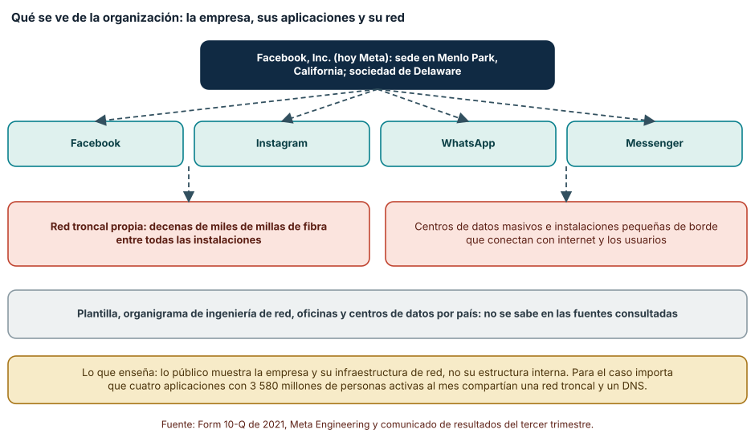

**Cómo leer la figura.** Arriba, la empresa; en medio, las aplicaciones afectadas; abajo, la infraestructura de red que todas compartían. La caja gris dice lo que no es público. **Dónde deja de valer:** no es un organigrama; las fuentes consultadas no lo publican.

Lo público identifica el papel del fundador, presidente y director ejecutivo (Form 10-Q) y el de quien firma la publicación técnica del 5 de octubre, sin ningún dato sobre quién respondía de cada sistema. El análisis se hace sobre sistemas y decisiones, no sobre personas.

### Visión y misión

Este caso no cita una declaración de visión o misión: el 10-Q consultado no la contiene en la parte leída y no se pudo verificar una versión consultable el 16 de noviembre de 2026. No se inventa una cita. Lo documentado de la intención de diseño es la de Meta sobre su red: que cualquier aplicación del usuario llegue a la instalación más cercana y esta se comunique por la red troncal con un centro de datos (Meta Engineering).

## Contexto y problema

Facebook opera una red global propia: una **red troncal** (*backbone*) de decenas de miles de millas de fibra que conecta todas sus instalaciones, de dos tipos: centros de datos enormes, donde se almacenan los datos y se hace el cómputo pesado, e instalaciones pequeñas que conectan la red troncal con el resto de internet y con los usuarios (Meta Engineering). El objetivo del sistema es que cualquier aplicación del usuario llegue al borde más cercano y que este hable por la red troncal con el centro de datos que corresponda.

Dos servicios de infraestructura son el centro de este caso. **DNS** traduce nombres como un nombre de sitio en direcciones IP; las consultas las responden los servidores autoritativos de la empresa, alojados en las instalaciones de borde. **BGP** (border gateway protocol) es el protocolo con el que cada red le dice al resto de internet qué direcciones puede alcanzar; si una red deja de anunciar un prefijo, ese prefijo deja de ser alcanzable (Cloudflare).

### El problema que resuelve una red troncal propia (documentado)

Meta describe una red troncal propia, de decenas de miles de millas de fibra, que une todas sus instalaciones: unas son centros de datos enormes con millones de máquinas, donde se almacenan los datos y se hace el cómputo pesado; otras son instalaciones más pequeñas que conectan la red troncal con el resto de internet y con los usuarios. Cuando alguien abre una aplicación, la petición va desde su dispositivo a la instalación más cercana y esta se comunica directamente, por la red troncal, con un centro de datos grande (Meta Engineering, 5 de octubre de 2021). Tener una red propia da control de rendimiento y de costos a esa escala, y esa misma propiedad es la que concentra el riesgo: todo pasa por la misma red.

### Qué hace el mantenimiento y por qué es una operación peligrosa (documentado y análisis)

Los ingenieros sacan a menudo partes de la red troncal para reparar fibra, añadir capacidad o actualizar el software de los routers (Meta Engineering). Mantener una red de ese tamaño exige hacerlo constantemente y con automatización; el análisis propio es que cuanto más frecuente es una operación, más importante es que su peor caso esté acotado por diseño y no por la prudencia de quien la ejecuta. En 2019 Google describió un incidente con una estructura parecida (un evento de mantenimiento que, por un error del software que lo orquestaba, afectó a clústeres de varias ubicaciones a la vez), lo que sugiere que el riesgo es propio del oficio y no de una empresa (Google Cloud).

## Mercado, usuarios y casos de uso

- **Usuarios:** al 30 de septiembre de 2021, 2 910 millones de usuarios activos mensuales de Facebook y 3 580 millones de personas activas mensuales en la familia de aplicaciones (comunicado de resultados del tercer trimestre).
- **Casos de uso:** redes sociales, mensajería y publicaciones en Facebook, Instagram y WhatsApp (los servicios que Cloudflare confirma caídos). Las fuentes consultadas no detallan usos ni cifras por caso de uso.
- **Efecto sobre terceros de internet:** Cloudflare observó que los resolvedores DNS públicos como 1.1.1.1 y 8.8.8.8 empezaron a devolver y almacenar respuestas de error (SERVFAIL), y que las aplicaciones y los usuarios reintentaron de forma agresiva; Cloudflare cifra en unas 30 veces las consultas que gestionaban los resolvedores del mundo respecto de lo habitual (Cloudflare).

**Cómo leer la figura.** Cada barra son miles de millones de personas en septiembre de 2021 con escala desde cero. Mira que la familia de aplicaciones sumaba más personas que la propia Facebook y que las diarias eran casi tantas como los mensuales de Facebook. **Dónde deja de valer:** son cifras de uso de la empresa de un mes concreto y las personas activas pueden contar la misma persona en varias aplicaciones sin duplicados internos, pero no es el número de personas afectadas en el apagón, que Meta no publicó.

### Quién se vio afectado y cómo

| Grupo | Efecto documentado | Fuente |
| --- | --- | --- |
| Usuarios de Facebook, Instagram y WhatsApp | Los nombres dejaron de resolverse y las infraestructuras dejaron de ser alcanzables | Cloudflare |
| Equipos de Meta | Las herramientas internas y los sistemas de uso diario se vieron afectados, lo que complicó el diagnóstico | Meta Engineering (4 de octubre de 2021) |
| Resolvedores DNS y otros servicios de internet | Aumento de unas 30 veces en las consultas por los reintentos | Cloudflare |
| Empresas y personas que dependían de los servicios | Meta pide disculpas a «las personas y negocios del mundo que dependen de nosotros»; no se cuantifica el efecto | Meta Engineering (4 de octubre de 2021) |

La publicación del 4 de octubre dice que el problema de la red troncal también afectó a muchas herramientas y sistemas internos que se usan a diario, lo que complicó los intentos de diagnóstico y resolución. Es el rasgo que el análisis del día siguiente desarrolla.

## Funcionalidad de principio a fin

1. La aplicación del usuario necesita una dirección: pregunta a un **resolvedor DNS** (el de su operador o uno público).
2. El resolvedor pregunta a los servidores DNS autoritativos de la empresa. Esos servidores están en instalaciones pequeñas y tienen direcciones conocidas, que se anuncian al resto de internet con **BGP**.
3. Con la dirección, la petición llega al borde más cercano, que habla por la red troncal con un centro de datos grande donde se recuperan y procesan los datos.
4. **Regla de salud del DNS:** los servidores DNS retiran sus anuncios BGP si ellos mismos no pueden hablar con los centros de datos, porque se interpreta como una conexión de red enferma. Es una decisión de diseño para no enviar a los usuarios a un sitio roto (Meta Engineering).
5. **Mantenimiento:** los ingenieros sacan a menudo partes de la red troncal para reparar fibra, añadir capacidad o actualizar el software de los routers. Los comandos pasan por una herramienta de **auditoría** que debe detener los que sean peligrosos (Meta Engineering).

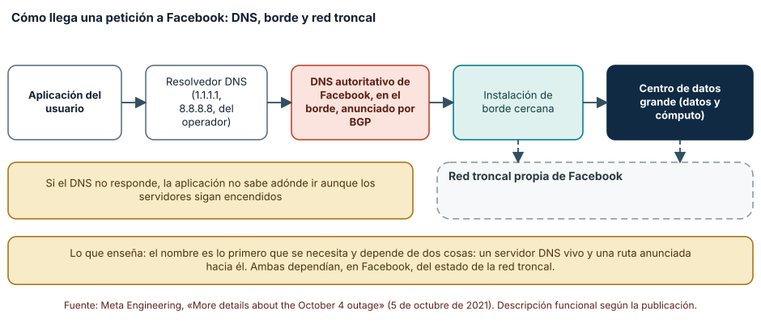

**Cómo leer la figura.** El camino de izquierda a derecha es el de una petición; la franja gris es la red troncal que une el borde con el centro de datos. Mira la caja roja: el DNS vive en el borde, pero su salud depende de ver el centro de datos. **Dónde deja de valer:** es una simplificación de la descripción de Meta; no incluye cachés, redes de entrega de contenido ni la topología detallada de las instalaciones.

### La operación de mantenimiento: de la intención al comando

1. Una persona decide hacer una tarea rutinaria de mantenimiento en la red troncal (Meta Engineering).
2. Emite un comando cuya intención era evaluar la disponibilidad de capacidad de la red troncal global (Meta Engineering).
3. El sistema está diseñado para auditar comandos como ese y evitar errores así (Meta Engineering).
4. En este caso, un error de la herramienta de auditoría impidió que se detuviera el comando, y el comando desconectó sin querer todas las conexiones de la red troncal, aislando los centros de datos de Meta en el mundo (Meta Engineering).

### El primer relato y el segundo

El 4 de octubre, Meta atribuyó el problema a «cambios de configuración en los routers de la red troncal» que coordinan el tráfico entre centros de datos, y afirmó que no hubo actividad maliciosa ni evidencia de datos comprometidos. El 5 de octubre precisó que el desencadenante fue un comando emitido durante un mantenimiento rutinario y que la herramienta de auditoría tenía un error. Es un ejemplo útil de cómo se refina una explicación de un incidente: la primera versión describe el efecto (cambios de configuración en los routers), la segunda, el mecanismo (el comando y la falta de contención).

### BGP y DNS explicados con un ejemplo

Cloudflare explica con sencillez la mecánica que hizo inalcanzable a Facebook. Internet es una red de redes y cada una anuncia por BGP los prefijos de direcciones que puede alcanzar; cuando una red cambia su anuncio o retira un prefijo, las demás actualizan sus tablas y, si existe, buscan una ruta alternativa; si no existe ninguna, el prefijo deja de ser alcanzable (Cloudflare). Aplicado al caso: los servidores DNS de Facebook tienen direcciones fijas que se anuncian de esta manera; al retirarse los anuncios, ningún resolvedor del mundo sabía por dónde llegar a ellos, de modo que la pregunta «¿cuál es la dirección de facebook.com?» no tenía quién la respondiera, y los resolvedores devolvían un error de tipo SERVFAIL. Dicho de otro modo: el servicio no estaba caído por falta de servidores, sino por falta de camino para llegar a ellos. Es una diferencia que importa para el diagnóstico: las máquinas podían estar sanas y el servicio, ausente.

## Negocio y economía

Meta obtiene casi todo su ingreso de la publicidad: en el tercer trimestre de 2021 los ingresos totales fueron 29 010 millones de dólares, de los cuales 28 276 millones (97,5 %) fueron publicidad (comunicado de resultados). Como orden de magnitud **ilustrativo**, 29 010 millones repartidos de forma uniforme entre las 2 208 horas del trimestre (92 días) dan unos 13,1 millones de dólares por hora, o unos 79 millones en seis horas. No es una pérdida medida: Meta no publicó el ingreso perdido y las fuentes consultadas no lo cuantifican. Lo que sí está documentado es que la empresa declaró el apagón como factor de riesgo y lo describió como de unas seis horas en su informe trimestral.

Hay además un coste no financiero: el 4 de octubre muchas empresas y personas dependían de estos servicios para comunicarse o vender. Las fuentes consultadas no lo miden.

### Impacto en cifras, con fuente

| Dimensión | Cifra | Fuente |
| --- | --- | --- |
| Duración | Aproximadamente seis horas; de ≈ 15:40 UTC (cambios de rutas) a ≈ 21:28 UTC (Facebook reconectado a internet) | Form 10-Q; Cloudflare |
| Disponibilidad del nombre en 1.1.1.1 | Dejó de resolverse hacia las 15:50 UTC y volvió hacia las 21:20 UTC | Cloudflare |
| Usuarios | 2 910 millones de usuarios activos mensuales de Facebook; 3 580 millones de personas activas mensuales en la familia de aplicaciones | Comunicado de resultados, tercer trimestre de 2021 |
| Ingresos del trimestre | 29 010 millones de dólares, 28 276 de publicidad | Comunicado de resultados |
| Carga sobre terceros | Unas 30 veces las consultas habituales en resolvedores | Cloudflare |
| Ingreso perdido | No publicado | — |
| Datos de usuarios | Sin evidencia de que se vieran comprometidos | Meta Engineering (4 de octubre de 2021) |

El ingreso por hora que se calcula en el párrafo anterior es una media aritmética sobre el trimestre, no una medición; los ingresos publicitarios dependen de la hora, del día y del tipo de anunciante, y Meta no publicó la pérdida.

### Reacción de la organización

- **Comunicación.** Meta pidió disculpas el mismo día, aclaró que no hubo actividad maliciosa y publicó el análisis técnico al día siguiente (Meta Engineering).
- **Aprendizaje anunciado.** Meta dice que tras cada incidente, grande o pequeño, hace una revisión extensa para hacer sus sistemas más resilientes, que el proceso ya estaba en marcha, y que su trabajo es reforzar las pruebas, los ejercicios y la resiliencia (Meta Engineering, 5 de octubre de 2021). No publica una lista de cambios.
- **Reguladores.** Las fuentes consultadas no documentan una reacción regulatoria específica; este caso no la inventa. El 10-Q del 25 de octubre describe el apagón como de unas seis horas y lo trata como factor de riesgo (Form 10-Q).

### Esquema del negocio: actores, valor y flujos

Los usuarios acceden gratis a las aplicaciones y la empresa se financia con publicidad: 28 276 de los 29 010 millones de ingresos del tercer trimestre de 2021 (comunicado de resultados). El flujo económico es de anunciantes a la empresa; el flujo de servicio, del dispositivo del usuario al borde y por la red troncal al centro de datos. Una interrupción detiene los dos: sin servicio no hay anuncios que mostrar. El valor de la red troncal propia es el rendimiento y el control; su coste es que todo pasa por ella.

### Costos operativos y costo del incidente

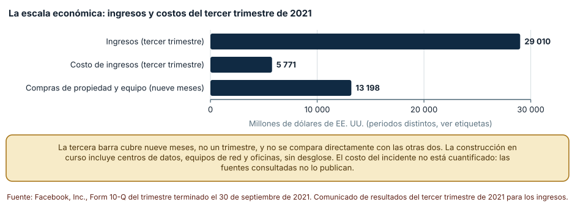

**Cómo leer la figura.** Cada barra es una partida en millones de dólares; la tercera cubre nueve meses, no un trimestre. Mira la escala: las compras de equipo en nueve meses superan al costo de ingresos del trimestre. **Dónde deja de valer:** no es el costo del incidente; no se compara una partida de nueve meses con una de tres.

Documentado en el 10-Q: costo de ingresos de 5 771 millones en el tercer trimestre y de 16 301 en nueve meses; compras de propiedad y equipo de 13 198 millones en nueve meses; construcción en curso con centros de datos, equipos de red y oficinas. **No se sabe:** el costo del incidente (ingreso perdido, recuperación, compensaciones) y el efecto en el trimestre; Meta no los publicó en las fuentes consultadas y el cálculo por hora de arriba es una media aritmética ilustrativa.

### Competidores y contexto de mercado

Las fuentes consultadas no nombran competidores ni dan cuota de mercado. Lo que se documenta del contexto es la dependencia de internet: durante el apagón, aplicaciones de terceros y resolvedores DNS recibieron unas 30 veces las consultas habituales (Cloudflare). Qué hicieron los usuarios o los competidores durante o después del apagón no consta en las fuentes consultadas.

## Arquitectura y esquemas

El rasgo arquitectónico clave es el **acoplamiento entre planos**: el plano de datos (usuarios hacia servidores), el plano de control (rutas BGP y DNS) y el plano de gestión (herramientas para operar y recuperar) compartían el mismo camino: la red troncal.

**Cómo leer la figura.** De izquierda a derecha, cada caja es una consecuencia de la anterior; las rojas son fallos y la dorada la decisión de diseño que amplificó. Mira el cuarto y quinto eslabón: un problema interno se hizo visible desde fuera porque cada borde reaccionó bien individualmente. **Dónde deja de valer:** es la versión pública de Meta, sin detalle del comando ni del error de auditoría, que la empresa no describió.

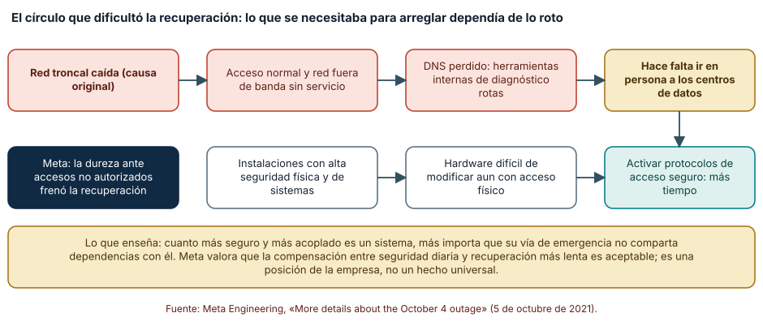

**Cómo leer la figura.** Cada caja es un obstáculo que Meta menciona y las flechas son la secuencia lógica en que aparecieron. Mira que la dureza de seguridad aparece al final de la cadena, no al principio. **Dónde deja de valer:** el orden es el de la explicación de Meta, no un registro temporal de las acciones; la empresa no da horas por obstáculo.

La arquitectura se recorre en siete niveles de zoom. El nivel 1, el contexto (camino de una petición), es la figura de la sección «Funcionalidad de principio a fin». Meta no publica la topología completa; los esquemas son modelos con los hechos de su explicación.

### Nivel 2 · Planos sobre un mismo camino

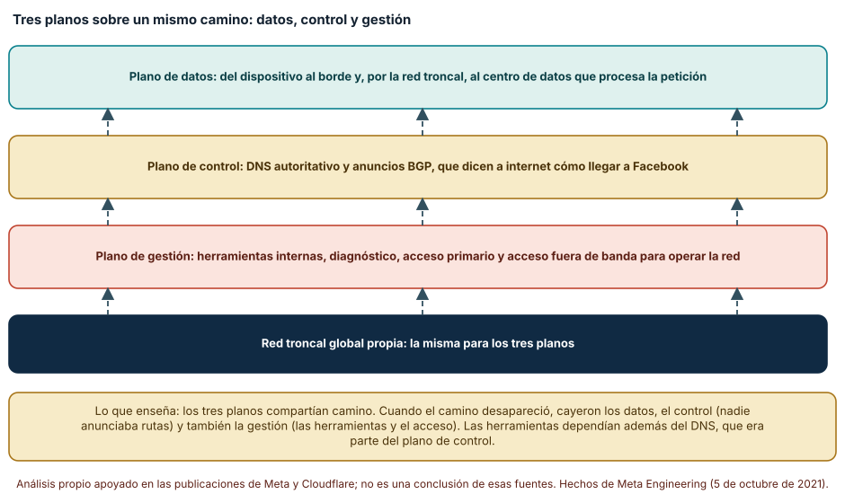

**Cómo leer la figura.** Cada franja es un plano; las flechas discontinuas son la dependencia del plano de arriba con lo que tiene debajo; la franja oscura es la red troncal. Mira que no hay un camino alternativo dibujado: la figura muestra que no lo había para los tres planos. **Dónde deja de valer:** «plano» es un recurso de análisis; Meta no usa esos nombres. Las fuentes dicen que tanto el acceso primario como el fuera de banda estaban caídos, pero no describen cómo se construye este último.

### Nivel 3 · Componentes: la regla de salud del DNS

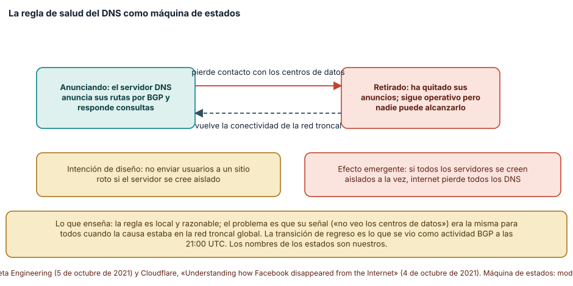

**Cómo leer la figura.** Dos estados y dos transiciones; la flecha roja es la que se disparó; la discontinua, la que debía ocurrir al recuperarse la red. Los recuadros inferiores dicen la intención y el efecto emergente. **Dónde deja de valer:** es un modelo; la regla real puede tener otras condiciones (tiempos, histéresis, número de servidores) que Meta no describe.

Meta explica la regla con claridad: para una operación fiable, los servidores DNS deshabilitan sus anuncios BGP si ellos mismos no pueden hablar con los centros de datos, porque es indicio de una conexión de red en mal estado; en este caso, al retirarse toda la red troncal, esas ubicaciones se declararon no saludables y retiraron los anuncios, y el resultado fue que los DNS quedaron inalcanzables aunque seguían operativos (Meta Engineering, 5 de octubre de 2021). Cloudflare lo vio desde fuera: a las 15:58 UTC observó que Facebook había dejado de anunciar las rutas de sus prefijos DNS, y mostró que dos de esos prefijos, 185.89.218.0/23 y 129.134.30.0/23, ya no figuraban en la tabla de un servidor de rutas público (Cloudflare).

### Nivel 4 · Secuencia del flujo que falló

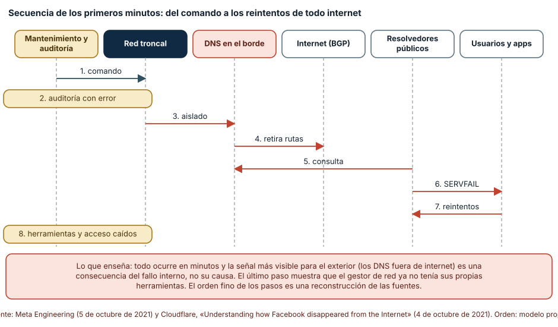

**Cómo leer la figura.** Cada columna es un actor; las flechas rojas son los pasos que empeoran; las cajas, estados internos. Mira el último paso: el equipo que gestionaba ya no tenía herramientas. **Dónde deja de valer:** el orden de los pasos es una reconstrucción de las dos fuentes; ninguna da horas por paso, salvo las de Cloudflare.

### Nivel 5 · Datos y flujo de datos: la «tormenta» de reintentos

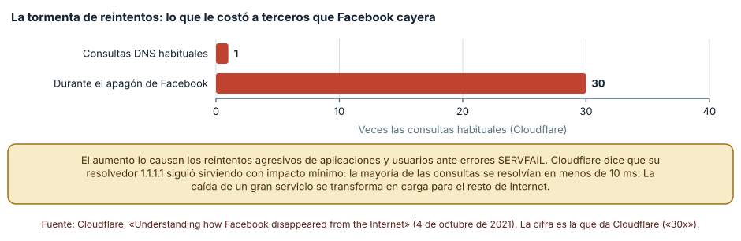

**Cómo leer la figura.** Cada barra es un múltiplo de las consultas habituales, con escala desde cero. Mira que el eje llega a 40: el aumento es de un orden de magnitud entero. **Dónde deja de valer:** es la cifra que da Cloudflare para los resolvedores del mundo, vista desde 1.1.1.1; no es una medición propia y no refleja otros resolvedores.

En este caso el «dato» que importa es el estado del DNS y de las rutas: el sistema pasó de tener sus direcciones publicadas a no tenerlas, y el resto de internet interpretó la ausencia como un error que reintentar. Las aplicaciones y los usuarios reintentaron de forma agresiva y los resolvedores de todo el mundo empezaron a manejar unas 30 veces más consultas de lo habitual, con riesgo de latencia y de tiempos de espera para otras plataformas (Cloudflare). Cloudflare añade que su servicio siguió con un impacto mínimo y que la inmensa mayoría de las consultas se resolvía en menos de 10 ms.

### Nivel 6 · Despliegue y radio de explosión

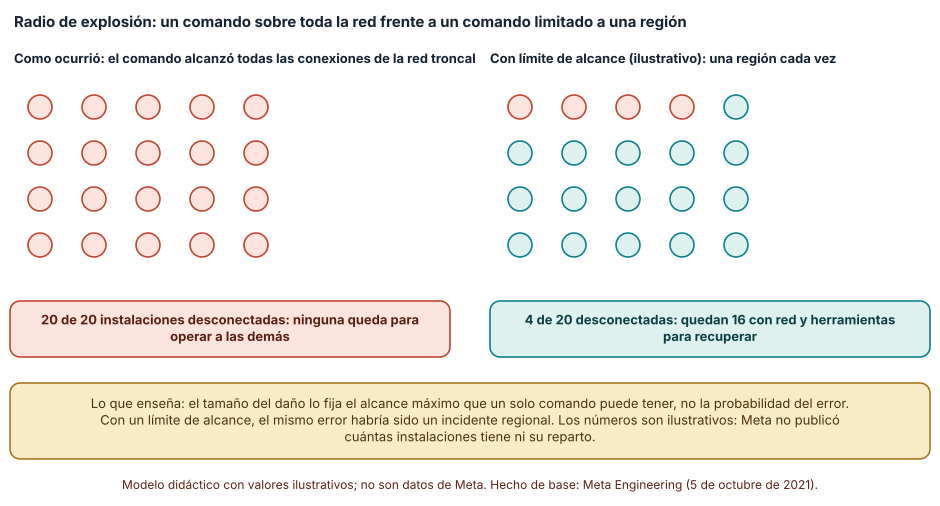

**Cómo leer la figura.** Cada círculo es una instalación; los rojos están desconectados y los verdes siguen operativos. Mira que la diferencia es de alcance máximo, no de acierto. **Dónde deja de valer:** es un modelo didáctico con valores ilustrativos; Meta no publica el número ni la distribución de sus instalaciones.

Lo documentado es el alcance: el comando desconectó «todas las conexiones de la red troncal», es decir, los centros de datos del mundo (Meta Engineering). El radio de explosión de un cambio no depende de la probabilidad de que salga mal, sino del alcance que el sistema le permite tener. Google describe un incidente en el que un evento de mantenimiento en una ubicación alcanzó a las de otras por un error de software, y su sistema «falla estático» (la red sigue unos minutos sin plano de control) antes de retirar rutas (Google Cloud).

### Nivel 7 · Dependencias y puntos únicos de fallo

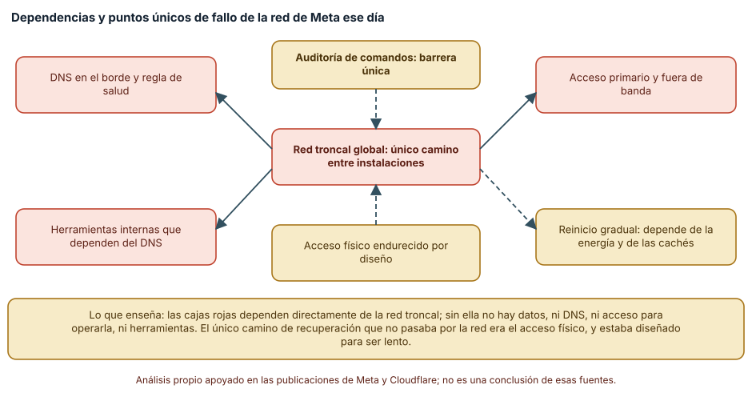

**Cómo leer la figura.** Rojo: dependencias directas de la red troncal; dorado: barreras o recursos que tuvieron un papel parcial. **Dónde deja de valer:** es análisis propio; no enumera otras dependencias (energía, proveedores de tránsito, cachés) que Meta menciona solo en parte.

### Nivel 8 · Defensa en profundidad

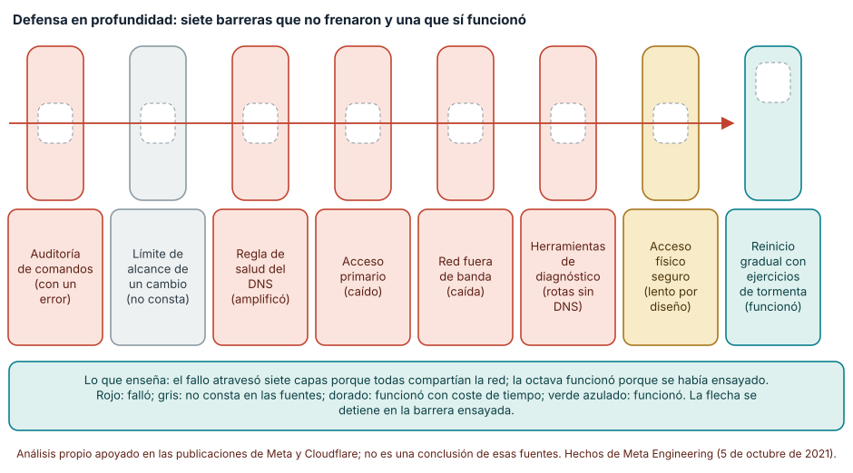

**Cómo leer la figura.** Cada lámina es una barrera; la flecha roja es el fallo, que atraviesa siete y se detiene en la octava. Rojo: falló; gris: no consta; dorado: funcionó con coste de tiempo; verde azulado: funcionó. **Dónde deja de valer:** la lista es análisis propio; no consta si existía un límite de alcance de cambios y por eso se marca en gris. La metáfora no mide la probabilidad de cada hueco.

### Hardware utilizado

Meta describe una red troncal de decenas de miles de millas de fibra óptica, routers que deciden hacia dónde enviar el tráfico y centros de datos con millones de máquinas, además de instalaciones de borde; también menciona descensos de consumo eléctrico de decenas de megavatios en los centros durante el apagón (Meta Engineering, 5 de octubre de 2021). **No se sabe:** fabricantes, modelos de routers y servidores, capacidad de los enlaces y número de instalaciones.

### Software utilizado

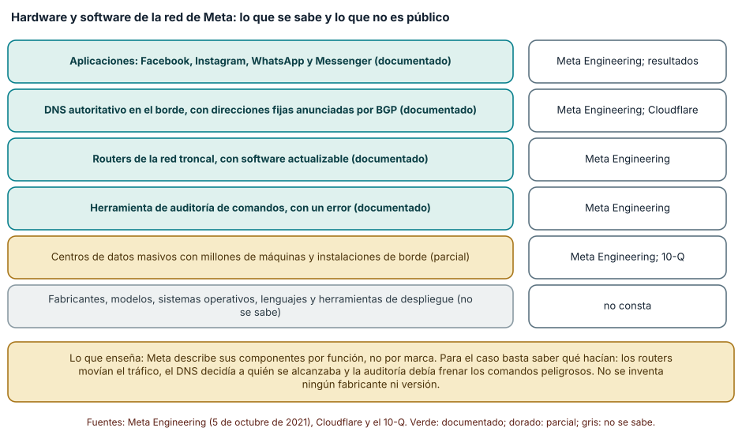

**Cómo leer la figura.** Cada fila es una capa; verde: documentada; dorado: parcial; gris: no se sabe. Mira que cada capa documentada tiene un papel en la cadena causal. **Dónde deja de valer:** es el límite de lo público.

Documentado: servidores DNS autoritativos con direcciones fijas anunciadas por BGP, una regla que los lleva a retirar esos anuncios si no ven los centros de datos, una herramienta de auditoría de comandos con un error, herramientas internas que dependen del DNS y un sistema de gestión de la capacidad de la red troncal que desencadenó el comando (Meta Engineering, 5 de octubre de 2021). **No se sabe:** sistemas operativos, lenguajes, frameworks, bases de datos y herramientas de despliegue.

### Infraestructura

Una red troncal propia (si usaba también nube pública para otras cargas, no se sabe): una red troncal propia, centros de datos grandes y pequeñas instalaciones de borde (Meta Engineering). La escala la dan las cifras de uso (3 580 millones de personas activas al mes en la familia de aplicaciones) y de inversión (13 198 millones en propiedad y equipo en nueve meses). Dependencias externas: el BGP de internet y los resolvedores DNS públicos (Cloudflare). **No se sabe:** regiones, número de instalaciones, proveedores de tránsito y dependencias de terceros no mencionadas.

### A prueba de fallos: qué existía, qué falló y qué debió existir

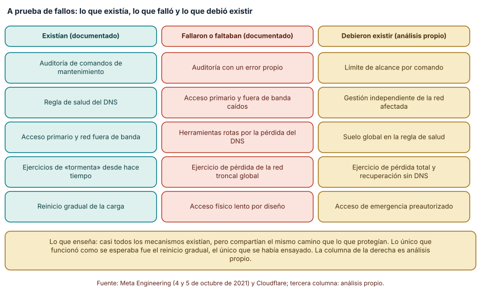

**Cómo leer la figura.** Verde azulado: lo que existía; coral: lo que falló o faltaba; dorado: análisis propio. **Dónde deja de valer:** no mide eficacia; las filas no se corresponden una a una.

Redundancia: una sola red troncal para los tres planos; el acceso primario y el fuera de banda estaban caídos (Meta Engineering). Conmutación: la regla de salud del DNS actuó sin suelo global. Límites: no consta un límite de alcance de cambios. Pruebas: ejercicios de tormenta que nunca simularon la pérdida de la red troncal global. Despliegue gradual: no consta para el comando. Recuperación: acceso físico y reinicio gradual con simulacros previos (Meta Engineering). Qué debió existir: límite de alcance, gestión independiente, suelo global en la regla, ejercicio de pérdida total y acceso de emergencia preautorizado (análisis propio).

## Casos especiales y cómo fallan

- **Tormenta de reintentos.** Cuando los DNS de Facebook dejaron de responder, los resolvedores públicos devolvieron y guardaron errores SERVFAIL y las aplicaciones y los usuarios reintentaron de forma agresiva: Cloudflare cifra en unas 30 veces las consultas habituales de sus resolvedores (Cloudflare). La caída de un servicio grande se convierte en carga para terceros.
- **Seguridad frente a recuperación.** El endurecimiento de la seguridad física y de sistemas retrasó el acceso a los equipos; Meta considera que compensa un mejor nivel de seguridad diaria a cambio de una recuperación más lenta en un evento poco frecuente (Meta Engineering, 5 de octubre de 2021). Es una posición de la empresa.
- **Herramientas que dependían de lo roto.** Sin DNS fallaron herramientas internas de diagnóstico, y tanto el acceso primario como el fuera de banda estaban caídos (Meta Engineering).
- **Reinicio.** Reactivar todo a la vez podía provocar nuevos fallos; los centros de datos mostraron descensos de decenas de megavatios de consumo y subirlos de golpe ponía en riesgo desde los sistemas eléctricos hasta las cachés. Meta recurrió a sus ejercicios de «tormenta» para subir la carga con cuidado (Meta Engineering).
- **Confianza.** Meta afirma que no hubo actividad maliciosa ni evidencia de datos de usuarios comprometidos (Meta Engineering, 4 de octubre de 2021).

- **Dependencia circular de recuperación.** Para recuperar la red hacía falta acceder a los equipos; para acceder se necesitaba la red o el DNS que habían caído; el acceso primario y el fuera de banda estaban caídos (Meta Engineering). La salida fue la presencia física, que a su vez era lenta por diseño.
- **Seguridad física como freno.** Las instalaciones están diseñadas con altos niveles de seguridad físicos y de sistema; el hardware y los routers son difíciles de modificar incluso con acceso físico. Hubo que activar los protocolos de acceso seguro para tener a personas en sitio y con capacidad de trabajar sobre los servidores (Meta Engineering, 5 de octubre de 2021).
- **El primer arreglo no es el final.** Restaurar la conectividad de la red troncal no bastó: Meta sabía que volver a activar todo a la vez podía causar una nueva ronda de fallos por un aumento de tráfico; centros de datos individuales mostraban descensos de consumo de decenas de megavatios, y revertirlos de golpe ponía en riesgo desde los sistemas eléctricos hasta las cachés (Meta Engineering).
- **Ejercicios previos, con un límite.** Meta dice estar bien preparada gracias a los ejercicios de «tormenta», en los que simula un fallo grave retirando un servicio, un centro de datos o una región entera; también reconoce que nunca había simulado la pérdida de la red troncal global (Meta Engineering, 5 de octubre de 2021).
- **Compensación de seguridad.** Meta describe que el endurecimiento contra el acceso no autorizado frenó la recuperación de un fallo causado por un error propio, y opina que el intercambio vale la pena: mucha más seguridad diaria a cambio de una recuperación más lenta en un evento poco frecuente (Meta Engineering, 5 de octubre de 2021). Es una posición de la empresa; este caso la expone sin juzgarla.
- **Comparable: dos políticas opuestas ante la misma señal.** Google describe que su red está diseñada para «fallar estática»: si pierde el plano de control, sigue unos minutos con lo último que conocía como defensa adicional (Google Cloud). En Meta, la señal «no veo los centros de datos» produjo de inmediato una acción: retirar las rutas. El análisis propio es que «mantener lo último conocido» y «salir al sentirse aislado» son políticas opuestas ante la misma señal, y que ninguna es correcta en general; las dos tuvieron fallos en el momento en que la señal era causada por un problema global y no local.

## Línea de tiempo

| Hora (UTC, 4 de octubre de 2021) | Hecho documentado | Fuente |
| --- | --- | --- |
| Antes de las 15:40 | Trabajo rutinario de mantenimiento; se emite un comando para evaluar la capacidad de la red troncal global | Meta Engineering |
| ≈ 15:40 | Pico de cambios de rutas BGP de Facebook; empiezan las retiradas de rutas | Cloudflare |
| 15:51 | Cloudflare abre una incidencia interna por «Facebook DNS lookup returning SERVFAIL» | Cloudflare |
| 15:58 | Se advierte que Facebook ha dejado de anunciar las rutas de sus prefijos DNS | Cloudflare |
| Entre medias (sin hora publicada) | Ingenieros desplazados a los centros de datos; los protocolos de acceso seguro retrasan el trabajo | Meta Engineering |
| ≈ 21:00 | Renovada actividad BGP; pico a las 21:17 | Cloudflare |
| ≈ 21:20 a 21:28 | El nombre de facebook.com vuelve a resolverse; Facebook aparece reconectado | Cloudflare |
| Tras restablecer la red | Reinicio gradual de los servicios para evitar una oleada de tráfico; descensos de decenas de megavatios en consumo eléctrico de centros de datos | Meta Engineering |
| 5 de octubre | Meta publica el análisis detallado | Meta Engineering |
| 25 de octubre | El informe trimestral describe el apagón como de «aproximadamente seis horas» | Form 10-Q |

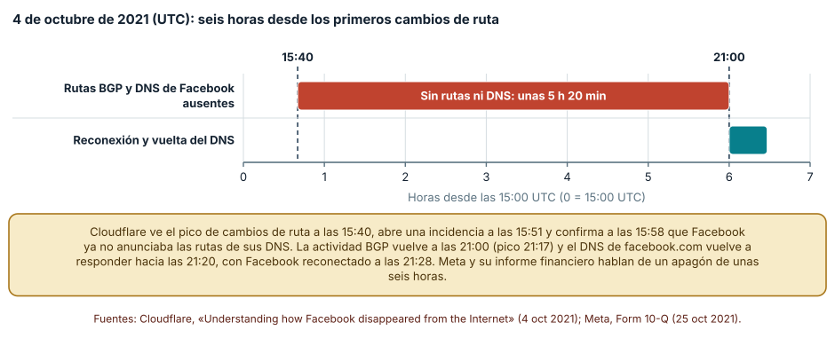

**Cómo leer la figura.** El eje son horas desde las 15:00 UTC; la barra roja es el periodo en que las rutas del DNS no estaban anunciadas, vista desde Cloudflare. Mira que la parte larga fue la recuperación, no el fallo, que fue casi instantáneo. **Dónde deja de valer:** es la vista externa (BGP y DNS); desde dentro, las fuentes no precisan cuándo se restableció cada servicio, y la «seis horas» de Meta incluye la recuperación completa.

El caso tiene dos escalas de tiempo documentadas: la hora a hora del 4 de octubre y, en lo anterior, un conjunto de condiciones de diseño cuyos años no son públicos.

### Antecedentes: decisiones y condiciones latentes

Meta no publica los años en que se tomaron las decisiones que se alinearon el 4 de octubre. Lo que consta, sin fecha, es lo siguiente.

| Condición latente | Qué dice la fuente | Año |
| --- | --- | --- |
| Regla de salud del DNS | Los DNS deshabilitan sus anuncios BGP si no hablan con los centros de datos | No consta |
| Auditoría de comandos | Los comandos se auditan para evitar errores; la herramienta tenía un error | No consta |
| Acceso físico endurecido | Se hizo «un extenso trabajo» de endurecimiento para evitar accesos no autorizados | No consta |
| Ejercicios de «tormenta» | Se llevan ejecutando «desde hace mucho tiempo»; nunca simularon la pérdida de la red troncal global | No consta |
| Red troncal propia | Decenas de miles de millas de fibra que unen todos los centros de datos | No consta |

Las únicas fechas son las del propio caso: 4 de octubre de 2021 (incidente), 5 de octubre (análisis) y 25 de octubre (informe trimestral). Es un hueco real de las fuentes: no se puede reconstruir una línea de tiempo de años y este caso no la inventa.

### Los primeros veinte minutos vistos desde fuera

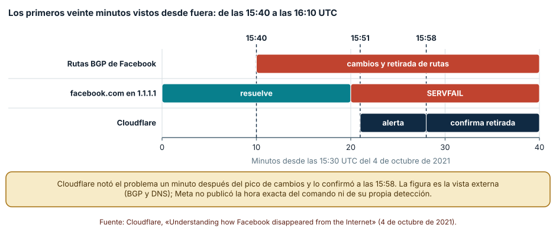

**Cómo leer la figura.** El eje son minutos desde las 15:30 UTC; cada fila es un hilo (rutas de Facebook, resolución desde 1.1.1.1 y detección de Cloudflare). Mira que la detección de Cloudflare y el cambio de rutas están separados por menos de veinte minutos. **Dónde deja de valer:** es la vista externa; la hora del comando y de la detección interna de Meta no son públicas.

### Hora a hora

| Hora (UTC) | Hecho documentado | Fuente |
| --- | --- | --- |
| ≈ 15:40 | Pico de cambios de rutas BGP de Facebook | Cloudflare |
| ≈ 15:50 | facebook.com deja de resolverse en 1.1.1.1 | Cloudflare |
| 15:51 | Incidencia interna de Cloudflare por SERVFAIL | Cloudflare |
| 15:58 | Cloudflare observa la retirada de rutas de los prefijos DNS | Cloudflare |
| Entre medias (sin horas) | Ingenieros enviados a los centros de datos; activación de los protocolos de acceso seguro; confirmación del problema; restauración de la red troncal | Meta Engineering |
| ≈ 21:00 | Renovada actividad BGP, con pico a las 21:17 | Cloudflare |
| ≈ 21:20 | facebook.com vuelve a resolverse en 1.1.1.1 | Cloudflare |
| 21:28 | Facebook aparece reconectado a internet | Cloudflare |
| Tras restablecer la red | Reinicio gradual de la carga | Meta Engineering |

**No consta:** la hora del comando, la hora en que Meta detectó el problema, cuánto tardaron los ingenieros en llegar a cada instalación, el orden de reactivación de los servicios y la hora en que cada aplicación volvió a la normalidad.

## Qué falló en cada instancia

Instancia por instancia, qué se esperaba y qué ocurrió, según las fuentes.

- **Comando de mantenimiento.** Un comando con la intención de evaluar la disponibilidad de capacidad de la red troncal desconectó sin querer todas las conexiones de la red troncal.
- **Auditoría.** «Un fallo en esa herramienta de auditoría» impidió detenerlo.
- **DNS y BGP.** Los servidores DNS retiraron sus anuncios BGP al verse aislados y dejaron de ser alcanzables aunque seguían operativos.
- **Acceso.** El acceso normal y el fuera de banda estaban caídos, y la pérdida del DNS rompió muchas de las herramientas internas de diagnóstico.
- **Acceso físico.** Enviar ingenieros a los centros de datos llevó tiempo por las medidas de seguridad física y de sistema, diseñadas para ser difíciles de eludir.
- **Reinicio.** Para evitar una subida brusca de tráfico y de consumo eléctrico, se reactivó gradualmente. Meta dice que los ejercicios de «tormenta» llevan tiempo ayudándoles en esto, aunque nunca habían simulado la pérdida de la red troncal global.

**Documentado por Cloudflare (vista externa).** Retirada de rutas BGP, fallos SERVFAIL, reintentos de aplicaciones y usuarios que multiplicaron por unas 30 las consultas de los resolvedores.

- **Cambio.** Se esperaba que un comando de evaluación de capacidad no tuviera efecto sobre el servicio; ocurrió que desconectó todas las conexiones de la red troncal (Meta Engineering).
- **Barrera de cambio.** Se esperaba que la auditoría detuviera un comando peligroso; un error propio de la herramienta lo impidió (Meta Engineering).
- **Regla de salud.** Se esperaba que la retirada de rutas evitara enviar a usuarios a un sitio roto; el efecto neto fue hacer inalcanzable todo el DNS de la empresa (Meta Engineering, Cloudflare).
- **Herramientas y acceso.** Se esperaba contar con acceso primario y fuera de banda y con herramientas de diagnóstico; todo ello estaba caído o roto por la pérdida del DNS (Meta Engineering).
- **Recuperación.** Se esperaba rapidez y ocurrió lentitud inevitable por la seguridad física (Meta Engineering). La decisión de seguridad fue deliberada y Meta la defiende.
- **Efecto en terceros.** La caída se convirtió en carga de reintentos para el resto de internet (Cloudflare).
- **Lo que funcionó.** El reinicio gradual, con la experiencia de los ejercicios de tormenta, evitó nuevos fallos sistémicos; los servicios volvieron relativamente rápido tras restablecer la red (Meta Engineering).

## Causa raíz y factores

**Detonante (documentado).** Durante un mantenimiento rutinario, un comando destinado a evaluar la capacidad de la red troncal desconectó por error todas las conexiones, y la herramienta de auditoría, que debía detenerlo, no lo hizo por un error propio (Meta Engineering, 5 de octubre de 2021; Form 10-Q: «una combinación de un error y un fallo»).

**Condiciones latentes (documentado).** Los servidores DNS retiran sus anuncios BGP si no pueden hablar con los centros de datos; sin DNS no se encontraba ningún servidor; el acceso normal y el fuera de banda dependían del mismo sistema; las herramientas de diagnóstico dependían del DNS; el acceso físico estaba deliberadamente endurecido (Meta Engineering).

**Factores de contexto (documentado).** Una red global enorme que se opera con mantenimiento frecuente, y un ensayo de tormentas que nunca había simulado la pérdida de la red troncal global, según la propia Meta.

**Inferido (análisis propio).**

- Los dos mecanismos que se encadenaron (auditoría de comandos y retiro de anuncios por salud) estaban pensados para proteger. El fallo es de **composición**: cada uno razonable por separado, el conjunto es un punto único de fallo.
- Las herramientas para operar compartían dependencias con lo que operaban. Es una consecuencia de lo que Meta describe sobre DNS y acceso, no una afirmación suya.

**No se sabe (por las fuentes públicas).** El comando exacto, la naturaleza del error de la auditoría, el número de personas afectadas por servicio, el ingreso perdido, el orden y la duración de cada tarea de recuperación, y el estado de las mejoras que Meta dijo estar estudiando.

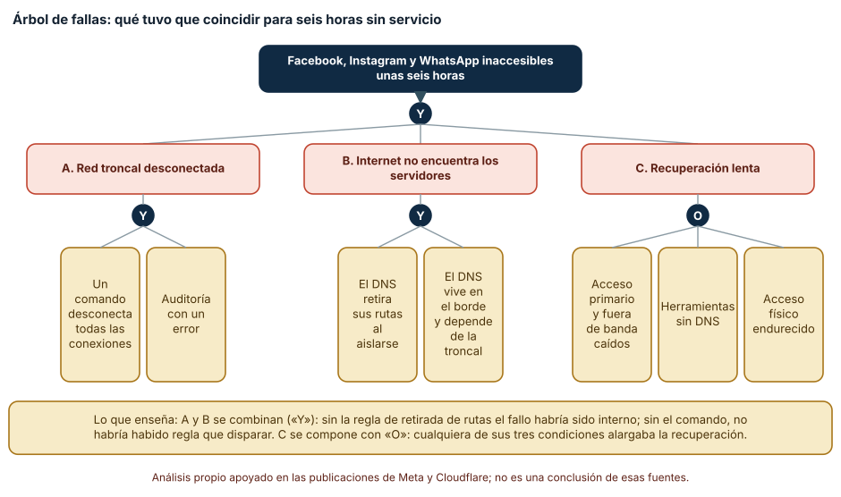

**Cómo leer la figura.** Arriba el evento final; «Y» exige las condiciones, «O» que baste una. Mira que A y B se combinan y que C se compone de tres condiciones que se suman. **Dónde deja de valer:** la estructura es análisis propio; las hojas son hechos de Meta y de Cloudflare. No son independientes (el DNS en el borde depende de la red troncal).

**Cadena causal ordenada (análisis propio, apoyado en las fuentes).**

1. Una red troncal única y global para todos los planos (condición de diseño).
2. Un comando de mantenimiento con alcance suficiente para desconectar todo (condición latente de alcance).
3. Una auditoría con un error (condición latente de contención).
4. Una regla de salud local que retira las rutas del DNS al aislarse (condición latente de acoplamiento).
5. Un plano de gestión que depende del mismo camino y del DNS (condición latente de recuperación).
6. Un acceso físico endurecido por diseño (condición de contexto, decisión de seguridad).
7. El resultado: servicios inaccesibles unas seis horas y una tormenta de reintentos sobre terceros (consecuencia).

### Documentado, inferido y no se sabe

| Categoría | Contenido |
| --- | --- |
| Documentado | El comando durante un mantenimiento rutinario; el error de la auditoría; la retirada de las rutas BGP por el DNS; las herramientas y el acceso caídos; el acceso físico lento por diseño; el reinicio gradual; la ausencia de actividad maliciosa; las horas externas de Cloudflare; las seis horas |
| Inferido (análisis propio) | La figura de los tres planos como lectura del acoplamiento; que el alcance máximo de un comando fija el radio de explosión; que la regla de salud y la auditoría son un fallo de composición; la cadena causal ordenada |
| No se sabe | El comando exacto; la naturaleza del error de la auditoría; la hora del comando y de la detección interna; el número de instalaciones; el ingreso perdido; cuántas personas fueron afectadas por servicio; las mejoras adoptadas después |

## Mejoras que debieron hacerse

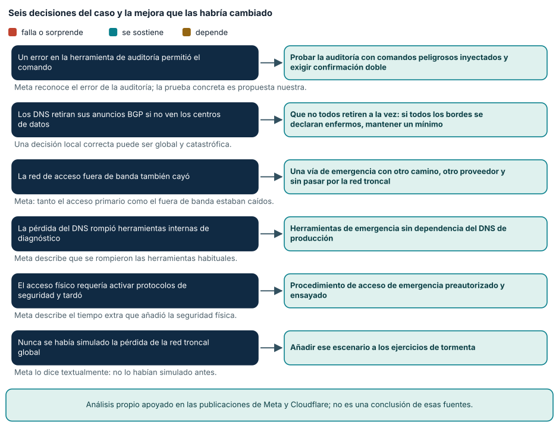

**Cómo leer la figura.** Cada tarjeta enlaza algo que Meta describe con una mejora que habría cambiado el desenlace. En esta figura el verde marca la mejora propuesta; la leyenda de colores de arriba es genérica de las tarjetas. **Dónde deja de valer:** son propuestas didácticas, no hallazgos de Meta; cada una tiene costo, riesgo de falsos positivos y una relación con la seguridad que no se evalúa aquí.

| Área | Mejora | Qué enseña el curso |
| --- | --- | --- |
| Cambios | Auditoría probada con casos peligrosos; confirmación doble y alcance máximo de un cambio de red | SE-483, SE-434 |
| Diseño de dependencias | Que los mecanismos de salud local no puedan desconectar todo a la vez; límites globales | SE-439, SE-389, SE-391 |
| Recuperación | Vía de emergencia independiente (otra red, otro proveedor) y herramientas sin dependencia del DNS de producción | SE-502, SE-499 |
| Acceso | Procedimiento de acceso de emergencia ensayado, con autorización preacordada | SE-499, SE-500 |
| Ensayos | Ejercicio de pérdida de la red troncal y de reinicio escalonado | SE-394, SE-502 |
| Aprendizaje | Revisión sin culpa y publicación de lecciones | SE-501 |

La recuperación ordenada del final es un buen ejemplo de lo que se hizo bien: Meta describe que reactivar todo a la vez podía provocar nuevos fallos y optó por subir la carga con cuidado, apoyándose en simulacros previos.

Todo lo que sigue, incluidos costos y trade-offs, es **análisis propio apoyado en las fuentes**: no son conclusiones de Meta ni de Cloudflare ni descripciones de lo que Meta adoptó.

### Para cada factor: control técnico, de proceso y de gobierno

| Factor causal | Control técnico | Control de proceso | Control de gobierno | Costo y trade-off | Clases |
| --- | --- | --- | --- | --- | --- |
| Alcance de un comando | Límite de impacto por comando: simulación previa, una región cada vez, reversión automática | Cambios de red por etapas con observación entre etapas | Política: ningún comando puede tocar toda la red en un paso | Más lentitud en cambios masivos; algunos cambios legítimos necesitan excepción | [SE-476 · Canary, blue-green y rollback](../../classes/part-39-build-release-y-cadena-de-suministro/se-476-canary-blue-green-y-rollback/README.md), [SE-475 · Feature flags y entrega progresiva](../../classes/part-39-build-release-y-cadena-de-suministro/se-475-feature-flags-y-entrega-progresiva/README.md), [SE-485 · Entrega y despliegue continuos](../../classes/part-40-ci-cd-iac-y-platform-engineering/se-485-entrega-y-despliegue-continuos/README.md) |
| Auditoría con error | Probar la auditoría con casos peligrosos conocidos y pruebas de mutación | Doble control para cambios de alto alcance | Revisión periódica de las herramientas que protegen | Coste de mantener un catálogo de casos peligrosos | [SE-483 · Tests, seguridad y políticas como gates](../../classes/part-40-ci-cd-iac-y-platform-engineering/se-483-tests-seguridad-y-politicas-como-gates/README.md), [SE-434 · Revisión, análisis estático y quality gates](../../classes/part-36-calidad-rendimiento-y-resiliencia/se-434-revision-analisis-estatico-y-quality-gates/README.md), [SE-426 · Mutación, fuzzing y generación de casos](../../classes/part-35-estrategia-y-tecnicas-de-prueba/se-426-mutacion-fuzzing-y-generacion-de-casos/README.md) |
| Regla de salud del DNS | Un suelo global: la regla no puede retirar más de una fracción de los servidores y siempre queda alguno anunciando | Revisión de las reglas locales por su efecto agregado | Registro de decisiones de diseño con su peor caso | Un DNS que sigue respondiendo con la red enferma puede enviar a usuarios a un sitio roto | [SE-439 · Circuit breakers, bulkheads y degradación](../../classes/part-36-calidad-rendimiento-y-resiliencia/se-439-circuit-breakers-bulkheads-y-degradacion/README.md), [SE-389 · Fallos parciales y modelos de red](../../classes/part-32-concurrencia-y-sistemas-distribuidos/se-389-fallos-parciales-y-modelos-de-red/README.md), [SE-391 · Consenso, elección y coordinación](../../classes/part-32-concurrencia-y-sistemas-distribuidos/se-391-consenso-eleccion-y-coordinacion/README.md) |
| Gestión que depende de lo gestionado | Red fuera de banda con otro camino y otro proveedor; herramientas que no usan el DNS de producción | Revisión del grafo de dependencias de las herramientas de operación | Requisito de que el plano de gestión sobreviva a la pérdida de los otros dos | Coste de una segunda red y de mantenerla viva | [SE-502 · Continuidad, disaster recovery y ejercicios](../../classes/part-41-observabilidad-sre-e-incidentes/se-502-continuidad-disaster-recovery-y-ejercicios/README.md), [SE-499 · Runbooks, on-call y escalamiento](../../classes/part-41-observabilidad-sre-e-incidentes/se-499-runbooks-on-call-y-escalamiento/README.md), [SE-326 · Vistas lógica, runtime, datos y despliegue](../../classes/part-27-arquitectura-de-software-y-dominio/se-326-vistas-logica-runtime-datos-y-despliegue/README.md) |
| Acceso físico lento | Procedimiento de acceso de emergencia ensayado, con autorizaciones preacordadas | Personal de guardia en sitio para eventos graves; simulacros | Una decisión explícita sobre el coste de tiempo de la seguridad | Cada excepción de acceso es una superficie de riesgo | [SE-499 · Runbooks, on-call y escalamiento](../../classes/part-41-observabilidad-sre-e-incidentes/se-499-runbooks-on-call-y-escalamiento/README.md), [SE-500 · Gestión de incidentes y comunicación](../../classes/part-41-observabilidad-sre-e-incidentes/se-500-gestion-de-incidentes-y-comunicacion/README.md), [SE-457 · Principios de seguridad y modelos de amenaza](../../classes/part-38-seguridad-privacidad-y-cumplimiento/se-457-principios-de-seguridad-y-modelos-de-amenaza/README.md) |
| Ejercicios que no cubren el peor caso | Ejercicio de pérdida de la red troncal y recuperación sin DNS | Calendario de ejercicios con casos nuevos cada trimestre | Informe a la dirección de qué peor caso no se ha ensayado | Los ejercicios en producción tienen riesgo y coste | [SE-394 · Caos controlado y pruebas de distribución](../../classes/part-32-concurrencia-y-sistemas-distribuidos/se-394-caos-controlado-y-pruebas-de-distribucion/README.md), [SE-502 · Continuidad, disaster recovery y ejercicios](../../classes/part-41-observabilidad-sre-e-incidentes/se-502-continuidad-disaster-recovery-y-ejercicios/README.md), [SE-440 · Disponibilidad, durabilidad y recuperación](../../classes/part-36-calidad-rendimiento-y-resiliencia/se-440-disponibilidad-durabilidad-y-recuperacion/README.md) |
| Tormenta de reintentos | Reintentos con retroceso exponencial y fluctuación en clientes; cachés negativas | Pruebas de comportamiento de los clientes ante errores DNS | Contratos con terceros sobre carga ante incidentes | Más complejidad en los clientes; la caché negativa puede retrasar la recuperación | [SE-438 · Timeouts, retries, backoff y jitter](../../classes/part-36-calidad-rendimiento-y-resiliencia/se-438-timeouts-retries-backoff-y-jitter/README.md), [SE-436 · Latencia, throughput, saturación y capacidad](../../classes/part-36-calidad-rendimiento-y-resiliencia/se-436-latencia-throughput-saturacion-y-capacidad/README.md) |
| Aprendizaje | Telemetría de la señal «herramienta de auditoría rechazó/aceptó» | Revisión sin culpa con acciones con dueño | Publicación de lecciones | Tiempo de calidad y exposición pública | [SE-501 · Postmortems sin culpa y aprendizaje](../../classes/part-41-observabilidad-sre-e-incidentes/se-501-postmortems-sin-culpa-y-aprendizaje/README.md), [SE-493 · Señales, eventos y observabilidad útil](../../classes/part-41-observabilidad-sre-e-incidentes/se-493-senales-eventos-y-observabilidad-util/README.md), [SE-498 · Alertas accionables y fatiga](../../classes/part-41-observabilidad-sre-e-incidentes/se-498-alertas-accionables-y-fatiga/README.md) |

### La arquitectura «después»

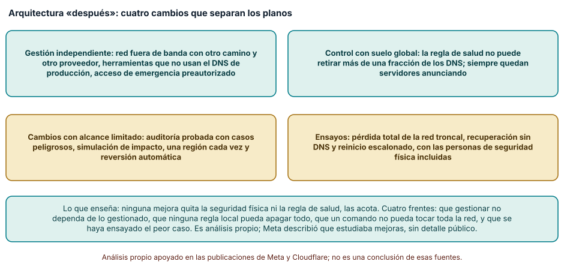

**Cómo leer la figura.** Cada bloque es un cambio de arquitectura que separa lo que el 4 de octubre estaba acoplado; los dos superiores atacan el acoplamiento de planos, los dos inferiores el alcance y el ensayo. **Dónde deja de valer:** es un diseño didáctico, no una descripción de lo que Meta hizo; no evalúa el coste económico de una segunda red ni los riesgos de seguridad de las excepciones de acceso.

### Diseñar la barrera de alcance

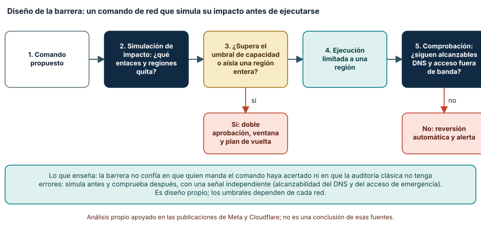

**Cómo leer la figura.** Cada caja es un paso; el tercero decide por umbral; las cajas rojas son las salidas con control extra. Mira que el paso 5 usa una señal independiente de la auditoría. **Dónde deja de valer:** los umbrales dependen de cada red; no se evalúa el tiempo que añade a un cambio urgente.

Decisiones de diseño, como ejercicio. (a) **Qué simula:** qué enlaces, qué regiones y cuánta capacidad se quitarían. (b) **Qué umbral:** por ejemplo, perder una región entera o más de una fracción de capacidad requiere un segundo control. (c) **Qué hace el paso 5:** comprueba desde fuera de la red afectada que el DNS y el acceso de emergencia siguen alcanzables y revierte si no. (d) **Quién puede forzar:** un rol con nombre, con registro. (e) **Cómo se prueba la barrera:** inyectándole un comando que quita todas las conexiones en un entorno de ensayo; debe detenerlo aun con la auditoría clásica deshabilitada.

## Vínculo con el curso

- [SE-041 · DNS: nombres, resolución y fallos](../../classes/part-03-redes-internet-y-protocolos/se-041-dns-nombres-resolucion-y-fallos/README.md) y [SE-039 · IPv4, IPv6, subredes, rutas y NAT](../../classes/part-03-redes-internet-y-protocolos/se-039-ipv4-ipv6-subredes-rutas-y-nat/README.md).
- [SE-389 · Fallos parciales y modelos de red](../../classes/part-32-concurrencia-y-sistemas-distribuidos/se-389-fallos-parciales-y-modelos-de-red/README.md), [SE-391 · Consenso, elección y coordinación](../../classes/part-32-concurrencia-y-sistemas-distribuidos/se-391-consenso-eleccion-y-coordinacion/README.md) y [SE-394 · Caos controlado y pruebas de distribución](../../classes/part-32-concurrencia-y-sistemas-distribuidos/se-394-caos-controlado-y-pruebas-de-distribucion/README.md).
- [SE-434 · Revisión, análisis estático y quality gates](../../classes/part-36-calidad-rendimiento-y-resiliencia/se-434-revision-analisis-estatico-y-quality-gates/README.md) y [SE-439 · Circuit breakers, bulkheads y degradación](../../classes/part-36-calidad-rendimiento-y-resiliencia/se-439-circuit-breakers-bulkheads-y-degradacion/README.md).
- [SE-483 · Tests de seguridad y políticas como gates](../../classes/part-40-ci-cd-iac-y-platform-engineering/se-483-tests-seguridad-y-politicas-como-gates/README.md).
- [SE-499 · Runbooks, on-call y escalamiento](../../classes/part-41-observabilidad-sre-e-incidentes/se-499-runbooks-on-call-y-escalamiento/README.md), [SE-500 · Gestión de incidentes y comunicación](../../classes/part-41-observabilidad-sre-e-incidentes/se-500-gestion-de-incidentes-y-comunicacion/README.md), [SE-501 · Postmortems sin culpa](../../classes/part-41-observabilidad-sre-e-incidentes/se-501-postmortems-sin-culpa-y-aprendizaje/README.md) y [SE-502 · Continuidad, disaster recovery y ejercicios](../../classes/part-41-observabilidad-sre-e-incidentes/se-502-continuidad-disaster-recovery-y-ejercicios/README.md).

Cada fila de la tabla es una clase real; el texto dice qué mecanismo del caso ilustra.

| Concepto | Clase | Cómo lo ilustra el caso |
| --- | --- | --- |
| Quality gates y políticas como puertas | [SE-483 · Tests, seguridad y políticas como gates](../../classes/part-40-ci-cd-iac-y-platform-engineering/se-483-tests-seguridad-y-politicas-como-gates/README.md) | La auditoría de comandos como puerta que tenía un error |
| Revisión, análisis estático y gates | [SE-434 · Revisión, análisis estático y quality gates](../../classes/part-36-calidad-rendimiento-y-resiliencia/se-434-revision-analisis-estatico-y-quality-gates/README.md) | Probar la puerta con casos peligrosos |
| Circuit breakers y degradación | [SE-439 · Circuit breakers, bulkheads y degradación](../../classes/part-36-calidad-rendimiento-y-resiliencia/se-439-circuit-breakers-bulkheads-y-degradacion/README.md) | Una regla de salud que corta, sin suelo global |
| Fallos parciales y modelos de red | [SE-389 · Fallos parciales y modelos de red](../../classes/part-32-concurrencia-y-sistemas-distribuidos/se-389-fallos-parciales-y-modelos-de-red/README.md) | Un nodo que cree estar aislado cuando es la red la que falla |
| Consenso y coordinación | [SE-391 · Consenso, elección y coordinación](../../classes/part-32-concurrencia-y-sistemas-distribuidos/se-391-consenso-eleccion-y-coordinacion/README.md) | Reglas locales que, juntas, retiran todos los anuncios |
| Consistencia, disponibilidad y particiones | [SE-390 · Consistencia, disponibilidad y particiones](../../classes/part-32-concurrencia-y-sistemas-distribuidos/se-390-consistencia-disponibilidad-y-particiones/README.md) | La partición total entre instalaciones |
| Vistas de arquitectura | [SE-326 · Vistas lógica, runtime, datos y despliegue](../../classes/part-27-arquitectura-de-software-y-dominio/se-326-vistas-logica-runtime-datos-y-despliegue/README.md) | Vista de despliegue y de dependencias que revela el camino único |
| Timeouts, reintentos, retroceso y fluctuación | [SE-438 · Timeouts, retries, backoff y jitter](../../classes/part-36-calidad-rendimiento-y-resiliencia/se-438-timeouts-retries-backoff-y-jitter/README.md) | La tormenta de reintentos de clientes |
| Saturación y capacidad | [SE-436 · Latencia, throughput, saturación y capacidad](../../classes/part-36-calidad-rendimiento-y-resiliencia/se-436-latencia-throughput-saturacion-y-capacidad/README.md) | Resolvedores con 30 veces la carga habitual |
| Canary y rollback | [SE-476 · Canary, blue-green y rollback](../../classes/part-39-build-release-y-cadena-de-suministro/se-476-canary-blue-green-y-rollback/README.md) | Cambios por región con vuelta atrás |
| Feature flags y entrega progresiva | [SE-475 · Feature flags y entrega progresiva](../../classes/part-39-build-release-y-cadena-de-suministro/se-475-feature-flags-y-entrega-progresiva/README.md) | Alcance gradual de cambios de red |
| Continuidad, DR y ejercicios | [SE-502 · Continuidad, disaster recovery y ejercicios](../../classes/part-41-observabilidad-sre-e-incidentes/se-502-continuidad-disaster-recovery-y-ejercicios/README.md) | Ejercicios de tormenta sin el peor caso |
| Runbooks y on-call | [SE-499 · Runbooks, on-call y escalamiento](../../classes/part-41-observabilidad-sre-e-incidentes/se-499-runbooks-on-call-y-escalamiento/README.md) | Guion de acceso de emergencia |
| Gestión de incidentes | [SE-500 · Gestión de incidentes y comunicación](../../classes/part-41-observabilidad-sre-e-incidentes/se-500-gestion-de-incidentes-y-comunicacion/README.md) | Diagnóstico sin herramientas y sin comunicaciones |
| Caos controlado | [SE-394 · Caos controlado y pruebas de distribución](../../classes/part-32-concurrencia-y-sistemas-distribuidos/se-394-caos-controlado-y-pruebas-de-distribucion/README.md) | Simular la pérdida de la red troncal |
| Postmortems sin culpa | [SE-501 · Postmortems sin culpa y aprendizaje](../../classes/part-41-observabilidad-sre-e-incidentes/se-501-postmortems-sin-culpa-y-aprendizaje/README.md) | Publicación detallada al día siguiente |
| Modelos de amenaza | [SE-457 · Principios de seguridad y modelos de amenaza](../../classes/part-38-seguridad-privacidad-y-cumplimiento/se-457-principios-de-seguridad-y-modelos-de-amenaza/README.md) | El intercambio entre seguridad y recuperación |
| Observabilidad útil | [SE-493 · Señales, eventos y observabilidad útil](../../classes/part-41-observabilidad-sre-e-incidentes/se-493-senales-eventos-y-observabilidad-util/README.md) | Señales internas perdidas con el DNS |

### Preguntas de discusión

1. La regla de salud del DNS es razonable por servidor y catastrófica en conjunto. ¿Qué propiedad tendría que tener una regla local para que su efecto agregado esté acotado?
2. Meta defiende que el endurecimiento de seguridad vale la pena aunque retrase la recuperación. ¿Qué evidencia permitiría decidir si el intercambio es correcto? ¿Qué diseño reduce el conflicto?
3. Si la auditoría de comandos tuviera una probabilidad de error de 1 en mil, ¿cuántos cambios al año hacen probable que falle alguna vez? ¿Qué barrera adicional compensa?
4. ¿Cómo se prueba que el plano de gestión sobrevive a la pérdida de los otros planos sin arriesgar producción?
5. ¿Qué responsabilidad tiene un servicio grande por la carga que su caída traslada a resolvedores y terceros?

### Mini-ejercicios

1. **Grafo de dependencias de operación.** Dibuja las herramientas que usarías para recuperar un servicio y marca las que dependen del propio servicio (DNS, autenticación, red). ¿Cuáles sobrevivirían a perder la red?
2. **Suelo global.** Diseña una regla de salud con un suelo: al menos N servidores siguen anunciando aunque pierdan los centros de datos. Define N, cómo se coordina sin red y qué riesgo introduce.
3. **Reintentos.** Escribe una política de reintentos para un cliente con retroceso exponencial y fluctuación, y calcula la carga adicional en el peor caso para un millón de clientes.
4. **Simulacro.** Diseña un ejercicio de pérdida total de la red troncal en un entorno de ensayo: qué se apaga, quién actúa y cómo se mide el tiempo de recuperación.

## Qué no generalizar

**Aprender.**

1. Un cambio de red debe tener un límite de alcance que la herramienta imponga, no solo la costumbre.
2. Una regla de salud local («si no veo mi backend, me retiro») es peligrosa cuando todas las instancias ven el mismo problema a la vez.
3. La herramienta con la que se repara no puede depender del sistema que se repara: DNS, red y acceso de emergencia deben tener un camino propio.
4. La seguridad física y la recuperación rápida se contraponen: decide el equilibrio con un procedimiento ensayado, no durante la crisis.
5. Reiniciar de golpe también falla: planifica una subida gradual.
6. Un fallo se ve desde fuera mucho antes de que se entienda desde dentro; las vistas externas (BGP, DNS) son datos útiles.

**No generalizar.**

- No prueba que la red de Facebook fuera mal diseñada en general: Meta la describe como un diseño con auditoría, tormentas y seguridad, que falló por una combinación específica.
- No prueba que el endurecimiento de seguridad sea malo; Meta defiende la compensación.
- Las cifras de duración y de usuarios son de 2021 y específicas de esa empresa.
- No hay evidencia en las fuentes de actividad maliciosa: Meta lo descarta explícitamente.

### Casos comparables y diferencias

| Caso | Parecido | Diferencia |
| --- | --- | --- |
| Google Cloud, 2 de junio de 2019 (informe 19009) | Un evento de mantenimiento con más alcance del previsto por un error de software; plano de control que retira rutas BGP; depuración dificultada; ingenieros que viajan a instalaciones seguras | La red de Google «falla estático» unos minutos antes de retirar rutas; el impacto fue pérdida de paquetes y duró entre 3 h 19 min y 4 h 25 min según la región |
| [Knight Capital](knight-capital.md) | Un único cambio sin barrera de alcance; la reversión improvisada empeora | Allí el daño era financiero y de un servidor; aquí, de toda la red |
| [CrowdStrike](crowdstrike.md) | Un cambio propio que alcanza a muchos sistemas a la vez | Allí el cambio era una actualización en los equipos de clientes; aquí, un comando de red interna |
| [GitLab 2017](gitlab-2017.md) | Una acción de operación rutinaria con consecuencias graves y herramientas de recuperación insuficientes | Allí se perdieron datos; aquí, el servicio durante horas, sin pérdida de datos conocida |

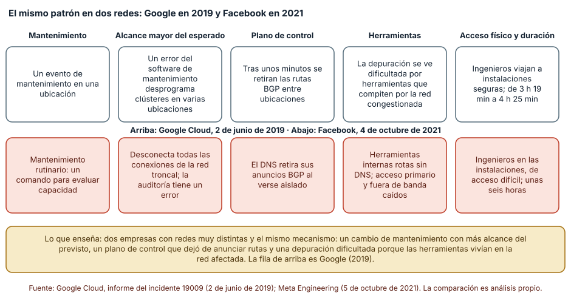

**Cómo leer la figura.** Cada columna es una etapa común; la fila superior es Google (2019) y la inferior Facebook (2021). Mira que las cinco etapas se repiten en el mismo orden. **Dónde deja de valer:** la comparación es análisis propio; las dos empresas tienen redes y sistemas distintos y los informes no cubren los mismos detalles, de modo que las etapas se alinean por función y no por identidad técnica.

**Reacción institucional.** Las fuentes consultadas no documentan una investigación regulatoria. La principal reacción documentada es la de la propia empresa (disculpas, análisis y revisión) y la de la comunidad técnica a través de la publicación de Cloudflare.

## Fuentes públicas verificadas

Todas consultadas el 16 de noviembre de 2026 y comprobadas con descarga directa (HTTP 200).

1. Santosh Janardhan, «Update about the October 4th outage», Engineering at Meta, 4 de octubre de 2021. [https://engineering.fb.com/2021/10/04/networking-traffic/outage/](https://engineering.fb.com/2021/10/04/networking-traffic/outage/). Respalda: causa declarada (cambio de configuración en routers de la red troncal), ausencia de actividad maliciosa.
2. Santosh Janardhan, «More details about the October 4 outage», Engineering at Meta, 5 de octubre de 2021. [https://engineering.fb.com/2021/10/05/networking-traffic/outage-details/](https://engineering.fb.com/2021/10/05/networking-traffic/outage-details/). Respalda: comando, auditoría, DNS y BGP, acceso físico, reinicio gradual.
3. Celso Martinho y Tom Strickx, «Understanding how Facebook disappeared from the Internet», Cloudflare Blog, 4 de octubre de 2021. [https://blog.cloudflare.com/october-2021-facebook-outage/](https://blog.cloudflare.com/october-2021-facebook-outage/). Respalda: horas UTC, retirada de rutas BGP, SERVFAIL, multiplicación por 30 de las consultas.
4. Facebook, Inc., Form 10-Q del trimestre terminado el 30 de septiembre de 2021 (25 de octubre de 2021). [https://www.sec.gov/Archives/edgar/data/1326801/000132680121000065/fb-20210930.htm](https://www.sec.gov/Archives/edgar/data/1326801/000132680121000065/fb-20210930.htm). Respalda: apagón de unas seis horas, combinación de error y fallo, sede y descripción del fundador, presidente y director ejecutivo.
5. Facebook, Inc., comunicado de resultados del tercer trimestre de 2021, anexo 99.1 del Form 8-K. [https://www.sec.gov/Archives/edgar/data/1326801/000132680121000062/fb-09302021xexhibit991.htm](https://www.sec.gov/Archives/edgar/data/1326801/000132680121000062/fb-09302021xexhibit991.htm). Respalda: usuarios y personas activas, ingresos de 29 010 millones y publicidad de 28 276 millones.

---

[↑ Casos de fallo](README.md) · [← TSB Bank](tsb.md) · [CrowdStrike →](crowdstrike.md)
