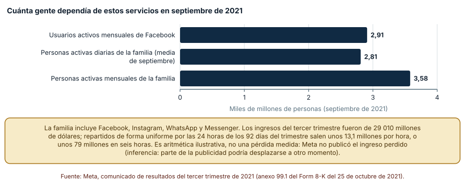
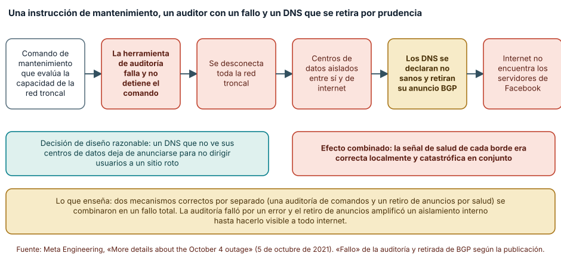

# Meta/Facebook (2021): el día que una empresa desapareció de internet

> **Qué es esta página.** Un caso de estudio de fallo: la realidad frente a la teoría del curso. No es una clase ni un rol. Separa lo que las fuentes **documentan**, lo que este análisis **infiere** y lo que **no se sabe**. Habla de decisiones, procesos y sistemas, no de personas. Fecha de consulta de todas las fuentes: 16 de noviembre de 2026.

**Resumen.** El 4 de octubre de 2021, Facebook, Instagram, WhatsApp y Messenger quedaron inaccesibles durante unas seis horas. Según la propia empresa, durante un trabajo rutinario de mantenimiento un comando destinado a evaluar la capacidad de la red troncal desconectó por error todas las conexiones entre sus centros de datos, y una herramienta de auditoría con un error no lo detuvo. Después, los servidores DNS de la compañía, al no poder hablar con los centros de datos, retiraron sus propios anuncios de rutas y dejaron de ser alcanzables desde internet. Recuperarlo exigió acceso físico a las instalaciones.

## 1. Ficha histórica

| Dato | Detalle | Fuente |
| --- | --- | --- |
| Organización | Facebook, Inc., hoy Meta (el sitio de ingeniería se llama «Engineering at Meta»); sede en 1601 Willow Road, Menlo Park, California | Form 10-Q de 2021 |
| Responsable institucional | Mark Zuckerberg, «founder, Chairman, and CEO»; el artículo técnico lo firma Santosh Janardhan | Form 10-Q de 2021; Meta Engineering |
| Fecha | 4 de octubre de 2021; primeros cambios de rutas hacia las 15:40 UTC | Cloudflare |
| Duración | «Aproximadamente seis horas»; Facebook vuelve a estar conectado a internet hacia las 21:28 UTC | Form 10-Q; Cloudflare |
| Servicios afectados | Facebook, Instagram, WhatsApp y servicios afiliados | Cloudflare; Meta Engineering |
| Causa declarada | Una combinación de un error y un fallo (bug) | Form 10-Q de 2021 |
| Datos de usuarios | La empresa afirma que no hubo actividad maliciosa ni evidencia de que los datos de usuarios se vieran comprometidos | Meta Engineering (4 oct 2021) |
| Estado posterior | Meta publicó un análisis y anunció revisar sus procesos y ensayos; no se cuantifica en las fuentes consultadas el costo directo del incidente | Meta Engineering (5 oct 2021) |

## 2. Contexto y objetivo del sistema

Facebook opera una red global propia: una **red troncal** (*backbone*) de decenas de miles de millas de fibra que conecta todas sus instalaciones, de dos tipos: centros de datos enormes, donde se almacenan los datos y se hace el cómputo pesado, e instalaciones pequeñas que conectan la red troncal con el resto de internet y con los usuarios (Meta Engineering). El objetivo del sistema es que cualquier aplicación del usuario llegue al borde más cercano y que este hable por la red troncal con el centro de datos que corresponda.

Dos servicios de infraestructura son el centro de este caso. **DNS** traduce nombres como un nombre de sitio en direcciones IP; las consultas las responden los servidores autoritativos de la empresa, alojados en las instalaciones de borde. **BGP** (border gateway protocol) es el protocolo con el que cada red le dice al resto de internet qué direcciones puede alcanzar; si una red deja de anunciar un prefijo, ese prefijo deja de ser alcanzable (Cloudflare).

## 3. Mercado, usuarios afectados y casos de uso

- **Usuarios:** al 30 de septiembre de 2021, 2 910 millones de usuarios activos mensuales de Facebook y 3 580 millones de personas activas mensuales en la familia de aplicaciones (comunicado de resultados del tercer trimestre).
- **Casos de uso:** redes sociales, mensajería y publicaciones en Facebook, Instagram y WhatsApp (los servicios que Cloudflare confirma caídos). Las fuentes consultadas no detallan usos ni cifras por caso de uso.
- **Efecto sobre terceros de internet:** Cloudflare observó que los resolvedores DNS públicos como 1.1.1.1 y 8.8.8.8 empezaron a devolver y almacenar respuestas de error (SERVFAIL), y que las aplicaciones y los usuarios reintentaron de forma agresiva; Cloudflare cifra en unas 30 veces las consultas que gestionaban los resolvedores del mundo respecto de lo habitual (Cloudflare).

**Cómo leer la figura.** Cada barra son miles de millones de personas en septiembre de 2021 con escala desde cero. Mira que la familia de aplicaciones sumaba más personas que la propia Facebook y que las diarias eran casi tantas como los mensuales de Facebook. **Dónde deja de valer:** son cifras de uso de la empresa de un mes concreto y las personas activas pueden contar la misma persona en varias aplicaciones sin duplicados internos, pero no es el número de personas afectadas en el apagón, que Meta no publicó.

## 4. Cómo funcionaba el sistema, de principio a fin

1. La aplicación del usuario necesita una dirección: pregunta a un **resolvedor DNS** (el de su operador o uno público).
2. El resolvedor pregunta a los servidores DNS autoritativos de la empresa. Esos servidores están en instalaciones pequeñas y tienen direcciones conocidas, que se anuncian al resto de internet con **BGP**.
3. Con la dirección, la petición llega al borde más cercano, que habla por la red troncal con un centro de datos grande donde se recuperan y procesan los datos.
4. **Regla de salud del DNS:** los servidores DNS retiran sus anuncios BGP si ellos mismos no pueden hablar con los centros de datos, porque se interpreta como una conexión de red enferma. Es una decisión de diseño para no enviar a los usuarios a un sitio roto (Meta Engineering).
5. **Mantenimiento:** los ingenieros sacan a menudo partes de la red troncal para reparar fibra, añadir capacidad o actualizar el software de los routers. Los comandos pasan por una herramienta de **auditoría** que debe detener los que sean peligrosos (Meta Engineering).

**Cómo leer la figura.** El camino de izquierda a derecha es el de una petición; la franja gris es la red troncal que une el borde con el centro de datos. Mira la caja roja: el DNS vive en el borde, pero su salud depende de ver el centro de datos. **Dónde deja de valer:** es una simplificación de la descripción de Meta; no incluye cachés, redes de entrega de contenido ni la topología detallada de las instalaciones.

## 5. Negocio y economía: qué estaba en juego

Meta obtiene casi todo su ingreso de la publicidad: en el tercer trimestre de 2021 los ingresos totales fueron 29 010 millones de dólares, de los cuales 28 276 millones (97,5 %) fueron publicidad (comunicado de resultados). Como orden de magnitud **ilustrativo**, 29 010 millones repartidos de forma uniforme entre las 2 208 horas del trimestre (92 días) dan unos 13,1 millones de dólares por hora, o unos 79 millones en seis horas. No es una pérdida medida: Meta no publicó el ingreso perdido y las fuentes consultadas no lo cuantifican. Lo que sí está documentado es que la empresa declaró el apagón como factor de riesgo y lo describió como de unas seis horas en su informe trimestral.

Hay además un coste no financiero: el 4 de octubre muchas empresas y personas dependían de estos servicios para comunicarse o vender. Las fuentes consultadas no lo miden.

## 6. Arquitectura y esquemas

El rasgo arquitectónico clave es el **acoplamiento entre planos**: el plano de datos (usuarios hacia servidores), el plano de control (rutas BGP y DNS) y el plano de gestión (herramientas para operar y recuperar) compartían el mismo camino: la red troncal.

**Cómo leer la figura.** De izquierda a derecha, cada caja es una consecuencia de la anterior; las rojas son fallos y la dorada la decisión de diseño que amplificó. Mira el cuarto y quinto eslabón: un problema interno se hizo visible desde fuera porque cada borde reaccionó bien individualmente. **Dónde deja de valer:** es la versión pública de Meta, sin detalle del comando ni del error de auditoría, que la empresa no describió.

**Cómo leer la figura.** Cada caja es un obstáculo que Meta menciona y las flechas son la secuencia lógica en que aparecieron. Mira que la dureza de seguridad aparece al final de la cadena, no al principio. **Dónde deja de valer:** el orden es el de la explicación de Meta, no un registro temporal de las acciones; la empresa no da horas por obstáculo.

## 7. Línea de tiempo del incidente

| Hora (UTC, 4 de octubre de 2021) | Hecho documentado | Fuente |
| --- | --- | --- |
| Antes de las 15:40 | Trabajo rutinario de mantenimiento; se emite un comando para evaluar la capacidad de la red troncal global | Meta Engineering |
| ≈ 15:40 | Pico de cambios de rutas BGP de Facebook; empiezan las retiradas de rutas | Cloudflare |
| 15:51 | Cloudflare abre una incidencia interna por «Facebook DNS lookup returning SERVFAIL» | Cloudflare |
| 15:58 | Se advierte que Facebook ha dejado de anunciar las rutas de sus prefijos DNS | Cloudflare |
| Entre medias (sin hora publicada) | Ingenieros desplazados a los centros de datos; los protocolos de acceso seguro retrasan el trabajo | Meta Engineering |
| ≈ 21:00 | Renovada actividad BGP; pico a las 21:17 | Cloudflare |
| ≈ 21:20 a 21:28 | El nombre de facebook.com vuelve a resolverse; Facebook aparece reconectado | Cloudflare |
| Tras restablecer la red | Reinicio gradual de los servicios para evitar una oleada de tráfico; descensos de decenas de megavatios en consumo eléctrico de centros de datos | Meta Engineering |
| 5 de octubre | Meta publica el análisis detallado | Meta Engineering |
| 25 de octubre | El informe trimestral describe el apagón como de «aproximadamente seis horas» | Form 10-Q |

**Cómo leer la figura.** El eje son horas desde las 15:00 UTC; la barra roja es el periodo en que las rutas del DNS no estaban anunciadas, vista desde Cloudflare. Mira que la parte larga fue la recuperación, no el fallo, que fue casi instantáneo. **Dónde deja de valer:** es la vista externa (BGP y DNS); desde dentro, las fuentes no precisan cuándo se restableció cada servicio, y la «seis horas» de Meta incluye la recuperación completa.

## 8. Qué falló en cada instancia

**Documentado por Meta.**

- **Comando de mantenimiento.** Un comando con la intención de evaluar la disponibilidad de capacidad de la red troncal desconectó sin querer todas las conexiones de la red troncal.
- **Auditoría.** «Un fallo en esa herramienta de auditoría» impidió detenerlo.
- **DNS y BGP.** Los servidores DNS retiraron sus anuncios BGP al verse aislados y dejaron de ser alcanzables aunque seguían operativos.
- **Acceso.** El acceso normal y el fuera de banda estaban caídos, y la pérdida del DNS rompió muchas de las herramientas internas de diagnóstico.
- **Acceso físico.** Enviar ingenieros a los centros de datos llevó tiempo por las medidas de seguridad física y de sistema, diseñadas para ser difíciles de eludir.
- **Reinicio.** Para evitar una subida brusca de tráfico y de consumo eléctrico, se reactivó gradualmente. Meta dice que los ejercicios de «tormenta» llevan tiempo ayudándoles en esto, aunque nunca habían simulado la pérdida de la red troncal global.

**Documentado por Cloudflare (vista externa).** Retirada de rutas BGP, fallos SERVFAIL, reintentos de aplicaciones y usuarios que multiplicaron por unas 30 las consultas de los resolvedores.

**Inferido (análisis propio).**

- Los dos mecanismos que se encadenaron (auditoría de comandos y retiro de anuncios por salud) estaban pensados para proteger. El fallo es de **composición**: cada uno razonable por separado, el conjunto es un punto único de fallo.
- Las herramientas para operar compartían dependencias con lo que operaban. Es una consecuencia de lo que Meta describe sobre DNS y acceso, no una afirmación suya.

**No se sabe (por las fuentes públicas).** El comando exacto, la naturaleza del error de la auditoría, el número de personas afectadas por servicio, el ingreso perdido, el orden y la duración de cada tarea de recuperación, y el estado de las mejoras que Meta dijo estar estudiando.

## 9. Las mejoras que debieron hacerse (análisis propio apoyado en la fuente)

**Cómo leer la figura.** Cada tarjeta enlaza algo que Meta describe con una mejora que habría cambiado el desenlace. En esta figura el verde marca la mejora propuesta; la leyenda de colores de arriba es genérica de las tarjetas. **Dónde deja de valer:** son propuestas didácticas, no hallazgos de Meta; cada una tiene costo, riesgo de falsos positivos y una relación con la seguridad que no se evalúa aquí.

| Área | Mejora | Qué enseña el curso |
| --- | --- | --- |
| Cambios | Auditoría probada con casos peligrosos; confirmación doble y alcance máximo de un cambio de red | SE-411, SE-374 |
| Diseño de dependencias | Que los mecanismos de salud local no puedan desconectar todo a la vez; límites globales | SE-379, SE-341, SE-343 |
| Recuperación | Vía de emergencia independiente (otra red, otro proveedor) y herramientas sin dependencia del DNS de producción | SE-430, SE-427 |
| Acceso | Procedimiento de acceso de emergencia ensayado, con autorización preacordada | SE-427, SE-428 |
| Ensayos | Ejercicio de pérdida de la red troncal y de reinicio escalonado | SE-346, SE-430 |
| Aprendizaje | Revisión sin culpa y publicación de lecciones | SE-429 |

La recuperación ordenada del final es un buen ejemplo de lo que se hizo bien: Meta describe que reactivar todo a la vez podía provocar nuevos fallos y optó por subir la carga con cuidado, apoyándose en simulacros previos.

## 10. Vínculo con el curso

- [SE-041 · DNS: nombres, resolución y fallos](../../classes/part-03-redes-internet-y-protocolos/se-041-dns-nombres-resolucion-y-fallos/) y [SE-039 · IPv4, IPv6, subredes, rutas y NAT](../../classes/part-03-redes-internet-y-protocolos/se-039-ipv4-ipv6-subredes-rutas-y-nat/).
- [SE-341 · Fallos parciales y modelos de red](../../classes/part-28-concurrencia-y-sistemas-distribuidos/se-341-fallos-parciales-y-modelos-de-red/), [SE-343 · Consenso, elección y coordinación](../../classes/part-28-concurrencia-y-sistemas-distribuidos/se-343-consenso-eleccion-y-coordinacion/) y [SE-346 · Caos controlado y pruebas de distribución](../../classes/part-28-concurrencia-y-sistemas-distribuidos/se-346-caos-controlado-y-pruebas-de-distribucion/).
- [SE-374 · Revisión, análisis estático y quality gates](../../classes/part-31-calidad-rendimiento-y-resiliencia/se-374-revision-analisis-estatico-y-quality-gates/) y [SE-379 · Circuit breakers, bulkheads y degradación](../../classes/part-31-calidad-rendimiento-y-resiliencia/se-379-circuit-breakers-bulkheads-y-degradacion/).
- [SE-411 · Tests de seguridad y políticas como gates](../../classes/part-34-ci-cd-iac-y-platform-engineering/se-411-tests-seguridad-y-politicas-como-gates/).
- [SE-427 · Runbooks, on-call y escalamiento](../../classes/part-35-observabilidad-sre-e-incidentes/se-427-runbooks-on-call-y-escalamiento/), [SE-428 · Gestión de incidentes y comunicación](../../classes/part-35-observabilidad-sre-e-incidentes/se-428-gestion-de-incidentes-y-comunicacion/), [SE-429 · Postmortems sin culpa](../../classes/part-35-observabilidad-sre-e-incidentes/se-429-postmortems-sin-culpa-y-aprendizaje/) y [SE-430 · Continuidad, disaster recovery y ejercicios](../../classes/part-35-observabilidad-sre-e-incidentes/se-430-continuidad-disaster-recovery-y-ejercicios/).

## 11. Qué aprender y qué no generalizar

**Aprender.**

1. Un cambio de red debe tener un límite de alcance que la herramienta imponga, no solo la costumbre.
2. Una regla de salud local («si no veo mi backend, me retiro») es peligrosa cuando todas las instancias ven el mismo problema a la vez.
3. La herramienta con la que se repara no puede depender del sistema que se repara: DNS, red y acceso de emergencia deben tener un camino propio.
4. La seguridad física y la recuperación rápida se contraponen: decide el equilibrio con un procedimiento ensayado, no durante la crisis.
5. Reiniciar de golpe también falla: planifica una subida gradual.
6. Un fallo se ve desde fuera mucho antes de que se entienda desde dentro; las vistas externas (BGP, DNS) son datos útiles.

**No generalizar.**

- No prueba que la red de Facebook fuera mal diseñada en general: Meta la describe como un diseño con auditoría, tormentas y seguridad, que falló por una combinación específica.
- No prueba que el endurecimiento de seguridad sea malo; Meta defiende la compensación.
- Las cifras de duración y de usuarios son de 2021 y específicas de esa empresa.
- No hay evidencia en las fuentes de actividad maliciosa: Meta lo descarta explícitamente.

## 12. Fuentes

Todas consultadas el 16 de noviembre de 2026 y comprobadas con descarga directa (HTTP 200).

1. Santosh Janardhan, «Update about the October 4th outage», Engineering at Meta, 4 de octubre de 2021. <https://engineering.fb.com/2021/10/04/networking-traffic/outage/>. Respalda: causa declarada (cambio de configuración en routers de la red troncal), ausencia de actividad maliciosa.
2. Santosh Janardhan, «More details about the October 4 outage», Engineering at Meta, 5 de octubre de 2021. <https://engineering.fb.com/2021/10/05/networking-traffic/outage-details/>. Respalda: comando, auditoría, DNS y BGP, acceso físico, reinicio gradual.
3. Celso Martinho y Tom Strickx, «Understanding how Facebook disappeared from the Internet», Cloudflare Blog, 4 de octubre de 2021. <https://blog.cloudflare.com/october-2021-facebook-outage/>. Respalda: horas UTC, retirada de rutas BGP, SERVFAIL, multiplicación por 30 de las consultas.
4. Facebook, Inc., Form 10-Q del trimestre terminado el 30 de septiembre de 2021 (25 de octubre de 2021). <https://www.sec.gov/Archives/edgar/data/1326801/000132680121000065/fb-20210930.htm>. Respalda: apagón de unas seis horas, combinación de error y fallo, sede y descripción del fundador, presidente y director ejecutivo.
5. Facebook, Inc., comunicado de resultados del tercer trimestre de 2021, anexo 99.1 del Form 8-K. <https://www.sec.gov/Archives/edgar/data/1326801/000132680121000062/fb-09302021xexhibit991.htm>. Respalda: usuarios y personas activas, ingresos de 29 010 millones y publicidad de 28 276 millones.
