# Post Office Horizon

[↑ Casos de fallo](README.md) · [← Boeing 737 MAX y MCAS](boeing-737-max-mcas.md) · [Equifax 2017 →](equifax-2017.md)

> **Qué es esta página.** Un caso de estudio de fallo: la realidad frente a la teoría del curso. No es una clase ni un rol. Separa lo que las fuentes **documentan**, lo que este análisis **infiere** y lo que **no se sabe**. Habla de decisiones, procesos y sistemas, no de personas. Cientos de personas fueron acusadas injustamente de robo y fraude, algunas encarceladas y algunas fallecieron antes de ser reparadas; este caso las trata con respeto, no nombra a ninguna persona afectada y no emite juicios sobre individuos. Fecha de consulta de todas las fuentes: 23 de noviembre de 2026.

**Resumen.** Horizon fue el sistema informático de contabilidad de las sucursales del Post Office, la red postal del Reino Unido, desde 2000. Cuando el sistema mostraba un faltante en las cuentas de una sucursal, el Post Office lo trataba como una pérdida real que debía cubrir el subpostmaster (el gestor de la sucursal), y en algunos casos lo perseguía penalmente por robo o fraude. Un juicio civil de 2019 sobre el funcionamiento del sistema y una sentencia penal de apelación de 2021 establecieron que Horizon tenía errores y defectos con riesgo material de producir faltantes aparentes, que la organización no reveló lo que sabía de su fiabilidad, que los subpostmasters no tenían modo de disputar los faltantes dentro del sistema y que el nivel de investigación era pobre; el Court of Appeal anuló 39 de las 42 condenas que examinó y el Parlamento aprobó en 2024 una ley que anula otras. La investigación pública estatutaria ha publicado el volumen 1 de su informe final, centrado en el impacto humano y la reparación; el examen del desarrollo técnico y del gobierno está en volúmenes aún pendientes. Este caso recorre el sistema y sus procesos en varios niveles de zoom, separa lo que consta en sentencias y en el informe de lo que no se sabe, y propone, rotulado como análisis propio, qué controles de producto, de proceso y de gobierno habrían cortado cada eslabón. Declaración de alcance: el caso se apoya en dos sentencias, una ley y un volumen de informe; no cubre el contenido de los volúmenes pendientes, no cuantifica las indemnizaciones pagadas y no describe el código de Horizon, que no es público.

**Cómo leer esta página.** Cada afirmación factual lleva entre paréntesis su fuente: «Bates n.º 6» es la sentencia de la High Court de 16 de diciembre de 2019 sobre el funcionamiento de Horizon, con el número de párrafo; «Hamilton» es la sentencia del Court of Appeal (Criminal Division) de 23 de abril de 2021; «Ley 2024» es el *Post Office (Horizon System) Offences Act 2024*; «Investigación, vol. 1» es el primer volumen del informe final de la investigación pública, de julio de 2025. Lo que no lleva fuente es análisis propio y está rotulado. Las figuras son dibujos propios; ninguna repite una tabla y todas dicen dónde dejan de valer.

## Ficha histórica

| Dato | Detalle | Fuente |
| --- | --- | --- |
| Organizaciones | Post Office Limited (red postal del Reino Unido; operador y, en estos casos, acusador); Fujitsu (proveedor de Horizon, sucesor de ICL) | Bates n.º 6; Hamilton |
| Sistema | Horizon, nacido del proyecto Pathway (1996-1999) de ICL con el Post Office y la Agencia de Prestaciones, que se retiró; versión original (Legacy Horizon, 2000-2010) y Horizon Online (HNG-X desde 2010, después HNG-A) | Bates n.º 6, párr. 299; Hamilton, párr. 56 |
| Escala del sistema | Unos seis millones de transacciones diarias en unas 11 500 sucursales y 500 000 usuarios desde su introducción, según un comunicado del Post Office de 2015 citado en la sentencia | Bates n.º 6, párr. 519 |
| Problema | Faltantes en las cuentas de las sucursales que el Post Office atribuyó a los subpostmasters; en las apelaciones, 42 personas condenadas tras ser procesadas por el propio Post Office | Hamilton |
| Resolución judicial | 16 de diciembre de 2019: la High Court examina Horizon; 23 de abril de 2021: el Court of Appeal anula 39 de 42 condenas; 24 de mayo de 2024: ley que anula condenas en su ámbito | Bates n.º 6; Hamilton; Ley 2024 |
| Magnitud documentada | Las pérdidas reclamadas por los demandantes de la High Court sumaban unos 18 millones de libras; 42 apelaciones; 17 relatos de primera mano en el volumen 1 | Hamilton, párr. 20; Investigación, vol. 1 |
| Estado | La investigación pública publicó el volumen 1 el 8 de julio de 2025; los volúmenes restantes se publicarán juntos y siguen pendientes | Investigación, vol. 1; sitio de la investigación |

Las fuentes no dan una cifra total de personas procesadas ni de personas afectadas; este caso no la estima. El importe de unos 18 millones de libras es el de las pérdidas reclamadas por quienes litigaron en la High Court, no el total de la red.

### Sedes, centros y lugares

| Lugar | Qué consta | Fuente |
| --- | --- | --- |
| Sucursales del Post Office en el Reino Unido | Unas 11 500 sucursales con Horizon en 2015 | Bates n.º 6, párr. 519 |
| Royal Courts of Justice, Londres | Sede de la High Court y del Court of Appeal que dictaron las sentencias | Bates n.º 6; Hamilton |
| Investigación pública | Estatutaria e independiente; 226 días de audiencias, 298 testigos con declaración oral y unos 274 604 documentos aportados | Investigación, vol. 1 |

**No se sabe** a partir de las fuentes: la ubicación de los centros de datos y de soporte de Horizon, el tamaño de los equipos del Post Office y de Fujitsu y las sedes de cada empresa; este caso no los inventa.

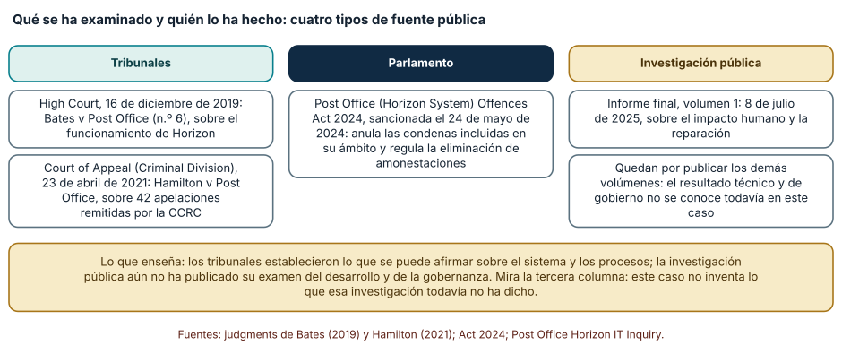

**Cómo leer la figura.** Tres columnas con los tres tipos de fuente pública. Mira la tercera: la investigación pública aún no ha publicado el examen del desarrollo y del gobierno, y este caso lo declara en lugar de suponerlo. **Dónde deja de valer:** no ordena las fuentes por peso; los tribunales fijan hechos con valor jurídico y la investigación examina además causas y responsabilidades.

### Organización

La estructura que importa para este caso es la relación entre cuatro partes: el Post Office como organización que contrata a los subpostmasters y mantiene la red; Fujitsu como proveedor y soporte técnico de Horizon; el Gobierno, como accionista del Post Office, cuyo papel examina la investigación (Investigación, vol. 1, resumen); y los tribunales. Los hechos documentados son que el Post Office tenía derecho contractual a obtener cualquier información de Horizon en poder de Fujitsu (Hamilton, párr. 18) y que acusaba por sí mismo a las personas que había contratado (Hamilton). **No se sabe:** el organigrama de cada organización y quién tomó cada decisión; esa información corresponde a los volúmenes pendientes de la investigación.

### Visión y misión

Las fuentes consultadas no contienen una declaración de visión o misión del Post Office. Lo que consta es su posición pública: en 2015 declaró que Horizon era «robusto y eficaz» al gestionar seis millones de transacciones diarias y que estaba auditado de forma independiente (Bates n.º 6, párr. 519). El análisis propio es que una organización que se define como depositaria de la confianza pública sobre el dinero ajeno tiene un incentivo fuerte para no dudar del sistema que respalda esa confianza.

## Contexto y problema

El Post Office gestiona una red de sucursales donde se venden servicios postales y se realizan operaciones de dinero, y para contabilizar todo ello necesitaba un sistema que registrara cada transacción en cada mostrador y produjera las cuentas de cada sucursal. Horizon se concibió en los años noventa como el proyecto Pathway, de ICL con el Post Office y la Agencia de Prestaciones, para informatizar entre otras cosas el pago de prestaciones con tarjeta; la Agencia se retiró del proyecto y lo que quedó se convirtió en Horizon, hoy llamado Legacy Horizon (Bates n.º 6, párr. 299). La implantación inicial se retrasó por problemas técnicos y, desde una etapa temprana, algunos subpostmasters notificaron discrepancias y faltantes que atribuían a fallos del sistema (Hamilton, párr. 19).

**El problema que el sistema resolvía.** Dar a una red de miles de sucursales independientes una contabilidad común y fiable. Ese valor es real: una única fuente de verdad sobre cada transacción permite que cualquier sucursal cierre su balance y que la central consolide. El riesgo que no se vio, o no se aceptó, es el de que una única fuente de verdad que puede estar equivocada sea tratada como infalible.

**La apuesta (documentado).** El Post Office sostuvo durante años que Horizon era fiable y trató los faltantes como pérdidas reales, causadas por deshonestidad o, en el mejor de los casos, descuido del subpostmaster; su posición era que cada subpostmaster debía demostrar que el faltante no era responsabilidad suya y, si no podía, debía cubrirlo (Hamilton, párr. 20). Un informe interno de agosto de 2010 afirmaba que Horizon, en ambas versiones, era robusto, que el dinero faltante lo era por robo en la sucursal y advertía de que cualquier revisión que se encargase tendría que divulgarse en los tribunales y que la percepción de que el Post Office dudaba de sus sistemas obligaría a suspender las acusaciones y plantearía una pregunta al Court of Appeal sobre los procesos pasados (Hamilton, párr. 24).

**El problema oculto (análisis propio).** Cuando una organización tiene a la vez la obligación de mantener la confianza en un sistema, el poder de reclamar dinero a partir de él y la facultad de perseguir penalmente, las señales que desmienten al sistema se convierten en amenazas institucionales y no en información. La ingeniería de sistemas llama a esto un conflicto de incentivos en el circuito de retroalimentación.

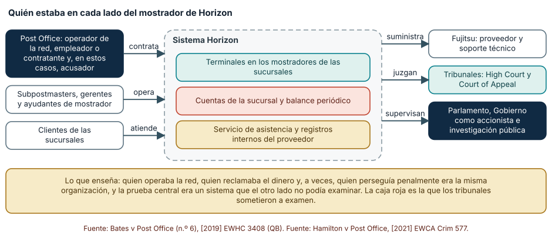

**Cómo leer la figura.** Izquierda: quienes contrataban, operaban y atendían; centro: el sistema con tres elementos; derecha: proveedor, tribunales y supervisores. Mira la caja roja: es la que los tribunales sometieron a examen. **Dónde deja de valer:** no muestra a los clientes de cada sucursal más allá de su papel ni a todos los actores del Gobierno.

## Mercado, usuarios y casos de uso

- **Subpostmasters y personal de las sucursales.** Personas contratadas por el Post Office, o por sus predecesores, como subpostmasters, gestores y ayudantes de mostrador (Hamilton). Eran los usuarios de Horizon y quienes respondían de sus faltantes.
- **Clientes de las sucursales.** Usuarios finales de los servicios postales y de dinero; las 11 500 sucursales atendían seis millones de transacciones diarias en 2015 (Bates n.º 6, párr. 519).
- **El Post Office como organización.** Usaba las cuentas de Horizon para consolidar, para reclamar faltantes y, en una parte de los casos, para decidir procesamientos penales.
- **Fujitsu.** Mantenía el sistema, recibía las llamadas a la asistencia y registraba errores en documentos internos (Hamilton, párr. 17).
- **Tribunales y Parlamento.** Los destinatarios de la prueba basada en Horizon, y después de las sentencias y de la ley de 2024.
- **Quienes fueron afectados.** El volumen 1 de la investigación describe, a partir de 17 relatos de primera mano, a personas que enfermaron, sufrieron problemas de salud mental, quebraron, tuvieron daño reputacional, fueron encarceladas injustamente o fallecieron antes de recibir una compensación (Investigación, vol. 1, resumen).

**Casos de uso del sistema.** (1) Registrar cada transacción del mostrador; (2) producir las cuentas de la sucursal y su balance por periodo; (3) consolidar en la central; (4) servir de prueba de lo que ocurrió en cada sucursal. Los tres primeros eran funciones del sistema; el cuarto es el que los tribunales examinaron.

## Funcionalidad de principio a fin

1. **Operación diaria.** El subpostmaster o un ayudante registra cada transacción en el terminal; Horizon acumula los datos de la sucursal (Bates n.º 6).
2. **Cierre de periodo.** Al final del periodo de balance, la sucursal produce un estado de cuentas que el subpostmaster acepta; el Post Office sostuvo en el juicio civil que esa aceptación tenía el efecto jurídico de una «cuenta saldada», argumento que el juez rechazó en la sentencia sobre cuestiones comunes y que, según su juicio de 2019, quedó además desmentido por una decisión de diseño: el Post Office decidió no incluir una función de disputa en Horizon (Bates n.º 6, párr. 300 a 302).
3. **Faltantes.** Si el balance mostraba un faltante, el Post Office lo trataba como un débito a cubrir. Cuando un subpostmaster lo discutía por la línea de asistencia, el Post Office lo trataba como una deuda no discutida; como máximo se ofrecía tiempo para pagar, con deducciones de la remuneración durante doce meses; aunque el subpostmaster dimitiera, para el Post Office seguía debiendo la suma (Hamilton, párr. 21).
4. **Registros de incidencias.** Cuando un subpostmaster llamaba y la llamada pasaba a la sección técnica de Fujitsu, se creaba un documento llamado PEAK; los PEAK alimentaban un registro de errores conocidos llamado KEL (Hamilton, párr. 17).
5. **Procesamiento.** En algunos casos el Post Office procesaba al subpostmaster, con la fiabilidad de los datos de Horizon como elemento esencial de la acusación (Hamilton, párr. 59).

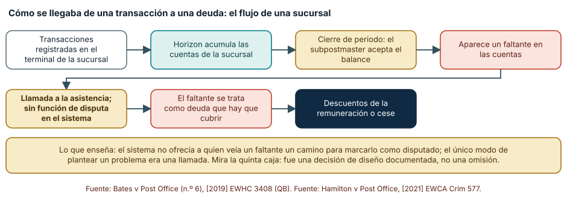

**Cómo leer la figura.** De izquierda a derecha y de arriba abajo, desde la transacción hasta las consecuencias para el subpostmaster. Mira la quinta caja: no había una función de disputa en el sistema. **Dónde deja de valer:** es un esquema del proceso que describen las sentencias, no del flujo de datos interno de Horizon.

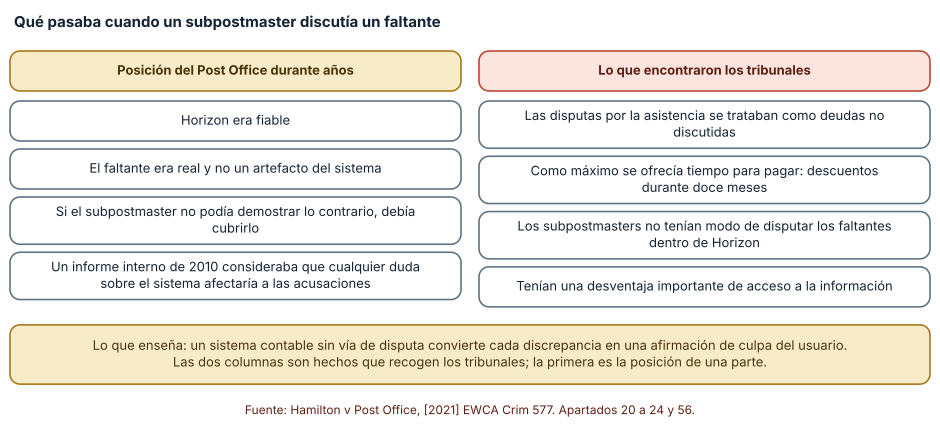

**Cómo leer la figura.** A la izquierda, la posición del Post Office; a la derecha, lo que los tribunales encontraron. Mira la última línea de la derecha: los subpostmasters tenían una desventaja importante para obtener la información que les habría permitido investigar. **Dónde deja de valer:** la columna izquierda es la posición de una parte según las sentencias, no una descripción neutral.

### El día a día de un cambio de software en Horizon

El proceso de cambios y despliegues de Horizon no es público más allá de lo que citan las sentencias. Lo documentado es que Horizon evolucionó desde su origen y que su robustez pudo variar a lo largo de su vida según cómo se cambiara el sistema (Bates n.º 6, apartado de las declaraciones conjuntas de los expertos, párr. 40); que la versión Horizon Online se introdujo en 2010 (Bates n.º 6, párr. 461); y que el juez distinguió entre Legacy Horizon (2000-2010), HNG-X (desde 2010) y HNG-A (Hamilton, párr. 56). **No se sabe:** cómo se gestionaba cada versión, quién aprobaba cada cambio y qué pruebas se hacían antes de liberarlo.

## Negocio y economía

El Post Office es una red postal con un modelo de servicios de bajo margen por transacción que depende de miles de sucursales operadas por contratistas; esa estructura exige que cada sucursal pueda cerrar sus cuentas con fiabilidad. Los hechos económicos que constan son escasos:

- **El coste que recaía en el subpostmaster.** Los faltantes se trataban como deudas a cubrir; en la High Court, las pérdidas reclamadas por los demandantes sumaban unas 18 millones de libras (Hamilton, párr. 20).
- **El coste para el sistema de justicia.** 42 apelaciones remitidas por la CCRC en un solo procedimiento y una ley específica para anular otras condenas (Hamilton; Ley 2024).
- **El coste de reparar.** El volumen 1 describe varios esquemas de compensación (el Horizon Shortfall Scheme, el esquema de la orden de litigio colectivo y los de condenas) y emite 19 recomendaciones sobre su funcionamiento; no cuantifica en el resumen consultado el total pagado (Investigación, vol. 1, resumen). **No se sabe** el importe total de las compensaciones.

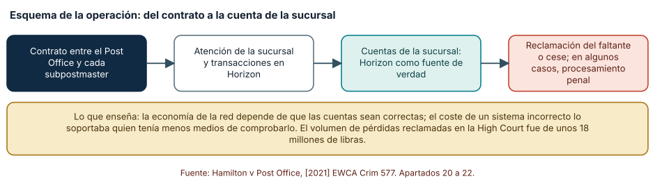

**Cómo leer la figura.** Cuatro etapas en cadena; no es un flujo de dinero. Mira la tercera: las cuentas de Horizon se tratan como fuente de verdad, y de ahí cuelga la cuarta. **Dónde deja de valer:** las sentencias discuten los términos contractuales exactos; la figura no los resume.

### Costos operativos y costo del incidente

| Rubro | Cifra | Fuente |
| --- | --- | --- |
| Pérdidas reclamadas por los demandantes de la High Court | Unos 18 millones de libras | Hamilton, párr. 20 |
| Apelaciones remitidas por la CCRC | 42 (39 estimadas, 3 desestimadas) | Hamilton, párr. 447 |
| Audiencias de la investigación pública | 226 días; 298 testigos; unos 274 604 documentos | Investigación, vol. 1 |
| Recomendaciones del volumen 1 | 19, entre ellas definir la reparación «plena y justa» | Investigación, vol. 1 |
| Importe total de compensaciones | No se sabe | No consta en las fuentes consultadas |
| Coste del desarrollo y mantenimiento de Horizon | No se sabe | No consta |
| Coste para el Post Office de las investigaciones y los litigios | No se sabe | No consta |

No se inventa ninguna cifra para las filas sin fuente.

### Competidores y contexto de mercado

Las fuentes no describen competidores del Post Office. El contexto que sí consta es el de la relación con el Estado: el Gobierno era accionista del Post Office y la investigación examina su papel de supervisión (Investigación, vol. 1, resumen). Qué hubiera ocurrido con otra solución técnica no consta y este caso no lo especula.

## Arquitectura y esquemas

Los hechos de esta sección vienen de las sentencias y del volumen 1 de la investigación. Los dibujos de componentes son un modelo funcional hecho con lo que describen, porque ninguna fuente publica el diseño interno de Horizon.

### Nivel 1 · Contexto

La figura de contexto está en «Contexto y problema». Resumen: un operador que contrata, un sistema que registra y calcula, un proveedor que lo mantiene y lo vigila, y tribunales que lo examinaron años después.

### Nivel 2 · Contenedores: la cadena de la prueba

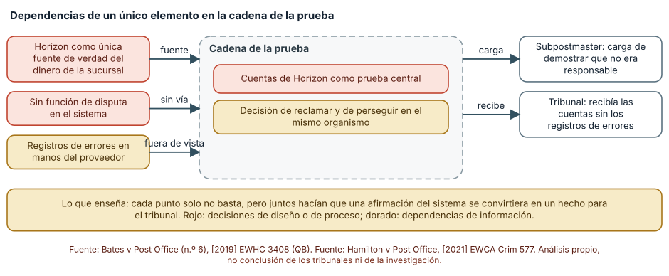

**Cómo leer la figura.** Izquierda: tres dependencias del sistema; centro: la cadena de la prueba; derecha: quienes soportaban su carga. Mira que casi todo lo rojo es una decisión de diseño o de proceso. **Dónde deja de valer:** es un análisis propio de la estructura que las sentencias describen; pueden existir otras dependencias que no figuran.

### Nivel 3 · Componentes: qué se sabe del sistema

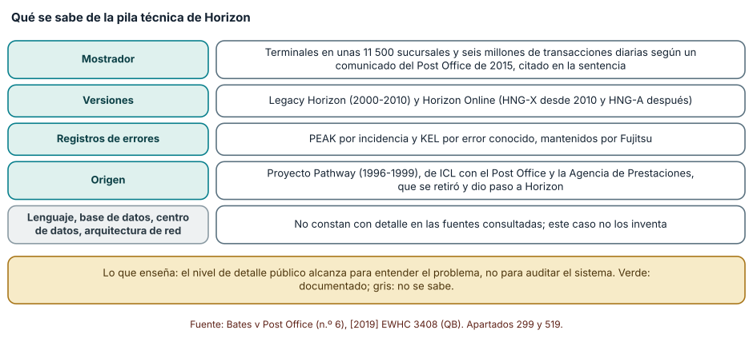

**Cómo leer la figura.** Cada fila es una capa; verde, documentada; gris, no se sabe. Mira que lo documentado es de producto y de proceso, no de arquitectura interna. **Dónde deja de valer:** no pretende describir la pila real, solo el límite de lo público.

### Nivel 4 · Errores reconocidos y cómo se presentaron

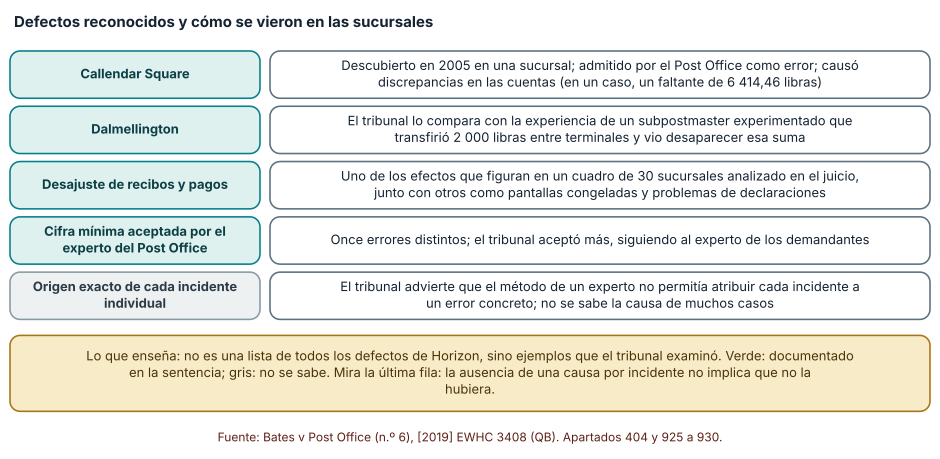

**Cómo leer la figura.** Cada fila es un ejemplo de lo que el tribunal examinó; verde, documentado en la sentencia; gris, lo que se desconoce. Mira la última: el origen de muchos incidentes concretos no se puede atribuir con certeza. **Dónde deja de valer:** no es la lista de todos los defectos de Horizon; el juez trabajó con una tabla de errores que no reproduce este caso.

El error de **Callendar Square** se descubrió en 2005 en una sucursal; el Post Office lo reconoció después como un error («bug») y causó, sin duda, discrepancias en las cuentas (Bates n.º 6, párr. 404). En un registro de visita del responsable de zona figura, en una semana, un faltante de 6 414,46 libras compuesto por transferencias y depósitos que habían aparecido duplicados o no registrados (Bates n.º 6, párr. 404 y siguientes). Otro caso, llamado **Dalmellington**, es el que el juez usa para evaluar la declaración de un subpostmaster experimentado que, tras realizar los pasos rutinarios para transferir 2 000 libras entre terminales, vio que la suma «desaparecía» del sistema; el juez considera su experiencia extraordinariamente parecida a ese error (Bates n.º 6, párr. 927). El juez también cita una anotación interna de un empleado de Fujitsu de febrero de 2006 en la que se decía que «este error lleva años» (Bates n.º 6, párr. 925). La discusión entre los expertos fue de grado: incluso la cifra más baja del experto del Post Office era de 11 errores distintos aceptados, y las partes ya no discutían que existieran numerosos errores (Bates n.º 6, párr. 925 y 930).

### Nivel 5 · Qué significa «robusto»

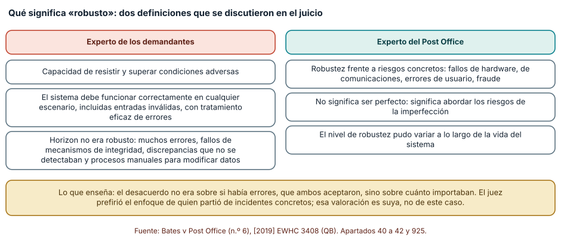

**Cómo leer la figura.** Cada columna es una definición; la de la izquierda exige funcionar bien en cualquier escenario y la de la derecha pide abordar los riesgos de la imperfección. Mira que ambas aceptan que hay faltantes y que el desacuerdo es sobre su causa. **Dónde deja de valer:** el juez prefirió el planteamiento que partía de incidentes concretos (Bates n.º 6, párr. 925); es su valoración, no la de este caso.

### Nivel 6 · La asimetría de información

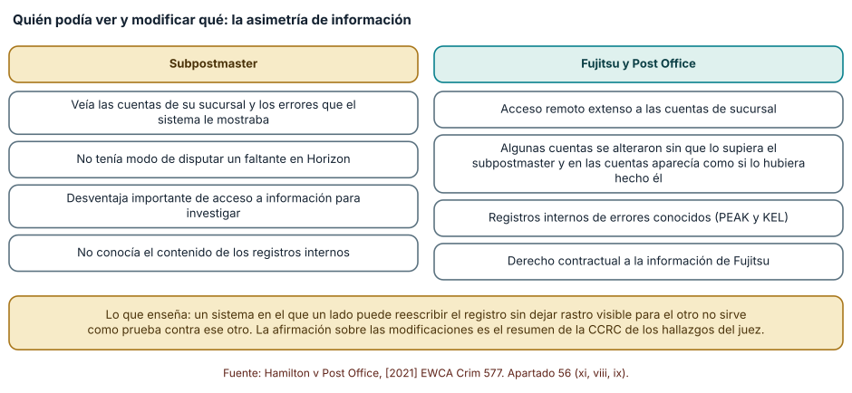

**Cómo leer la figura.** Cada columna es un lado de la relación; la izquierda, con acceso a su propia sucursal; la derecha, con acceso remoto y registros internos. Mira la segunda línea de la derecha: algunas cuentas se alteraron sin que lo supiera el subpostmaster y en las cuentas aparecía como si lo hubiera hecho él. **Dónde deja de valer:** esa afirmación es el resumen que la CCRC hace de los hallazgos del juez; no se verifica aquí contra el texto íntegro de la sentencia de 2019, que es muy extenso.

### Nivel 7 · Los registros internos de errores

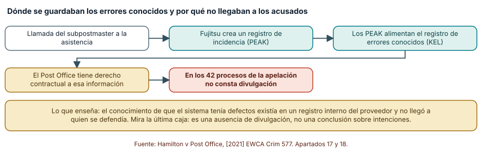

**Cómo leer la figura.** Cada caja es un paso del flujo de registros; la última es una ausencia. Mira la cuarta: el Post Office tenía derecho contractual a esa información. **Dónde deja de valer:** el tribunal dice que, «hasta donde sabemos», no hubo divulgación en los 42 procesos; no afirma nada sobre otros.

### Nivel 8 · Defensa en profundidad: ocho barreras

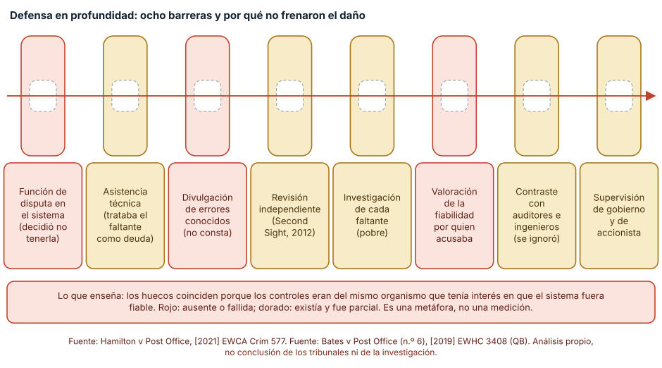

**Cómo leer la figura.** Cada lámina es una barrera; el hueco es el punto por el que el daño pasó. Las rojas faltaban o fallaron; las doradas existían con eficacia parcial. Mira que los huecos se alinean: los controles eran de la misma organización que tenía interés en que el sistema fuera fiable. **Dónde deja de valer:** el modelo de láminas es una metáfora, no una medición; la lista sale de las sentencias y la agrupación en ocho es propia.

Documentado para cada barrera: **función de disputa**, decidió el Post Office no tenerla (Bates n.º 6, párr. 300); **asistencia**, trataba los faltantes como deudas (Hamilton, párr. 21); **divulgación**, no consta en los 42 procesos (Hamilton, párr. 18); **revisión independiente**, encargada en julio de 2012 a Second Sight, que concluyó que en algunas circunstancias Horizon podía ser sistémicamente defectuoso desde la perspectiva del usuario y que el soporte no siempre era adecuado (Hamilton, párr. 26); **investigación de cada faltante**, pobre (Hamilton, párr. 56); **valoración de fiabilidad**, la afirmación interna de 2010 de que era robusto (Hamilton, párr. 24); **contraste con terceros**, ingenieros de Royal Mail y auditores del propio Post Office aportaron evidencia a favor de los subpostmasters (Hamilton, párr. 56); **supervisión del accionista**, objeto de examen por la investigación (Investigación, vol. 1, resumen).

### Hardware utilizado

Las fuentes consultadas documentan terminales en los mostradores de las sucursales y la sucursal como unidad de cuenta; no describen el hardware de Horizon. **No se sabe:** el fabricante y modelo de los terminales, los servidores centrales, las redes de comunicación y los centros de datos.

### Software utilizado

Documentado: dos generaciones de producto, Legacy Horizon y Horizon Online (con HNG-X y después HNG-A), y los registros de incidencias PEAK y KEL (Bates n.º 6; Hamilton, párr. 17 y 56). **No se sabe:** lenguaje, base de datos, mecanismos de replicación, arquitectura de las funciones de acceso remoto y detalles de cada error.

### Infraestructura

La infraestructura documentada es la contractual y organizativa: el Post Office, Fujitsu, la línea de asistencia y la sección técnica que investigaba (Hamilton, párr. 17). **No se sabe:** su capacidad, ubicación y dependencias de terceros.

### A prueba de fallos: qué existía, qué falló y qué debió existir

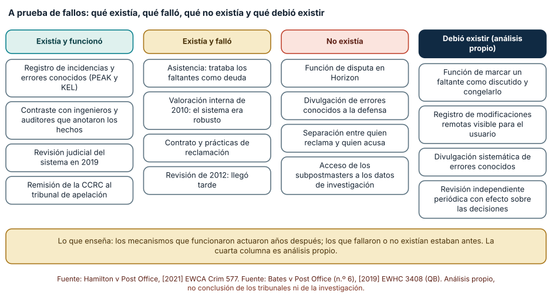

**Cómo leer la figura.** Verde: lo que había y funcionó; dorado: lo que había y falló; coral: lo que no existía; azul oscuro: análisis propio de lo que debió existir. Las filas no se corresponden una a una. Mira que lo que funcionó actuó años después. **Dónde deja de valer:** no mide eficacia; la cuarta columna es análisis propio.

## Casos especiales y cómo fallan

- **Un faltante que no es un fallo visible.** Un error que produce una discrepancia plausible no avisa: la cuenta muestra un número y la persona que la tiene delante debe decidir si es real. El Post Office aceptó, a medida que avanzó el juicio, que existían numerosos errores, aunque no su alcance (Bates n.º 6, párr. 925).
- **Corrección manual de datos por el proveedor.** El experto de los demandantes señaló que el sistema requería numerosos procesos y soluciones para que Fujitsu modificara datos ya registrados, algo que no se necesitaría en un sistema robusto (Bates n.º 6, párr. 41). Según la CCRC, el acceso remoto era extenso y algunas cuentas se alteraron sin conocimiento del subpostmaster (Hamilton, párr. 56).
- **Que el usuario no pueda marcar una discrepancia.** El Post Office decidió no incluir una función de disputa, según el arquitecto jefe de Horizon que declaró en el juicio y cuyo testimonio el juez aceptó (Bates n.º 6, párr. 300 a 302). Sin esa función, la única vía era la línea de asistencia.
- **Derecho contractual a información sin ejercerlo hacia la defensa.** El Post Office podía pedir cualquier información de Horizon a Fujitsu, pero no consta que los PEAK o los KEL se divulgaran en ningún proceso penal ni civil anterior a la High Court (Hamilton, párr. 18).
- **Evidencia de terceros que contradice el sistema.** Ingenieros de Royal Mail y auditores del propio Post Office anotaron hechos que respaldaban a los subpostmasters, y esas anotaciones se ignoraron en la conclusión de los registros de incidencias (Bates n.º 6, párr. 927; Hamilton, párr. 56).
- **La revisión que se evitó.** En 2010, un informe interno consideró encargar una revisión independiente pero advirtió de que debería divulgarse en los tribunales y de que la percepción de duda obligaría a suspender los procesamientos; pasaron varios años antes de que se encargara una (Hamilton, párr. 24 y 25).
- **Reparar es otro sistema.** El volumen 1 muestra que los esquemas de compensación necesitan definiciones, asesoramiento legal, plazos y organismo administrador, y emite 19 recomendaciones (Investigación, vol. 1, resumen).

## Línea de tiempo

Escala de años (cómo se formó el defecto institucional), de años (el litigio) y de meses (la reparación).

### Antecedentes, litigio y reparación

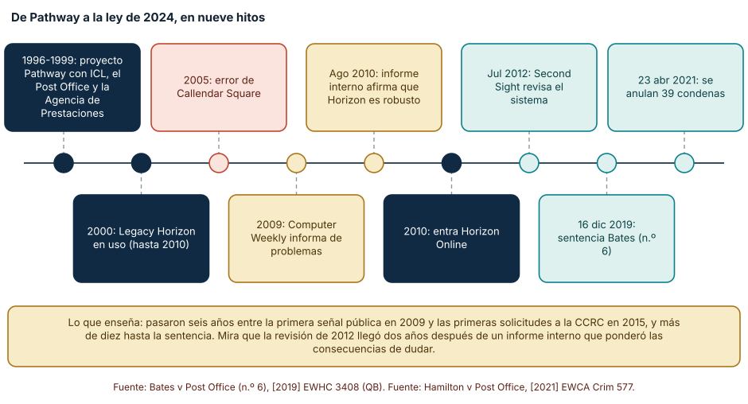

**Cómo leer la figura.** Los hitos están espaciados de manera uniforme, no a escala de años; los años de las cajas son los reales. Los colores distinguen el sistema, las señales y la respuesta. Mira la distancia entre 2009 y 2019: diez años. **Dónde deja de valer:** no es una escala temporal; la duración de los tramos no se puede leer de la distancia dibujada.

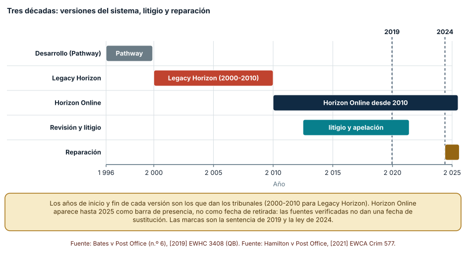

**Cómo leer la figura.** Eje horizontal: años; cada fila es una etapa; las dos líneas verticales son la sentencia de 2019 y la ley de 2024. Mira que Legacy Horizon y el tiempo de los primeros litigios se solapan casi por completo. **Dónde deja de valer:** Horizon Online aparece hasta 2025 como presencia, no como fecha de retirada, que las fuentes no dan.

| Cuándo | Hecho | Fuente |
| --- | --- | --- |
| 1996-1999 | Proyecto Pathway de ICL con el Post Office y la Agencia de Prestaciones; la Agencia se retira | Bates n.º 6, párr. 299 |
| 2000 | Legacy Horizon en uso; los faltantes se notifican desde una etapa temprana | Hamilton, párr. 19 y 56 |
| 2005 | Se descubre el error de Callendar Square | Bates n.º 6, párr. 404 |
| 2009 | Computer Weekly informa de problemas; dos parlamentarios trasladan quejas de sus electores a un ministro | Hamilton, párr. 23 |
| Agosto de 2010 | Informe interno del Post Office: Horizon es robusto | Hamilton, párr. 24 |
| 2010 | Se introduce Horizon Online | Bates n.º 6, párr. 461 |
| Julio de 2012 | Se encarga la revisión de Second Sight | Hamilton, párr. 26 |
| Marzo de 2015 | Los primeros subpostmasters condenados piden a la CCRC revisar sus casos | Hamilton, párr. 27 |
| 2017 | Orden de litigio colectivo en la High Court | Hamilton, párr. 29 |
| 16 de diciembre de 2019 | Sentencia Bates n.º 6 sobre Horizon | Bates n.º 6 |
| 23 de abril de 2021 | El Court of Appeal anula 39 condenas y desestima 3 | Hamilton, párr. 447 |
| 24 de mayo de 2024 | Ley que anula condenas en su ámbito | Ley 2024 |
| 8 de julio de 2025 | Volumen 1 del informe final de la investigación | Investigación, vol. 1 |

## Qué falló en cada instancia

| Instancia | Qué se esperaba | Qué ocurrió | Fuente |
| --- | --- | --- | --- |
| Horizon | Cuentas exactas de cada sucursal | Errores y defectos con riesgo material de inexactitud en 2000-2010 y después | Hamilton, párr. 56 |
| Función de disputa | Que el usuario pudiera marcar una discrepancia | Se decidió no incluirla | Bates n.º 6, párr. 300 |
| Asistencia | Investigar y resolver | Trataba los faltantes como deudas no discutidas | Hamilton, párr. 21 |
| Registros de errores | Que su contenido llegara a quien podía necesitarlo | No consta divulgación en los 42 procesos | Hamilton, párr. 18 |
| Valoración interna | Evaluar con independencia la fiabilidad | Informe de 2010: robusto; revisión independiente aplazada hasta 2012 | Hamilton, párr. 24 y 26 |
| Investigación de cada caso | Buscar la causa de cada faltante | Nivel pobre; posición por defecto de responsabilidad del subpostmaster | Hamilton, párr. 56 |
| Proceso penal | Prueba fiable y proceso equitativo | Abuso de proceso en los casos estimados | Hamilton, párr. 447 |
| Supervisión | Control por el accionista y por la gobernanza | Objeto de examen de la investigación; resultado pendiente | Investigación, vol. 1 |

## Causa raíz y factores

**Detonante (documentado).** Horizon mostraba faltantes en cuentas de sucursales por errores y defectos del sistema y por otras causas que los tribunales no atribuyen individualmente, y el Post Office los trataba como pérdidas reales de las personas que atendían la sucursal (Hamilton, párr. 20 y 56).

**Condiciones latentes (documentado).** Un sistema sin función de disputa; registros internos de errores conocidos que no llegaban a la defensa; acceso remoto extenso del proveedor y modificaciones de cuentas sin conocimiento del subpostmaster; una posición institucional de que el sistema era fiable; un contrato y una práctica que cargaban la prueba sobre el subpostmaster; una investigación pobre; y la facultad de acusar en la misma organización que reclamaba (Hamilton, párr. 18 a 24 y 56; Bates n.º 6, párr. 300).

**Factores de contexto (documentado).** Quejas públicas ya en 2009, un informe interno de 2010 que ponderó las consecuencias de dudar, y varios años hasta una revisión independiente (Hamilton, párr. 23 a 26). El análisis propio es que cada decisión, tomada aislada, podía parecer razonable a quien la tomaba: el conjunto, no.

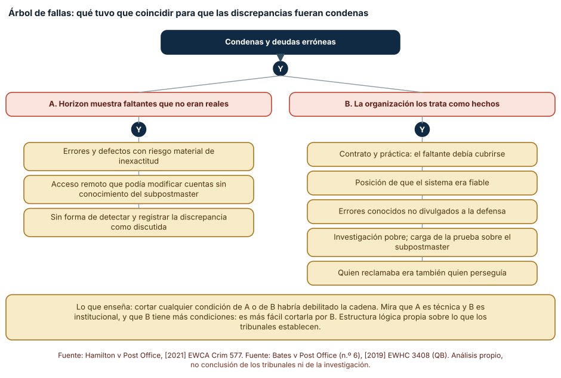

**Cómo leer la figura.** Arriba, el evento final; los círculos con «Y» exigen que todas las ramas ocurran. Las cajas doradas son las condiciones. Mira que la rama A es técnica y la B institucional, con más condiciones. **Dónde deja de valer:** la estructura lógica es análisis propio; en la realidad las condiciones no eran independientes: el acceso remoto, por ejemplo, agravaba la falta de divulgación.

**Los siete hallazgos del juez que apoyaron la apelación, según la CCRC.**

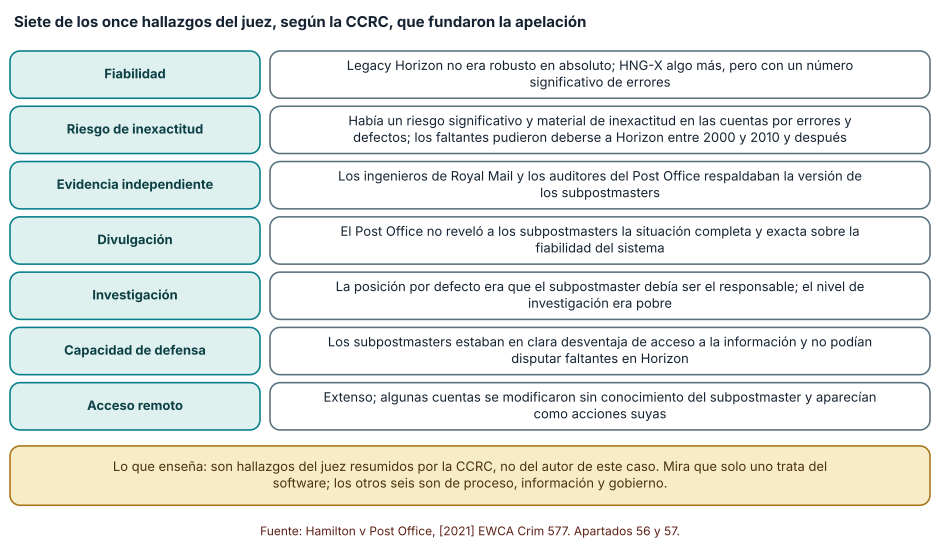

**Cómo leer la figura.** Cada fila es un hallazgo con su detalle; todos están documentados en la sentencia de apelación como resumen de la CCRC. Mira que solo uno es de software: los otros son de proceso, información y gobierno. **Dónde deja de valer:** el resumen tiene once puntos y la figura muestra siete; los otros cuatro tratan de la sobreestimación de la obligación contractual y de la robustez de HNG-X, entre otros.

**Cadena causal ordenada (análisis propio, apoyado en las sentencias).**

1. Un sistema de contabilidad central se despliega en miles de sucursales con errores y sin función de disputa (condición técnica).
2. Un contrato y una práctica cargan al subpostmaster con el faltante y con la carga de probar que no es suyo (condición de proceso).
3. Una posición institucional afirma que el sistema es fiable (condición de gobierno).
4. Los errores conocidos se registran dentro del proveedor y no llegan a quien se defiende (condición de información).
5. Quien reclama el dinero es también quien decide perseguir (condición de incentivos).
6. Las señales externas, quejas, informes y evidencia de terceros, se leen como amenazas y se retrasa su revisión independiente (condición de aprendizaje).
7. Resultado: condenas y deudas que luego se anulan y un daño humano grave.

### Documentado, inferido y no se sabe

| Categoría | Contenido |
| --- | --- |
| Documentado | Los hallazgos del juez y su resumen por la CCRC; la decisión de no incluir una función de disputa; los registros PEAK y KEL; la posición del Post Office; el informe de 2010; la revisión de 2012; los 39 de 42; la ley de 2024; las cifras de la investigación |
| Inferido (análisis propio) | El conflicto de incentivos como forma general; la estructura del árbol y de las ocho barreras; que cada decisión aislada podía parecer razonable |
| No se sabe | El código de Horizon; el número total de procesados y afectados; el importe total de las compensaciones; quién decidió cada medida; el contenido de los volúmenes pendientes de la investigación |

## Mejoras que debieron hacerse

Las sentencias y el volumen 1 señalan lo que falló y recomiendan sobre la reparación; la elección de qué controles de producto, de proceso y de gobierno habrían cortado cada eslabón es análisis nuestro. Todo lo de esta sección, incluidos costes y trade-offs, es **análisis propio apoyado en la fuente**: no son conclusiones de los tribunales ni de la investigación, ni una descripción de lo que el Post Office haya implantado.

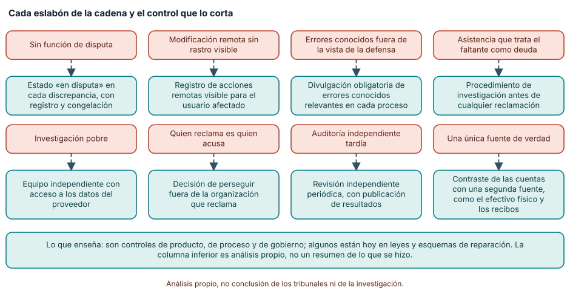

**Cómo leer la figura.** Arriba el eslabón de la cadena, debajo el control que lo corta. Mira que hay controles de producto, de proceso y de gobierno. **Dónde deja de valer:** los controles son propuestas educativas, no prescripciones; cada uno tiene coste y falsos positivos.

### La arquitectura «después»

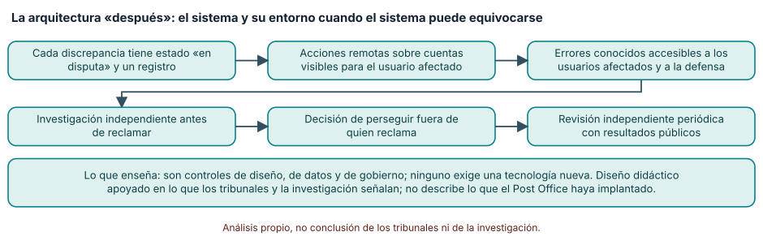

**Cómo leer la figura.** Cada caja es un cambio del sistema o de su entorno. Mira que ninguna exige una tecnología nueva. **Dónde deja de valer:** es un diseño didáctico; no describe lo que el Post Office haya implantado.

### Para cada factor: control técnico, de proceso y de gobierno

| Factor causal | Control técnico | Control de proceso | Control de gobierno | Costo y trade-off | Clases |
| --- | --- | --- | --- | --- | --- |
| Sin función de disputa | Estado «en disputa» por discrepancia, con registro inmutable | Cada disputa abre una investigación con plazo | Nadie puede reclamar una discrepancia en disputa sin resolverla | Más trabajo de soporte; evita deudas erróneas | [SE-352 · Restricciones, invariantes y consistencia](../../classes/part-29-datos-persistencia-y-recuperacion/se-352-restricciones-invariantes-y-consistencia/README.md), [SE-351 · Transacciones, aislamiento y concurrencia](../../classes/part-29-datos-persistencia-y-recuperacion/se-351-transacciones-aislamiento-y-concurrencia/README.md), [SE-148 · Casos de uso, historias y job stories](../../classes/part-12-ingenieria-de-requisitos/se-148-casos-de-uso-historias-y-job-stories/README.md) |
| Acceso remoto sin rastro visible | Registro de acciones de operadores y proveedores, visible para el afectado | Revisión periódica de accesos | Principio de mínimo privilegio con aprobación y auditoría | Complejidad de la auditoría | [SE-459 · Autorización, recursos y mínimo privilegio](../../classes/part-38-seguridad-privacidad-y-cumplimiento/se-459-autorizacion-recursos-y-minimo-privilegio/README.md), [SE-494 · Logs estructurados y correlación](../../classes/part-41-observabilidad-sre-e-incidentes/se-494-logs-estructurados-y-correlacion/README.md), [SE-457 · Principios de seguridad y modelos de amenaza](../../classes/part-38-seguridad-privacidad-y-cumplimiento/se-457-principios-de-seguridad-y-modelos-de-amenaza/README.md) |
| Errores conocidos no divulgados | Registro único de errores accesible por quien pueda verse afectado | Divulgación obligatoria de errores relevantes en cada proceso | Política de divulgación con responsable | Riesgo reputacional percibido a corto plazo | [SE-465 · Vulnerabilidades, divulgación y respuesta](../../classes/part-38-seguridad-privacidad-y-cumplimiento/se-465-vulnerabilidades-divulgacion-y-respuesta/README.md), [SE-501 · Postmortems sin culpa y aprendizaje](../../classes/part-41-observabilidad-sre-e-incidentes/se-501-postmortems-sin-culpa-y-aprendizaje/README.md), [SE-466 · Cumplimiento, evidencia y límites legales](../../classes/part-38-seguridad-privacidad-y-cumplimiento/se-466-cumplimiento-evidencia-y-limites-legales/README.md) |
| Asistencia que trata faltantes como deuda | Guion con investigación previa a la reclamación | Escalado técnico por tipo de síntoma | Indicador de casos de disputa sin resolver | Coste de soporte | [SE-499 · Runbooks, on-call y escalamiento](../../classes/part-41-observabilidad-sre-e-incidentes/se-499-runbooks-on-call-y-escalamiento/README.md), [SE-500 · Gestión de incidentes y comunicación](../../classes/part-41-observabilidad-sre-e-incidentes/se-500-gestion-de-incidentes-y-comunicacion/README.md), [SE-498 · Alertas accionables y fatiga](../../classes/part-41-observabilidad-sre-e-incidentes/se-498-alertas-accionables-y-fatiga/README.md) |
| Investigación pobre | Datos de diagnóstico accesibles al investigador independiente | Equipo independiente con facultad de acceso | Informe a un órgano separado del operador | Coste de independencia | [SE-493 · Señales, eventos y observabilidad útil](../../classes/part-41-observabilidad-sre-e-incidentes/se-493-senales-eventos-y-observabilidad-util/README.md), [SE-450 · Casos de seguridad y trazabilidad](../../classes/part-37-sistemas-criticos-tiempo-real-y-normas-de-seguridad/se-450-casos-de-seguridad-y-trazabilidad/README.md), [SE-534 · Gestión de riesgos y decisiones ejecutivas](../../classes/part-44-gestion-liderazgo-y-practica-profesional/se-534-gestion-de-riesgos-y-decisiones-ejecutivas/README.md) |
| Quien reclama es quien acusa | No aplica | Decisión de perseguir fuera de la organización que reclama | Estructura de gobierno con separación explícita | Pérdida de control sobre los casos | [SE-536 · Propiedad intelectual, contratos y ética](../../classes/part-44-gestion-liderazgo-y-practica-profesional/se-536-propiedad-intelectual-contratos-y-etica/README.md), [SE-466 · Cumplimiento, evidencia y límites legales](../../classes/part-38-seguridad-privacidad-y-cumplimiento/se-466-cumplimiento-evidencia-y-limites-legales/README.md), [SE-529 · Liderazgo técnico sin autoridad formal](../../classes/part-44-gestion-liderazgo-y-practica-profesional/se-529-liderazgo-tecnico-sin-autoridad-formal/README.md) |
| Revisión independiente tardía | Pruebas de integridad y conciliación automáticas | Revisión independiente periódica | Publicación de resultados al accionista y a los usuarios | Aceptar que se hallarán errores | [SE-433 · Modelos de calidad y atributos medibles](../../classes/part-36-calidad-rendimiento-y-resiliencia/se-433-modelos-de-calidad-y-atributos-medibles/README.md), [SE-535 · Compras, proveedores y evaluación técnica](../../classes/part-44-gestion-liderazgo-y-practica-profesional/se-535-compras-proveedores-y-evaluacion-tecnica/README.md), [SE-505 · Principios de la ingeniería del caos: estado estable e hipótesis](../../classes/part-42-ingenieria-del-caos/se-505-principios-de-la-ingenieria-del-caos-estado-estable-e-hipotesis/README.md) |
| Una única fuente de verdad | Conciliación con una segunda fuente (efectivo y recibos) | Recuento físico periódico con comparación | Criterio de que el dato del sistema es una hipótesis y no una prueba | Más conciliaciones | [SE-352 · Restricciones, invariantes y consistencia](../../classes/part-29-datos-persistencia-y-recuperacion/se-352-restricciones-invariantes-y-consistencia/README.md), [SE-510 · Fallos de datos y de estado: réplicas, particiones y corrupción](../../classes/part-42-ingenieria-del-caos/se-510-fallos-de-datos-y-de-estado-replicas-particiones-y-corrupcion/README.md), [SE-389 · Fallos parciales y modelos de red](../../classes/part-32-concurrencia-y-sistemas-distribuidos/se-389-fallos-parciales-y-modelos-de-red/README.md) |

### Cómo lo habría evitado lo que enseña el curso

Cada línea es análisis propio. (1) Las transacciones, restricciones e invariantes de [SE-351 · Transacciones, aislamiento y concurrencia](../../classes/part-29-datos-persistencia-y-recuperacion/se-351-transacciones-aislamiento-y-concurrencia/README.md) y [SE-352 · Restricciones, invariantes y consistencia](../../classes/part-29-datos-persistencia-y-recuperacion/se-352-restricciones-invariantes-y-consistencia/README.md) enseñan a diseñar conciliaciones que detectan una discrepancia entre fuentes, no a confiar en una sola. (2) El mínimo privilegio y la autorización de [SE-459 · Autorización, recursos y mínimo privilegio](../../classes/part-38-seguridad-privacidad-y-cumplimiento/se-459-autorizacion-recursos-y-minimo-privilegio/README.md), junto con los logs estructurados de [SE-494 · Logs estructurados y correlación](../../classes/part-41-observabilidad-sre-e-incidentes/se-494-logs-estructurados-y-correlacion/README.md), hacen visible toda modificación hecha por un operador o proveedor. (3) La divulgación de vulnerabilidades y la respuesta de [SE-465 · Vulnerabilidades, divulgación y respuesta](../../classes/part-38-seguridad-privacidad-y-cumplimiento/se-465-vulnerabilidades-divulgacion-y-respuesta/README.md) enseñan que un error conocido se comunica a quien puede verse afectado. (4) Los postmortems sin culpa de [SE-501 · Postmortems sin culpa y aprendizaje](../../classes/part-41-observabilidad-sre-e-incidentes/se-501-postmortems-sin-culpa-y-aprendizaje/README.md) y la gestión de incidentes de [SE-500 · Gestión de incidentes y comunicación](../../classes/part-41-observabilidad-sre-e-incidentes/se-500-gestion-de-incidentes-y-comunicacion/README.md) describen lo contrario de lo ocurrido: aprender de las señales en lugar de defenderse de ellas. (5) La evaluación de proveedores de [SE-535 · Compras, proveedores y evaluación técnica](../../classes/part-44-gestion-liderazgo-y-practica-profesional/se-535-compras-proveedores-y-evaluacion-tecnica/README.md) y el cumplimiento y la evidencia de [SE-466 · Cumplimiento, evidencia y límites legales](../../classes/part-38-seguridad-privacidad-y-cumplimiento/se-466-cumplimiento-evidencia-y-limites-legales/README.md) señalan que un contrato con un proveedor no sustituye la verificación del sistema. (6) La ingeniería del caos, [SE-505 · Principios de la ingeniería del caos: estado estable e hipótesis](../../classes/part-42-ingenieria-del-caos/se-505-principios-de-la-ingenieria-del-caos-estado-estable-e-hipotesis/README.md) y [SE-510 · Fallos de datos y de estado: réplicas, particiones y corrupción](../../classes/part-42-ingenieria-del-caos/se-510-fallos-de-datos-y-de-estado-replicas-particiones-y-corrupcion/README.md), practica la inyección de datos erróneos con una hipótesis de estado estable: aquí, «las cuentas de una sucursal coinciden con el efectivo físico». (7) La ética y los contratos de [SE-536 · Propiedad intelectual, contratos y ética](../../classes/part-44-gestion-liderazgo-y-practica-profesional/se-536-propiedad-intelectual-contratos-y-etica/README.md) tratan de quién responde de las decisiones que afectan a las personas.

## Vínculo con el curso

Cada enlace es una clase real; el texto dice qué mecanismo del caso ilustra. Las partes de sistemas críticos, de seguridad y cumplimiento, de observabilidad e incidentes y de ingeniería del caos son las que más aportan.

| Concepto | Clase | Cómo lo ilustra el caso |
| --- | --- | --- |
| Transacciones y consistencia | [SE-351 · Transacciones, aislamiento y concurrencia](../../classes/part-29-datos-persistencia-y-recuperacion/se-351-transacciones-aislamiento-y-concurrencia/README.md) | Un balance que no cuadra debe poder marcarse y resolverse |
| Restricciones e invariantes | [SE-352 · Restricciones, invariantes y consistencia](../../classes/part-29-datos-persistencia-y-recuperacion/se-352-restricciones-invariantes-y-consistencia/README.md) | «Lo que sale es lo que entra» como comprobación automática |
| Fallos de datos y de estado | [SE-510 · Fallos de datos y de estado: réplicas, particiones y corrupción](../../classes/part-42-ingenieria-del-caos/se-510-fallos-de-datos-y-de-estado-replicas-particiones-y-corrupcion/README.md) | Inyectar datos erróneos y ver si el sistema lo señala |
| Casos de uso e historias | [SE-148 · Casos de uso, historias y job stories](../../classes/part-12-ingenieria-de-requisitos/se-148-casos-de-uso-historias-y-job-stories/README.md) | La historia «como subpostmaster quiero disputar un faltante» no existía |
| Mínimo privilegio | [SE-459 · Autorización, recursos y mínimo privilegio](../../classes/part-38-seguridad-privacidad-y-cumplimiento/se-459-autorizacion-recursos-y-minimo-privilegio/README.md) | Acceso remoto sin rastro visible para el afectado |
| Logs estructurados y correlación | [SE-494 · Logs estructurados y correlación](../../classes/part-41-observabilidad-sre-e-incidentes/se-494-logs-estructurados-y-correlacion/README.md) | Un registro de acciones sobre cada cuenta |
| Vulnerabilidades, divulgación y respuesta | [SE-465 · Vulnerabilidades, divulgación y respuesta](../../classes/part-38-seguridad-privacidad-y-cumplimiento/se-465-vulnerabilidades-divulgacion-y-respuesta/README.md) | Errores conocidos que no llegan a quien puede verse afectado |
| Cumplimiento y evidencia | [SE-466 · Cumplimiento, evidencia y límites legales](../../classes/part-38-seguridad-privacidad-y-cumplimiento/se-466-cumplimiento-evidencia-y-limites-legales/README.md) | Un sistema como prueba exige evidencia de su fiabilidad |
| Casos de seguridad y trazabilidad | [SE-450 · Casos de seguridad y trazabilidad](../../classes/part-37-sistemas-criticos-tiempo-real-y-normas-de-seguridad/se-450-casos-de-seguridad-y-trazabilidad/README.md) | Cada afirmación sobre el sistema necesita evidencia |
| Proveedores y evaluación técnica | [SE-535 · Compras, proveedores y evaluación técnica](../../classes/part-44-gestion-liderazgo-y-practica-profesional/se-535-compras-proveedores-y-evaluacion-tecnica/README.md) | Fiabilidad del sistema de un tercero |
| Ética, contratos y propiedad | [SE-536 · Propiedad intelectual, contratos y ética](../../classes/part-44-gestion-liderazgo-y-practica-profesional/se-536-propiedad-intelectual-contratos-y-etica/README.md) | Responsabilidad ante los afectados |
| Gestión de riesgos y decisiones | [SE-534 · Gestión de riesgos y decisiones ejecutivas](../../classes/part-44-gestion-liderazgo-y-practica-profesional/se-534-gestion-de-riesgos-y-decisiones-ejecutivas/README.md) | El riesgo de que el sistema se equivoque como decisión de dirección |
| Gestión de incidentes y comunicación | [SE-500 · Gestión de incidentes y comunicación](../../classes/part-41-observabilidad-sre-e-incidentes/se-500-gestion-de-incidentes-y-comunicacion/README.md) | Cómo se responde a señales de que algo va mal |
| Postmortems sin culpa | [SE-501 · Postmortems sin culpa y aprendizaje](../../classes/part-41-observabilidad-sre-e-incidentes/se-501-postmortems-sin-culpa-y-aprendizaje/README.md) | Aprender de las señales en lugar de defender la posición |
| Principios de la ingeniería del caos | [SE-505 · Principios de la ingeniería del caos: estado estable e hipótesis](../../classes/part-42-ingenieria-del-caos/se-505-principios-de-la-ingenieria-del-caos-estado-estable-e-hipotesis/README.md) | Estado estable e hipótesis para la contabilidad de una sucursal |
| Fallos parciales | [SE-389 · Fallos parciales y modelos de red](../../classes/part-32-concurrencia-y-sistemas-distribuidos/se-389-fallos-parciales-y-modelos-de-red/README.md) | Un sistema correcto en parte y erróneo en algún caso |
| Alertas accionables | [SE-498 · Alertas accionables y fatiga](../../classes/part-41-observabilidad-sre-e-incidentes/se-498-alertas-accionables-y-fatiga/README.md) | Un faltante es una alerta: necesita dueño y plazo |
| Liderazgo técnico | [SE-529 · Liderazgo técnico sin autoridad formal](../../classes/part-44-gestion-liderazgo-y-practica-profesional/se-529-liderazgo-tecnico-sin-autoridad-formal/README.md) | Decir lo que se sabe a quien debe decidir |

### Preguntas de discusión

1. ¿Qué diseño habría hecho que un faltante no pudiera tratarse como deuda sin una investigación? ¿Qué costes tendría?
2. Si el proveedor puede corregir datos de una sucursal, ¿qué debe ver y firmar la persona afectada?
3. Un informe interno de 2010 consideró que una revisión independiente tendría que divulgarse. ¿Cómo se diseña una organización en la que revisar sea siempre posible?
4. ¿Quién debe decidir procesar penalmente cuando la prueba es un sistema propio? ¿Qué separación de funciones evita el conflicto?
5. Las sentencias distinguen entre errores y faltantes. ¿Cómo se prueba que un sistema contable no produce una discrepancia?

### Mini-ejercicios

1. **Estado de disputa.** Modela una máquina de estados para una discrepancia contable con los estados «detectada», «en disputa», «investigada» y «resuelta», y escribe una prueba que impida reclamar un importe en estado «en disputa».
2. **Registro de acciones remotas.** Para un sistema propio, define qué acciones de un operador sobre datos de un usuario se registran, quién las puede leer y durante cuánto tiempo.
3. **Conciliación.** Escribe un guion que compare el total de un libro de transacciones con un recuento independiente y marque las diferencias.
4. **Política de divulgación.** Redacta media página sobre cuándo y a quién se comunica un error conocido de un sistema que otras personas usan como prueba.

## Qué no generalizar

**Aprender.**

1. Un sistema cuyos datos se usan contra un usuario necesita una vía para que el usuario los dispute.
2. Quien puede modificar los datos debe dejar un rastro visible para el afectado.
3. Los errores conocidos no son información interna: son información para quien puede verse afectado.
4. Quien reclama no debe decidir si se acusa.
5. Una señal que desmiente al sistema es información, no una amenaza.
6. Reparar el daño es un proceso con diseño propio, no un trámite posterior.

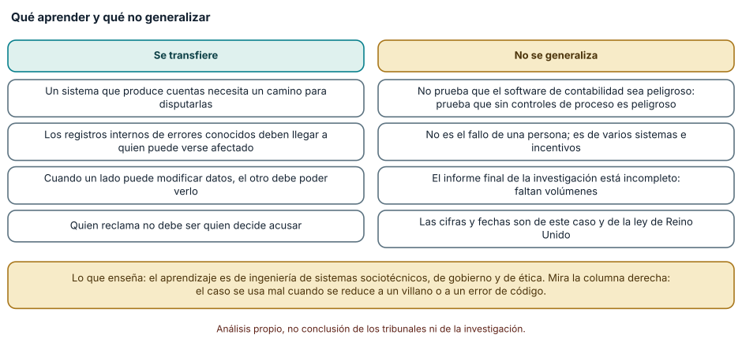

**Cómo leer la figura.** Verde: lo que se transfiere; dorado: lo que no. Mira la columna derecha: el caso se usa mal cuando se reduce a un villano o a un error de código. **Dónde deja de valer:** es una lectura propia de las sentencias y del informe.

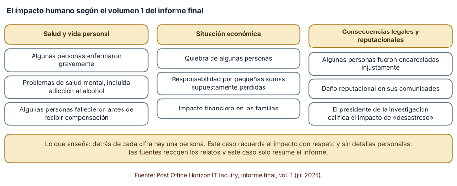

**Cómo leer la figura.** Cada columna agrupa un tipo de consecuencia que cita el informe a partir de 17 relatos de primera mano. Mira que no hay cifras: detrás de cada línea hay personas. **Dónde deja de valer:** no cuantifica a los afectados; las fuentes consultadas no dan esa cifra total.

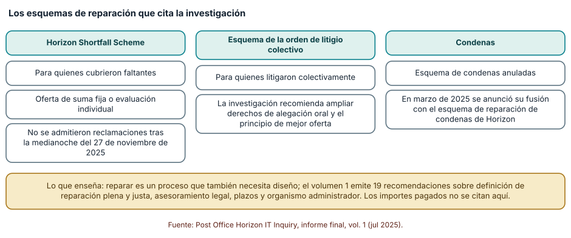

**Cómo leer la figura.** Cada columna es un esquema de reparación; las fechas son las del resumen del volumen 1. Mira que reparar tiene sus propios plazos y definiciones. **Dónde deja de valer:** no describe cuánto se ha pagado ni cuántas personas han recibido una oferta.

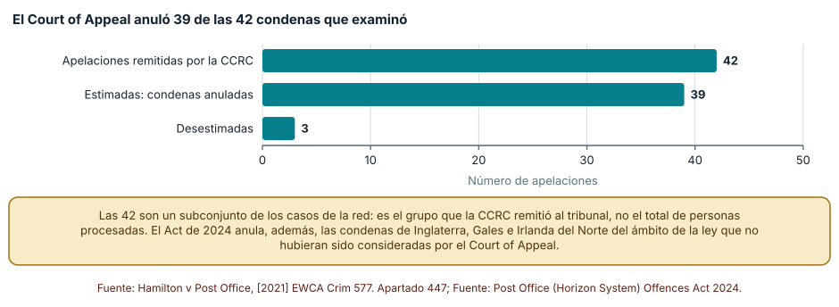

**Cómo leer la figura.** Cada barra es un número de apelaciones; las dos últimas reparten la primera. Mira la tercera: tres no prosperaron, y el tribunal explica en cada una por qué. **Dónde deja de valer:** las 42 son las que la CCRC remitió, no el total de personas procesadas.

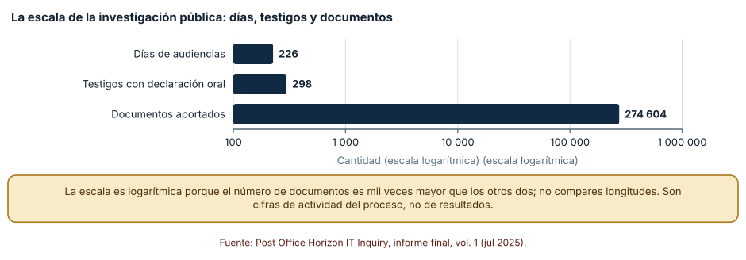

**Cómo leer la figura.** Escala logarítmica: cada marca es diez veces mayor que la anterior. Mira que los documentos superan en mil veces a los otros dos. **Dónde deja de valer:** son cifras de actividad del proceso, no de resultados.

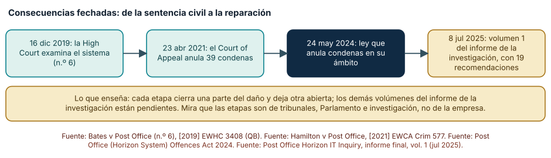

**Cómo leer la figura.** Cuatro hitos fechados, de izquierda a derecha. Mira que los tres primeros son de tribunales y Parlamento. **Dónde deja de valer:** que cada hito sea consecuencia del anterior no consta como relación causal; es una ordenación de hechos.

**No generalizar.**

- No prueba que los sistemas contables informatizados sean peligrosos: prueba que son peligrosos cuando se tratan como infalibles y no se les da vía de disputa.
- No es el fallo de una persona: los tribunales describen decisiones, procesos e incentivos de varias organizaciones a lo largo de años; la investigación pública examina todavía los demás volúmenes.
- Los hechos son los que declaran los tribunales y la ley; el informe de la investigación está incompleto y puede añadir o corregir.
- Las cifras (39 de 42, 18 millones de libras, 226 días) son de este caso y de la ley del Reino Unido.
- Lo ocurrido con las compensaciones después de julio de 2025 y las medidas del Gobierno no se verificaron en esta sesión y no se tratan.

### Casos comparables y diferencias

| Caso | Parecido | Diferencia |
| --- | --- | --- |
| [Therac-25 (1985)](therac-25.md) | Una organización confía en que el sistema es fiable ante las quejas de quienes lo usan | Allí el daño fue físico y los informes de incidentes se trataron de forma aislada; aquí es la prueba contable la que causa el daño |
| [Boeing 737 MAX y MCAS](boeing-737-max-mcas.md) | Supuestos sobre las personas que usan el sistema y una información que no llega a quien la necesita | Allí el daño fue por una función de control de vuelo; aquí por un sistema de contabilidad usado como prueba |
| [TSB Bank (2018)](tsb.md) | Un sistema cuyos errores afectan a clientes de la organización | Allí el problema fue una migración y su recuperación; aquí un sistema operado durante años |

## Fuentes públicas verificadas

Todas consultadas el 23 de noviembre de 2026. Los PDF se descargaron y se extrajo su texto; las páginas web se abrieron con herramienta de lectura.

1. High Court of Justice (Queen's Bench Division), *Bates and Others v Post Office Ltd (No 6: Horizon Issues)*, [2019] EWHC 3408 (QB), 16 de diciembre de 2019, Fraser J. [https://www.judiciary.uk/wp-content/uploads/2019/12/bates-v-post-office-judgment.pdf](https://www.judiciary.uk/wp-content/uploads/2019/12/bates-v-post-office-judgment.pdf) (respalda las descripciones de Horizon, de los expertos, de los errores y de la decisión de no tener una función de disputa; los números de párrafo del caso son los de esta sentencia).
2. Court of Appeal (Criminal Division), *Hamilton and Others v Post Office Ltd*, [2021] EWCA Crim 577, 23 de abril de 2021. [https://www.judiciary.uk/wp-content/uploads/2022/07/Hamilton-Others-v-Post-Office-judgment-230421.pdf](https://www.judiciary.uk/wp-content/uploads/2022/07/Hamilton-Others-v-Post-Office-judgment-230421.pdf) (respalda los hechos de los apartados 17 a 29, el resumen de la CCRC en el párrafo 56 y el resultado del párrafo 447).
3. Parlamento del Reino Unido, *Post Office (Horizon System) Offences Act 2024* (2024 c. 14), sancionada el 24 de mayo de 2024. [https://www.legislation.gov.uk/ukpga/2024/14/enacted](https://www.legislation.gov.uk/ukpga/2024/14/enacted) (respalda la anulación de condenas en su ámbito).
4. Post Office Horizon IT Inquiry, *Volume 1 of the Post Office Horizon IT Inquiry's final report: Redress (compensation) and the human impact of the Horizon scandal*, resumen divulgativo, 8 de julio de 2025. [https://www.postofficehorizoninquiry.org.uk/sites/default/files/2025-07/Post_Office_Horizon_Inquiry_Volume_1_Rapid_Read.pdf](https://www.postofficehorizoninquiry.org.uk/sites/default/files/2025-07/Post_Office_Horizon_Inquiry_Volume_1_Rapid_Read.pdf) (respalda las cifras de audiencias, testigos y documentos, el impacto humano y las 19 recomendaciones).
5. Post Office Horizon IT Inquiry, página de informes y declaraciones. [https://www.postofficehorizoninquiry.org.uk/reports-and-statements](https://www.postofficehorizoninquiry.org.uk/reports-and-statements) (respalda la publicación del volumen 1 y que los volúmenes restantes seguían pendientes).

---

[↑ Casos de fallo](README.md) · [← Boeing 737 MAX y MCAS](boeing-737-max-mcas.md) · [Equifax 2017 →](equifax-2017.md)
