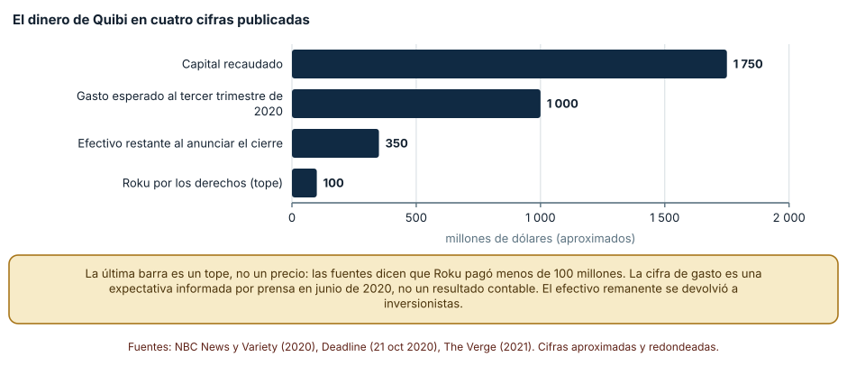
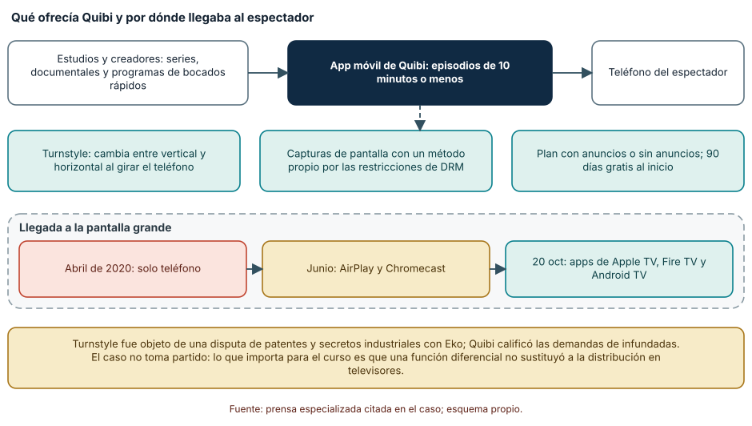

# Quibi

[↑ Casos de fallo](README.md) · [← Incidente de base de datos de GitLab](gitlab-2017.md)

Quibi fue un servicio de vídeo por suscripción pensado solo para el teléfono, con episodios de diez minutos o menos y producciones con talento reconocido. Recaudó unos 1.750 millones de dólares, se lanzó el 6 de abril de 2020 y anunció su cierre el 21 de octubre del mismo año. No es un fallo de ingeniería: el servicio funcionó, tuvo funciones técnicas propias y sus responsables lo cerraron devolviendo efectivo a los inversores. Es un fallo de producto y de mercado, y por eso su valor para el curso está en las decisiones de descubrimiento, hipótesis, métricas y capital que lo rodearon. Este caso usa solo lo que es público; los datos internos de Quibi no lo son y no se infieren.

## Ficha histórica

| Dato | Contenido |
| --- | --- |
| Organización | Quibi (de *quick bites*), antes llamada NewTV; empresa privada |
| Responsables | Jeffrey Katzenberg, fundador, antes director de DreamWorks Animation y presidente de Walt Disney Studios; Meg Whitman, directora ejecutiva, antes directora de eBay y de Hewlett Packard Enterprise |
| Sede | Los Ángeles, California (EE. UU.) |
| Anuncio | 7 de agosto de 2018, con 1.000 millones de dólares de financiación inicial |
| Lanzamiento | 6 de abril de 2020, en EE. UU. y Canadá |
| Cierre | Anunciado el 21 de octubre de 2020; aplicación inoperable el 1 de diciembre de 2020 |
| Inversores | Según Deadline, entre otros Disney, NBCUniversal, Sony Pictures, MGM, WarnerMedia, ViacomCBS, Goldman Sachs y JPMorgan Chase |
| Capital | Unos 1.750 millones de dólares recaudados |
| Plantilla | Unas 200 personas en el anuncio del cierre, según Deadline |
| Estado posterior | La empresa devolvió a los inversores unos 350 millones de dólares de efectivo; el 8 de enero de 2021 Roku adquirió los derechos de más de 75 programas por «significativamente menos» de 100 millones, según la prensa |

La fecha de consulta de las fuentes citadas al final es el 16 de noviembre de 2026.

## Contexto y problema

En 2018, los grandes servicios de vídeo bajo demanda competían por la pantalla del televisor. La apuesta de Quibi era que existía otro espacio sin servir: los momentos en movimiento, de camino al trabajo o entre una tarea y otra, en que la gente mira el teléfono. Katzenberg lo describió en 2018 con una analogía con el crecimiento de Spotify y Apple Music y con el aumento mundial de usuarios de teléfonos inteligentes, y la prensa recogió su idea de un «espacio en blanco» para el vídeo móvil de calidad (Variety, 2018 y 2020).

El problema que Quibi decía resolver era la distancia entre dos mundos: el vídeo breve gratuito y de usuarios, de YouTube o Instagram, y las series largas con presupuesto, pensadas para una sala. Quibi quería una televisión de calidad troceada en capítulos de diez minutos o menos, en el teléfono, a cambio de una suscripción. Whitman dijo en su entrevista de cierre que el caso de uso era «de 7 de la mañana a 7 de la noche», en movimiento.

Esa tesis tenía un sentido razonable en 2018. Lo que el caso examina es qué pasó cuando cada uno de sus supuestos se contrastó con el mundo real. Tres supuestos sostenían el negocio: que el uso en movimiento fuera frecuente y valioso, que bastara el teléfono sin televisor y que la calidad de los títulos hiciera pagar a una audiencia que ya tenía vídeo gratuito.

## Mercado, usuarios y casos de uso

Quibi apuntaba a un público joven y móvil. La prensa lo situó frente a una audiencia «de TikTok» (The Verge, 2020) y a un mercado que ya incluía a Netflix, Amazon y, desde noviembre de 2019 y 2020, a Disney+, HBO Max y Peacock, con catálogos que ya tenían público (NBC News, 2020).

Los usuarios que el producto tenía en mente eran:

- **El espectador en movimiento**, que dispone de minutos sueltos y prefiere un capítulo que empiece y termine en esa ventana.
- **El espectador de mensajería y noticias**, a quien se ofrecían programas informativos diarios; NBC News produjo uno para la plataforma.
- **Los creadores y estudios**, que producían series y programas para Quibi con talento reconocido.
- **Los anunciantes**, a quienes se vendió el inventario del primer año antes del lanzamiento, unos 150 millones de dólares según TechCrunch (2019).

La competencia más cercana no fue otra plataforma de pago, sino la atención gratuita: Variety recuerda que TikTok, Instagram, Snapchat y YouTube ofrecen sin cobro un flujo casi infinito de entretenimiento breve.

## Funcionalidad de principio a fin

**1. Descubrir y descargar.** El usuario encontraba la aplicación en las tiendas de aplicaciones. Quibi abrió preinscripciones en la App Store para aumentar las descargas del primer día y consiguió unas 300.000 instalaciones ese día según Sensor Tower, una cifra que TechCrunch comparó con las unas 4 millones de Disney+ en su lanzamiento.

**2. Probar sin pagar.** El servicio ofrecía una prueba gratuita de 90 días. Durante el verano de 2020, según Whitman, probaron una prueba sin tarjeta, otra de 14 días y un modelo distinto en Australia.

**3. Ver.** Cada título tenía episodios de diez minutos o menos y un mensaje de novedades diarias. Dentro de la aplicación, una función llamada Turnstyle cambiaba entre vertical y horizontal al girar el teléfono. Las capturas de pantalla se resolvieron con un método propio por las restricciones de la gestión de derechos digitales (Engadget, 2020).

**4. Pagar.** Terminada la prueba, el plan costaba 4,99 dólares al mes con anuncios o 7,99 sin ellos.

**5. Ver en casa.** Al inicio no había aplicaciones para televisor. Whitman explicó que lo decidieron porque el uso previsto era en movimiento y porque otras tareas de ingeniería tenían prioridad. AirPlay y Chromecast llegaron en junio de 2020, y las aplicaciones de Apple TV, Fire TV y Android TV el 20 de octubre de 2020, un día antes del anuncio del cierre (NBC News).

**6. El final.** Las instancias de un cierre ordenado: la decisión se tomó, según los responsables, unas dos semanas antes del anuncio; se informó al personal en una reunión; se encargó la venta de activos a un banco de inversión (Variety); la aplicación dejó de funcionar el 1 de diciembre de 2020; y en enero de 2021 Roku adquirió los derechos de los programas.

## Negocio y economía

El modelo era mixto: suscripción con dos niveles y publicidad. La economía de un servicio de este tipo depende de tres números que Quibi no ha publicado de forma completa: cuántos suscriptores pagan, cuánto cuesta cada título y cuánto dura cada suscriptor. Lo público permite dibujar el contorno:

- **Capital.** Se recaudaron unos 1.750 millones de dólares en rondas, de las que 1.000 millones se anunciaron en agosto de 2018. Según un informe de prensa recogido por NBC News, Quibi esperaba haber gastado unos 1.000 millones hacia el tercer trimestre de 2020 y necesitar unos 200 millones más a mediados de 2021 para mantenerse.
- **Costo de contenido.** Variety cita un gasto de hasta 6 millones de dólares por hora de contenido producido. El costo por hora, para series de pocos minutos por episodio, es una cifra que el caso no puede interpretar sin saber cuánto contenido se produjo.
- **Ingresos.** Los precios eran de 4,99 y 7,99 dólares al mes. Kantar estimó 1,1 millones de hogares suscriptores en el segundo trimestre de 2020 y 710.000 en el tercero (Variety). Sensor Tower estimó que menos del 10 % de los primeros usuarios se convirtió en suscriptor de pago, cifra que Quibi discutió.
- **Fin.** En el anuncio del cierre quedaban unos 350 millones de dólares en caja. Whitman explicó la lógica: para llegar a escala habría que levantar mucho más capital a principios de 2021 y los datos no lo respaldarían, de modo que lo responsable era devolver el efectivo a los accionistas en lugar de agotarlo.

**Cómo leer la figura.** Cada barra es una cifra de capital en millones de dólares. Mira primero la primera y la tercera: de 1.750 millones recaudados quedaban unos 350 al anunciar el cierre. La última es un tope: las fuentes solo dicen que Roku pagó menos de 100 millones. **Dónde deja de valer:** el gasto de 1.000 millones es una expectativa de prensa para el tercer trimestre de 2020, no un dato contable; las cuatro barras vienen de fuentes distintas y no cuadran como una cuenta de resultados.

## Arquitectura y esquemas

Quibi no publicó detalles de su arquitectura interna, por lo que este apartado se limita al producto y a la distribución, que sí son públicos. No se infiere nada del interior de los sistemas.

### Contexto: la premisa frente al mundo de abril de 2020

**Cómo leer la figura.** A la izquierda, lo que el negocio suponía; a la derecha, lo que había en abril de 2020. Cada fila empareja un supuesto con su contraste mediante una flecha punteada. Mira primero la primera fila: el supuesto de uso en movimiento chocó con el confinamiento. **Dónde deja de valer:** el contraste es de contexto, no de causa: ni los responsables ni la prensa pueden separar cuánto del resultado se debió al confinamiento. Katzenberg reconoció que atribuirlo todo a la pandemia no era justo.

### Componentes: el producto y su distribución

**Cómo leer la figura.** La fila superior sigue el contenido de los creadores al teléfono. La segunda lista las funciones de la aplicación. El grupo de abajo muestra cómo se fue abriendo el acceso al televisor: coral al inicio, dorado en junio y verde azulado en octubre. **Dónde deja de valer:** es una descripción de producto desde la prensa; no muestra la arquitectura técnica ni cómo se entregaba el vídeo.

Un detalle técnico sí documentado merece atención: Turnstyle, la función que cambia de orientación al girar el teléfono, fue objeto de una disputa con la empresa Eko, que alegó infracción de patentes y apropiación de secretos industriales; Quibi pidió a un tribunal que declarara que no infringía y calificó las reclamaciones de infundadas (The Verge y Variety, 2020). El caso no toma partido; lo que importa es que una función diferencial costosa de desarrollar y litigar no sustituyó a la distribución en televisores.

### Datos y escala

**Cómo leer la figura.** Las dos barras superiores comparan instalaciones del primer día; las dos inferiores muestran la evolución de los hogares suscriptores que estimó Kantar. Mira primero la distancia entre las dos primeras: las instalaciones de Quibi fueron el 7,5 % de las de Disney+, según Sensor Tower. **Dónde deja de valer:** las dos primeras son instalaciones y las otras dos hogares suscriptores; son medidas distintas y no se comparan entre sí. Todas son estimaciones de terceros y Quibi discutió la de conversión de Sensor Tower: a julio de 2020 declaró más de 5,6 millones de descargas.

## Casos especiales y cómo fallan

**El lanzamiento con atención máxima, justo en el confinamiento.** Documentado: el servicio se lanzó el 6 de abril de 2020, cuando gran parte de EE. UU. estaba bajo órdenes de quedarse en casa (NBC News). Whitman afirmó que decidieron un lanzamiento con mucha atención para crear una categoría y que no lo cambiarían; Katzenberg reconoció que el diseño era «para estar en movimiento» en un momento en que nadie lo estaba.

**La prueba gratuita larga.** Documentado: 90 días gratis al inicio. La tasa de conversión es el dato que decide el negocio, y está en disputa: Sensor Tower estimó menos del 10 % de conversión de los primeros usuarios y Quibi dijo que el número de suscriptores de pago de esa estimación era incorrecto «en un orden de magnitud». No se sabe quién tenía razón porque Quibi no publicó su cifra.

**Pivotes durante el verano.** Documentado por Whitman: se probaron distintas pruebas gratuitas, un marketing más centrado en títulos que en la plataforma y un modelo distinto en Australia; «ninguna cambió la respuesta fundamental», que era la necesidad de más capital.

**Prioridades de ingeniería.** La aplicación para televisor «no estaba en lo más alto» de la lista, según Whitman. Es una decisión de priorización coherente con la tesis. Es también el caso típico de una restricción de producto —solo móvil— que se mantiene aunque la hipótesis de uso ya se haya cuestionado.

**El contenido y su derecho.** Documentado en la prensa citada por Deadline: la tesis de la biblioteca como activo. Katzenberg planteó que el primer camino para el servicio era continuar en la plataforma de otro; terminó con Roku, que adquirió los derechos por menos de 100 millones de dólares y los mantuvo en formato corto, según The Verge.

**Un cierre ordenado.** Es el caso especial más raro y el más instructivo. Whitman lo describe como una decisión de madurez: los emprendedores siguen hasta quedarse sin dinero, pero ellos devolvieron el capital que quedaba. Es una afirmación de los responsables; este caso la registra sin evaluarla.

## Línea de tiempo

| Fecha | Hecho |
| --- | --- |
| 7 de agosto de 2018 | Se anuncia NewTV con 1.000 millones de dólares de financiación; se espera lanzar a fines de 2019 |
| Octubre de 2018 | Se anuncia el nombre Quibi |
| Octubre de 2019 | Quibi informa que ya tiene vendido el inventario publicitario del primer año, unos 150 millones |
| Marzo de 2020 | Eko presenta demandas por Turnstyle |
| 6 de abril de 2020 | Lanzamiento en EE. UU. y Canadá; unas 300.000 instalaciones el primer día (Sensor Tower) |
| Junio de 2020 | Llegan AirPlay y Chromecast |
| Julio de 2020 | Sensor Tower estima baja conversión; Quibi informa 5,6 millones de descargas |
| Tercer trimestre de 2020 | Kantar estima 710.000 hogares suscriptores, por debajo de los 1,1 millones del trimestre anterior |
| 20 de octubre de 2020 | Llegan las aplicaciones de Apple TV, Fire TV y Android TV |
| 21 de octubre de 2020 | Se anuncia el cierre |
| 1 de diciembre de 2020 | La aplicación deja de funcionar |
| 8 de enero de 2021 | Roku adquiere los derechos de más de 75 programas |

**Cómo leer la figura.** Cada carril es una fase: preparación, servicio en operación y tras el cierre. Las líneas punteadas marcan el anuncio de 1.000 millones, el lanzamiento y el anuncio del cierre. Mira primero la proporción: la preparación fue más larga que la vida del servicio. **Dónde deja de valer:** los meses son cálculo propio y no dicen nada sobre la intensidad de cada fase; el servicio estuvo abierto unos ocho meses.

## Qué falló en cada instancia

Qué se esperaba de cada parte del negocio y qué ocurrió, con la salvedad de que gran parte de la evidencia son estimaciones de terceros.

1. **La propuesta de valor.** Se esperaba que la calidad de títulos breves justificara una suscripción en un mercado con alternativas gratuitas. Variety resume que el servicio «no era lo bastante atractivo» para que los consumidores pagaran; es una interpretación de la prensa y es una de las dos hipótesis que los propios responsables dejaron abiertas: que la idea de un servicio independiente de formato corto premium no funcionara.
2. **El uso previsto.** Se esperaba uso en movimiento de 7 a 19 horas. La audiencia estaba en casa y el televisor estaba a un paso. Katzenberg lo reconoce, pero no puede decir cuánto de esto fue la pandemia y cuánto la tesis.
3. **El producto y la distribución.** Se esperaba que bastara el teléfono. El acceso al televisor llegó por etapas y la aplicación nativa, el día antes del cierre.
4. **La adquisición y la conversión.** Se esperaba convertir tras la prueba gratuita. Los datos de terceros sugieren una conversión baja, pero no hay cifra propia de Quibi.
5. **La competencia.** Se esperaba un espacio sin competidores. El lanzamiento coincidió con la llegada de otros servicios con catálogos que ya tenían público y con una oferta gratuita de vídeo corto.
6. **La financiación.** Se esperaba que la escala llegara con el capital recaudado. Según Whitman, para llegar a escala hacía falta mucho más capital y los datos no lo habrían respaldado.
7. **El cierre.** Se esperaba continuidad; la decisión fue devolver el efectivo, vender los activos y cerrar de forma ordenada.

## Causa raíz y factores

Los responsables dieron su propia lectura en la entrevista de cierre: fue «un poco de cada», una mezcla de que la idea de un servicio independiente de formato corto premium podía no funcionar y de que el lanzamiento coincidió con una pandemia que cambió el uso. Después, Katzenberg dijo en CNBC que atribuirlo todo a la pandemia no era justo.

**Hipótesis cuestionada (documentado).** Que el uso en movimiento fuera suficiente para sostener una suscripción independiente.

**Condiciones del plan (documentado).**

- Producto solo móvil durante la mayor parte de su vida.
- Prueba gratuita larga y fecha de cobro lejana.
- Gran lanzamiento antes de medir la hipótesis.
- Capital grande comprometido por adelantado en contenido y marketing, con inventario publicitario vendido para un año.

**Factores externos (documentado).** Confinamiento por la pandemia; llegada simultánea de Disney+, HBO Max y Peacock; oferta gratuita de vídeo corto.

**Factores de contexto (inferidos).** Una apuesta de gran escala y reputación podría dificultar el cambio de rumbo; lo que se sabe es que los responsables dijeron que cambiaron muchas cosas en el verano y que ninguna modificó la necesidad de más capital.

**No se sabe.** Cuántos suscriptores de pago tenía Quibi, cuántos conservaba tras la prueba, cuánto veían, cuánto costó cada título, cómo se tomó cada decisión interna ni qué datos tenían los responsables que no son públicos. Cualquier explicación más precisa de la que dan los responsables y la prensa sería especulación.

## Mejoras que debieron hacerse

> **Esta sección es análisis propio de este programa**, no una afirmación de Quibi, de sus responsables ni de la prensa. Se apoya en lo documentado y propone controles de descubrimiento y de gobierno que el curso enseña. Es un ejercicio de aprendizaje con información incompleta: no sabemos si habrían funcionado.

**Cómo leer la figura.** Arriba, el recorrido que describen la prensa y los responsables; abajo, una propuesta de este programa. Las flechas son pasos en orden. Mira primero dónde se mide: en el seguido, después de lanzar; en el alternativo, antes de ampliar. **Dónde deja de valer:** es una propuesta; el lanzamiento de atención máxima tenía una razón declarada, crear una categoría, y puede que un recorrido escalonado no habría atraído a los inversores.

1. **Declarar las hipótesis y medirlas por separado.** Que la gente ve vídeo de calidad en movimiento, que paga por ello y que lo hace sin televisor son tres hipótesis distintas, con riesgos distintos. Cada una admite una prueba barata antes de producir un catálogo grande. Clases: [SE-124](../../classes/part-10-descubrimiento-y-estrategia-de-producto/se-124-hipotesis-supuestos-y-preguntas-criticas/README.md) y [SE-127](../../classes/part-10-descubrimiento-y-estrategia-de-producto/se-127-prototipos-experimentos-y-reduccion-de-incertidumbre/README.md).
2. **Comparar con las alternativas reales, incluidas las gratuitas.** La propuesta de valor se mide frente a lo que la persona ya hace en esos momentos, no frente a la televisión de pago. Clases: [SE-125](../../classes/part-10-descubrimiento-y-estrategia-de-producto/se-125-propuesta-de-valor-y-resultados-deseados/README.md) y [SE-126](../../classes/part-10-descubrimiento-y-estrategia-de-producto/se-126-segmentacion-mercado-y-alternativas-existentes/README.md).
3. **No convertir una restricción de producto en dogma.** «Solo móvil» era razonable como hipótesis de partida; cuando el uso real mostró otro patrón, la distribución en televisores debía subir en la lista. Se puede decidir con costo y reversibilidad en mente. Clases: [SE-255](../../classes/part-21-software-movil-escritorio-y-multiplataforma/se-255-nativo-hibrido-web-wrapper-y-cross-platform/README.md) y [SE-142](../../classes/part-11-economia-metricas-y-decisiones-de-producto/se-142-decisiones-reversibles-e-irreversibles/README.md).
4. **Metrices de adopción, retención y tarea útil, con contrapesos.** Descargas y primeras semanas no son un norte; la conversión tras la prueba, la retención y el tiempo de visión sí, con guardarraíles de costo por suscriptor. Clases: [SE-136](../../classes/part-11-economia-metricas-y-decisiones-de-producto/se-136-metricas-de-adopcion-retencion-y-tarea-util/README.md) y [SE-139](../../classes/part-11-economia-metricas-y-decisiones-de-producto/se-139-north-star-guardrails-y-metricas-contrarias/README.md).
5. **Criterios de no éxito definidos antes del lanzamiento.** Qué conversión, qué retención y qué costo por suscriptor harían parar o cambiar de modelo, escritos antes de gastar. Los responsables sí lo hicieron al final, y eso es un acierto: devolvieron el capital en lugar de agotarlo. Habría ayudado fijarlo antes. Clase: [SE-130](../../classes/part-10-descubrimiento-y-estrategia-de-producto/se-130-criterios-de-no-exito-y-decisiones-de-abandono/README.md).
6. **Capital por tramos ligados a evidencia.** Un compromiso de capital muy grande por adelantado reduce el costo de oportunidad de equivocarse con demasiada facilidad. Tramos ligados a hitos de uso mantienen opciones abiertas. Clases: [SE-141](../../classes/part-11-economia-metricas-y-decisiones-de-producto/se-141-portafolio-opciones-y-secuenciacion-de-inversion/README.md) y [SE-133](../../classes/part-11-economia-metricas-y-decisiones-de-producto/se-133-modelos-de-negocio-y-sostenibilidad/README.md).
7. **Evaluar si era un producto o una función de otro.** Katzenberg planteó la pregunta de si un servicio independiente de formato corto premium podía funcionar; la alternativa de integrarse en una plataforma existente era una opción que el curso llama alianza o distribución, y que se exploró al final. Clase: [SE-134](../../classes/part-11-economia-metricas-y-decisiones-de-producto/se-134-costos-de-construccion-operacion-y-oportunidad/README.md).

## Vínculo con el curso

- [SE-124 · Hipótesis, supuestos y preguntas críticas](../../classes/part-10-descubrimiento-y-estrategia-de-producto/se-124-hipotesis-supuestos-y-preguntas-criticas/README.md): los tres supuestos del negocio y cómo se podían contrastar por separado.
- [SE-125 · Propuesta de valor y resultados deseados](../../classes/part-10-descubrimiento-y-estrategia-de-producto/se-125-propuesta-de-valor-y-resultados-deseados/README.md): el valor se mide contra lo que la persona ya hace, aquí vídeo gratuito.
- [SE-126 · Segmentación, mercado y alternativas existentes](../../classes/part-10-descubrimiento-y-estrategia-de-producto/se-126-segmentacion-mercado-y-alternativas-existentes/README.md): la competencia incluye lo gratuito y los servicios que llegaron a la vez.
- [SE-127 · Prototipos, experimentos y reducción de incertidumbre](../../classes/part-10-descubrimiento-y-estrategia-de-producto/se-127-prototipos-experimentos-y-reduccion-de-incertidumbre/README.md): aprender antes de producir un catálogo grande.
- [SE-130 · Criterios de no éxito y decisiones de abandono](../../classes/part-10-descubrimiento-y-estrategia-de-producto/se-130-criterios-de-no-exito-y-decisiones-de-abandono/README.md): el cierre ordenado como decisión y su preparación.
- [SE-136 · Métricas de adopción, retención y tarea útil](../../classes/part-11-economia-metricas-y-decisiones-de-producto/se-136-metricas-de-adopcion-retencion-y-tarea-util/README.md): la conversión tras la prueba gratuita como dato decisivo.
- [SE-139 · North Star, guardrails y métricas contrarias](../../classes/part-11-economia-metricas-y-decisiones-de-producto/se-139-north-star-guardrails-y-metricas-contrarias/README.md): descargas como vanidad frente a suscriptores y costo.
- [SE-142 · Decisiones reversibles e irreversibles](../../classes/part-11-economia-metricas-y-decisiones-de-producto/se-142-decisiones-reversibles-e-irreversibles/README.md): el lanzamiento masivo como decisión poco reversible.
- [SE-255 · Nativo, híbrido, web wrapper y cross-platform](../../classes/part-21-software-movil-escritorio-y-multiplataforma/se-255-nativo-hibrido-web-wrapper-y-cross-platform/README.md): elegir plataformas según el uso real y no solo según la tesis.
- [SE-141 · Portafolio, opciones y secuenciación de inversión](../../classes/part-11-economia-metricas-y-decisiones-de-producto/se-141-portafolio-opciones-y-secuenciacion-de-inversion/README.md): capital por tramos y opciones.

## Qué no generalizar

- **No prueba que el vídeo corto no funcione.** Las propias fuentes recuerdan que el vídeo breve gratuito prospera; lo que Quibi puso a prueba fue un servicio independiente, premium y de pago.
- **No separa el efecto de la pandemia.** Ni los responsables ni la prensa pueden afirmar cuánto del resultado se debió al confinamiento. El caso presenta las dos hipótesis sin decidir.
- **No es un juicio sobre las personas.** Katzenberg y Whitman figuran por su papel público y por sus declaraciones; sus decisiones se explican con la información de entonces.
- **Las cifras de audiencia son de terceros.** Sensor Tower y Kantar estiman; Quibi no publicó su número de suscriptores y discutió una de esas estimaciones.
- **No dice cómo funcionaba por dentro.** No hay información pública de su arquitectura; no se infiere.
- **Un cierre con devolución de capital no es la norma.** Muchas empresas siguen hasta quedarse sin dinero; este caso muestra otra opción, no una regla.

## Fuentes públicas verificadas

Todas las URL se abrieron el 16 de noviembre de 2026.

- [Deadline, Quibi's Jeffrey Katzenberg & Meg Whitman Detail Clear-Eyed Decision To Shut It Down (21 de octubre de 2020)](https://deadline.com/2020/10/quibi-shuts-down-jeffrey-katzenberg-meg-whitman-interview-exclusive-1234601254/): entrevista de cierre con los responsables; inversores, plantilla, caja restante, experimentos del verano, decisión móvil, lanzamiento y las dos hipótesis.
- [Variety, Quibi Is Officially Dead (1 de diciembre de 2020)](https://variety.com/2020/digital/news/quibi-officially-shuts-down-1234842926/): precios, estimaciones de Kantar, coste por hora de contenido, competencia, devolución de 350 millones y venta de activos.
- [Variety, Jeffrey Katzenberg's NewTV Startup Closes $1 Billion (7 de agosto de 2018)](https://variety.com/2018/digital/news/newtv-jeffrey-katzenberg-meg-whitman-1-billion-funding-1202897529/): anuncio, financiación inicial, formato de diez minutos y analogía de la música en streaming.
- [TechCrunch, Streaming service Quibi sells out of its $150M in first-year ad inventory (23 de octubre de 2019)](https://techcrunch.com/2019/10/23/streaming-service-quibi-sells-out-of-its-150m-in-first-year-ad-inventory/): inventario publicitario vendido antes del lanzamiento.
- [TechCrunch, Quibi gains 300K launch day downloads, hits No. 3 on App Store (7 de abril de 2020)](https://techcrunch.com/2020/04/07/quibi-gains-300k-launch-day-downloads-hits-no-3-on-app-store/): instalaciones del primer día, comparación con Disney+, precios y prueba gratuita.
- [The Verge, Quibi reportedly lost 90 percent of early users after their free trials expired (8 de julio de 2020)](https://www.theverge.com/2020/7/8/21318060/quibi-subscriber-count-free-trial-paying-users-conversion-rate): estimación de Sensor Tower, respuesta de Quibi y descargas.
- [The Verge, Quibi will shut down on or around December 1st (22 de octubre de 2020)](https://www.theverge.com/2020/10/22/21529392/quibi-shut-down-date-december-tv-shows-movies-streaming): fecha del cierre del servicio.
- [The Verge, Quibi's library will live on through the Roku Channel (8 de enero de 2021)](https://www.theverge.com/2021/1/8/22220426/quibi-roku-channel-acquisition-content): adquisición por Roku por menos de 100 millones.
- [NBC News, A look at why Quibi failed so soon after launching (22 de octubre de 2020)](https://www.nbcnews.com/business/business-news/look-why-quibi-failed-so-soon-after-launching-n1244312): contexto del lanzamiento durante la pandemia, aplicaciones de televisor, gasto esperado y declaraciones de Katzenberg.
- [The Verge, Quibi is already locked in a legal battle over its rotating video tech (11 de marzo de 2020)](https://www.theverge.com/2020/3/11/21173981/quibi-eko-lawsuit-turnstyle-technology-jeffrey-katzenberg-streaming-interactive): la disputa por Turnstyle.
- [Engadget, Quibi will let you screenshot its shows (2020)](https://www.engadget.com/quibi-screenshots-054628323.html): el método propio de capturas por restricciones de DRM.
- [Wikipedia, Quibi](https://en.wikipedia.org/wiki/Quibi): fuente secundaria para la sede y el contexto de la ficha; se contrasta con las anteriores.

---

[↑ Casos de fallo](README.md) · [← Incidente de base de datos de GitLab](gitlab-2017.md)
