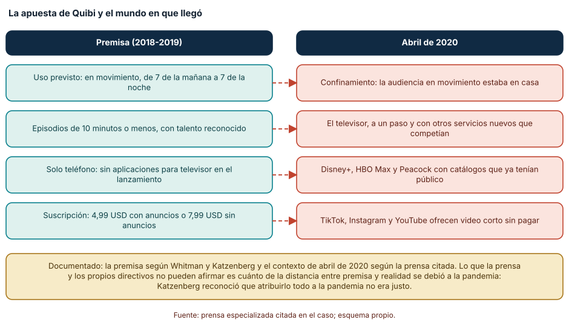
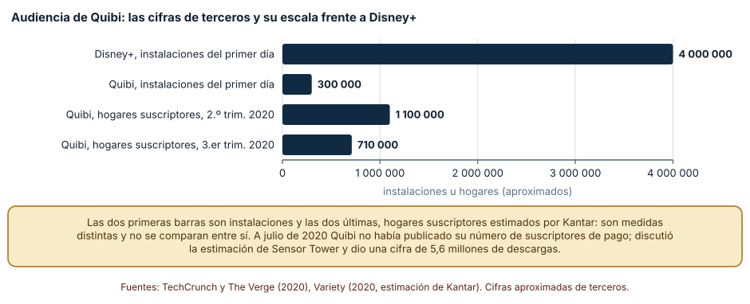
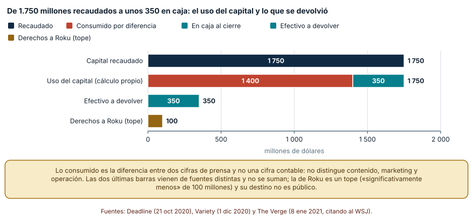
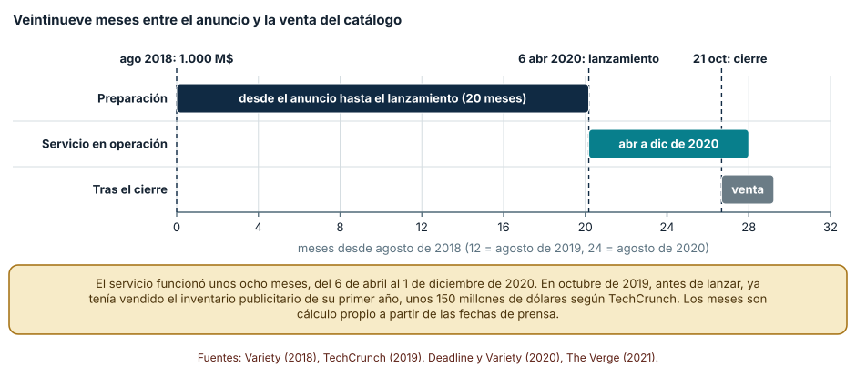
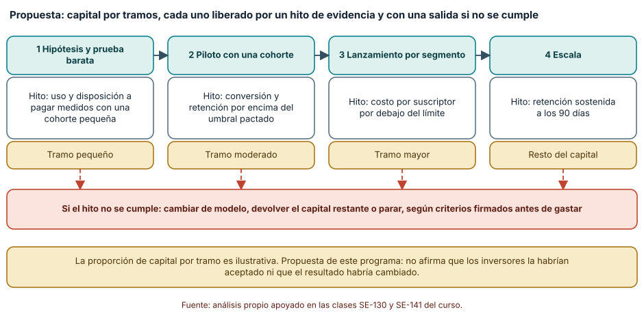

# Quibi

[↑ Casos de fallo](README.md) · [← Incidente de base de datos de GitLab](gitlab-2017.md)

Quibi fue un servicio de vídeo por suscripción pensado solo para el teléfono, con episodios de diez minutos o menos y producciones con talento reconocido. Recaudó unos 1.750 millones de dólares, se lanzó el 6 de abril de 2020 y anunció su cierre el 21 de octubre del mismo año. No es un fallo de ingeniería: el servicio funcionó, tuvo funciones técnicas propias y sus responsables lo cerraron devolviendo efectivo a los inversores. Es un fallo de producto y de mercado, y por eso su valor para el curso está en las decisiones de descubrimiento, hipótesis, métricas y capital que lo rodearon. Este caso usa solo lo que es público; los datos internos de Quibi no lo son y no se infieren.

## Ficha histórica

| Dato | Contenido |
| --- | --- |
| Organización | Quibi (de *quick bites*), antes llamada NewTV; empresa privada |
| Responsables | Jeffrey Katzenberg, fundador, antes director de DreamWorks Animation y presidente de Walt Disney Studios; Meg Whitman, directora ejecutiva, antes directora de eBay y de Hewlett Packard Enterprise |
| Sede | Los Ángeles, California (EE. UU.) |
| Anuncio | 7 de agosto de 2018, con 1.000 millones de dólares de financiación inicial |
| Lanzamiento | 6 de abril de 2020, en EE. UU. y Canadá |
| Cierre | Anunciado el 21 de octubre de 2020; aplicación inoperable el 1 de diciembre de 2020 |
| Inversores | Según Deadline, entre otros Disney, NBCUniversal, Sony Pictures, MGM, WarnerMedia, ViacomCBS, Goldman Sachs y JPMorgan Chase |
| Capital | Unos 1.750 millones de dólares recaudados |
| Plantilla | Unas 200 personas en el anuncio del cierre, según Deadline |
| Estado posterior | La empresa devolvió a los inversores unos 350 millones de dólares de efectivo; el 8 de enero de 2021 Roku adquirió los derechos de más de 75 programas por «significativamente menos» de 100 millones, según la prensa |

La fecha de consulta de las fuentes citadas al final es el 16 de noviembre de 2026.

## Contexto y problema

En 2018, los grandes servicios de vídeo bajo demanda competían por la pantalla del televisor. La apuesta de Quibi era que existía otro espacio sin servir: los momentos en movimiento, de camino al trabajo o entre una tarea y otra, en que la gente mira el teléfono. Katzenberg lo describió en 2018 con una analogía con el crecimiento de Spotify y Apple Music y con el aumento mundial de usuarios de teléfonos inteligentes, y la prensa recogió su idea de un «espacio en blanco» para el vídeo móvil de calidad (Variety, 2018 y 2020).

El problema que Quibi decía resolver era la distancia entre dos mundos: el vídeo breve gratuito y de usuarios, de YouTube o Instagram, y las series largas con presupuesto, pensadas para una sala. Quibi quería una televisión de calidad troceada en capítulos de diez minutos o menos, en el teléfono, a cambio de una suscripción. Whitman dijo en su entrevista de cierre que el caso de uso era «de 7 de la mañana a 7 de la noche», en movimiento.

Esa tesis tenía un sentido razonable en 2018. Lo que el caso examina es qué pasó cuando cada uno de sus supuestos se contrastó con el mundo real. Tres supuestos sostenían el negocio: que el uso en movimiento fuera frecuente y valioso, que bastara el teléfono sin televisor y que la calidad de los títulos hiciera pagar a una audiencia que ya tenía vídeo gratuito.

### Qué tipo de caso es este y cómo se adapta el esquema

Este es un fallo de **producto y de mercado**, no de ingeniería. Por eso las secciones de arquitectura, flujo crítico y mejoras se leen con otro vocabulario: en lugar de servidores, componentes y puntos únicos de fallo, aquí hay un **modelo de producto** (qué se vende, a quién y con qué promesa), un **mercado** (quién más compite por el mismo tiempo de la persona), **decisiones técnicas documentadas** (las pocas que la prensa pública describe) y un **cierre** (cómo termina una empresa que decide no seguir). La regla editorial sigue igual: solo lo público, con fuente y fecha, y separado de la interpretación. Los datos internos de Quibi (suscriptores de pago, minutos vistos, costo por título) no son públicos y este caso no los infiere.

### Un mercado, dos tiempos: la tesis de 2018 y el mundo de 2020

El anuncio de agosto de 2018 es un documento de época que permite ver con qué información se tomó la decisión. Variety recogió entonces que la empresa, con 1.000 millones de dólares de financiación inicial de la sociedad de inversión de Katzenberg, apuntaba a lanzar a fines de 2019 un servicio de episodios de diez minutos con dos niveles de suscripción (sin anuncios y con anuncios ligeros), y que Katzenberg argumentaba que el número de usuarios de teléfono y su consumo de vídeo en ellos crecía. La misma nota recordaba, como contrapunto, que Verizon había cerrado el mes anterior Go90, su servicio de vídeo corto con anuncios que nunca alcanzó masa crítica, con una depreciación de 658 millones de dólares en el segundo trimestre de 2018. Es decir: **un caso comparable de vídeo móvil corto ya había fracasado a la vista de todos antes de que Quibi lanzara** y la prensa lo señaló. Eso no prueba que el proyecto estuviera mal planteado (el propio texto lo distingue por su apuesta de calidad y de formato), pero sí que la hipótesis tenía un antecedente cuyo análisis era barato.

Entre el anuncio y el lanzamiento pasaron 20 meses. En ese tiempo cambió el entorno que daba sentido a la tesis: llegaron Disney+ (noviembre de 2019), HBO Max y Peacock con catálogos y marcas ya conocidos, y el 6 de abril de 2020 el lanzamiento coincidió con órdenes de quedarse en casa en gran parte de EE. UU. Katzenberg lo resume en la entrevista de cierre con Deadline: todo en Quibi estaba pensado para los momentos «en movimiento», y en el momento del lanzamiento nadie estaba en movimiento. Dice también que cuánto de esto afectó la pandemia «siempre será desconocido».

**Cómo leer la figura.** El eje horizontal va del contenido largo al corto y el vertical de gratuito a de pago. Cada burbuja es una oferta de la época según las fuentes. Mira primero el cuadrante de Quibi (de pago y corto): es el que menos competidores directos tenía y, a la vez, el que obliga al espectador a pagar por algo que el cuadrante vecino ofrece sin costo. **Dónde deja de valer:** es un mapa cualitativo del contexto, no una medición de cuota de mercado; las posiciones son las de la prensa citada y no hay datos de uso comparables entre ofertas.

## Mercado, usuarios y casos de uso

Quibi apuntaba a un público joven y móvil. La prensa lo situó frente a una audiencia «de TikTok» (The Verge, 2020) y a un mercado que ya incluía a Netflix, Amazon y, desde noviembre de 2019 y 2020, a Disney+, HBO Max y Peacock, con catálogos que ya tenían público (NBC News, 2020).

Los usuarios que el producto tenía en mente eran:

- **El espectador en movimiento**, que dispone de minutos sueltos y prefiere un capítulo que empiece y termine en esa ventana.
- **El espectador de mensajería y noticias**, a quien se ofrecían programas informativos diarios; NBC News produjo uno para la plataforma.
- **Los creadores y estudios**, que producían series y programas para Quibi con talento reconocido.
- **Los anunciantes**, a quienes se vendió el inventario del primer año antes del lanzamiento, unos 150 millones de dólares según TechCrunch (2019).

La competencia más cercana no fue otra plataforma de pago, sino la atención gratuita: Variety recuerda que TikTok, Instagram, Snapchat y YouTube ofrecen sin cobro un flujo casi infinito de entretenimiento breve.

### El trabajo que se contrata: «llenar el rato libre en movimiento»

La clase [SE-122 · Usuarios, actores, trabajos y contextos](../../classes/part-10-descubrimiento-y-estrategia-de-producto/se-122-usuarios-actores-trabajos-y-contextos/README.md) enseña a describir a los usuarios por el trabajo que contratan al producto y no por su perfil. El de Quibi, según los responsables, era llenar los ratos breves y sueltos «de 7 de la mañana a 7 de la noche» con entretenimiento de calidad. Visto como trabajo, hay que preguntarse **contra qué alternativas compite**: lo que la persona hace hoy en ese rato. Variety lo señala sin ambigüedad: las aplicaciones de vídeo corto gratuito ofrecen un flujo prácticamente infinito. La clase [SE-126 · Segmentación, mercado y alternativas existentes](../../classes/part-10-descubrimiento-y-estrategia-de-producto/se-126-segmentacion-mercado-y-alternativas-existentes/README.md) trata esa pregunta (alternativas existentes), y [SE-125 · Propuesta de valor y resultados deseados](../../classes/part-10-descubrimiento-y-estrategia-de-producto/se-125-propuesta-de-valor-y-resultados-deseados/README.md) la propuesta de valor frente a ellas.

El trabajo tiene además una **condición de contexto**: ocurre en movimiento. Es una hipótesis comprobable por separado de las otras dos del negocio (que el vídeo de calidad se pague y que no haga falta el televisor). Si el contexto desaparece (confinamiento), el trabajo deja de ocurrir en los momentos previstos; los trabajos no desaparecen, se desplazan. Que la audiencia estuviera en casa significó que el mismo rato libre ocurría ahora delante de un televisor.

### Audiencias con necesidades distintas, no todas atendidas

| Audiencia | Qué esperaba | Qué ofreció Quibi | Fuente |
| --- | --- | --- | --- |
| Espectador en movimiento | Capítulos que empiecen y terminen en minutos | Episodios de diez minutos o menos y novedades diarias | Variety, 2018 y 2020 |
| Espectador joven de plataformas sociales | Contenido de formato breve con ritmo propio | Producciones de formato premium con talento reconocido | The Verge y Variety, 2020 |
| Anunciantes | Un entorno seguro y de audiencia valiosa | Inventario del primer año vendido antes del lanzamiento | TechCrunch, 2019 |
| Creadores y estudios | Acceso a una audiencia nueva y derechos | Ventana de exclusividad de dos años según lo que informa la prensa | The Verge, 2021 |
| Clientes de un operador móvil | Un beneficio añadido a su contrato | Un año gratuito para clientes de un plan ilimitado de T-Mobile | TechCrunch, 2020 |

La tabla muestra que Quibi tenía **cinco audiencias** a la vez; lo que se publica de resultados solo mide una (el espectador). Es otra razón por la que el diagnóstico es parcial.

## Funcionalidad de principio a fin

**1. Descubrir y descargar.** El usuario encontraba la aplicación en las tiendas de aplicaciones. Quibi abrió preinscripciones en la App Store para aumentar las descargas del primer día y consiguió unas 300.000 instalaciones ese día según Sensor Tower, una cifra que TechCrunch comparó con las unas 4 millones de Disney+ en su lanzamiento.

**2. Probar sin pagar.** El servicio ofrecía una prueba gratuita de 90 días. Durante el verano de 2020, según Whitman, probaron una prueba sin tarjeta, otra de 14 días y un modelo distinto en Australia.

**3. Ver.** Cada título tenía episodios de diez minutos o menos y un mensaje de novedades diarias. Dentro de la aplicación, una función llamada Turnstyle cambiaba entre vertical y horizontal al girar el teléfono. Las capturas de pantalla se resolvieron con un método propio por las restricciones de la gestión de derechos digitales (Engadget, 2020).

**4. Pagar.** Terminada la prueba, el plan costaba 4,99 dólares al mes con anuncios o 7,99 sin ellos.

**5. Ver en casa.** Al inicio no había aplicaciones para televisor. Whitman explicó que lo decidieron porque el uso previsto era en movimiento y porque otras tareas de ingeniería tenían prioridad. AirPlay y Chromecast llegaron en junio de 2020, y las aplicaciones de Apple TV, Fire TV y Android TV el 20 de octubre de 2020, un día antes del anuncio del cierre (NBC News).

**6. El final.** Las instancias de un cierre ordenado: la decisión se tomó, según los responsables, unas dos semanas antes del anuncio; se informó al personal en una reunión; se encargó la venta de activos a un banco de inversión (Variety); la aplicación dejó de funcionar el 1 de diciembre de 2020; y en enero de 2021 Roku adquirió los derechos de los programas.

### El embudo del espectador, con los datos que sí son públicos

La funcionalidad de un servicio por suscripción se entiende como un embudo: descubrir, descargar, probar, convertir y retener. Las fuentes públicas cubren partes del embudo con cifras de **terceros** y de **la propia empresa**, que no coinciden; conviene mostrarlas por separado.

- **Descargas del primer día.** Unas 300.000 según Sensor Tower (TechCrunch, 7 de abril de 2020), el 7,5 % de las unas 4 millones de instalaciones que Disney+ tuvo en su lanzamiento en EE. UU.
- **Usuarios de la primera semana.** 600.000 usuarios nuevos según Whitman (Deadline, 21 de octubre de 2020).
- **Primer mes.** 2,6 millones de instalaciones según Sensor Tower; la propia Quibi habló de 3,5 millones de descargas y 1,3 millones de usuarios activos (NBC News, 22 de octubre de 2020).
- **Cohorte inicial.** Sensor Tower estimó unos 910.000 registros en los primeros días de abril y unos 72.000 pagadores tras los tres meses de prueba gratuita, es decir, cerca de un 8 % (The Verge, 8 de julio de 2020). Quibi respondió que el número de suscriptores de pago de esa estimación era incorrecto «en un orden de magnitud» y que su conversión de descarga a prueba superaba los puntos de referencia de las aplicaciones móviles.
- **Total.** Sensor Tower estimó 4,5 millones de descargas; Quibi dijo más de 5,6 millones (The Verge, julio de 2020).
- **Hogares suscriptores.** Kantar estimó 1,1 millones en el segundo trimestre de 2020 y 710.000 en el tercero (Variety, 1 de diciembre de 2020).

Todo lo que hay entre la descarga y el pago son estimaciones, y la que más pesa (la conversión) está en disputa. Esa disputa es el dato: **cuando una empresa discute una cifra sin publicar la suya, la decisión pública queda sin evidencia**. Un producto que conoce su conversión la usa para decidir; uno que no la publica puede tener razones (competitivas, de negociación con inversores) que no se conocen. La clase [SE-136 · Métricas de adopción, retención y tarea útil](../../classes/part-11-economia-metricas-y-decisiones-de-producto/se-136-metricas-de-adopcion-retencion-y-tarea-util/README.md) trata por qué la conversión tras la prueba gratuita es la métrica que separa curiosidad de valor y [SE-135 · Resultados, outputs, actividad y vanity metrics](../../classes/part-11-economia-metricas-y-decisiones-de-producto/se-135-resultados-outputs-actividad-y-vanity-metrics/README.md) por qué las descargas son una métrica de vanidad.

**Cómo leer la figura.** El embudo de la izquierda es la estimación de Sensor Tower para los primeros días de abril de 2020; la columna de la derecha es la posición de la empresa, con la cifra que no publicó marcada como desconocida. Mira primero que las dos columnas no se pueden comparar: una tiene números y la otra, solo una objeción. **Dónde deja de valer:** el embudo es de una cohorte de unos días; no estima la conversión de las cohortes posteriores (la prueba de 14 días de mayo y junio) ni la retención, y las cifras no se pueden promediar entre fuentes.

Las dos fuentes que miden descargas no coinciden, y la diferencia crece con el tiempo, como muestra la figura.

**Cómo leer la figura.** Cada línea es una fuente. Los puntos son hitos que cada una informó, no una serie continua. Mira primero la separación entre las dos líneas al final: es la que impide saber la audiencia real. **Dónde deja de valer:** los puntos de la primera semana miden cosas distintas (usuarios nuevos frente a descargas del primer día) y las dos fuentes no usan la misma definición de «descarga»; la figura muestra la discrepancia, no corrige una con otra.

### El recorrido del usuario y el momento del cobro

Con una prueba gratuita de 90 días, el primer cobro de la cohorte de lanzamiento caía a principios de julio de 2020 (90 días después del 6 de abril, el 5 de julio; cálculo propio). Es decir: **el dato que decidía el negocio, cuántos pagan, no existió hasta casi tres meses después del lanzamiento**, y para entonces el capital ya estaba comprometido en contenido y marketing. La figura sitúa los hitos de ese recorrido.

**Cómo leer la figura.** Cada carril es una cohorte de usuarios según su prueba gratuita; las marcas verticales son el primer cobro posible y el cierre del servicio. Mira primero cuándo ocurre el primer cobro posible: ya había pasado más de un tercio de la vida del servicio (de abril a diciembre). **Dónde deja de valer:** la fecha del primer cobro es cálculo propio a partir de los 90 días; el usuario podía convertir o cancelar antes, y no se sabe cuántos lo hicieron.

## Negocio y economía

El modelo era mixto: suscripción con dos niveles y publicidad. La economía de un servicio de este tipo depende de tres números que Quibi no ha publicado de forma completa: cuántos suscriptores pagan, cuánto cuesta cada título y cuánto dura cada suscriptor. Lo público permite dibujar el contorno:

- **Capital.** Se recaudaron unos 1.750 millones de dólares en rondas, de las que 1.000 millones se anunciaron en agosto de 2018. Según un informe de prensa recogido por NBC News, Quibi esperaba haber gastado unos 1.000 millones hacia el tercer trimestre de 2020 y necesitar unos 200 millones más a mediados de 2021 para mantenerse.
- **Costo de contenido.** Variety cita un gasto de hasta 6 millones de dólares por hora de contenido producido. El costo por hora, para series de pocos minutos por episodio, es una cifra que el caso no puede interpretar sin saber cuánto contenido se produjo.
- **Ingresos.** Los precios eran de 4,99 y 7,99 dólares al mes. Kantar estimó 1,1 millones de hogares suscriptores en el segundo trimestre de 2020 y 710.000 en el tercero (Variety). Sensor Tower estimó que menos del 10 % de los primeros usuarios se convirtió en suscriptor de pago, cifra que Quibi discutió.
- **Fin.** En el anuncio del cierre quedaban unos 350 millones de dólares en caja. Whitman explicó la lógica: para llegar a escala habría que levantar mucho más capital a principios de 2021 y los datos no lo respaldarían, de modo que lo responsable era devolver el efectivo a los accionistas en lugar de agotarlo.

**Cómo leer la figura.** Cada barra es una cifra de capital en millones de dólares. Mira primero la primera y la tercera: de 1.750 millones recaudados quedaban unos 350 al anunciar el cierre. La última es un tope: las fuentes solo dicen que Roku pagó menos de 100 millones. **Dónde deja de valer:** el gasto de 1.000 millones es una expectativa de prensa para el tercer trimestre de 2020, no un dato contable; las cuatro barras vienen de fuentes distintas y no cuadran como una cuenta de resultados.

### Impacto en cifras, con fuente y límite

| Dimensión | Cifra | Fuente y fecha | Qué mide y qué no |
| --- | --- | --- | --- |
| Capital recaudado | Unos 1.750 millones de dólares | Deadline y Variety, octubre y diciembre de 2020 | Total de rondas; no dice cuánto se comprometió en contratos |
| Financiación inicial | 1.000 millones de dólares anunciados | Variety, 7 de agosto de 2018 | Primera ronda de NewTV; la sociedad de Katzenberg había reunido además otros fondos |
| Caja al anunciar el cierre | Unos 350 millones de dólares | Deadline, 21 de octubre de 2020 | Efectivo restante; de él se devolvió parte a los inversores |
| Devolución a inversores | Unos 350 millones de dólares, según Variety | Variety, 1 de diciembre de 2020 | Informe de prensa de lo comunicado a inversores |
| Gasto estimado | Unos 1.400 millones de dólares consumidos entre 1.750 recaudados y 350 en caja | Cálculo propio | Diferencia contable aproximada; no distingue contenido, marketing y operación |
| Costo de contenido | Hasta 6 millones de dólares por hora producida | Variety, 1 de diciembre de 2020 | Una cota de la prensa; sin datos del total producido |
| Inventario publicitario | Unos 150 millones de dólares vendidos del primer año | TechCrunch, 23 de octubre de 2019 | Compromisos de anunciantes antes del lanzamiento; no ingresos realizados |
| Precio | 4,99 dólares con anuncios; 7,99 sin ellos | Variety y TechCrunch, 2020 | Precio al terminar la prueba gratuita |
| Meta inicial de suscriptores | Más de 7 millones al cierre del primer año | NBC News, 22 de octubre de 2020 | Proyección inicial citada por la prensa, no un compromiso público |
| Hogares suscriptores | 1,1 millones (2.º trimestre de 2020) y 710.000 (3.º) | Kantar, citado por Variety | Estimaciones de una consultora; la empresa no publicó la suya |
| Plantilla | Unas 200 personas | Deadline, 21 de octubre de 2020 | Al anunciarse el cierre |
| Venta de derechos | Menos de 100 millones de dólares («significativamente menos») por más de 75 programas | The Verge, 8 de enero de 2021, citando al WSJ | Precio no divulgado por Roku; informe de prensa |
| Disputa de patentes | Eko pedía cerca de 100 millones de dólares en daños | Variety, 1 de diciembre de 2020 | Alegación de una parte; no un hecho juzgado |

Cuatro lecturas de análisis propio. Primera: la relación entre la meta inicial (más de 7 millones de suscriptores en un año) y la estimación de Kantar (hasta 1,1 millones de hogares) es una diferencia de un orden de magnitud, pero las dos medidas no son equivalentes (suscriptores frente a hogares, proyección frente a estimación); es una señal, no una cuenta. Segunda: la combinación de 6 millones por hora de contenido (cota superior) con 1.400 millones consumidos permite imaginar la magnitud del compromiso de contenido, pero no se puede calcular el total sin conocer cuánto se produjo. Tercera: las cifras de ingresos realizados de Quibi no son públicas. Cuarta: la venta de derechos a Roku, por menos de 100 millones, está lejos de recuperar lo consumido; el destino de ese dinero no es público.

### Reacción de los responsables y de los inversores

- **Decisión.** Según Whitman, la decisión de devolver el efectivo se tomó «unas dos semanas» antes del anuncio, tras probar durante el verano pruebas gratuitas de distinta duración, un marketing centrado en los títulos y un modelo distinto en Australia, y tras buscar durante tres semanas compradores, socios y financiación adicional (Katzenberg, en la misma entrevista).
- **Presión de los inversores.** Katzenberg dijo que no hubo presiones de nadie, «en un sentido o en otro».
- **Comunicación.** Un anuncio con una carta abierta, una reunión virtual con la plantilla y una entrevista exclusiva. Katzenberg dijo en CNBC al día siguiente que atribuirlo todo a la pandemia no era justo.
- **Reacción de la prensa.** Variety describió el cierre como «el rápido y silencioso final» de la apuesta; NBC News concluyó que era imposible fijar una sola causa.
- **Fin de los contenidos.** Roku adquirió más de 75 programas con una ventana de exclusividad de dos años y derechos hasta 2027, con la condición, según el WSJ citado por The Verge, de mantener el formato original corto.

## Arquitectura y esquemas

Quibi no publicó detalles de su arquitectura interna, por lo que este apartado se limita al producto y a la distribución, que sí son públicos. No se infiere nada del interior de los sistemas.

### Contexto: la premisa frente al mundo de abril de 2020

**Cómo leer la figura.** A la izquierda, lo que el negocio suponía; a la derecha, lo que había en abril de 2020. Cada fila empareja un supuesto con su contraste mediante una flecha punteada. Mira primero la primera fila: el supuesto de uso en movimiento chocó con el confinamiento. **Dónde deja de valer:** el contraste es de contexto, no de causa: ni los responsables ni la prensa pueden separar cuánto del resultado se debió al confinamiento. Katzenberg reconoció que atribuirlo todo a la pandemia no era justo.

### Componentes: el producto y su distribución

**Cómo leer la figura.** La fila superior sigue el contenido de los creadores al teléfono. La segunda lista las funciones de la aplicación. El grupo de abajo muestra cómo se fue abriendo el acceso al televisor: coral al inicio, dorado en junio y verde azulado en octubre. **Dónde deja de valer:** es una descripción de producto desde la prensa; no muestra la arquitectura técnica ni cómo se entregaba el vídeo.

Un detalle técnico sí documentado merece atención: Turnstyle, la función que cambia de orientación al girar el teléfono, fue objeto de una disputa con la empresa Eko, que alegó infracción de patentes y apropiación de secretos industriales; Quibi pidió a un tribunal que declarara que no infringía y calificó las reclamaciones de infundadas (The Verge y Variety, 2020). El caso no toma partido; lo que importa es que una función diferencial costosa de desarrollar y litigar no sustituyó a la distribución en televisores.

### Datos y escala

**Cómo leer la figura.** Las dos barras superiores comparan instalaciones del primer día; las dos inferiores muestran la evolución de los hogares suscriptores que estimó Kantar. Mira primero la distancia entre las dos primeras: las instalaciones de Quibi fueron el 7,5 % de las de Disney+, según Sensor Tower. **Dónde deja de valer:** las dos primeras son instalaciones y las otras dos hogares suscriptores; son medidas distintas y no se comparan entre sí. Todas son estimaciones de terceros y Quibi discutió la de conversión de Sensor Tower: a julio de 2020 declaró más de 5,6 millones de descargas.

### Cómo leer esta sección en un caso de producto

La arquitectura de un producto de este tipo tiene niveles análogos a los de un sistema técnico, y cada uno tiene su figura.

| Nivel | Pregunta | Figura |
| --- | --- | --- |
| 1. Contexto de mercado | ¿Contra quién y contra qué compite? | Cuadrante de mercado (arriba) y premisa y realidad |
| 2. Modelo de producto | ¿Qué se promete, a quién, con qué y a cambio de qué? | Lienzo del producto |
| 3. Recorrido y datos | ¿Cómo pasa el usuario de descubrir a pagar? | Embudo y recorrido (arriba) |
| 4. Decisiones técnicas | ¿Qué decisiones de ingeniería son públicas y qué costaron? | Decisiones técnicas documentadas |
| 5. Capital | ¿Cómo se gastó y cómo se devolvió el dinero? | Cascada del capital |
| 6. Supuestos y evidencia | ¿Qué creía el negocio y qué lo respaldaba? | Mapa de supuestos |
| 7. Puertas y controles | ¿Qué momentos de decisión existieron? | Puertas de aprendizaje y operación en días |
| 8. Cierre | ¿Cómo termina la empresa y qué pasa con lo construido? | Cronología del cierre |
| 9. Después | ¿Cómo se habría organizado el capital con evidencia? | Capital por tramos |

### Nivel 2: el modelo de producto

El modelo de producto es la respuesta a seis preguntas: para quién, qué trabajo, qué promesa, qué formato, qué precio y qué canal. Las fuentes públicas permiten responder cada una, y mostrarlas juntas ayuda a ver dónde la apuesta era más arriesgada.

**Cómo leer la figura.** Es un lienzo de modelo de negocio de nueve bloques, resumido con los datos públicos. Las cajas coral son los supuestos que el caso examina: uso en movimiento, solo teléfono y pago por contenido premium. Mira primero la fila de supuestos: tres de ellos eran verificables con experimentos baratos antes de gastar. **Dónde deja de valer:** el lienzo es una reconstrucción de este programa a partir de la prensa; Quibi no publicó el suyo y no se infieren sus cifras internas.

### Nivel 4: decisiones técnicas documentadas

Quibi no publicó su arquitectura, pero la prensa describe cuatro decisiones técnicas con consecuencias de producto:

1. **Solo teléfono al inicio.** Whitman dijo que se pensó en aplicaciones para el salón y se decidió priorizar otras tareas de ingeniería porque el caso de uso era en movimiento.
2. **Turnstyle.** Cambiar entre vertical y horizontal al girar el teléfono. Según The Verge, la patente de Quibi describe el envío de dos archivos de vídeo en proporciones distintas y el cambio entre ellos al girar. Es una decisión de producto con implicaciones técnicas (producir y entregar dos versiones de cada título) y legales (la disputa con Eko).
3. **Capturas de pantalla propias.** Tom Conrad, director de producto, explicó en julio de 2020 que el sistema de gestión de derechos digitales que preferían los titulares de derechos hacía que las plataformas móviles bloquearan las capturas, y que por eso se desarrolló un método propio (pulsar, mantener y deslizar).
4. **Acceso al televisor por etapas.** AirPlay y Chromecast en junio de 2020 y aplicaciones nativas el 20 de octubre.

**Cómo leer la figura.** Cada fila es una decisión: a la izquierda la restricción que la motivó, en medio la decisión y a la derecha lo que la fuente dice que ocurrió. Las cajas coral son costos o consecuencias señaladas por la fuente; las doradas, interpretación de este programa. Mira primero la fila del televisor: la decisión técnica más barata de revertir se revirtió tarde. **Dónde deja de valer:** son decisiones descritas por la prensa y por declaraciones de los responsables; no hay documentación técnica pública y no se infiere el diseño interno.

La lectura propia es que Turnstyle y la captura de pantalla eran **inversiones en diferenciación de experiencia** (una función en la que la empresa era única), mientras que el acceso a la pantalla grande era una **inversión en alcance** (llegar a donde estaba la audiencia). Los equipos de ingeniería tienen un presupuesto finito, y la ordenación de esas inversiones es una decisión de producto. La clase [SE-128 · Priorización por valor, riesgo y aprendizaje](../../classes/part-10-descubrimiento-y-estrategia-de-producto/se-128-priorizacion-por-valor-riesgo-y-aprendizaje/README.md) trata la priorización por valor, riesgo y aprendizaje, y la [SE-255 · Nativo, híbrido, web wrapper y cross-platform](../../classes/part-21-software-movil-escritorio-y-multiplataforma/se-255-nativo-hibrido-web-wrapper-y-cross-platform/README.md) la elección de plataformas según el uso real y no solo según la tesis.

### Nivel 5: el capital y su uso

El capital es el combustible de un producto que no se financia con ingresos. La figura muestra el recorrido del dinero que fija la prensa: lo recaudado, lo consumido (por diferencia) y lo devuelto.

**Cómo leer la figura.** La primera barra es el capital recaudado; la segunda lo parte en lo consumido (coral) y lo que quedaba (teal); la tercera, lo que se iba a devolver; la cuarta, el techo de lo que pagó Roku. Mira primero la proporción: de cada cinco dólares recaudados, cuatro habían sido consumidos al decidir cerrar. **Dónde deja de valer:** lo consumido es una diferencia entre dos cifras de prensa y no una cifra contable; no distingue contenido, marketing, plantilla ni compromisos futuros, y las dos últimas barras son cifras de fuentes distintas y no se suman.

La decisión de cerrar es, económicamente, una decisión de **no gastar los 350 millones restantes** en un resultado que los responsables esperaban igual. Whitman dijo que la mayoría de los emprendedores sigue hasta quedarse sin dinero. Es una afirmación de los responsables; el caso la registra y no la evalúa. La clase [SE-130 · Criterios de no éxito y decisiones de abandono](../../classes/part-10-descubrimiento-y-estrategia-de-producto/se-130-criterios-de-no-exito-y-decisiones-de-abandono/README.md) enseña por qué los criterios de abandono se escriben antes del gasto, y la [SE-141 · Portafolio, opciones y secuenciación de inversión](../../classes/part-11-economia-metricas-y-decisiones-de-producto/se-141-portafolio-opciones-y-secuenciacion-de-inversion/README.md) por qué el capital por tramos conserva opciones.

### Nivel 6: supuestos y evidencia

Un mapa de supuestos ordena lo que el negocio daba por cierto según cuánto importa y cuánta evidencia tenía. Es una herramienta de las clases [SE-124 · Hipótesis, supuestos y preguntas críticas](../../classes/part-10-descubrimiento-y-estrategia-de-producto/se-124-hipotesis-supuestos-y-preguntas-criticas/README.md) y [SE-127 · Prototipos, experimentos y reducción de incertidumbre](../../classes/part-10-descubrimiento-y-estrategia-de-producto/se-127-prototipos-experimentos-y-reduccion-de-incertidumbre/README.md).

**Cómo leer la figura.** Cada punto es un supuesto colocado según su importancia para que el negocio funcione (arriba, más importante) y la evidencia que se tenía antes del lanzamiento (a la derecha, más evidencia). Mira primero el cuadrante superior izquierdo: supuestos muy importantes y casi sin evidencia, que son los que conviene probar primero. **Dónde deja de valer:** la ubicación es una valoración de este programa a partir de lo público; Quibi pudo tener estudios internos que no conocemos y que moverían puntos.

### Nivel 7: puertas y controles de decisión

Una puerta de decisión es un momento programado en que se decide continuar, cambiar o parar, según evidencia. El caso permite ver cuáles existieron y cuáles no, con una advertencia: lo que no es público se marca como desconocido.

**Cómo leer la figura.** Cada columna es una puerta; el recuadro inferior dice qué se sabe públicamente. Teal: hay evidencia pública de que existió; coral: hay evidencia pública de que se decidió no hacerlo; gris: no se sabe. Mira primero la tercera columna: el lanzamiento escalonado se consideró y se descartó con una razón declarada. **Dónde deja de valer:** que una puerta «no se sepa» no significa que faltara; solo que no es público.

### Nivel 8: el cierre

El cierre es una secuencia con orden propio, aquí más rica que en un incidente técnico: decidir, buscar alternativas, comunicar, desmontar, vender y litigar.

**Cómo leer la figura.** Cada carril es un tipo de actividad del cierre y el eje cuenta días desde la decisión. Las marcas son hitos documentados; las barras son períodos con inicio y fin informados. Mira primero lo corto del tiempo entre la decisión y el anuncio, y lo que se hizo en el medio. **Dónde deja de valer:** el día 0 (30 de septiembre) es tres semanas antes del anuncio, según Katzenberg; la fecha de la decisión es una aproximación a partir de «un par de semanas» que dijo Whitman; el resto son fechas de prensa.

La lectura propia es que un cierre ordenado es un acto de ingeniería de la decisión: comunicar a la plantilla, devolver capital, preservar el activo (el catálogo) y cerrar el servicio con una fecha. Se enseña poco porque casi nunca se estudia. [SE-450 · Gestión de riesgos y decisiones ejecutivas](../../classes/part-37-gestion-liderazgo-y-practica-profesional/se-450-gestion-de-riesgos-y-decisiones-ejecutivas/README.md) trata la gestión de riesgos y las decisiones ejecutivas.

## Casos especiales y cómo fallan

**El lanzamiento con atención máxima, justo en el confinamiento.** Documentado: el servicio se lanzó el 6 de abril de 2020, cuando gran parte de EE. UU. estaba bajo órdenes de quedarse en casa (NBC News). Whitman afirmó que decidieron un lanzamiento con mucha atención para crear una categoría y que no lo cambiarían; Katzenberg reconoció que el diseño era «para estar en movimiento» en un momento en que nadie lo estaba.

**La prueba gratuita larga.** Documentado: 90 días gratis al inicio. La tasa de conversión es el dato que decide el negocio, y está en disputa: Sensor Tower estimó menos del 10 % de conversión de los primeros usuarios y Quibi dijo que el número de suscriptores de pago de esa estimación era incorrecto «en un orden de magnitud». No se sabe quién tenía razón porque Quibi no publicó su cifra.

**Pivotes durante el verano.** Documentado por Whitman: se probaron distintas pruebas gratuitas, un marketing más centrado en títulos que en la plataforma y un modelo distinto en Australia; «ninguna cambió la respuesta fundamental», que era la necesidad de más capital.

**Prioridades de ingeniería.** La aplicación para televisor «no estaba en lo más alto» de la lista, según Whitman. Es una decisión de priorización coherente con la tesis. Es también el caso típico de una restricción de producto —solo móvil— que se mantiene aunque la hipótesis de uso ya se haya cuestionado.

**El contenido y su derecho.** Documentado en la prensa citada por Deadline: la tesis de la biblioteca como activo. Katzenberg planteó que el primer camino para el servicio era continuar en la plataforma de otro; terminó con Roku, que adquirió los derechos por menos de 100 millones de dólares y los mantuvo en formato corto, según The Verge.

**Un cierre ordenado.** Es el caso especial más raro y el más instructivo. Whitman lo describe como una decisión de madurez: los emprendedores siguen hasta quedarse sin dinero, pero ellos devolvieron el capital que quedaba. Es una afirmación de los responsables; este caso la registra sin evaluarla.

### La prueba gratuita que retrasa el aprendizaje

Con una prueba de 90 días, el producto compra tiempo de uso a costa de **tiempo de aprendizaje**. Para la empresa, la conversión a pago de la cohorte de abril no era observable hasta julio. Whitman cuenta que el verano fue de cambios (prueba sin tarjeta, de 14 días, un modelo distinto en Australia, marketing centrado en títulos), es decir, de experimentos que se hicieron **después** de comprometer el gasto. Una prueba más corta habría adelantado el dato a costa de menos tiempo de exposición del usuario al catálogo; no se sabe cuál habría sido mejor, y de eso trata la clase [SE-138 · Experimentos, sesgos y causalidad básica](../../classes/part-11-economia-metricas-y-decisiones-de-producto/se-138-experimentos-sesgos-y-causalidad-basica/README.md) sobre experimentos y causalidad: cada variante cambia a la vez el precio efectivo, el tiempo de exposición y la composición de quienes se registran.

### Lanzar para crear una categoría: el argumento a favor

Whitman defendió el lanzamiento grande con una razón de producto: se creaba una categoría nueva y hacía falta que muchas personas la conocieran y la probaran, lo que según ella ocurrió (600.000 usuarios nuevos en la primera semana). Es un argumento serio, no una excusa: las categorías nuevas a veces solo existen cuando el mercado las ve. El caso lo registra con su peso. La pregunta de diseño es qué **evidencia** debía existir para justificar el gasto de lanzar en grande, y de eso trata la clase [SE-142 · Decisiones reversibles e irreversibles](../../classes/part-11-economia-metricas-y-decisiones-de-producto/se-142-decisiones-reversibles-e-irreversibles/README.md): un lanzamiento masivo es una decisión de baja reversibilidad.

### Cuando el contexto cambia, el trabajo del producto cambia

El confinamiento no solo redujo el uso en movimiento; también cambió el **canal**: la gente en casa tenía más tiempo, más pantallas grandes y más ofertas de pago a mano. Una hipótesis de producto (el momento en movimiento) y una decisión técnica (solo teléfono) quedaron ligadas: cuando la primera cambió, la segunda se volvió una restricción. Tardó semanas la solución parcial (AirPlay y Chromecast en junio) y meses la completa (aplicaciones nativas el 20 de octubre). La lección de gestión del cambio es la de [SE-153 · Gestión de cambios y líneas base](../../classes/part-12-ingenieria-de-requisitos/se-153-gestion-de-cambios-y-lineas-base/README.md): una línea base de supuestos debe poder revisarse cuando cambia el contexto, no solo cuando falla el producto.

### Una función diferencial cuya propiedad se disputa

La disputa con Eko ilustra un riesgo de propiedad intelectual de las funciones diferenciales. Según The Verge, Quibi presentó una demanda para que se declarara que Turnstyle no infringía la patente de Eko un día antes de que Eko presentara la suya, que además alegaba apropiación de secretos industriales por dos empleados que conocieron la tecnología de Eko bajo acuerdo de confidencialidad cuando trabajaban en otra empresa; Quibi calificó las reclamaciones de carentes de mérito y dijo que había desarrollado Turnstyle internamente y obtenido una patente propia. Variety informó en diciembre de 2020 de que Eko seguía reclamando cerca de 100 millones de dólares. El caso no toma partido. Lo relevante para el curso es que una función diferencial arrastra un riesgo legal que la ingeniería de producto debe evaluar antes del lanzamiento ([SE-452 · Propiedad intelectual, contratos y ética](../../classes/part-37-gestion-liderazgo-y-practica-profesional/se-452-propiedad-intelectual-contratos-y-etica/README.md) y [SE-117 · Licencias, procedencia y reutilización](../../classes/part-09-bibliotecas-paquetes-sdk-y-automatizacion/se-117-licencias-procedencia-y-reutilizacion/README.md)).

## Línea de tiempo

| Fecha | Hecho |
| --- | --- |
| 7 de agosto de 2018 | Se anuncia NewTV con 1.000 millones de dólares de financiación; se espera lanzar a fines de 2019 |
| Octubre de 2018 | Se anuncia el nombre Quibi |
| Octubre de 2019 | Quibi informa que ya tiene vendido el inventario publicitario del primer año, unos 150 millones |
| Marzo de 2020 | Eko presenta demandas por Turnstyle |
| 6 de abril de 2020 | Lanzamiento en EE. UU. y Canadá; unas 300.000 instalaciones el primer día (Sensor Tower) |
| Junio de 2020 | Llegan AirPlay y Chromecast |
| Julio de 2020 | Sensor Tower estima baja conversión; Quibi informa 5,6 millones de descargas |
| Tercer trimestre de 2020 | Kantar estima 710.000 hogares suscriptores, por debajo de los 1,1 millones del trimestre anterior |
| 20 de octubre de 2020 | Llegan las aplicaciones de Apple TV, Fire TV y Android TV |
| 21 de octubre de 2020 | Se anuncia el cierre |
| 1 de diciembre de 2020 | La aplicación deja de funcionar |
| 8 de enero de 2021 | Roku adquiere los derechos de más de 75 programas |

**Cómo leer la figura.** Cada carril es una fase: preparación, servicio en operación y tras el cierre. Las líneas punteadas marcan el anuncio de 1.000 millones, el lanzamiento y el anuncio del cierre. Mira primero la proporción: la preparación fue más larga que la vida del servicio. **Dónde deja de valer:** los meses son cálculo propio y no dicen nada sobre la intensidad de cada fase; el servicio estuvo abierto unos ocho meses.

### Antecedentes: decisiones y condiciones latentes, con año

| Año | Decisión o condición | Fuente | Lectura de este programa |
| --- | --- | --- | --- |
| Antes de agosto de 2018 | La idea la inicia Katzenberg «hace más de dos años» según la entrevista de octubre de 2020 | Deadline | Origen de la tesis; no hay documentos públicos de esa etapa |
| Julio de 2018 | Verizon cierra Go90, servicio de vídeo corto con anuncios, y depreciará 658 millones | Variety, 2018 | Un antecedente comparable que la prensa señaló; su análisis era barato |
| 7 de agosto de 2018 | Anuncio de NewTV con 1.000 millones de dólares y episodios de diez minutos; meta de lanzar a fines de 2019 | Variety, 2018 | Primera hipótesis pública y compromiso de capital muy grande |
| 2018 | Planes de dos niveles, con y sin anuncios | Variety, 2018 | Un modelo mixto cuya economía depende de la conversión y de la publicidad |
| Junio de 2019 | Quibi informa de 100 millones en ventas de publicidad con 50 millones por vender | TechCrunch, 2019 | Evidencia a favor de la demanda publicitaria antes de tener producto |
| 23 de octubre de 2019 | Inventario del primer año agotado: unos 150 millones | TechCrunch, 2019 | Los anunciantes compran la promesa, no el uso |
| 2019 | El lanzamiento se retrasa de fines de 2019 a abril de 2020 | Variety y TechCrunch | La fecha se movió; el entorno también |
| 2019 | Disney+ se lanza en noviembre | NBC News | Cambia el mercado antes del lanzamiento de Quibi |
| Marzo de 2020 | Disputa con Eko | The Verge, 11 de marzo de 2020 | Un riesgo legal antes del lanzamiento |
| 6 de abril de 2020 | Lanzamiento | Varias fuentes | En pleno confinamiento |

Esta tabla muestra la mayor condición latente del caso: **entre el anuncio y el lanzamiento pasaron 20 meses en los que el entorno cambió y la tesis no se re-examinó públicamente**. Es una lectura propia; no se sabe si internamente se hizo.

### Un año de operación, en una escala

La línea de tiempo principal muestra las fases. Una segunda vista, en días desde el lanzamiento, muestra cuándo llegaron los datos que decidían el negocio frente a cuándo estaba comprometido el capital.

**Cómo leer la figura.** Cada carril es un tipo de hito: producto, datos y capital. Las marcas son fechas documentadas o calculadas; las barras son períodos informados. Mira primero la distancia entre el día en que se puede cobrar por primera vez y el día en que cierra el servicio. **Dónde deja de valer:** los días son cálculo propio a partir de fechas de prensa; el día 93 es la fecha del informe de Sensor Tower (8 de julio) y no la del dato interno.

## Qué falló en cada instancia

Qué se esperaba de cada parte del negocio y qué ocurrió, con la salvedad de que gran parte de la evidencia son estimaciones de terceros.

1. **La propuesta de valor.** Se esperaba que la calidad de títulos breves justificara una suscripción en un mercado con alternativas gratuitas. Variety resume que el servicio «no era lo bastante atractivo» para que los consumidores pagaran; es una interpretación de la prensa y es una de las dos hipótesis que los propios responsables dejaron abiertas: que la idea de un servicio independiente de formato corto premium no funcionara.
2. **El uso previsto.** Se esperaba uso en movimiento de 7 a 19 horas. La audiencia estaba en casa y el televisor estaba a un paso. Katzenberg lo reconoce, pero no puede decir cuánto de esto fue la pandemia y cuánto la tesis.
3. **El producto y la distribución.** Se esperaba que bastara el teléfono. El acceso al televisor llegó por etapas y la aplicación nativa, el día antes del cierre.
4. **La adquisición y la conversión.** Se esperaba convertir tras la prueba gratuita. Los datos de terceros sugieren una conversión baja, pero no hay cifra propia de Quibi.
5. **La competencia.** Se esperaba un espacio sin competidores. El lanzamiento coincidió con la llegada de otros servicios con catálogos que ya tenían público y con una oferta gratuita de vídeo corto.
6. **La financiación.** Se esperaba que la escala llegara con el capital recaudado. Según Whitman, para llegar a escala hacía falta mucho más capital y los datos no lo habrían respaldado.
7. **El cierre.** Se esperaba continuidad; la decisión fue devolver el efectivo, vender los activos y cerrar de forma ordenada.

## Causa raíz y factores

Los responsables dieron su propia lectura en la entrevista de cierre: fue «un poco de cada», una mezcla de que la idea de un servicio independiente de formato corto premium podía no funcionar y de que el lanzamiento coincidió con una pandemia que cambió el uso. Después, Katzenberg dijo en CNBC que atribuirlo todo a la pandemia no era justo.

**Hipótesis cuestionada (documentado).** Que el uso en movimiento fuera suficiente para sostener una suscripción independiente.

**Condiciones del plan (documentado).**

- Producto solo móvil durante la mayor parte de su vida.
- Prueba gratuita larga y fecha de cobro lejana.
- Gran lanzamiento antes de medir la hipótesis.
- Capital grande comprometido por adelantado en contenido y marketing, con inventario publicitario vendido para un año.

**Factores externos (documentado).** Confinamiento por la pandemia; llegada simultánea de Disney+, HBO Max y Peacock; oferta gratuita de vídeo corto.

**Factores de contexto (inferidos).** Una apuesta de gran escala y reputación podría dificultar el cambio de rumbo; lo que se sabe es que los responsables dijeron que cambiaron muchas cosas en el verano y que ninguna modificó la necesidad de más capital.

**No se sabe.** Cuántos suscriptores de pago tenía Quibi, cuántos conservaba tras la prueba, cuánto veían, cuánto costó cada título, cómo se tomó cada decisión interna ni qué datos tenían los responsables que no son públicos. Cualquier explicación más precisa de la que dan los responsables y la prensa sería especulación.

### Cadena causal estructurada

Los responsables dieron una lectura propia («un poco de cada») y la prensa añadió otras. Ordenadas en una cadena, y con la salvedad de que gran parte es interpretación, las causas son:

1. **Una tesis con tres supuestos encadenados** (uso en movimiento, solo teléfono, pago por premium breve), cada uno necesario. *Documentado como tesis; la evidencia previa es desconocida.*
2. **Un compromiso de capital muy grande por adelantado**, con contenido y marketing contratados antes de medir. *Documentado (1.750 millones, inventario publicitario vendido).*
3. **Un lanzamiento de gran escala** decidido a propósito. *Documentado (Whitman).*
4. **Un entorno cambiado** (confinamiento, nuevas plataformas con catálogos). *Documentado.*
5. **Una oferta gratuita de vídeo corto** que cubría el mismo trabajo sin precio. *Documentado (Variety).*
6. **Una conversión baja o en disputa y un crecimiento de suscriptores lento**, que no justificaba una nueva ronda. *Documentado por estimaciones de terceros; cifra propia desconocida.*
7. **Una necesidad de capital creciente** para llegar a escala. *Documentado (Whitman: más capital «relativamente pronto»).*
8. **Una decisión de cerrar con devolución de efectivo.** *Documentado.*

El eje 1 a 3 explica **por qué el negocio dependía de que todo saliera bien a la primera**; el 4 y el 5, **por qué no salió así**; el 6 a 8, **cómo se tomó la decisión de salida**. Es una lectura propia.

### Factores contribuyentes y barreras que no existieron o no se sabe si existieron

| Factor | Tipo | Barrera | Estado en las fuentes |
| --- | --- | --- | --- |
| Supuesto de uso en movimiento | Hipótesis | Prueba temprana con una cohorte pequeña | No se sabe si se hizo |
| Solo teléfono | Producto | Revisar la restricción cuando cambió el uso | Se revisó tarde (junio y octubre) |
| Capital por adelantado | Financiación | Tramos ligados a evidencia | Capital grande desde 2018 |
| Lanzamiento grande | Ejecución | Lanzamiento escalonado | Considerado y descartado, según Whitman |
| Prueba gratuita larga | Modelo | Medir la conversión antes de escalar | Cambiada en el verano |
| Competencia gratuita | Mercado | Comparar contra alternativas reales | La prensa lo señala; no hay estudio público |
| Antecedente de Go90 | Aprendizaje | Análisis de un caso comparable | No se sabe si se hizo |
| Criterios de abandono | Gobierno | Umbrales escritos antes del gasto | No se sabe; la salida se decidió con datos «claros» según Whitman |

### Árbol de fallas

**Cómo leer la figura.** Las compuertas Y exigen todas las condiciones; las O, alguna. Las hojas coral son hechos documentados y las doradas son interpretaciones de este programa. Mira primero la rama central: el capital necesario crecía mientras la conversión no lo justificaba. **Dónde deja de valer:** es un modelo lógico simplificado; no hay probabilidades ni datos internos y no cubre otros factores que los responsables no mencionaron.

### Documentado, inferido y no se sabe

| Afirmación | Estado | Base |
| --- | --- | --- |
| Lanzamiento el 6 de abril de 2020, cierre anunciado el 21 de octubre | Documentado | Varias fuentes |
| Capital de 1.750 millones y caja de 350 millones | Documentado | Deadline, Variety |
| Hogares suscriptores de 1,1 millones a 710.000 | Documentado como estimación de Kantar | Variety |
| Conversión de la cohorte inicial en torno al 8 % | Estimación de Sensor Tower, disputada por la empresa | The Verge |
| Que la pandemia explique una parte del resultado | Reconocido por los responsables; cuánto, desconocido | Deadline, CNBC |
| Que la oferta gratuita redujera la disposición a pagar | Inferido | Variety lo plantea como contexto |
| Que el análisis de Go90 pudiera haber informado la tesis | Inferido | Lectura de este programa |
| Suscriptores de pago, minutos vistos, costo por título | No se sabe | No son públicos |
| Criterios de abandono escritos antes del gasto | No se sabe | No son públicos |

## Mejoras que debieron hacerse

> **Esta sección es análisis propio de este programa**, no una afirmación de Quibi, de sus responsables ni de la prensa. Se apoya en lo documentado y propone controles de descubrimiento y de gobierno que el curso enseña. Es un ejercicio de aprendizaje con información incompleta: no sabemos si habrían funcionado.

**Cómo leer la figura.** Arriba, el recorrido que describen la prensa y los responsables; abajo, una propuesta de este programa. Las flechas son pasos en orden. Mira primero dónde se mide: en el seguido, después de lanzar; en el alternativo, antes de ampliar. **Dónde deja de valer:** es una propuesta; el lanzamiento de atención máxima tenía una razón declarada, crear una categoría, y puede que un recorrido escalonado no habría atraído a los inversores.

1. **Declarar las hipótesis y medirlas por separado.** Que la gente ve vídeo de calidad en movimiento, que paga por ello y que lo hace sin televisor son tres hipótesis distintas, con riesgos distintos. Cada una admite una prueba barata antes de producir un catálogo grande. Clases: [SE-124](../../classes/part-10-descubrimiento-y-estrategia-de-producto/se-124-hipotesis-supuestos-y-preguntas-criticas/README.md) y [SE-127](../../classes/part-10-descubrimiento-y-estrategia-de-producto/se-127-prototipos-experimentos-y-reduccion-de-incertidumbre/README.md).
2. **Comparar con las alternativas reales, incluidas las gratuitas.** La propuesta de valor se mide frente a lo que la persona ya hace en esos momentos, no frente a la televisión de pago. Clases: [SE-125](../../classes/part-10-descubrimiento-y-estrategia-de-producto/se-125-propuesta-de-valor-y-resultados-deseados/README.md) y [SE-126](../../classes/part-10-descubrimiento-y-estrategia-de-producto/se-126-segmentacion-mercado-y-alternativas-existentes/README.md).
3. **No convertir una restricción de producto en dogma.** «Solo móvil» era razonable como hipótesis de partida; cuando el uso real mostró otro patrón, la distribución en televisores debía subir en la lista. Se puede decidir con costo y reversibilidad en mente. Clases: [SE-255](../../classes/part-21-software-movil-escritorio-y-multiplataforma/se-255-nativo-hibrido-web-wrapper-y-cross-platform/README.md) y [SE-142](../../classes/part-11-economia-metricas-y-decisiones-de-producto/se-142-decisiones-reversibles-e-irreversibles/README.md).
4. **Metrices de adopción, retención y tarea útil, con contrapesos.** Descargas y primeras semanas no son un norte; la conversión tras la prueba, la retención y el tiempo de visión sí, con guardarraíles de costo por suscriptor. Clases: [SE-136](../../classes/part-11-economia-metricas-y-decisiones-de-producto/se-136-metricas-de-adopcion-retencion-y-tarea-util/README.md) y [SE-139](../../classes/part-11-economia-metricas-y-decisiones-de-producto/se-139-north-star-guardrails-y-metricas-contrarias/README.md).
5. **Criterios de no éxito definidos antes del lanzamiento.** Qué conversión, qué retención y qué costo por suscriptor harían parar o cambiar de modelo, escritos antes de gastar. Los responsables sí lo hicieron al final, y eso es un acierto: devolvieron el capital en lugar de agotarlo. Habría ayudado fijarlo antes. Clase: [SE-130](../../classes/part-10-descubrimiento-y-estrategia-de-producto/se-130-criterios-de-no-exito-y-decisiones-de-abandono/README.md).
6. **Capital por tramos ligados a evidencia.** Un compromiso de capital muy grande por adelantado reduce el costo de oportunidad de equivocarse con demasiada facilidad. Tramos ligados a hitos de uso mantienen opciones abiertas. Clases: [SE-141](../../classes/part-11-economia-metricas-y-decisiones-de-producto/se-141-portafolio-opciones-y-secuenciacion-de-inversion/README.md) y [SE-133](../../classes/part-11-economia-metricas-y-decisiones-de-producto/se-133-modelos-de-negocio-y-sostenibilidad/README.md).
7. **Evaluar si era un producto o una función de otro.** Katzenberg planteó la pregunta de si un servicio independiente de formato corto premium podía funcionar; la alternativa de integrarse en una plataforma existente era una opción que el curso llama alianza o distribución, y que se exploró al final. Clase: [SE-134](../../classes/part-11-economia-metricas-y-decisiones-de-producto/se-134-costos-de-construccion-operacion-y-oportunidad/README.md).

### Mejora a fondo, factor por factor

> **Análisis propio de este programa**, no una afirmación de Quibi, de sus responsables ni de la prensa. Es un ejercicio con información incompleta: no se sabe si habría funcionado, y los costos se dan como órdenes cualitativos porque las cifras internas no son públicas. Cada factor se aborda con un control **técnico o de producto**, uno de **proceso** y uno de **gobierno**.

**Factor 1: tres supuestos encadenados sin prueba separada.**
- *Producto:* una prueba barata por supuesto: uso en movimiento (diario de uso con una cohorte pequeña), disposición a pagar (precio probado en una landing o un piloto) y suficiencia del teléfono (qué porcentaje de visionados ocurre en pantalla grande).
- *Proceso:* mapa de supuestos revisado antes de cada gran compromiso de gasto.
- *Gobierno:* ningún supuesto «muy importante y sin evidencia» recibe capital grande sin una prueba previa.
- *Costo y trade-off:* meses de demora y menos «sorpresa» de lanzamiento; se compra información antes de comprometer capital. [SE-124 · Hipótesis, supuestos y preguntas críticas](../../classes/part-10-descubrimiento-y-estrategia-de-producto/se-124-hipotesis-supuestos-y-preguntas-criticas/README.md), [SE-127 · Prototipos, experimentos y reducción de incertidumbre](../../classes/part-10-descubrimiento-y-estrategia-de-producto/se-127-prototipos-experimentos-y-reduccion-de-incertidumbre/README.md), [SE-121 · Problemas, síntomas, necesidades y oportunidades](../../classes/part-10-descubrimiento-y-estrategia-de-producto/se-121-problemas-sintomas-necesidades-y-oportunidades/README.md).

**Factor 2: capital comprometido por adelantado.**
- *Producto:* un catálogo inicial pequeño, ampliable según uso.
- *Proceso:* tramos de capital ligados a hitos de uso, retención y costo por suscriptor.
- *Gobierno:* los inversores y la dirección acuerdan los hitos y los umbrales de parada al inicio.
- *Costo y trade-off:* una ronda grande da credibilidad y atrae talento; los tramos pueden reducir el atractivo ante estudios. [SE-141 · Portafolio, opciones y secuenciación de inversión](../../classes/part-11-economia-metricas-y-decisiones-de-producto/se-141-portafolio-opciones-y-secuenciacion-de-inversion/README.md), [SE-133 · Modelos de negocio y sostenibilidad](../../classes/part-11-economia-metricas-y-decisiones-de-producto/se-133-modelos-de-negocio-y-sostenibilidad/README.md), [SE-453 · Economía del software y costo total](../../classes/part-37-gestion-liderazgo-y-practica-profesional/se-453-economia-del-software-y-costo-total/README.md).

**Factor 3: lanzamiento de gran escala sin prueba de campo.**
- *Producto:* un lanzamiento escalonado (por mercado, por segmento o por canal) con medición de la conversión de cada cohorte.
- *Proceso:* un criterio de ampliación: se pasa a la siguiente etapa si la conversión y la retención superan un umbral.
- *Gobierno:* quién autoriza pasar de etapa y con qué datos.
- *Costo y trade-off:* se pierde parte del efecto de «categoría nueva» que Whitman defendió; se gana capacidad de corregir. [SE-142 · Decisiones reversibles e irreversibles](../../classes/part-11-economia-metricas-y-decisiones-de-producto/se-142-decisiones-reversibles-e-irreversibles/README.md), [SE-128 · Priorización por valor, riesgo y aprendizaje](../../classes/part-10-descubrimiento-y-estrategia-de-producto/se-128-priorizacion-por-valor-riesgo-y-aprendizaje/README.md).

**Factor 4: la restricción «solo móvil» se mantuvo tras cambiar el uso.**
- *Producto:* acceso a la pantalla grande desde la primera fase, aunque fuera con funciones reducidas.
- *Proceso:* revisión trimestral de las restricciones de producto contra los datos de uso.
- *Gobierno:* una restricción de producto con fecha de caducidad y dueño.
- *Costo y trade-off:* ingeniería desviada de otras funciones; en cambio, el costo de un cambio tardío fue meses de alcance limitado. [SE-255 · Nativo, híbrido, web wrapper y cross-platform](../../classes/part-21-software-movil-escritorio-y-multiplataforma/se-255-nativo-hibrido-web-wrapper-y-cross-platform/README.md), [SE-153 · Gestión de cambios y líneas base](../../classes/part-12-ingenieria-de-requisitos/se-153-gestion-de-cambios-y-lineas-base/README.md).

**Factor 5: prueba gratuita larga.**
- *Producto:* pruebas de duración distinta por cohorte.
- *Proceso:* medir la conversión de cada duración y la retención a 30, 60 y 90 días.
- *Gobierno:* la duración de la prueba es una decisión revisable con datos, no una constante.
- *Costo y trade-off:* una prueba corta reduce el tiempo de exposición al catálogo y adelanta el dato. [SE-138 · Experimentos, sesgos y causalidad básica](../../classes/part-11-economia-metricas-y-decisiones-de-producto/se-138-experimentos-sesgos-y-causalidad-basica/README.md), [SE-136 · Métricas de adopción, retención y tarea útil](../../classes/part-11-economia-metricas-y-decisiones-de-producto/se-136-metricas-de-adopcion-retencion-y-tarea-util/README.md).

**Factor 6: competencia gratuita no comparada.**
- *Producto:* un estudio de «lo que la persona hace hoy en ese rato» antes de definir el producto.
- *Proceso:* análisis de alternativas con casos pasados (Go90 es público desde 2018).
- *Gobierno:* un documento de «por qué alguien pagaría» revisado por alguien ajeno al equipo.
- *Costo y trade-off:* tiempo de investigación; reduce la sorpresa. [SE-125 · Propuesta de valor y resultados deseados](../../classes/part-10-descubrimiento-y-estrategia-de-producto/se-125-propuesta-de-valor-y-resultados-deseados/README.md), [SE-126 · Segmentación, mercado y alternativas existentes](../../classes/part-10-descubrimiento-y-estrategia-de-producto/se-126-segmentacion-mercado-y-alternativas-existentes/README.md), [SE-123 · Investigación, entrevistas y evidencia cualitativa](../../classes/part-10-descubrimiento-y-estrategia-de-producto/se-123-investigacion-entrevistas-y-evidencia-cualitativa/README.md).

**Factor 7: métricas de actividad en lugar de valor.**
- *Producto:* un árbol de métricas con retención, conversión y costo por suscriptor.
- *Proceso:* descargas y registros se informan siempre junto a conversión.
- *Gobierno:* los informes a inversores incluyen las métricas que contradicen la narrativa.
- *Costo y trade-off:* reportar números menos favorables a corto plazo. [SE-135 · Resultados, outputs, actividad y vanity metrics](../../classes/part-11-economia-metricas-y-decisiones-de-producto/se-135-resultados-outputs-actividad-y-vanity-metrics/README.md), [SE-139 · North Star, guardrails y métricas contrarias](../../classes/part-11-economia-metricas-y-decisiones-de-producto/se-139-north-star-guardrails-y-metricas-contrarias/README.md), [SE-143 · Taller: diseñar un árbol de métricas](../../classes/part-11-economia-metricas-y-decisiones-de-producto/se-143-taller-disenar-un-arbol-de-metricas/README.md).

**Factor 8: criterios de abandono implícitos.**
- *Producto:* un conjunto de umbrales (conversión, retención, costo por suscriptor) con un plazo.
- *Proceso:* una revisión formal en cada hito.
- *Gobierno:* los responsables y los inversores firman los criterios antes del gasto.
- *Costo y trade-off:* incomodidad de pactar el fracaso desde el principio; es lo que permitió, aquí, devolver capital en lugar de agotarlo. [SE-130 · Criterios de no éxito y decisiones de abandono](../../classes/part-10-descubrimiento-y-estrategia-de-producto/se-130-criterios-de-no-exito-y-decisiones-de-abandono/README.md), [SE-450 · Gestión de riesgos y decisiones ejecutivas](../../classes/part-37-gestion-liderazgo-y-practica-profesional/se-450-gestion-de-riesgos-y-decisiones-ejecutivas/README.md).

**Factor 9: función diferencial con riesgo legal.**
- *Producto:* un análisis de libertad de operación antes de invertir en una función única.
- *Proceso:* revisión de propiedad intelectual de las funciones diferenciales.
- *Gobierno:* decidir qué litigios se aceptan como parte del riesgo del proyecto.
- *Costo y trade-off:* tiempo legal y posible rediseño. [SE-452 · Propiedad intelectual, contratos y ética](../../classes/part-37-gestion-liderazgo-y-practica-profesional/se-452-propiedad-intelectual-contratos-y-etica/README.md), [SE-117 · Licencias, procedencia y reutilización](../../classes/part-09-bibliotecas-paquetes-sdk-y-automatizacion/se-117-licencias-procedencia-y-reutilizacion/README.md).

**Factor 10: catálogo como activo y como pasivo.**
- *Producto:* contratos de contenido con ventanas y opciones de salida pensadas desde el inicio.
- *Proceso:* un plan de «qué pasa con el catálogo si cerramos».
- *Gobierno:* acuerdos con creadores que prevean la venta de derechos. Roku mantuvo la ventana de exclusividad original de dos años y el formato corto, lo que indica que los contratos con los creadores permitieron trasladar el catálogo a un tercero.
- *Costo y trade-off:* menos flexibilidad contractual a cambio de mayor valor de liquidación. [SE-134 · Costos de construcción, operación y oportunidad](../../classes/part-11-economia-metricas-y-decisiones-de-producto/se-134-costos-de-construccion-operacion-y-oportunidad/README.md), [SE-187 · Riesgos, supuestos, issues y decisiones](../../classes/part-15-procesos-planificacion-y-estimacion/se-187-riesgos-supuestos-issues-y-decisiones/README.md).

El orden de efecto por costo es instructivo: los factores 1 y 6 son baratos y se pueden hacer antes de gastar; el 2 y el 3 son los de mayor efecto sobre el daño; el 8 permitió un buen cierre. Los tres tipos de control en cada factor son la parte que casi nunca se hace.

**Cómo leer la figura.** Cada etapa es un cuadro con el hito de evidencia que debe cumplirse para liberar el siguiente tramo de capital, y una flecha de salida si no se cumple. La proporción de capital por tramo es ilustrativa. Mira primero las flechas de salida: es lo que convierte un plan en una opción. **Dónde deja de valer:** es una propuesta de este programa; no afirma que los inversores habrían aceptado tramos ni que el resultado habría cambiado.

## Vínculo con el curso

- [SE-124 · Hipótesis, supuestos y preguntas críticas](../../classes/part-10-descubrimiento-y-estrategia-de-producto/se-124-hipotesis-supuestos-y-preguntas-criticas/README.md): los tres supuestos del negocio y cómo se podían contrastar por separado.
- [SE-125 · Propuesta de valor y resultados deseados](../../classes/part-10-descubrimiento-y-estrategia-de-producto/se-125-propuesta-de-valor-y-resultados-deseados/README.md): el valor se mide contra lo que la persona ya hace, aquí vídeo gratuito.
- [SE-126 · Segmentación, mercado y alternativas existentes](../../classes/part-10-descubrimiento-y-estrategia-de-producto/se-126-segmentacion-mercado-y-alternativas-existentes/README.md): la competencia incluye lo gratuito y los servicios que llegaron a la vez.
- [SE-127 · Prototipos, experimentos y reducción de incertidumbre](../../classes/part-10-descubrimiento-y-estrategia-de-producto/se-127-prototipos-experimentos-y-reduccion-de-incertidumbre/README.md): aprender antes de producir un catálogo grande.
- [SE-130 · Criterios de no éxito y decisiones de abandono](../../classes/part-10-descubrimiento-y-estrategia-de-producto/se-130-criterios-de-no-exito-y-decisiones-de-abandono/README.md): el cierre ordenado como decisión y su preparación.
- [SE-136 · Métricas de adopción, retención y tarea útil](../../classes/part-11-economia-metricas-y-decisiones-de-producto/se-136-metricas-de-adopcion-retencion-y-tarea-util/README.md): la conversión tras la prueba gratuita como dato decisivo.
- [SE-139 · North Star, guardrails y métricas contrarias](../../classes/part-11-economia-metricas-y-decisiones-de-producto/se-139-north-star-guardrails-y-metricas-contrarias/README.md): descargas como vanidad frente a suscriptores y costo.
- [SE-142 · Decisiones reversibles e irreversibles](../../classes/part-11-economia-metricas-y-decisiones-de-producto/se-142-decisiones-reversibles-e-irreversibles/README.md): el lanzamiento masivo como decisión poco reversible.
- [SE-255 · Nativo, híbrido, web wrapper y cross-platform](../../classes/part-21-software-movil-escritorio-y-multiplataforma/se-255-nativo-hibrido-web-wrapper-y-cross-platform/README.md): elegir plataformas según el uso real y no solo según la tesis.
- [SE-141 · Portafolio, opciones y secuenciación de inversión](../../classes/part-11-economia-metricas-y-decisiones-de-producto/se-141-portafolio-opciones-y-secuenciacion-de-inversion/README.md): capital por tramos y opciones.

### Concepto, clase y cómo lo ilustra el caso

| Concepto | Clase | Cómo lo ilustra el caso |
| --- | --- | --- |
| Problemas, síntomas y oportunidades | [SE-121 · Problemas, síntomas, necesidades y oportunidades](../../classes/part-10-descubrimiento-y-estrategia-de-producto/se-121-problemas-sintomas-necesidades-y-oportunidades/README.md) | El «espacio en blanco» del vídeo móvil como oportunidad declarada |
| Usuarios, trabajos y contextos | [SE-122 · Usuarios, actores, trabajos y contextos](../../classes/part-10-descubrimiento-y-estrategia-de-producto/se-122-usuarios-actores-trabajos-y-contextos/README.md) | «Llenar el rato libre en movimiento» y su contexto |
| Investigación con usuarios | [SE-123 · Investigación, entrevistas y evidencia cualitativa](../../classes/part-10-descubrimiento-y-estrategia-de-producto/se-123-investigacion-entrevistas-y-evidencia-cualitativa/README.md) | Qué evidencia cualitativa había antes de invertir |
| Hipótesis y supuestos | [SE-124 · Hipótesis, supuestos y preguntas críticas](../../classes/part-10-descubrimiento-y-estrategia-de-producto/se-124-hipotesis-supuestos-y-preguntas-criticas/README.md) | Tres supuestos encadenados |
| Propuesta de valor | [SE-125 · Propuesta de valor y resultados deseados](../../classes/part-10-descubrimiento-y-estrategia-de-producto/se-125-propuesta-de-valor-y-resultados-deseados/README.md) | Premium breve frente a vídeo gratuito |
| Segmentación y alternativas | [SE-126 · Segmentación, mercado y alternativas existentes](../../classes/part-10-descubrimiento-y-estrategia-de-producto/se-126-segmentacion-mercado-y-alternativas-existentes/README.md) | La competencia incluye lo gratuito |
| Prototipos y experimentos | [SE-127 · Prototipos, experimentos y reducción de incertidumbre](../../classes/part-10-descubrimiento-y-estrategia-de-producto/se-127-prototipos-experimentos-y-reduccion-de-incertidumbre/README.md) | Aprender antes de producir un catálogo grande |
| Priorización | [SE-128 · Priorización por valor, riesgo y aprendizaje](../../classes/part-10-descubrimiento-y-estrategia-de-producto/se-128-priorizacion-por-valor-riesgo-y-aprendizaje/README.md) | Turnstyle frente a aplicaciones de televisor |
| Criterios de no éxito | [SE-130 · Criterios de no éxito y decisiones de abandono](../../classes/part-10-descubrimiento-y-estrategia-de-producto/se-130-criterios-de-no-exito-y-decisiones-de-abandono/README.md) | El cierre como decisión preparada |
| Modelos de negocio | [SE-133 · Modelos de negocio y sostenibilidad](../../classes/part-11-economia-metricas-y-decisiones-de-producto/se-133-modelos-de-negocio-y-sostenibilidad/README.md) | Suscripción más publicidad con prueba larga |
| Costos y oportunidad | [SE-134 · Costos de construcción, operación y oportunidad](../../classes/part-11-economia-metricas-y-decisiones-de-producto/se-134-costos-de-construccion-operacion-y-oportunidad/README.md) | El costo del catálogo y del lanzamiento |
| Métricas de vanidad | [SE-135 · Resultados, outputs, actividad y vanity metrics](../../classes/part-11-economia-metricas-y-decisiones-de-producto/se-135-resultados-outputs-actividad-y-vanity-metrics/README.md) | Descargas frente a suscriptores |
| Adopción y retención | [SE-136 · Métricas de adopción, retención y tarea útil](../../classes/part-11-economia-metricas-y-decisiones-de-producto/se-136-metricas-de-adopcion-retencion-y-tarea-util/README.md) | Conversión tras la prueba |
| Experimentos y causalidad | [SE-138 · Experimentos, sesgos y causalidad básica](../../classes/part-11-economia-metricas-y-decisiones-de-producto/se-138-experimentos-sesgos-y-causalidad-basica/README.md) | Variantes de prueba en el verano |
| North Star y guardarraíles | [SE-139 · North Star, guardrails y métricas contrarias](../../classes/part-11-economia-metricas-y-decisiones-de-producto/se-139-north-star-guardrails-y-metricas-contrarias/README.md) | Qué métrica guía y qué la contrapesa |
| Portafolio y opciones | [SE-141 · Portafolio, opciones y secuenciación de inversión](../../classes/part-11-economia-metricas-y-decisiones-de-producto/se-141-portafolio-opciones-y-secuenciacion-de-inversion/README.md) | Capital por tramos |
| Decisiones reversibles | [SE-142 · Decisiones reversibles e irreversibles](../../classes/part-11-economia-metricas-y-decisiones-de-producto/se-142-decisiones-reversibles-e-irreversibles/README.md) | Lanzamiento masivo como decisión poco reversible |
| Árbol de métricas | [SE-143 · Taller: diseñar un árbol de métricas](../../classes/part-11-economia-metricas-y-decisiones-de-producto/se-143-taller-disenar-un-arbol-de-metricas/README.md) | De descargas a margen |
| Viabilidad técnico-económica | [SE-144 · Proyecto: caso de viabilidad técnico-económica](../../classes/part-11-economia-metricas-y-decisiones-de-producto/se-144-proyecto-caso-de-viabilidad-tecnico-economica/README.md) | Cuánto debía costar cada hora de contenido |
| Plataformas móviles | [SE-255 · Nativo, híbrido, web wrapper y cross-platform](../../classes/part-21-software-movil-escritorio-y-multiplataforma/se-255-nativo-hibrido-web-wrapper-y-cross-platform/README.md) | Elegir según uso real |
| Gestión de riesgos y decisiones | [SE-450 · Gestión de riesgos y decisiones ejecutivas](../../classes/part-37-gestion-liderazgo-y-practica-profesional/se-450-gestion-de-riesgos-y-decisiones-ejecutivas/README.md) | La decisión ejecutiva de cerrar |
| Propiedad intelectual | [SE-452 · Propiedad intelectual, contratos y ética](../../classes/part-37-gestion-liderazgo-y-practica-profesional/se-452-propiedad-intelectual-contratos-y-etica/README.md) | La disputa por Turnstyle |

### Preguntas de discusión

1. Whitman defendió un lanzamiento grande para crear una categoría. ¿Qué evidencia habría tenido que existir para justificar ese costo? ¿Qué lanzamiento intermedio habría dado parte de esa evidencia?
2. Katzenberg dijo que cuánto afectó la pandemia «siempre será desconocido». ¿Cómo diseñarías un análisis que separe, aunque sea de forma aproximada, el efecto del contexto del efecto de la tesis?
3. Si tuvieras que probar solo uno de los tres supuestos del negocio con 100.000 dólares, ¿cuál y cómo?
4. Quibi discutió la estimación de conversión de Sensor Tower sin publicar la suya. ¿Qué incentivos tiene una empresa privada para publicar o no sus métricas? ¿Qué cambia si hay inversores externos?
5. Un cierre con devolución de capital fue una decisión de los responsables. ¿Qué criterios escritos antes del gasto habrían hecho esa decisión más predecible?
6. Turnstyle fue una inversión en diferenciación y el acceso a televisores una inversión en alcance. ¿Cómo decidirías entre ambas con un presupuesto de ingeniería fijo?

### Mini-ejercicios

- **Ejercicio 1: diseña la barrera.** Escribe, en media página, los **criterios de no éxito** que habrías pactado con los inversores antes de gastar: tres umbrales (conversión, retención, costo por suscriptor) con valores y fechas, y qué pasa si no se cumplen. Justifica los valores sin usar datos internos de Quibi.
- **Ejercicio 2: el mapa.** Dibuja un mapa de supuestos para un producto que conozcas (importancia frente a evidencia) y elige los dos supuestos que probarías primero.
- **Ejercicio 3: el embudo.** Con 910.000 registros y 72.000 pagadores, calcula la conversión; después calcula cuántos registros harían falta para 1,1 millones de hogares con esa misma conversión y discute qué supone sobre el crecimiento.
- **Ejercicio 4: la prueba gratuita.** Diseña un experimento que compare pruebas de 14 y 90 días y define qué mides para decidir.
- **Ejercicio 5: documentado, inferido, no se sabe.** Clasifica cinco afirmaciones de este caso y propone qué documento público cambiaría una de «no se sabe» a «documentado».

## Qué no generalizar

- **No prueba que el vídeo corto no funcione.** Las propias fuentes recuerdan que el vídeo breve gratuito prospera; lo que Quibi puso a prueba fue un servicio independiente, premium y de pago.
- **No separa el efecto de la pandemia.** Ni los responsables ni la prensa pueden afirmar cuánto del resultado se debió al confinamiento. El caso presenta las dos hipótesis sin decidir.
- **No es un juicio sobre las personas.** Katzenberg y Whitman figuran por su papel público y por sus declaraciones; sus decisiones se explican con la información de entonces.
- **Las cifras de audiencia son de terceros.** Sensor Tower y Kantar estiman; Quibi no publicó su número de suscriptores y discutió una de esas estimaciones.
- **No dice cómo funcionaba por dentro.** No hay información pública de su arquitectura; no se infiere.
- **Un cierre con devolución de capital no es la norma.** Muchas empresas siguen hasta quedarse sin dinero; este caso muestra otra opción, no una regla.

### Casos comparables y diferencias

- **Go90 (Verizon), 2018.** Servicio de vídeo corto con anuncios que, según Variety, nunca alcanzó masa crítica y se cerró en julio de 2018 con una depreciación de 658 millones de dólares en el segundo trimestre. Similitud: vídeo corto móvil con ambición de escala. Diferencias: era gratuito con anuncios (no de pago), lo respaldaba un operador y no tenía el modelo de suscripción premium de Quibi. Es el antecedente que la prensa recordó al anunciarse Quibi.
- **Disney+, noviembre de 2019.** La comparación de lanzamiento que hizo TechCrunch: unas 4 millones de instalaciones el primer día frente a unas 300.000, y, según The Verge, unos 9,5 millones de registros en los primeros tres días con un 11 % de conversión, frente a unos 910.000 y un 8 % de Quibi (estimaciones de Sensor Tower). Diferencia clave (lectura propia): Disney+ llegaba con un catálogo conocido y una base de usuarios de otras marcas de la empresa; Quibi, con ninguna de las dos cosas.
- **Servicios de streaming con cierre ordenado.** El caso no compara otros cierres porque las fuentes citadas no los cubren.

El patrón común con Go90 (vídeo móvil corto como oportunidad) es una **lectura de este programa**; las dos empresas, sus modelos y sus mercados difieren y el parecido no establece causalidad.

## Fuentes públicas verificadas

Todas las URL se abrieron el 16 de noviembre de 2026.

- [Deadline, Quibi's Jeffrey Katzenberg & Meg Whitman Detail Clear-Eyed Decision To Shut It Down (21 de octubre de 2020)](https://deadline.com/2020/10/quibi-shuts-down-jeffrey-katzenberg-meg-whitman-interview-exclusive-1234601254/): entrevista de cierre con los responsables; inversores, plantilla, caja restante, experimentos del verano, decisión móvil, lanzamiento y las dos hipótesis.
- [Variety, Quibi Is Officially Dead (1 de diciembre de 2020)](https://variety.com/2020/digital/news/quibi-officially-shuts-down-1234842926/): precios, estimaciones de Kantar, coste por hora de contenido, competencia, devolución de 350 millones y venta de activos.
- [Variety, Jeffrey Katzenberg's NewTV Startup Closes $1 Billion (7 de agosto de 2018)](https://variety.com/2018/digital/news/newtv-jeffrey-katzenberg-meg-whitman-1-billion-funding-1202897529/): anuncio, financiación inicial, formato de diez minutos y analogía de la música en streaming.
- [TechCrunch, Streaming service Quibi sells out of its $150M in first-year ad inventory (23 de octubre de 2019)](https://techcrunch.com/2019/10/23/streaming-service-quibi-sells-out-of-its-150m-in-first-year-ad-inventory/): inventario publicitario vendido antes del lanzamiento.
- [TechCrunch, Quibi gains 300K launch day downloads, hits No. 3 on App Store (7 de abril de 2020)](https://techcrunch.com/2020/04/07/quibi-gains-300k-launch-day-downloads-hits-no-3-on-app-store/): instalaciones del primer día, comparación con Disney+, precios y prueba gratuita.
- [The Verge, Quibi reportedly lost 90 percent of early users after their free trials expired (8 de julio de 2020)](https://www.theverge.com/2020/7/8/21318060/quibi-subscriber-count-free-trial-paying-users-conversion-rate): estimación de Sensor Tower, respuesta de Quibi y descargas.
- [The Verge, Quibi will shut down on or around December 1st (22 de octubre de 2020)](https://www.theverge.com/2020/10/22/21529392/quibi-shut-down-date-december-tv-shows-movies-streaming): fecha del cierre del servicio.
- [The Verge, Quibi's library will live on through the Roku Channel (8 de enero de 2021)](https://www.theverge.com/2021/1/8/22220426/quibi-roku-channel-acquisition-content): adquisición por Roku por menos de 100 millones.
- [NBC News, A look at why Quibi failed so soon after launching (22 de octubre de 2020)](https://www.nbcnews.com/business/business-news/look-why-quibi-failed-so-soon-after-launching-n1244312): contexto del lanzamiento durante la pandemia, aplicaciones de televisor, gasto esperado y declaraciones de Katzenberg.
- [The Verge, Quibi is already locked in a legal battle over its rotating video tech (11 de marzo de 2020)](https://www.theverge.com/2020/3/11/21173981/quibi-eko-lawsuit-turnstyle-technology-jeffrey-katzenberg-streaming-interactive): la disputa por Turnstyle.
- [Engadget, Quibi will let you screenshot its shows (2020)](https://www.engadget.com/quibi-screenshots-054628323.html): el método propio de capturas por restricciones de DRM.
- [Wikipedia, Quibi](https://en.wikipedia.org/wiki/Quibi): fuente secundaria para la sede y el contexto de la ficha; se contrasta con las anteriores.

---

[↑ Casos de fallo](README.md) · [← Incidente de base de datos de GitLab](gitlab-2017.md)
