# SolarWinds 2020

[↑ Casos de fallo](README.md) · [← Equifax 2017](equifax-2017.md)

> **Qué es esta página.** Un caso de estudio de fallo: la realidad frente a la teoría del curso. No es una clase ni un rol. Separa lo que las fuentes **documentan**, lo que este análisis **infiere** y lo que **no se sabe**. Habla de decisiones, procesos y sistemas, no de personas. Fecha de consulta de todas las fuentes: 23 de noviembre de 2026.

**Resumen.** SolarWinds es una empresa de software de gestión de TI cuya plataforma Orion monitoriza redes. Entre septiembre de 2019 y junio de 2020 un atacante estuvo dentro de los sistemas de la empresa y, desde el 20 de febrero de 2020, insertó una puerta trasera, que SolarWinds llama SUNBURST, en las compilaciones de Orion. Las actualizaciones, firmadas con el certificado legítimo de la empresa, llegaron a los clientes, entre ellos agencias federales de EE. UU. y organizaciones de infraestructura crítica; CISA sabe de compromisos desde al menos marzo de 2020. SolarWinds fue informada del ataque el 12 de diciembre de 2020, y el 13 de diciembre CISA emitió una directiva de emergencia ordenando desconectar las versiones afectadas. El caso es el ejemplo más citado de compromiso de la cadena de suministro de software: el cliente comprobó la firma, la versión y el canal, y todo era legítimo; lo que estaba comprometido era el entorno donde se fabricaba el artefacto. Este caso recorre el sistema en varios niveles de zoom, separa lo documentado de lo inferido y propone, rotulado como análisis propio, los controles que habrían cortado cada eslabón. Declaración de alcance: se apoya en cuatro fuentes públicas de naturaleza distinta (CISA, SolarWinds, Microsoft y un comunicado conjunto del gobierno de EE. UU.); no se pudieron verificar en esta sesión las cifras de clientes afectados, los costes económicos ni las actuaciones regulatorias posteriores, y el caso los declara desconocidos en lugar de repetir cifras no comprobadas.

**Cómo leer esta página.** Cada afirmación factual lleva entre paréntesis su fuente: «CISA ED» es la directiva de emergencia 21-01 de CISA; «CISA AA» es la alerta AA20-352A (con sus actualizaciones de 2021); «SolarWinds» son el aviso de seguridad y el blog de la empresa de enero de 2021; «Microsoft» es su análisis técnico de diciembre de 2020; «Declaración conjunta» es el comunicado del FBI, CISA y ODNI del 16 de diciembre de 2020. Lo que no lleva fuente es análisis propio y está rotulado. Las figuras son dibujos propios; ninguna repite una tabla y todas dicen dónde dejan de valer.

## Ficha histórica

| Dato | Detalle | Fuente |
| --- | --- | --- |
| Organización | SolarWinds, proveedor de software de gestión de TI; producto afectado: Orion Platform | SolarWinds |
| Incidente | Primera actividad sospechosa en septiembre de 2019; inserción de SUNBURST en compilaciones desde el 20 de febrero de 2020; el atacante retiró el código de los sistemas de la empresa en junio de 2020; SolarWinds fue informada el 12 de diciembre de 2020 | SolarWinds |
| Versiones afectadas | Orion Platform 2019.4 HF 5, 2020.2 sin hotfix y 2020.2 HF 1 según SolarWinds; CISA ordenó desconectar las versiones 2019.4 a 2020.2.1 HF1 | SolarWinds; CISA ED |
| Respuesta federal | Directiva de emergencia ED 21-01 de CISA el 13 de diciembre de 2020; grupo de coordinación de FBI, CISA y ODNI; CISA da por cumplida la directiva y la cierra en enero de 2026 | CISA ED; Declaración conjunta |
| Atribución | El 15 de abril de 2021 el gobierno de EE. UU. atribuyó la actividad al Servicio de Inteligencia Exterior de Rusia (SVR) | CISA ED; CISA AA |
| Magnitud del daño | Compromisos desde al menos marzo de 2020 en agencias del gobierno de EE. UU., organizaciones de infraestructura crítica y empresas privadas; cifra total de afectados: no se sabe a partir de las fuentes verificadas | CISA AA |

Las fuentes verificadas no nombran fundadores ni dan una historia corporativa de SolarWinds; este caso no la inventa. Sobre el tamaño: las fuentes consultadas no dan cifras de ingresos, empleados ni clientes de Orion, y no se repiten aquí cifras que no se pudieron comprobar en una fuente primaria.

### Sedes, centros y lugares

| Lugar | Qué consta | Fuente |
| --- | --- | --- |
| Sedes y oficinas de SolarWinds | No constan en las fuentes verificadas | No consta |
| Servidores del atacante | El atacante gestionó la intrusión mediante varios servidores ubicados en EE. UU. para mimetizar el tráfico legítimo | SolarWinds |
| Entornos de los clientes | Agencias federales de EE. UU., infraestructura crítica y empresas privadas | CISA AA |

**No se sabe** a partir de las fuentes verificadas: la ubicación de los equipos de desarrollo y compilación de SolarWinds, de sus centros de datos y de sus oficinas.

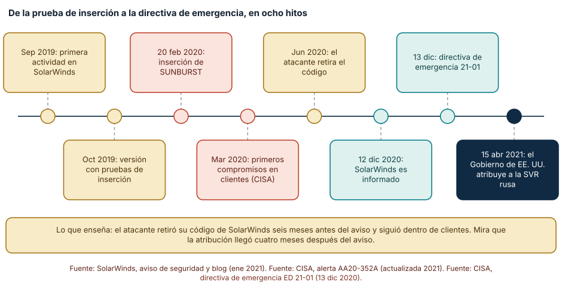

**Cómo leer la figura.** Ocho hitos de izquierda a derecha, con los años reales; los colores distinguen actividad del atacante, respuesta y atribución. Mira la distancia entre el segundo y el cuarto hito: la inserción en febrero de 2020 y los primeros compromisos en clientes en marzo. **Dónde deja de valer:** el espaciado es uniforme, no a escala; los hitos son los que citan las fuentes.

### Organización

Las fuentes consultadas no describen el organigrama de SolarWinds. Lo documentado es la respuesta: tras el ataque, la empresa trabajó con un despacho de abogados (DLA Piper), con CrowdStrike y KPMG en el análisis de causa raíz, y con las fuerzas del orden, la comunidad de inteligencia y gobiernos (SolarWinds). La respuesta federal la coordinó un grupo con tres organismos: el FBI como responsable de la respuesta a la amenaza y de atribuir al responsable, CISA como responsable de la respuesta sobre los activos y ODNI para el apoyo de inteligencia (Declaración conjunta). **No se sabe:** la estructura de los equipos de desarrollo, compilación y seguridad de SolarWinds en 2019 y 2020.

### Visión y misión

Las fuentes consultadas no contienen una declaración de visión o misión de SolarWinds. Lo que sí consta es una afirmación de posición: la empresa dijo que su proceso de desarrollo y compilación es común en toda la industria del software y que compartía lo aprendido para ayudar a que otros se protegieran de ataques similares (SolarWinds, blog de enero de 2021). El análisis propio es que esa frase describe el verdadero alcance del caso: no es el de una empresa, sino el de una práctica de la industria.

## Contexto y problema

Las organizaciones necesitan saber qué ocurre en sus redes: qué equipos hay, cuánto tráfico mueven, cuáles fallan. Orion es la plataforma con la que SolarWinds ofrece esa monitorización. CISA la describe como un software utilizado ampliamente para vigilar el tráfico de redes federales importantes, lo que explica por qué su compromiso suponía un riesgo inaceptable (CISA ED, antecedentes). Para vigilar equipos, una herramienta así necesita acceso amplio a la red; ese acceso es, a la vez, su valor y su riesgo.

**El problema que el sistema resolvía.** La visibilidad: una organización con miles de equipos no puede operarlos sin una herramienta que los inventaríe y los vigile. Ese valor es real. El riesgo que no se vio, o no se gestionó de forma suficiente, es el de que la herramienta de vigilancia sea ella misma un punto de entrada con los permisos de un administrador.

**La apuesta (documentado).** Los clientes instalaban las actualizaciones del proveedor porque eran las que corregían fallos y vulnerabilidades; las actualizaciones llegaban firmadas con el certificado legítimo de SolarWinds (CISA AA). Para el cliente, aplicar actualizaciones firmadas del proveedor es una práctica de seguridad recomendada.

**El problema oculto (análisis propio).** La firma digital garantiza el origen de un archivo, no que su contenido sea el que el proveedor quiso producir. Si el entorno que fabrica y firma el artefacto está comprometido, todo lo que el cliente comprueba después sigue siendo cierto y no sirve.

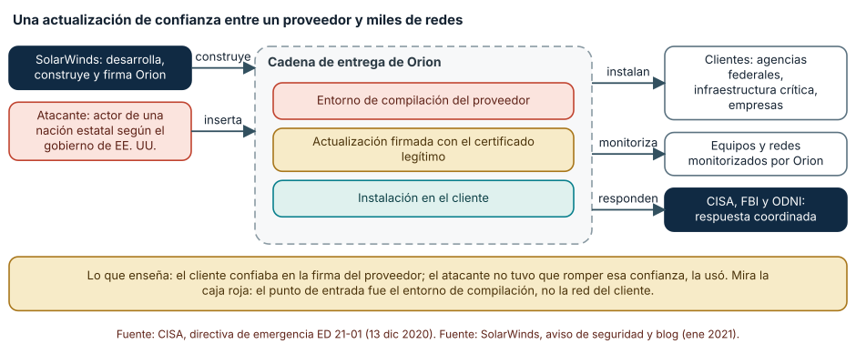

**Cómo leer la figura.** Izquierda: proveedor y atacante; centro: la cadena de entrega de Orion con tres elementos; derecha: clientes, equipos monitorizados y respuesta. Mira la caja roja: el entorno de compilación. **Dónde deja de valer:** no dibuja la lista completa de víctimas, que las fuentes no dan.

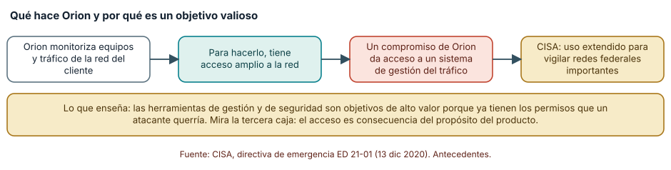

**Cómo leer la figura.** De izquierda a derecha: qué hace Orion, qué necesita para hacerlo, qué da un compromiso y cómo lo describe CISA. Mira la tercera caja: el acceso es consecuencia del propósito del producto. **Dónde deja de valer:** es un esquema funcional de la descripción pública del producto.

## Mercado, usuarios y casos de uso

- **Organizaciones clientes.** Agencias del gobierno federal de EE. UU., entidades de infraestructura crítica y empresas privadas instalaron Orion; CISA no da una cifra (CISA AA).
- **Administradores de redes.** Usuarios directos de Orion: monitorizan y configuran equipos desde la plataforma.
- **El proveedor.** Desarrolla, compila, firma y distribuye actualizaciones (SolarWinds).
- **Respuesta.** CISA, FBI y ODNI; la directiva de emergencia obliga a las agencias federales civiles (CISA ED).
- **Investigadores y empresas de seguridad.** Microsoft analizó el archivo comprometido y publicó indicadores y detecciones (Microsoft); CrowdStrike y KPMG ayudaron a SolarWinds a localizar el código de inyección (SolarWinds).

**Casos de uso del sistema afectado.** (1) Monitorizar el estado de equipos y tráfico; (2) recibir e instalar actualizaciones del proveedor; (3) operar con permisos amplios sobre la red. Los tres son legítimos; el atacante aprovechó el (2) y el (3).

## Funcionalidad de principio a fin

1. **Desarrollo y compilación.** SolarWinds desarrolla el código de Orion y lo compila en un entorno propio (SolarWinds).
2. **Firma.** El binario se firma con el certificado legítimo de SolarWinds (CISA AA).
3. **Distribución.** El binario llega al cliente como actualización de la plataforma (SolarWinds).
4. **Instalación.** El cliente instala la actualización; el archivo comprometido, `SolarWinds.Orion.Core.BusinessLayer.dll`, queda en el servidor de Orion (CISA ED; CISA AA).
5. **Activación.** La puerta trasera comprueba que han pasado al menos 12 a 14 días desde la escritura del archivo antes de actuar (Microsoft), y entonces se comunica con servidores del atacante que imitan tráfico legítimo (SolarWinds).
6. **Segunda fase.** El atacante puede entregar cargas adicionales, entre ellas componentes de Cobalt Strike (Microsoft).

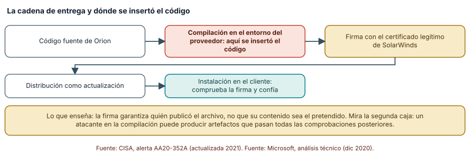

**Cómo leer la figura.** De izquierda a derecha, del código fuente a la instalación. Mira la segunda caja: la inserción se hizo en la compilación, por eso la firma y la verificación posteriores la avalaron. **Dónde deja de valer:** es un esquema general de una cadena de entrega; SolarWinds no publica el diseño de su canalización.

### El día a día de una compilación de Orion

El proceso de desarrollo y compilación de SolarWinds no es público más allá de lo que dice la empresa. Documentado: el proceso, según la propia empresa, es común en toda la industria del software; el atacante desplegó en el entorno de compilación un código de inyección que insertaba SUNBURST en las compilaciones de Orion sin despertar sospechas de los equipos de desarrollo y compilación; una versión actualizada de esa herramienta se usó desde el 20 de febrero de 2020 (SolarWinds, blog de enero de 2021). Microsoft observa que el archivo comprometido estaba firmado digitalmente, lo que indica acceso a la canalización de desarrollo o distribución, y que hay indicios de que desde octubre de 2019 el atacante probaba su capacidad de insertar código añadiendo clases vacías (Microsoft). **No se sabe:** la estructura de la canalización, quién tenía acceso, cómo se revisaba un cambio antes de compilar y qué comprobaciones se hacían sobre el artefacto.

## Negocio y economía

El modelo de negocio es el de un proveedor de software de gestión de TI que vende licencias y mantenimiento a organizaciones; los clientes con mantenimiento activo reciben actualizaciones, y SolarWinds recomendaba a todos los clientes con mantenimiento activo de Orion actualizar a la versión 2020.2.5 (SolarWinds, aviso de seguridad). Las fuentes verificadas en esta sesión no dan cifras de ingresos, de clientes ni de costes del incidente; el caso no las inventa.

- **Coste de la respuesta para los clientes.** CISA ordenó desconectar, analizar, reconstruir los equipos monitorizados desde fuentes de confianza y restablecer cuentas (CISA ED). El coste total no se cuantifica en las fuentes verificadas.
- **Coste para el proveedor.** SolarWinds contrató investigación forense con CrowdStrike y KPMG y asesoría jurídica (SolarWinds). Importes: no se saben.
- **Efecto en el negocio.** No consta en las fuentes verificadas.

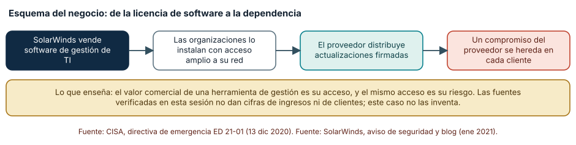

**Cómo leer la figura.** Cuatro etapas de izquierda a derecha; la última nombra el riesgo. Mira la tercera: la actualización firmada es lo que hace posible la cuarta. **Dónde deja de valer:** no es un flujo de dinero; las fuentes verificadas no dan cifras.

### Costos operativos y costo del incidente

| Rubro | Cifra | Fuente |
| --- | --- | --- |
| Duración de la intrusión en SolarWinds | De septiembre de 2019 a junio de 2020 | SolarWinds |
| Tiempo con SUNBURST en las compilaciones | Desde el 20 de febrero de 2020 hasta el descubrimiento (unos 296 días hasta el 12 de diciembre, cálculo propio) | SolarWinds |
| Versiones afectadas | Tres versiones de Orion según SolarWinds | SolarWinds |
| Número de clientes afectados | No se sabe a partir de las fuentes verificadas | No consta |
| Coste total para el proveedor y los clientes | No se sabe | No consta |

No se inventa ninguna cifra para las filas sin fuente.

### Competidores y contexto de mercado

Las fuentes consultadas no describen competidores de SolarWinds. El contexto que sí consta es regulatorio y de respuesta: el gobierno federal de EE. UU. formó un grupo de coordinación y usó una directiva de emergencia de CISA, una herramienta legal que obliga a las agencias civiles (CISA ED, antecedentes legales). Qué ocurrió con la cuota de mercado de SolarWinds no consta en las fuentes verificadas.

## Arquitectura y esquemas

Los hechos de esta sección vienen de CISA, SolarWinds y Microsoft. Los dibujos de componentes son un modelo funcional hecho con lo que describen, porque ninguna fuente publica el diseño interno de Orion ni de su canalización.

### Nivel 1 · Contexto

La figura de contexto está en «Contexto y problema». Resumen: un proveedor que compila y firma, un cliente que verifica y confía, una herramienta con acceso amplio y un atacante en el entorno de compilación.

### Nivel 2 · Contenedores: versiones y archivos

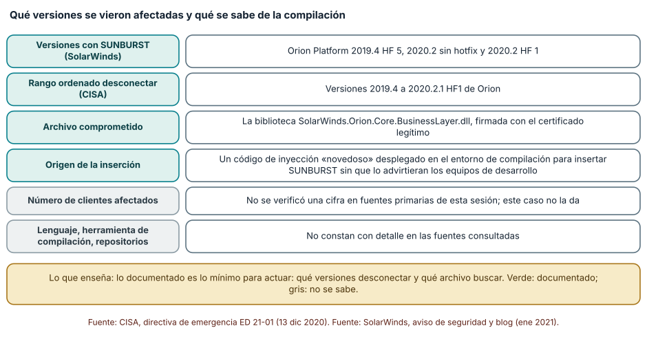

**Cómo leer la figura.** Cada fila es una capa; verde, documentada; gris, no se sabe. Mira que lo documentado basta para actuar: qué versiones desconectar y qué archivo buscar. **Dónde deja de valer:** no pretende describir la arquitectura real, solo lo que consta.

### Nivel 3 · Secuencia del ataque

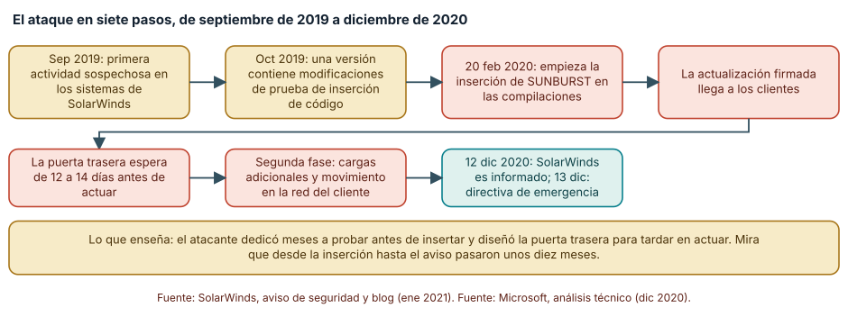

**Cómo leer la figura.** Cada caja es un paso; las doradas son preparación, las rojas actividad hostil y la azul verdosa respuesta. Mira que el atacante prueba antes de insertar y que la puerta trasera está diseñada para esperar. **Dónde deja de valer:** el orden fino de la segunda fase lo detallan los informes técnicos; esta figura resume.

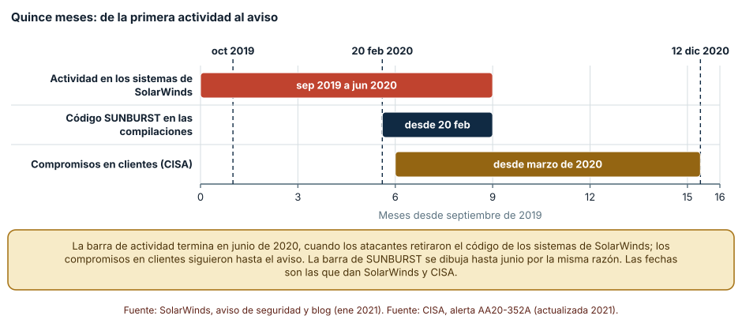

**Cómo leer la figura.** Eje horizontal: meses desde septiembre de 2019; cada fila es un actor o un fenómeno. Mira que la fila de clientes sigue después de que el atacante retiró su código del proveedor. **Dónde deja de valer:** las barras muestran periodos que dan las fuentes (CISA: compromisos «desde al menos marzo de 2020»); la fecha de fin de los compromisos en clientes es la del aviso, no una medición.

### Nivel 4 · Por qué tardó en verse

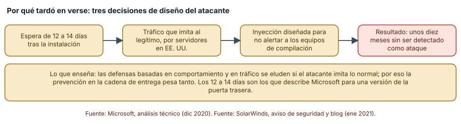

**Cómo leer la figura.** Cada caja es una decisión de diseño del atacante que retrasa su detección. Mira la última: unos diez meses entre la inserción y el aviso. **Dónde deja de valer:** son decisiones que describen SolarWinds y Microsoft; la lista no es exhaustiva.

Documentado. SolarWinds dice que el atacante gestionó la intrusión a través de varios servidores en EE. UU. imitando tráfico legítimo, lo que le permitió eludir técnicas de detección de SolarWinds, de otras empresas y del gobierno federal (SolarWinds). Microsoft describe una versión de la puerta trasera que comprueba que la última escritura del archivo malicioso fue al menos 12 a 14 días antes de actuar (Microsoft). La empresa identificó, además, dos incidencias de soporte de clientes que, con el beneficio de la retrospectiva, cree que pudieron estar relacionadas con SUNBURST (SolarWinds). Es una señal presente que no se leyó como tal en su momento; el análisis propio es que la señal solo se reconoce cuando ya se sabe lo que se busca.

### Nivel 5 · La confianza del cliente

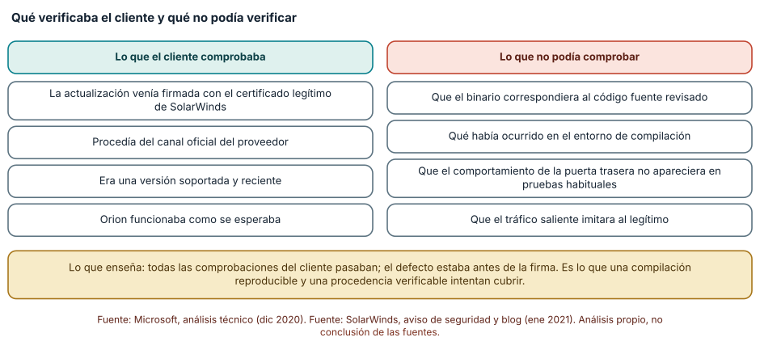

**Cómo leer la figura.** A la izquierda, comprobaciones que el cliente hacía y que pasaban; a la derecha, lo que quedaba fuera de su alcance. Mira que ninguna comprobación de la izquierda es insuficiente por sí sola: el defecto estaba antes. **Dónde deja de valer:** las listas son una reconstrucción lógica desde las fuentes; no describen el proceso de cada cliente.

### Nivel 6 · Qué ordenó CISA

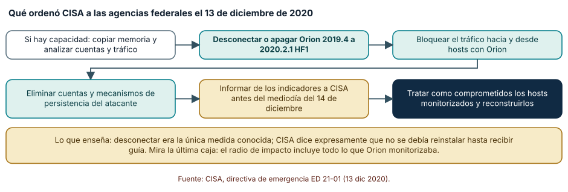

**Cómo leer la figura.** Cada caja es una acción de la directiva; las verdes son de contención, la dorada de notificación, la azul oscuro de reconstrucción. Mira la segunda: desconectar era la única medida conocida. **Dónde deja de valer:** la directiva se actualizó con guías suplementarias que sustituyen una de las acciones; esta figura resume la directiva original.

La directiva exigía desconectar o apagar Orion 2019.4 a 2020.2.1 HF1, bloquear el tráfico hacia y desde los equipos con Orion, eliminar cuentas y persistencia controladas por el atacante y notificar a CISA antes del mediodía del 14 de diciembre cualquier indicador, como el archivo con un hash concreto; después, tratar como comprometidos todos los equipos monitorizados por Orion y reconstruirlos desde fuentes de confianza (CISA ED). CISA aclaró que las agencias debían esperar su guía antes de reinstalar el software con los parches que el proveedor preparaba (CISA ED).

### Nivel 7 · No solo Orion

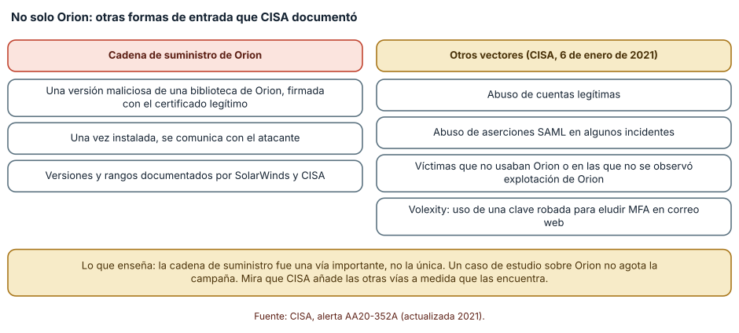

**Cómo leer la figura.** A la izquierda, el vector de Orion; a la derecha, otros que CISA documentó. Mira que algunas víctimas no usaban Orion. **Dónde deja de valer:** la lista de vectores de CISA es de enero de 2021 y puede haberse ampliado después.

### Nivel 8 · Dependencias y puntos únicos de fallo

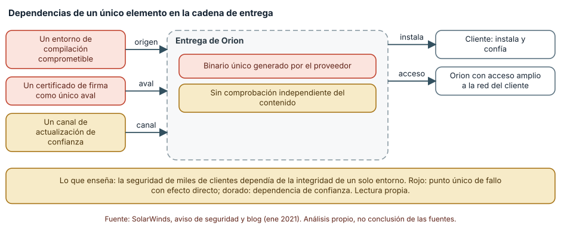

**Cómo leer la figura.** Izquierda: tres dependencias del proveedor; centro: la entrega de Orion; derecha: lo que ocurre en el cliente. Mira que casi todo lo rojo es una condición de la producción del artefacto. **Dónde deja de valer:** es un análisis propio; las fuentes no enumeran dependencias.

### Nivel 9 · Defensa en profundidad: ocho barreras

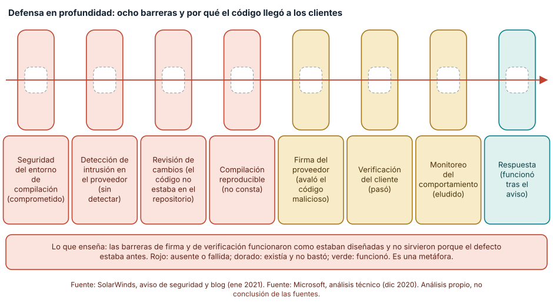

**Cómo leer la figura.** Cada lámina es una barrera; el hueco es el punto por el que el código pasó. Las rojas no existían o fallaron; las doradas existían y no bastaron; la verde funcionó. Mira que las barreras posteriores a la compilación funcionaron como estaban diseñadas. **Dónde deja de valer:** el modelo de láminas es una metáfora, no una medición; la lista sale de lo que cuentan las fuentes y la agrupación en ocho es propia.

### Hardware utilizado

Las fuentes consultadas no describen hardware. Lo documentado es que los servidores de Orion de los clientes eran sistemas Windows (la directiva pide reconstruir el sistema operativo Windows de los equipos con Orion) y que el atacante usó servidores en EE. UU. (CISA ED; SolarWinds). **No se sabe:** el hardware de la canalización de compilación y de los entornos de desarrollo.

### Software utilizado

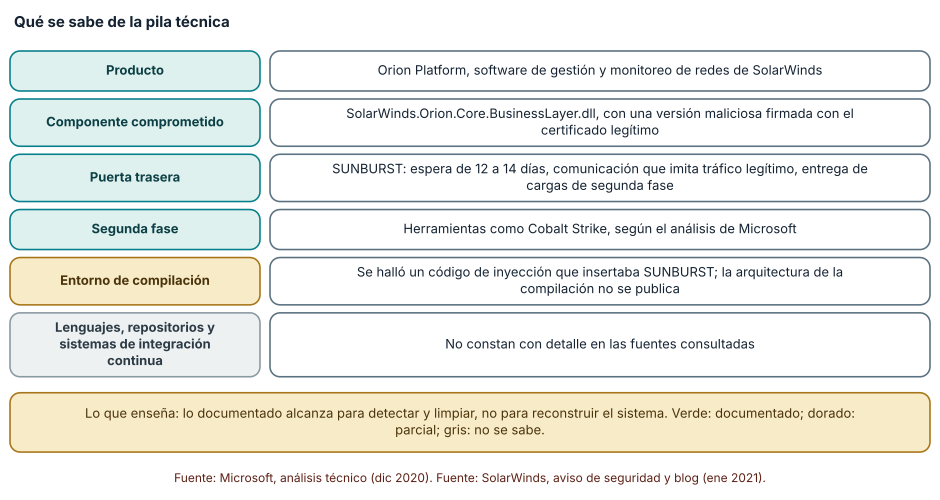

**Cómo leer la figura.** Cada fila es una capa; verde, documentada; dorado, parcial; gris, no se sabe. Mira que lo documentado alcanza para detectar y limpiar. **Dónde deja de valer:** no pretende describir la pila real.

Documentado: Orion Platform; la biblioteca `SolarWinds.Orion.Core.BusinessLayer.dll`; SUNBURST y su comportamiento de espera; cargas de segunda fase como Cobalt Strike (CISA ED; Microsoft; SolarWinds). **No se sabe:** lenguajes, sistema de control de versiones, sistema de integración continua y herramientas de firma.

### Infraestructura

La infraestructura documentada es la del atacante, con servidores en EE. UU., y la de los clientes, con servidores de Orion en sus redes (SolarWinds; CISA ED). **No se sabe:** la infraestructura de SolarWinds.

### A prueba de fallos: qué existía, qué falló y qué debió existir

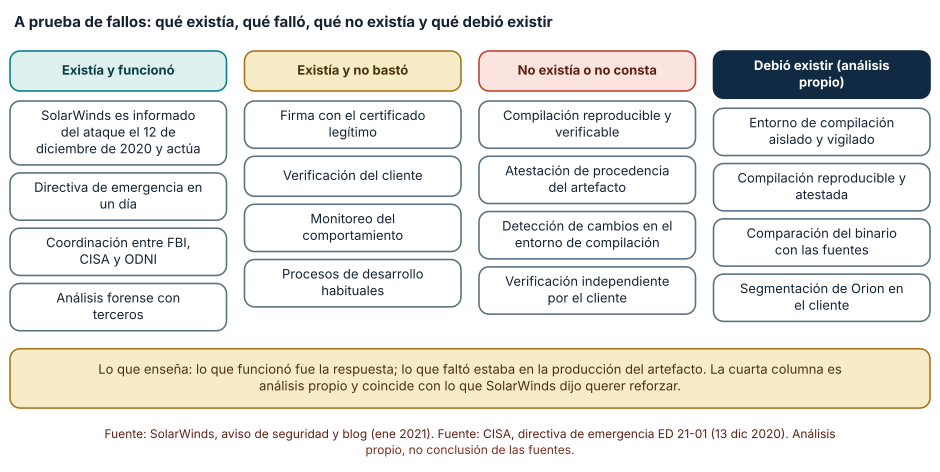

**Cómo leer la figura.** Verde: lo que había y funcionó; dorado: lo que había y no bastó; coral: lo que no existía o no consta; azul oscuro: análisis propio de lo que debió existir. Mira que lo que funcionó actuó después del descubrimiento. **Dónde deja de valer:** no mide eficacia; la cuarta columna es análisis propio.

## Casos especiales y cómo fallan

- **Una firma que avala lo equivocado.** El archivo malicioso se firmó con el certificado legítimo de SolarWinds (CISA AA). Los controles del cliente basados en firma no tenían cómo distinguirlo.
- **Una puerta trasera que espera.** SUNBURST espera de 12 a 14 días antes de actuar (Microsoft), lo que rompe la correlación entre la instalación y el comportamiento sospechoso.
- **Tráfico que imita al legítimo.** La comunicación se diseñó para parecerse al tráfico normal y pasaba por servidores en EE. UU. (SolarWinds).
- **Una herramienta con permisos amplios.** Orion necesita acceso amplio para monitorizar; el compromiso de Orion es el compromiso de ese acceso (CISA ED).
- **El atacante que se retira.** En junio de 2020 retiró el código de los sistemas de SolarWinds; en los clientes ya instalados la puerta trasera seguía (SolarWinds; CISA AA).
- **Otras vías de entrada.** CISA documentó abuso de cuentas legítimas y de aserciones SAML en incidentes en que la víctima no usaba Orion o no se observó explotación de Orion (CISA AA).
- **Señales previas que solo se leen después.** SolarWinds identificó dos incidencias de soporte de clientes que podrían estar relacionadas con SUNBURST (SolarWinds).
- **La reconstrucción como remedio.** La directiva obliga a tratar como comprometidos todos los equipos monitorizados y a reconstruirlos (CISA ED): el costo de confiar en una herramienta con acceso amplio es reconstruir lo que vigilaba.

## Línea de tiempo

Escala de meses (cómo se construyó el ataque), de días (la respuesta) y de años (la atribución).

### Antecedentes y respuesta

| Cuándo | Hecho | Fuente |
| --- | --- | --- |
| Septiembre de 2019 | Primera actividad sospechosa en los sistemas de SolarWinds | SolarWinds |
| Octubre de 2019 | Una versión de Orion contiene modificaciones diseñadas para probar la inserción de código | SolarWinds; Microsoft |
| 20 de febrero de 2020 | Empieza la inserción de SUNBURST en las compilaciones de Orion | SolarWinds |
| Marzo de 2020 | CISA sabe de compromisos desde al menos esta fecha | CISA AA |
| Junio de 2020 | El atacante retira el código de los sistemas de SolarWinds | SolarWinds |
| 12 de diciembre de 2020 | SolarWinds es informada del ataque | SolarWinds |
| 13 de diciembre | CISA emite la directiva de emergencia 21-01 | CISA ED |
| 16 de diciembre | Declaración conjunta del FBI, CISA y ODNI; formación del grupo de coordinación | Declaración conjunta |
| 6 de enero de 2021 | CISA actualiza su alerta con otros vectores de acceso | CISA AA |
| 11 de enero de 2021 | SolarWinds publica que encontró el código de inyección con ayuda de CrowdStrike y KPMG | SolarWinds |
| 15 de abril de 2021 | El gobierno de EE. UU. atribuye la actividad a la SVR rusa | CISA ED; CISA AA |
| Enero de 2026 | CISA cierra la directiva por cumplida | CISA ED |

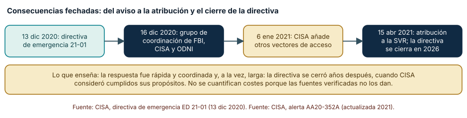

**Cómo leer la figura.** Cuatro hitos de izquierda a derecha: la directiva, el grupo de coordinación, los otros vectores y la atribución con el cierre de la directiva. Mira que el cierre llega años después. **Dónde deja de valer:** que cada hito sea consecuencia del anterior no consta como relación causal.

## Qué falló en cada instancia

| Instancia | Qué se esperaba | Qué ocurrió | Fuente |
| --- | --- | --- | --- |
| Entorno de compilación | Que solo produjera el código previsto | Un atacante desplegó un código de inyección que insertaba SUNBURST | SolarWinds |
| Detección en el proveedor | Detectar la intrusión | La actividad empezó en septiembre de 2019; SolarWinds fue informada el 12 de diciembre de 2020 | SolarWinds |
| Revisión de cambios | Que lo compilado correspondiera a lo revisado | El código malicioso no estaba en el repositorio de fuentes según la descripción del código de inyección | SolarWinds |
| Firma | Avalar el artefacto legítimo | Avaló el artefacto con la puerta trasera | CISA AA |
| Verificación del cliente | Detectar un artefacto no confiable | Pasó: la firma y la procedencia eran legítimas | CISA AA |
| Monitoreo de comportamiento | Detectar actividad anómala | Eludido por espera y por tráfico que imitaba al legítimo | Microsoft; SolarWinds |
| Respuesta | Contener y limpiar | Funcionó tras el aviso; directiva en un día | CISA ED |

## Causa raíz y factores

**Detonante (documentado).** El despliegue por parte de un atacante, en el entorno de compilación de SolarWinds, de un código que insertó SUNBURST en las compilaciones de Orion a partir del 20 de febrero de 2020 (SolarWinds).

**Condiciones latentes (documentado y análisis propio).** Documentado: una intrusión que duró desde septiembre de 2019 sin ser detectada; el código se insertó sin despertar la sospecha de los equipos de desarrollo y compilación; el artefacto resultante se firmó con el certificado legítimo; los clientes lo instalaron y Orion tiene acceso amplio. Análisis propio: la falta de una verificación independiente del contenido del artefacto frente a las fuentes y la falta de atestación de procedencia.

**Factores de contexto (documentado).** Un adversario con recursos y paciencia, descrito por el gobierno de EE. UU. como un servicio de inteligencia (CISA ED; CISA AA); una práctica de compilación y distribución que la propia empresa describe como común en la industria (SolarWinds).

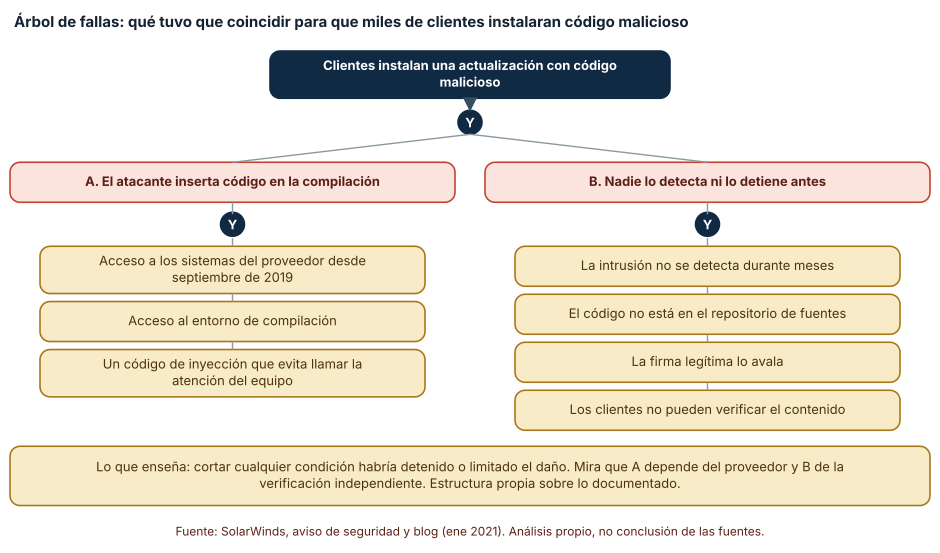

**Cómo leer la figura.** Arriba, el evento final; los círculos con «Y» exigen que todas las ramas ocurran. Las cajas doradas son las condiciones. Mira que la rama A depende del proveedor y la B de la verificación independiente. **Dónde deja de valer:** la estructura es análisis propio; en la realidad las condiciones no son independientes: la firma legítima agrava la falta de verificación del contenido.

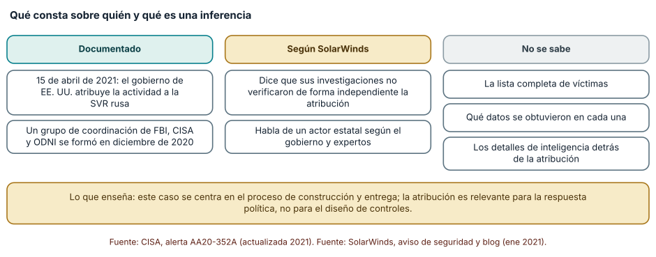

**Cómo leer la figura.** Tres columnas: documentado, la posición de la empresa y lo desconocido. Mira que SolarWinds dice no haber verificado de forma independiente la atribución, aunque cita la creencia del gobierno y de expertos. **Dónde deja de valer:** el caso no valida ni discute la atribución; se centra en controles de ingeniería.

**Cadena causal ordenada (análisis propio, apoyado en las fuentes).**

1. Una herramienta de gestión necesita acceso amplio a las redes de sus clientes (condición del producto).
2. El proveedor construye y firma el producto en un entorno que un atacante logra comprometer (condición de la cadena de entrega).
3. Un código de inyección inserta una puerta trasera en las compilaciones sin pasar por el repositorio de fuentes (detonante).
4. El binario se firma con el certificado legítimo (condición de confianza).
5. Los clientes comprueban la firma y la versión, y las instalan (condición de verificación).
6. La puerta trasera espera, imita tráfico normal y pasa meses sin detectarse (condición de visibilidad).
7. Un aviso externo en diciembre de 2020 desencadena la respuesta (resultado).

### Documentado, inferido y no se sabe

| Categoría | Contenido |
| --- | --- |
| Documentado | La cronología; las versiones; el archivo comprometido; la firma legítima; la espera de 12 a 14 días; el código de inyección; la directiva de emergencia; los otros vectores de CISA; la atribución del gobierno de EE. UU. |
| Inferido (análisis propio) | Que la falta de verificación independiente del contenido es la causa común de las barreras; la estructura del árbol y de las ocho barreras |
| No se sabe | El número de clientes afectados; los costes; los datos obtenidos; la estructura de la canalización de SolarWinds; los detalles técnicos de la inyección; el resultado de procesos posteriores a 2021 |

## Mejoras que debieron hacerse

Las fuentes describen el ataque y la respuesta; la elección de qué controles habrían cortado cada eslabón es análisis nuestro. Todo lo de esta sección, incluidos costes y trade-offs, es **análisis propio apoyado en la fuente**: no son conclusiones de CISA, de Microsoft ni de SolarWinds, ni una descripción de lo que SolarWinds implantó, salvo que la empresa dijo estar reforzando sus sistemas y su proceso de desarrollo (SolarWinds).

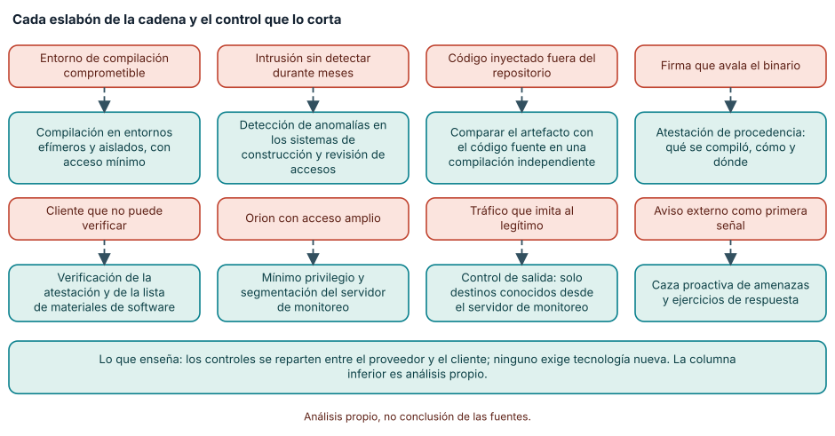

**Cómo leer la figura.** Arriba el eslabón de la cadena, debajo el control que lo corta. Mira que los controles se reparten entre proveedor y cliente. **Dónde deja de valer:** son propuestas educativas, no prescripciones; cada una tiene coste y falsos positivos.

### La arquitectura «después»

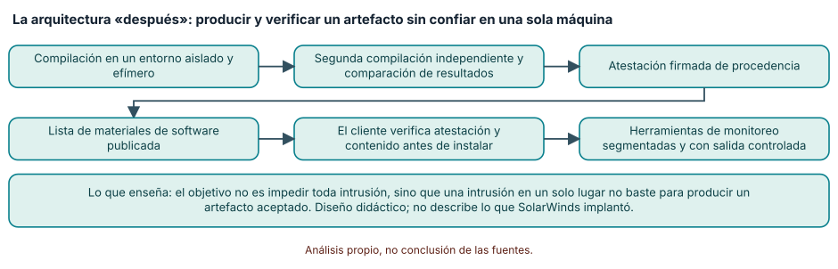

**Cómo leer la figura.** Cada caja es un cambio de la cadena de entrega o de su entorno. Mira que el objetivo es que una sola intrusión no baste para producir un artefacto aceptado. **Dónde deja de valer:** es un diseño didáctico; no describe lo que SolarWinds implantó.

### Para cada factor: control técnico, de proceso y de gobierno

| Factor causal | Control técnico | Control de proceso | Control de gobierno | Costo y trade-off | Clases |
| --- | --- | --- | --- | --- | --- |
| Entorno de compilación comprometible | Compilación en entornos efímeros y aislados | Acceso mínimo y revisado a los sistemas de construcción | Los sistemas de construcción como activo crítico con dueño | Complejidad de la canalización | [SE-469 · Build reproducible y hermético](../../classes/part-39-build-release-y-cadena-de-suministro/se-469-build-reproducible-y-hermetico/README.md), [SE-484 · Credenciales efímeras y OIDC](../../classes/part-40-ci-cd-iac-y-platform-engineering/se-484-credenciales-efimeras-y-oidc/README.md), [SE-483 · Tests, seguridad y políticas como gates](../../classes/part-40-ci-cd-iac-y-platform-engineering/se-483-tests-seguridad-y-politicas-como-gates/README.md) |
| Intrusión sin detectar durante meses | Detección de anomalías en los sistemas de construcción | Caza proactiva de amenazas periódica | Informe de resultados al comité de riesgo | Tiempo del equipo de seguridad | [SE-493 · Señales, eventos y observabilidad útil](../../classes/part-41-observabilidad-sre-e-incidentes/se-493-senales-eventos-y-observabilidad-util/README.md), [SE-457 · Principios de seguridad y modelos de amenaza](../../classes/part-38-seguridad-privacidad-y-cumplimiento/se-457-principios-de-seguridad-y-modelos-de-amenaza/README.md), [SE-500 · Gestión de incidentes y comunicación](../../classes/part-41-observabilidad-sre-e-incidentes/se-500-gestion-de-incidentes-y-comunicacion/README.md) |
| Código fuera del repositorio | Compilar dos veces de forma independiente y comparar | Prohibir la compilación con fuentes no versionadas | Política de que lo publicado debe ser reproducible | Coste de una segunda cadena | [SE-469 · Build reproducible y hermético](../../classes/part-39-build-release-y-cadena-de-suministro/se-469-build-reproducible-y-hermetico/README.md), [SE-470 · Artefactos, repositorios y promoción](../../classes/part-39-build-release-y-cadena-de-suministro/se-470-artefactos-repositorios-y-promocion/README.md), [SE-478 · Riesgos de CI y dependencias comprometidas](../../classes/part-39-build-release-y-cadena-de-suministro/se-478-riesgos-de-ci-y-dependencias-comprometidas/README.md) |
| Firma que avala lo compilado | Atestación de procedencia: qué, cómo y dónde | Verificación de la atestación antes de firmar | Custodia de claves con aprobación múltiple | Más pasos de entrega | [SE-472 · SBOM, procedencia y atestaciones](../../classes/part-39-build-release-y-cadena-de-suministro/se-472-sbom-procedencia-y-atestaciones/README.md), [SE-473 · Firmas, checksums y verificación](../../classes/part-39-build-release-y-cadena-de-suministro/se-473-firmas-checksums-y-verificacion/README.md), [SE-480 · Proyecto: release firmado y recuperable](../../classes/part-39-build-release-y-cadena-de-suministro/se-480-proyecto-release-firmado-y-recuperable/README.md) |
| Cliente que no puede verificar | Lista de materiales de software publicada | Verificar procedencia al instalar | Exigencia contractual de atestaciones a proveedores | Sobrecarga para el cliente | [SE-472 · SBOM, procedencia y atestaciones](../../classes/part-39-build-release-y-cadena-de-suministro/se-472-sbom-procedencia-y-atestaciones/README.md), [SE-479 · Taller: verificar la procedencia de un release](../../classes/part-39-build-release-y-cadena-de-suministro/se-479-taller-verificar-la-procedencia-de-un-release/README.md), [SE-471 · Dependencias directas, transitivas y vendorización](../../classes/part-39-build-release-y-cadena-de-suministro/se-471-dependencias-directas-transitivas-y-vendorizacion/README.md) |
| Herramienta con acceso amplio | Mínimo privilegio y segmentación | Revisión periódica de permisos de las herramientas | Clasificación de herramientas de gestión como críticas | Menos visibilidad por segmento | [SE-459 · Autorización, recursos y mínimo privilegio](../../classes/part-38-seguridad-privacidad-y-cumplimiento/se-459-autorizacion-recursos-y-minimo-privilegio/README.md), [SE-401 · Redes, identidad y secretos en cloud](../../classes/part-33-cloud-plataforma-e-infraestructura/se-401-redes-identidad-y-secretos-en-cloud/README.md), [SE-403 · Entornos, cuentas y separación de responsabilidades](../../classes/part-33-cloud-plataforma-e-infraestructura/se-403-entornos-cuentas-y-separacion-de-responsabilidades/README.md) |
| Tráfico que imita al legítimo | Control de salida: solo destinos conocidos | Revisión de reglas de salida | Registro de excepciones | Falsos positivos | [SE-462 · Secretos, configuración y separación de ambientes](../../classes/part-38-seguridad-privacidad-y-cumplimiento/se-462-secretos-configuracion-y-separacion-de-ambientes/README.md), [SE-401 · Redes, identidad y secretos en cloud](../../classes/part-33-cloud-plataforma-e-infraestructura/se-401-redes-identidad-y-secretos-en-cloud/README.md), [SE-498 · Alertas accionables y fatiga](../../classes/part-41-observabilidad-sre-e-incidentes/se-498-alertas-accionables-y-fatiga/README.md) |
| Señal externa como primera alerta | Telemetría de la cadena de entrega | Ejercicios de respuesta a incidentes | Plan de comunicación con clientes y reguladores | Coste de ejercicios | [SE-502 · Continuidad, disaster recovery y ejercicios](../../classes/part-41-observabilidad-sre-e-incidentes/se-502-continuidad-disaster-recovery-y-ejercicios/README.md), [SE-511 · Game days y ejercicios de respuesta a incidentes](../../classes/part-42-ingenieria-del-caos/se-511-game-days-y-ejercicios-de-respuesta-a-incidentes/README.md), [SE-534 · Gestión de riesgos y decisiones ejecutivas](../../classes/part-44-gestion-liderazgo-y-practica-profesional/se-534-gestion-de-riesgos-y-decisiones-ejecutivas/README.md) |

### Cómo lo habría evitado lo que enseña el curso

Cada línea es análisis propio. (1) La compilación reproducible y hermética de [SE-469 · Build reproducible y hermético](../../classes/part-39-build-release-y-cadena-de-suministro/se-469-build-reproducible-y-hermetico/README.md) y la promoción de artefactos de [SE-470 · Artefactos, repositorios y promoción](../../classes/part-39-build-release-y-cadena-de-suministro/se-470-artefactos-repositorios-y-promocion/README.md) explican cómo comparar lo compilado con las fuentes. (2) La lista de materiales, la procedencia y las atestaciones de [SE-472 · SBOM, procedencia y atestaciones](../../classes/part-39-build-release-y-cadena-de-suministro/se-472-sbom-procedencia-y-atestaciones/README.md) y las firmas y la verificación de [SE-473 · Firmas, checksums y verificación](../../classes/part-39-build-release-y-cadena-de-suministro/se-473-firmas-checksums-y-verificacion/README.md) muestran qué debe comprobar un cliente además de la firma. (3) Los riesgos de la integración continua y de las dependencias comprometidas de [SE-478 · Riesgos de CI y dependencias comprometidas](../../classes/part-39-build-release-y-cadena-de-suministro/se-478-riesgos-de-ci-y-dependencias-comprometidas/README.md), con el taller de verificar la procedencia de [SE-479 · Taller: verificar la procedencia de un release](../../classes/part-39-build-release-y-cadena-de-suministro/se-479-taller-verificar-la-procedencia-de-un-release/README.md), son este caso aplicado. (4) El release firmado y recuperable de [SE-480 · Proyecto: release firmado y recuperable](../../classes/part-39-build-release-y-cadena-de-suministro/se-480-proyecto-release-firmado-y-recuperable/README.md) trata de la custodia de la clave que firmó el artefacto. (5) El mínimo privilegio de [SE-459 · Autorización, recursos y mínimo privilegio](../../classes/part-38-seguridad-privacidad-y-cumplimiento/se-459-autorizacion-recursos-y-minimo-privilegio/README.md) y las redes de [SE-401 · Redes, identidad y secretos en cloud](../../classes/part-33-cloud-plataforma-e-infraestructura/se-401-redes-identidad-y-secretos-en-cloud/README.md) limitan lo que una herramienta comprometida puede hacer. (6) La ingeniería del caos, [SE-505 · Principios de la ingeniería del caos: estado estable e hipótesis](../../classes/part-42-ingenieria-del-caos/se-505-principios-de-la-ingenieria-del-caos-estado-estable-e-hipotesis/README.md) y [SE-511 · Game days y ejercicios de respuesta a incidentes](../../classes/part-42-ingenieria-del-caos/se-511-game-days-y-ejercicios-de-respuesta-a-incidentes/README.md), con ejercicios de respuesta a incidentes, ensaya el escenario «una herramienta de confianza resulta comprometida». (7) La gestión de riesgos ejecutiva de [SE-534 · Gestión de riesgos y decisiones ejecutivas](../../classes/part-44-gestion-liderazgo-y-practica-profesional/se-534-gestion-de-riesgos-y-decisiones-ejecutivas/README.md) trata de quién decide que el entorno de compilación es un activo crítico.

## Vínculo con el curso

Cada enlace es una clase real; el texto dice qué mecanismo del caso ilustra. Las partes de build, release y cadena de suministro, de CI/CD y de seguridad son las que más aportan, junto con las de observabilidad e ingeniería del caos.

| Concepto | Clase | Cómo lo ilustra el caso |
| --- | --- | --- |
| Build reproducible y hermético | [SE-469 · Build reproducible y hermético](../../classes/part-39-build-release-y-cadena-de-suministro/se-469-build-reproducible-y-hermetico/README.md) | Compilar dos veces y comparar habría revelado la inserción |
| Artefactos, repositorios y promoción | [SE-470 · Artefactos, repositorios y promoción](../../classes/part-39-build-release-y-cadena-de-suministro/se-470-artefactos-repositorios-y-promocion/README.md) | Qué entra en un artefacto y cómo se promociona |
| Dependencias | [SE-471 · Dependencias directas, transitivas y vendorización](../../classes/part-39-build-release-y-cadena-de-suministro/se-471-dependencias-directas-transitivas-y-vendorizacion/README.md) | Un componente de confianza que a su vez es una dependencia de miles de redes |
| SBOM, procedencia y atestaciones | [SE-472 · SBOM, procedencia y atestaciones](../../classes/part-39-build-release-y-cadena-de-suministro/se-472-sbom-procedencia-y-atestaciones/README.md) | Una atestación de qué se compiló y dónde |
| Firmas, checksums y verificación | [SE-473 · Firmas, checksums y verificación](../../classes/part-39-build-release-y-cadena-de-suministro/se-473-firmas-checksums-y-verificacion/README.md) | Una firma que garantiza origen y no contenido |
| Riesgos de CI y dependencias comprometidas | [SE-478 · Riesgos de CI y dependencias comprometidas](../../classes/part-39-build-release-y-cadena-de-suministro/se-478-riesgos-de-ci-y-dependencias-comprometidas/README.md) | Un entorno de construcción comprometido |
| Taller de procedencia de un release | [SE-479 · Taller: verificar la procedencia de un release](../../classes/part-39-build-release-y-cadena-de-suministro/se-479-taller-verificar-la-procedencia-de-un-release/README.md) | Verificar procedencia como ejercicio |
| Release firmado y recuperable | [SE-480 · Proyecto: release firmado y recuperable](../../classes/part-39-build-release-y-cadena-de-suministro/se-480-proyecto-release-firmado-y-recuperable/README.md) | La custodia de la clave de firma |
| Tests, seguridad y políticas como gates | [SE-483 · Tests, seguridad y políticas como gates](../../classes/part-40-ci-cd-iac-y-platform-engineering/se-483-tests-seguridad-y-politicas-como-gates/README.md) | Una política que bloquee un artefacto no atestado |
| Credenciales efímeras | [SE-484 · Credenciales efímeras y OIDC](../../classes/part-40-ci-cd-iac-y-platform-engineering/se-484-credenciales-efimeras-y-oidc/README.md) | Accesos efímeros a los sistemas de construcción |
| Modelos de amenaza | [SE-457 · Principios de seguridad y modelos de amenaza](../../classes/part-38-seguridad-privacidad-y-cumplimiento/se-457-principios-de-seguridad-y-modelos-de-amenaza/README.md) | El proveedor como superficie de ataque |
| Mínimo privilegio | [SE-459 · Autorización, recursos y mínimo privilegio](../../classes/part-38-seguridad-privacidad-y-cumplimiento/se-459-autorizacion-recursos-y-minimo-privilegio/README.md) | Una herramienta de gestión con acceso amplio |
| Secretos y configuración | [SE-462 · Secretos, configuración y separación de ambientes](../../classes/part-38-seguridad-privacidad-y-cumplimiento/se-462-secretos-configuracion-y-separacion-de-ambientes/README.md) | Claves de firma y credenciales de la canalización |
| Observabilidad útil | [SE-493 · Señales, eventos y observabilidad útil](../../classes/part-41-observabilidad-sre-e-incidentes/se-493-senales-eventos-y-observabilidad-util/README.md) | Telemetría de la cadena de entrega |
| Alertas accionables | [SE-498 · Alertas accionables y fatiga](../../classes/part-41-observabilidad-sre-e-incidentes/se-498-alertas-accionables-y-fatiga/README.md) | Señales débiles que solo se reconocen después |
| Gestión de incidentes | [SE-500 · Gestión de incidentes y comunicación](../../classes/part-41-observabilidad-sre-e-incidentes/se-500-gestion-de-incidentes-y-comunicacion/README.md) | Respuesta coordinada y directiva de emergencia |
| Continuidad y ejercicios | [SE-502 · Continuidad, disaster recovery y ejercicios](../../classes/part-41-observabilidad-sre-e-incidentes/se-502-continuidad-disaster-recovery-y-ejercicios/README.md) | Ensayar «la herramienta de confianza está comprometida» |
| Principios de la ingeniería del caos | [SE-505 · Principios de la ingeniería del caos: estado estable e hipótesis](../../classes/part-42-ingenieria-del-caos/se-505-principios-de-la-ingenieria-del-caos-estado-estable-e-hipotesis/README.md) | Hipótesis de estado estable ante una dependencia comprometida |
| Game days | [SE-511 · Game days y ejercicios de respuesta a incidentes](../../classes/part-42-ingenieria-del-caos/se-511-game-days-y-ejercicios-de-respuesta-a-incidentes/README.md) | Ejercicios de respuesta a incidentes |
| Gestión de riesgos | [SE-534 · Gestión de riesgos y decisiones ejecutivas](../../classes/part-44-gestion-liderazgo-y-practica-profesional/se-534-gestion-de-riesgos-y-decisiones-ejecutivas/README.md) | La cadena de entrega como riesgo de dirección |

### Preguntas de discusión

1. Si compilas dos veces en máquinas independientes y los resultados difieren, ¿qué haces y quién decide?
2. ¿Qué debe verificar un cliente además de la firma? ¿Qué parte de esa verificación es realista para una organización pequeña?
3. Una herramienta de monitoreo necesita permisos amplios. ¿Cómo limitas lo que un compromiso de la herramienta puede hacer sin dejarla ciega?
4. La directiva obligó a reconstruir los equipos monitorizados. ¿Qué diseño haría esa reconstrucción más barata?
5. Si la señal temprana fue una incidencia de soporte, ¿cómo se diseña un proceso que la leyera como señal de seguridad?

### Mini-ejercicios

1. **Compilación doble.** Compila un proyecto pequeño dos veces en entornos distintos y compara los binarios; documenta las fuentes de diferencia.
2. **Atestación mínima.** Escribe una atestación en JSON con qué se compiló, con qué herramienta y desde qué commit; escribe un guion que la verifique.
3. **Alcance de una herramienta.** Lista los permisos de una herramienta de monitoreo de tu entorno y reduce los que no necesita.
4. **Ejercicio de mesa.** Redacta un guion de media página para «el proveedor de nuestra herramienta de monitoreo avisa de un compromiso».

## Qué no generalizar

**Aprender.**

1. Una firma garantiza el origen de un archivo, no que su contenido sea el que se quiso producir.
2. El entorno de compilación es un activo crítico: protégelo como protegerías la producción.
3. Compilar de forma reproducible y comparar es lo que convierte la confianza en verificación.
4. Una herramienta con acceso amplio es un objetivo de alto valor: limita su alcance.
5. La respuesta a un compromiso de la cadena de suministro es reconstruir, no limpiar.
6. Ensaya el escenario «mi herramienta de confianza está comprometida» antes de que ocurra.

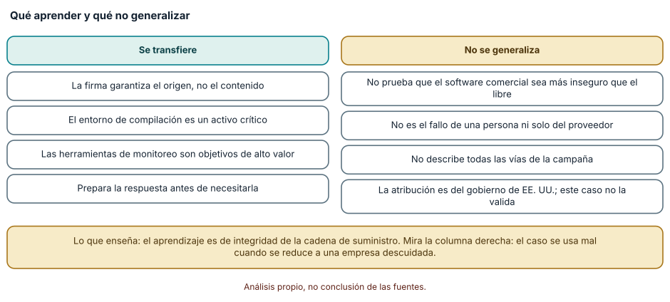

**Cómo leer la figura.** Verde: lo que se transfiere; dorado: lo que no. Mira la columna derecha: el caso se usa mal cuando se reduce a una empresa descuidada. **Dónde deja de valer:** es una lectura propia de las fuentes.

**No generalizar.**

- No prueba que el software comercial sea más inseguro que el libre: el mismo tipo de ataque afecta a cualquier canalización de entrega.
- No es el fallo de una persona ni solo de un proveedor: describe una práctica de la industria que la propia empresa reconoce.
- No describe toda la campaña: CISA documentó otros vectores, y la lista de víctimas no es pública.
- La atribución es del gobierno de EE. UU.; este caso no la valida ni la discute.
- Las cifras (296 días, de 12 a 14 días, versiones) son de este incidente.
- Lo ocurrido después de 2021, incluidos procesos y cambios en la empresa, queda fuera de este caso porque no se verificó en esta sesión.

### Casos comparables y diferencias

| Caso | Parecido | Diferencia |
| --- | --- | --- |
| [CrowdStrike (2024)](crowdstrike.md) | Una actualización de un proveedor de confianza llega a muchos clientes a la vez | Allí fue un error, sin atacante; aquí fue una inserción hostil |
| [Equifax 2017](equifax-2017.md) | Un compromiso detectado mucho después de la entrada | Allí el vector fue un parche no aplicado; aquí, la cadena de entrega |
| [Knight Capital (2012)](knight-capital.md) | Un artefacto de despliegue que no era el que se creía | Allí fue un error de proceso; aquí, un atacante |

## Fuentes públicas verificadas

Todas consultadas el 23 de noviembre de 2026. Las páginas web se abrieron y se extrajo su texto.

1. CISA, *Emergency Directive 21-01: Mitigate SolarWinds Orion Code Compromise*, 13 de diciembre de 2020 (cerrada en enero de 2026). [https://www.cisa.gov/news-events/directives/ed-21-01-mitigate-solarwinds-orion-code-compromise](https://www.cisa.gov/news-events/directives/ed-21-01-mitigate-solarwinds-orion-code-compromise) (respalda la directiva, las versiones, las acciones, la atribución a la SVR y el cierre).
2. CISA, *Advanced Persistent Threat Compromise of Government Agencies, Critical Infrastructure, and Private Sector Organizations*, alerta AA20-352A, actualizada en 2021. [https://www.cisa.gov/news-events/cybersecurity-advisories/aa20-352a](https://www.cisa.gov/news-events/cybersecurity-advisories/aa20-352a) (respalda los compromisos desde marzo de 2020, la firma con el certificado legítimo y los otros vectores).
3. SolarWinds, *New Findings From Our Investigation of SUNBURST*, blog Orange Matter, 11 de enero de 2021. [https://orangematter.solarwinds.com/2021/01/11/new-findings-from-our-investigation-of-sunburst/](https://orangematter.solarwinds.com/2021/01/11/new-findings-from-our-investigation-of-sunburst/) (respalda la cronología de la empresa, el código de inyección y las incidencias de soporte).
4. SolarWinds, *Security Advisory*. [https://www.solarwinds.com/sa-overview/securityadvisory](https://www.solarwinds.com/sa-overview/securityadvisory) (respalda las versiones afectadas y las recomendaciones de actualización).
5. Microsoft, *Analyzing Solorigate, the compromised DLL file that started a sophisticated cyberattack*, 18 de diciembre de 2020. [https://www.microsoft.com/en-us/security/blog/2020/12/18/analyzing-solorigate-the-compromised-dll-file-that-started-a-sophisticated-cyberattack-and-how-microsoft-defender-helps-protect/](https://www.microsoft.com/en-us/security/blog/2020/12/18/analyzing-solorigate-the-compromised-dll-file-that-started-a-sophisticated-cyberattack-and-how-microsoft-defender-helps-protect/) (respalda la firma digital del archivo, las pruebas desde octubre de 2019 y la espera de 12 a 14 días).
6. FBI, CISA y ODNI, declaración conjunta del 16 de diciembre de 2020. [https://www.cisa.gov/news-events/news/joint-statement-federal-bureau-investigation-fbi-cybersecurity-and-infrastructure-security-agency](https://www.cisa.gov/news-events/news/joint-statement-federal-bureau-investigation-fbi-cybersecurity-and-infrastructure-security-agency) (respalda la formación del grupo de coordinación y los papeles de cada organismo).

---

[↑ Casos de fallo](README.md) · [← Equifax 2017](equifax-2017.md)
