# Southwest Airlines 2022

[↑ Casos de fallo](README.md) · [← Interrupción de Amazon S3 en 2017](aws-s3-2017.md)

> **Qué es esta página.** Un caso de estudio de fallo: la realidad frente a la teoría del curso. No es una clase ni un rol. Separa lo que las fuentes **documentan**, lo que este análisis **infiere** y lo que **no se sabe**. Habla de decisiones, procesos y sistemas, no de personas. Fecha de consulta de todas las fuentes: 23 de noviembre de 2026.

**Resumen.** En diciembre de 2022 una gran tormenta invernal afectó a muchas aerolíneas de EE. UU., y la mayoría se recuperó en pocos días; Southwest Airlines no. Canceló unos 16 900 vuelos y dejó a más de dos millones de pasajeros sin viaje durante las fiestas de Navidad y el comienzo del año, con tripulaciones, además, varadas y sin poder comunicarse con la programación. El Departamento de Transporte de EE. UU. (DOT) impuso en diciembre de 2023 una sanción de 140 millones de dólares por infracciones de protección al consumidor, además de más de 600 millones de reembolsos y reintegros que, según el propio DOT, logró que Southwest pagara. La causa técnica y organizativa es objeto de dos relatos distintos expresados en el Senado: el director de operaciones de Southwest dijo que la tormenta creó una cantidad y frecuencia sin precedentes de cambios de tripulación que desbordaron los procesos y la tecnología de programación; el sindicato de pilotos dijo que el colapso era previsible y evitable y que se habían ignorado avisos durante años. Este caso recorre el sistema en varios niveles de zoom, separa lo documentado de lo inferido y propone, rotulado como análisis propio, los controles que habrían cortado cada eslabón. Declaración de alcance, importante: este caso es el más limitado de la serie en fuentes. No se pudieron abrir en esta sesión el texto íntegro de la orden del DOT ni el informe o los testimonios del Senado; el caso se apoya en el comunicado oficial del DOT, en dos crónicas de la audiencia del Senado (CNN y AP) y en una crónica de NPR sobre la sanción. Por eso no describe la arquitectura del software ni la causa raíz con la profundidad de los otros casos, y declara «no se sabe» todo lo que esas fuentes no cubren.

**Cómo leer esta página.** Cada afirmación factual lleva entre paréntesis su fuente: «DOT» es el comunicado del Departamento de Transporte del 18 de diciembre de 2023; «CNN» y «AP» son las crónicas de la audiencia del Comité de Comercio del Senado del 9 de febrero de 2023 (la de CNN se leyó en una copia de KSL, la de AP en una copia de The Boston Globe); «NPR» es su crónica del 18 de diciembre de 2023. Las posiciones de la aerolínea y del sindicato se citan como lo que son: testimonios de parte. Lo que no lleva fuente es análisis propio y está rotulado. Las figuras son dibujos propios; ninguna repite una tabla y todas dicen dónde dejan de valer.

## Ficha histórica

| Dato | Detalle | Fuente |
| --- | --- | --- |
| Organización | Southwest Airlines, aerolínea con sede en Dallas | NPR |
| Incidente | Colapso operativo tras una tormenta invernal que empezó el 21 de diciembre de 2022; el 24 la reasignación de tripulaciones estaba desbordada; la recuperación llevó otra semana | AP |
| Magnitud del daño | Unos 16 900 vuelos cancelados y más de dos millones de pasajeros afectados (DOT); «más de 16 700» (CNN) y «casi 17 000» (AP) | DOT; CNN; AP |
| Coste | Más de 1 000 millones de dólares según AP; más de 600 millones en reembolsos y reintegros a pasajeros según el DOT | AP; DOT |
| Sanción | 140 millones de dólares del DOT el 18 de diciembre de 2023: 35 millones al Tesoro, 72 millones compensados con un sistema de compensación de 90 millones y 33 millones de crédito por 25 000 puntos entregados a cada pasajero afectado | DOT |
| Audiencia | 9 de febrero de 2023, Comité de Comercio del Senado, con un directivo de Southwest, el presidente del sindicato de pilotos y otros testigos | CNN |
| Estado | La causa técnica detallada no se verificó en fuentes primarias; el DOT cerró su investigación sobre programación poco realista sin hacer un hallazgo | DOT |

Las fuentes consultadas no dan una historia corporativa de Southwest; este caso no la inventa.

### Sedes, centros y lugares

| Lugar | Qué consta | Fuente |
| --- | --- | --- |
| Dallas | Sede de la aerolínea | NPR |
| Denver y Chicago | Aeropuertos donde, según el director de operaciones, hubo problemas con equipos de descongelación y pasarelas y se canceló la mayor parte de los vuelos | AP |
| Centro de mando | El DOT realizó auditorías de varios días en la sede; Southwest creó un equipo nuevo en su centro de mando | DOT; CNN |

**No se sabe:** el número de centros de operaciones, su ubicación y el despliegue de personal.

### Organización

Las fuentes consultadas no describen el organigrama de Southwest. Lo documentado: un director de operaciones compareció en el Senado; hay un sindicato de pilotos con presidente, que presentó un testimonio escrito; y existe un centro de mando, donde la aerolínea dijo haber creado un equipo nuevo (CNN; AP). **No se sabe:** la estructura de los equipos de programación de tripulaciones, de tecnología y de operaciones.

### Visión y misión

Las fuentes no contienen una declaración de misión de Southwest. El análisis propio es que una aerolínea que opera una red punto a punto, en la que cualquier avión puede estar en cualquier ciudad, depende más que otras de la recolocación rápida de tripulaciones y aviones tras una perturbación.

## Contexto y problema

Una aerolínea es una red de aviones, tripulaciones, aeropuertos y pasajeros que debe sincronizarse a diario. Cuando una tormenta cancela vuelos, hay que decidir cuáles se cancelan, reasignar aviones y, sobre todo, reasignar pilotos y auxiliares a vuelos nuevos respetando límites de horas de servicio y de descanso. Eso lo hace un software de reasignación de tripulaciones, con apoyo de procesos humanos de comunicación.

**El problema que el sistema resolvía.** Volver a una operación estable tras una perturbación. El director de operaciones dijo en el Senado que Southwest tenía un plan pero que la tormenta fue peor de lo esperado (AP). El software de reasignación, de General Electric, sugiere cómo reasignar tripulaciones a vuelos tras una perturbación y, según el mismo directivo, se vio desbordado por el número de cambios necesarios durante la tormenta (AP).

**La apuesta (documentado).** Southwest había cambiado en septiembre de 2022, a instancias del secretario de Transporte, su plan de atención al cliente para dar derecho a reembolsos de gastos como comidas, hoteles y transporte terrestre cuando un vuelo se retrasa o cancela de forma significativa por un problema de la aerolínea, y por eso estaba obligada legalmente a cumplirlo durante el colapso (DOT).

**El problema oculto (análisis propio).** Un sistema puede funcionar bien con volúmenes de cambios normales y colapsar cuando el volumen cruza un umbral: la recuperación de una red necesita una capacidad de reasignación con holgura para el peor día, y esa capacidad es la menos visible en el día a día.

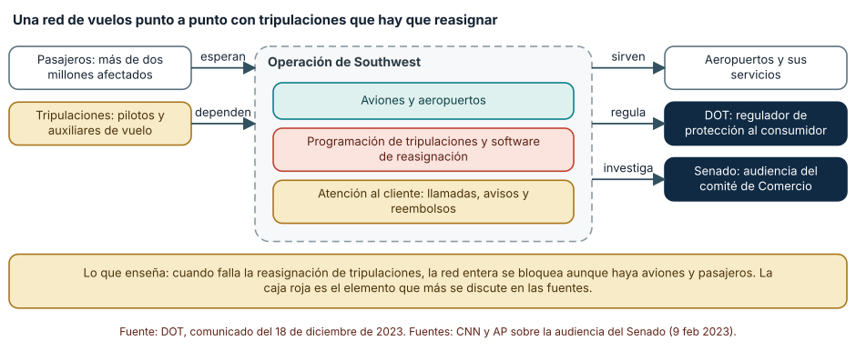

**Cómo leer la figura.** Izquierda: quienes esperan; centro: la operación con tres elementos; derecha: aeropuertos, DOT y Senado. Mira la caja roja: la reasignación de tripulaciones. **Dónde deja de valer:** es un modelo funcional; las fuentes no describen la arquitectura.

## Mercado, usuarios y casos de uso

- **Pasajeros.** Más de dos millones afectados (DOT). Cientos de miles se quedaron en aeropuertos, hoteles y otros lugares lejos de casa (DOT).
- **Tripulaciones.** Pilotos y auxiliares que quedaron varados y sin poder comunicarse con la programación, según el sindicato (CNN; AP).
- **Personal de programación y del centro de mando.** Responsables de reasignar tripulaciones y avisar.
- **Reguladores y legisladores.** El DOT, con asistencia de la Sección de Protección al Consumidor del Departamento de Justicia (DOT), y el Comité de Comercio del Senado (CNN).
- **Aeropuertos.** Denver y Chicago, con problemas de descongelación y pasarelas (AP).

**Casos de uso del sistema afectado.** (1) Programar vuelos y tripulaciones; (2) reasignar tripulaciones tras una perturbación; (3) avisar a los pasajeros; (4) atender llamadas y reembolsos. Los casos (2) a (4) son los que fallaron.

## Funcionalidad de principio a fin

1. **Perturbación.** El 21 de diciembre una tormenta invernal afecta a Southwest y a otras aerolíneas (AP).
2. **Cancelaciones locales.** Southwest tiene problemas con la descongelación y las pasarelas en Denver y Chicago y acaba cancelando la mayor parte de los vuelos en esos aeropuertos (AP).
3. **Reasignación.** El software de reasignación recibe más cambios de los que puede procesar; el 24 de diciembre, la capacidad de reprogramar tripulaciones estaba «destrozada» según AP; pilotos y auxiliares quedan varados igual que los pasajeros (AP).
4. **Comunicación.** Programación no puede confirmar qué tripulación opera cada vuelo ni comunicarse con las tripulaciones; el sindicato aportó mensajes de cabina como evidencia (CNN).
5. **Avisos y atención.** Muchos pasajeros no reciben avisos o los reciben inexactos; el centro de llamadas se desborda (DOT).
6. **Reembolsos.** Un sitio web de solicitudes tiene errores que no se avisan; tarifas opcionales no se reembolsan (DOT).
7. **Recuperación.** La operación tarda otra semana en volver a la normalidad (AP).

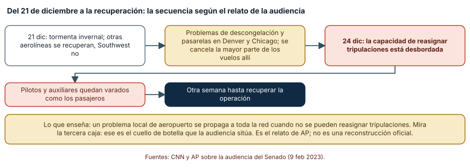

**Cómo leer la figura.** De izquierda a derecha y de arriba abajo; la tercera caja es la que las fuentes sitúan como cuello de botella. Mira que un problema local se propaga. **Dónde deja de valer:** es el relato de AP y no una reconstrucción oficial; no da horas por vuelo.

### El día a día de la reasignación de tripulaciones

El proceso interno de reasignación de Southwest no es público más allá de lo que dicen las crónicas. Documentado: el software, de General Electric, propone reasignaciones; el director de operaciones dijo en el Senado que se vio desbordado y que la aerolínea lo actualizaría a partir del día siguiente a la audiencia, además de crear un equipo en el centro de mando, mejorar los sistemas telefónicos e invertir en preparación para el frío (AP; CNN). **No se sabe:** los límites de capacidad del software, cómo se medían, qué pruebas de carga se habían hecho y cómo se ensayaba una tormenta.

## Negocio y economía

El modelo de una aerolínea es de márgenes ajustados y alta utilización de aviones y tripulaciones. Los hechos económicos que constan:

- **Coste del colapso.** Más de 1 000 millones de dólares según AP, entre reembolsos, costes adicionales y ventas perdidas; la cifra es de la crónica y no se contrastó con las cuentas de la empresa (AP).
- **Reembolsos y reintegros.** El DOT dice que logró que Southwest devolviera más de 600 millones a los pasajeros y que el total pagado por el colapso, con la sanción, supera los 750 millones (DOT).
- **Sanción.** 140 millones, con la composición de la figura siguiente (DOT).
- **Inversión.** Las fuentes verificadas no dan el importe de la inversión posterior en tecnología.

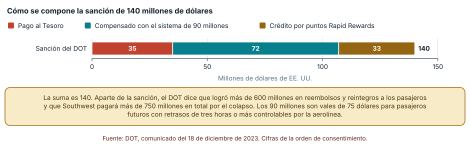

**Cómo leer la figura.** Una sola barra dividida en tres tramos; los números suman 140. Mira que solo 35 millones son un pago al Tesoro; el resto se compensa con acciones a favor de los pasajeros. **Dónde deja de valer:** son los importes del comunicado del DOT; NPR añade que el pago de 35 millones se reparte en tres años.

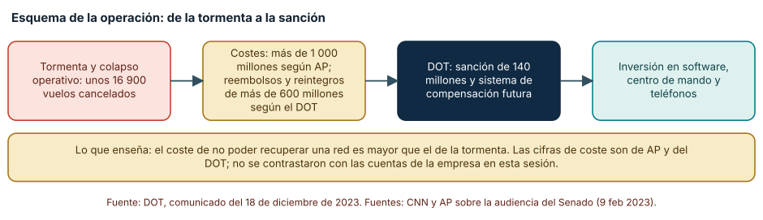

**Cómo leer la figura.** Cuatro etapas de izquierda a derecha. Mira la segunda: las cifras de coste vienen de fuentes distintas. **Dónde deja de valer:** no es un flujo de dinero verificado con las cuentas de la empresa.

### Costos operativos y costo del incidente

| Rubro | Cifra | Fuente |
| --- | --- | --- |
| Vuelos cancelados | Unos 16 900 | DOT |
| Pasajeros afectados | Más de dos millones | DOT |
| Reembolsos y reintegros | Más de 600 millones de dólares | DOT |
| Sanción civil | 140 millones, con 35 en efectivo al Tesoro | DOT |
| Total pagado por el colapso según el DOT | Más de 750 millones | DOT |
| Coste total según AP | Más de 1 000 millones | AP |
| Coste exacto para Southwest | No se sabe a partir de fuentes primarias | No consta |

No se inventa ninguna cifra para las filas sin fuente.

### Competidores y contexto de mercado

Otras aerolíneas se vieron afectadas por la misma tormenta y se recuperaron antes (AP; NPR). NPR añade que el sector ha mejorado su desempeño operativo: el domingo posterior a Acción de Gracias de 2023 hubo 2,9 millones de pasajeros en un día, el máximo histórico, con menos del 0,5 % de vuelos cancelados, y las cancelaciones bajaron en los primeros nueve meses de 2023 según datos del DOT (NPR). Qué ocurrió con la cuota de mercado de Southwest no consta.

## Arquitectura y esquemas

Los hechos de esta sección vienen del DOT, de CNN, de AP y de NPR. Los dibujos de componentes son un modelo funcional hecho con lo que describen: ninguna fuente publica el diseño interno de los sistemas de Southwest.

### Nivel 1 · Contexto

La figura de contexto está en «Contexto y problema».

### Nivel 2 · La escala del colapso

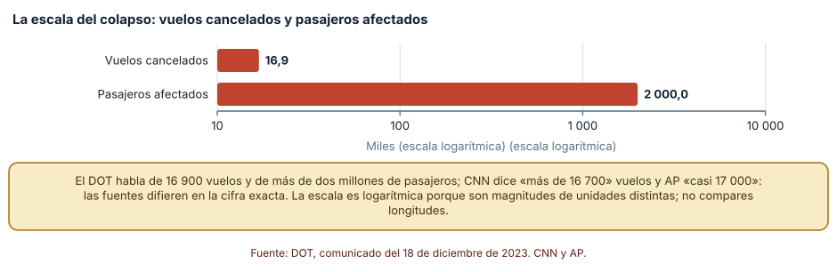

**Cómo leer la figura.** Cada barra es una cantidad en miles, con escala logarítmica; no compares longitudes. Mira la nota: las fuentes difieren en la cifra de vuelos. **Dónde deja de valer:** son dos magnitudes de unidades distintas; la figura solo las pone en el mismo eje.

### Nivel 3 · Dos relatos de la causa

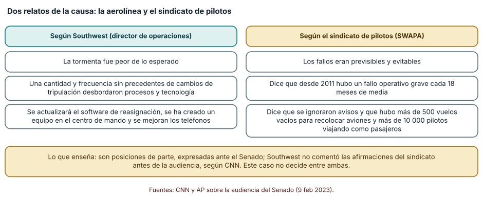

**Cómo leer la figura.** A la izquierda, lo que dijo el director de operaciones; a la derecha, lo que dijo el sindicato. Mira que no coinciden en si el fallo era previsible. **Dónde deja de valer:** son posiciones de parte; el caso no decide entre ellas ni verificó las afirmaciones del sindicato.

Documentado. El director de operaciones dijo que la dificultad de recuperarse de la tormenta «creó una cantidad y frecuencia sin precedentes de cambios en las tripulaciones que desbordaron nuestros procesos y tecnología de programación de tripulaciones» (CNN). El presidente del sindicato dijo que los directivos habían ignorado durante años llamadas a mejorar la tecnología y que la recuperación se manejó mal, perdiendo la pista de empleados y operando más de 500 vuelos vacíos (AP); y, en su testimonio escrito, que los fallos eran previsibles porque el sistema había fallado varias veces «con una frecuencia y magnitud crecientes» y que desde 2011 Southwest había tenido de media un fallo operativo grave cada 18 meses (CNN). Southwest declinó comentar las afirmaciones del sindicato antes de la audiencia (CNN). El comité, según AP, se mostró frustrado porque Southwest no respondió a avisos sindicales sobre su sistema de programación de tripulaciones (AP). **No se sabe:** quién tiene razón en los detalles, cuántos avisos hubo y qué se hizo con ellos.

### Nivel 4 · Lo que se vio en las cabinas

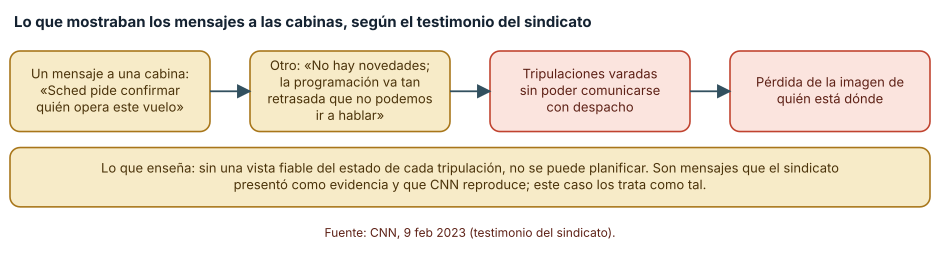

**Cómo leer la figura.** Cada caja es un mensaje o una consecuencia; las doradas son citas del testimonio. Mira la tercera: las tripulaciones no podían comunicarse con despacho. **Dónde deja de valer:** son mensajes presentados por una parte y reproducidos por CNN; no se verificaron con la aerolínea.

### Nivel 5 · Qué encontró el DOT

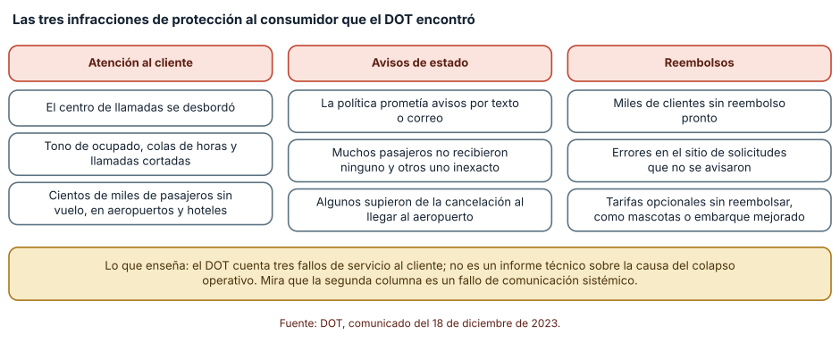

**Cómo leer la figura.** Cada columna es una infracción con sus rasgos. Mira que las tres son de servicio al cliente. **Dónde deja de valer:** el DOT cerró su investigación de programación poco realista sin hacer un hallazgo; la figura no incluye ese tema.

Documentado. El DOT investigó examinando decenas de miles de páginas de documentos, con varias auditorías presenciales de varios días y visitas a la sede de Southwest, revisando miles de quejas de consumidores y consultando a terceros como aeropuertos; la Sección de Protección al Consumidor del Departamento de Justicia ayudó (DOT). La orden de consentimiento exige además un sistema de compensación de 90 millones de dólares para pasajeros futuros: si Southwest causa que un pasajero llegue tres horas o más tarde de lo previsto por un problema bajo su control, debe darle un vale transferible de 75 dólares (DOT). El DOT dice que cierra la investigación de programación poco realista sin un hallazgo, con el fin de lograr un alivio rápido para el público (DOT).

### Nivel 6 · Dependencias y puntos únicos de fallo

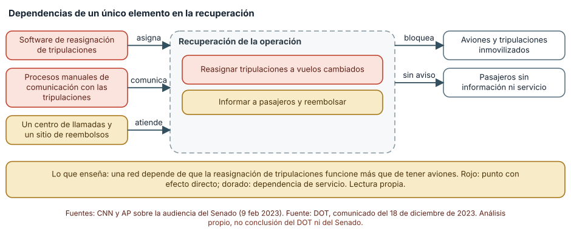

**Cómo leer la figura.** Izquierda: tres dependencias; centro: la recuperación; derecha: sus efectos. Mira que casi todo lo rojo es capacidad de recuperación, no prevención. **Dónde deja de valer:** análisis propio; las fuentes no enumeran dependencias.

### Nivel 7 · Defensa en profundidad: ocho barreras

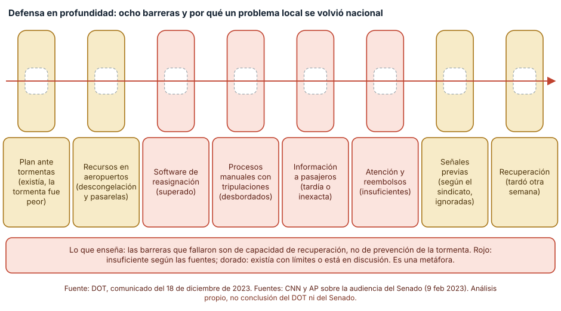

**Cómo leer la figura.** Cada lámina es una barrera; el hueco es el punto por el que el problema pasó. Las rojas fueron insuficientes; las doradas existían con límites o están en discusión. Mira que casi todas son de recuperación. **Dónde deja de valer:** el modelo de láminas es una metáfora; la lista sale de las fuentes y la agrupación en ocho es propia.

### Hardware utilizado

Las fuentes no describen hardware más allá de ordenadores de cabina que recibían mensajes (CNN). **No se sabe:** servidores, centros de datos y redes.

### Software utilizado

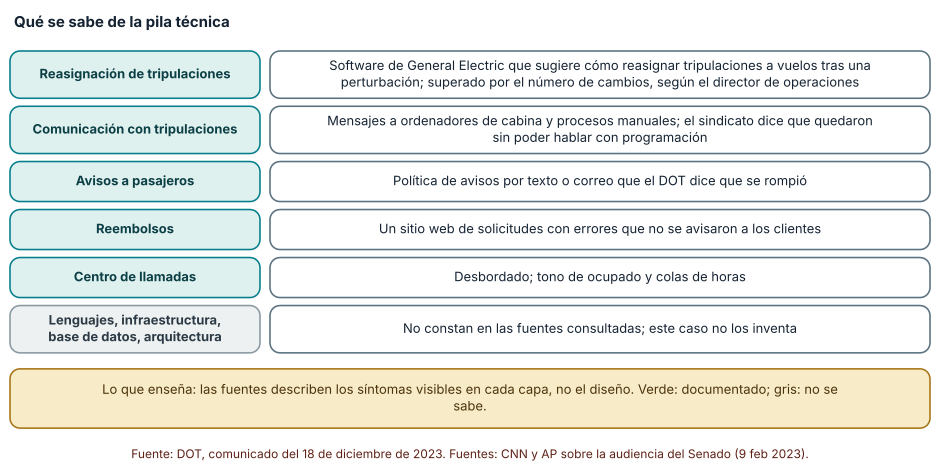

**Cómo leer la figura.** Cada fila es una capa; verde, documentada; gris, no se sabe. Mira que lo documentado son síntomas, no arquitectura. **Dónde deja de valer:** no pretende describir la pila real.

Documentado: un software de General Electric para sugerir reasignaciones de tripulaciones (AP), mensajes a ordenadores de cabina (CNN), una política de avisos por texto o correo y un sitio web de solicitudes de reembolso (DOT). **No se sabe:** lenguajes, bases de datos, la antigüedad de cada sistema y la integración entre ellos.

### Infraestructura

La infraestructura documentada es la operativa: aeropuertos, centro de mando, centro de llamadas (DOT; AP). **No se sabe:** la infraestructura técnica.

### A prueba de fallos: qué existía, qué falló y qué debió existir

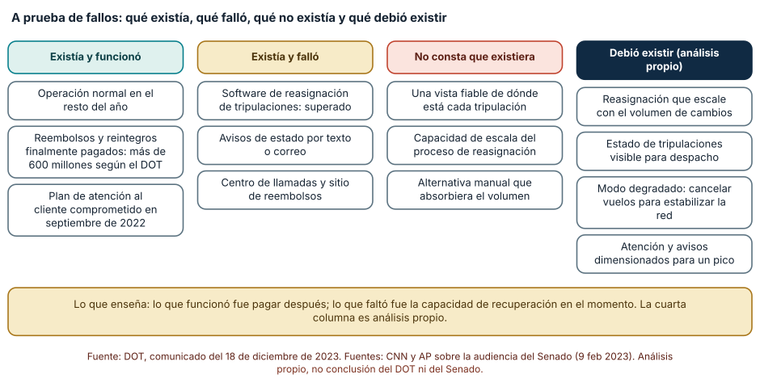

**Cómo leer la figura.** Verde: lo que había y funcionó; dorado: lo que había y falló; coral: lo que no consta que existiera; azul oscuro: análisis propio de lo que debió existir. Mira que lo que funcionó fue pagar después. **Dónde deja de valer:** no mide eficacia; la cuarta columna es análisis propio.

## Casos especiales y cómo fallan

- **Una perturbación común con respuestas distintas.** La tormenta afectó a varias aerolíneas; Southwest fue la que no se recuperó (AP; NPR). Eso apunta a diferencias de capacidad de recuperación y no a la tormenta como causa única.
- **Un cuello de botella que bloquea la red.** La reasignación de tripulaciones: sin tripulaciones disponibles y localizadas, los aviones y pasajeros no vuelan (AP).
- **Un proceso manual con volumen sin precedentes.** El director de operaciones habló de procesos y tecnología desbordados (CNN).
- **Mensajes que muestran la pérdida de visibilidad.** Despacho preguntaba por mensaje quién operaba un vuelo (CNN).
- **Avisos que no llegan.** Pasajeros que se enteraron de la cancelación al llegar al aeropuerto (DOT).
- **Un sitio de reembolsos con errores silenciosos.** Solicitudes con errores que no se notificaron; el DOT dice que, tras su auditoría, Southwest reembolsó a esos clientes (DOT).
- **Una obligación creada meses antes.** El cambio de política de septiembre de 2022 hizo obligatorios los reembolsos de gastos de los pasajeros durante el colapso (DOT).
- **Una investigación cerrada sin hallazgo.** El DOT cerró su investigación de programación poco realista sin un hallazgo (DOT): el caso no puede afirmar que la programación fuera poco realista.

## Línea de tiempo

Escala de días (el colapso) y de meses (la respuesta).

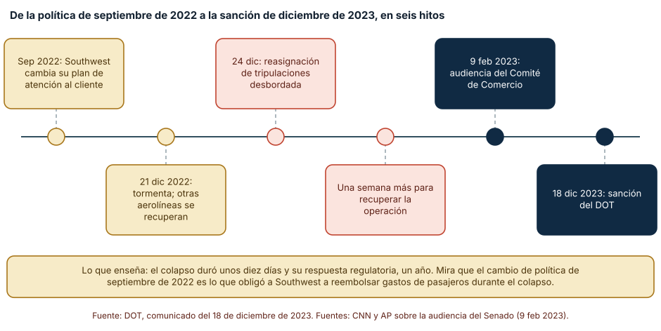

**Cómo leer la figura.** Seis hitos de izquierda a derecha, con las fechas reales; los colores distinguen contexto, colapso y respuesta. Mira la distancia entre el colapso y la sanción: casi un año. **Dónde deja de valer:** el espaciado es uniforme, no a escala.

| Cuándo | Hecho | Fuente |
| --- | --- | --- |
| Septiembre de 2022 | Southwest cambia su plan de atención al cliente, con reembolsos de gastos por problemas de la aerolínea | DOT |
| 21 de diciembre de 2022 | Una tormenta invernal golpea a varias aerolíneas; Southwest no se recupera cuando las otras sí | AP |
| Hasta el 24 de diciembre | Denver y Chicago: descongelación y pasarelas; la mayoría de vuelos cancelados allí | AP |
| 24 de diciembre | La capacidad de reasignar tripulaciones está desbordada | AP |
| Hasta una semana después | La aerolínea tarda otra semana en recuperarse | AP |
| 9 de febrero de 2023 | Audiencia del Comité de Comercio del Senado | CNN; AP |
| 18 de diciembre de 2023 | El DOT anuncia la sanción de 140 millones | DOT; NPR |

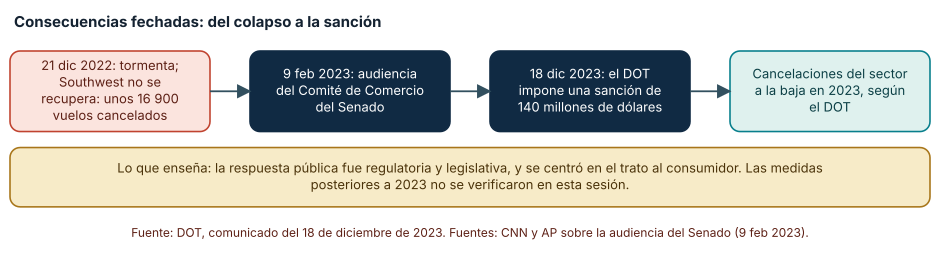

**Cómo leer la figura.** Cuatro hitos de izquierda a derecha. Mira que la respuesta pública es regulatoria y legislativa. **Dónde deja de valer:** que cada hito sea consecuencia del anterior no consta como relación causal.

## Qué falló en cada instancia

| Instancia | Qué se esperaba | Qué ocurrió | Fuente |
| --- | --- | --- | --- |
| Recursos en aeropuertos | Operar con la tormenta | Problemas de descongelación y pasarelas en Denver y Chicago | AP |
| Reasignación de tripulaciones | Absorber los cambios | Superada; sin capacidad de reprogramar el 24 de diciembre | AP; CNN |
| Comunicación con tripulaciones | Mantener a las tripulaciones localizadas | Mensajes de despacho sin respuesta; tripulaciones varadas | CNN |
| Avisos a pasajeros | Texto o correo de cambios de vuelo | Muchos no recibieron avisos o recibieron avisos inexactos | DOT |
| Atención al cliente | Resolver llamadas | Desbordada: ocupado, colas de horas, llamadas cortadas | DOT |
| Reembolsos | Reembolso pronto y correcto | Errores en el sitio y tarifas opcionales sin reembolsar | DOT |
| Gestión de avisos previos | Atender las advertencias | Según el sindicato, ignoradas; Southwest no comentó | CNN; AP |

## Causa raíz y factores

**Detonante (documentado).** Una tormenta invernal desde el 21 de diciembre de 2022 y, en Southwest, problemas locales en aeropuertos y una cantidad de cambios de tripulación que superó la capacidad de reasignación (AP; CNN).

**Condiciones latentes (documentado como posición de parte).** Según Southwest, procesos y tecnología de programación de tripulaciones desbordados; según el sindicato, una tecnología y procesos con fallos previos repetidos y avisos ignorados (CNN; AP). Documentado por el DOT: avisos, atención y reembolsos no preparados para el volumen (DOT).

**Factores de contexto (documentado).** Una tormenta que afectó a todo el sector; una red de la que no hay detalle en las fuentes; una obligación de reembolso vigente desde septiembre de 2022 (AP; DOT).

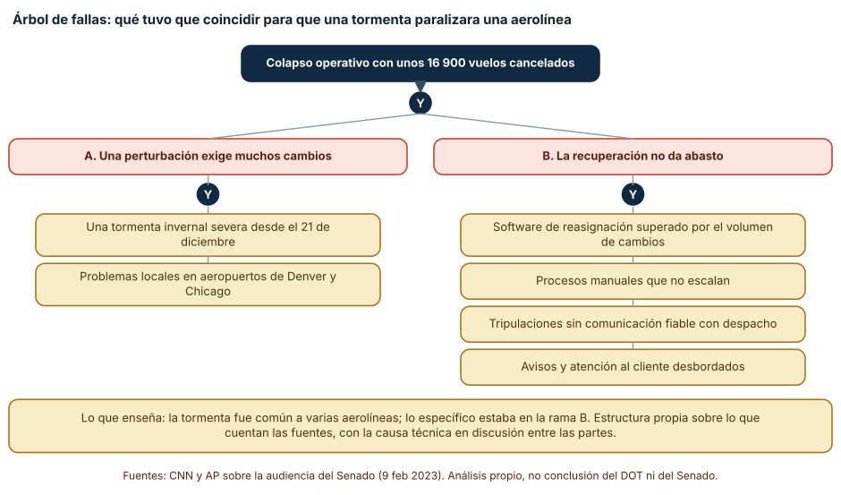

**Cómo leer la figura.** Arriba, el evento final; los círculos con «Y» exigen que todas las ramas ocurran. Mira que la rama A es común al sector y la B es específica. **Dónde deja de valer:** la estructura es análisis propio; las dos posiciones sobre la causa no coinciden y no se decide entre ellas.

**Cadena causal ordenada (análisis propio, apoyado en las fuentes).**

1. Una red depende de reasignar tripulaciones y la capacidad para hacerlo tiene un límite (condición de capacidad).
2. Una tormenta severa causa cancelaciones locales y una gran cantidad de cambios (detonante).
3. El software y los procesos de reasignación se desbordan (condición técnica y de proceso).
4. Las tripulaciones quedan varadas y sin comunicación con despacho (propagación).
5. Los avisos, la atención y los reembolsos no dan abasto (condición de servicio).
6. La recuperación tarda más de una semana (resultado).

### Documentado, inferido y no se sabe

| Categoría | Contenido |
| --- | --- |
| Documentado | Las cifras del DOT; las tres infracciones; la sanción y su composición; las declaraciones ante el Senado, como posiciones de parte; la secuencia que cuenta AP |
| Inferido (análisis propio) | Que la capacidad de reasignación es el cuello de botella; la estructura del árbol y de las ocho barreras |
| No se sabe | La causa técnica detallada; qué pruebas de carga existían; cuántos avisos previos hubo; el coste exacto; qué cambió después de 2023 |

## Mejoras que debieron hacerse

Las fuentes describen lo que falló y lo que Southwest dijo que haría; la elección de qué controles habrían cortado cada eslabón es análisis nuestro. Todo lo de esta sección, incluidos costes y trade-offs, es **análisis propio apoyado en la fuente**: no son conclusiones del DOT ni del Senado ni descripciones de lo que Southwest implantó, salvo donde se cita.

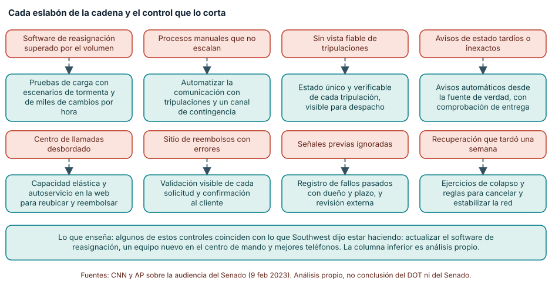

**Cómo leer la figura.** Arriba el eslabón de la cadena, debajo el control que lo corta. Mira que algunos coinciden con lo que Southwest dijo. **Dónde deja de valer:** son propuestas educativas, no prescripciones; cada una tiene coste y falsos positivos.

### La arquitectura «después»

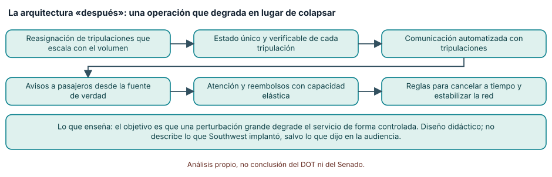

**Cómo leer la figura.** Cada caja es un cambio. Mira que el objetivo es degradar de forma controlada. **Dónde deja de valer:** es un diseño didáctico; no describe lo que Southwest implantó.

### Para cada factor: control técnico, de proceso y de gobierno

| Factor causal | Control técnico | Control de proceso | Control de gobierno | Costo y trade-off | Clases |
| --- | --- | --- | --- | --- | --- |
| Reasignación superada | Pruebas de carga con escenarios de tormenta | Ensayo anual del peor día | Indicador de holgura de capacidad | Coste de infraestructura sobredimensionada | [SE-435 · Carga, estrés, picos y endurance](../../classes/part-36-calidad-rendimiento-y-resiliencia/se-435-carga-estres-picos-y-endurance/README.md), [SE-436 · Latencia, throughput, saturación y capacidad](../../classes/part-36-calidad-rendimiento-y-resiliencia/se-436-latencia-throughput-saturacion-y-capacidad/README.md), [SE-404 · Escalado, capacidad y costos](../../classes/part-33-cloud-plataforma-e-infraestructura/se-404-escalado-capacidad-y-costos/README.md) |
| Procesos manuales que no escalan | Automatizar la comunicación con tripulaciones | Canal de contingencia | Revisión de procesos críticos | Inversión inicial | [SE-499 · Runbooks, on-call y escalamiento](../../classes/part-41-observabilidad-sre-e-incidentes/se-499-runbooks-on-call-y-escalamiento/README.md), [SE-396 · Proyecto: servicio distribuido con degradación](../../classes/part-32-concurrencia-y-sistemas-distribuidos/se-396-proyecto-servicio-distribuido-con-degradacion/README.md), [SE-517 · Mantenimiento correctivo, adaptativo y perfectivo](../../classes/part-43-mantenimiento-y-modernizacion-legacy/se-517-mantenimiento-correctivo-adaptativo-y-perfectivo/README.md) |
| Sin estado fiable de tripulaciones | Estado único y verificable | Conciliación periódica | Propietario del dato | Integración con sistemas heredados | [SE-352 · Restricciones, invariantes y consistencia](../../classes/part-29-datos-persistencia-y-recuperacion/se-352-restricciones-invariantes-y-consistencia/README.md), [SE-530 · Diseño de equipos y ownership](../../classes/part-44-gestion-liderazgo-y-practica-profesional/se-530-diseno-de-equipos-y-ownership/README.md), [SE-526 · Economía de reescribir frente a evolucionar](../../classes/part-43-mantenimiento-y-modernizacion-legacy/se-526-economia-de-reescribir-frente-a-evolucionar/README.md) |
| Avisos tardíos o inexactos | Avisos desde la fuente de verdad | Verificación de entrega | Política de avisos con indicadores | Coste de notificación | [SE-498 · Alertas accionables y fatiga](../../classes/part-41-observabilidad-sre-e-incidentes/se-498-alertas-accionables-y-fatiga/README.md), [SE-493 · Señales, eventos y observabilidad útil](../../classes/part-41-observabilidad-sre-e-incidentes/se-493-senales-eventos-y-observabilidad-util/README.md), [SE-497 · SLI, SLO, SLA y presupuestos de error](../../classes/part-41-observabilidad-sre-e-incidentes/se-497-sli-slo-sla-y-presupuestos-de-error/README.md) |
| Atención desbordada | Capacidad elástica y autoservicio | Planes de pico | Presupuesto de contingencia | Coste de capacidad ociosa | [SE-404 · Escalado, capacidad y costos](../../classes/part-33-cloud-plataforma-e-infraestructura/se-404-escalado-capacidad-y-costos/README.md), [SE-500 · Gestión de incidentes y comunicación](../../classes/part-41-observabilidad-sre-e-incidentes/se-500-gestion-de-incidentes-y-comunicacion/README.md), [SE-439 · Circuit breakers, bulkheads y degradación](../../classes/part-36-calidad-rendimiento-y-resiliencia/se-439-circuit-breakers-bulkheads-y-degradacion/README.md) |
| Reembolsos con errores | Validación y confirmación | Auditoría periódica | Cumplimiento medible | Coste de auditoría | [SE-466 · Cumplimiento, evidencia y límites legales](../../classes/part-38-seguridad-privacidad-y-cumplimiento/se-466-cumplimiento-evidencia-y-limites-legales/README.md), [SE-434 · Revisión, análisis estático y quality gates](../../classes/part-36-calidad-rendimiento-y-resiliencia/se-434-revision-analisis-estatico-y-quality-gates/README.md), [SE-483 · Tests, seguridad y políticas como gates](../../classes/part-40-ci-cd-iac-y-platform-engineering/se-483-tests-seguridad-y-politicas-como-gates/README.md) |
| Señales previas ignoradas | Registro de fallos con tendencias | Postmortem con dueño y plazo | Revisión externa independiente | Atención de dirección | [SE-501 · Postmortems sin culpa y aprendizaje](../../classes/part-41-observabilidad-sre-e-incidentes/se-501-postmortems-sin-culpa-y-aprendizaje/README.md), [SE-534 · Gestión de riesgos y decisiones ejecutivas](../../classes/part-44-gestion-liderazgo-y-practica-profesional/se-534-gestion-de-riesgos-y-decisiones-ejecutivas/README.md), [SE-529 · Liderazgo técnico sin autoridad formal](../../classes/part-44-gestion-liderazgo-y-practica-profesional/se-529-liderazgo-tecnico-sin-autoridad-formal/README.md) |
| Recuperación lenta | Reglas de cancelación para estabilizar | Ejercicios de colapso | Autoridad de cancelar a tiempo | Cancelar antes cuesta ingresos | [SE-502 · Continuidad, disaster recovery y ejercicios](../../classes/part-41-observabilidad-sre-e-incidentes/se-502-continuidad-disaster-recovery-y-ejercicios/README.md), [SE-511 · Game days y ejercicios de respuesta a incidentes](../../classes/part-42-ingenieria-del-caos/se-511-game-days-y-ejercicios-de-respuesta-a-incidentes/README.md), [SE-505 · Principios de la ingeniería del caos: estado estable e hipótesis](../../classes/part-42-ingenieria-del-caos/se-505-principios-de-la-ingenieria-del-caos-estado-estable-e-hipotesis/README.md) |

### Cómo lo habría evitado lo que enseña el curso

Cada línea es análisis propio. (1) La carga, el estrés y los picos de [SE-435 · Carga, estrés, picos y endurance](../../classes/part-36-calidad-rendimiento-y-resiliencia/se-435-carga-estres-picos-y-endurance/README.md) y la latencia, la saturación y la capacidad de [SE-436 · Latencia, throughput, saturación y capacidad](../../classes/part-36-calidad-rendimiento-y-resiliencia/se-436-latencia-throughput-saturacion-y-capacidad/README.md) enseñan a probar el sistema con el peor día y no con el día medio. (2) La degradación y los cortacircuitos de [SE-439 · Circuit breakers, bulkheads y degradación](../../classes/part-36-calidad-rendimiento-y-resiliencia/se-439-circuit-breakers-bulkheads-y-degradacion/README.md) y el proyecto de servicio con degradación de [SE-396 · Proyecto: servicio distribuido con degradación](../../classes/part-32-concurrencia-y-sistemas-distribuidos/se-396-proyecto-servicio-distribuido-con-degradacion/README.md) describen cómo estabilizar una red cancelando antes. (3) Las restricciones e invariantes de [SE-352 · Restricciones, invariantes y consistencia](../../classes/part-29-datos-persistencia-y-recuperacion/se-352-restricciones-invariantes-y-consistencia/README.md) y la propiedad del dato de [SE-530 · Diseño de equipos y ownership](../../classes/part-44-gestion-liderazgo-y-practica-profesional/se-530-diseno-de-equipos-y-ownership/README.md) tratan de un estado único y verificable de las tripulaciones. (4) Los SLO y las alertas de [SE-497 · SLI, SLO, SLA y presupuestos de error](../../classes/part-41-observabilidad-sre-e-incidentes/se-497-sli-slo-sla-y-presupuestos-de-error/README.md) y [SE-498 · Alertas accionables y fatiga](../../classes/part-41-observabilidad-sre-e-incidentes/se-498-alertas-accionables-y-fatiga/README.md) explican por qué los avisos deben salir de la fuente de verdad. (5) Los postmortems sin culpa de [SE-501 · Postmortems sin culpa y aprendizaje](../../classes/part-41-observabilidad-sre-e-incidentes/se-501-postmortems-sin-culpa-y-aprendizaje/README.md) y la gestión de riesgos de [SE-534 · Gestión de riesgos y decisiones ejecutivas](../../classes/part-44-gestion-liderazgo-y-practica-profesional/se-534-gestion-de-riesgos-y-decisiones-ejecutivas/README.md) tratan de las señales previas. (6) La ingeniería del caos, [SE-505 · Principios de la ingeniería del caos: estado estable e hipótesis](../../classes/part-42-ingenieria-del-caos/se-505-principios-de-la-ingenieria-del-caos-estado-estable-e-hipotesis/README.md) y [SE-511 · Game days y ejercicios de respuesta a incidentes](../../classes/part-42-ingenieria-del-caos/se-511-game-days-y-ejercicios-de-respuesta-a-incidentes/README.md), ensaya el escenario «una perturbación grande cruza el umbral de capacidad». (7) La economía de reescribir frente a evolucionar de [SE-526 · Economía de reescribir frente a evolucionar](../../classes/part-43-mantenimiento-y-modernizacion-legacy/se-526-economia-de-reescribir-frente-a-evolucionar/README.md) ayuda a decidir qué hacer con sistemas heredados de programación.

## Vínculo con el curso

Cada enlace es una clase real; el texto dice qué mecanismo del caso ilustra. Las partes de resiliencia, de observabilidad e incidentes, de modernización de sistemas heredados y de ingeniería del caos son las que más aportan.

| Concepto | Clase | Cómo lo ilustra el caso |
| --- | --- | --- |
| Carga, estrés y picos | [SE-435 · Carga, estrés, picos y endurance](../../classes/part-36-calidad-rendimiento-y-resiliencia/se-435-carga-estres-picos-y-endurance/README.md) | Probar con el peor día y no con la media |
| Latencia, saturación y capacidad | [SE-436 · Latencia, throughput, saturación y capacidad](../../classes/part-36-calidad-rendimiento-y-resiliencia/se-436-latencia-throughput-saturacion-y-capacidad/README.md) | Un software de reasignación saturado |
| Escalado, capacidad y costos | [SE-404 · Escalado, capacidad y costos](../../classes/part-33-cloud-plataforma-e-infraestructura/se-404-escalado-capacidad-y-costos/README.md) | Holgura de capacidad frente a coste |
| Circuit breakers y degradación | [SE-439 · Circuit breakers, bulkheads y degradación](../../classes/part-36-calidad-rendimiento-y-resiliencia/se-439-circuit-breakers-bulkheads-y-degradacion/README.md) | Cancelar a tiempo para estabilizar la red |
| Proyecto de servicio con degradación | [SE-396 · Proyecto: servicio distribuido con degradación](../../classes/part-32-concurrencia-y-sistemas-distribuidos/se-396-proyecto-servicio-distribuido-con-degradacion/README.md) | Un sistema que degrada en lugar de colapsar |
| Restricciones e invariantes | [SE-352 · Restricciones, invariantes y consistencia](../../classes/part-29-datos-persistencia-y-recuperacion/se-352-restricciones-invariantes-y-consistencia/README.md) | Un estado consistente de cada tripulación |
| Alertas accionables | [SE-498 · Alertas accionables y fatiga](../../classes/part-41-observabilidad-sre-e-incidentes/se-498-alertas-accionables-y-fatiga/README.md) | Avisos a pasajeros desde la fuente de verdad |
| SLI, SLO y presupuestos | [SE-497 · SLI, SLO, SLA y presupuestos de error](../../classes/part-41-observabilidad-sre-e-incidentes/se-497-sli-slo-sla-y-presupuestos-de-error/README.md) | Un objetivo de tiempo de recuperación |
| Runbooks y escalamiento | [SE-499 · Runbooks, on-call y escalamiento](../../classes/part-41-observabilidad-sre-e-incidentes/se-499-runbooks-on-call-y-escalamiento/README.md) | Procedimiento de contingencia para la comunicación |
| Gestión de incidentes | [SE-500 · Gestión de incidentes y comunicación](../../classes/part-41-observabilidad-sre-e-incidentes/se-500-gestion-de-incidentes-y-comunicacion/README.md) | Comunicación a clientes durante el incidente |
| Postmortems sin culpa | [SE-501 · Postmortems sin culpa y aprendizaje](../../classes/part-41-observabilidad-sre-e-incidentes/se-501-postmortems-sin-culpa-y-aprendizaje/README.md) | Aprender de fallos previos con dueño y plazo |
| Continuidad y ejercicios | [SE-502 · Continuidad, disaster recovery y ejercicios](../../classes/part-41-observabilidad-sre-e-incidentes/se-502-continuidad-disaster-recovery-y-ejercicios/README.md) | Ensayar el colapso |
| Ownership | [SE-530 · Diseño de equipos y ownership](../../classes/part-44-gestion-liderazgo-y-practica-profesional/se-530-diseno-de-equipos-y-ownership/README.md) | Propietario del dato de tripulaciones |
| Gestión de riesgos | [SE-534 · Gestión de riesgos y decisiones ejecutivas](../../classes/part-44-gestion-liderazgo-y-practica-profesional/se-534-gestion-de-riesgos-y-decisiones-ejecutivas/README.md) | La capacidad de recuperación como riesgo ejecutivo |
| Mantenimiento correctivo y adaptativo | [SE-517 · Mantenimiento correctivo, adaptativo y perfectivo](../../classes/part-43-mantenimiento-y-modernizacion-legacy/se-517-mantenimiento-correctivo-adaptativo-y-perfectivo/README.md) | Sistemas heredados de programación |
| Reescribir frente a evolucionar | [SE-526 · Economía de reescribir frente a evolucionar](../../classes/part-43-mantenimiento-y-modernizacion-legacy/se-526-economia-de-reescribir-frente-a-evolucionar/README.md) | Decidir sobre un sistema de reasignación heredado |
| Principios de la ingeniería del caos | [SE-505 · Principios de la ingeniería del caos: estado estable e hipótesis](../../classes/part-42-ingenieria-del-caos/se-505-principios-de-la-ingenieria-del-caos-estado-estable-e-hipotesis/README.md) | Hipótesis de estado estable ante una gran perturbación |
| Game days | [SE-511 · Game days y ejercicios de respuesta a incidentes](../../classes/part-42-ingenieria-del-caos/se-511-game-days-y-ejercicios-de-respuesta-a-incidentes/README.md) | Ejercicios de respuesta a incidentes |

### Preguntas de discusión

1. ¿Cómo se dimensiona la capacidad de un sistema de recuperación para un evento que ocurre una vez cada varios años?
2. Si un sistema funciona bien el 99 % de los días y colapsa el 1 %, ¿qué indicadores muestran que está cerca del umbral?
3. ¿Cuándo es mejor cancelar antes y perder ingresos que mantener el programa y arriesgar el colapso?
4. Un sindicato dice haber avisado durante años. ¿Cómo se diseña un canal de avisos que llegue a la decisión de inversión?
5. ¿Qué debe decirse a un pasajero que no puede hablar con nadie?

### Mini-ejercicios

1. **Umbral de capacidad.** Simula un asignador de recursos con una cola de cambios y mide a qué tasa de cambios deja de converger.
2. **Estado único.** Modela el estado de las tripulaciones como una máquina de estados y escribe una prueba que detecte un estado imposible.
3. **Avisos desde la fuente.** Diseña un proceso que genere avisos a clientes solo desde el estado actual de un vuelo y compáralo con uno de avisos manuales.
4. **Regla de cancelación.** Define un umbral a partir del cual se cancelan vuelos preventivamente y calcula su coste frente al colapso.

## Qué no generalizar

**Aprender.**

1. Una red depende de su capacidad de recuperación más que de su capacidad nominal: pruébala con el peor día.
2. Sin un estado fiable de tus recursos no puedes reasignarlos.
3. Un proceso manual no escala con el volumen de cambios.
4. Los avisos y la atención al cliente son parte de la operación, no un añadido.
5. Las señales previas necesitan un dueño y un plazo.

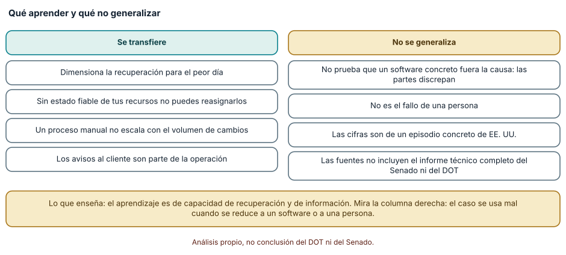

**Cómo leer la figura.** Verde: lo que se transfiere; dorado: lo que no. Mira la columna derecha: el caso se usa mal cuando se reduce a un software o a una persona. **Dónde deja de valer:** es una lectura propia de las fuentes.

**No generalizar.**

- No prueba que un software concreto fuera la causa: las dos partes discrepan y las fuentes no incluyen un informe técnico.
- No es el fallo de una persona: las fuentes describen procesos, tecnología y decisiones.
- Las afirmaciones del sindicato son testimonio de parte y no se verificaron aquí.
- Las cifras son de un episodio concreto, de EE. UU. y de 2022 y 2023.
- Lo ocurrido después de 2023, incluidas las medidas de Southwest, queda fuera de este caso porque no se verificó en esta sesión.

### Casos comparables y diferencias

| Caso | Parecido | Diferencia |
| --- | --- | --- |
| [Knight Capital (2012)](knight-capital.md) | Una falta de capacidad de recuperación convierte un incidente local en uno nacional | Allí el daño fue financiero y en minutos; aquí fue operativo y en días |
| [HealthCare.gov (2013)](healthcare-gov.md) | Un sistema que funciona con volúmenes normales no soporta el pico | Allí era un lanzamiento; aquí, un día de tormenta |
| [CrowdStrike (2024)](crowdstrike.md) | Las aerolíneas se ven afectadas por un fallo de tecnología | Allí fue una actualización de proveedor; aquí, la capacidad de recuperación propia |

## Fuentes públicas verificadas

Todas consultadas el 23 de noviembre de 2026. El comunicado del DOT y la página de la orden se abrieron con el navegador integrado porque la descarga directa estaba bloqueada; no se pudo extraer el texto del PDF de la orden y no se usa su contenido.

1. U.S. Department of Transportation, «DOT Penalizes Southwest Airlines $140 Million for 2022 Holiday Meltdown», comunicado del 18 de diciembre de 2023. [https://www.transportation.gov/briefing-room/dot-penalizes-southwest-airlines-140-million-2022-holiday-meltdown](https://www.transportation.gov/briefing-room/dot-penalizes-southwest-airlines-140-million-2022-holiday-meltdown) (respalda las cifras de vuelos, pasajeros, reembolsos, la sanción y las tres infracciones).
2. U.S. Department of Transportation, página de la orden «Southwest Airlines - Order 2023-12-11». [https://www.transportation.gov/airconsumer/southwest-order-2023-12-11](https://www.transportation.gov/airconsumer/southwest-order-2023-12-11) (respalda que la orden de consentimiento está publicada; su contenido no se usa).
3. Gregory Wallace, CNN, «Southwest explains its meltdown to Congress», 9 de febrero de 2023, copia en KSL. [https://www.ksl.com/article/50575686/southwest-explains-its-meltdown-to-congress](https://www.ksl.com/article/50575686/southwest-explains-its-meltdown-to-congress) (respalda la audiencia, el testimonio del sindicato y la declaración del director de operaciones).
4. Associated Press, «Senate panel probes holiday meltdown at Southwest Airlines», 9 de febrero de 2023, copia en The Boston Globe. [https://www.bostonglobe.com/2023/02/09/business/senate-panel-probes-holiday-meltdown-southwest-airlines-2/](https://www.bostonglobe.com/2023/02/09/business/senate-panel-probes-holiday-meltdown-southwest-airlines-2/) (respalda la secuencia de la tormenta, el software de reasignación y el coste de más de 1 000 millones).
5. NPR, «Southwest will pay a $140 million fine for its meltdown during the 2022 holidays», 18 de diciembre de 2023. [https://www.npr.org/2023/12/18/1219906471/southwest-airlines-2022-meltdown-fined-faa](https://www.npr.org/2023/12/18/1219906471/southwest-airlines-2022-meltdown-fined-faa) (respalda el resumen de la sanción, el pago en tres años y el contexto del sector en 2023).

---

[↑ Casos de fallo](README.md) · [← Interrupción de Amazon S3 en 2017](aws-s3-2017.md)
