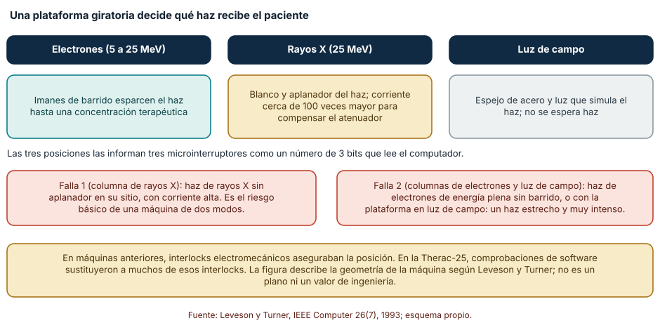
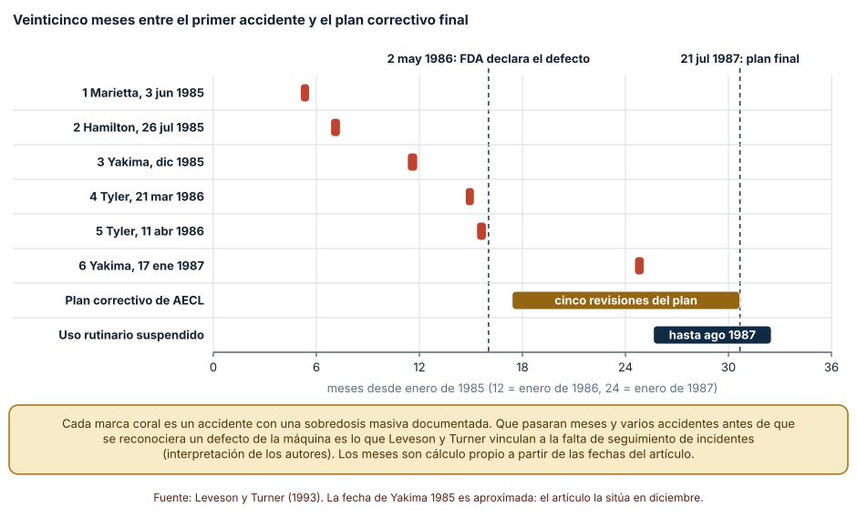

# Therac-25

[↑ Casos de fallo](README.md) · [← CrowdStrike](crowdstrike.md) · [Incidente de base de datos de GitLab →](gitlab-2017.md)

Entre junio de 1985 y enero de 1987, seis pacientes de cáncer recibieron en Estados Unidos y Canadá dosis de radiación cientos de veces superiores a las prescritas por una misma máquina, el acelerador lineal Therac-25. Varios murieron o quedaron con lesiones graves y permanentes. Es el caso más estudiado de daño causado por software porque se conservan los hechos de cada accidente, el código implicado y la respuesta de fabricante, hospitales y reguladores. Este caso lo trata con el respeto que merecen las personas afectadas: describe decisiones, mecanismos y sistemas, no culpables.

## Ficha histórica

| Dato | Contenido |
| --- | --- |
| Producto | Therac-25, acelerador lineal médico de doble modo (electrones y fotones de 25 MeV) |
| Fabricante | Atomic Energy of Canada Limited (AECL), una empresa pública canadiense (*crown corporation*); la división médica se llamó después Theratronics International |
| Colaborador histórico | CGR, empresa francesa que desarrolló junto a AECL los modelos anteriores |
| Desarrollo | Prototipo cableado en 1976; versión completamente computarizada a fines de 1982; análisis de seguridad en marzo de 1983 |
| Instalaciones | Once unidades: cinco en Estados Unidos y seis en Canadá |
| Accidentes | Seis con sobredosis masivas entre el 3 de junio de 1985 y el 17 de enero de 1987 (detalle en la línea de tiempo) |
| Centros | Kennestone Regional Oncology Center (Marietta, Georgia); Ontario Cancer Foundation (Hamilton, Ontario); Yakima Valley Memorial Hospital (Washington); East Texas Cancer Center (Tyler, Texas) |
| Respuesta oficial | La FDA declaró defectuoso el equipo el 2 de mayo de 1986; el plan de acción correctiva final es del 21 de julio de 1987; recall clase I |
| Estado posterior | Se retrofitaron salvaguardas de hardware contra errores de software. Según un reportaje de 1994, AECL disolvió su división médica en 1988 y la renombró Theratronics International |

La fecha de consulta de las fuentes citadas al final es el 16 de noviembre de 2026.

## Contexto y problema

Un acelerador lineal médico (*linac*) acelera electrones para destruir tumores con el menor daño posible al tejido sano. Con los electrones se tratan tejidos poco profundos; para llegar más hondo, el haz de electrones se convierte en fotones de alta energía (rayos X) frenándolo contra un blanco. En los años setenta, AECL y CGR cooperaron en aceleradores: el Therac-6, solo de rayos X, y el Therac-20, de doble modo. En ambos, un minicomputador PDP-11 se agregó a máquinas que ya funcionaban solas, y se conservaron los interlocks y circuitos protectores de hardware.

La relación entre AECL y CGR no se renovó en 1981, y AECL diseñó el Therac-25 con un concepto de «doble paso» que pliega el acelerador y reduce el espacio necesario. A diferencia de sus predecesores, estaba pensado desde el principio para control por computador y asignaba al software más responsabilidad de seguridad. Esa decisión de arquitectura, no un error concreto de programación, es la que Leveson y Turner señalan como el hilo central del caso.

El problema de negocio y de ingeniería era legítimo: una sola máquina para dos modalidades, más compacta, más versátil y más fácil de operar. Lo que el caso examina es qué ocurrió cuando la comodidad y el ahorro de hardware se resolvieron cediendo al software las barreras que antes estaban en el hardware.

## Mercado, usuarios y casos de uso

Los clientes eran centros oncológicos y hospitales. Cada máquina la usaban cuatro grupos con necesidades distintas:

- **Pacientes**, que reciben decenas de sesiones cortas en una misma zona y que no pueden ver ni evaluar lo que hace la máquina.
- **Técnicos de radioterapia (operadores)**, que preparan al paciente, salen de la sala blindada y controlan desde un terminal. Según el artículo, se quejaron desde el principio de que introducir el plan tardaba demasiado.
- **Físicos médicos y oncólogos**, responsables de calibrar la máquina, prescribir el tratamiento e interpretar las reacciones del paciente.
- **El fabricante y los reguladores**, que reciben los informes, deciden qué es un defecto y autorizan o no el uso.

Los casos de uso clínicos eran dos: tratamiento con electrones, de 5 a 25 MeV, para tumores superficiales, y tratamiento con fotones, a 25 MeV, para tumores profundos. Además existía una posición de «luz de campo», sin haz, para verificar con una luz y un espejo dónde caería la radiación antes de tratar.

## Funcionalidad de principio a fin

El recorrido siguiente reconstruye una sesión de tratamiento tal como la describe el artículo, de la preparación a la operación diaria.

**1. Preparar al paciente.** El operador sitúa al paciente en la mesa, fija a mano el tamaño del campo y la rotación del soporte, y coloca los accesorios. La posición de «luz de campo» permite comprobar con luz la zona; después, el operador sale de la sala.

**2. Introducir la prescripción.** Desde un terminal VT100 en la sala de control, el operador teclea la identificación del paciente, el modo (X para rayos X, E para electrones), la energía, la dosis y el tiempo. Para acelerar el trabajo, el fabricante modificó el software antes de la primera instalación: en lugar de reescribir los datos, se podían copiar con retornos de carro, de modo que una serie rápida de retornos completaba la entrada. Los operadores con experiencia teclean muy rápido.

**3. Verificar y activar.** Cuando los parámetros «verifican», el terminal muestra «beam ready». El operador pulsa B para encender el haz. La máquina está en una sala blindada y el operador solo ve al paciente por un monitor de vídeo y un intercomunicador.

**4. Qué ocurre si hay un fallo.** El Therac-25 puede detenerse de dos maneras: una **suspensión**, que exige reiniciar completamente la máquina, y una **pausa**, menos grave, que se reanuda con una sola tecla, P. Los mensajes de error eran crípticos: la palabra «Malfunction» seguida de un número del 1 al 64. El manual no explicaba esos códigos. Los operadores recibían a diario pausas por baja tasa de dosis y otras que no afectaban al paciente; una terapeuta de otro centro llegó a reportar unas 40 pausas de este tipo en algunos días. Pulsar P era el procedimiento habitual.

**5. Dentro de la máquina.** El software, escrito en lenguaje ensamblador de PDP-11 y ejecutado sobre un planificador propio en un procesador con 32 KB, tiene tareas críticas —el monitor de tratamiento, el control de servos y un «ama de llaves» que revisa interlocks— y tareas no críticas. Las tareas se comunican por variables compartidas, sin sincronización real. El artículo subraya que las comprobaciones y asignaciones de esas variables no eran operaciones indivisibles.

**6. La posición de la plataforma giratoria.** El computador lee tres microinterruptores que informan en qué posición está una plataforma giratoria que lleva los accesorios de cada modo. Si la plataforma está mal colocada, el haz llega sin el aplanador que lo hace seguro. En la Therac-25, comprobaciones de software sustituyeron a muchos de los interlocks electromecánicos tradicionales que garantizaban esa posición.

## Negocio y economía

AECL era una empresa pública que competía en el mercado de aceleradores médicos. La ventaja económica del Therac-25 era clara para el cliente: una sola máquina para ambos modos, menos espacio y un manejo más ágil. Para el fabricante, el ahorro de reduplicar hardware de seguridad y el atractivo de una máquina más moderna eran parte de la apuesta.

Lo que no se sabe es tan importante como lo que se sabe. Leveson y Turner indican que no pudieron obtener información detallada sobre el desarrollo de software, la gestión ni el control de calidad del fabricante, y que no se conocen las cifras de ventas ni los costos de duplicar interlocks. Por eso este caso no atribuye una intención económica a la decisión de no duplicar interlocks: la fuente documenta la decisión, no su motivación.

El costo posterior sí dejó huellas públicas: el accidente de Marietta derivó en una demanda presentada el 13 de noviembre de 1985; hubo otras por los accidentes de Tyler y de Yakima, algunas resueltas fuera de los tribunales; y el fabricante debió retirar de servicio las máquinas durante meses de 1987, con una serie de revisiones al plan correctivo. El artículo no cuantifica estos costos.

## Arquitectura y esquemas

### Contexto: tres máquinas, un cambio de reparto

**Cómo leer la figura.** Cada columna es una máquina. Debajo de cada nombre, un cuadro blanco describe la arquitectura y otro, verde azulado o coral, quién protegía al paciente. Mira primero el color: en las dos primeras máquinas la protección quedaba en el hardware; en la tercera, en el software. El cuadro dorado inferior recuerda el análisis de seguridad de 1983. **Dónde deja de valer:** el esquema simplifica; el artículo aclara que parte del software se reutilizó entre las tres máquinas y que no se sabe exactamente cuánto.

### Componentes: una plataforma giratoria decide qué haz recibe el paciente

**Cómo leer la figura.** Las tres columnas son las posiciones de la plataforma y lo que lleva cada una. Los dos cuadros coral inferiores son los dos modos de falla que el artículo describe: rayos X sin aplanador, o electrones sin barrido. Mira primero la columna central: la corriente del haz en modo de rayos X es unas cien veces mayor que en electrones, porque el aplanador atenúa mucho. **Dónde deja de valer:** es la geometría de la máquina según el artículo; no es un plano ni una especificación.

### Flujo crítico: la ventana de ocho segundos

**Cómo leer la figura.** Cada carril es un actor del sistema; el eje son segundos. La barra dorada es el ajuste de los imanes, de unos 8 segundos. La barra coral del operador es la edición dentro de esa ventana. Mira primero el carril «Ptime»: la comprobación de ediciones solo se hace en la primera pasada. **Dónde deja de valer:** solo el tope de 8 segundos es un dato; el reparto del tiempo del operador es ilustrativo.

### Datos y escala

La máquina no registraba lo que hacía de un modo útil para investigar: no había un registro de auditoría con el estado interno, y la función de impresión de la prescripción estaba desactivada en uno de los accidentes. Los hospitales no compartían datos: la mayoría de los centros se enteró de los incidentes de otros por conversaciones informales. Es una lectura de este programa, no un dato del artículo: seis accidentes en once máquinas, a lo largo de dos años, no se reconocieron como una serie hasta que un físico médico de Tyler reprodujo el fallo.

## Casos especiales y cómo fallan

**Hamilton: el interruptor sospechoso.** El 26 de julio de 1985, la máquina no se suspendió y la pantalla mostraba que no se había entregado dosis. Siguiendo el procedimiento habitual, el operador pulsó P para reintentar. AECL no pudo reproducir el fallo y sospechó de un microinterruptor de la plataforma; reforzó el diseño y afirmó que el riesgo había mejorado «al menos cinco órdenes de magnitud». Leveson y Turner consideran esa cifra difícil de justificar. Es un caso de explicación aceptada sin evidencia suficiente: no se pudo reproducir el defecto, y se asumió que el hardware era la causa.

**Yakima 1985: la respuesta «imposible».** Una paciente desarrolló un enrojecimiento con un patrón de rayas. El 24 de febrero de 1986, AECL respondió por escrito que el daño no podía haberse producido por el equipo y que no había otros incidentes conocidos. El personal del hospital, que no sabía de los otros accidentes, atribuyó la lesión a «causa desconocida». Un año después, un segundo accidente en el mismo hospital hizo sospechar que el primero también fue de la máquina; la paciente sobrevivió con secuelas.

**Tyler: la prescripción editada demasiado rápido.** El 21 de marzo y el 11 de abril de 1986, una operadora experimentada tecleó «X» en vez de «E», volvió atrás con la tecla del cursor, corrigió y llegó a la línea de comandos. La máquina mostró «Malfunction 54», con una dosis aparente baja, y el procedimiento habitual fue seguir. El hospital no tenía documentación que explicara ese código. El físico del hospital, Fritz Hager, trabajó con la operadora hasta reproducir el fallo editando a velocidad y midió una dosis de más de 4.000 rad; AECL lo reprodujo cuando conoció el procedimiento y midió unos 25.000.

**Yakima 1987: el contador que se desborda.** El 17 de enero de 1987, tras una secuencia de pausas, el haz se encendió con la plataforma en posición de luz de campo. La causa estaba en otro punto del código: una variable de un byte, que debía ser cero solo si todo estaba bien, se incrementaba en cada pasada. Cada 256 pasadas volvía a cero y la comprobación de la posición del colimador se omitía. Si el operador pulsaba la tecla de ajuste justo en esa pasada, la verificación no se hacía.

**La máquina que no detecta su propio fallo.** En los accidentes de Tyler las cámaras de ionización que miden la dosis se saturaron por la densidad del haz sin barrido y registraron una dosis baja. El artículo resume la lección con una frase: el software «mentía» al operador y la máquina no podía detectar que había ocurrido una sobredosis. La única señal real era la reacción del paciente.

**El procedimiento de seguir.** Cuando las pausas son cotidianas, ignorarlas es racional. Una operadora declaró que, en su formación, le habían explicado que había tantas salvaguardas que era prácticamente imposible hacer daño a un paciente. Es lo que la ingeniería de seguridad llama normalización de la desviación, aunque el artículo no usa ese término.

## Línea de tiempo

| Fecha | Hecho |
| --- | --- |
| 1976 | Primer prototipo cableado del Therac-25 |
| Fines de 1982 | Versión comercial computarizada |
| Marzo de 1983 | Análisis de seguridad con árbol de fallos que no considera errores de software |
| 3 de junio de 1985 | Marietta, Georgia: sobredosis; no se investigó ni se reconoció durante mucho tiempo |
| 26 de julio de 1985 | Hamilton, Ontario: sobredosis; AECL atribuye el fallo a un microinterruptor |
| Septiembre de 1985 | Modificación del microinterruptor; AECL anuncia una mejora de «cinco órdenes de magnitud» |
| Diciembre de 1985 | Yakima: reacción cutánea con patrón de rayas; el fabricante responde que es imposible |
| 21 de marzo de 1986 | Tyler, Texas: primera sobredosis |
| 11 de abril de 1986 | Tyler: segunda sobredosis; el físico del hospital reproduce el fallo |
| 15 de abril de 1986 | AECL informa a la FDA y propone retirar la tecla de cursor hacia arriba |
| 2 de mayo de 1986 | La FDA declara el equipo defectuoso y exige renotificar a los usuarios |
| 13 de junio de 1986 | Primer plan de acción correctiva de AECL, con seis puntos |
| 17 de enero de 1987 | Yakima: segunda sobredosis en ese hospital |
| Febrero de 1987 | La FDA pide suspender el uso rutinario hasta contar con un plan aprobado; el uso se restringe hasta agosto |
| 21 de julio de 1987 | Quinta y última revisión del plan correctivo |

**Cómo leer la figura.** Cada carril superior es un accidente; las dos barras inferiores son la respuesta del fabricante y el período de uso restringido. Las líneas punteadas marcan cuándo la FDA declara el defecto y cuándo se aprueba el plan final. Mira primero el vacío entre los accidentes 1 al 3 y la primera línea punteada: pasaron meses antes de la intervención. **Dónde deja de valer:** la marca de Yakima de 1985 es aproximada, porque el artículo solo da el mes; los meses son cálculo propio.

## Qué falló en cada instancia

Cada caso es una instancia en un centro. Lo que se esperaba era que la máquina diera la dosis prescrita y se detuviera de forma segura si había un fallo.

1. **Marietta, 3 de junio de 1985.** Una paciente de 61 años recibía radioterapia tras una lumpectomía. Sintió «una fuerza de calor tremenda». Las estimaciones indicaron una o dos dosis en el rango de 15.000 a 20.000 rad frente a unos 200 de una sesión típica. Perdió el pecho y el uso del hombro y del brazo. El accidente no se investigó cuidadosamente; la causa técnica concreta no se conoce.
2. **Hamilton, 26 de julio de 1985.** Una paciente en su sesión número 24 recibió entre 13.000 y 17.000 rad en la cadera. Murió el 3 de noviembre de 1985 de un cáncer muy agresivo; de haber vivido, habría necesitado una prótesis de cadera por la sobreexposición. La causa técnica probable, la misma que la del segundo accidente de Yakima, es una conjetura del artículo.
3. **Yakima, diciembre de 1985.** Una paciente con un patrón de rayas en la piel. Se descartaron varias causas. Sobrevivió, con una úlcera crónica y cirugías posteriores. La causa técnica no se determinó.
4. **Tyler, 21 de marzo de 1986.** Un paciente en su novena sesión. La máquina mostró «Malfunction 54» y una dosis baja; el operador pulsó P y la máquina repitió el mensaje. Recibió entre 16.500 y 25.000 rad según simulaciones posteriores en una zona de un centímetro; murió cinco meses después.
5. **Tyler, 11 de abril de 1986.** Un paciente con un cáncer de piel en la cara. Mismo mensaje. Describió una sensación de «fuego». Murió el 1 de mayo de 1986.
6. **Yakima, 17 de enero de 1987.** Un paciente con cáncer terminal recibió una dosis que se estimó entre 8.000 y 10.000 rad tras dos intentos, frente a 86 prescritos. Según el artículo murió en abril por complicaciones relacionadas con la sobredosis; ya tenía un cáncer terminal, los sobrevivientes iniciaron demandas y el asunto se resolvió fuera de los tribunales.

**Cómo leer la figura.** Cada fila es un accidente. El cuadrado es la estimación mínima y el triángulo, la máxima; el eje es logarítmico, así que cada marca principal multiplica por diez. Las líneas punteadas son 200 y 1.000 rad. Mira primero la distancia entre las estimaciones y la primera línea: más de un orden de magnitud. **Dónde deja de valer:** son estimaciones posteriores, localizadas en una zona pequeña, y varían entre simulaciones; la dosis de 1.000 rad que se cita como potencialmente letal lo es para el cuerpo entero, no para una zona de un centímetro. Mide el orden de magnitud del error, no una dosis exacta.

## Causa raíz y factores

Leveson y Turner rechazan explícitamente reducir el caso a una causa. Escriben que atribuir un accidente a un solo factor suele ser un grave error y que culpar al «error humano» o al «error de software» es casi igual de inútil. Su análisis identifica factores que se combinaron:

**Detonantes técnicos (documentado).**

- Una **condición de carrera** en la entrada de datos: la edición del modo y la energía dentro de la ventana de ajuste de imanes no era detectada, y el haz quedaba configurado con parámetros inconsistentes (Tyler).
- Un **desbordamiento de contador** de un byte que dejaba de comprobar la posición del colimador una de cada 256 pasadas (Yakima 1987).
- Posibles defectos adicionales que el código no permite descartar en los tres primeros accidentes.

**Condiciones latentes (documentado).**

- **Software como única barrera.** Se retiraron o no se duplicaron interlocks de hardware que en el Therac-20 contenían el mismo error de edición sin daño.
- **Análisis de seguridad que excluyó el software.** El árbol de fallos de 1983 asignó probabilidades sin justificación y modeló los fallos del computador como fallos de hardware o ruido.
- **Prácticas de ingeniería de software deficientes.** Poca documentación, programa escrito por una sola persona en ensamblador, concurrencia sin sincronización, reutilización de código de máquinas anteriores, pruebas casi solo de sistema, y ausencia de un plan de pruebas documentado cuando la FDA lo pidió.
- **Diseño de interacción.** Mensajes crípticos, pausas que se reanudaban con una tecla, una interfaz que copiaba datos con retornos y no avisaba de saturación de las cámaras.

**Factores organizacionales y regulatorios (documentado).**

- No había un mecanismo de seguimiento de incidentes: la llamada de un físico de Marietta y la demanda de 1985 no provocaron una investigación; el fabricante respondió a otros centros que no había incidentes previos.
- Los centros de salud no estaban obligados en esa época a notificar incidentes al fabricante ni a la FDA; la ley se enmendó en 1990.
- La FDA exigía solo una notificación previa a la comercialización, no una aprobación, y reaccionaba a los problemas; cuando intervino, su respuesta fue, según los autores, impresionante.

**No se sabe.** El artículo declara que no pudo conocer los detalles de la gestión, de la calidad ni de la formación del programador, y que la documentación consultada puede ser incorrecta. Tampoco hay explicación pública de por qué no se duplicaron los interlocks.

## Mejoras que debieron hacerse

> **Esta sección es análisis propio de este programa**, apoyado en el artículo de Leveson y Turner. Son controles y procesos que habrían cortado cada cadena causal; no se sabe si el fabricante los consideró ni por qué los descartó. Algunas de estas medidas son exactamente las del plan correctivo final.

**Cómo leer la figura.** Cada fila es un recorrido de la orden al haz. En la de arriba, el software es la única barrera. Abajo, cada caja verde azulada es una capa independiente; las tres cajas blancas son medidas de operación. Mira primero que ninguna de las capas nuevas depende del mismo código. **Dónde deja de valer:** las capas son las del plan final según el artículo; la suficiencia de cada una es una valoración de los autores y de la FDA.

1. **Conservar interlocks de hardware independientes del software.** Corta el hilo central: ningún camino a un daño grave debe depender de un solo componente. El plan final añadió un potenciómetro y un interlock para la plataforma, y un circuito que corta el haz tras un pulso alto sin pasar por el software. Clase: [SE-274](../../classes/part-22-embedded-iot-y-tiempo-real/se-274-safety-seguridad-y-vida-util-prolongada/README.md).
2. **Un análisis de peligros que incluya el software y los estados del sistema.** La primera evaluación lo excluyó. Hay que modelar qué ocurre si el software escribe un valor incorrecto, no solo si el hardware falla. Clase: [SE-283](../../classes/part-23-software-especializado-y-dominios/se-283-salud-datos-sensibles-y-sistemas-regulados/README.md) y [SE-361](../../classes/part-30-estrategia-y-tecnicas-de-prueba/se-361-calidad-por-riesgo-y-proposito-de-las-pruebas/README.md).
3. **No confiar en números de riesgo que no se pueden justificar.** Una mejora «de cinco órdenes de magnitud» o una tasa genérica de fallos de software por hora no sustituyen la evidencia. Exigir de cada cifra su método. Clase: [SE-006](../../classes/part-00-ingenieria-de-software-como-profesion/se-006-evidencia-incertidumbre-y-pensamiento-critico-en-ingenieria/README.md).
4. **Diseño de concurrencia sin estado compartido sin sincronizar.** Las variables compartidas con comprobar-y-asignar no indivisible permitieron las carreras. Una máquina de estados explícita, o paso de mensajes, hace los estados y transiciones revisables. Clases: [SE-338](../../classes/part-28-concurrencia-y-sistemas-distribuidos/se-338-memoria-compartida-locks-y-condiciones-de-carrera/README.md), [SE-269](../../classes/part-22-embedded-iot-y-tiempo-real/se-269-interrupciones-concurrencia-y-estado-compartido/README.md) y [SE-161](../../classes/part-13-especificaciones-contratos-y-modelos/se-161-maquinas-de-estado-y-model-checking-introductorio/README.md).
5. **Pruebas que busquen el tiempo y la secuencia, no solo el valor.** Las máquinas funcionaron miles de horas sin accidentes; el fallo exigía una secuencia rápida de teclas. Pruebas basadas en propiedades y generación de secuencias de entrada habrían tenido una oportunidad de encontrarla. Clase: [SE-365](../../classes/part-30-estrategia-y-tecnicas-de-prueba/se-365-pruebas-basadas-en-propiedades-y-modelos/README.md) y [SE-366](../../classes/part-30-estrategia-y-tecnicas-de-prueba/se-366-mutacion-fuzzing-y-generacion-de-casos/README.md).
6. **Fallar a un estado seguro y no normalizar los fallos.** Convertir los fallos de dosimetría en suspensiones obligatorias con reingreso de parámetros, como hizo el plan final, impide que una pausa rutinaria sea un camino a la sobredosis. Clase: [SE-172](../../classes/part-14-experiencia-accesibilidad-e-internacionalizacion/se-172-estados-vacios-carga-error-y-recuperacion/README.md).
7. **Que la máquina pueda detectar su propia falla.** Mostrar la saturación de las cámaras de ionización, mensajes comprensibles y un registro de auditoría con el estado interno. Una medición que se satura debe avisar de que está saturada. Clase: [SE-422](../../classes/part-35-observabilidad-sre-e-incidentes/se-422-logs-estructurados-y-correlacion/README.md).
8. **Seguimiento de incidentes y registro de peligros.** La primera llamada de un físico y la primera demanda debían abrir una investigación. Un registro de peligros con dueño habría conectado los accidentes. Clases: [SE-429](../../classes/part-35-observabilidad-sre-e-incidentes/se-429-postmortems-sin-culpa-y-aprendizaje/README.md) y [SE-427](../../classes/part-35-observabilidad-sre-e-incidentes/se-427-runbooks-on-call-y-escalamiento/README.md).
9. **Requisitos y decisiones registradas, no solo código.** Documentación de especificaciones y de las razones de cada decisión para que no se deshagan por accidente. Clases: [SE-151](../../classes/part-12-ingenieria-de-requisitos/se-151-trazabilidad-desde-necesidad-hasta-evidencia/README.md) y [SE-147](../../classes/part-12-ingenieria-de-requisitos/se-147-atributos-de-calidad-y-restricciones/README.md).
10. **Notificación de incidentes por parte de los usuarios y apertura al regulador.** Una vía obligatoria de los centros al fabricante y a la autoridad, que la legislación estadounidense adoptó en 1990. Clase: [SE-004](../../classes/part-00-ingenieria-de-software-como-profesion/se-004-etica-interes-publico-y-consecuencias-de-las-decisiones-tecnicas/README.md).

Lo que enseña el curso no habría evitado el primer defecto de código, pero habría cambiado lo que ese defecto significaba: con un interlock independiente, el mismo error de edición del Therac-20 seguía siendo una molestia con fusibles que saltan.

## Vínculo con el curso

- [SE-269 · Interrupciones, concurrencia y estado compartido](../../classes/part-22-embedded-iot-y-tiempo-real/se-269-interrupciones-concurrencia-y-estado-compartido/README.md): variables compartidas sin sincronización en un planificador de tareas con interrupciones.
- [SE-338 · Memoria compartida, locks y condiciones de carrera](../../classes/part-28-concurrencia-y-sistemas-distribuidos/se-338-memoria-compartida-locks-y-condiciones-de-carrera/README.md): el comprobar-y-asignar no indivisible del accidente de Tyler.
- [SE-274 · Safety, seguridad y vida útil prolongada](../../classes/part-22-embedded-iot-y-tiempo-real/se-274-safety-seguridad-y-vida-util-prolongada/README.md): independencia de las capas de protección y fallo a un estado seguro.
- [SE-283 · Salud, datos sensibles y sistemas regulados](../../classes/part-23-software-especializado-y-dominios/se-283-salud-datos-sensibles-y-sistemas-regulados/README.md): el contexto regulatorio de los dispositivos médicos y la obligación de notificar.
- [SE-161 · Máquinas de estado y model checking introductorio](../../classes/part-13-especificaciones-contratos-y-modelos/se-161-maquinas-de-estado-y-model-checking-introductorio/README.md): cómo modelar los estados de la entrada de datos habría hecho visible la ventana de edición.
- [SE-365 · Pruebas basadas en propiedades y modelos](../../classes/part-30-estrategia-y-tecnicas-de-prueba/se-365-pruebas-basadas-en-propiedades-y-modelos/README.md): buscar secuencias, no solo valores.
- [SE-172 · Estados vacíos, carga, error y recuperación](../../classes/part-14-experiencia-accesibilidad-e-internacionalizacion/se-172-estados-vacios-carga-error-y-recuperacion/README.md): qué dice una interfaz cuando algo falla y qué permite hacer.
- [SE-429 · Postmortems sin culpa y aprendizaje](../../classes/part-35-observabilidad-sre-e-incidentes/se-429-postmortems-sin-culpa-y-aprendizaje/README.md): el artículo de Leveson y Turner es un ejemplo de investigación sin búsqueda de culpables.
- [SE-004 · Ética, interés público y consecuencias de las decisiones técnicas](../../classes/part-00-ingenieria-de-software-como-profesion/se-004-etica-interes-publico-y-consecuencias-de-las-decisiones-tecnicas/README.md): la responsabilidad profesional cuando el software puede dañar a personas.
- [SE-006 · Evidencia, incertidumbre y pensamiento crítico en ingeniería](../../classes/part-00-ingenieria-de-software-como-profesion/se-006-evidencia-incertidumbre-y-pensamiento-critico-en-ingenieria/README.md): desconfiar de una explicación sin evidencia y de una cifra sin método.

## Qué no generalizar

- **No significa que el software no deba controlar sistemas críticos.** La lección es que el software no debe ser la única barrera y que su verificación exige más que pruebas del sistema completo.
- **No es un caso de «error del operador».** Los autores sostienen lo contrario: casi todo se puede llamar error humano, y esa etiqueta no ayuda a prevenir nada.
- **Los detalles técnicos son de una época.** Un PDP-11 en ensamblador, 32 KB y un planificador propio no se parecen a los sistemas actuales; el caso no enseña a programar en ese entorno, enseña a razonar sobre responsabilidades.
- **No equivale a todos los dispositivos médicos.** Es una serie de accidentes de una máquina concreta; no estima la seguridad de otros equipos ni de otros fabricantes.
- **Las dosis son estimaciones.** El artículo advierte que no se pueden determinar con exactitud y que cambian según la simulación.
- **El resultado del proceso regulatorio de entonces no es el de hoy.** La ley de notificación y la actividad de la FDA con software cambiaron después de estos hechos.

## Fuentes públicas verificadas

Todas las URL se abrieron el 16 de noviembre de 2026.

- [Leveson, N. G. y Turner, C. S., An Investigation of the Therac-25 Accidents, IEEE Computer 26(7), julio de 1993, pp. 18-41 (DOI)](https://doi.org/10.1109/MC.1993.274940): fuente primaria de todos los hechos técnicos, las fechas, las dosis estimadas, la respuesta de AECL y la FDA, y el análisis de causas y lecciones.
- [Copia del artículo de Leveson y Turner en el sitio de un curso de Columbia](https://www.cs.columbia.edu/~junfeng/08fa-e6998/sched/readings/therac25.pdf): texto completo consultado para este caso.
- [Registro bibliográfico del artículo en Crossref](https://api.crossref.org/works/10.1109/MC.1993.274940): comprobación de título, revista, volumen, número, páginas y fecha de publicación.
- [Rose, B. W., Fatal Dose, Saturday Night, junio de 1994](https://www.ccnr.org/fatal_dose.html): reportaje periodístico que sitúa el caso desde la experiencia de pacientes y físicos y cuenta el destino posterior de la división médica de AECL.
- [Wikipedia, Therac-25](https://en.wikipedia.org/wiki/Therac-25): resumen secundario con referencias; se usa para contrastar el año de producción y el alcance de los accidentes.

---

[↑ Casos de fallo](README.md) · [← CrowdStrike](crowdstrike.md) · [Incidente de base de datos de GitLab →](gitlab-2017.md)
