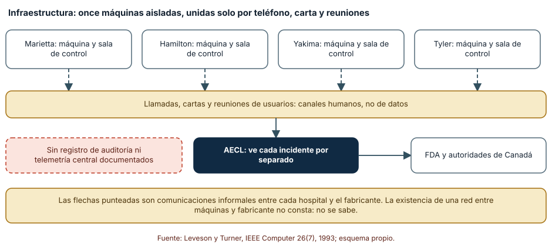
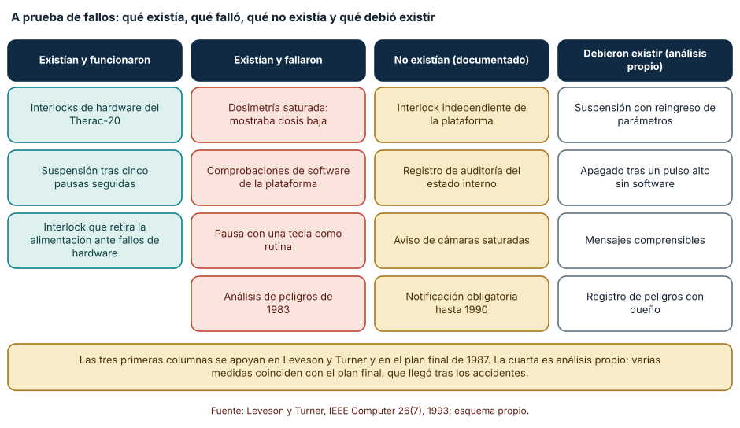
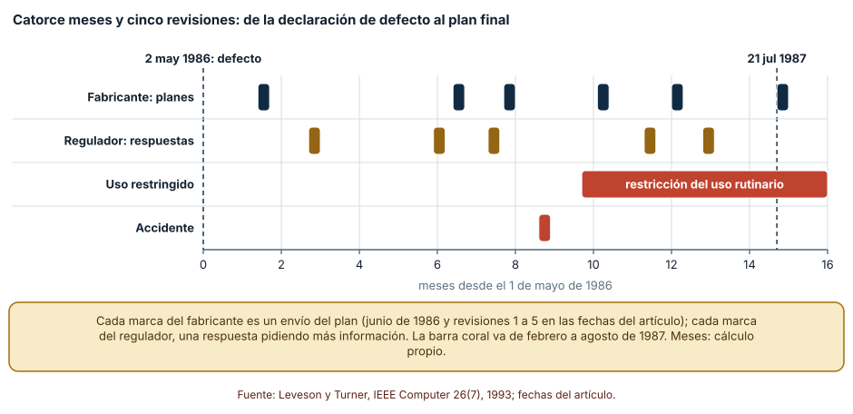
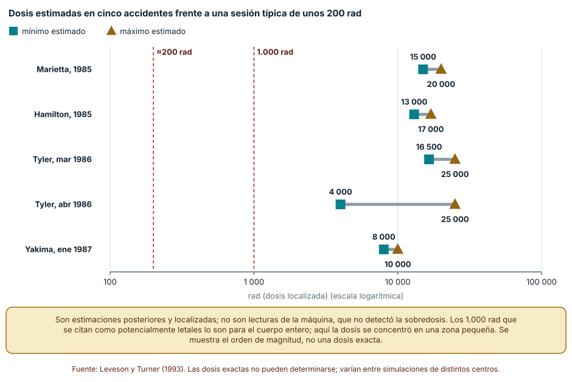

# Therac-25

[↑ Casos de fallo](README.md) · [← CrowdStrike](crowdstrike.md) · [Incidente de base de datos de GitLab →](gitlab-2017.md)

Entre junio de 1985 y enero de 1987, seis pacientes de cáncer recibieron en Estados Unidos y Canadá dosis de radiación cientos de veces superiores a las prescritas por una misma máquina, el acelerador lineal Therac-25. Varios murieron o quedaron con lesiones graves y permanentes. Es el caso más estudiado de daño causado por software porque se conservan los hechos de cada accidente, el código implicado y la respuesta de fabricante, hospitales y reguladores. Este caso lo trata con el respeto que merecen las personas afectadas: describe decisiones, mecanismos y sistemas, no culpables.

## Ficha histórica

| Dato | Contenido |
| --- | --- |
| Producto | Therac-25, acelerador lineal médico de doble modo (electrones y fotones de 25 MeV) |
| Fabricante | Atomic Energy of Canada Limited (AECL), una empresa pública canadiense (*crown corporation*); la división médica se llamó después Theratronics International |
| Colaborador histórico | CGR, empresa francesa que desarrolló junto a AECL los modelos anteriores |
| Desarrollo | Prototipo cableado en 1976; versión completamente computarizada a fines de 1982; análisis de seguridad en marzo de 1983 |
| Instalaciones | Once unidades: cinco en Estados Unidos y seis en Canadá |
| Accidentes | Seis con sobredosis masivas entre el 3 de junio de 1985 y el 17 de enero de 1987 (detalle en la línea de tiempo) |
| Centros | Kennestone Regional Oncology Center (Marietta, Georgia); Ontario Cancer Foundation (Hamilton, Ontario); Yakima Valley Memorial Hospital (Washington); East Texas Cancer Center (Tyler, Texas) |
| Respuesta oficial | La FDA declaró defectuoso el equipo el 2 de mayo de 1986; el plan de acción correctiva final es del 21 de julio de 1987; recall clase I |
| Estado posterior | Se retrofitaron salvaguardas de hardware contra errores de software. Según un reportaje de 1994, AECL disolvió su división médica en 1988 y la renombró Theratronics International |

La fecha de consulta de las fuentes citadas al final es el 16 de noviembre de 2026.

### Fabricantes, hospitales y lugares implicados

**Documentado (Leveson y Turner, 1993):** el fabricante, Atomic Energy of Canada Limited (AECL), es una empresa pública canadiense («corporación de la Corona») que a principios de los años setenta colaboró con la empresa francesa CGR en aceleradores lineales; los modelos anteriores derivaban de máquinas de CGR (la Neptune y la Sagittaire). La cooperación no se renovó en 1981 «por presiones competitivas». Cuando el fabricante necesitó soporte técnico en un accidente, envió un ingeniero desde Ottawa (la «oficina central» en Canadá). La división médica de AECL se estaba privatizando cuando se escribió el artículo y pasó a llamarse Theratronics International. Las once máquinas se instalaron en cinco centros de EE. UU. y seis de Canadá; los hospitales con accidentes fueron Kennestone (Marietta, Georgia), la Fundación Oncológica de Ontario (Hamilton), Yakima Valley Memorial (Washington) y East Texas Cancer Center (Tyler). Otros centros aparecen por sus acciones: Vancouver y Halifax añadieron protecciones propias.

**No se sabe:** dónde fabricó AECL cada componente, cuántas personas trabajaban en la división médica, qué oficinas de soporte existían y cuáles eran los otros seis centros. El artículo no lo dice y este caso no lo infiere.

**Cómo leer la figura.** El nodo central es el fabricante; arriba, quienes le suministraron o supervisaron; abajo, los centros que usaron la máquina. Mira primero qué centros tuvieron accidentes (los cuatro en coral) y qué centros añadieron protecciones por su cuenta (dorado). **Dónde deja de valer:** no es un mapa geográfico ni lista las once instalaciones, porque la fuente solo nombra algunas.

### Organización y plantilla

**No es público** el organigrama de AECL Medical ni su plantilla en esos años. Lo que el artículo permite decir sobre la estructura son los **roles**: un programador a cargo del software durante varios años (la persona dejó la empresa en 1986 y los autores no pudieron conocer su formación), un responsable de aseguramiento de calidad que respondió a usuarios y al regulador, ingenieros de soporte locales y de la oficina central, y un área de relación con los usuarios que participó en tres reuniones de grupo de usuarios. Este programa **no** reconstruye una pirámide de la organización con esos datos, porque sería inventar niveles que la fuente no da.

### Visión y misión

**No se sabe:** el artículo no cita una misión ni una visión de AECL Medical. Lo que sí documenta es la apuesta de producto: una máquina de doble modo, más compacta y pensada desde el principio para control por computador. Es una decisión de diseño, no una declaración de propósito.

## Contexto y problema

Un acelerador lineal médico (*linac*) acelera electrones para destruir tumores con el menor daño posible al tejido sano. Con los electrones se tratan tejidos poco profundos; para llegar más hondo, el haz de electrones se convierte en fotones de alta energía (rayos X) frenándolo contra un blanco. En los años setenta, AECL y CGR cooperaron en aceleradores: el Therac-6, solo de rayos X, y el Therac-20, de doble modo. En ambos, un minicomputador PDP-11 se agregó a máquinas que ya funcionaban solas, y se conservaron los interlocks y circuitos protectores de hardware.

La relación entre AECL y CGR no se renovó en 1981, y AECL diseñó el Therac-25 con un concepto de «doble paso» que pliega el acelerador y reduce el espacio necesario. A diferencia de sus predecesores, estaba pensado desde el principio para control por computador y asignaba al software más responsabilidad de seguridad. Esa decisión de arquitectura, no un error concreto de programación, es la que Leveson y Turner señalan como el hilo central del caso.

El problema de negocio y de ingeniería era legítimo: una sola máquina para dos modalidades, más compacta, más versátil y más fácil de operar. Lo que el caso examina es qué ocurrió cuando la comodidad y el ahorro de hardware se resolvieron cediendo al software las barreras que antes estaban en el hardware.

### Cómo funciona la terapia con acelerador y por qué importa la dosis

La radioterapia externa busca depositar en el tumor una dosis suficiente para destruirlo y la mínima posible en el tejido sano. La dosis se mide en *rad* (la unidad que usa el artículo; hoy se emplea el gray, y un gray equivale a 100 rad). Leveson y Turner dan dos puntos de referencia: una sesión típica ronda los 200 rad en la zona tratada y una dosis de cuerpo entero de unos 1.000 rad es potencialmente letal. El artículo describe cómo sobredosis de miles de rad en una zona pequeña produjeron lesiones graves y permanentes y, en varios casos, la muerte del paciente, aunque algunos ya tenían un cáncer avanzado y la contribución de cada factor no siempre pudo separarse.

Un acelerador de doble modo produce dos haces con la misma máquina. En **modo electrones** (de 5 a 25 MeV), el haz sale del acelerador, pasa por imanes de barrido que lo extienden y se aplica a tejidos superficiales. En **modo fotones** (rayos X de 25 MeV), el haz de electrones choca con un blanco metálico y un aplanador lo hace uniforme; como el aplanador atenúa mucho, la corriente del haz debe ser mucho mayor, del orden de cien veces según el artículo. Ahí está el riesgo físico central: **un haz de electrones a la corriente de rayos X, sin el blanco y sin los imanes de barrido, es un haz concentrado y mortal**. Todo el diseño de seguridad del equipo consiste en impedir esa combinación. En las máquinas anteriores esa tarea la hacían, en buena parte, interruptores y topes mecánicos; en el Therac-25 se confió una parte decisiva al software.

### Una decisión de arquitectura con un precio no medido

El artículo no cuestiona que fuera razonable querer una máquina más compacta y más fácil de operar. Cuestiona que las barreras de seguridad pasaran a depender de un único componente, con un análisis de seguridad que no incluyó ese componente. Es la distinción que la clase [SE-008 · Restricciones, riesgos y compromisos entre atributos](../../classes/part-00-ingenieria-de-software-como-profesion/se-008-restricciones-riesgos-y-compromisos-entre-atributos/README.md) llama compromiso entre atributos: ganar compacidad y comodidad cuesta algo, y el costo debe estar en la mesa antes de decidir. Aquí el costo no se midió.

## Mercado, usuarios y casos de uso

Los clientes eran centros oncológicos y hospitales. Cada máquina la usaban cuatro grupos con necesidades distintas:

- **Pacientes**, que reciben decenas de sesiones cortas en una misma zona y que no pueden ver ni evaluar lo que hace la máquina.
- **Técnicos de radioterapia (operadores)**, que preparan al paciente, salen de la sala blindada y controlan desde un terminal. Según el artículo, se quejaron desde el principio de que introducir el plan tardaba demasiado.
- **Físicos médicos y oncólogos**, responsables de calibrar la máquina, prescribir el tratamiento e interpretar las reacciones del paciente.
- **El fabricante y los reguladores**, que reciben los informes, deciden qué es un defecto y autorizan o no el uso.

Los casos de uso clínicos eran dos: tratamiento con electrones, de 5 a 25 MeV, para tumores superficiales, y tratamiento con fotones, a 25 MeV, para tumores profundos. Además existía una posición de «luz de campo», sin haz, para verificar con una luz y un espejo dónde caería la radiación antes de tratar.

### Quién sabía qué: la información repartida entre cuatro mundos

Los cuatro grupos de usuarios vivían en mundos de información separados, y esa separación es parte del mecanismo del caso.

- **El operador** veía un terminal, un monitor de vídeo y mensajes numerados. No veía el estado interno de la máquina.
- **El físico médico** conocía el comportamiento del equipo y las dosis, pero solo el de su centro. Fritz Hager, del centro de Tyler, es el caso documentado en que un físico reprodujo el fallo practicando la secuencia de teclas hasta repetirla.
- **El fabricante** recibía llamadas y cartas; el artículo documenta que respondió a los centros que no conocía otros incidentes y que atribuyó el fallo de Hamilton a un microinterruptor.
- **El regulador** actuaba, según Leveson y Turner, de manera reactiva; los centros de salud no tenían obligación de notificar incidentes ni al fabricante ni a la FDA hasta la enmienda legal de 1990, y un estudio del organismo de control del Congreso de EE. UU. citado en el artículo estimó que la FDA conocía menos del 1 % de las muertes, lesiones graves y fallos de equipos ocurridos en hospitales.

Una consecuencia de análisis propio: la **primera señal fiable** de que algo era sistemático solo podía aparecer si alguien juntaba las historias. Sin un canal para ello, cada centro enfrentaba su accidente como un caso aislado. La clase [SE-004 · Ética, interés público y consecuencias de las decisiones técnicas](../../classes/part-00-ingenieria-de-software-como-profesion/se-004-etica-interes-publico-y-consecuencias-de-las-decisiones-tecnicas/README.md) trata la responsabilidad profesional cuando las decisiones técnicas pueden dañar a personas, y la [SE-501 · Postmortems sin culpa y aprendizaje](../../classes/part-41-observabilidad-sre-e-incidentes/se-501-postmortems-sin-culpa-y-aprendizaje/README.md), cómo se aprende de un incidente sin buscar culpables.

**Cómo leer la figura.** Cada nodo es un actor; las flechas sólidas son flujos documentados (informes, llamadas, cartas) y las punteadas son los flujos que, según el artículo, faltaban o llegaron tarde. Mira primero el nodo del fabricante: recibía información de cada hospital y no la devolvía a los demás. **Dónde deja de valer:** el diagrama es un modelo de comunicación de 1985 a 1987; no describe cómo funciona hoy la vigilancia de dispositivos médicos, que cambió después.

## Funcionalidad de principio a fin

El recorrido siguiente reconstruye una sesión de tratamiento tal como la describe el artículo, de la preparación a la operación diaria.

**1. Preparar al paciente.** El operador sitúa al paciente en la mesa, fija a mano el tamaño del campo y la rotación del soporte, y coloca los accesorios. La posición de «luz de campo» permite comprobar con luz la zona; después, el operador sale de la sala.

**2. Introducir la prescripción.** Desde un terminal VT100 en la sala de control, el operador teclea la identificación del paciente, el modo (X para rayos X, E para electrones), la energía, la dosis y el tiempo. Para acelerar el trabajo, el fabricante modificó el software antes de la primera instalación: en lugar de reescribir los datos, se podían copiar con retornos de carro, de modo que una serie rápida de retornos completaba la entrada. Los operadores con experiencia teclean muy rápido.

**3. Verificar y activar.** Cuando los parámetros «verifican», el terminal muestra «beam ready». El operador pulsa B para encender el haz. La máquina está en una sala blindada y el operador solo ve al paciente por un monitor de vídeo y un intercomunicador.

**4. Qué ocurre si hay un fallo.** El Therac-25 puede detenerse de dos maneras: una **suspensión**, que exige reiniciar completamente la máquina, y una **pausa**, menos grave, que se reanuda con una sola tecla, P. Los mensajes de error eran crípticos: la palabra «Malfunction» seguida de un número del 1 al 64. El manual no explicaba esos códigos. Los operadores recibían a diario pausas por baja tasa de dosis y otras que no afectaban al paciente; una terapeuta de otro centro llegó a reportar unas 40 pausas de este tipo en algunos días. Pulsar P era el procedimiento habitual.

**5. Dentro de la máquina.** El software, escrito en lenguaje ensamblador de PDP-11 y ejecutado sobre un planificador propio en un procesador con 32 KB, tiene tareas críticas —el monitor de tratamiento, el control de servos y un «ama de llaves» que revisa interlocks— y tareas no críticas. Las tareas se comunican por variables compartidas, sin sincronización real. El artículo subraya que las comprobaciones y asignaciones de esas variables no eran operaciones indivisibles.

**6. La posición de la plataforma giratoria.** El computador lee tres microinterruptores que informan en qué posición está una plataforma giratoria que lleva los accesorios de cada modo. Si la plataforma está mal colocada, el haz llega sin el aplanador que lo hace seguro. En la Therac-25, comprobaciones de software sustituyeron a muchos de los interlocks electromecánicos tradicionales que garantizaban esa posición.

### La misma sesión, vista desde el interior de la máquina

El recorrido anterior es el que vive el operador. Mirado por dentro, el mismo recorrido son tres lazos que corren a la vez: el del terminal (que atiende teclado y pantalla), el del monitor de tratamiento (que avanza por ocho fases) y el de los controladores de hardware (imanes, plataforma, haz). Entre ellos no hay mensajes: hay variables compartidas.

1. El operador teclea la prescripción; la tarea del teclado analiza modo y energía y deja el resultado en una variable compartida de dos bytes (*MEOS*, por *mode/energy offset*): el byte alto lo usa la rutina de entrada de datos para indexar tablas de parámetros; el bajo lo usa otra tarea para colocar la plataforma y el colimador.
2. Cuando el cursor llega a la línea de comandos, el teclado marca la entrada como completa en otra variable compartida.
3. La rutina de entrada de datos (*Datent*) detecta esa marca y llama a *Magnet*, que fija los imanes de flexión. Esa operación tarda unos 8 segundos y usa una subrutina de espera, *Ptime*, que es entrada y salida varias veces.
4. Al terminar, el monitor pasa de fase (de la 1, entrada de datos, a la 3, prueba de preparación) y la rutina de preparación comprueba que no haya errores antes de permitir el haz.
5. Si todo verifica, el terminal muestra «beam ready» y el operador pulsa B.

Dos propiedades de ese diseño importan para lo que sigue: la comprobación de «no hay ediciones pendientes» se hace en puntos concretos del tiempo, no de forma continua, y las variables que cuentan la historia (marca de entrada completa, MEOS, estado del colimador) las escriben tareas distintas sin protección común. La clase [SE-386 · Memoria compartida, locks y condiciones de carrera](../../classes/part-32-concurrencia-y-sistemas-distribuidos/se-386-memoria-compartida-locks-y-condiciones-de-carrera/README.md) trata las condiciones de carrera y la [SE-269 · Interrupciones, concurrencia y estado compartido](../../classes/part-22-embedded-iot-y-tiempo-real/se-269-interrupciones-concurrencia-y-estado-compartido/README.md) el estado compartido con interrupciones.

## Negocio y economía

AECL era una empresa pública que competía en el mercado de aceleradores médicos. La ventaja económica del Therac-25 era clara para el cliente: una sola máquina para ambos modos, menos espacio y un manejo más ágil. Para el fabricante, el ahorro de reduplicar hardware de seguridad y el atractivo de una máquina más moderna eran parte de la apuesta.

Lo que no se sabe es tan importante como lo que se sabe. Leveson y Turner indican que no pudieron obtener información detallada sobre el desarrollo de software, la gestión ni el control de calidad del fabricante, y que no se conocen las cifras de ventas ni los costos de duplicar interlocks. Por eso este caso no atribuye una intención económica a la decisión de no duplicar interlocks: la fuente documenta la decisión, no su motivación.

El costo posterior sí dejó huellas públicas: el accidente de Marietta derivó en una demanda presentada el 13 de noviembre de 1985; hubo otras por los accidentes de Tyler y de Yakima, algunas resueltas fuera de los tribunales; y el fabricante debió retirar de servicio las máquinas durante meses de 1987, con una serie de revisiones al plan correctivo. El artículo no cuantifica estos costos.

### Impacto en cifras y en consecuencias, con fuente y límite

Las cifras del caso son pocas y casi todas vienen del mismo artículo; conviene decir qué significa cada una y qué no.

| Dimensión | Dato | Fuente | Límite |
| --- | --- | --- | --- |
| Máquinas instaladas | 11 (5 en EE. UU., 6 en Canadá) | Leveson y Turner, 1993 | No dice cuántas siguieron en servicio ni cuántos pacientes trató cada una |
| Accidentes con sobredosis masiva | 6, entre el 3 de junio de 1985 y el 17 de enero de 1987 | Leveson y Turner, 1993 | Son los reconocidos como tales; el artículo advierte que otros daños pudieron no atribuirse a la máquina |
| Pacientes | Varios murieron y otros quedaron con lesiones graves y permanentes; el artículo describe cada caso | Leveson y Turner, 1993 | La contribución de la sobredosis a cada muerte no siempre se puede separar de la enfermedad previa |
| Dosis | De unos 4.000 a unos 25.000 rad en zonas pequeñas frente a unos 200 de una sesión típica | Leveson y Turner, 1993 | Son estimaciones posteriores y varían entre simulaciones |
| Clasificación regulatoria | Clase II tras Hamilton; clase I (probabilidad razonable de consecuencias graves o muerte) en 1987 | Leveson y Turner, 1993 | La clasificación cambió por la evidencia acumulada, no por una norma nueva |
| Duración de la respuesta | De la declaración de defecto (2 de mayo de 1986) al plan final (21 de julio de 1987): unos 14 meses | Leveson y Turner, 1993; cálculo propio | La FDA pidió suspender el uso rutinario de febrero a agosto de 1987 |
| Costos financieros | No se conocen | Leveson y Turner, 1993 | El artículo no cuantifica demandas, indemnizaciones ni costos de retirada |

Tres lecturas de análisis propio. Primera: los 14 meses de respuesta muestran que la corrección de un defecto de seguridad en un dispositivo médico no es un parche, sino un proceso de varias revisiones con el regulador (cinco versiones del plan). Segunda: la ausencia de cifras de costo es un dato por sí mismo: la sociedad no sabe cuánto costó a la empresa ni al sistema de salud, y por eso no se puede usar el caso como argumento económico en un sentido o en otro. Tercera: el costo humano no se agrega en una sola cifra; cada caso es una persona, y por eso el caso no ofrece un «total».

### Reacción de la empresa, del regulador y de la comunidad médica

- **AECL.** Tras Hamilton hizo una retirada voluntaria y una modificación del microinterruptor; tras Tyler, notificó a la FDA el 15 de abril de 1986, propuso retirar la tecla de cursor hacia arriba y presentó un primer plan de acción correctiva el 13 de junio de 1986. Hubo cinco revisiones del plan hasta el 21 de julio de 1987.
- **FDA.** Declaró defectuoso el equipo el 2 de mayo de 1986 y exigió un plan y la renotificación a los usuarios. En febrero de 1987 pidió que se suspendiera el uso rutinario hasta contar con un plan aprobado; clasificó la retirada como clase I. El autor del artículo describe su respuesta, una vez implicada, como «impresionante», dada su poca experiencia con problemas de dispositivos médicos computarizados.
- **Autoridad canadiense.** La *Health Protection Branch* hizo lo mismo que la FDA en cuanto a la restricción de uso, hasta agosto de 1987.
- **Comunidad de usuarios.** Los centros se reunieron en tres reuniones de grupo de usuarios; la de marzo de 1987, descrita por los autores como inusualmente productiva, reunió en un solo lugar a los interesados, entre ellos el fabricante y los usuarios, para decidir una línea de acción con rapidez; de ella salieron nueve puntos que AECL se comprometió a calendarizar en abril. Los físicos pidieron un registro impreso de auditoría y acceso al código fuente; el fabricante respondió que las limitaciones de memoria no permitían un registro y que el código no se entregaría. La asociación de físicos médicos estadounidense había formado un grupo de trabajo sobre computadores en radioterapia en 1979 y reforzó ese trabajo tras los accidentes.

### Esquema del negocio: quién compra, quién usa y quién supervisa

El valor del producto era para el hospital: una sola máquina que ofrece dos modalidades de tratamiento, con menos espacio y operación más ágil. El flujo económico (el hospital compra o arrienda el equipo y paga mantenimiento) **no está cuantificado** en el artículo: no hay precios, ventas ni márgenes. El flujo de seguridad es el que el caso documenta: el fabricante diseña, el hospital opera, el físico médico calibra, el regulador vigila de forma reactiva y la asociación de físicos propone estándares de usuario. [SE-133 · Modelos de negocio y sostenibilidad](../../classes/part-11-economia-metricas-y-decisiones-de-producto/se-133-modelos-de-negocio-y-sostenibilidad/README.md) trata los modelos de negocio y [SE-537 · Economía del software y costo total](../../classes/part-44-gestion-liderazgo-y-practica-profesional/se-537-economia-del-software-y-costo-total/README.md) el costo total, aplicables aquí con una salvedad: faltan los datos.

**Cómo leer la figura.** El nodo central es el tratamiento; los demás son actores con su aporte. Los recuadros punteados son lo que no se sabe. Mira primero que el pago no aparece: no hay cifras públicas. **Dónde deja de valer:** representa roles según el artículo y no relaciones contractuales, que no son públicas.

### Costos operativos y costo del incidente

**Documentado:** hubo una demanda por el accidente de Marietta presentada el 13 de noviembre de 1985, demandas por Tyler y Yakima (algunas resueltas fuera de los tribunales) y, de febrero a agosto de 1987, una restricción del uso rutinario por orden del regulador. **No se sabe:** el costo de los litigios, de las modificaciones, de la retirada y de la pérdida de ventas. El artículo lo dice de forma explícita: no se conocen cifras de ventas ni los costos de duplicar interlocks. Por eso este caso **no ofrece un total económico**, y no lo estima: el costo humano, además, no se agrega en una cifra.

### Competidores y contexto de mercado

**Documentado:** el artículo atribuye la ruptura entre AECL y CGR en 1981 a «presiones competitivas» y menciona que la industria de aceleradores médicos había sido considerada segura durante décadas, salvo algunos incidentes en los años sesenta. **No se sabe** (con fuente pública verificada para este caso) la cuota de mercado de AECL, los nombres de los competidores ni el número de aceleradores instalados en el mundo en 1985. Dejar esa laguna a la vista es preferible a citar cifras de fuentes secundarias no contrastadas.

## Arquitectura y esquemas

### Contexto: tres máquinas, un cambio de reparto

**Cómo leer la figura.** Cada columna es una máquina. Debajo de cada nombre, un cuadro blanco describe la arquitectura y otro, verde azulado o coral, quién protegía al paciente. Mira primero el color: en las dos primeras máquinas la protección quedaba en el hardware; en la tercera, en el software. El cuadro dorado inferior recuerda el análisis de seguridad de 1983. **Dónde deja de valer:** el esquema simplifica; el artículo aclara que parte del software se reutilizó entre las tres máquinas y que no se sabe exactamente cuánto.

### Componentes: una plataforma giratoria decide qué haz recibe el paciente

**Cómo leer la figura.** Las tres columnas son las posiciones de la plataforma y lo que lleva cada una. Los dos cuadros coral inferiores son los dos modos de falla que el artículo describe: rayos X sin aplanador, o electrones sin barrido. Mira primero la columna central: la corriente del haz en modo de rayos X es unas cien veces mayor que en electrones, porque el aplanador atenúa mucho. **Dónde deja de valer:** es la geometría de la máquina según el artículo; no es un plano ni una especificación.

### Flujo crítico: la ventana de ocho segundos

**Cómo leer la figura.** Cada carril es un actor del sistema; el eje son segundos. La barra dorada es el ajuste de los imanes, de unos 8 segundos. La barra coral del operador es la edición dentro de esa ventana. Mira primero el carril «Ptime»: la comprobación de ediciones solo se hace en la primera pasada. **Dónde deja de valer:** solo el tope de 8 segundos es un dato; el reparto del tiempo del operador es ilustrativo.

### Datos y escala

La máquina no registraba lo que hacía de un modo útil para investigar: no había un registro de auditoría con el estado interno, y la función de impresión de la prescripción estaba desactivada en uno de los accidentes. Los hospitales no compartían datos: la mayoría de los centros se enteró de los incidentes de otros por conversaciones informales. Es una lectura de este programa, no un dato del artículo: seis accidentes en once máquinas, a lo largo de dos años, no se reconocieron como una serie hasta que un físico médico de Tyler reprodujo el fallo.

### Cómo recorrer esta sección: siete niveles de zoom

| Nivel | Pregunta | Figura |
| --- | --- | --- |
| 1. Contexto | ¿Quién interviene y qué información circula? | Tres máquinas (arriba) y canales de información |
| 2. Hardware | ¿Qué hay en la sala de tratamiento y en la de control? | Arquitectura de hardware |
| 3. Software | ¿Qué tareas hay y cómo se comunican? | Arquitectura de software |
| 4. Flujo que falló | ¿Qué pasa, paso a paso, en la edición rápida? | Secuencia de Tyler y análisis de la carrera |
| 5. Datos | ¿Qué variables compartidas y qué contador? | Estado compartido y contador de un byte |
| 6. Interbloqueos | ¿Qué verificaba cada barrera de seguridad? | Posición de la plataforma y capas de defensa |
| 7. Después | ¿Qué cambió el plan final? | Plan correctivo por causa |

Los detalles de software provienen de lo que Leveson y Turner pudieron reconstruir a partir de la documentación de los accidentes y las reparaciones; AECL reclama derechos de propiedad sobre el diseño y los autores advierten que su descripción es «aproximada».

### Nivel 2: arquitectura de hardware

El Therac-25 se organiza en dos espacios separados por el blindaje. En la **sala de tratamiento** están el acelerador, la plataforma giratoria con sus accesorios, los imanes de barrido y de flexión, las cámaras de ionización que miden el haz y la mesa. En la **sala de control**, el operador tiene un terminal VT100 y ve al paciente por vídeo y por intercomunicador. El computador, un PDP-11/23 con 32 KB, lee sensores (tres microinterruptores de la plataforma, cámaras) y comanda actuadores (servo, imanes, plataforma) a través de convertidores. Un sistema de interlock vigila fallos de hardware y retira la alimentación cuando detecta uno; el computador lo monitorea y puede pausar o suspender el tratamiento.

**Cómo leer la figura.** Las dos zonas punteadas son las dos salas; el blindaje las separa. Las flechas negras llevan órdenes del computador a los actuadores; las de la derecha llevan lecturas de los sensores al computador. Mira primero lo que **no** hay entre las salas: ninguna conexión que permita al operador ver el estado interno, solo vídeo y voz. **Dónde deja de valer:** es un esquema funcional reconstruido del artículo, no un plano; el artículo no da la topología eléctrica real.

Una propiedad física decide gran parte del caso: la posición de la plataforma se envía al computador como una señal binaria de tres bits, una por microinterruptor, y debe corresponder a exactamente una de tres posiciones legales (electrones, rayos X, luz de campo). Las otras combinaciones de bits son intermedias o inválidas. En el Therac-25 las comprobaciones de software sustituyeron a muchos de los interlocks electromecánicos tradicionales que garantizaban esa posición.

**Cómo leer la figura.** Cada fila es una combinación de los tres microinterruptores (llenos si están pulsados). Las filas teal son las tres posiciones legales; las coral son combinaciones que no deben permitir el haz. Mira primero cuántas combinaciones son ilegales frente a las legales: la comprobación debe rechazar la mayoría. **Dónde deja de valer:** las combinaciones intermedias dependen de la mecánica real; el esquema es ilustrativo del principio, no un mapa de la máquina.

### Nivel 3: arquitectura de software

El software está escrito en lenguaje ensamblador de PDP-11, sobre un ejecutivo de tiempo real propio (no un sistema operativo estándar), con un planificador expropiativo. Según el artículo tiene cuatro componentes: datos almacenados (calibración y datos del paciente), planificador, tareas críticas y no críticas, y servicios de interrupción. El planificador lanza las tareas cada 0,1 segundos: primero las críticas y, en el tiempo restante, las no críticas.

- **Críticas.** El monitor de tratamiento (*Treat*), que avanza por ocho fases según la variable *Tphase*; la tarea de servos, que controla emisión, tasa de dosis, simetría y movimientos; y el «ama de llaves» (*housekeeper*), que revisa interlocks de estado y límites y escribe mensajes en pantalla.
- **No críticas.** Suma de verificación, procesador de teclado de la consola, procesador de pantalla, teclado de servicio, *snapshot*, control manual y calibración.
- **Interrupciones.** Reloj, barrido, trampas (desbordamiento, interrupciones de hardware), arranque, pantalla, teclado, impresora y teclado de servicio.

**Cómo leer la figura.** El planificador está arriba; abajo, las tareas por criticidad; en la franja inferior, las variables compartidas, con flechas desde quien las escribe y hacia quien las lee. Mira primero la franja inferior: es el único canal entre tareas. **Dónde deja de valer:** los nombres son los del artículo; AECL no publicó el código, y la figura simplifica las relaciones entre tareas.

Lo notable del diseño no es que usara ensamblador o 32 KB, algo corriente entonces. Es que **la seguridad dependía de una conversación entre tareas hecha con variables sin sincronización**: el artículo observa que no hay sincronización real y que las comprobaciones y asignaciones de esas variables no eran operaciones indivisibles. El curso trata ese tipo de arquitectura en [SE-268 · Sistemas de tiempo real y deadlines](../../classes/part-22-embedded-iot-y-tiempo-real/se-268-sistemas-de-tiempo-real-y-deadlines/README.md) (tiempo real y plazos) y [SE-081 · Programación concurrente y actores](../../classes/part-06-paradigmas-de-programacion/se-081-programacion-concurrente-y-actores/README.md) (concurrencia y actores como alternativa).

### Nivel 4: secuencia del flujo que falló (Tyler)

La secuencia que sigue es la que reconstruyeron el físico del hospital y los analistas del fabricante después de los accidentes de marzo y abril de 1986.

**Cómo leer la figura.** Cada columna es un actor; el tiempo corre hacia abajo. Las flechas coral son los mensajes en que el sistema pierde la edición. Mira primero la segunda columna: el procesador de teclado marca «entrada completa» **antes** de que el operador corrija. **Dónde deja de valer:** los tiempos concretos entre teclas no están en el artículo; solo se sabe que la edición ocurrió dentro de la ventana de unos 8 segundos y que el físico necesitó práctica para repetirla.

### Análisis de la condición de carrera

El mecanismo, según el artículo, tiene tres partes. Primero, la rutina de entrada de datos sale de su fase cuando la marca de entrada completa está activa, pero esa marca solo indica que el cursor **llegó** a la línea de comandos, no que **siga** ahí. Segundo, el ajuste de los imanes dura unos 8 segundos y la subrutina de espera que comprueba si hubo ediciones solo mira la bandera de ajuste de imanes en su primera ejecución, porque la limpia; las ediciones en las pasadas siguientes no se perciben. Tercero, el byte bajo de MEOS (que usa otra tarea para posicionar la plataforma y el colimador) sí se actualiza con la edición, mientras el byte alto (que usó la rutina de entrada para fijar parámetros) conserva el valor anterior. La máquina queda con la plataforma en una posición y los parámetros del haz en otra, sin que nadie detecte la inconsistencia.

Un análisis de entrelazados (lectura propia a partir del mecanismo descrito) muestra por qué las pruebas de funcionamiento normal no lo encontraron. Hay dos órdenes posibles de eventos y solo uno es peligroso:

- **Orden seguro:** la edición ocurre antes de que se fijen los imanes o después de que terminen; la rutina de entrada la ve y reinicia.
- **Orden peligroso:** la edición ocurre durante los 8 segundos del ajuste de imanes y después de la primera ejecución de la espera.

**Cómo leer la figura.** Cada carril es una ejecución de la misma secuencia de teclas, con el mismo operador y los mismos datos, pero en distinto instante. La barra gris es la ventana de ajuste de imanes; la marca coral es la edición. Mira primero que el resultado depende **solo** del momento. **Dónde deja de valer:** no estima la probabilidad de cada orden; el artículo solo dice que exigía operar a cierta velocidad, y que operadores experimentados lo hacían.

La enseñanza del curso es que una prueba que repite la misma secuencia con el mismo ritmo recorre un solo orden y no distingue una máquina sana de una con una carrera latente. Las clases [SE-386 · Memoria compartida, locks y condiciones de carrera](../../classes/part-32-concurrencia-y-sistemas-distribuidos/se-386-memoria-compartida-locks-y-condiciones-de-carrera/README.md) (carreras), [SE-161 · Máquinas de estado y model checking introductorio](../../classes/part-13-especificaciones-contratos-y-modelos/se-161-maquinas-de-estado-y-model-checking-introductorio/README.md) (máquinas de estado y *model checking*) y [SE-425 · Pruebas basadas en propiedades y modelos](../../classes/part-35-estrategia-y-tecnicas-de-prueba/se-425-pruebas-basadas-en-propiedades-y-modelos/README.md) (propiedades y secuencias) proponen explorar los órdenes, no solo los valores. Un trabajo de 1987 de un directivo del centro de dispositivos de la FDA, que Leveson y Turner citan, observa que estas máquinas habían funcionado miles de horas en la fábrica y en los hospitales sin accidentes y que es improbable que las pruebas descubran todos los errores que exigen una acción del operador en ventanas de tiempo muy estrechas.

### Nivel 5: estado compartido y el contador de un byte

Un segundo defecto, independiente de la carrera, causó el accidente de Yakima de enero de 1987. La rutina de preparación incrementaba en cada pasada una variable compartida de un solo byte, *Class3*, que debía ser distinta de cero si había una inconsistencia y cero si todo estaba bien. Cuando era distinta de cero, otra rutina (*Lmtchk*) llamaba a la comprobación de posición del colimador (*Chkcol*); si era cero, **la omitía**. Como un byte solo llega a 255, en cada pasada número 256 la variable volvía a cero y la comprobación del colimador no se hacía. La preparación se ejecuta varios cientos de veces durante la puesta a punto. El accidente ocurrió cuando el operador pulsó la tecla de ajuste justo en esa pasada; el colimador seguía en posición de luz de campo y el haz de 25 MeV se encendió sin blanco ni barrido, con el espejo de acero en su camino.

**Cómo leer la figura.** Cada casilla es una pasada por la rutina de preparación. Las teal activan la comprobación; la coral, en la pasada 256, la omite. Mira primero que la comprobación no falló: **no se ejecutó**. **Dónde deja de valer:** el número de pasadas por puesta a punto no está en el artículo; solo que son varios cientos. La probabilidad de coincidir con la pasada 256 es la de una ventana de una pasada entre cientos, y no se puede estimar con los datos disponibles.

AECL describió la corrección como simple: en lugar de incrementar la variable, asignarle un valor fijo distinto de cero en cada pasada. Es un ejemplo de lo que la clase [SE-052 · Invariantes, precondiciones y poscondiciones](../../classes/part-04-pensamiento-computacional-y-resolucion-de-problemas/se-052-invariantes-precondiciones-y-poscondiciones/README.md) llama invariante: «Class3 vale cero **solo** cuando todo está bien» era la propiedad que el código rompía cada 256 ciclos. Un invariante enunciado y comprobado habría hecho visible el desbordamiento.

### Nivel 6: interbloqueos (interlocks) y defensa en profundidad

Un interbloqueo de seguridad (*interlock*) es una condición que, si no se cumple, impide una acción peligrosa. Se distingue por **quién** lo impone: un interlock electromecánico (un interruptor que corta la alimentación) no depende de ningún programa; uno en software depende de que el programa esté bien. La arquitectura anterior combinaba ambos; la nueva se apoyó en el software, y el accidente consistió en que la barrera de software cedió sin que otra la respaldara.

Para ver el conjunto, la figura ordena las barreras que debían separar un error del paciente, incluidas las humanas y organizativas, y qué ocurrió con cada una según el artículo.

**Cómo leer la figura.** Cada columna es una barrera, de la concepción del producto a la vigilancia posterior. Coral: no existió o no funcionó; gris: existió pero no cubría este riesgo; teal: añadida por el plan final. Mira primero cuántas barreras fallaron por razones distintas (análisis incompleto, dosimetría saturada, normalización de la pausa) y no por una sola. **Dónde deja de valer:** la valoración de cada barrera es la de Leveson y Turner; la figura no mide su eficacia ni afirma que hubiera sido suficiente cualquiera de ellas.

### Nivel 7: arquitectura después del plan final

El plan final (21 de julio de 1987) añadió cambios de tres tipos: hardware independiente del software, software más estricto y operación más clara. La figura asocia cada **causa** con la **medida** que la corta, de modo que se vea qué parte del problema quedaba cubierta por qué parte de la solución.

**Cómo leer la figura.** A la izquierda, causas documentadas; a la derecha, medidas del plan final. Cada flecha es «esta medida corta esta causa». Mira primero las causas sin flecha: son las que el plan no resolvió (registro impreso de auditoría y notificación obligatoria), que se atendieron por otras vías o más tarde. **Dónde deja de valer:** la lista de medidas es la del artículo a julio de 1987; no afirma que cada medida bastara ni que se aplicara igual en todas las máquinas.

### Hardware utilizado: acelerador, controlador e interbloqueos

**Documentado:** el acelerador lineal de doble modo (electrones de 5 a 25 MeV y fotones de 25 MeV); una plataforma giratoria con tres posiciones y tres microinterruptores que informan su posición como señal binaria; imanes de barrido y de flexión; cámaras de ionización para medir electrones y fotones; un blanco y un aplanador para el modo de rayos X; un computador PDP-11/23 con 32 KB de memoria; un terminal VT100 en la sala de control; un sistema de interlocks de hardware que retira la alimentación ante un fallo; circuitos muestreadores y de retención de las cámaras de ionización; y, tras el plan final, un potenciómetro de la plataforma, un circuito independiente que corta tras un pulso alto y un interruptor de pie de «hombre muerto» para movimientos. **No se sabe:** la capacidad de cómputo exacta fuera de la memoria, los fabricantes de cada componente y las especificaciones eléctricas.

**Cómo leer la figura.** Cada fila es una capa de hardware de la máquina; a la derecha, qué barrera de seguridad dependía de ella. Mira primero la fila del computador: era el único enlace entre la orden y los actuadores. **Dónde deja de valer:** es un esquema funcional del artículo y no un plano.

### Software utilizado

**Documentado:** lenguaje ensamblador de PDP-11; un ejecutivo de tiempo real escrito para esta máquina (no un sistema operativo estándar) con planificador expropiativo que lanza tareas cada 0,1 segundos; tareas críticas (monitor de tratamiento, servos, ama de llaves) y no críticas; servicios de interrupción; variables compartidas entre tareas sin sincronización real; módulos heredados de las máquinas anteriores (paquete del Therac-6 y rutinas del Therac-20); un programa que se carga en la máquina y cuya copia in situ se impidió en el plan final; y un único programador durante varios años. **No se sabe:** los nombres y versiones de las herramientas de ensamblado y de prueba, el sistema de control de versiones y los procedimientos de construcción: el fabricante reclamó propiedad sobre el diseño y los autores no pudieron examinar el código fuente.

**Cómo leer la figura.** Cada fila es una capa de software; a la derecha, lo heredado y lo desconocido. Mira primero la capa del ejecutivo: no había un sistema operativo estándar que impusiera exclusión mutua. **Dónde deja de valer:** el artículo advierte que su descripción es aproximada y que la documentación consultada puede contener errores.

### Infraestructura: máquinas aisladas, sin red documentada

**Documentado:** once máquinas en hospitales, cada una autónoma; la comunicación entre hospitales y fabricante era por teléfono, carta y reuniones de usuarios; el fabricante informó a la FDA el 15 de abril de 1986 con un informe de accidente. **No se sabe** (y no se infiere) si las máquinas tenían conexión de red, y el artículo no menciona transmisión remota de datos. **Inferido:** sin registro de auditoría en la máquina y sin red, la única memoria del sistema era lo que cada hospital anotaba; lo cual se alinea con que el artículo señale que cada centro conocía solo sus propios casos.

**Cómo leer la figura.** Cada caja de hospital es independiente; las líneas son canales humanos y no de datos. Mira primero que no hay un nodo central de telemetría. **Dónde deja de valer:** no afirma que no hubiera red; dice que no hay evidencia pública de ella.

### A prueba de fallos: interbloqueos, redundancia y recuperación

El caso es el ejemplo clásico de una arquitectura que retiró redundancia de hardware y la reemplazó con comprobaciones de software.

**Cómo leer la figura.** Cada caja es un mecanismo y su color es la columna. Mira primero la columna «existían y fallaron»: son controles que daban sensación de seguridad (las pausas, la dosimetría). **Dónde deja de valer:** las tres primeras columnas se apoyan en Leveson y Turner; la cuarta es análisis propio y no sugiere que fuera barata ni suficiente.

Un detalle de diseño del plan correctivo ilustra la tolerancia a fallos de la dosimetría: antes de 1986, el apagado automático ante una lectura alta de las cámaras exigía **tres lecturas altas consecutivas**, lo que implicaba un tiempo de apagado de unos 300 milisegundos; el plan lo cambió por un apagado tras **un solo** pulso alto, y añadió un circuito independiente del software. Es la diferencia entre un control que espera confirmación y uno que protege en el primer indicio.

## Casos especiales y cómo fallan

**Hamilton: el interruptor sospechoso.** El 26 de julio de 1985, la máquina no se suspendió y la pantalla mostraba que no se había entregado dosis. Siguiendo el procedimiento habitual, el operador pulsó P para reintentar. AECL no pudo reproducir el fallo y sospechó de un microinterruptor de la plataforma; reforzó el diseño y afirmó que el riesgo había mejorado «al menos cinco órdenes de magnitud». Leveson y Turner consideran esa cifra difícil de justificar. Es un caso de explicación aceptada sin evidencia suficiente: no se pudo reproducir el defecto, y se asumió que el hardware era la causa.

**Yakima 1985: la respuesta «imposible».** Una paciente desarrolló un enrojecimiento con un patrón de rayas. El 24 de febrero de 1986, AECL respondió por escrito que el daño no podía haberse producido por el equipo y que no había otros incidentes conocidos. El personal del hospital, que no sabía de los otros accidentes, atribuyó la lesión a «causa desconocida». Un año después, un segundo accidente en el mismo hospital hizo sospechar que el primero también fue de la máquina; la paciente sobrevivió con secuelas.

**Tyler: la prescripción editada demasiado rápido.** El 21 de marzo y el 11 de abril de 1986, una operadora experimentada tecleó «X» en vez de «E», volvió atrás con la tecla del cursor, corrigió y llegó a la línea de comandos. La máquina mostró «Malfunction 54», con una dosis aparente baja, y el procedimiento habitual fue seguir. El hospital no tenía documentación que explicara ese código. El físico del hospital, Fritz Hager, trabajó con la operadora hasta reproducir el fallo editando a velocidad y midió una dosis de más de 4.000 rad; AECL lo reprodujo cuando conoció el procedimiento y midió unos 25.000.

**Yakima 1987: el contador que se desborda.** El 17 de enero de 1987, tras una secuencia de pausas, el haz se encendió con la plataforma en posición de luz de campo. La causa estaba en otro punto del código: una variable de un byte, que debía ser cero solo si todo estaba bien, se incrementaba en cada pasada. Cada 256 pasadas volvía a cero y la comprobación de la posición del colimador se omitía. Si el operador pulsaba la tecla de ajuste justo en esa pasada, la verificación no se hacía.

**La máquina que no detecta su propio fallo.** En los accidentes de Tyler las cámaras de ionización que miden la dosis se saturaron por la densidad del haz sin barrido y registraron una dosis baja. El artículo resume la lección con una frase: el software «mentía» al operador y la máquina no podía detectar que había ocurrido una sobredosis. La única señal real era la reacción del paciente.

**El procedimiento de seguir.** Cuando las pausas son cotidianas, ignorarlas es racional. Una operadora declaró que, en su formación, le habían explicado que había tantas salvaguardas que era prácticamente imposible hacer daño a un paciente. Es lo que la ingeniería de seguridad llama normalización de la desviación, aunque el artículo no usa ese término.

### El bucle de pausas: cómo una salvaguarda se vuelve rutina

Entre los accidentes hay un mecanismo humano y de organización que el artículo documenta y que merece su propio esquema. Una **pausa** era una detención menor: el operador pulsaba P y el tratamiento seguía con los parámetros previos; solo tras cinco pausas la máquina forzaba una suspensión. Los mensajes eran «Malfunction» seguido de un número del 1 al 64 que el manual de mantenimiento listaba sin explicar. Una terapeuta de otro centro reportó unas 40 pausas por baja tasa de dosis en algunos días, y una operadora recordó que le habían enseñado que había tantos mecanismos de seguridad que era prácticamente imposible dañar a un paciente.

Visto como un sistema, hay un lazo de refuerzo: más pausas inocuas, menos atención a cada una, más rápido el «P», menos probabilidad de notar la pausa que sí importa. Es una lectura propia que usa hechos del artículo; el artículo no lo modela así.

**Cómo leer la figura.** Cada caja es un estado del operador y las flechas son transiciones. La flecha coral es la rama peligrosa; las flechas de retorno cierran el lazo de refuerzo. Mira primero que ningún paso del lazo es una falta: cada uno es razonable con la información que el operador tenía. **Dónde deja de valer:** es un modelo didáctico de la normalización del riesgo; no mide con qué frecuencia ocurrió cada paso, y el artículo no estudia la psicología de los operadores.

### Qué habría visto un físico con instrumentos distintos

Los dos accidentes de Tyler muestran una paradoja de medición: la máquina decía que la dosis era baja porque las cámaras de ionización que la miden se saturaban con un haz sin barrido a alta corriente. El físico de Tyler midió primero unos 804 rad, advirtió que la cámara se había saturado, extendió su rango y obtuvo más de 4.000. La enseñanza es de instrumentación: **un sensor saturado no es un sensor que mide poco; es un sensor que ya no mide**. La clase [SE-494 · Logs estructurados y correlación](../../classes/part-41-observabilidad-sre-e-incidentes/se-494-logs-estructurados-y-correlacion/README.md) propone registrar el estado interno y [SE-493 · Señales, eventos y observabilidad útil](../../classes/part-41-observabilidad-sre-e-incidentes/se-493-senales-eventos-y-observabilidad-util/README.md) el principio de señales útiles; la pregunta para el diseño es qué debe hacer un sistema cuando su instrumento le dice que no sabe.

## Línea de tiempo

| Fecha | Hecho |
| --- | --- |
| 1976 | Primer prototipo cableado del Therac-25 |
| Fines de 1982 | Versión comercial computarizada |
| Marzo de 1983 | Análisis de seguridad con árbol de fallos que no considera errores de software |
| 3 de junio de 1985 | Marietta, Georgia: sobredosis; no se investigó ni se reconoció durante mucho tiempo |
| 26 de julio de 1985 | Hamilton, Ontario: sobredosis; AECL atribuye el fallo a un microinterruptor |
| Septiembre de 1985 | Modificación del microinterruptor; AECL anuncia una mejora de «cinco órdenes de magnitud» |
| Diciembre de 1985 | Yakima: reacción cutánea con patrón de rayas; el fabricante responde que es imposible |
| 21 de marzo de 1986 | Tyler, Texas: primera sobredosis |
| 11 de abril de 1986 | Tyler: segunda sobredosis; el físico del hospital reproduce el fallo |
| 15 de abril de 1986 | AECL informa a la FDA y propone retirar la tecla de cursor hacia arriba |
| 2 de mayo de 1986 | La FDA declara el equipo defectuoso y exige renotificar a los usuarios |
| 13 de junio de 1986 | Primer plan de acción correctiva de AECL, con seis puntos |
| 17 de enero de 1987 | Yakima: segunda sobredosis en ese hospital |
| Febrero de 1987 | La FDA pide suspender el uso rutinario hasta contar con un plan aprobado; el uso se restringe hasta agosto |
| 21 de julio de 1987 | Quinta y última revisión del plan correctivo |

**Cómo leer la figura.** Cada carril superior es un accidente; las dos barras inferiores son la respuesta del fabricante y el período de uso restringido. Las líneas punteadas marcan cuándo la FDA declara el defecto y cuándo se aprueba el plan final. Mira primero el vacío entre los accidentes 1 al 3 y la primera línea punteada: pasaron meses antes de la intervención. **Dónde deja de valer:** la marca de Yakima de 1985 es aproximada, porque el artículo solo da el mes; los meses son cálculo propio.

### Antecedentes: decisiones y condiciones latentes, con año

La tabla ordena lo que existía **antes** del primer accidente. Las fechas son las del artículo; la columna de lectura es análisis propio.

| Año | Decisión o condición | Fuente | Lectura de este programa |
| --- | --- | --- | --- |
| Principios de la década de 1970 | AECL y CGR colaboran en aceleradores; el paquete de software del Therac-6 es la base común de las máquinas siguientes | Leveson y Turner | Origen de una base reutilizada durante más de una década |
| 1976 | Primer prototipo cableado del Therac-25; estructura de programa y subrutinas heredadas | Leveson y Turner | La reutilización traslada supuestos de máquinas con interlocks a una sin ellos |
| 1981 | No se renueva la relación AECL y CGR; AECL diseña el Therac-25 con el concepto de doble paso | Leveson y Turner | El producto se concibe para control por computador desde el inicio |
| Fines de 1982 | Versión comercial computarizada | Leveson y Turner | Software con más responsabilidad de seguridad que en las máquinas previas |
| Marzo de 1983 | Análisis de seguridad por árbol de fallos que supone que los errores de programación no existen y asigna probabilidades sin justificación | Leveson y Turner | La barrera conceptual más importante falta desde el diseño |
| Hasta 1986 | Documentación escasa, un solo programador, pruebas casi solo de sistema, sin plan de pruebas documentado | Leveson y Turner | Las prácticas de ingeniería no se pueden verificar desde fuera |
| 1985 (antes del accidente) | La rutina de edición y la de ajuste de imanes funcionan sin sincronización común | Leveson y Turner | Condición latente de la carrera de Tyler |
| 1990 | Enmienda legal que obliga a los centros a notificar incidentes | Leveson y Turner | Llegó después de los hechos |

La tabla no pretende que cada decisión fuera incorrecta con la información de su época. Muestra que la mayoría de las condiciones que causaron daño ya existían en 1983.

### Los accidentes y la respuesta, a resolución de meses

La línea de tiempo principal sigue más arriba. Aquí se añaden dos vistas distintas: **qué dato circulaba y a quién** y **cuántas veces se rehízo el plan correctivo**.

La respuesta del regulador y del fabricante dura mucho más que los accidentes. Entre el 2 de mayo de 1986 (declaración de defecto) y el 21 de julio de 1987 (quinta y última versión del plan) pasaron unos 14 meses y medio, con la FDA pidiendo más información en cada iteración: una descripción detallada del proceso de desarrollo, un plan de pruebas, diagramas de flujo, la reclasificación de los fallos de dosimetría como interlocks de seguridad y, en 1987, un interlock de hardware de la plataforma.

**Cómo leer la figura.** Cada carril es un actor y el eje son los meses. Las marcas navy del carril del fabricante son los envíos del plan; las doradas, las respuestas del regulador; la barra coral es el período de restricción de uso y la marca de abajo, el accidente de enero de 1987. Mira primero cuántas idas y vueltas hubo antes de que el plan incluyera hardware. **Dónde deja de valer:** las fechas son las del artículo y algunas se dan solo por mes; no pretende medir el esfuerzo de cada revisión.

## Qué falló en cada instancia

Cada caso es una instancia en un centro. Lo que se esperaba era que la máquina diera la dosis prescrita y se detuviera de forma segura si había un fallo.

1. **Marietta, 3 de junio de 1985.** Una paciente de 61 años recibía radioterapia tras una lumpectomía. Sintió «una fuerza de calor tremenda». Las estimaciones indicaron una o dos dosis en el rango de 15.000 a 20.000 rad frente a unos 200 de una sesión típica. Perdió el pecho y el uso del hombro y del brazo. El accidente no se investigó cuidadosamente; la causa técnica concreta no se conoce.
2. **Hamilton, 26 de julio de 1985.** Una paciente en su sesión número 24 recibió entre 13.000 y 17.000 rad en la cadera. Murió el 3 de noviembre de 1985 de un cáncer muy agresivo; de haber vivido, habría necesitado una prótesis de cadera por la sobreexposición. La causa técnica probable, la misma que la del segundo accidente de Yakima, es una conjetura del artículo.
3. **Yakima, diciembre de 1985.** Una paciente con un patrón de rayas en la piel. Se descartaron varias causas. Sobrevivió, con una úlcera crónica y cirugías posteriores. La causa técnica no se determinó.
4. **Tyler, 21 de marzo de 1986.** Un paciente en su novena sesión. La máquina mostró «Malfunction 54» y una dosis baja; el operador pulsó P y la máquina repitió el mensaje. Recibió entre 16.500 y 25.000 rad según simulaciones posteriores en una zona de un centímetro; murió cinco meses después.
5. **Tyler, 11 de abril de 1986.** Un paciente con un cáncer de piel en la cara. Mismo mensaje. Describió una sensación de «fuego». Murió el 1 de mayo de 1986.
6. **Yakima, 17 de enero de 1987.** Un paciente con cáncer terminal recibió una dosis que se estimó entre 8.000 y 10.000 rad tras dos intentos, frente a 86 prescritos. Según el artículo murió en abril por complicaciones relacionadas con la sobredosis; ya tenía un cáncer terminal, los sobrevivientes iniciaron demandas y el asunto se resolvió fuera de los tribunales.

**Cómo leer la figura.** Cada fila es un accidente. El cuadrado es la estimación mínima y el triángulo, la máxima; el eje es logarítmico, así que cada marca principal multiplica por diez. Las líneas punteadas son 200 y 1.000 rad. Mira primero la distancia entre las estimaciones y la primera línea: más de un orden de magnitud. **Dónde deja de valer:** son estimaciones posteriores, localizadas en una zona pequeña, y varían entre simulaciones; la dosis de 1.000 rad que se cita como potencialmente letal lo es para el cuerpo entero, no para una zona de un centímetro. Mide el orden de magnitud del error, no una dosis exacta.

## Causa raíz y factores

Leveson y Turner rechazan explícitamente reducir el caso a una causa. Escriben que atribuir un accidente a un solo factor suele ser un grave error y que culpar al «error humano» o al «error de software» es casi igual de inútil. Su análisis identifica factores que se combinaron:

**Detonantes técnicos (documentado).**

- Una **condición de carrera** en la entrada de datos: la edición del modo y la energía dentro de la ventana de ajuste de imanes no era detectada, y el haz quedaba configurado con parámetros inconsistentes (Tyler).
- Un **desbordamiento de contador** de un byte que dejaba de comprobar la posición del colimador una de cada 256 pasadas (Yakima 1987).
- Posibles defectos adicionales que el código no permite descartar en los tres primeros accidentes.

**Condiciones latentes (documentado).**

- **Software como única barrera.** Se retiraron o no se duplicaron interlocks de hardware que en el Therac-20 contenían el mismo error de edición sin daño.
- **Análisis de seguridad que excluyó el software.** El árbol de fallos de 1983 asignó probabilidades sin justificación y modeló los fallos del computador como fallos de hardware o ruido.
- **Prácticas de ingeniería de software deficientes.** Poca documentación, programa escrito por una sola persona en ensamblador, concurrencia sin sincronización, reutilización de código de máquinas anteriores, pruebas casi solo de sistema, y ausencia de un plan de pruebas documentado cuando la FDA lo pidió.
- **Diseño de interacción.** Mensajes crípticos, pausas que se reanudaban con una tecla, una interfaz que copiaba datos con retornos y no avisaba de saturación de las cámaras.

**Factores organizacionales y regulatorios (documentado).**

- No había un mecanismo de seguimiento de incidentes: la llamada de un físico de Marietta y la demanda de 1985 no provocaron una investigación; el fabricante respondió a otros centros que no había incidentes previos.
- Los centros de salud no estaban obligados en esa época a notificar incidentes al fabricante ni a la FDA; la ley se enmendó en 1990.
- La FDA exigía solo una notificación previa a la comercialización, no una aprobación, y reaccionaba a los problemas; cuando intervino, su respuesta fue, según los autores, impresionante.

**No se sabe.** El artículo declara que no pudo conocer los detalles de la gestión, de la calidad ni de la formación del programador, y que la documentación consultada puede ser incorrecta. Tampoco hay explicación pública de por qué no se duplicaron los interlocks.

### Cadena causal estructurada

Leveson y Turner rechazan una causa única, pero conviene ordenar los eslabones para ver qué barrera corta cada uno. Todos son decisiones o condiciones del sistema.

1. **El producto asigna al software la protección de dos haces con riesgos opuestos.** *Documentado.*
2. **No se duplican interlocks de hardware que en máquinas anteriores contenían errores de software.** *Documentado.*
3. **El análisis de peligros de 1983 no considera errores de software.** *Documentado.*
4. **Las tareas se comunican por variables compartidas sin sincronización.** *Documentado.*
5. **Una secuencia de edición rápida deja parámetros inconsistentes (Tyler); un contador de un byte omite una comprobación una de cada 256 veces (Yakima 1987).** *Documentado.*
6. **La dosimetría se satura y el sistema muestra una dosis baja.** *Documentado.*
7. **Las pausas son rutinarias y los mensajes crípticos.** *Documentado.*
8. **Los accidentes iniciales se atribuyen a hardware o a «causa desconocida» sin evidencia suficiente.** *Documentado.*
9. **No hay un canal obligatorio de notificación y seguimiento de incidentes.** *Documentado.*

Los eslabones 1 a 5 explican **por qué el defecto pudo producir una sobredosis**; el 6 y el 7, **por qué nadie lo vio en el momento**; el 8 y el 9, **por qué hubo más accidentes antes de la corrección**. Ese reparto en tres ejes (diseño, detección y aprendizaje organizacional) es una lectura propia que facilita ver que arreglar el eje 1 no corrige el 3.

### Barreras que no existieron o no funcionaron

| Barrera | Estado | Evidencia |
| --- | --- | --- |
| Interlocks de hardware independientes | No existían para la posición de la plataforma y la dosimetría | Leveson y Turner; plan final los añade |
| Análisis de peligros con software | No existía en 1983 | Leveson y Turner |
| Pruebas de tiempo y secuencia | No consta que existieran | Leveson y Turner: pruebas casi solo de sistema |
| Mensajes de error comprensibles | No existían | Leveson y Turner; plan final los añade |
| Aviso de cámaras saturadas | No existía | Leveson y Turner |
| Registro de auditoría | No existía; el fabricante alegó límites de memoria | Leveson y Turner, reunión de usuarios |
| Investigación de incidentes | Insuficiente: la llamada de 1985 y la primera demanda no la activaron | Leveson y Turner |
| Notificación obligatoria | No existía hasta 1990 | Leveson y Turner |

### Árbol de fallas

**Cómo leer la figura.** Las compuertas Y exigen todas las condiciones de abajo; con eliminar una, se evita el evento superior. Las hojas coral son hechos documentados; las doradas, interpretación de este programa. Mira primero la rama central: es la que dejaba al paciente como único detector. **Dónde deja de valer:** es un modelo simplificado; no asigna probabilidades (que es justamente lo que el artículo critica del análisis de 1983) y no cubre otros posibles defectos del código.

### Documentado, inferido y no se sabe

| Afirmación | Estado | Base |
| --- | --- | --- |
| La condición de carrera de Tyler y el contador de un byte de Yakima 1987 | Documentado | Leveson y Turner; correcciones de AECL |
| Que la causa de Hamilton fuera el microinterruptor | No se sabe | AECL lo asumió sin poder reproducir el fallo; el artículo lo considera no justificado |
| La causa técnica de Marietta y Yakima 1985 | No se sabe | Leveson y Turner |
| Que Hamilton y Yakima 1987 compartan causa | Conjetura del artículo | Leveson y Turner |
| Por qué no se duplicaron los interlocks | No se sabe | El artículo no obtuvo información del fabricante |
| Que las pausas rutinarias hayan favorecido la normalización | Inferido | Declaraciones de operadores en el artículo |
| El costo económico para el fabricante | No se sabe | No consta |

## Mejoras que debieron hacerse

> **Esta sección es análisis propio de este programa**, apoyado en el artículo de Leveson y Turner. Son controles y procesos que habrían cortado cada cadena causal; no se sabe si el fabricante los consideró ni por qué los descartó. Algunas de estas medidas son exactamente las del plan correctivo final.

**Cómo leer la figura.** Cada fila es un recorrido de la orden al haz. En la de arriba, el software es la única barrera. Abajo, cada caja verde azulada es una capa independiente; las tres cajas blancas son medidas de operación. Mira primero que ninguna de las capas nuevas depende del mismo código. **Dónde deja de valer:** las capas son las del plan final según el artículo; la suficiencia de cada una es una valoración de los autores y de la FDA.

1. **Conservar interlocks de hardware independientes del software.** Corta el hilo central: ningún camino a un daño grave debe depender de un solo componente. El plan final añadió un potenciómetro y un interlock para la plataforma, y un circuito que corta el haz tras un pulso alto sin pasar por el software. Clase: [SE-274](../../classes/part-22-embedded-iot-y-tiempo-real/se-274-safety-seguridad-y-vida-util-prolongada/README.md).
2. **Un análisis de peligros que incluya el software y los estados del sistema.** La primera evaluación lo excluyó. Hay que modelar qué ocurre si el software escribe un valor incorrecto, no solo si el hardware falla. Clase: [SE-295](../../classes/part-24-software-especializado-y-dominios/se-295-salud-datos-sensibles-y-sistemas-regulados/README.md) y [SE-421](../../classes/part-35-estrategia-y-tecnicas-de-prueba/se-421-calidad-por-riesgo-y-proposito-de-las-pruebas/README.md).
3. **No confiar en números de riesgo que no se pueden justificar.** Una mejora «de cinco órdenes de magnitud» o una tasa genérica de fallos de software por hora no sustituyen la evidencia. Exigir de cada cifra su método. Clase: [SE-006](../../classes/part-00-ingenieria-de-software-como-profesion/se-006-evidencia-incertidumbre-y-pensamiento-critico-en-ingenieria/README.md).
4. **Diseño de concurrencia sin estado compartido sin sincronizar.** Las variables compartidas con comprobar-y-asignar no indivisible permitieron las carreras. Una máquina de estados explícita, o paso de mensajes, hace los estados y transiciones revisables. Clases: [SE-386](../../classes/part-32-concurrencia-y-sistemas-distribuidos/se-386-memoria-compartida-locks-y-condiciones-de-carrera/README.md), [SE-269](../../classes/part-22-embedded-iot-y-tiempo-real/se-269-interrupciones-concurrencia-y-estado-compartido/README.md) y [SE-161](../../classes/part-13-especificaciones-contratos-y-modelos/se-161-maquinas-de-estado-y-model-checking-introductorio/README.md).
5. **Pruebas que busquen el tiempo y la secuencia, no solo el valor.** Las máquinas funcionaron miles de horas sin accidentes; el fallo exigía una secuencia rápida de teclas. Pruebas basadas en propiedades y generación de secuencias de entrada habrían tenido una oportunidad de encontrarla. Clase: [SE-425](../../classes/part-35-estrategia-y-tecnicas-de-prueba/se-425-pruebas-basadas-en-propiedades-y-modelos/README.md) y [SE-426](../../classes/part-35-estrategia-y-tecnicas-de-prueba/se-426-mutacion-fuzzing-y-generacion-de-casos/README.md).
6. **Fallar a un estado seguro y no normalizar los fallos.** Convertir los fallos de dosimetría en suspensiones obligatorias con reingreso de parámetros, como hizo el plan final, impide que una pausa rutinaria sea un camino a la sobredosis. Clase: [SE-172](../../classes/part-14-experiencia-accesibilidad-e-internacionalizacion/se-172-estados-vacios-carga-error-y-recuperacion/README.md).
7. **Que la máquina pueda detectar su propia falla.** Mostrar la saturación de las cámaras de ionización, mensajes comprensibles y un registro de auditoría con el estado interno. Una medición que se satura debe avisar de que está saturada. Clase: [SE-494](../../classes/part-41-observabilidad-sre-e-incidentes/se-494-logs-estructurados-y-correlacion/README.md).
8. **Seguimiento de incidentes y registro de peligros.** La primera llamada de un físico y la primera demanda debían abrir una investigación. Un registro de peligros con dueño habría conectado los accidentes. Clases: [SE-501](../../classes/part-41-observabilidad-sre-e-incidentes/se-501-postmortems-sin-culpa-y-aprendizaje/README.md) y [SE-499](../../classes/part-41-observabilidad-sre-e-incidentes/se-499-runbooks-on-call-y-escalamiento/README.md).
9. **Requisitos y decisiones registradas, no solo código.** Documentación de especificaciones y de las razones de cada decisión para que no se deshagan por accidente. Clases: [SE-151](../../classes/part-12-ingenieria-de-requisitos/se-151-trazabilidad-desde-necesidad-hasta-evidencia/README.md) y [SE-147](../../classes/part-12-ingenieria-de-requisitos/se-147-atributos-de-calidad-y-restricciones/README.md).
10. **Notificación de incidentes por parte de los usuarios y apertura al regulador.** Una vía obligatoria de los centros al fabricante y a la autoridad, que la legislación estadounidense adoptó en 1990. Clase: [SE-004](../../classes/part-00-ingenieria-de-software-como-profesion/se-004-etica-interes-publico-y-consecuencias-de-las-decisiones-tecnicas/README.md).

Lo que enseña el curso no habría evitado el primer defecto de código, pero habría cambiado lo que ese defecto significaba: con un interlock independiente, el mismo error de edición del Therac-20 seguía siendo una molestia con fusibles que saltan.

### Mejora a fondo, factor por factor

> **Análisis propio de este programa, apoyado en Leveson y Turner.** No se sabe qué consideró el fabricante ni por qué descartó cada opción. Los costos son cualitativos: el artículo no los cuantifica. Cada factor se aborda con un control técnico, uno de proceso y uno de gobierno, porque ninguno basta solo.

**Factor 1: el software como única barrera.**
- *Técnico:* interlocks de hardware independientes (potenciómetro e interlock de la plataforma, circuito que corta el haz tras un pulso alto sin pasar por el software), que son los del plan final.
- *Proceso:* regla de diseño de «dos fallos independientes antes de un daño grave».
- *Gobierno:* ninguna función que pueda causar daño grave se aprueba si su única barrera es un programa.
- *Costo y trade-off:* más hardware, más espacio y un equipo menos compacto; es justamente lo que el diseño quería evitar. El costo se compara con el de una barrera, no con el de ninguna. [SE-274 · Safety, seguridad y vida útil prolongada](../../classes/part-22-embedded-iot-y-tiempo-real/se-274-safety-seguridad-y-vida-util-prolongada/README.md), [SE-440 · Disponibilidad, durabilidad y recuperación](../../classes/part-36-calidad-rendimiento-y-resiliencia/se-440-disponibilidad-durabilidad-y-recuperacion/README.md).

**Factor 2: análisis de peligros que excluyó el software.**
- *Técnico:* un análisis (por ejemplo, de peligros y operabilidad o de modos de falla) que trate el software como fuente de estados erróneos y no solo el hardware.
- *Proceso:* revisión independiente del análisis, con acceso al diseño.
- *Gobierno:* que el análisis sea un requisito de la presentación al regulador y que no pueda omitirse el software.
- *Costo y trade-off:* tiempo de especialistas; riesgo de falsa seguridad si el análisis se convierte en ritual. [SE-295 · Salud, datos sensibles y sistemas regulados](../../classes/part-24-software-especializado-y-dominios/se-295-salud-datos-sensibles-y-sistemas-regulados/README.md), [SE-421 · Calidad por riesgo y propósito de las pruebas](../../classes/part-35-estrategia-y-tecnicas-de-prueba/se-421-calidad-por-riesgo-y-proposito-de-las-pruebas/README.md), [SE-187 · Riesgos, supuestos, issues y decisiones](../../classes/part-15-procesos-planificacion-y-estimacion/se-187-riesgos-supuestos-issues-y-decisiones/README.md).

**Factor 3: cifras de riesgo sin método.**
- *Técnico:* cada probabilidad lleva su derivación y su incertidumbre; no se asignan tasas genéricas al software.
- *Proceso:* auditoría de los supuestos.
- *Gobierno:* quien firma una cifra responde de su método.
- *Costo y trade-off:* se pierde la comodidad de un número único; se gana honestidad. [SE-006 · Evidencia, incertidumbre y pensamiento crítico en ingeniería](../../classes/part-00-ingenieria-de-software-como-profesion/se-006-evidencia-incertidumbre-y-pensamiento-critico-en-ingenieria/README.md).

**Factor 4: concurrencia sin sincronización.**
- *Técnico:* máquina de estados explícita para la entrada de datos o paso de mensajes en vez de variables compartidas; operaciones indivisibles para comprobar y asignar.
- *Proceso:* revisión de cada variable compartida: quién escribe, quién lee, qué invariante protege.
- *Gobierno:* una regla de arquitectura que prohíba estado compartido sin protección en código crítico.
- *Costo y trade-off:* un diseño más rígido y más código de coordinación. [SE-386 · Memoria compartida, locks y condiciones de carrera](../../classes/part-32-concurrencia-y-sistemas-distribuidos/se-386-memoria-compartida-locks-y-condiciones-de-carrera/README.md), [SE-269 · Interrupciones, concurrencia y estado compartido](../../classes/part-22-embedded-iot-y-tiempo-real/se-269-interrupciones-concurrencia-y-estado-compartido/README.md), [SE-161 · Máquinas de estado y model checking introductorio](../../classes/part-13-especificaciones-contratos-y-modelos/se-161-maquinas-de-estado-y-model-checking-introductorio/README.md).

**Factor 5: pruebas de sistema que no exploran el tiempo.**
- *Técnico:* generación de secuencias de entrada con distintas velocidades y *model checking* del protocolo de entrada.
- *Proceso:* pruebas unitarias y de módulo, no solo de sistema, y un plan de pruebas escrito.
- *Gobierno:* la presentación al regulador incluye el plan de pruebas y sus resultados (lo que la FDA pidió y no obtuvo al principio).
- *Costo y trade-off:* más tiempo de prueba; ninguna técnica garantiza encontrar todo, y el artículo lo reconoce. [SE-425 · Pruebas basadas en propiedades y modelos](../../classes/part-35-estrategia-y-tecnicas-de-prueba/se-425-pruebas-basadas-en-propiedades-y-modelos/README.md), [SE-426 · Mutación, fuzzing y generación de casos](../../classes/part-35-estrategia-y-tecnicas-de-prueba/se-426-mutacion-fuzzing-y-generacion-de-casos/README.md), [SE-422 · Pruebas unitarias y diseño testable](../../classes/part-35-estrategia-y-tecnicas-de-prueba/se-422-pruebas-unitarias-y-diseno-testable/README.md).

**Factor 6: invariantes que se rompen en silencio (contador de un byte).**
- *Técnico:* representar el estado «consistente» con una condición explícita y no con un contador incrementado; comprobar el invariante.
- *Proceso:* revisión de tipos y rangos en variables de control.
- *Gobierno:* análisis estático obligatorio en código crítico.
- *Costo y trade-off:* herramientas y disciplina; el costo es pequeño frente a una omisión de una comprobación cada 256 pasadas. [SE-052 · Invariantes, precondiciones y poscondiciones](../../classes/part-04-pensamiento-computacional-y-resolucion-de-problemas/se-052-invariantes-precondiciones-y-poscondiciones/README.md), [SE-434 · Revisión, análisis estático y quality gates](../../classes/part-36-calidad-rendimiento-y-resiliencia/se-434-revision-analisis-estatico-y-quality-gates/README.md).

**Factor 7: dosimetría que se satura sin avisar.**
- *Técnico:* detectar saturación y tratarla como fallo; un segundo instrumento independiente con otro principio de medida.
- *Proceso:* calibración y pruebas con haces fuera del rango normal.
- *Gobierno:* una dosis que el sistema no puede medir se considera una dosis no verificada y detiene el tratamiento.
- *Costo y trade-off:* más hardware y más falsos positivos al principio. [SE-494 · Logs estructurados y correlación](../../classes/part-41-observabilidad-sre-e-incidentes/se-494-logs-estructurados-y-correlacion/README.md), [SE-493 · Señales, eventos y observabilidad útil](../../classes/part-41-observabilidad-sre-e-incidentes/se-493-senales-eventos-y-observabilidad-util/README.md).

**Factor 8: pausas normalizadas y mensajes crípticos.**
- *Técnico:* los fallos de dosimetría suspenden el tratamiento y exigen reingreso de parámetros (plan final); mensajes en lenguaje claro.
- *Proceso:* análisis periódico de las pausas por centro: si una pausa es frecuente, se investiga o se elimina.
- *Gobierno:* una política de «ningún error sin explicación escrita» en el manual.
- *Costo y trade-off:* más interrupciones y más tiempo de tratamiento por paciente: justamente lo que los operadores habían pedido evitar. [SE-172 · Estados vacíos, carga, error y recuperación](../../classes/part-14-experiencia-accesibilidad-e-internacionalizacion/se-172-estados-vacios-carga-error-y-recuperacion/README.md), [SE-171 · Interacción, affordances y retroalimentación](../../classes/part-14-experiencia-accesibilidad-e-internacionalizacion/se-171-interaccion-affordances-y-retroalimentacion/README.md).

**Factor 9: explicación sin evidencia y falta de seguimiento de incidentes.**
- *Técnico:* registro de auditoría con estado interno suficiente para reconstruir lo ocurrido.
- *Proceso:* un registro de peligros con dueño y un procedimiento de investigación cuando un cliente reporta una lesión.
- *Gobierno:* obligación de notificar a fabricante y regulador (adoptada en 1990) y reuniones de usuarios con voz real.
- *Costo y trade-off:* costo administrativo y legal de reconocer incidentes; es el costo de aprender. [SE-501 · Postmortems sin culpa y aprendizaje](../../classes/part-41-observabilidad-sre-e-incidentes/se-501-postmortems-sin-culpa-y-aprendizaje/README.md), [SE-499 · Runbooks, on-call y escalamiento](../../classes/part-41-observabilidad-sre-e-incidentes/se-499-runbooks-on-call-y-escalamiento/README.md), [SE-004 · Ética, interés público y consecuencias de las decisiones técnicas](../../classes/part-00-ingenieria-de-software-como-profesion/se-004-etica-interes-publico-y-consecuencias-de-las-decisiones-tecnicas/README.md), [SE-105 · Reproducción de errores y reducción de casos](../../classes/part-08-entornos-herramientas-y-depuracion/se-105-reproduccion-de-errores-y-reduccion-de-casos/README.md).

**Factor 10: cambios y decisiones sin registro.**
- *Técnico:* documentación de requisitos y de las razones de cada decisión de diseño.
- *Proceso:* trazabilidad de requisito a prueba.
- *Gobierno:* revisión de decisiones de seguridad por alguien ajeno al equipo.
- *Costo y trade-off:* esfuerzo documental permanente. [SE-151 · Trazabilidad desde necesidad hasta evidencia](../../classes/part-12-ingenieria-de-requisitos/se-151-trazabilidad-desde-necesidad-hasta-evidencia/README.md), [SE-147 · Atributos de calidad y restricciones](../../classes/part-12-ingenieria-de-requisitos/se-147-atributos-de-calidad-y-restricciones/README.md), [SE-208 · ADRs, RFCs y registro de decisiones](../../classes/part-17-documentacion-y-conocimiento-tecnico/se-208-adrs-rfcs-y-registro-de-decisiones/README.md), [SE-333 · Trade-offs, ADR y evaluación de alternativas](../../classes/part-27-arquitectura-de-software-y-dominio/se-333-trade-offs-adr-y-evaluacion-de-alternativas/README.md).

El orden de efecto por costo es claro: ninguna mejora de la lista es cara frente a un interlock que en el Therac-20 ya existía. Lo costoso era la decisión de prescindir de él.

## Vínculo con el curso

- [SE-269 · Interrupciones, concurrencia y estado compartido](../../classes/part-22-embedded-iot-y-tiempo-real/se-269-interrupciones-concurrencia-y-estado-compartido/README.md): variables compartidas sin sincronización en un planificador de tareas con interrupciones.
- [SE-386 · Memoria compartida, locks y condiciones de carrera](../../classes/part-32-concurrencia-y-sistemas-distribuidos/se-386-memoria-compartida-locks-y-condiciones-de-carrera/README.md): el comprobar-y-asignar no indivisible del accidente de Tyler.
- [SE-274 · Safety, seguridad y vida útil prolongada](../../classes/part-22-embedded-iot-y-tiempo-real/se-274-safety-seguridad-y-vida-util-prolongada/README.md): independencia de las capas de protección y fallo a un estado seguro.
- [SE-295 · Salud, datos sensibles y sistemas regulados](../../classes/part-24-software-especializado-y-dominios/se-295-salud-datos-sensibles-y-sistemas-regulados/README.md): el contexto regulatorio de los dispositivos médicos y la obligación de notificar.
- [SE-161 · Máquinas de estado y model checking introductorio](../../classes/part-13-especificaciones-contratos-y-modelos/se-161-maquinas-de-estado-y-model-checking-introductorio/README.md): cómo modelar los estados de la entrada de datos habría hecho visible la ventana de edición.
- [SE-425 · Pruebas basadas en propiedades y modelos](../../classes/part-35-estrategia-y-tecnicas-de-prueba/se-425-pruebas-basadas-en-propiedades-y-modelos/README.md): buscar secuencias, no solo valores.
- [SE-172 · Estados vacíos, carga, error y recuperación](../../classes/part-14-experiencia-accesibilidad-e-internacionalizacion/se-172-estados-vacios-carga-error-y-recuperacion/README.md): qué dice una interfaz cuando algo falla y qué permite hacer.
- [SE-501 · Postmortems sin culpa y aprendizaje](../../classes/part-41-observabilidad-sre-e-incidentes/se-501-postmortems-sin-culpa-y-aprendizaje/README.md): el artículo de Leveson y Turner es un ejemplo de investigación sin búsqueda de culpables.
- [SE-004 · Ética, interés público y consecuencias de las decisiones técnicas](../../classes/part-00-ingenieria-de-software-como-profesion/se-004-etica-interes-publico-y-consecuencias-de-las-decisiones-tecnicas/README.md): la responsabilidad profesional cuando el software puede dañar a personas.
- [SE-006 · Evidencia, incertidumbre y pensamiento crítico en ingeniería](../../classes/part-00-ingenieria-de-software-como-profesion/se-006-evidencia-incertidumbre-y-pensamiento-critico-en-ingenieria/README.md): desconfiar de una explicación sin evidencia y de una cifra sin método.

### Concepto, clase y cómo lo ilustra el caso

| Concepto | Clase | Cómo lo ilustra el caso |
| --- | --- | --- |
| Compromisos entre atributos | [SE-008 · Restricciones, riesgos y compromisos entre atributos](../../classes/part-00-ingenieria-de-software-como-profesion/se-008-restricciones-riesgos-y-compromisos-entre-atributos/README.md) | Compacidad y comodidad frente a barreras de hardware |
| Ética y consecuencias | [SE-004 · Ética, interés público y consecuencias de las decisiones técnicas](../../classes/part-00-ingenieria-de-software-como-profesion/se-004-etica-interes-publico-y-consecuencias-de-las-decisiones-tecnicas/README.md) | Responsabilidad cuando el software puede dañar a personas |
| Evidencia y cifras sin método | [SE-006 · Evidencia, incertidumbre y pensamiento crítico en ingeniería](../../classes/part-00-ingenieria-de-software-como-profesion/se-006-evidencia-incertidumbre-y-pensamiento-critico-en-ingenieria/README.md) | «Cinco órdenes de magnitud» y tasas genéricas de software |
| Trazabilidad | [SE-151 · Trazabilidad desde necesidad hasta evidencia](../../classes/part-12-ingenieria-de-requisitos/se-151-trazabilidad-desde-necesidad-hasta-evidencia/README.md) | Decisiones y requisitos sin registro |
| Atributos de calidad | [SE-147 · Atributos de calidad y restricciones](../../classes/part-12-ingenieria-de-requisitos/se-147-atributos-de-calidad-y-restricciones/README.md) | Seguridad como atributo con criterio verificable |
| Invariantes | [SE-052 · Invariantes, precondiciones y poscondiciones](../../classes/part-04-pensamiento-computacional-y-resolucion-de-problemas/se-052-invariantes-precondiciones-y-poscondiciones/README.md) | Class3 solo debe ser cero si todo está bien |
| Modelado de estado | [SE-057 · Modelado de estado, transiciones y eventos](../../classes/part-04-pensamiento-computacional-y-resolucion-de-problemas/se-057-modelado-de-estado-transiciones-y-eventos/README.md) | La fase del monitor y las ediciones del operador |
| Máquinas de estado | [SE-161 · Máquinas de estado y model checking introductorio](../../classes/part-13-especificaciones-contratos-y-modelos/se-161-maquinas-de-estado-y-model-checking-introductorio/README.md) | Modelar la entrada de datos revela la carrera |
| Programación concurrente | [SE-081 · Programación concurrente y actores](../../classes/part-06-paradigmas-de-programacion/se-081-programacion-concurrente-y-actores/README.md) | Alternativa a variables compartidas |
| Carreras | [SE-386 · Memoria compartida, locks y condiciones de carrera](../../classes/part-32-concurrencia-y-sistemas-distribuidos/se-386-memoria-compartida-locks-y-condiciones-de-carrera/README.md) | Comprobar y asignar sin operación indivisible |
| Tiempo real | [SE-268 · Sistemas de tiempo real y deadlines](../../classes/part-22-embedded-iot-y-tiempo-real/se-268-sistemas-de-tiempo-real-y-deadlines/README.md) | Planificador cada 0,1 s y ventanas de ajuste |
| Interrupciones y estado compartido | [SE-269 · Interrupciones, concurrencia y estado compartido](../../classes/part-22-embedded-iot-y-tiempo-real/se-269-interrupciones-concurrencia-y-estado-compartido/README.md) | Variables entre tareas sin sincronización |
| Seguridad funcional | [SE-274 · Safety, seguridad y vida útil prolongada](../../classes/part-22-embedded-iot-y-tiempo-real/se-274-safety-seguridad-y-vida-util-prolongada/README.md) | Independencia de barreras y fallo a estado seguro |
| Salud regulada | [SE-295 · Salud, datos sensibles y sistemas regulados](../../classes/part-24-software-especializado-y-dominios/se-295-salud-datos-sensibles-y-sistemas-regulados/README.md) | Dispositivos médicos y notificación |
| Pruebas por riesgo | [SE-421 · Calidad por riesgo y propósito de las pruebas](../../classes/part-35-estrategia-y-tecnicas-de-prueba/se-421-calidad-por-riesgo-y-proposito-de-las-pruebas/README.md) | Dónde buscar errores graves |
| Propiedades y secuencias | [SE-425 · Pruebas basadas en propiedades y modelos](../../classes/part-35-estrategia-y-tecnicas-de-prueba/se-425-pruebas-basadas-en-propiedades-y-modelos/README.md), [SE-426 · Mutación, fuzzing y generación de casos](../../classes/part-35-estrategia-y-tecnicas-de-prueba/se-426-mutacion-fuzzing-y-generacion-de-casos/README.md) | Variar tiempos y secuencias |
| Reproducción de errores | [SE-105 · Reproducción de errores y reducción de casos](../../classes/part-08-entornos-herramientas-y-depuracion/se-105-reproduccion-de-errores-y-reduccion-de-casos/README.md) | El físico de Tyler reprodujo el fallo practicando |
| Estados de error en la interfaz | [SE-172 · Estados vacíos, carga, error y recuperación](../../classes/part-14-experiencia-accesibilidad-e-internacionalizacion/se-172-estados-vacios-carga-error-y-recuperacion/README.md) | Mensajes y recuperación |
| Registros | [SE-494 · Logs estructurados y correlación](../../classes/part-41-observabilidad-sre-e-incidentes/se-494-logs-estructurados-y-correlacion/README.md) | Registro de auditoría del estado interno |
| Postmortems | [SE-501 · Postmortems sin culpa y aprendizaje](../../classes/part-41-observabilidad-sre-e-incidentes/se-501-postmortems-sin-culpa-y-aprendizaje/README.md) | Investigación sin buscar culpables |
| Gestión de riesgos | [SE-187 · Riesgos, supuestos, issues y decisiones](../../classes/part-15-procesos-planificacion-y-estimacion/se-187-riesgos-supuestos-issues-y-decisiones/README.md) | Registro de peligros |

### Preguntas de discusión

1. El artículo dice que culpar al «error humano» o al «error de software» es casi igual de inútil. ¿Qué pregunta mejor plantearías ante un accidente para no caer en ninguna de las dos etiquetas?
2. Un físico tardó en reproducir el fallo porque debía practicar la secuencia a cierta velocidad. ¿Qué datos mínimos tendría que registrar una máquina para que cualquier centro lo reconstruyera sin esa práctica?
3. Si la pausa es una función querida por los operadores, ¿cómo diseñarías un sistema de fallos que distinga lo inocuo de lo grave sin multiplicar interrupciones?
4. El plan final añadió hardware **y** cambios de software. ¿Qué habría pasado si solo se hubiera corregido el software de Tyler y de Yakima?
5. En un dispositivo con software moderno (actualizaciones remotas, nube), ¿qué equivalentes tienen hoy el interlock de hardware y la notificación obligatoria?
6. ¿Qué tiene que saber un equipo de software que entra por primera vez en un dominio regulado antes de aceptar la responsabilidad de una barrera de seguridad?

### Mini-ejercicios

- **Ejercicio 1: diseña la barrera.** Para el accidente de Yakima de 1987, describe en pocas líneas un interlock de hardware que habría impedido el haz con la plataforma en posición de luz de campo aunque el software omitiera su comprobación. Indica qué sensor usa, qué corta y cómo se prueba.
- **Ejercicio 2: modela la entrada de datos.** Dibuja la máquina de estados de la entrada de prescripción con los estados «editando», «completa» y «ajustando imanes» y las transiciones posibles. Marca la transición que debería existir (de «ajustando imanes» a «editando» con reinicio) y no existía.
- **Ejercicio 3: invariante.** Escribe en una frase el invariante de la variable `Class3` y propón una comprobación mínima que lo verificara en cada pasada.
- **Ejercicio 4: interleavings.** Dadas dos tareas que comparten una bandera con comprobar y asignar, enumera los órdenes posibles de cuatro pasos y marca cuáles dejan estado inconsistente.
- **Ejercicio 5: documentado, inferido, no se sabe.** Elige tres afirmaciones de este caso, clasifícalas y redacta qué documento haría falta para pasar una de «no se sabe» a «documentado».

## Qué no generalizar

- **No significa que el software no deba controlar sistemas críticos.** La lección es que el software no debe ser la única barrera y que su verificación exige más que pruebas del sistema completo.
- **No es un caso de «error del operador».** Los autores sostienen lo contrario: casi todo se puede llamar error humano, y esa etiqueta no ayuda a prevenir nada.
- **Los detalles técnicos son de una época.** Un PDP-11 en ensamblador, 32 KB y un planificador propio no se parecen a los sistemas actuales; el caso no enseña a programar en ese entorno, enseña a razonar sobre responsabilidades.
- **No equivale a todos los dispositivos médicos.** Es una serie de accidentes de una máquina concreta; no estima la seguridad de otros equipos ni de otros fabricantes.
- **Las dosis son estimaciones.** El artículo advierte que no se pueden determinar con exactitud y que cambian según la simulación.
- **El resultado del proceso regulatorio de entonces no es el de hoy.** La ley de notificación y la actividad de la FDA con software cambiaron después de estos hechos.

### Casos comparables y diferencias

- **Therac-20.** Compartía parte del software y el mismo error de edición, pero conservaba interlocks de hardware; el artículo informa de fusibles que saltaban y de ninguna lesión. Es la comparación más limpia: el mismo defecto con y sin barrera independiente.
- **Dispositivos médicos con software posteriores.** El artículo cita que la FDA reforzó su sistema de reporte y sus procedimientos para incluir software tras estos hechos; este caso no evalúa dispositivos de hoy.
- **CrowdStrike (en este programa).** Otro caso donde un defecto latente esperó a que un valor cambiara; la diferencia es el daño (personas frente a equipos) y la existencia de una barrera de plataforma que, en un caso, detuvo el sistema y, en el otro, no existía.

El patrón común es la **barrera única con defecto latente**. Es una lectura de este programa sobre fuentes distintas y no una ley: ni el dominio, ni la época, ni el tipo de daño se transfieren.

## Fuentes públicas verificadas

Todas las URL se abrieron el 16 de noviembre de 2026.

- [Leveson, N. G. y Turner, C. S., An Investigation of the Therac-25 Accidents, IEEE Computer 26(7), julio de 1993, pp. 18-41 (DOI)](https://doi.org/10.1109/MC.1993.274940): fuente primaria de todos los hechos técnicos, las fechas, las dosis estimadas, la arquitectura de software, la respuesta de AECL y la FDA, el plan correctivo y el análisis de causas y lecciones.
- [Copia del artículo de Leveson y Turner en el sitio de un curso de Columbia](https://www.cs.columbia.edu/~junfeng/08fa-e6998/sched/readings/therac25.pdf): texto completo consultado para este caso, incluidos los recuadros sobre diseño de software y análisis de seguridad.
- [Registro bibliográfico del artículo en Crossref](https://api.crossref.org/works/10.1109/MC.1993.274940): comprobación de título, revista, volumen, número, páginas y fecha de publicación.
- [Rose, B. W., Fatal Dose, Saturday Night, junio de 1994](https://www.ccnr.org/fatal_dose.html): reportaje periodístico que sitúa el caso desde la experiencia de pacientes y físicos y cuenta el destino posterior de la división médica de AECL.
- [Wikipedia, Therac-25](https://en.wikipedia.org/wiki/Therac-25): resumen secundario con referencias; se usa para contrastar el año de producción y el alcance de los accidentes.

---

[↑ Casos de fallo](README.md) · [← CrowdStrike](crowdstrike.md) · [Incidente de base de datos de GitLab →](gitlab-2017.md)

