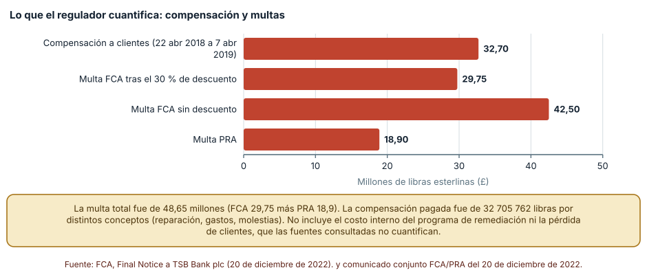
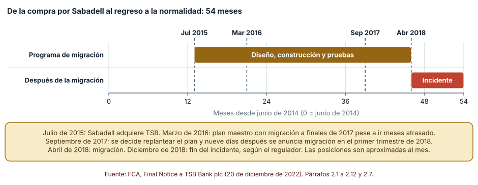

# TSB (2018): una migración de plataforma sin vuelta atrás

> **Qué es esta página.** Un caso de estudio de fallo: la realidad frente a la teoría del curso. No es una clase ni un rol. Separa lo que las fuentes **documentan**, lo que este análisis **infiere** y lo que **no se sabe**. Habla de decisiones, procesos y sistemas, no de personas. Fecha de consulta de todas las fuentes: 16 de noviembre de 2026.

**Resumen.** El fin de semana del 20 al 22 de abril de 2018, el banco británico TSB migró a una plataforma informática nueva. Desde el primer día fallaron la banca por internet y móvil, el teléfono y las sucursales; el banco no volvió a la normalidad hasta el 10 de diciembre de 2018. Los reguladores británicos concluyeron en 2022 que, aunque las causas técnicas directas fueron de configuración, capacidad y código, hubo fallos de planificación, pruebas, gestión de riesgos, externalización y preparación para la crisis. Multaron a TSB con 48,65 millones de libras.

## 1. Ficha histórica

| Dato | Detalle | Fuente |
| --- | --- | --- |
| Organización | TSB Bank plc, banco minorista del Reino Unido; sede registrada en 20 Gresham Street, Londres | FCA, Final Notice |
| Origen | Creado por la escisión de Lloyds Banking Group (LBG) en junio de 2014 | FCA, 2.1 |
| Propietario en 2018 | Banco Sabadell, que adquirió TSB en julio de 2015 | FCA, 2.2 |
| Proveedor de la nueva plataforma | SABIS (filial de Sabadell), que debía diseñar, construir, probar, migrar los datos y operar | FCA, 2.4 |
| Incidente | Migración principal del 20 al 22 de abril de 2018; en producción desde el 22 de abril | FCA, 2.5 |
| Magnitud | Todas las sucursales y una proporción significativa de los 5,2 millones de clientes afectados; 225 492 quejas (≈ 4,3 % de la base) entre el 22 de abril de 2018 y el 7 de abril de 2019; 32 705 762 libras de compensación | FCA, 2.8; comunicado FCA/PRA |
| Fin del incidente | TSB no volvió a la normalidad operativa («business as usual») hasta el 10 de diciembre de 2018 | FCA, 2.7 |
| Sanción | 48,65 millones de libras (FCA 29,75 con un 30 % de descuento sobre 42,5; PRA 18,9), el 20 de diciembre de 2022 | FCA, Final Notice; comunicado conjunto |
| Revisión independiente | Informe de Slaughter and May encargado por el consejo de TSB y publicado el 19 de noviembre de 2019; TSB declaró que hay aspectos con los que el consejo no está de acuerdo | TSB, comunicado de prensa |

Las fuentes consultadas no atribuyen responsabilidades a personas concretas por su nombre en los pasajes que respaldan este caso; este análisis tampoco lo hace. Una nota sobre las fuentes: el informe de Slaughter and May se publicó como un PDF escaneado de unas 260 páginas, de modo que no se pudo extraer su texto para comprobar citas; por eso las afirmaciones técnicas de esta página se apoyan en el Final Notice de la FCA y en el comunicado conjunto, que sí se leyeron íntegros.

## 2. Contexto y objetivo del sistema

Tras la escisión, TSB siguió recibiendo sus servicios informáticos de la plataforma de Lloyds bajo un contrato de externalización que le permitía usarla hasta julio de 2024, con opción de salir mediante una copia operada por un tercero o una plataforma completamente nueva (FCA, 2.1). Cuando Sabadell compró TSB, parte de la lógica de negocio era migrar los servicios a Proteo, la plataforma bancaria de Sabadell, con la expectativa de rendimientos financieros; el objetivo era migrar a finales de 2017 (FCA, 2.2). El sistema objetivo era una versión nueva, **Proteo4UK**, adaptada al mercado británico, creada en gran parte a partir de la plataforma española ya existente pero «aún no probada» en su versión británica (FCA, 2.3).

## 3. Mercado, usuarios afectados y casos de uso

- **Clientes:** 5,2 millones; todas las sucursales y una parte significativa de los clientes afectados por los problemas iniciales (comunicado FCA/PRA).
- **Casos de uso afectados:** acceso a la cuenta y uso de la banca por internet y móvil, banca telefónica, tecnología de sucursales, pagos y operaciones con tarjeta de débito, además de «ciertas brechas de datos» (FCA, 2.5).
- **Clientes vulnerables:** el sistema previo solo registraba algunas categorías de clientes vulnerables, y la falta de preparación aumentó el estrés de algunos (FCA, 2.31).
- **Mercado:** banca minorista del Reino Unido; la migración servía, según la FCA, a la estrategia de su nuevo propietario (FCA, 2.2). Qué cuota de mercado tenía no consta en las fuentes consultadas.

## 4. Cómo funcionaba el sistema, de principio a fin

1. Hasta abril de 2018, los clientes de TSB usaban canales (internet, móvil, teléfono, sucursal) respaldados por la plataforma de Lloyds.
2. Entre 2015 y 2018, TSB diseñó, construyó y probó Proteo4UK con SABIS, que se apoyaba en **85 terceros** (que para TSB eran «cuartas partes») para entregar los sistemas y operar la plataforma, actuando como agregador de servicios (FCA, 2.22).
3. Durante el fin de semana de la **Main Migration Event** (MME), TSB migró la mayoría de las operaciones, los servicios y los datos de clientes a Proteo4UK (FCA, 2.5).
4. Tras la migración, **no podía volver a la plataforma de Lloyds**: dependía de SABIS, como proveedor externalizado, para arreglar múltiples incidentes (FCA, 2.27).

**Cómo leer la figura.** A la izquierda el estado anterior y a la derecha el posterior; la flecha es el fin de semana de migración. Mira la caja oscura: la ausencia de retorno cambia el tipo de riesgo del proyecto. **Dónde deja de valer:** es un esquema de responsabilidades, no de componentes internos; el Final Notice no describe la arquitectura técnica de Proteo4UK.

## 5. Negocio y economía: qué estaba en juego

Estaba en juego la lógica económica de la adquisición: migrar a Proteo era parte del rendimiento financiero esperado de Sabadell (FCA, 2.2). La fecha, además, se había hecho **pública**: la meta de fin de 2017 era conocida, y el banco la mantuvo en el plan maestro de marzo de 2016 pese a llevar meses de retraso (FCA, 2.10). Del lado del costo, el regulador cuantifica la compensación (32,7 millones de libras) y las multas (48,65 millones), y nada más; el costo interno de la remediación y el efecto sobre los clientes no se cuantifican en las fuentes consultadas.

**Cómo leer la figura.** Cada barra es una cantidad en millones de libras y la escala parte de cero. Mira que la compensación a clientes y la multa de la FCA son del mismo orden. **Dónde deja de valer:** no es el costo total del incidente; faltan el gasto de remediación, la pérdida de clientes y el efecto sobre la marca, que no están cuantificados en las fuentes consultadas.

## 6. Arquitectura y esquemas

Tres decisiones arquitectónicas y de gobierno condicionan todo lo demás.

- **Migración casi total en una sola ventana (big bang).** La MME migró «la mayoría» de las operaciones, servicios y datos en un fin de semana.
- **Plataforma nueva para el mercado británico y proveedor sin experiencia en subcontratistas del Reino Unido.** SABIS tenía experiencia con Proteo en España, pero no gestionando entregas de servicio con muchos subcontratistas británicos (FCA, 2.16, 2.3).
- **Documentación de diseño sustituida por documentos de configuración.** En lugar de exigir documentación de diseño, TSB aceptó que SABIS entregara documentos de configuración que no permitían verificar que la infraestructura se había construido conforme al diseño original; en febrero de 2018 decidió no exigir la totalidad de ellos (FCA, 2.21).

**Cómo leer la figura.** Cada caja es un canal o un efecto y cada flecha una transferencia de carga. Mira que no hay un solo punto de fallo sino un efecto dominó entre canales. **Dónde deja de valer:** la cascada la describe la FCA en términos cualitativos; no hay en las fuentes consultadas una cifra de llamadas abandonadas ni tiempos de espera.

## 7. Línea de tiempo del incidente

| Fecha | Hecho documentado |
| --- | --- |
| Junio de 2014 | Escisión de TSB de Lloyds Banking Group |
| Julio de 2015 | Sabadell adquiere TSB; objetivo: migrar a Proteo a finales de 2017 |
| Marzo de 2016 | Plan maestro integrado, ya con retraso de meses y planificado de izquierda a derecha |
| 20 de septiembre de 2017 | El banco decide replantear el programa; nueve días después anuncia públicamente que migrará en el primer trimestre de 2018 |
| Febrero de 2018 | Se reduce el alcance de pruebas no funcionales en configuración «activo-activo» de los centros de datos, fuera del foro de gobierno adecuado; cambio de quién atestigua los requisitos no funcionales; se decide no exigir toda la documentación de configuración |
| Víspera de la decisión de migrar | Las pruebas terminan el día antes de tomar la decisión |
| 20 a 22 de abril de 2018 | Evento principal de migración (MME) |
| 22 de abril de 2018 | Puesta en producción; fallos de acceso, servicios digitales, teléfono y sucursales |
| 24 de abril de 2018 | TSB publica el mensaje de que nadie «quedará con pérdidas» por estos problemas |
| Mayo de 2018 | Programa «Putting Things Right» |
| 10 de diciembre de 2018 | Retorno a la normalidad operativa |
| 7 de abril de 2019 | Cierre del periodo en que se cuentan 225 492 quejas |
| 19 de noviembre de 2019 | Se publica la revisión independiente de Slaughter and May |
| 20 de diciembre de 2022 | Final Notice de la FCA y sanción conjunta FCA/PRA |

**Cómo leer la figura.** El eje son meses desde junio de 2014; las líneas discontinuas son hitos del plan y la barra roja el periodo del incidente. Mira la proporción: casi tres años de preparación frente a ocho meses de crisis. **Dónde deja de valer:** las posiciones son aproximadas al mes y el comienzo de la barra de programa se fija en la adquisición, no en el inicio de ningún trabajo técnico concreto.

## 8. Qué falló en cada instancia

**Documentado por el regulador.**

- **Causas técnicas directas.** «Problemas con la configuración informática, la capacidad y el código» (FCA, 2.9). Un problema de configuración de ciertos componentes de los centros de datos causó la falta de disponibilidad de la banca por internet y móvil durante periodos posteriores a la migración (FCA, 2.14).
- **Planificación.** Plan maestro «insuficientemente de izquierda a derecha»; plan de reajuste («Defender Plan») también; se cumplió la fecha aplazando funcionalidad o poniendo soluciones manuales (FCA, 2.10 a 2.12).
- **Pruebas.** Las fases de prueba no siguieron los plazos del plan; algunas corrieron en paralelo o cambiaron de alcance; concluyeron el día antes de la decisión (FCA, 2.13). Se redujo una prueba no funcional clave y no se identificaron ni informaron los riesgos de no hacerla (FCA, 2.14).
- **Gobierno de pruebas.** Cambio en febrero de 2018 de quién atestigua los requisitos no funcionales sin llamar explícitamente la atención del consejo (FCA, 2.15).
- **Riesgos y externalización.** Sin evaluación formal y completa de la capacidad de SABIS al inicio ni después; riesgos de incumplimiento del proveedor no identificados; dependencia de 85 terceros sin visibilidad suficiente; confirmaciones de terceros críticos aceptadas parcialmente (FCA, 2.16 a 2.25).
- **Continuidad y crisis.** Sin vuelta atrás; planes de incidentes pensados para 48 horas y ejercicios de pocos días; sin estrategia de comunicación a clientes ni de ampliación de recursos para quejas; casi 12 meses para gestionar las quejas (FCA, 2.26 a 2.31).

**Inferido (análisis propio).** El patrón es de **presión de fecha convertida en recorte de verificación**, el mismo que en [HealthCare.gov](healthcare-gov.md), con un agravante propio: la irreversibilidad. Con migración en un solo evento y sin retorno, el costo de un error de verificación es máximo. La FCA recoge que, en opinión de TSB, el banco no habría decidido proceder si hubiera considerado posible un incidente de esa escala (FCA, 2.26); este análisis añade que el regulador sí encontró que las preparaciones no estaban a la altura de ese escenario.

**No se sabe (por las fuentes consultadas).** Cuántas personas estuvieron exactamente sin acceso y durante cuánto tiempo cada una; el costo interno total para TSB; el reparto de causas dentro del informe de Slaughter and May, cuyo texto no se pudo extraer.

## 9. Las mejoras que debieron hacerse (análisis propio apoyado en la fuente)

**Cómo leer la figura.** Cada tarjeta tiene a la izquierda una decisión documentada, a la derecha la mejora propuesta y debajo la razón. En esta figura el verde marca la mejora propuesta; la leyenda de colores de la parte superior es genérica de las tarjetas y aquí no clasifica veredictos. **Dónde deja de valer:** son propuestas didácticas; migrar por oleadas tiene un costo propio de coexistencia y datos duplicados que no se evalúa aquí.

| Área | Mejora | Qué enseña el curso |
| --- | --- | --- |
| Migración | Por oleadas con **vuelta atrás probada**; doble escritura o coexistencia mientras se verifica | SE-437, SE-439, SE-440, SE-444 |
| Datos | Ensayos de migración con datos reales y reconciliación; migraciones compatibles | SE-318, SE-321, SE-439 |
| Pruebas | Criterios de salida; no recortar la prueba de carga ni de configuración | SE-361, SE-375, SE-364 |
| Planificación | Estimaciones con rango y supuestos; no anunciar fecha antes de replanificar | SE-185, SE-191, SE-449 |
| Proveedores | Diligencia formal del proveedor y de sus subcontratistas; ejercicios conjuntos de incidente | SE-451, SE-452 |
| Continuidad | Planes para semanas, no horas; ejercicios que incluyan al proveedor | SE-430, SE-427 |
| Incidentes y clientes | Comunicación proactiva; ampliar capacidad de contacto y gestión de quejas | SE-428, SE-429 |
| Gobierno | Decisiones reversibles frente a irreversibles; atestación de requisitos con el consejo informado | SE-142, SE-450 |

## 10. Vínculo con el curso

- [SE-437 · Strangler, branch by abstraction y anticorruption](../../classes/part-36-mantenimiento-y-modernizacion-legacy/se-437-strangler-branch-by-abstraction-y-anticorruption/), [SE-439 · Migraciones de datos sin interrupción](../../classes/part-36-mantenimiento-y-modernizacion-legacy/se-439-migraciones-de-datos-sin-interrupcion/), [SE-440 · Compatibilidad, coexistencia y doble escritura](../../classes/part-36-mantenimiento-y-modernizacion-legacy/se-440-compatibilidad-coexistencia-y-doble-escritura/) y [SE-444 · Migración incremental reversible](../../classes/part-36-mantenimiento-y-modernizacion-legacy/se-444-proyecto-migracion-incremental-reversible/).
- [SE-318 · Migraciones compatibles y evolución de esquema](../../classes/part-26-datos-persistencia-y-recuperacion/se-318-migraciones-compatibles-y-evolucion-de-esquema/) y [SE-321 · Backups, restauración y pruebas de recuperación](../../classes/part-26-datos-persistencia-y-recuperacion/se-321-backups-restauracion-y-pruebas-de-recuperacion/).
- [SE-361 · Calidad por riesgo y propósito de las pruebas](../../classes/part-30-estrategia-y-tecnicas-de-prueba/se-361-calidad-por-riesgo-y-proposito-de-las-pruebas/) y [SE-375 · Carga, estrés, picos y endurance](../../classes/part-31-calidad-rendimiento-y-resiliencia/se-375-carga-estres-picos-y-endurance/).
- [SE-185 · Estimación por tamaño, rango y evidencia histórica](../../classes/part-15-procesos-planificacion-y-estimacion/se-185-estimacion-por-tamano-rango-y-evidencia-historica/) y [SE-449 · Estimación organizacional y compromisos](../../classes/part-37-gestion-liderazgo-y-practica-profesional/se-449-estimacion-organizacional-y-compromisos/).
- [SE-451 · Compras, proveedores y evaluación técnica](../../classes/part-37-gestion-liderazgo-y-practica-profesional/se-451-compras-proveedores-y-evaluacion-tecnica/).
- [SE-430 · Continuidad, disaster recovery y ejercicios](../../classes/part-35-observabilidad-sre-e-incidentes/se-430-continuidad-disaster-recovery-y-ejercicios/) y [SE-428 · Gestión de incidentes y comunicación](../../classes/part-35-observabilidad-sre-e-incidentes/se-428-gestion-de-incidentes-y-comunicacion/).
- [SE-142 · Decisiones reversibles e irreversibles](../../classes/part-11-economia-metricas-y-decisiones-de-producto/se-142-decisiones-reversibles-e-irreversibles/).

## 11. Qué aprender y qué no generalizar

**Aprender.**

1. Una migración sin vuelta atrás exige evidencia proporcional a esa irreversibilidad; decide la reversibilidad antes que la fecha.
2. Una fecha pública es una restricción de gobierno: debe replantearse con datos, no mantenerse por haberla anunciado.
3. Las pruebas que terminan el día antes de la decisión no informan la decisión.
4. Externalizar la ejecución no externaliza el riesgo: el banco sigue respondiendo ante sus clientes y reguladores.
5. Un incidente se mide en semanas; planifica canales, capacidad y comunicación para ese plazo.
6. La fuga de carga entre canales es un fallo de diseño, no de operación.

**No generalizar.**

- No prueba que las migraciones grandes deban evitarse ni que el reemplazo de plataforma sea mala idea; prueba que esta se ejecutó con riesgos mal gestionados.
- No prueba que Proteo o Sabadell sean tecnologías defectuosas: el regulador habla de configuración, capacidad y código de esta implantación.
- La sanción es de 2022 y se refiere a Principios de la FCA y de la PRA aplicables a esa entidad; no es una regla universal.
- No se atribuyen intenciones ni culpas a personas.

## 12. Fuentes

Todas consultadas el 16 de noviembre de 2026 y comprobadas con descarga directa (HTTP 200).

1. Financial Conduct Authority, *Final Notice* a TSB Bank plc, referencia 191240, 20 de diciembre de 2022. <https://www.fca.org.uk/publication/final-notices/tsb-bank-plc-2022.pdf>. Respalda todos los hechos marcados «FCA, n».
2. FCA y PRA, comunicado conjunto *TSB fined £48.65m for operational resilience failings*, 20 de diciembre de 2022. <https://www.fca.org.uk/news/press-releases/tsb-fined-ps4865m-operational-resilience-failings>. Respalda: 5,2 millones de clientes, todas las sucursales afectadas, 18,9 millones de la PRA y el total de 48,65.
3. TSB, *TSB Board publishes independent review of 2018 IT Migration*, 19 de noviembre de 2019. <https://www.tsb.co.uk/news-releases/slaughter-and-may/>. Respalda la publicación del informe de Slaughter and May y el desacuerdo parcial del consejo.
4. Slaughter and May, informe del *Independent Review* (PDF publicado por TSB). <https://www.tsb.co.uk/content/dam/tsb-public/documents/media-centre/Slaughter-and-May-final-report.pdf>. Descargable (HTTP 200) pero escaneado: no se extrajeron citas de él.
