# TSB Bank

[↑ Casos de fallo](README.md) · [← HealthCare.gov](healthcare-gov.md) · [Caída global de Meta →](meta-2021.md)

> **Qué es esta página.** Un caso de estudio de fallo: la realidad frente a la teoría del curso. No es una clase ni un rol. Separa lo que las fuentes **documentan**, lo que este análisis **infiere** y lo que **no se sabe**. Habla de decisiones, procesos y sistemas, no de personas. Fecha de consulta de todas las fuentes: 16 de noviembre de 2026.

**Cómo leer esta página.** Cada afirmación factual lleva su fuente («FCA, n» remite a los párrafos numerados del Final Notice de la FCA del 20 de diciembre de 2022; «TSB, 2019» al comunicado del banco del 19 de noviembre de 2019). Lo que no lleva fuente es análisis propio y está rotulado. Las figuras son dibujos propios, ninguna repite una tabla y todas dicen dónde dejan de valer. El caso se recorre en ocho niveles de zoom de la arquitectura, con tres escalas de tiempo y un análisis causal que separa lo documentado, lo inferido y lo que no se sabe., el banco británico TSB migró a una plataforma informática nueva. Desde el primer día fallaron la banca por internet y móvil, el teléfono y las sucursales; el banco no volvió a la normalidad hasta el 10 de diciembre de 2018. Los reguladores británicos concluyeron en 2022 que, aunque las causas técnicas directas fueron de configuración, capacidad y código, hubo fallos de planificación, pruebas, gestión de riesgos, externalización y preparación para la crisis. Multaron a TSB con 48,65 millones de libras. El caso es, además, un ejemplo claro de cómo se combinan tres cosas que el curso enseña por separado: una migración sin vuelta atrás, una dependencia fuerte de un proveedor con muchos subcontratistas y una decisión de «ir» tomada con evidencia que tenía salvedades. Aquí hay dos relatos sobre el mismo suceso, el del regulador y el del banco, y se muestran los dos.

## Ficha histórica

| Dato | Detalle | Fuente |
| --- | --- | --- |
| Organización | TSB Bank plc, banco minorista del Reino Unido; sede registrada en 20 Gresham Street, Londres | FCA, Final Notice |
| Origen | Creado por la escisión de Lloyds Banking Group (LBG) en junio de 2014 | FCA, 2.1 |
| Propietario en 2018 | Banco Sabadell, que adquirió TSB en julio de 2015 | FCA, 2.2 |
| Proveedor de la nueva plataforma | SABIS (filial de Sabadell), que debía diseñar, construir, probar, migrar los datos y operar | FCA, 2.4 |
| Incidente | Migración principal del 20 al 22 de abril de 2018; en producción desde el 22 de abril | FCA, 2.5 |
| Magnitud | Todas las sucursales y una proporción significativa de los 5,2 millones de clientes afectados; 225 492 quejas (≈ 4,3 % de la base) entre el 22 de abril de 2018 y el 7 de abril de 2019; 32 705 762 libras de compensación | FCA, 2.8; comunicado FCA/PRA |
| Fin del incidente | TSB no volvió a la normalidad operativa («business as usual») hasta el 10 de diciembre de 2018 | FCA, 2.7 |
| Sanción | 48,65 millones de libras (FCA 29,75 con un 30 % de descuento sobre 42,5; PRA 18,9), el 20 de diciembre de 2022 | FCA, Final Notice; comunicado conjunto |
| Revisión independiente | Informe de Slaughter and May encargado por el consejo de TSB y publicado el 19 de noviembre de 2019; TSB declaró que hay aspectos con los que el consejo no está de acuerdo | TSB, comunicado de prensa |

Las fuentes consultadas no atribuyen responsabilidades a personas concretas por su nombre en los pasajes que respaldan este caso; este análisis tampoco lo hace. Una nota sobre las fuentes: el informe de Slaughter and May se publicó como un PDF escaneado de unas 260 páginas, de modo que no se pudo extraer su texto para comprobar citas; por eso las afirmaciones técnicas de esta página se apoyan en el Final Notice de la FCA y en el comunicado conjunto, que sí se leyeron íntegros.

Dos datos más de la ficha. La FCA define como periodo relevante de su análisis del 16 de diciembre de 2015 al 10 de diciembre de 2018 (FCA, 3.1), es decir, desde el programa de migración hasta el regreso a la normalidad. Y el regulador concluyó que TSB incumplió dos principios de la regulación británica: el Principio 2 (diligencia, cuidado y pericia, por la gestión de la externalización con SABIS) y el Principio 3 (organizarse y controlarse de forma responsable y eficaz, con sistemas adecuados de gestión de riesgos) (FCA, 2.33 y 2.34).

### Sedes, oficinas y entidades

El Final Notice da una sola sede: el domicilio registrado de TSB Bank plc en 20 Gresham Street, Londres. Las entidades que aparecen son TSB Bank plc (el banco), TSB Banking Group plc (el holding), Banco de Sabadell, S.A. (el propietario) y SABIS: Sabadell Information Systems, S.A. (SABIS Spain) y Sabadell Information Systems Limited (SABIS UK) (FCA, definiciones). **No se sabe** en las fuentes consultadas: el número de sucursales, la plantilla, el número de oficinas o países de SABIS y la ubicación de los centros de datos.

### Organización y responsabilidades

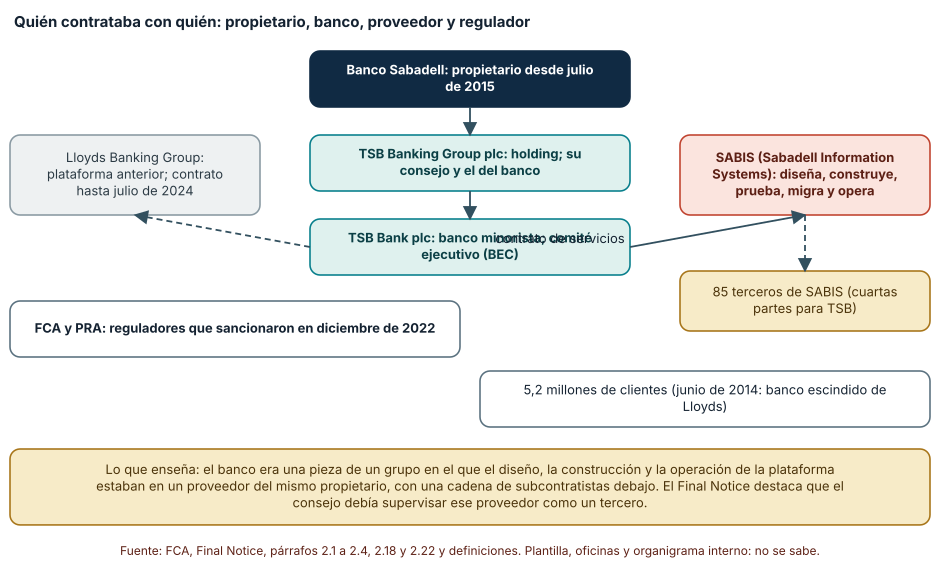

**Cómo leer la figura.** De arriba abajo: propietario, holding, banco; a los lados, la plataforma anterior y el proveedor con su cadena de terceros. Mira la flecha de contrato de servicios: toda la plataforma nueva dependía de ella. **Dónde deja de valer:** no es un organigrama interno; las fuentes no lo publican.

La FCA describe que el consejo de TSB (los consejos de TSB y de TSBBG) y el comité ejecutivo (BEC) tenían papeles distintos: las funciones del BEC atestiguaban sus requisitos no funcionales y la función de TI atestiguaba qué se había probado; el consejo y sus subcomités debían decidir con esa información (FCA, 2.15). El contrato con SABIS se articulaba en un acuerdo marco de servicios (MSA) y un acuerdo de servicios de operación (OSA) (FCA, 2.34). El análisis se hace sobre funciones y decisiones, no sobre personas.

### Visión y misión

Este caso no cita una declaración de visión o misión de TSB: las fuentes consultadas no la contienen y no se pudo verificar una versión consultable el 16 de noviembre de 2026. La lógica estratégica documentada es otra: Sabadell compró TSB en 2015 con la expectativa de rendimientos financieros de migrar los servicios a su plataforma Proteo (FCA, 2.2).

## Contexto y problema

Tras la escisión, TSB siguió recibiendo sus servicios informáticos de la plataforma de Lloyds bajo un contrato de externalización que le permitía usarla hasta julio de 2024, con opción de salir mediante una copia operada por un tercero o una plataforma completamente nueva (FCA, 2.1). Cuando Sabadell compró TSB, parte de la lógica de negocio era migrar los servicios a Proteo, la plataforma bancaria de Sabadell, con la expectativa de rendimientos financieros; el objetivo era migrar a finales de 2017 (FCA, 2.2). El sistema objetivo era una versión nueva, **Proteo4UK**, adaptada al mercado británico, creada en gran parte a partir de la plataforma española ya existente pero «aún no probada» en su versión británica (FCA, 2.3).

### Por qué migrar (documentado)

Tras la escisión de 2014, TSB recibía sus servicios informáticos de la plataforma de Lloyds en virtud de un acuerdo de externalización que le permitía seguir hasta 10 años, hasta julio de 2024, o salir por una de dos vías: una copia de la plataforma operada por un tercero o una plataforma completamente nueva (FCA, 2.1). Seguir en la plataforma de Lloyds era una dependencia de un antiguo propietario y un coste recurrente. Cuando Sabadell compró TSB en julio de 2015, la lógica estratégica incluía los rendimientos financieros esperados de migrar los servicios a Proteo, su plataforma, con la meta de hacerlo a finales de 2017 (FCA, 2.2).

### Qué hacía difícil el proyecto (documentado)

La FCA califica la escala de «sin precedentes» y como ambiciosa en un plazo de menos de tres años para una plataforma de nueva construcción en el Reino Unido. Sabadell tenía poca experiencia en banca minorista británica y, aunque tenía mucha en entregar una plataforma mayor y más compleja en España, la migración requería una versión nueva de Proteo, aún no probada, adaptada al mercado británico, con mucha personalización y un gran número de proveedores externos (FCA, 2.3). El proveedor, SABIS, no tenía experiencia gestionando la entrega de servicios con muchos subcontratistas británicos (FCA, 2.16).

### La apuesta y el relato del banco

El banco sostenía que no migraría hasta estar listo (FCA, 2.10). El 19 de noviembre de 2019, el consejo de TSB publicó la revisión independiente que encargó a Slaughter and May y declaró que los hallazgos eran del despacho; que el proyecto implicó más de cuatro años de planificación y pruebas; que la migración se hizo por etapas, con ATM, pagos con tarjeta, hipotecas y la app móvil antes del evento principal; y que el consejo no compartía algunos aspectos del informe, en particular porque una causa clave de la magnitud fue que los dos centros de datos se configuraron de forma inconsistente en ciertas áreas pese a haberse especificado idénticos, además de problemas de código y capacidad (TSB, 2019). Es un relato legítimo y no incompatible con el del regulador: ambos reconocen causas técnicas; difieren en cuánto peso dar a la planificación y la supervisión del proveedor.

## Mercado, usuarios y casos de uso

- **Clientes:** 5,2 millones; todas las sucursales y una parte significativa de los clientes afectados por los problemas iniciales (comunicado FCA/PRA).
- **Casos de uso afectados:** acceso a la cuenta y uso de la banca por internet y móvil, banca telefónica, tecnología de sucursales, pagos y operaciones con tarjeta de débito, además de «ciertas brechas de datos» (FCA, 2.5).
- **Clientes vulnerables:** el sistema previo solo registraba algunas categorías de clientes vulnerables, y la falta de preparación aumentó el estrés de algunos (FCA, 2.31).
- **Mercado:** banca minorista del Reino Unido; la migración servía, según la FCA, a la estrategia de su nuevo propietario (FCA, 2.2). Qué cuota de mercado tenía no consta en las fuentes consultadas.

### Quién usaba qué canal y qué se rompió para cada uno

| Usuario o canal | Qué necesitaba | Qué ocurrió | Fuente |
| --- | --- | --- | --- |
| Cliente digital (internet y móvil) | Acceder a la cuenta, ver saldo, pagar | Fallos de disponibilidad por periodos tras la migración; problema de configuración en ciertos componentes de los centros de datos | FCA, 2.5, 2.14 |
| Cliente que llama | Resolver lo que no podía hacer en digital | Tiempos de espera mayores y llamadas abandonadas; sobrecarga de telefonía con volumen sin precedentes que superó la capacidad y el personal planificados | FCA, 2.6, 2.31 |
| Cliente en sucursal | Atención presencial | Colas largas y servicios lentos por fallos de tecnología de sucursal | FCA, 2.6 |
| Pagos y tarjetas de débito | Pagar y retirar | Problemas consecuentes con pagos y transacciones con tarjeta de débito | FCA, 2.5 |
| Cliente vulnerable | Atención adecuada en un incidente largo | Los sistemas previos solo registraban algunas categorías; la falta de preparación aumentó el estrés de algunos | FCA, 2.31 |
| Cliente con una queja | Que se resuelva | 225 492 quejas; casi doce meses para gestionarlas | FCA, 2.8, 2.31 |

La FCA habla también de «ciertas brechas de datos» entre los problemas iniciales (FCA, 2.5). Las fuentes consultadas no detallan su naturaleza ni su número; este caso no lo inventa.

## Funcionalidad de principio a fin

1. Hasta abril de 2018, los clientes de TSB usaban canales (internet, móvil, teléfono, sucursal) respaldados por la plataforma de Lloyds.
2. Entre 2015 y 2018, TSB diseñó, construyó y probó Proteo4UK con SABIS, que se apoyaba en **85 terceros** (que para TSB eran «cuartas partes») para entregar los sistemas y operar la plataforma, actuando como agregador de servicios (FCA, 2.22).
3. Durante el fin de semana de la **Main Migration Event** (MME), TSB migró la mayoría de las operaciones, los servicios y los datos de clientes a Proteo4UK (FCA, 2.5).
4. Tras la migración, **no podía volver a la plataforma de Lloyds**: dependía de SABIS, como proveedor externalizado, para arreglar múltiples incidentes (FCA, 2.27).

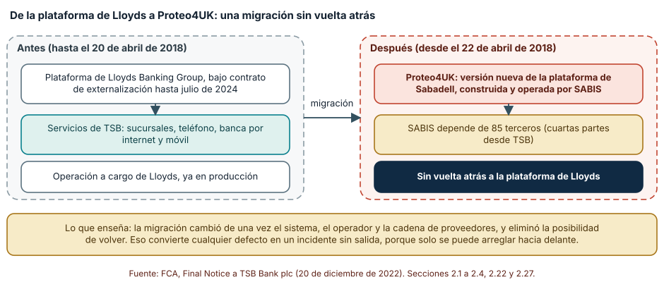

**Cómo leer la figura.** A la izquierda el estado anterior y a la derecha el posterior; la flecha es el fin de semana de migración. Mira la caja oscura: la ausencia de retorno cambia el tipo de riesgo del proyecto. **Dónde deja de valer:** es un esquema de responsabilidades, no de componentes internos; el Final Notice no describe la arquitectura técnica de Proteo4UK.

### El mismo cambio visto por cada actor

1. **Cliente.** Hasta abril de 2018 usaba internet, móvil, teléfono y sucursal; el 22 de abril se encontró con una plataforma nueva sin que, desde su punto de vista, hubiera ninguna elección. Para el cliente la migración no tiene fase de prueba: pasa de una vez a producción real con su dinero.
2. **TSB.** Entre 2015 y 2018 diseñó, construyó y probó la plataforma con SABIS, definió un plan maestro y un replan, estableció una estructura de incidentes de tres niveles (Bronze, Silver y Gold) y decidió operar el evento principal como un incidente Gold (FCA, 2.4, 2.10 a 2.12, 2.29).
3. **SABIS.** Diseñaba, construía, probaba, migraba los datos y operaba la plataforma; dependía de 85 terceros y actuaba como agregador de servicios (FCA, 2.4, 2.22).
4. **Consejo.** Tomó la decisión de migrar tras considerar documentación de gobierno que analizaba si las pruebas cumplían los requisitos; una carta de SABIS y las confirmaciones de sus cuatro terceros críticos eran referencias importantes (FCA, 2.15, 2.24).
5. **Regulador.** Intervino después: la FCA y la PRA investigaron y sancionaron en diciembre de 2022, más de cuatro años después.

### Qué se había migrado antes del evento principal (según TSB)

Según el banco, antes del evento principal se habían movido por etapas ATM, pagos con tarjeta de débito y crédito, hipotecas y la app móvil, y luego sistemas internos clave (TSB, 2019). La FCA señala una limitación de esa evidencia: la auditoría de los servicios que ya estaban en vivo no identificó con claridad que eran técnicamente menos complejos y tenían una cadena de suministro más limitada que lo que se iba a poner en marcha en el evento principal (FCA, 2.23). Es una buena muestra de un límite de la evidencia de «ya funciona»: lo que se prueba en pequeño no prueba lo que se hace en grande.

## Negocio y economía

Estaba en juego la lógica económica de la adquisición: migrar a Proteo era parte del rendimiento financiero esperado de Sabadell (FCA, 2.2). La fecha, además, se había hecho **pública**: la meta de fin de 2017 era conocida, y el banco la mantuvo en el plan maestro de marzo de 2016 pese a llevar meses de retraso (FCA, 2.10). Del lado del costo, el regulador cuantifica la compensación (32,7 millones de libras) y las multas (48,65 millones), y nada más; el costo interno de la remediación y el efecto sobre los clientes no se cuantifican en las fuentes consultadas.

**Cómo leer la figura.** Cada barra es una cantidad en millones de libras y la escala parte de cero. Mira que la compensación a clientes y la multa de la FCA son del mismo orden. **Dónde deja de valer:** no es el costo total del incidente; faltan el gasto de remediación, la pérdida de clientes y el efecto sobre la marca, que no están cuantificados en las fuentes consultadas.

### Impacto en cifras, con fuente

| Dimensión | Cifra | Fuente |
| --- | --- | --- |
| Clientes | 5,2 millones; todas las sucursales y una proporción significativa de clientes afectados | Comunicado FCA/PRA, 20 de diciembre de 2022 |
| Quejas | 225 492 entre el 22 de abril de 2018 y el 7 de abril de 2019 (≈ 4,3 % de la base en la migración) | FCA, 2.8 |
| Compensación | 32 705 762 libras, incluidos pagos por molestias, gastos de clientes y reposición de su situación | FCA, 2.8, 2.32 |
| Duración | Hasta el 10 de diciembre de 2018, casi ocho meses | FCA, 2.7 |
| Multa | 48,65 millones: FCA 29,75 (tras un 30 % de descuento sobre 42,5) y PRA 18,9 | FCA, Final Notice; comunicado conjunto |
| Plazo de gestión de quejas | Casi 12 meses | FCA, 2.31 |
| Plazo hasta la sanción | Del incidente (abril de 2018) a la sanción (diciembre de 2022), más de cuatro años | FCA, Final Notice |

### Reacción de la organización y de los reguladores

- **TSB.** El 24 de abril de 2018 publicó que nadie «quedará con pérdidas» por esos problemas; en mayo creó el programa «Putting Things Right»; destinó recursos adicionales, con terceros, a las quejas (FCA, 2.32). En 2019 dijo haber compensado a todo cliente elegible, haber cambiado estructuras de liderazgo y gestión y decidido asumir el control directo de sus operaciones de TI (TSB, 2019).
- **FCA y PRA.** Sancionaron conjuntamente en 2022 y señalaron fallos de planificación, pruebas, gestión de riesgos, externalización y preparación para la crisis (FCA, 2.9; comunicado FCA/PRA).
- **Atención pública.** El incidente atrajo cobertura mediática, intervención regulatoria e interés parlamentario (FCA, 2.8). Las fuentes consultadas no cuantifican el efecto reputacional ni la pérdida de clientes.
- **Sabadell.** Las fuentes consultadas no dan información sobre el efecto en la matriz.

**Lo que cuesta el control y lo que cuesta su ausencia (análisis propio).** Un ensayo adicional de la configuración activo-activo costaba días de pruebas sobre servicios en vivo y un riesgo acotado; las consecuencias de no hacerlo se midieron en meses de incidente, 32,7 millones de compensación y la sanción. La asimetría es la misma que en otros casos: el coste de verificar es visible y inmediato, el de no verificar es probabilístico y diferido.

### Esquema de la operación: valor, ingresos y flujos

TSB es un banco minorista del Reino Unido: sus clientes usan cuentas, pagos y tarjetas por cuatro canales (internet y móvil, teléfono, sucursal y tarjetas) y el banco obtiene sus ingresos de la actividad bancaria; el desglose de ingresos de TSB no está en las fuentes consultadas. El flujo de servicio es de la plataforma al canal; el flujo económico del proyecto es de TSB a SABIS por los servicios de diseño, construcción, migración y operación, con la expectativa de ahorro y rendimiento para el propietario (FCA, 2.2, 2.4). La compensación a clientes (32,7 millones de libras) y las multas son flujos de salida del incidente.

### Costos operativos y costo del incidente

| Rubro | Cifra | Fuente |
| --- | --- | --- |
| Compensación a clientes | 32 705 762 libras, incluidos pagos por molestias, gastos y reposición de situación | FCA, 2.8, 2.32 |
| Multa de la FCA | 29,75 millones (42,5 con un 30 % de descuento por acuerdo) | FCA, Final Notice |
| Multa de la PRA | 18,9 millones | Comunicado FCA/PRA |
| Quejas gestionadas | 225 492 (≈ 4,3 % de la base) entre el 22 de abril de 2018 y el 7 de abril de 2019 | FCA, 2.8 |
| Coste interno de remediación, programa y pérdidas por clientes | No se sabe en las fuentes consultadas | — |

La FCA identifica como hechos de costo solo los de compensación y sanción. Los recursos adicionales para quejas, incluidos terceros, se mencionan sin cifra (FCA, 2.32). El coste interno total y el efecto en resultados del banco o de Sabadell no se pueden dar sin una fuente verificada y no se inventan.

### Competidores y contexto de mercado

Las fuentes consultadas no hablan de competidores ni de cuota de mercado de TSB. Lo documentado del contexto: el banco se escindió de Lloyds en 2014 y siguió usando su plataforma hasta 2018 con opción hasta 2024 (FCA, 2.1); la estrategia del propietario preveía migrar a Proteo (FCA, 2.2). Qué ocurrió con los clientes o con los competidores tras el incidente no consta en las fuentes consultadas.

## Arquitectura y esquemas

Tres decisiones arquitectónicas y de gobierno condicionan todo lo demás.

- **Migración casi total en una sola ventana (big bang).** La MME migró «la mayoría» de las operaciones, servicios y datos en un fin de semana.
- **Plataforma nueva para el mercado británico y proveedor sin experiencia en subcontratistas del Reino Unido.** SABIS tenía experiencia con Proteo en España, pero no gestionando entregas de servicio con muchos subcontratistas británicos (FCA, 2.16, 2.3).
- **Documentación de diseño sustituida por documentos de configuración.** En lugar de exigir documentación de diseño, TSB aceptó que SABIS entregara documentos de configuración que no permitían verificar que la infraestructura se había construido conforme al diseño original; en febrero de 2018 decidió no exigir la totalidad de ellos (FCA, 2.21).

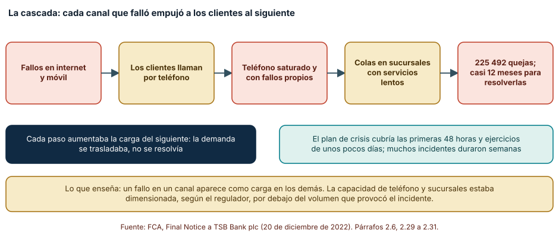

**Cómo leer la figura.** Cada caja es un canal o un efecto y cada flecha una transferencia de carga. Mira que no hay un solo punto de fallo sino un efecto dominó entre canales. **Dónde deja de valer:** la cascada la describe la FCA en términos cualitativos; no hay en las fuentes consultadas una cifra de llamadas abandonadas ni tiempos de espera.

La arquitectura se recorre en ocho niveles de zoom, cada uno con su figura. El nivel 1, el contexto, es la primera figura del caso (sección «Funcionalidad de principio a fin»). Las fuentes consultadas no publican la arquitectura técnica de Proteo4UK; los esquemas son modelos de responsabilidades y de efectos con los hechos del Final Notice.

### Nivel 2 · Contenedores

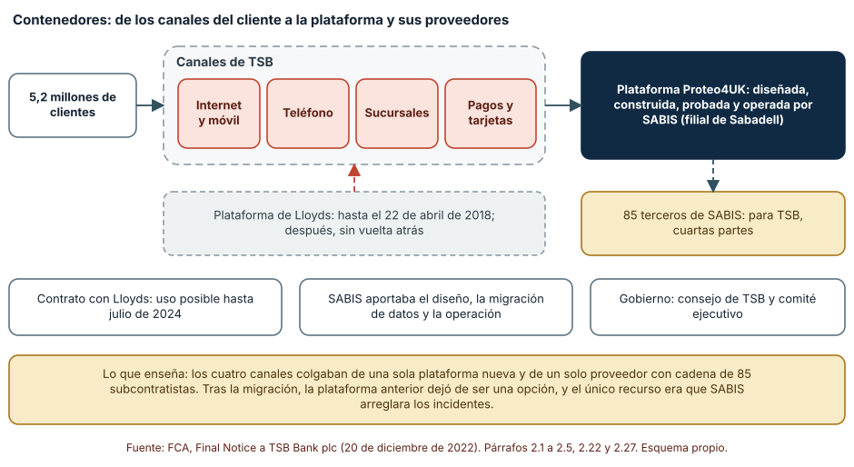

**Cómo leer la figura.** A la izquierda el cliente; en el centro los canales; a la derecha la plataforma nueva con su cadena de terceros; abajo, la plataforma anterior con una flecha roja discontinua que dice que ya no se podía volver. Mira que los cuatro canales dependen de la misma plataforma. **Dónde deja de valer:** es un esquema de responsabilidades; no muestra servidores ni redes ni el reparto interno de la plataforma.

### Nivel 3 · Componentes: qué fallaba en cada canal

La FCA describe una cascada: los fallos de los servicios digitales llevaron a los clientes a llamar; la telefonía sufrió fallos propios y una carga sin precedentes; los fallos de tecnología de sucursales y la demanda adicional produjeron colas (FCA, 2.6). El esquema de esa cascada está en la figura de la sección «Arquitectura y esquemas» inicial. Lo nuevo en este nivel es el origen técnico: el regulador sitúa las causas directas en configuración, capacidad y código (FCA, 2.9), y el propio banco subraya la configuración inconsistente de los dos centros de datos (TSB, 2019).

### Nivel 4 · Secuencia del flujo que falló

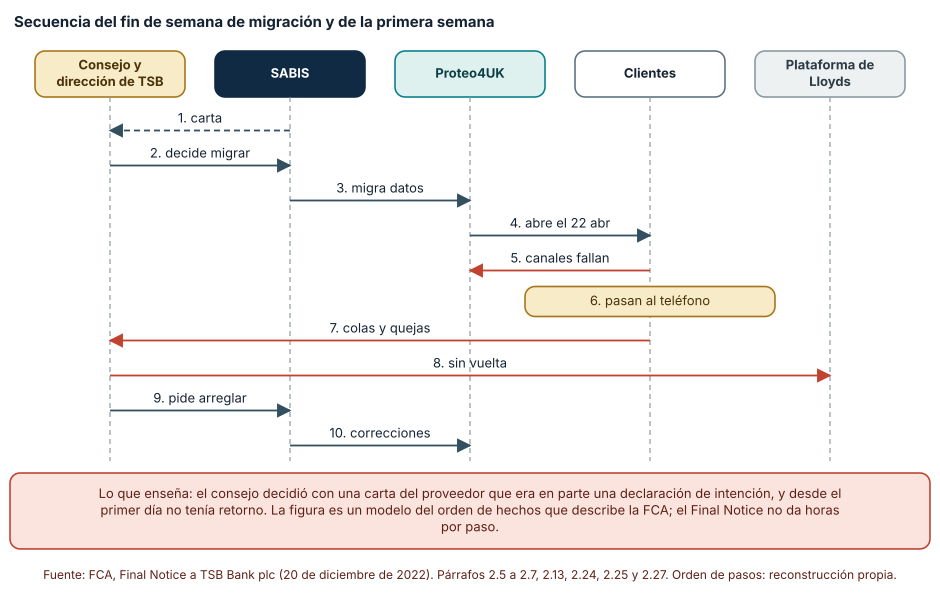

**Cómo leer la figura.** Cada columna es un actor; las flechas discontinuas son informes; las rojas, los hechos que agravan la situación. Mira la flecha 8: es la que convierte un fallo en crisis. **Dónde deja de valer:** el orden de pasos es una reconstrucción; la FCA no da horas por paso ni la secuencia exacta de fallos durante el fin de semana.

### Nivel 5 · Datos y ventana de migración

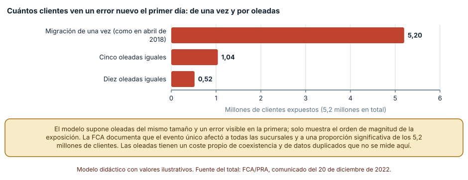

**Cómo leer la figura.** Cada barra es una estrategia de migración y su longitud, los clientes expuestos al primer error de la plataforma; la escala parte de cero. Mira la diferencia entre la barra roja y las otras: un orden de magnitud. **Dónde deja de valer:** es un modelo didáctico con oleadas iguales; la FCA no publica un plan de oleadas, y las oleadas tienen su propio coste de coexistencia y datos duplicados.

El Evento Principal de Migración movió la mayoría de las operaciones, de los servicios y de los datos de clientes en un fin de semana (FCA, 2.5). La FCA menciona «ciertas brechas de datos» entre los problemas iniciales (FCA, 2.5), y el propio banco habla de haber migrado los datos centrales y los registros de pago de unos cinco millones de clientes (TSB, 2019). El punto de datos clave del caso es la ventana: cuando migras todo a la vez, la exposición al primer error es de todos.

### Nivel 6 · Despliegue: dos centros de datos

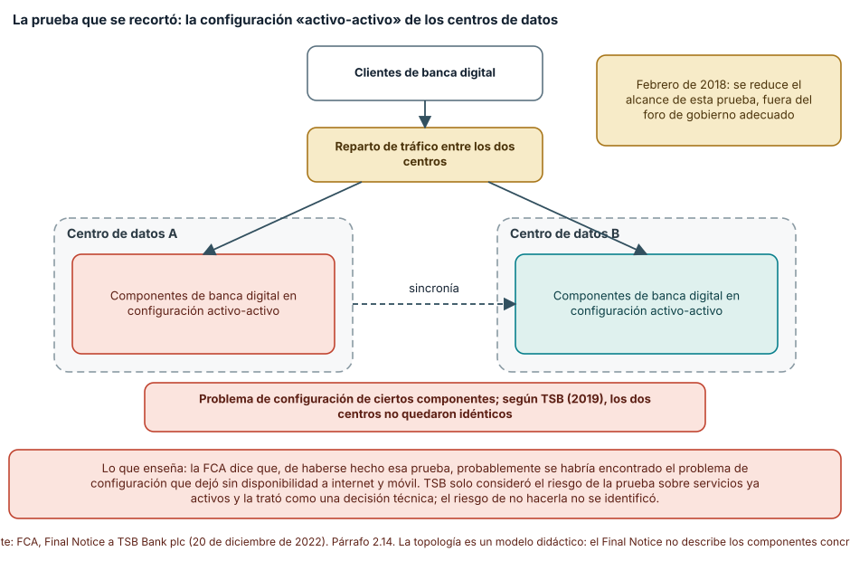

**Cómo leer la figura.** Arriba, los clientes y el reparto de tráfico; abajo, los dos centros; el recuadro dorado fecha la decisión que recortó la prueba y el coral, el problema sin detectar. Mira la flecha discontinua: el comportamiento conjunto es lo que se probaba. **Dónde deja de valer:** la topología es un modelo; el Final Notice no describe los componentes concretos. El relato del banco, que sitúa el origen en una configuración inconsistente entre los dos centros pese a una especificación idéntica, es de TSB (2019) y no una conclusión de la FCA.

La FCA es explícita: el alcance de un tipo de prueba no funcional de los canales digitales en configuración activo-activo se redujo a finales de febrero de 2018, fuera del foro de gobierno adecuado; de haberse hecho, es probable que se hubiera encontrado el problema de configuración que dejó sin disponibilidad la banca por internet y móvil. TSB solo consideró el riesgo de interrupción de servicios que ya estaban en vivo, la trató como una decisión puramente técnica y no identificó ni informó los riesgos de no hacerla (FCA, 2.14).

### Nivel 7 · Dependencias y puntos únicos de fallo

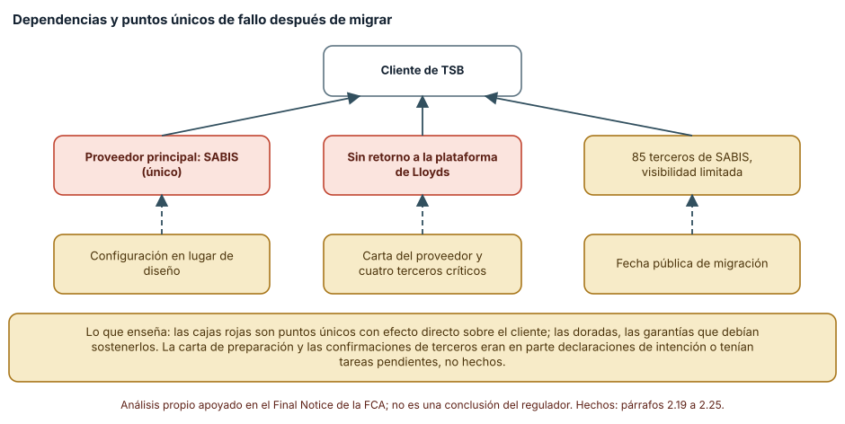

**Cómo leer la figura.** Las cajas rojas son puntos únicos de fallo con efecto sobre el cliente; las doradas, las garantías que debían sostenerlos. **Dónde deja de valer:** es análisis propio de la estructura que describe la FCA; no enumera otras dependencias (redes, proveedores de nube o de tarjetas) que las fuentes consultadas no tratan.

La FCA detalla la dependencia: TSB no hizo al inicio una diligencia formal y completa sobre la capacidad de SABIS pese a haber identificado que asegurar que los recursos combinados de TSB, Sabadell y Lloyds fueran capaces de entregar la migración era clave (FCA, 2.19); no identificó formalmente riesgos como que SABIS no pudiera entregar la plataforma en dos años (FCA, 2.20); no reevaluó la capacidad de SABIS tras los problemas de los servicios ya en vivo (FCA, 2.23); y no se aseguró de que el modelo de gestión de proveedores de SABIS estuviera desarrollado ni de tener visibilidad sobre los 85 subcontratistas (FCA, 2.22). La carta de SABIS y las confirmaciones de terceros críticos eran, en parte, declaraciones de intención o expectativa y casi todas tenían tareas o pruebas pendientes; TSB no pidió más garantía formal ni una confirmación actualizada (FCA, 2.24 y 2.25).

### Nivel 8 · Defensa en profundidad

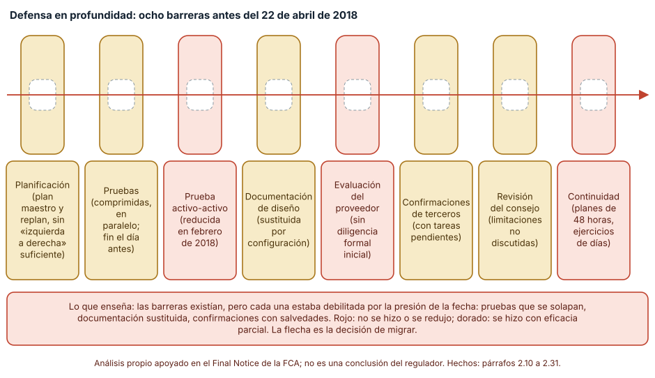

**Cómo leer la figura.** Cada lámina es una barrera; rojo: no se hizo o se redujo; dorado: existió con eficacia parcial. La flecha es la decisión de migrar. **Dónde deja de valer:** es una metáfora, no una medición; la lista de barreras sale del Final Notice y la agrupación en ocho es nuestra.

Resumen de las barreras con su deficiencia: **planificación**, plan maestro y replan «insuficientemente de izquierda a derecha» (2.11, 2.12); **pruebas**, no siguieron los plazos y se solaparon, terminando el día antes de decidir (2.13); **activo-activo**, reducida (2.14); **documentación**, configuración en vez de diseño y, en febrero, sin exigir toda (2.21); **proveedor**, sin diligencia formal (2.19); **confirmaciones**, con salvedades (2.25); **consejo**, limitaciones y cambios de responsabilidad no señalados (2.15, 2.17); **continuidad**, planes y ensayos para periodos cortos (2.28 a 2.30).

### Hardware utilizado

Las fuentes no describen el hardware. Lo único documentado es que había dos centros de datos en una configuración activo-activo para los canales digitales, y que ciertos componentes de esos centros estaban mal configurados (FCA, 2.14); el banco añade que los dos centros no quedaron idénticos pese a especificarse así (TSB, 2019). **No se sabe:** marcas, modelos, capacidad, ubicación y red de los centros.

### Software utilizado

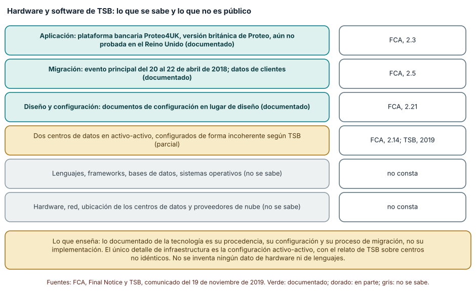

**Cómo leer la figura.** Cada fila es una capa técnica; verde: documentada; dorado: parcial; gris: no se sabe. Mira que lo documentado trata de procedencia y proceso, no de código. **Dónde deja de valer:** es el límite de lo público.

Proteo4UK es una versión nueva de la plataforma bancaria Proteo de Sabadell, adaptada al Reino Unido, construida en gran parte a partir de la plataforma española y aún no probada (FCA, 2.3 y definiciones). La plataforma anterior era la de Lloyds (FCA, 2.1). **No se sabe:** el stack técnico (lenguajes, bases de datos, sistemas operativos, middleware) y las herramientas de migración y despliegue.

### Infraestructura

Estaba a cargo de SABIS, que se apoyaba en 85 terceros, y no se podía volver a la plataforma de Lloyds tras la migración (FCA, 2.22, 2.27). La escala se conoce por los clientes (5,2 millones) y por el volumen de llamadas, que superó lo planificado (FCA, 2.31). **No se sabe:** si la infraestructura era propia, alquilada o híbrida, las regiones y las dependencias concretas.

### A prueba de fallos: qué existía, qué falló y qué debió existir

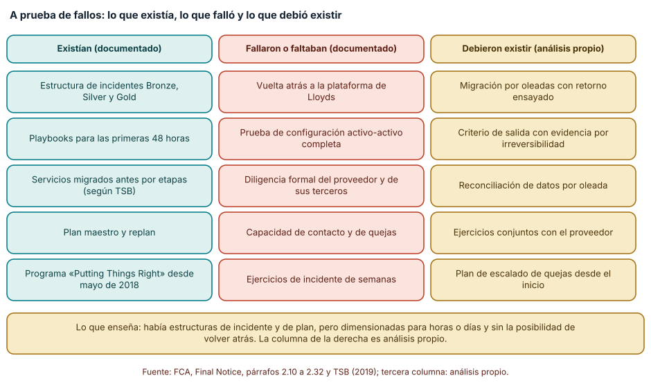

**Cómo leer la figura.** Verde azulado: lo que existía; coral: lo que falló o faltaba; dorado: análisis propio. **Dónde deja de valer:** no mide eficacia; las filas no se corresponden una a una.

Redundancia: dos centros de datos activo-activo, con una prueba reducida de esa configuración (FCA, 2.14). Conmutación y retorno: no había vuelta atrás a la plataforma de Lloyds (FCA, 2.27). Límites y despliegue gradual: algunos servicios se migraron antes (TSB, 2019), pero el evento principal movió la mayoría de las operaciones y datos (FCA, 2.5). Pruebas: terminaron el día antes de decidir (FCA, 2.13). Recuperación: estructura Bronze, Silver y Gold, playbooks de 48 horas y ejercicios de pocos días frente a incidentes de semanas (FCA, 2.29, 2.30). Qué debió existir: oleadas con retorno, evidencia según irreversibilidad y capacidad de quejas desde el inicio (análisis propio).

## Casos especiales y cómo fallan

- **Clientes vulnerables.** Los sistemas previos solo capturaban algunas categorías de clientes vulnerables y no se prepararon formas de identificarlos en un incidente largo, lo que añadió estrés a algunos (FCA, 2.31).
- **Brechas de datos y pagos.** Entre los problemas iniciales la FCA cita ciertas brechas de datos, fallos de banca digital y telefónica, de tecnología de sucursales y problemas consecuentes con pagos y tarjetas de débito (FCA, 2.5).
- **Funcionalidad aplazada y trabajos manuales.** La fecha de migración se cumplió aplazando funcionalidad bancaria o poniendo soluciones manuales (FCA, 2.12).
- **Incidentes largos.** Las guías de incidentes solo cubrían las primeras 48 horas y los ensayos del nivel «Gold» suponían resolver en pocos días, mientras que muchos eventos tardaron semanas (FCA, 2.29 y 2.30).
- **Quejas.** 225 492 quejas entre el 22 de abril de 2018 y el 7 de abril de 2019, casi 12 meses para resolverlas y 32 705 762 libras de compensación (FCA, 2.8, 2.31 y 2.32).
- **Recuperación y supervisión.** El 24 de abril TSB prometió que nadie quedaría con pérdidas, en mayo creó el programa «Putting Things Right» y el banco no volvió a la normalidad hasta el 10 de diciembre de 2018. Hubo atención mediática, regulatoria y parlamentaria (FCA, 2.7, 2.8 y 2.32).

- **Revisiones puntuales.** Algunas revisiones relacionadas con la migración tenían alcance limitado, se declaraban «puntuales» (que podían haber quedado superadas) o estaban matizadas, y esas limitaciones no se discutieron ni cuestionaron con el consejo en momentos clave (FCA, 2.17).
- **Evidencia de «ya funciona».** La auditoría de los servicios ya en vivo no distinguió con claridad que eran menos complejos que lo que iba a migrar en el evento principal (FCA, 2.23).
- **Cambio de quién atestigua.** En febrero de 2018 las funciones del comité ejecutivo seguían firmando sus requisitos no funcionales mientras la función de TI atestiguaba cuáles se habían probado; ese cambio de responsabilidad no parece haberse señalado explícitamente al consejo ni a sus subcomités, que no pudieron considerar si introducía riesgos (FCA, 2.15).
- **Aprendizaje interno cerrado.** Las revisiones de aseguramiento interno detectaron entre abril y noviembre de 2017 deficiencias en la gestión de incidentes, se consideraron de bajo impacto y las acciones se cerraron antes del evento principal, aparentemente sin considerar su efecto en un escenario de incidentes múltiples (FCA, 2.28). Las pruebas de gestión de incidentes eran limitadas porque había pocos servicios y pocos incidentes en vivo.
- **Ensayos que subestiman la duración.** Los ejercicios «Gold» suponían resolver incidentes en pocos días y eran solo para miembros del comité ejecutivo, sin considerar si bastaban para una crisis informática de varios órganos (FCA, 2.29); los playbooks cubrían solo las primeras 48 horas (FCA, 2.30).
- **Telefonía y quejas.** Los guiones pregrabados y las respuestas genéricas no reflejaban la experiencia real del cliente (FCA, 2.31); el volumen de llamadas superó la capacidad y el personal previstos; TSB tuvo planes de contingencia limitados para ampliar recursos de quejas.
- **Remediación.** Tras el incidente, TSB reforzó con terceros su gestión de quejas y pagó 32 705 762 libras de compensación (FCA, 2.32).

## Línea de tiempo

| Fecha | Hecho documentado |
| --- | --- |
| Junio de 2014 | Escisión de TSB de Lloyds Banking Group |
| Julio de 2015 | Sabadell adquiere TSB; objetivo: migrar a Proteo a finales de 2017 |
| Marzo de 2016 | Plan maestro integrado, ya con retraso de meses y planificado de izquierda a derecha |
| 20 de septiembre de 2017 | El banco decide replantear el programa; nueve días después anuncia públicamente que migrará en el primer trimestre de 2018 |
| Febrero de 2018 | Se reduce el alcance de pruebas no funcionales en configuración «activo-activo» de los centros de datos, fuera del foro de gobierno adecuado; cambio de quién atestigua los requisitos no funcionales; se decide no exigir toda la documentación de configuración |
| Víspera de la decisión de migrar | Las pruebas terminan el día antes de tomar la decisión |
| 20 a 22 de abril de 2018 | Evento principal de migración (MME) |
| 22 de abril de 2018 | Puesta en producción; fallos de acceso, servicios digitales, teléfono y sucursales |
| 24 de abril de 2018 | TSB publica el mensaje de que nadie «quedará con pérdidas» por estos problemas |
| Mayo de 2018 | Programa «Putting Things Right» |
| 10 de diciembre de 2018 | Retorno a la normalidad operativa |
| 7 de abril de 2019 | Cierre del periodo en que se cuentan 225 492 quejas |
| 19 de noviembre de 2019 | Se publica la revisión independiente de Slaughter and May |
| 20 de diciembre de 2022 | Final Notice de la FCA y sanción conjunta FCA/PRA |

**Cómo leer la figura.** El eje son meses desde junio de 2014; las líneas discontinuas son hitos del plan y la barra roja el periodo del incidente. Mira la proporción: casi tres años de preparación frente a ocho meses de crisis. **Dónde deja de valer:** las posiciones son aproximadas al mes y el comienzo de la barra de programa se fija en la adquisición, no en el inicio de ningún trabajo técnico concreto.

El caso tiene tres escalas: años (cómo se llegó al fin de semana de la migración), semanas y meses (el incidente y sus consecuencias) y el largo plazo (de la sanción).

### Antecedentes: decisiones y condiciones latentes, con año

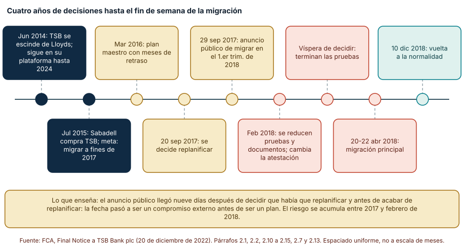

**Cómo leer la figura.** Los hitos se espacian de forma uniforme (no a escala) y se alternan arriba y abajo; el color distingue decisiones de partida (azul oscuro), condiciones latentes (dorado), recortes de verificación (coral) y recuperación (verde azulado). Mira el par «replanificar» y «anunciar»: nueve días. **Dónde deja de valer:** no es una escala temporal; las fechas de cada hito son las del Final Notice, y el día exacto de la reducción de pruebas de febrero de 2018 no consta.

| Fecha | Hecho documentado | Fuente |
| --- | --- | --- |
| 16 de diciembre de 2015 | Inicio del periodo relevante de la FCA | FCA, 3.1 |
| 20 de septiembre de 2017 | El banco resuelve replanificar el programa | FCA, 2.11 |
| 29 de septiembre de 2017 (nueve días después) | Anuncia públicamente que migrará en el primer trimestre de 2018, antes de terminar de replanificar | FCA, 2.11 |
| Abril a noviembre de 2017 | Las revisiones internas detectan deficiencias de gestión de incidentes, consideradas de bajo impacto | FCA, 2.28 |
| Finales de febrero de 2018 | Se reduce el alcance de la prueba activo-activo; cambia la atestación de requisitos no funcionales; se decide no exigir todos los documentos de configuración | FCA, 2.14, 2.15, 2.21 |
| Día anterior a la decisión | Terminan las pruebas | FCA, 2.13 |

### De la migración al regreso a la normalidad

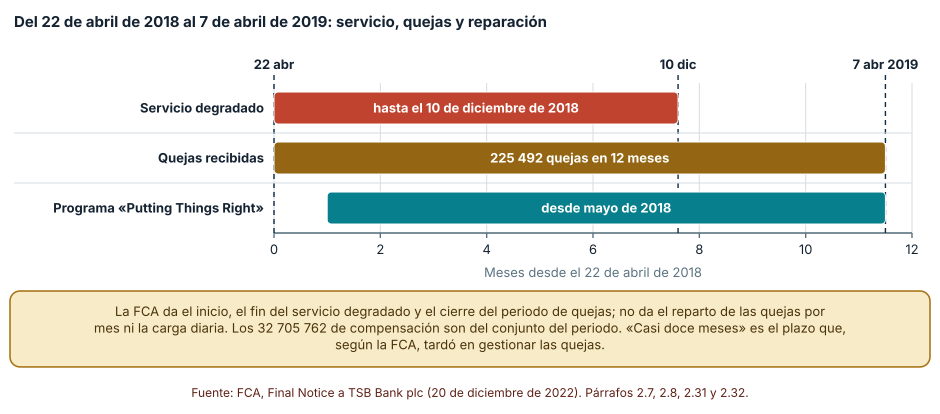

**Cómo leer la figura.** Cada fila es un hilo desde el 22 de abril de 2018; las líneas discontinuas marcan el inicio, el 10 de diciembre y el cierre del periodo de quejas. Mira que las quejas se alargan unos cuatro meses después de que el servicio vuelve. **Dónde deja de valer:** los tramos son la ventana de los hechos, no una serie diaria; la FCA no da el reparto por mes.

| Fecha | Hecho documentado | Fuente |
| --- | --- | --- |
| 20 a 22 de abril de 2018 | Migración principal | FCA, 2.5 |
| Primera semana | Servicios al cliente interrumpidos de forma extensa, con problemas en los días y semanas siguientes | FCA, 2.7 |
| 24 de abril de 2018 | Mensaje de que nadie «quedará con pérdidas» | FCA, 2.32 |
| Mayo de 2018 | Programa «Putting Things Right» | FCA, 2.32 |
| 10 de diciembre de 2018 | Vuelta a la normalidad operativa | FCA, 2.7 |
| 7 de abril de 2019 | Fin del periodo en que se cuentan 225 492 quejas | FCA, 2.8 |
| 19 de noviembre de 2019 | Publicación de la revisión independiente | TSB, 2019 |
| 20 de diciembre de 2022 | Final Notice y sanción | FCA, Final Notice |

**No consta:** las horas de cada fallo durante el fin de semana, cuántas personas estuvieron sin acceso y durante cuánto tiempo cada una, y el calendario exacto de los arreglos.

## Qué falló en cada instancia

Instancia por instancia, qué se esperaba y qué ocurrió, según las fuentes.

- **Causas técnicas directas.** «Problemas con la configuración informática, la capacidad y el código» (FCA, 2.9). Un problema de configuración de ciertos componentes de los centros de datos causó la falta de disponibilidad de la banca por internet y móvil durante periodos posteriores a la migración (FCA, 2.14).
- **Planificación.** Plan maestro «insuficientemente de izquierda a derecha»; plan de reajuste («Defender Plan») también; se cumplió la fecha aplazando funcionalidad o poniendo soluciones manuales (FCA, 2.10 a 2.12).
- **Pruebas.** Las fases de prueba no siguieron los plazos del plan; algunas corrieron en paralelo o cambiaron de alcance; concluyeron el día antes de la decisión (FCA, 2.13). Se redujo una prueba no funcional clave y no se identificaron ni informaron los riesgos de no hacerla (FCA, 2.14).
- **Gobierno de pruebas.** Cambio en febrero de 2018 de quién atestigua los requisitos no funcionales sin llamar explícitamente la atención del consejo (FCA, 2.15).
- **Riesgos y externalización.** Sin evaluación formal y completa de la capacidad de SABIS al inicio ni después; riesgos de incumplimiento del proveedor no identificados; dependencia de 85 terceros sin visibilidad suficiente; confirmaciones de terceros críticos aceptadas parcialmente (FCA, 2.16 a 2.25).
- **Continuidad y crisis.** Sin vuelta atrás; planes de incidentes pensados para 48 horas y ejercicios de pocos días; sin estrategia de comunicación a clientes ni de ampliación de recursos para quejas; casi 12 meses para gestionar las quejas (FCA, 2.26 a 2.31).

- **Configuración e infraestructura.** Se esperaba que los dos centros de datos fueran equivalentes; ocurrió que un problema de configuración de ciertos componentes causó indisponibilidad de internet y móvil, y la prueba que habría podido detectarlo se había reducido (FCA, 2.14; TSB, 2019).
- **Capacidad.** Se esperaba que la plataforma soportara el volumen de uso; la FCA cita problemas de capacidad entre las causas directas (FCA, 2.9). El volumen de llamadas superó la capacidad de telefonía (FCA, 2.31).
- **Documentación.** Se esperaba verificar que la infraestructura se construyó según el diseño; la documentación de configuración no lo permitía, y en febrero se decidió no exigirla toda (FCA, 2.21). Eso, además, dificulta la gestión de incidentes.
- **Gobierno de la decisión.** Las limitaciones de las revisiones y el cambio de atestación no se señalaron con claridad al consejo (FCA, 2.15, 2.17); la carta del proveedor y las confirmaciones eran de intención (FCA, 2.24, 2.25).
- **Proveedor.** Sin diligencia formal al inicio, sin reevaluación tras los primeros problemas, sin visibilidad suficiente de los 85 terceros (FCA, 2.19 a 2.23).
- **Continuidad.** Planes y ensayos pensados para pocos días cuando los incidentes duraron semanas; sin retorno; sin plan de escalado de quejas ni de atención a clientes vulnerables (FCA, 2.26 a 2.31).
- **Mensajes externos.** La FCA recoge que el mensaje de «nadie quedará con pérdidas» fue una promesa pública seguida de un programa de remediación (FCA, 2.32).

## Causa raíz y factores

**Detonante (documentado).** Los problemas técnicos directos fueron de configuración, capacidad y código; en concreto, un problema de configuración de ciertos componentes de los centros de datos causó la falta de disponibilidad de la banca por internet y móvil tras la migración (FCA, 2.9 y 2.14).

**Condiciones latentes (documentado).** Un plan maestro «insuficientemente de izquierda a derecha» y un replanteo igual; pruebas comprimidas o en paralelo, terminadas el día antes de decidir; una prueba no funcional reducida en febrero de 2018 fuera del foro de gobierno adecuado; sin evaluación formal de la capacidad del proveedor ni de sus 85 terceros; documentación de diseño sustituida por documentos de configuración; sin vuelta atrás; planes de continuidad pensados para 48 horas (FCA, 2.10 a 2.31).

**Factores de contexto (documentado).** Una migración de escala sin precedente y ambiciosa para una plataforma nueva en el Reino Unido; Sabadell con experiencia limitada en el mercado británico; un proveedor sin experiencia gestionando muchos subcontratistas del Reino Unido; una fecha conocida públicamente (FCA, 2.2, 2.3, 2.10 y 2.16).

**Inferido (análisis propio).** El patrón es de **presión de fecha convertida en recorte de verificación**, el mismo que en [HealthCare.gov](healthcare-gov.md), con un agravante propio: la irreversibilidad. Con migración en un solo evento y sin retorno, el costo de un error de verificación es máximo. La FCA recoge que, en opinión de TSB, el banco no habría decidido proceder si hubiera considerado posible un incidente de esa escala (FCA, 2.26); este análisis añade que el regulador sí encontró que las preparaciones no estaban a la altura de ese escenario.

**No se sabe (por las fuentes consultadas).** Cuántas personas estuvieron exactamente sin acceso y durante cuánto tiempo cada una; el costo interno total para TSB; el reparto de causas dentro del informe de Slaughter and May, cuyo texto no se pudo extraer.

**Cómo leer la figura.** Arriba, el servicio degradado; la puerta «Y» exige las tres ramas; dentro de A y C basta una de sus causas («O») y en B se combinan («Y»). **Dónde deja de valer:** la estructura es análisis propio; los hechos de cada hoja son de la FCA. Las ramas no son independientes (la fecha pública presiona las pruebas).

**Cadena causal ordenada (análisis propio, apoyado en el Final Notice).**

1. Una estrategia de adquisición que valora la migración de plataforma y una meta de fecha pública (contexto, 2015 a 2017).
2. Un plan maestro con retraso desde el inicio y un replan con el mismo defecto de secuencia (condición latente de planificación).
3. Un proveedor sin diligencia formal inicial y con 85 subcontratistas sin visibilidad (condición latente de externalización).
4. Una documentación de diseño sustituida por configuración, y pruebas comprimidas o en paralelo (condiciones latentes de calidad).
5. Una prueba no funcional clave reducida fuera del foro de gobierno, y un cambio de atestación sin señalar al consejo (condición latente de gobierno).
6. Un consejo que decide con evidencia matizada y con una carta de intención (decisión).
7. Una migración sin retorno, con planes de continuidad pensados para 48 horas (condición latente de resiliencia).
8. Problemas de configuración, capacidad y código que dejan al cliente sin canales por meses (detonante y consecuencia).

### Documentado, inferido y no se sabe

| Categoría | Contenido |
| --- | --- |
| Documentado | Las causas técnicas directas (configuración, capacidad, código); la meta de fecha pública y el anuncio a nueve días de decidir replanificar; la reducción de la prueba activo-activo; la documentación de configuración; la falta de diligencia formal sobre SABIS; los planes de 48 horas; las cifras de quejas y compensación; las sanciones |
| Inferido (análisis propio) | Que la presión de la fecha pública se tradujo en recortes de verificación; que la irreversibilidad es el agravante; que las ramas del árbol no eran independientes; que el patrón es comparable al de HealthCare.gov |
| No se sabe | El reparto de causas dentro del informe de Slaughter and May (PDF escaneado de unas 260 páginas, no se extrajo su texto); los detalles técnicos de la configuración; cuántas personas quedaron sin acceso y cuánto tiempo; el coste interno total; las «brechas de datos» concretas |

## Mejoras que debieron hacerse

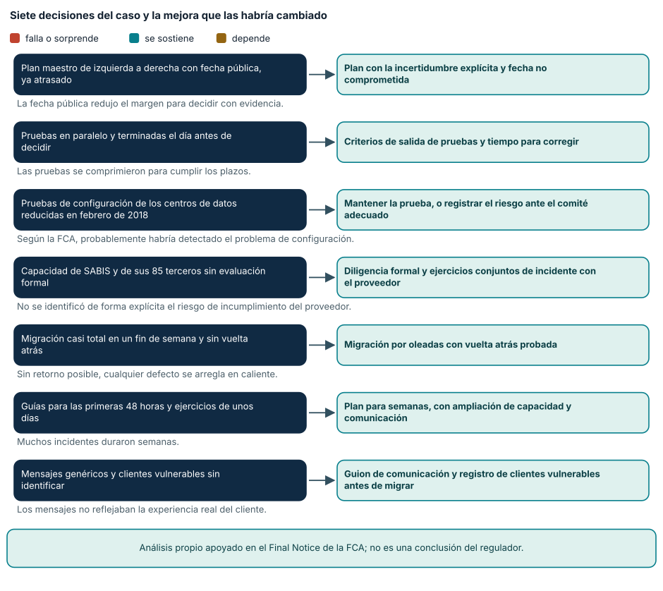

**Cómo leer la figura.** Cada tarjeta tiene a la izquierda una decisión documentada, a la derecha la mejora propuesta y debajo la razón. En esta figura el verde marca la mejora propuesta; la leyenda de colores de la parte superior es genérica de las tarjetas y aquí no clasifica veredictos. **Dónde deja de valer:** son propuestas didácticas; migrar por oleadas tiene un costo propio de coexistencia y datos duplicados que no se evalúa aquí.

| Área | Mejora | Qué enseña el curso |
| --- | --- | --- |
| Migración | Por oleadas con **vuelta atrás probada**; doble escritura o coexistencia mientras se verifica | SE-437, SE-439, SE-440, SE-444 |
| Datos | Ensayos de migración con datos reales y reconciliación; migraciones compatibles | SE-318, SE-321, SE-439 |
| Pruebas | Criterios de salida; no recortar la prueba de carga ni de configuración | SE-361, SE-375, SE-364 |
| Planificación | Estimaciones con rango y supuestos; no anunciar fecha antes de replanificar | SE-185, SE-191, SE-449 |
| Proveedores | Diligencia formal del proveedor y de sus subcontratistas; ejercicios conjuntos de incidente | SE-451, SE-452 |
| Continuidad | Planes para semanas, no horas; ejercicios que incluyan al proveedor | SE-430, SE-427 |
| Incidentes y clientes | Comunicación proactiva; ampliar capacidad de contacto y gestión de quejas | SE-428, SE-429 |
| Gobierno | Decisiones reversibles frente a irreversibles; atestación de requisitos con el consejo informado | SE-142, SE-450 |

Todo lo que sigue, incluidos costos y trade-offs, es **análisis propio apoyado en el Final Notice**: no son conclusiones de la FCA ni descripciones de lo que TSB adoptó.

### Para cada factor: control técnico, de proceso y de gobierno

| Factor causal | Control técnico | Control de proceso | Control de gobierno | Costo y trade-off | Clases |
| --- | --- | --- | --- | --- | --- |
| Migración de una vez, sin vuelta | Capa de enrutamiento con migración por oleadas de clientes y plataforma anterior viva durante el periodo | Ensayo de la vuelta atrás con datos reales antes de cada oleada | Regla de que una decisión irreversible exige evidencia de peldaño superior | Coexistencia, doble escritura y datos duplicados; más duración del proyecto | [SE-437 · Strangler, branch by abstraction y anticorruption](../../classes/part-36-mantenimiento-y-modernizacion-legacy/se-437-strangler-branch-by-abstraction-y-anticorruption/README.md), [SE-439 · Migraciones de datos sin interrupción](../../classes/part-36-mantenimiento-y-modernizacion-legacy/se-439-migraciones-de-datos-sin-interrupcion/README.md), [SE-440 · Compatibilidad, coexistencia y doble escritura](../../classes/part-36-mantenimiento-y-modernizacion-legacy/se-440-compatibilidad-coexistencia-y-doble-escritura/README.md), [SE-444 · Proyecto: migración incremental reversible](../../classes/part-36-mantenimiento-y-modernizacion-legacy/se-444-proyecto-migracion-incremental-reversible/README.md) |
| Datos | Reconciliación automática entre origen y destino y ensayos con copias de producción | Ensayos de migración repetidos con criterios de aceptación | Informe de reconciliación firmado antes de cada oleada | Tiempo y coste de entornos con datos reales y de privacidad | [SE-318 · Migraciones compatibles y evolución de esquema](../../classes/part-26-datos-persistencia-y-recuperacion/se-318-migraciones-compatibles-y-evolucion-de-esquema/README.md), [SE-321 · Backups, restauración y pruebas de recuperación](../../classes/part-26-datos-persistencia-y-recuperacion/se-321-backups-restauracion-y-pruebas-de-recuperacion/README.md), [SE-439 · Migraciones de datos sin interrupción](../../classes/part-36-mantenimiento-y-modernizacion-legacy/se-439-migraciones-de-datos-sin-interrupcion/README.md) |
| Pruebas recortadas | Pruebas de carga al doble y de activo-activo con corte de un centro en vivo | Criterios de aprobación fijados antes; cambio de alcance solo en el foro de gobierno | El consejo ve qué pruebas se redujeron y su riesgo | Probar activo-activo en servicios vivos tiene riesgo propio y requiere ventanas | [SE-361 · Calidad por riesgo y propósito de las pruebas](../../classes/part-30-estrategia-y-tecnicas-de-prueba/se-361-calidad-por-riesgo-y-proposito-de-las-pruebas/README.md), [SE-375 · Carga, estrés, picos y endurance](../../classes/part-31-calidad-rendimiento-y-resiliencia/se-375-carga-estres-picos-y-endurance/README.md), [SE-364 · End-to-end, aceptación y recorridos críticos](../../classes/part-30-estrategia-y-tecnicas-de-prueba/se-364-end-to-end-aceptacion-y-recorridos-criticos/README.md) |
| Fecha pública | Plan con rango y supuestos explícitos | No anunciar antes de terminar de replanificar | Comunicación externa condicionada a evidencia interna | Costo de reputación si se retrasa; hay que prepararlo | [SE-185 · Estimación por tamaño, rango y evidencia histórica](../../classes/part-15-procesos-planificacion-y-estimacion/se-185-estimacion-por-tamano-rango-y-evidencia-historica/README.md), [SE-191 · Taller: planificar bajo incertidumbre explícita](../../classes/part-15-procesos-planificacion-y-estimacion/se-191-taller-planificar-bajo-incertidumbre-explicita/README.md), [SE-449 · Estimación organizacional y compromisos](../../classes/part-37-gestion-liderazgo-y-practica-profesional/se-449-estimacion-organizacional-y-compromisos/README.md) |
| Proveedor y subcontratistas | Telemetría compartida y contrato con indicadores objetivos | Diligencia formal al inicio y reevaluación tras cada hito; ejercicios conjuntos de incidente | Una función con autoridad sobre el riesgo del proveedor | Más coste de supervisión; el proveedor puede resistirse | [SE-451 · Compras, proveedores y evaluación técnica](../../classes/part-37-gestion-liderazgo-y-practica-profesional/se-451-compras-proveedores-y-evaluacion-tecnica/README.md), [SE-452 · Propiedad intelectual, contratos y ética](../../classes/part-37-gestion-liderazgo-y-practica-profesional/se-452-propiedad-intelectual-contratos-y-etica/README.md), [SE-333 · Anti-corruption layers y traducción de modelos](../../classes/part-27-integracion-eventos-y-mensajeria/se-333-anti-corruption-layers-y-traduccion-de-modelos/README.md) |
| Documentación de diseño | Infraestructura como código con verificación de conformidad con el diseño | Exigir diseño, no solo configuración; revisión de conformidad | Excepciones documentadas y aprobadas | Esfuerzo de documentación; riesgo de que se desactualice | [SE-354 · Infraestructura como código y estado](../../classes/part-29-cloud-plataforma-e-infraestructura/se-354-infraestructura-como-codigo-y-estado/README.md), [SE-302 · Vistas lógica, runtime, datos y despliegue](../../classes/part-25-arquitectura-de-software-y-dominio/se-302-vistas-logica-runtime-datos-y-despliegue/README.md), [SE-309 · Trade-offs, ADR y evaluación de alternativas](../../classes/part-25-arquitectura-de-software-y-dominio/se-309-trade-offs-adr-y-evaluacion-de-alternativas/README.md) |
| Atestación y gobierno de la decisión | Informe automático de estado de pruebas | Atestación cruzada de requisitos no funcionales; límites de cada revisión visibles | Cambios de responsabilidad comunicados al consejo | Más documentación para el consejo | [SE-450 · Gestión de riesgos y decisiones ejecutivas](../../classes/part-37-gestion-liderazgo-y-practica-profesional/se-450-gestion-de-riesgos-y-decisiones-ejecutivas/README.md), [SE-188 · Definition of Ready, Done y aceptación](../../classes/part-15-procesos-planificacion-y-estimacion/se-188-definition-of-ready-done-y-aceptacion/README.md), [SE-411 · Tests, seguridad y políticas como gates](../../classes/part-34-ci-cd-iac-y-platform-engineering/se-411-tests-seguridad-y-politicas-como-gates/README.md) |
| Continuidad | Cuarto de guerra con capacidad de escalado de contacto y quejas | Planes para semanas; ejercicios que incluyan al proveedor | Umbral para declarar crisis y escalar recursos | Mantener capacidad ociosa o contratos de refuerzo | [SE-430 · Continuidad, disaster recovery y ejercicios](../../classes/part-35-observabilidad-sre-e-incidentes/se-430-continuidad-disaster-recovery-y-ejercicios/README.md), [SE-427 · Runbooks, on-call y escalamiento](../../classes/part-35-observabilidad-sre-e-incidentes/se-427-runbooks-on-call-y-escalamiento/README.md), [SE-428 · Gestión de incidentes y comunicación](../../classes/part-35-observabilidad-sre-e-incidentes/se-428-gestion-de-incidentes-y-comunicacion/README.md) |
| Clientes y comunicación | Canal alternativo con estado del servicio | Guiones que reflejen la experiencia real; identificar clientes vulnerables | Compromiso público de reparación con responsable | Coste de atención y de reparación | [SE-428 · Gestión de incidentes y comunicación](../../classes/part-35-observabilidad-sre-e-incidentes/se-428-gestion-de-incidentes-y-comunicacion/README.md), [SE-429 · Postmortems sin culpa y aprendizaje](../../classes/part-35-observabilidad-sre-e-incidentes/se-429-postmortems-sin-culpa-y-aprendizaje/README.md), [SE-172 · Estados vacíos, carga, error y recuperación](../../classes/part-14-experiencia-accesibilidad-e-internacionalizacion/se-172-estados-vacios-carga-error-y-recuperacion/README.md) |

### La arquitectura «después»

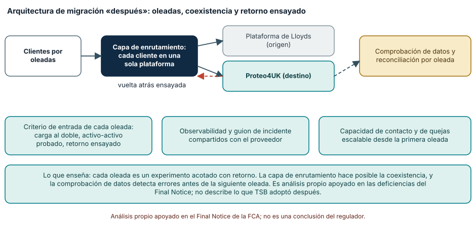

**Cómo leer la figura.** Arriba, el camino de un cliente por oleadas, con la capa de enrutamiento decidiendo en qué plataforma está cada uno; abajo, tres apoyos. La flecha roja es la vuelta atrás. **Dónde deja de valer:** es un diseño didáctico; no considera el coste de mantener dos plataformas ni el de sincronizarlas, que en un banco con tantos productos es alto y debe medirse.

### Diseñar la barrera de decisión

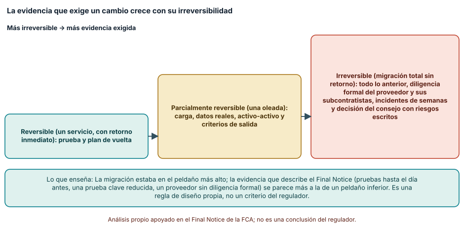

**Cómo leer la figura.** Cada peldaño es un tipo de cambio según se pueda deshacer; el texto dice la evidencia mínima. Mira que el peldaño más alto exige todo lo de los anteriores más diligencia del proveedor, incidentes de semanas y decisión del consejo. **Dónde deja de valer:** es una regla de diseño propia, no un criterio del regulador, y los umbrales de cada peldaño se calibran por organización.

Diseño de la barrera, como ejercicio. (a) **Clasifica la decisión:** ¿se puede deshacer en horas, en días o nunca? (b) **Exige evidencia por peldaño:** para «nunca», ensayo completo con datos reales, carga al doble, activo-activo con corte, diligencia formal del proveedor y sus subcontratistas, y un ejercicio de incidente de semanas. (c) **Quién firma:** el consejo, con los riesgos escritos y las pruebas reducidas visibles. (d) **Qué pasa si falta una pieza:** se baja un peldaño, es decir, se reduce el alcance de la migración (oleadas) en vez de aceptar la falta. (e) **Cómo se evita que sea un trámite:** que la decisión «no» haya ocurrido al menos una vez.

## Vínculo con el curso

- [SE-437 · Strangler, branch by abstraction y anticorruption](../../classes/part-36-mantenimiento-y-modernizacion-legacy/se-437-strangler-branch-by-abstraction-y-anticorruption/README.md), [SE-439 · Migraciones de datos sin interrupción](../../classes/part-36-mantenimiento-y-modernizacion-legacy/se-439-migraciones-de-datos-sin-interrupcion/README.md), [SE-440 · Compatibilidad, coexistencia y doble escritura](../../classes/part-36-mantenimiento-y-modernizacion-legacy/se-440-compatibilidad-coexistencia-y-doble-escritura/README.md) y [SE-444 · Migración incremental reversible](../../classes/part-36-mantenimiento-y-modernizacion-legacy/se-444-proyecto-migracion-incremental-reversible/README.md).
- [SE-318 · Migraciones compatibles y evolución de esquema](../../classes/part-26-datos-persistencia-y-recuperacion/se-318-migraciones-compatibles-y-evolucion-de-esquema/README.md) y [SE-321 · Backups, restauración y pruebas de recuperación](../../classes/part-26-datos-persistencia-y-recuperacion/se-321-backups-restauracion-y-pruebas-de-recuperacion/README.md).
- [SE-361 · Calidad por riesgo y propósito de las pruebas](../../classes/part-30-estrategia-y-tecnicas-de-prueba/se-361-calidad-por-riesgo-y-proposito-de-las-pruebas/README.md) y [SE-375 · Carga, estrés, picos y endurance](../../classes/part-31-calidad-rendimiento-y-resiliencia/se-375-carga-estres-picos-y-endurance/README.md).
- [SE-185 · Estimación por tamaño, rango y evidencia histórica](../../classes/part-15-procesos-planificacion-y-estimacion/se-185-estimacion-por-tamano-rango-y-evidencia-historica/README.md) y [SE-449 · Estimación organizacional y compromisos](../../classes/part-37-gestion-liderazgo-y-practica-profesional/se-449-estimacion-organizacional-y-compromisos/README.md).
- [SE-451 · Compras, proveedores y evaluación técnica](../../classes/part-37-gestion-liderazgo-y-practica-profesional/se-451-compras-proveedores-y-evaluacion-tecnica/README.md).
- [SE-430 · Continuidad, disaster recovery y ejercicios](../../classes/part-35-observabilidad-sre-e-incidentes/se-430-continuidad-disaster-recovery-y-ejercicios/README.md) y [SE-428 · Gestión de incidentes y comunicación](../../classes/part-35-observabilidad-sre-e-incidentes/se-428-gestion-de-incidentes-y-comunicacion/README.md).
- [SE-142 · Decisiones reversibles e irreversibles](../../classes/part-11-economia-metricas-y-decisiones-de-producto/se-142-decisiones-reversibles-e-irreversibles/README.md).

Cada fila de la tabla es una clase real; el texto dice qué mecanismo del caso ilustra.

| Concepto | Clase | Cómo lo ilustra el caso |
| --- | --- | --- |
| Strangler y migración incremental | [SE-437 · Strangler, branch by abstraction y anticorruption](../../classes/part-36-mantenimiento-y-modernizacion-legacy/se-437-strangler-branch-by-abstraction-y-anticorruption/README.md) | Migrar por oleadas habría acotado la exposición |
| Migraciones de datos sin interrupción | [SE-439 · Migraciones de datos sin interrupción](../../classes/part-36-mantenimiento-y-modernizacion-legacy/se-439-migraciones-de-datos-sin-interrupcion/README.md) | La ventana de datos del fin de semana único |
| Coexistencia y doble escritura | [SE-440 · Compatibilidad, coexistencia y doble escritura](../../classes/part-36-mantenimiento-y-modernizacion-legacy/se-440-compatibilidad-coexistencia-y-doble-escritura/README.md) | Mantener ambas plataformas mientras se verifica |
| Migración incremental reversible | [SE-444 · Proyecto: migración incremental reversible](../../classes/part-36-mantenimiento-y-modernizacion-legacy/se-444-proyecto-migracion-incremental-reversible/README.md) | La vuelta atrás probada que no existía |
| Economía de reescribir frente a evolucionar | [SE-442 · Economía de reescribir frente a evolucionar](../../classes/part-36-mantenimiento-y-modernizacion-legacy/se-442-economia-de-reescribir-frente-a-evolucionar/README.md) | La lógica de la migración de plataforma como inversión |
| Migraciones compatibles de esquema | [SE-318 · Migraciones compatibles y evolución de esquema](../../classes/part-26-datos-persistencia-y-recuperacion/se-318-migraciones-compatibles-y-evolucion-de-esquema/README.md) | Compatibilidad entre origen y destino |
| Backups, restauración y recuperación | [SE-321 · Backups, restauración y pruebas de recuperación](../../classes/part-26-datos-persistencia-y-recuperacion/se-321-backups-restauracion-y-pruebas-de-recuperacion/README.md) | Un plan de vuelta atrás es un plan de restauración |
| Calidad por riesgo | [SE-361 · Calidad por riesgo y propósito de las pruebas](../../classes/part-30-estrategia-y-tecnicas-de-prueba/se-361-calidad-por-riesgo-y-proposito-de-las-pruebas/README.md) | Qué pruebas se recortan y por qué |
| Carga, estrés y picos | [SE-375 · Carga, estrés, picos y endurance](../../classes/part-31-calidad-rendimiento-y-resiliencia/se-375-carga-estres-picos-y-endurance/README.md) | El volumen de llamadas y de acceso que superó lo planificado |
| End-to-end y recorridos críticos | [SE-364 · End-to-end, aceptación y recorridos críticos](../../classes/part-30-estrategia-y-tecnicas-de-prueba/se-364-end-to-end-aceptacion-y-recorridos-criticos/README.md) | Recorridos críticos de cliente en todos los canales |
| Disponibilidad y recuperación | [SE-380 · Disponibilidad, durabilidad y recuperación](../../classes/part-31-calidad-rendimiento-y-resiliencia/se-380-disponibilidad-durabilidad-y-recuperacion/README.md) | Activo-activo como propiedad que se prueba |
| Estimación con rango | [SE-185 · Estimación por tamaño, rango y evidencia histórica](../../classes/part-15-procesos-planificacion-y-estimacion/se-185-estimacion-por-tamano-rango-y-evidencia-historica/README.md) | El plan con retraso desde el inicio |
| Estimación organizacional y compromisos | [SE-449 · Estimación organizacional y compromisos](../../classes/part-37-gestion-liderazgo-y-practica-profesional/se-449-estimacion-organizacional-y-compromisos/README.md) | Comprometer una fecha pública antes de replanificar |
| Compras y proveedores | [SE-451 · Compras, proveedores y evaluación técnica](../../classes/part-37-gestion-liderazgo-y-practica-profesional/se-451-compras-proveedores-y-evaluacion-tecnica/README.md) | Diligencia formal del proveedor |
| Propiedad intelectual y contratos | [SE-452 · Propiedad intelectual, contratos y ética](../../classes/part-37-gestion-liderazgo-y-practica-profesional/se-452-propiedad-intelectual-contratos-y-etica/README.md) | Contrato de externalización con indicadores objetivos |
| Continuidad y ejercicios | [SE-430 · Continuidad, disaster recovery y ejercicios](../../classes/part-35-observabilidad-sre-e-incidentes/se-430-continuidad-disaster-recovery-y-ejercicios/README.md) | Planes de 48 horas frente a incidentes de semanas |
| Gestión de incidentes y comunicación | [SE-428 · Gestión de incidentes y comunicación](../../classes/part-35-observabilidad-sre-e-incidentes/se-428-gestion-de-incidentes-y-comunicacion/README.md) | Guiones que no reflejaban la experiencia real |
| Decisiones reversibles | [SE-142 · Decisiones reversibles e irreversibles](../../classes/part-11-economia-metricas-y-decisiones-de-producto/se-142-decisiones-reversibles-e-irreversibles/README.md) | Clasificar la decisión por reversibilidad |
| Riesgos y decisiones ejecutivas | [SE-450 · Gestión de riesgos y decisiones ejecutivas](../../classes/part-37-gestion-liderazgo-y-practica-profesional/se-450-gestion-de-riesgos-y-decisiones-ejecutivas/README.md) | Qué ve el consejo cuando decide |

### Preguntas de discusión

1. La FCA y el banco coinciden en las causas técnicas y difieren en el peso de la gobernanza. ¿Qué evidencia permitiría decidir entre ambos relatos?
2. ¿Por qué un servicio ya migrado con éxito es una evidencia débil para el evento mayor? ¿Qué variables cambian (complejidad, cadena de proveedores, volumen)?
3. Si la fecha es pública, ¿cómo se protege el consejo de la presión de cumplirla? ¿Qué mecanismo de «salida con dignidad» se puede preparar de antemano?
4. ¿Qué se pierde con un cambio de atestación de requisitos no funcionales que no se comunica? ¿Cómo se diseña un cambio de responsabilidad para que sea visible?
5. Con una plataforma anterior viva y rutas por cliente, ¿qué problemas nuevos aparecen (conciliación, reportes, atención al cliente)?

### Mini-ejercicios

1. **Plan de oleadas.** Divide una base de 5 millones de clientes en oleadas, define el tamaño de la primera, su criterio de éxito y el de parada, y estima cuántos clientes se exponen al primer error.
2. **Vuelta atrás.** Escribe el procedimiento de retorno de una oleada: qué datos se reconcilian, quién decide y en cuánto tiempo, y cómo se ensaya.
3. **Prueba activo-activo.** Diseña una prueba que corte un centro de datos en un entorno de ensayo y mida la disponibilidad de los canales digitales; define cuándo se hace en producción.
4. **Carta de preparación.** Reescribe una carta de preparación de un proveedor para que contenga hechos verificables (pruebas hechas, con resultado) y no intenciones.

## Qué no generalizar

**Aprender.**

1. Una migración sin vuelta atrás exige evidencia proporcional a esa irreversibilidad; decide la reversibilidad antes que la fecha.
2. Una fecha pública es una restricción de gobierno: debe replantearse con datos, no mantenerse por haberla anunciado.
3. Las pruebas que terminan el día antes de la decisión no informan la decisión.
4. Externalizar la ejecución no externaliza el riesgo: el banco sigue respondiendo ante sus clientes y reguladores.
5. Un incidente se mide en semanas; planifica canales, capacidad y comunicación para ese plazo.
6. La fuga de carga entre canales es un fallo de diseño, no de operación.

**No generalizar.**

- No prueba que las migraciones grandes deban evitarse ni que el reemplazo de plataforma sea mala idea; prueba que esta se ejecutó con riesgos mal gestionados.
- No prueba que Proteo o Sabadell sean tecnologías defectuosas: el regulador habla de configuración, capacidad y código de esta implantación.
- La sanción es de 2022 y se refiere a Principios de la FCA y de la PRA aplicables a esa entidad; no es una regla universal.
- No se atribuyen intenciones ni culpas a personas.

### Casos comparables y diferencias

| Caso | Parecido | Diferencia |
| --- | --- | --- |
| [HealthCare.gov](healthcare-gov.md) | Fecha comprometida, pruebas comprimidas, decisión de lanzar con riesgos conocidos | Aquí había un sistema anterior que se perdió y no había capacidad de volver |
| [Knight Capital](knight-capital.md) | Un despliegue sin verificar versión por nodo y sin guion de incidente | Allí un solo servidor; aquí una migración completa de un banco |
| [GitLab 2017](gitlab-2017.md) | Procedimientos de recuperación sin ensayar | Allí el daño fue de datos de una plataforma; aquí, de canales de clientes |
| [CrowdStrike](crowdstrike.md) | Dependencia de un proveedor con cambios que llegan a todos a la vez | Allí un cambio de contenido; aquí, un proyecto de años |

**Reacción regulatoria.** El caso termina en una sanción conjunta de la FCA y la PRA por fallos de resiliencia operativa. El Final Notice no se pronuncia sobre qué debía hacer el sector y este caso no extrapola una norma general.

## Fuentes públicas verificadas

Todas consultadas el 16 de noviembre de 2026 y comprobadas con descarga directa (HTTP 200).

1. Financial Conduct Authority, *Final Notice* a TSB Bank plc, referencia 191240, 20 de diciembre de 2022. [https://www.fca.org.uk/publication/final-notices/tsb-bank-plc-2022.pdf](https://www.fca.org.uk/publication/final-notices/tsb-bank-plc-2022.pdf). Respalda todos los hechos marcados «FCA, n».
2. FCA y PRA, comunicado conjunto *TSB fined £48.65m for operational resilience failings*, 20 de diciembre de 2022. [https://www.fca.org.uk/news/press-releases/tsb-fined-ps4865m-operational-resilience-failings](https://www.fca.org.uk/news/press-releases/tsb-fined-ps4865m-operational-resilience-failings). Respalda: 5,2 millones de clientes, todas las sucursales afectadas, 18,9 millones de la PRA y el total de 48,65.
3. TSB, *TSB Board publishes independent review of 2018 IT Migration*, 19 de noviembre de 2019. [https://www.tsb.co.uk/news-releases/slaughter-and-may/](https://www.tsb.co.uk/news-releases/slaughter-and-may/). Respalda la publicación del informe de Slaughter and May y el desacuerdo parcial del consejo.
4. Slaughter and May, informe del *Independent Review* (PDF publicado por TSB). [https://www.tsb.co.uk/content/dam/tsb-public/documents/media-centre/Slaughter-and-May-final-report.pdf](https://www.tsb.co.uk/content/dam/tsb-public/documents/media-centre/Slaughter-and-May-final-report.pdf). Descargable (HTTP 200) pero escaneado: no se extrajeron citas de él.
5. Slaughter and May, página sobre la revisión independiente de la migración de TSB. [https://slaughterandmay.com/news/slaughter-and-may-s-independent-review-of-tsb-s-2018-migration-to-a-new-it-platform](https://slaughterandmay.com/news/slaughter-and-may-s-independent-review-of-tsb-s-2018-migration-to-a-new-it-platform). Respalda: que el informe se publicó el 19 de noviembre de 2019.

---

[↑ Casos de fallo](README.md) · [← HealthCare.gov](healthcare-gov.md) · [Caída global de Meta →](meta-2021.md)
